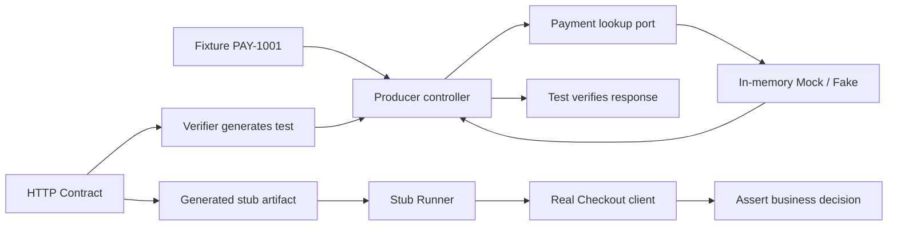
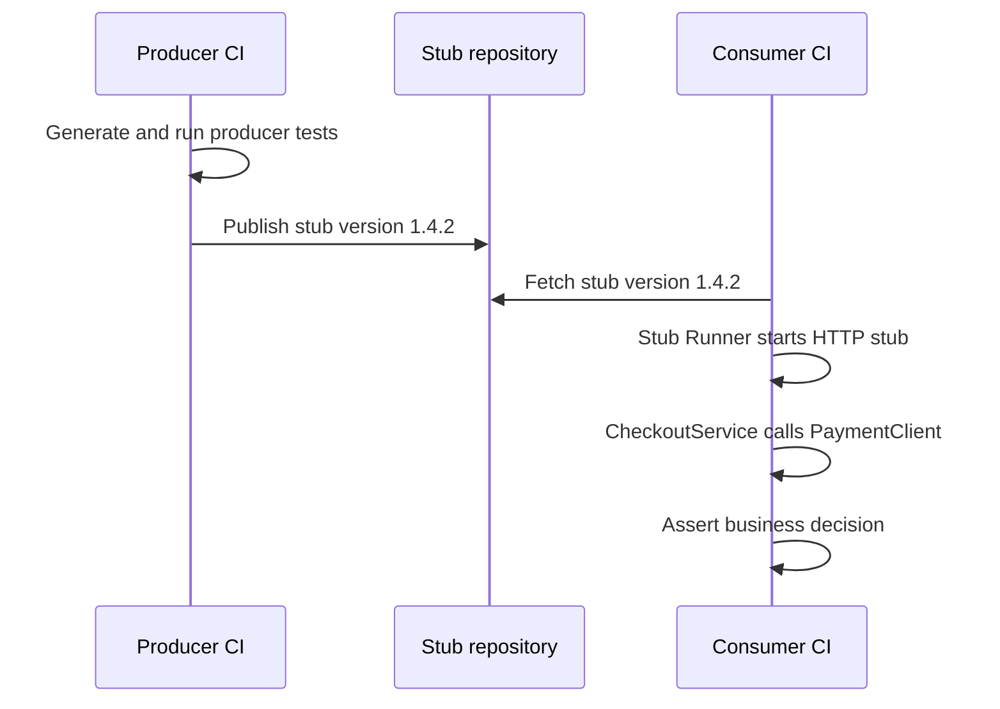
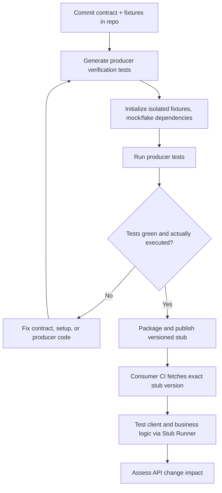

# Keeping Fixtures Independent of Databases or External Services

## 1. Why Do Fixtures Need Independence?

Suppose `checkout-service` (consumer) calls `payment-service` (producer) to look up payment status before confirming an order. Today, the test passes because a shared database happens to have record `PAY-1001` in state `PAID`. Tomorrow, another job updates that record to `REFUNDED` and the exact same test fails, even though the API code did not change. Another time, tests hang because a mocked bank service in an integration environment stops responding.

This is an issue of **fixtures and test dependency boundaries**: outcomes depend on data and systems the test does not control. In **Spring Cloud Contract**, contracts describe how the producer must respond to requests or emit messages; the tooling generates producer verification tests, builds stubs for the consumer via **Stub Runner**, and integrates into CI to catch incompatible API changes. If fixtures are unstable, those benefits erode quickly.

A **fixture** is the set of state, objects, and input data arranged so a test can run and verify behavior. It may include a sample payment, an order, a bank gateway response, a fixed timestamp, or a queued event. A fixture **differs from a contract**: the contract states *what both sides commit to*; the fixture prepares *concrete preconditions to test that commitment*.

Lesson objectives:

- Create business-meaningful fixtures without depending on pre-existing rows in a shared database.
- Isolate the producer API from external services during producer verification when appropriate.
- Use test doubles, in-memory repositories, mocks, or stubs while still exercising the **real producer HTTP path**.
- Separate contract tests from integration tests requiring real databases, brokers, or infrastructure.
- Set up version-pinned consumer stubs that run reproducibly on developer machines and in CI.

**Independence** here does not mean never using a database. It means tests **control and reproduce their own required state**; if a real database is needed, it must be provisioned separately, seeded explicitly, and cleaned up. Tests must never implicitly depend on production data, staging environments, or mutable external services.

## 2. Distinguishing Contracts, Fixtures, Mocks, Fakes, and Stubs

| Concept | Role in testing | Example |
| --- | --- | --- |
| **Contract** | Defines requests/responses or messages that must be supported. | `GET /api/payments/PAY-1001` returns `200` with `status: PAID`. |
| **Fixture** | Establishes precondition data state for a deterministic scenario. | Transaction `PAY-1001` linked to `ORD-2001`, amount `250000 VND`. |
| **Mock** | Object simulating behavior/calls as configured in test; can verify interactions. | Mockito returns a `PaymentView` when controller calls `PaymentQuery.findById(...)`. |
| **Fake** | Lightweight working implementation, typically in memory. | `InMemoryPaymentRepository` stores payments in a `Map`. |
| **Stub** | Returns canned results when matching inputs arrive. | Stub Runner starts a WireMock stub from the contract, returning `PAID` JSON when consumer calls the API. |
| **Producer verification** | Runs contract-generated tests on the producer to confirm the app honors its commitments. | Calls `PaymentController` and asserts status, headers, and body. |
| **Consumer test** | Verifies consumer client/logic when talking to a stub. | Checkout confirms the order only if the client receives `PAID`. |

Note that **producer fixtures** and **consumer stubs** sit on opposite sides. Producer tests must run against producer code and check its responses; consumer tests can use the producer's stub instead of the live service. Never see a stub return the right JSON and conclude the producer has been verified.

## 3. A Payment Scenario as a Running Example

Both teams agree:

```http
GET /api/payments/PAY-1001 HTTP/1.1
Accept: application/json
```

The response must be:

```http
HTTP/1.1 200 OK
Content-Type: application/json

{
  "paymentId": "PAY-1001",
  "orderId": "ORD-2001",
  "status": "PAID",
  "amount": 250000,
  "currency": "VND"
}
```

These values are chosen deliberately: `PAY-1001` belongs to `ORD-2001`; `status = PAID` allows order confirmation; `amount = 250000` only makes sense paired with `currency = VND`. They are synthetic data containing no real customer info.

Boundary diagram:



In the **producer verification** branch, the controller, routing, HTTP status, and JSON serialization remain real producer code. Only the data-lookup port is swapped for an independent mock/fake. In the **consumer** branch, Stub Runner replaces calls to real Payment, while Checkout's client and logic still run.

## 4. Describing the Contract in Groovy DSL

Example contract file on the `payment-service` side:

```groovy
import org.springframework.cloud.contract.spec.Contract

Contract.make {
    name 'get_paid_payment'
    description 'Look up a paid payment transaction to confirm order'

    request {
        method 'GET'
        urlPath '/api/payments/PAY-1001'
        headers {
            header 'Accept': 'application/json'
        }
    }

    response {
        status 200
        headers {
            contentType(applicationJson())
        }
        body([
            paymentId: 'PAY-1001',
            orderId: 'ORD-2001',
            status: 'PAID',
            amount: 250000,
            currency: 'VND'
        ])
    }
}
```

The contract only describes the interaction. **It does not create record `PAY-1001` in a database**, generate a `PaymentView` inside the controller, or start a mock bank. That belongs to the test/fixture setup layer.

With **YAML DSL**, the equivalent content is:

```yaml
description: Look up a paid payment transaction to confirm order
name: get_paid_payment
request:
  method: GET
  urlPath: /api/payments/PAY-1001
  headers:
    Accept: application/json
response:
  status: 200
  headers:
    Content-Type: application/json
  body:
    paymentId: PAY-1001
    orderId: ORD-2001
    status: PAID
    amount: 250000
    currency: VND
```

These two snippets are **two representations of the same scenario**; choose one file as the source of truth. The examples below assume the Groovy version was chosen. Fixture independence **does not depend** on whether the contract is written in Groovy or YAML.

## 5. Producer Verification Without a Live External Database

### 5.1. Drawing the boundary at a port

Suppose the Payment controller depends on a `PaymentQuery` interface. In production, this interface is implemented by a JPA/database adapter. During contract tests, swap that adapter for a mock or fake.

```java
// Types in this example are illustrative application code.
public interface PaymentQuery {
    PaymentView findById(String paymentId);
}
```

An illustrative data type:

```java
public record PaymentView(
    String paymentId,
    String orderId,
    String status,
    long amount,
    String currency
) {}
```

The producer app has a controller handling requests:

```java
@RestController
@RequestMapping("/api/payments")
class PaymentController {
    private final PaymentQuery paymentQuery;

    PaymentController(PaymentQuery paymentQuery) {
        this.paymentQuery = paymentQuery;
    }

    @GetMapping("/{id}")
    PaymentView getPayment(@PathVariable String id) {
        return paymentQuery.findById(id);
    }
}
```

This code is **minimal for illustration**: a real controller must handle `404`, authorization errors, validation, etc., per the agreed API. Isolating the read interface lets tests rely on stable behavior without contacting a real database.

### 5.2. Base test class with Mockito and RestAssuredMockMvc

Spring Cloud Contract Verifier is typically configured with a **base class** for generated producer verification tests. With JUnit 5, Spring MVC, and MockMvc mode, one way to isolate the controller is:

```java
package com.example.payment.contract;

import io.restassured.module.mockmvc.RestAssuredMockMvc;
import org.junit.jupiter.api.BeforeEach;
import org.mockito.Mockito;

public abstract class ContractBase {

    @BeforeEach
    void setupPaymentFixture() {
        PaymentQuery query = Mockito.mock(PaymentQuery.class);

        Mockito.when(query.findById("PAY-1001")).thenReturn(
            new PaymentView(
                "PAY-1001", "ORD-2001", "PAID", 250000L, "VND"
            )
        );

        RestAssuredMockMvc.standaloneSetup(
            new PaymentController(query)
        );
    }
}
```

This assumes `PaymentQuery`, `PaymentView`, and `PaymentController` are accessible from `ContractBase`'s package; adjust imports or visibility for your project layout. Mockito, RestAssuredMockMvc, JUnit Jupiter, and Spring MVC test libraries must be on the test classpath. This fits when your Spring Cloud Contract version generates HTTP tests via **RestAssuredMockMvc**. If using `WEBTESTCLIENT` or real HTTP mode, configure the base class accordingly.

Benefits:

1. **No database startup needed:** the query is satisfied via Mockito in each test.
2. **No leftover-data dependency:** always returns the exact same `PAY-1001` object.
3. **Still exercises the producer endpoint:** requests travel through controller mapping and MockMvc HTTP handling.
4. **Easy failure diagnosis:** if the producer renames `status` to `state` in JSON, the contract still fails the test.

Limitation to keep in mind: a mock returning a canned `PaymentView` will not catch SQL/JPA query bugs or how the adapter stores and reads data. **That is the job of integration tests** in a separate test layer. Nor does this contract test guarantee that beans/filters outside `standaloneSetup` are exercised. When contracts depend on security filters, message converters, exception handlers, or real Spring configuration, choose an appropriate test context instead of bypassing them.

### 5.3. Using Spring context when more real components are needed

Another approach is booting Spring TestContext using `@SpringBootTest`/`@AutoConfigureMockMvc` and replacing **boundary beans** with test-scoped mocks. Mock-bean annotations have evolved across Spring Boot/Spring Framework generations (e.g., `@MockBean` in older projects and `@MockitoBean` in newer ones); use the right one for your version rather than mixing arbitrarily. With a full test context, also check auto-configuration: a datasource may still initialize even if repositories are mocked unless profiles or test settings disable it.

This is a trade-off between **breadth of real code tested** and **isolation**:

| Setup approach | What it tests well | What to watch out for |
| --- | --- | --- |
| `standaloneSetup(controller, ...)` + mock port | Routes/controllers and HTTP responses in minimal setup. | Does not cover full Spring Security, filters, configuration, or database. |
| Spring TestContext + mocked outer boundary beans | More real Spring components alongside controller/serializer. | May still boot external dependencies; requires tight test-profile config. |
| Full app + dedicated test database | Controller, service, repository, and persistence. | Slower; must provision environment, migrate schema, seed, and clean state. |

No single choice is optimal for every application. For contracts covering HTTP shapes, responses/statuses, and a few specific rules, mocking a port is simple and valuable. For contracts truly relying on security, validation, or persistence, a broader test context plus **independent integration tests** increases confidence.

## 6. In-Memory Fixtures: When to Use a Fake Instead of a Mock?

Mockito is convenient when only one or two methods are needed. When business logic creates, updates, and reads multiple transactions in the same scenario, an **in-memory fake repository** can be clearer:

```java
final class InMemoryPaymentRepository {
    private final Map<String, PaymentView> payments =
        new HashMap<>();

    void seed(PaymentView payment) {
        payments.put(payment.paymentId(), payment);
    }

    PaymentView find(String id) {
        return payments.get(id);
    }

    void reset() {
        payments.clear();
    }
}
```

In tests, create a **fresh instance per fixture setup** or call `reset()` at clear lifecycle points. Never store a shared `static Map` across hundreds of parallel tests, as outcomes will become order-dependent.

A fake is not a complete database replacement:

- It may not replicate real database transactions, isolation levels, or unique constraints.
- Its lookup/sorting behavior may differ from real SQL.
- It skips migrations, column types, precision, and connection errors.

Therefore, use fakes to isolate **external contracts**, while keeping dedicated-database integration tests for **adapter correctness**.

## 7. If a Contract Requires a Database, It Must Still Be Independent

Sometimes HTTP behavior cannot be verified reliably without executing real queries or JPA mappings. In such cases, “database independence” means **no dependency on a shared database**, rather than banning all databases.

A safe workflow for test databases:

1. Provision a **test-dedicated** database or schema (e.g., an ephemeral Testcontainers instance), never staging/production.
2. Run required migrations before testing; avoid relying on manually prepared state.
3. Seed fixtures via SQL or builders with **test-controlled identifiers**, such as `PAY-1001`.
4. Ensure explicit commit timing so HTTP requests from another application context can observe seeded data.
5. Clean up data after each test or recreate the environment; never assume tests run sequentially.
6. When running in parallel, use isolated namespaces, schemas, or instances so tests never overwrite each other.

**Sketch of a SQL fixture** in an isolated test database:

```sql
INSERT INTO payments (
    payment_id, order_id, status, amount, currency
) VALUES (
    'PAY-1001', 'ORD-2001', 'PAID', 250000, 'VND'
);
```

This SQL is illustrative; actual schemas must match your migrations and application constraints. If tests re-run, ensure old data is cleaned or setup is idempotent.

**Transaction caveat:** test-method rollbacks do not always roll back changes made by HTTP requests executing on separate threads, connections, or transactions. Understand transaction boundaries in your chosen test mode. Never run `DELETE FROM` or `TRUNCATE` against non-test databases.

## 8. Isolating External Services

A producer may call a payment gateway, tax system, or identity service to build its response. If producer verification calls live endpoints directly, tests become coupled to network, quotas, tokens, third-party data, and response latency.

### 8.1. Choosing the right boundary

Suppose `payment-service` has this flow:

```text
PaymentController
    -> PaymentApplicationService
        -> BankGateway (HTTP to third party)
```

When verifying `PaymentController` HTTP responses, swap `BankGateway` for a test fake/mock that always returns `APPROVED` for a specific payment ID. Producer routing, validation, DTO mapping, and state handling still execute normally.

Scenarios to control:

| Scenario | Fake gateway returns | Producer must respond per contract |
| --- | --- | --- |
| Authorization succeeds | `APPROVED` for `PAY-1001` | `200`/`201` with exact agreed status. |
| Transaction declined | `DECLINED` for `PAY-1002` | Rejection status code and payload matching contract. |
| Gateway timeout | Controlled simulated exception/timeout | API returns error or retries per committed policy. |
| Gateway returns incomplete data | Intentionally malformed payload | Producer mapping/validation handles properly or reports error. |

Never assume `DECLINED` must return HTTP `400` or timeout must return `503`: those are API decisions both sides must agree on in the contract.

### 8.2. When you need to test the producer's HTTP client layer

If you want to verify that the `BankGatewayHttpClient` adapter actually constructs the right HTTP request, use an **in-process stub server** like WireMock/MockWebServer or equivalent tooling to return deterministic responses. Point the client to the test-provisioned localhost/port; never call a live bank.

This is an integration test for an **outbound HTTP adapter**, distinct from a producer contract test checking the **inbound** API. One project can use both, provided test goals and boundaries stay clear so every producer contract test does not accidentally turn into an end-to-end test across all microservices.

### 8.3. Blocking unintended outbound calls

Do not mock only the primary endpoint while letting secondary calls (token services, config, analytics, email, feature flags) leak out to the network. In CI, a well-isolated test should run under a test profile that connects only to test-controlled local dependencies; replace unneeded components with fakes/no-ops and assert zero side effects.

If a test requires real secrets or a shared sandbox bank account to run, that signals the test is no longer externally independent. Tag such tests separately rather than mixing them into the producer verification loop running on every pull request.

## 9. Keeping Consumers Independent of the Real Producer via Stub Runner

The producer generates stubs from verified contracts and publishes a versioned artifact. When testing `checkout-service`, you **do not need to run real `payment-service`**: Stub Runner starts the stub and serves contract responses.

Illustrative Spring Boot test using a specific versioned stub installed in the local Maven repository:

```java
@SpringBootTest(properties = {
    "payment.base-url=http://localhost:6565"
})
@AutoConfigureStubRunner(
    ids = "com.example:payment-service:1.4.2:stubs:6565",
    stubsMode = StubRunnerProperties.StubsMode.LOCAL
)
class CheckoutPaymentClientTest {

    @Autowired
    CheckoutService checkoutService;

    @Test
    void confirmsOrderWhenPaymentIsPaid() {
        assertThat(checkoutService.canConfirm("ORD-2001"))
            .isTrue();
    }
}
```

This snippet is abbreviated; it requires real imports, test dependencies, `CheckoutService`, and application configuration. The test is meaningful only if `CheckoutService` **calls the real `PaymentClient`** configured to point at `localhost:6565` and sends `GET /api/payments/PAY-1001`. If the client hits another path, the stub won't match; fix either code or contract per the true commitment.

`LOCAL` uses the stub artifact already present in the local Maven repository; in CI, `REMOTE` mode with an artifact repository can be used when properly configured. **Pinning version `1.4.2`** makes results reproducible. Choosing a dynamic version like `+` can cause CI to silently pull a different stub than the previous run.

Key relationship:



Producer stubs do not automatically guarantee the client is bug-free: consumer tests must verify response parsing, error-code handling, status mapping, and delivery decisions. Likewise, green consumer tests with stubs **are not a substitute** for producer verification.

## 10. Messaging Also Needs Independent Fixtures

Spring Cloud Contract can describe **messaging** interactions, not just HTTP. Suppose `payment-service` emits a `PaymentCaptured` event and `fulfillment-service` consumes it.

Sample payload:

```json
{
  "eventId": "EVT-1001",
  "eventType": "PaymentCaptured",
  "orderId": "ORD-2001",
  "paymentId": "PAY-1001",
  "amount": 250000,
  "currency": "VND",
  "occurredAt": "2026-01-15T09:00:00Z"
}
```

Fixtures should prepare a captured transaction and a fixed clock; event emission should be tested via a messaging verifier or test binder/in-memory transport depending on your Spring Cloud Contract setup. Never require every pull request to connect to a shared Kafka/RabbitMQ cluster just to verify payload shape.

A **sketch** of a Groovy DSL message contract:

```groovy
import org.springframework.cloud.contract.spec.Contract

Contract.make {
    name 'payment_captured_event'

    input {
        triggeredBy('emitCapturedPayment()')
    }

    outputMessage {
        sentTo('payments.captured')
        body([
            eventId: 'EVT-1001',
            eventType: 'PaymentCaptured',
            orderId: 'ORD-2001',
            paymentId: 'PAY-1001',
            amount: 250000,
            currency: 'VND',
            occurredAt: '2026-01-15T09:00:00Z'
        ])
    }
}
```

This example requires the test base class to define the `emitCapturedPayment()` trigger and configure an appropriate message-sending/receiving mechanism. Having a contract file does not make the verifier automatically launch a broker. If the app uses real Kafka/RabbitMQ in production, still maintain separate integration tests for serializers, routing, partitions, acknowledgments, and retries; an isolated contract fixture does not prove the entire messaging infrastructure.

## 11. Ensuring Fixtures Are Deterministic and Business-Meaningful

Independent fixtures must also be **deterministic**: same scenario, same conditions, repeatable results. Common sources of variance:

| Variance source | Flaky test example | How to control |
| --- | --- | --- |
| **System clock** | `capturedAt = Instant.now()` makes body vary each run. | Inject `Clock.fixed(...)` or constrained timestamp matcher. |
| **Random identifiers** | Generates `UUID.randomUUID()` while contract expects `PAY-1001`. | Seed fixed IDs or use format matcher with stub sample value. |
| **Shared stored data** | Another test flips `PAY-1001` to `REFUNDED`. | Use dedicated mock/fake or isolated database. |
| **Undefined ordering** | DB query lacks `ORDER BY` while test asserts fixed list order. | Assert order only when committed by API; otherwise compare by set/key. |
| **Network & external services** | Slow gateway, expired token, or rate limit. | Replace with controllable in-process fake/stub server. |
| **Shifting stub version** | Consumer CI grabs “latest” on every run. | Pin artifact version and update via reviewed changes. |
| **Shared state between tests** | One test clears a `static Map` another test is reading. | Fresh fixture per test; avoid shared mutable state. |
| **Timezone/locale** | Timestamp strings or number separators vary between Windows/Linux CI. | Standardize on UTC/ISO 8601 and locale-independent formatting. |

Fixed clock example in Java:

```java
Clock fixedClock = Clock.fixed(
    Instant.parse("2026-01-15T09:00:00Z"),
    ZoneOffset.UTC
);
```

Pass `fixedClock` as a dependency to payment or event-creation logic instead of calling `Instant.now()` directly. If business rules check transaction expiration, fixtures must explicitly capture `paidAt`, `expiresAt`, and valid windows rather than arbitrary timestamps.

### Recommended test cases

At a minimum, cover scenarios the consumer actually has to handle:

| Scenario | Stable fixture | Values to verify |
| --- | --- | --- |
| Payment succeeded | `PAY-1001` / `ORD-2001` / `PAID` | HTTP 200, right order, status, amount/currency. |
| Pending payment | `PAY-1002` / `ORD-2002` / `PENDING` | Checkout does not confirm order before payment completes. |
| Not found | No `PAY-9999` in fake/test DB | HTTP 404 and error payload if part of API commitment. |
| External service declined | Fake gateway returns `DECLINED` | Producer/consumer follow agreed decline branch. |
| Controlled timeout | Fake gateway throws deterministic timeout exception | Error reporting/retry per published policy. |

When authoring multiple contracts, do not make one fixture return `PAID` for every ID; doing so can mask bugs where the consumer requests the wrong resource. Each business branch needs dedicated data and a clear rationale for why the response is right.

## 12. Integrating into CI Without Hidden Dependencies

A typical pipeline:



On every pull request, CI should run producer verification **without outbound internet access** or only hitting test-created local endpoints. Real integration tests can run in a separate stage with automatically provisioned databases/brokers. Key checkpoints:

1. Groovy/YAML contract files and fixtures come from the **exact same commit**; never manually copy JSON from a personal machine.
2. Tests are generated and the test runner actually executes them; do not mistake a successful build with **0 tests run** for verification.
3. Test data resets before each test or suite without cross-test interference.
4. Zero unintended calls to production, staging, or third-party accounts during producer verification.
5. Stubs are published **after producer verification passes**, with explicit coordinates and versions.
6. Consumer CI uses that stub, executes real client code, and verifies key success/error branches.
7. When changing paths, JSON fields, status enums, or event schemas, re-run tests for all supported consumers.

To detect hidden dependencies early, try running the producer test suite in a fresh environment with no pre-seeded database, no VPN, and no external service tokens. Tests still need **intentional** prerequisites (JDK, build tool, libraries, dedicated test services), but should never require undocumented state.

## 13. Common Bugs and Fixes

| Symptom | Cause | Fix |
| --- | --- | --- |
| Passes locally, CI says `PAY-1001` not found | Fixture relied on a manual row on dev laptop. | Seed fixture in test or mock lookup port. |
| Passed yesterday, failed today with no code change | Shared staging data, current time, or stub version shifted. | Isolate state, freeze clock, pin stub version. |
| Producer tests require VPN | Calling external service or DB not provisioned by test. | Put fake/stub at outbound boundary; move external integration tests to a separate stage. |
| Contract tests pass yet JPA repository breaks | Mocked repository skipped persistence layer. | Add isolated-DB integration tests; keep contract tests for HTTP commitments. |
| Consumer stub tests pass yet producer is wrong | Running consumer tests against stale stub artifact. | Run producer verification and publish stubs from verified producer builds. |
| Test checks mock returns JSON without calling controller | Test verifies Mockito only, not routing/serialization. | Use generated producer tests through real HTTP layer; mock only outer dependencies. |
| Tests break under parallel runs | Fixture held in static variable or shared schema. | Scope data per test; use isolated instances/schemas or isolation mechanisms. |
| Timeout tests take minutes | Waiting on real network timeouts or `Thread.sleep(...)`. | Fake errors/clock/scheduler with short deterministic timeouts. |
| Event test needs shared Kafka to run | Local test binder/messaging verifier not configured. | Use supported messaging test integration; test real broker in a separate layer. |
| Contract edited yet consumer sees old data | Still pulling previous stub version. | Build and publish new stub; update consumer version via reviewed change. |

### Three design mistakes to avoid

**1. “Mock everything so tests always pass.”** If you mock the controller itself and return canned JSON, tests never verify the producer implementation. Replace only boundaries unneeded for verifying the contract; keep request-handling and response-building code running.

**2. “No DB means no DB tests needed.”** Isolated contract tests excel at catching JSON field or status changes, yet do not verify SQL queries, migrations, or transactions. You still need persistence tests in an isolated DB environment.

**3. “Stub Runner works, so the system is compatible.”** Passing consumer tests with stubs proves only that the consumer handles **the stubbed examples**. You still need passing producer verification on the same contract version, plus appropriate tests for behaviors outside the contract.

## 14. Practice Exercise

The system has `checkout-service`, `payment-service`, PostgreSQL, and a third-party `bank-gateway`. APIs:

```text
GET /api/payments/{paymentId}
POST /api/payments/{paymentId}/capture
```

For `PAY-1001`, Checkout expects a `200` response containing `paymentId: PAY-1001`, `orderId: ORD-2001`, `status: PAID`, `amount: 250000`, and `currency: VND`. The gateway returns `APPROVED` on capture.

**Tasks:**

1. Write a Groovy or YAML contract for `GET /api/payments/PAY-1001`. Choose which fields must be asserted strictly because the consumer genuinely depends on them.
2. Design the `PaymentQuery` interface and `PaymentController`; create a `ContractBase` using Mockito or a fake repository to test GET **without PostgreSQL**.
3. Describe how to mock `BankGateway` for `APPROVED` and `DECLINED` scenarios when testing POST capture. State clearly that expected HTTP codes/payloads must match the agreed contract.
4. Identify which SQL/JPA bugs would go undetected when using mocks and propose an isolated PostgreSQL integration test to cover them.
5. Add scenario `PAY-1002` in `PENDING` state; ensure this scenario's fixture **does not** share mutable data with `PAY-1001`.
6. Build a stub artifact after producer verification passes, and write a consumer test via Stub Runner with a pinned version.
7. Explain how to verify in CI that generated tests actually ran, without real bank-gateway tokens or a staging database.

**Self-check hint:** the solution succeeds when contracts reflect business rules, fixtures regenerate from test sources, producer verification still runs through real controllers, external dependencies are replaced by test-controlled objects, and separate integration tests cover databases/gateways where needed.

## 15. Takeaways

- **Contracts describe commitments; fixtures prepare test preconditions.** They are related yet do not replace each other.
- Producer verification should exercise **real producer code at the API boundary** and isolate databases/external services via mocks, fakes, or dedicated environments when appropriate.
- Never depend on pre-existing staging/production database rows, live endpoints, wall-clock time, or silently shifting stub versions.
- For dynamic data, use fixed clocks, meaningful sample IDs, and tight matchers; avoid shared mutable state across tests.
- **Stub Runner** lets consumers test against published stubs without running the real producer; producer verification must still run to guarantee stubs match what the producer actually implements.
- Integrate contracts, fixtures, test generation, and stubs into **reproducible CI**; reserve real database/broker checks for an integration test layer using dedicated test environments.

### References

- [Spring Cloud Contract Reference](https://docs.spring.io/spring-cloud-contract/reference/): DSL, producer verification, and stubs.
- [Spring Cloud Contract — Developing Your First Application](https://docs.spring.io/spring-cloud-contract/reference/getting-started/first-application.html): setting up contracts and base test classes.
- [Spring Cloud Contract — Stub Runner](https://docs.spring.io/spring-cloud-contract/reference/project-features-stubrunner.html): how consumers use stubs for testing.
- [Spring Testing Framework](https://docs.spring.io/spring-framework/reference/testing.html): MockMvc, Spring TestContext, and test isolation techniques.
- [Testcontainers for Java](https://java.testcontainers.org/): provisioning ephemeral databases/brokers when independent integration tests are needed.
