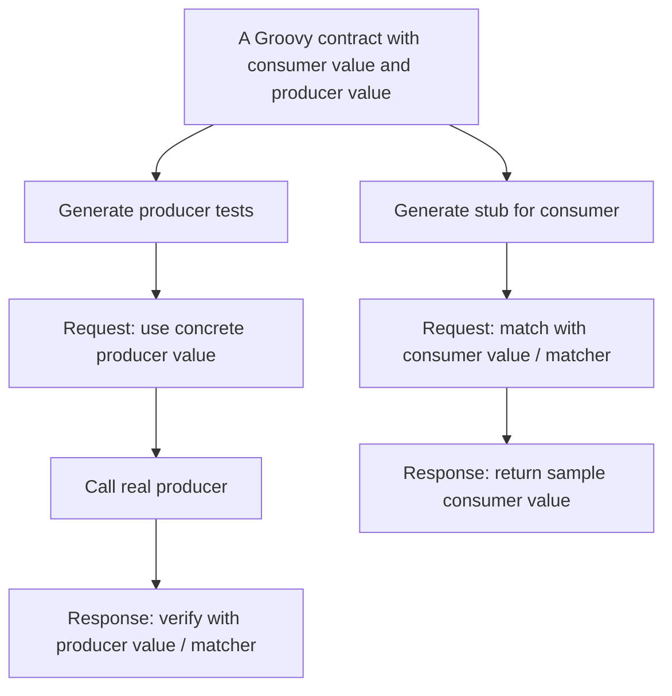
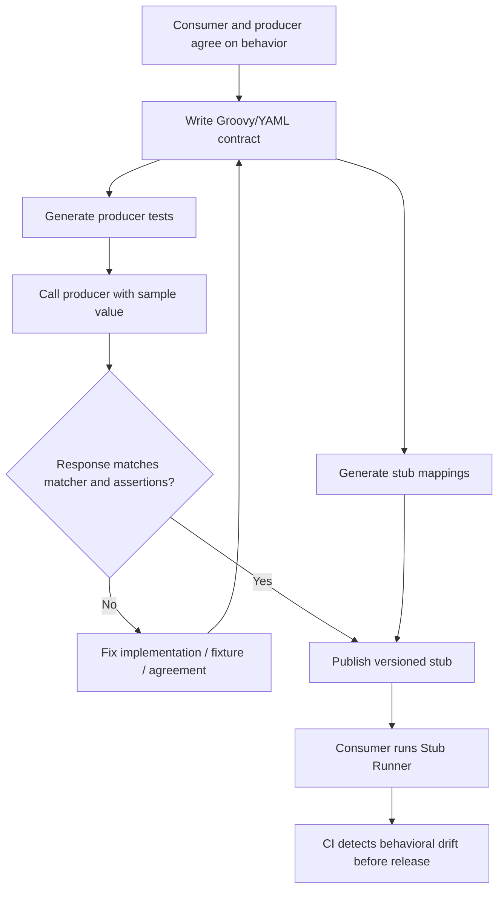

# Consumer Value and Producer Value Model

When writing contracts with **Spring Cloud Contract**, a data field does not always have the same form on both sides. The consumer might send many different order IDs, whereas the producer-side test needs a specific ID to set up test data. Conversely, the producer might return a randomly generated transaction ID, while the consumer stub needs a stable sample value to continue its processing flow.

That is why Spring Cloud Contract's Groovy DSL provides the **consumer value** and **producer value** model. A single contract can describe **the matching condition the consumer needs** and **the value/matcher the producer must be verified against**. Both sides rely on the same agreement, but the tools use that information in two different ways.

This lesson belongs to the **Two-Sided Values** chapter of the **Spring Cloud Contract** module. This knowledge is the foundation for defining HTTP or message contracts using Groovy/YAML DSL, generating tests to verify the producer, publishing stubs, running consumer tests with Stub Runner, and detecting incompatible API changes in CI.

After this lesson, you will be able to:

- Explain `consumer(...)`, `producer(...)`, `value(...)`, and `$(...)` in Groovy DSL.
- Choose fixed values and matching expressions for **request** and **response** in the right direction.
- Trace a contract through auto-generated producer tests and consumer-facing stubs.
- Control dynamic data such as IDs, order codes, headers, and Location without making tests brittle.
- Identify overly broad matchers, incorrect fixtures, and business dependencies not yet protected by the contract.
- Organize testing and CI to detect mismatches between both sides when the API changes.

## 1. Both Sides Read the Same Contract, But What Do They Use It For?

Suppose the system has:

- **Consumer:** `OrderService` needs to reserve inventory before confirming an order.
- **Producer:** `InventoryService` exposes the API `POST /api/v1/reservations`.

The consumer sends a request containing `orderId`. In a real environment, IDs like `ORD-1001`, `ORD-1002`, or `ORD-2048` can all be valid. However, to test the producer, we must know a scenario in advance for which we can prepare data, such as `orderId = ORD-1001` with two units of `SKU-001` available in stock.

After processing, the producer returns `reservationId`. In a real system, this ID might be `RES-701`, `RES-702`, or another code generated at runtime. If the generated test forces the producer to always return `RES-701`, the test will fail due to a dynamic detail unrelated to interface compliance. Meanwhile, a stub returning `RES-701` is enough for the consumer to verify reading and using the reservation ID.

We need to separate **two purposes**:

| Purpose | Target | What Does the Tool Do? |
| --- | --- | --- |
| Verify producer | Real producer application in the test environment | Generates a concrete request, calls the application, and compares the response against committed conditions |
| Simulate producer for consumer | Consumer application running alongside the stub | The stub receives a matching request and returns a sample response so the consumer can test its integration flow |

The key point is that **consumer value and producer value describe the perspective of using the contract**, not simply "the value sent by the consumer" and "the value returned by the producer".

## 2. Basic Syntax of Groovy DSL

In Groovy DSL, a two-sided value can be declared with:

```groovy
value(consumer(...), producer(...))
```

The commonly seen shorthand syntax:

```groovy
$(consumer(...), producer(...))
```

The `...` placeholders here represent where concrete values/matchers go, **not complete executable Groovy snippets**.

Both express the same idea: one side describes how the **consumer-side stub** uses the value, and the other describes how the **producer-side generated test** uses it. You will encounter both in Spring Cloud Contract documentation and repositories.

Example of a dynamic path in a **request**:

```groovy
urlPath($(consumer(regex('/api/v1/reservations/[0-9]+')),
          producer('/api/v1/reservations/1042')))
```

And an example of a dynamic ID in a **response**:

```groovy
body([
    reservationId: $(consumer('RES-701'),
                     producer(regex('RES-[0-9]+')))
])
```

Both use `consumer` and `producer`, but **the positions of the regex and the concrete value are reversed** between request and response.

### Rule-of-Thumb Table

| Describing | Consumer Value Is Usually | Producer Value Is Usually | Why? |
| --- | --- | --- | --- |
| **Request** | Matcher/regex so the stub accepts the consumer's request | Concrete value for the generated test to send to the producer | The consumer sends varying data; the producer test needs deterministic input |
| **Response** | Concrete value for the stub to return to the consumer | Matcher/regex to check the producer's real response | The stub needs sample data; the producer may return dynamic data |

This is a **common design pattern**, not a requirement that every field must have a regex. When both sides simply need the same fixed value, you can write `'HELD'`, `201`, or `2` directly without wrapping every field in `$(...)`.

### Data Flow Diagram



Therefore, the helpful line of thought is not "who owns this field?", but rather "is the field in the **request or response**, and **which side needs a matcher while the other needs an example value**?".

## 3. Request: Consumer Value Can Be a Regex, Producer Value Is a Concrete Example

Suppose `OrderService` needs to send an order ID formatted as `ORD-` followed by digits. We want the stub to accept valid IDs, while the producer test only sends the ID prepared in the fixture.

```groovy
import org.springframework.cloud.contract.spec.Contract

Contract.make {
    name 'create_reservation_order_id_pattern'
    description 'OrderService reserves inventory with an orderId matching the agreed format'

    request {
        method 'POST'
        url '/api/v1/reservations'
        headers {
            contentType(applicationJson())
        }
        body([
            orderId : $(consumer(regex('ORD-[0-9]+')),
                        producer('ORD-1001')),
            sku     : 'SKU-001',
            quantity: 2
        ])
    }

    response {
        status 201
        headers {
            contentType(applicationJson())
        }
        body([
            reservationId: 'RES-701',
            status       : 'HELD'
        ])
    }
}
```

This contract states that:

1. **In the stub:** a request whose `orderId` satisfies `ORD-[0-9]+` can match this scenario's condition, along with the remaining conditions such as method, URL, `sku`, and `quantity`.
2. **In the producer test:** the tool uses `orderId = ORD-1001` to send the request to the real application.
3. **In the response:** this example test still compares against the fixed value `RES-701`; if the system generates IDs dynamically, that field should be switched to the response pattern shown in the next section.

The pattern `ORD-[0-9]+` does not by itself prove that every order ID exists or is allowed to reserve stock. It only expresses the accepted request format in the contract. Therefore, the producer's fixture must contain order `ORD-1001` or the appropriate business state to respond with `201`.

### How Broad Should a Matcher Be?

| Consumer Value | Example Accepted | Risk / Meaning |
| --- | --- | --- |
| `regex('ORD-[0-9]+')` | `ORD-1001`, `ORD-55` | Only accepts codes consisting of the prefix and digits |
| `regex('ORD-[0-9]{4}')` | `ORD-1001` | Only codes with exactly four digits |
| `regex('[A-Z0-9-]+')` | `ORD-1001`, `ABC-9` | Broader; may accept data outside the convention |
| `regex('.*')` | Many strings, including empty depending on context | Too broad if the consumer must send a valid order ID |
| `'ORD-1001'` | Only the specific ID | Suitable when the stub only needs a fixed fixture |

Do not turn a field with clear rules into `.*` just to make the stub "easy to run". The stub might accept an invalid request that the real producer rejects, creating a false sense of compatibility.

## 4. Response: Producer Value Is a Matcher, Consumer Value Is a Sample Value

When the producer creates a reservation, `reservationId` is usually generated at processing time. The consumer needs **an ID with a consistent format** to work with, but the generated test should not require every run to produce the exact same ID.

```groovy
import org.springframework.cloud.contract.spec.Contract

Contract.make {
    name 'create_reservation_dynamic_response_id'
    description 'Producer creates a dynamic reservation ID, consumer receives a sample ID from stub'

    request {
        method 'POST'
        url '/api/v1/reservations'
        headers {
            contentType(applicationJson())
        }
        body([
            orderId : 'ORD-1001',
            sku     : 'SKU-001',
            quantity: 2
        ])
    }

    response {
        status 201
        headers {
            contentType(applicationJson())
        }
        body([
            reservationId: $(consumer('RES-701'),
                             producer(regex('RES-[0-9]+'))),
            status       : 'HELD'
        ])
    }
}
```

In the **stub**, `consumer('RES-701')` is the actual value in the mocked JSON. The consumer can extract `reservationId` and continue testing calls to the confirm/cancel reservation API.

In the **producer test**, `producer(regex('RES-[0-9]+'))` requires the value returned by the real producer to **match the format**. If the application returns `reservationId: null`, omits the field, or uses an ID not matching the regex, a proper test must fail.

Matching the regex **does not prove** that the ID is unique, persisted in the database, or can be looked up successfully afterward. Such guarantees require adding contracts for subsequent requests or stateful integration tests.

### Be Careful with Data Types

JSON distinguishes strings, numbers, booleans, and `null`. If the API commits to `reservationId` being a **string**, use a matcher that preserves the type requirement. Do not switch to an "any value" matcher and accidentally accept a JSON number as well.

For quantities, prices, and timestamps, clearly specify the JSON type, unit, and value range that the consumer actually uses. A regex checking a numeric string does not replace requirements like positive integers, currency scales, or valid timestamps.

## 5. A Contract Combining Dynamic Values in Both Request and Response

Let's combine both directions into a single reservation scenario. This is an end-to-end example to see the full mechanism.

```groovy
import org.springframework.cloud.contract.spec.Contract

Contract.make {
    name 'order_create_reservation_dynamic_values'
    description '''
        OrderService sends a valid order ID to reserve 2 units of SKU-001.
        InventoryService returns status HELD along with a new reservationId.
    '''

    request {
        method 'POST'
        url '/api/v1/reservations'
        headers {
            contentType(applicationJson())
            header('X-Correlation-Id',
                   $(consumer(regex('corr-[0-9]+')),
                     producer('corr-1001')))
        }
        body([
            orderId : $(consumer(regex('ORD-[0-9]+')),
                        producer('ORD-1001')),
            sku     : 'SKU-001',
            quantity: 2
        ])
    }

    response {
        status 201
        headers {
            contentType(applicationJson())
            header('Location',
                   $(consumer('/api/v1/reservations/RES-701'),
                     producer(regex('/api/v1/reservations/RES-[0-9]+'))))
        }
        body([
            reservationId: $(consumer('RES-701'),
                             producer(regex('RES-[0-9]+'))),
            status       : 'HELD'
        ])
    }
}
```

This is a **hypothetical** HTTP agreement for learning purposes; paths, statuses, field names, and ID formats must all be confirmed by the consumer and producer in a real project.

Let's compare each field:

| Location | Consumer Value | Producer Value | Runtime Meaning |
| --- | --- | --- | --- |
| Request header `X-Correlation-Id` | `corr-[0-9]+` | `corr-1001` | Stub accepts many correlation IDs; test sends a specific ID |
| Request body `orderId` | `ORD-[0-9]+` | `ORD-1001` | Stub matches format; test uses deterministic fixture |
| Request body `sku` | `SKU-001` | Same value | No matcher needed if the scenario only covers this SKU |
| Request body `quantity` | `2` | Same value | Test requests reserving exactly two units |
| Response status | `201` | `201` | Stub returns and test checks the agreed status |
| Response header `Location` | `/api/v1/reservations/RES-701` | Path matcher with dynamic ID | Stub gives sample URI; test checks real URI format |
| Response body `reservationId` | `RES-701` | Matcher `RES-[0-9]+` | Stub gives sample ID; test checks real ID format |
| Response body `status` | `HELD` | `HELD` | Fixed business value must match |

**Important limitation:** the two matchers for `Location` and `reservationId` both accept the `RES-[0-9]+` pattern, yet they do not check **whether the two IDs are equal**. The producer could return `Location = .../RES-702` and `reservationId = RES-701` and both would match the regex. If ID consistency is a critical commitment, you need cross-field assertions or appropriate integration tests.

### What Data Must the Producer Prepare?

For the test to genuinely verify the implementation, the producer test environment should:

1. Prepare `ORD-1001` and `SKU-001` with reservable quantity of at least two.
2. Allow requests with header `X-Correlation-Id: corr-1001`.
3. Call the producer's controller or HTTP endpoint, rather than returning hardcoded JSON identical to the contract in the base class.
4. Create the reservation and return `201`, Location, and body with status `HELD`.
5. Reset fixtures or use isolated test data so results are repeatable.

The request regex specifies the matching condition for the stub; the producer fixture ensures the **sample request** actually leads to the expected business branch.

## 6. Fixed Values Do Not Need Two-Sided Declarations

A common mistake is applying `$(consumer(...), producer(...))` to *every* field, even those that actually have the same value on both sides:

```groovy
response {
    status 201
    body([
        status: 'HELD',
        quantityReserved: 2
    ])
}
```

Here `HELD` and `2` are concrete values needed by both the stub and the producer test. Keeping it simple makes the contract easier to read.

You can use this mental formula:

| Context | How to Write |
| --- | --- |
| Both sides need the same literal | Use the literal directly |
| Request has many valid values but producer test needs one example | `consumer(regex(...))` + `producer(value)` |
| Producer response has a dynamic value but stub needs an example | `consumer(value)` + `producer(regex(...))` |
| Value changes based on request or state across multiple calls | Consider dynamic response, linked matchers, or integration tests |

Regexes must express **interface guarantees**, not "just match anything so it passes". Nor should you generate values dynamically in fixtures if the consumer simply expects a clear business constant.

## 7. Applying to Paths, Query Parameters, and Headers

Two-sided thinking can be used for other request components besides the JSON body.

### Path parameter

```groovy
request {
    method 'GET'
    urlPath($(consumer(regex('/api/v1/reservations/[0-9]+/status')),
              producer('/api/v1/reservations/1042/status')))
}
```

The `consumer` part lets the stub accept matching numeric IDs. The `producer` part is a fixed URI for the generated test to call the producer. ID `1042` must exist in the fixture if the expected response is `200`.

Do not confuse Spring MVC's `/api/v1/reservations/{id}/status` syntax with automatic variable substitution in a contract. When you want to match multiple URLs, you must describe an actual matcher.

### Header

```groovy
request {
    method 'GET'
    url '/api/v1/reservations/1042'
    headers {
        header('X-Correlation-Id',
               $(consumer(regex('corr-[0-9]+')),
                 producer('corr-1001')))
    }
}
```

In the response, you can also use two-sided values for dynamic headers, such as `Location` in the example in section 5. Do not hardcode the CI host and port in Location unless that is part of the commitment to the consumer.

### Query parameter

```groovy
request {
    method 'GET'
    urlPath('/api/v1/orders') {
        queryParameters {
            parameter 'externalId',
                      $(consumer(regex('ORD-[0-9]+')),
                        producer('ORD-1001'))
        }
    }
}
```

Putting query parameters inside a `queryParameters` block separates them from the path and avoids unnecessary matchers across the entire URL. When using a specific DSL, verify how the generator creates query matchers in your project's version of Spring Cloud Contract.

## 8. A Request Matcher Does Not Mean the Producer Accepts Infinite Cases

Consider a success contract whose request `orderId` matches regex `ORD-[0-9]+`.

The stub can accept `ORD-1001` or `ORD-9999`, but the real producer might return `404` for `ORD-9999` if that order does not exist. This is not a syntactic contradiction, but rather a **gap between input data and business state**.

To prevent the stub from misleading consumers:

- Restrict matchers to conditions the consumer needs and the producer can guarantee.
- Use specific fixtures for producer tests and clearly document the success preconditions.
- Create separate contracts for inputs that are syntactically valid but fail business validation.
- If a stub contains multiple mappings, design request conditions so they do not conflict or overlap.
- When stateful stubs are needed, consider mechanisms supported by your Spring Cloud Contract/Stub Runner version and verify the generated mappings.

For example, a success contract with `orderId = ORD-1001` and a not-found contract with `orderId = ORD-9999` can use **two fixed values** in the stub to avoid conflicts. A broad regex can be useful when you only need to test dynamic data processing flows, but it does not substitute for distinct business states.

## 9. Response Matchers Only Verify Declared Conditions

Suppose `reservationId` has the matcher `RES-[0-9]+`. The following responses need to be evaluated individually:

| Actual Response | Matches ID Pattern? | Enough to Conclude the Contract Passes? |
| --- | --- | --- |
| `"RES-701"` | Yes | Still must check status, other fields, and semantics |
| `"RES-8503"` | Yes | Still must check business state |
| `"reservation-701"` | No | Violates the committed format |
| `null` | No | No valid ID |
| Missing field `reservationId` | No | Missing data required by consumer |
| `"RES-701"` but Location contains `RES-999` | Each field may match regex | Does not prove they reference the same resource |

When the consumer relies on the ID to confirm or cancel a reservation, add tests for read/update behavior by ID, not just the initial response. A generated test from a single HTTP interaction **does not automatically prove** uniqueness, data durability, atomicity, or idempotency.

### Regex Does Not Replace JSON Types

Example response body:

```json
{
  "reservationId": "RES-701",
  "quantityReserved": 2,
  "expiresAt": "2026-11-24T05:00:00Z"
}
```

The three fields have different meanings:

- `reservationId` is an identifier string, which can be checked with a string pattern.
- `quantityReserved` is an integer, requiring type and range checks if the consumer depends on them.
- `expiresAt` is a timestamp, requiring agreement on UTC/offset, format, and expiration semantics.

A regex for a timestamp format does not prove the reservation has not expired. Nor does a digits-only regex prove `quantityReserved` is greater than 0 or is a JSON number. Choose matchers that are meaningful for each data type.

## 10. Dynamic Data in YAML DSL

Spring Cloud Contract supports both **Groovy DSL** and **YAML DSL**. Both approaches target producer/consumer behavior but do not use the same syntax for dynamic values.

A YAML example **using only literals**:

```yaml
name: create_reservation_literal
description: OrderService reserves two items using fixed test data
request:
  method: POST
  url: /api/v1/reservations
  headers:
    Content-Type: application/json
  body:
    orderId: ORD-1001
    sku: SKU-001
    quantity: 2
response:
  status: 201
  headers:
    Content-Type: application/json
  body:
    reservationId: RES-701
    status: HELD
```

This YAML example describes **the same concrete data for both sides**. If you want `orderId` to have a matcher in the stub and `reservationId` to have a matcher in the generated producer test, use the **version-appropriate YAML DSL** matcher structure instead of pasting the Groovy `$(consumer(...), producer(...))` string directly into YAML.

Documentation or codebases may use YAML matcher blocks for request/response, while Groovy uses `consumer(...)` and `producer(...)`. When converting formats, inspect both the **generated test** and the **stub mapping**, because changing syntax does not guarantee matcher semantics are preserved.

## 11. Applying Two-Sided Thinking to Message Contracts

Spring Cloud Contract also describes communication via **messages**. For example, `PaymentService` emits a payment success event consumed by `OrderService`. The producer may generate `paymentId` dynamically, while the consumer needs a stable sample payload in the stub.

An example message contract:

```groovy
import org.springframework.cloud.contract.spec.Contract

Contract.make {
    name 'payment_completed_event_dynamic_id'
    description 'OrderService receives a payment event with a valid paymentId'
    label 'payment_completed'

    input {
        triggeredBy('emitPaymentCompleted()')
    }

    outputMessage {
        sentTo('payments.completed')
        headers {
            header('contentType', 'application/json')
        }
        body([
            orderId  : 'ORD-1001',
            paymentId: $(consumer('PAY-701'),
                         producer(regex('PAY-[0-9]+'))),
            status   : 'COMPLETED'
        ])
    }
}
```

Here `outputMessage` is close to a **producer-side response**: the test needs to check the message emitted by the producer, while the stub needs sample data for the consumer. However, a message contract also involves how it is triggered, where it is sent, and how messages are collected. The producer must configure appropriate message verification and implement the `emitPaymentCompleted()` method in the test environment.

**Do not assume every part of the message DSL is an HTTP request/response.** With messages, the input can be a trigger or an incoming message, and the matching purpose depends on the interaction model. Identify the actual publish/subscribe path and inspect the generated test code when applying dynamic values.

## 12. Common Mistakes

| Mistake | Consequence | How to Handle |
| --- | --- | --- |
| Assuming `consumer` always means "data sent by consumer" | Reverses values in the response | Identify the consumer of the spec: consumer stub or producer test |
| Putting a regex in the request's producer value without a concrete test value | Generated test may lack valid input | Dynamic requests usually use consumer matcher + producer sample |
| Hardcoding a random response ID in the producer test | Brittle test, fails even when the API is correct | Responses use consumer sample + producer matcher |
| Setting an overly broad regex like `.*` | Stub matches wrong requests; test accepts meaningless responses | Choose matchers tight to format, type, and data domain |
| Producer sample does not match consumer regex | Test and stub do not represent the same class of data | Cross-check the sample value against the pattern |
| Sample data does not exist in fixture | Producer returns a valid error when contract expects success | Prepare the fixture or adjust the scenario |
| Two stubs match the same request with conflicting responses | Consumer test depends on mapping order/priority | Narrow matchers or differentiate state |
| Checking ID and Location only with two separate regexes | Fails to catch mismatched IDs between the two places | Add linked assertions or integration tests |
| Assuming regex guarantees business validation | Misses testing authorization, state, idempotency | Add error-branch contracts and suitable integration tests |
| Pasting Groovy `$(...)` syntax into YAML | Matcher may not be interpreted | Use the YAML schema for your exact version |
| Not inspecting actual generated tests/stubs | Hard to spot reversed value direction or misconfigured matchers | Inspect generated tests, stub mappings, and run them |

## 13. Integrating Two-Sided Values into the CI Workflow

The consumer/producer model only works when contracts are **automatically verified** and stubs are **published from a verified producer version**.



In a Maven project configured with Spring Cloud Contract Verifier:

```bash
mvn -B -ntp clean verify
```

For a `BUILD SUCCESS` result to be trustworthy, confirm that:

1. The contract in question is actually read by the generator; corresponding generated tests exist.
2. The producer test **is executed**, sends the exact `producer`-side sample data, and checks response values/matchers.
3. The stub artifact contains the `consumer`-side request matcher and sample response matching the contract.
4. Consumer tests use the **correct stub version** and exercise the relevant business logic branches.
5. CI blocks releases when the producer no longer satisfies the contract; contract changes are reviewed by consumer/producer owners.

A build with **0 contract tests** may still pass green without protecting the API. A stub with an overly broad regex can also make consumer tests pass in cases where the real producer would reject the request. Therefore, whenever adding a new matcher, inspect **both the producer test and the stub**, not just the DSL syntax.

## 14. Checklist for Choosing Consumer Value and Producer Value

- [ ] Identified whether the field is in the **request** or **response**.
- [ ] Know which consumer needs the data and what the producer commits to guarantee.
- [ ] For dynamic requests: the consumer matcher has an accurate scope.
- [ ] For dynamic requests: the producer sample satisfies the matcher and has a valid fixture.
- [ ] For dynamic responses: the consumer sample is realistic enough to run the stub.
- [ ] For dynamic responses: the producer matcher checks the required format and type.
- [ ] Fixed fields are not unnecessarily wrapped in `$(...)`.
- [ ] Regexes do not cause the stub to accidentally match error branches or other endpoints.
- [ ] Cross-field relationships, such as ID in the body and Location, are verified additionally if needed.
- [ ] Groovy syntax and YAML matchers are not mixed up.
- [ ] Inspected generated tests and stubs, and tested with one valid input and one input that should not match.
- [ ] Integrated producer verification and consumer tests with Stub Runner into the CI pipeline.

### Practice Exercise

Suppose `BillingService` is the producer and `OrderService` is the consumer. When creating an invoice, the consumer sends:

```http
POST /api/v1/invoices
Content-Type: application/json
X-Correlation-Id: corr-812

{"orderId":"ORD-812","currency":"VND"}
```

The producer returns:

```http
HTTP/1.1 201 Created
Content-Type: application/json
Location: /api/v1/invoices/INV-9001

{"invoiceId":"INV-9001","status":"ISSUED"}
```

Requirements:

1. Write a Groovy contract with a `name` and `description` clearly stating the consumer and business purpose.
2. In the **request**, have `orderId` accept the pattern `ORD-[0-9]+` and `X-Correlation-Id` accept `corr-[0-9]+` in the stub, while the producer test uses `ORD-812` and `corr-812`.
3. In the **response**, have the stub return `invoiceId = INV-9001`, while the producer test verifies the real ID matches `INV-[0-9]+`.
4. Apply the same approach to `Location`, then explain why two separate matchers still do not guarantee the ID in Location matches `invoiceId`.
5. Keep `currency = VND` and `status = ISSUED` as fixed values, and explain why `consumer/producer` is not necessarily needed for them.
6. Prepare a fixture for `ORD-812`, generate the producer test, and observe the actual request sent to the producer.
7. Use Stub Runner to try `ORD-813` and `ORD-ABC` to verify matcher scope; explain why the stub matching a well-formed ID does not prove the producer can create invoices for every ID.
8. Intentionally make the producer return `invoiceId = null` or `status = PENDING` and check which clause causes the generated test to fail.
9. Add the tests to CI; publish the stub only after the producer tests and all other required checks pass.

**Completion criteria:** you can look at a `$(consumer(...), producer(...))` expression and clearly state **which part the stub will use, which part the generated producer test will use, which values should be fixed, which values need matchers, and where the verification limits of the contract lie**.

## References

- [Spring Cloud Contract — Dynamic Properties](https://docs.spring.io/spring-cloud-contract/reference/project-features-contract/dsl-dynamic-properties.html): consumer/producer values and dynamic specifications.
- [Spring Cloud Contract — HTTP Contracts](https://docs.spring.io/spring-cloud-contract/reference/project-features-contract/http.html): request/response structure and HTTP matcher types.
- [Spring Cloud Contract — Messaging](https://docs.spring.io/spring-cloud-contract/reference/project-features-messaging.html): message contracts and message verification steps.
