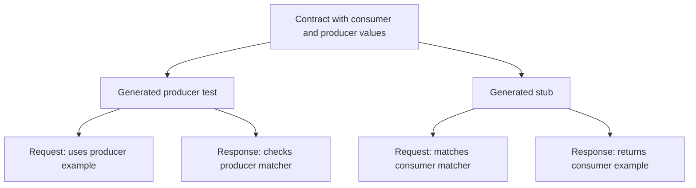
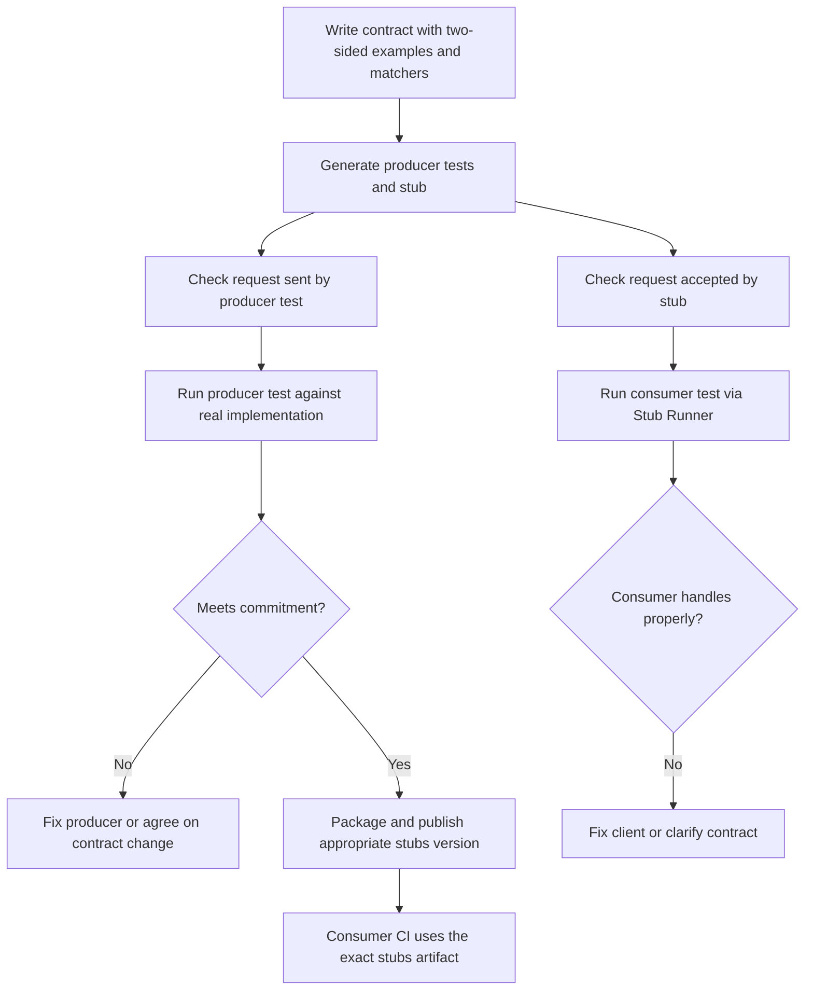

# Role of Each Side in Request and Response

## 1. Why Does Spring Cloud Contract Need Values from Both Sides?

In **Spring Cloud Contract**, a contract describes the behaviors that the API-providing service (**producer**) commits to for the API-calling service (**consumer**). For HTTP, a contract defines requests and responses using Groovy or YAML DSL; the tool can generate tests to verify the producer, create stubs for the consumer to run with **Stub Runner**, and integrate these steps into CI to detect incompatible API changes.

A common problem is that **the same data field needs to be used in two ways**. For example, when the consumer sends `customerId`, the stub must accept any valid ID such as `cust-123` or `cust-987`; however, the generated producer test only needs to send one specific, reproducible value. Conversely, when the producer returns a newly created order ID, the producer test must accept a dynamically generated ID matching a rule, while the stub needs to return a stable sample ID so the consumer can test its own logic.

Spring Cloud Contract's Groovy DSL provides the concepts **`consumer(...)`** and **`producer(...)`** (also commonly referred to as `client` and `server` in corresponding documentation or DSLs). They allow a field to describe both the **consumer-side value/matcher** and the **producer-side value/matcher**. The most common point of confusion is that the meaning of the two sides **does not swap with HTTP direction**, yet **which side provides the matcher and which provides the concrete example reverses between request and response**.

After this lesson, learners will be able to:

1. Correctly explain the roles of `consumer` and `producer` in requests and responses.
2. Choose which side needs a **matcher** and which side needs a **sample value** for test/stub generation.
3. Write an HTTP contract with dynamic values and predict the generated test behavior.
4. Spot "swapped sides" errors, overly broad matchers, and invalid examples.
5. Verify using producer tests, stubs, Stub Runner, and CI instead of only reading the DSL.

## 2. The Four-Case Table to Remember

Here, the **producer** is the service implementing the real API; the **consumer** is the service sending requests or reading responses. The **producer test** is the test generated to call the real API, and the **stub** is the mock server generated from the contract for the consumer to use.

| Contract Location | `consumer(...)` Side | `producer(...)` Side |
| --- | --- | --- |
| **Request** | **Matcher/condition the stub uses to accept requests from the consumer** | **Concrete value the generated producer test sends to the producer** |
| **Response** | **Concrete value the stub returns to the consumer** | **Matcher/condition the generated producer test uses to verify the real response** |

Reading the table according to the actual data flow:



When **dynamic behavior is not needed**, the same fixed value for both sides is sufficient, such as HTTP `POST`, status `201`, or field `state: CREATED`. Two-sided concepts are especially useful when requests/responses contain UUIDs, timestamps, tokens, order IDs, or other data that validly varies between calls.

> **Quick rule:** In a **request**, the consumer "supplies the stub with a matching condition", and the producer "supplies the test with an example to send". In a **response**, the consumer "receives an example from the stub", and the producer "is tested against the condition it must uphold".

## 3. End-to-End Groovy DSL Example: Creating an Order

Suppose `order-service` exposes `POST /api/orders`. The consumer sends a `customerId` formatted as `cust-` followed by three digits, along with `quantity` equal to 2 in this scenario. When order creation succeeds, the producer returns HTTP `201`, state `CREATED`, and an `orderId` generated in the format `ord-` + digits.

A contract file at `src/test/resources/contracts/orders/create-order.groovy` can be written as:

```groovy
import org.springframework.cloud.contract.spec.Contract

Contract.make {
    description 'Create order for a valid customer'

    request {
        method POST()
        url '/api/orders'
        headers {
            contentType(applicationJson())
        }
        body([
            customerId: $(consumer(regex('cust-[0-9]{3}')),
                          producer('cust-123')),
            quantity  : 2
        ])
    }

    response {
        status CREATED()
        headers {
            contentType(applicationJson())
        }
        body([
            orderId: $(consumer('ord-501'),
                       producer(regex('ord-[0-9]+'))),
            state  : 'CREATED'
        ])
    }
}
```

This is **one specific scenario**, not the specification of the entire order creation API. The example only verifies that `customerId` has the chosen format, `quantity = 2`, and `orderId` has the expected pattern. If the business requires customer IDs of different lengths, quantity limits, unique order IDs, or response data linked to the request, corresponding constraints and scenarios must be added.

### Exact Meaning of the Four Values

| Expression | Where Is It? | What Is It Used For? |
| --- | --- | --- |
| `consumer(regex('cust-[0-9]{3}'))` | Request | Stub accepts `customerId` matching this format |
| `producer('cust-123')` | Request | Generated producer test sends exact `cust-123` to the real API |
| `consumer('ord-501')` | Response | Stub returns `ord-501` to the consumer when the request matches |
| `producer(regex('ord-[0-9]+'))` | Response | Generated producer test checks real `orderId` against the regex |

**Sample values must satisfy the matcher of the same field.** Here, `cust-123` matches `cust-[0-9]{3}` and `ord-501` matches `ord-[0-9]+`. If you put `customerId = user-123` while keeping matcher `cust-[0-9]{3}`, the generated producer test would send a request outside the set that the stub considers valid: a sign of a self-contradictory contract.

### Fixed Parts That Do Not Need Two-Sided Wrapping

Values like `method POST()`, `status CREATED()`, `quantity: 2`, and `state: 'CREATED'` do not need `consumer/producer` if the same value applies meaningfully at both ends. Add dynamic matchers only when the data genuinely has multiple valid values per business requirements.

## 4. From the Generated Producer Test Perspective

The Spring Cloud Contract plugin reads the contract and generates **producer-side** tests. An illustrative summary of what the test will do:

```text
1. Send POST /api/orders
   Content-Type: application/json
   Body:
     { "customerId": "cust-123", "quantity": 2 }

2. Verify the producer's real response:
   HTTP status = 201
   Content-Type = application/json
   JSON field state = "CREATED"
   JSON field orderId matches /ord-[0-9]+/
```

The generated test **uses `producer('cust-123')` to construct the request**: the test has deterministic data to invoke the controller/server without generating random IDs on every run. When verifying the response, the test **uses `producer(regex('ord-[0-9]+'))`** to accept various valid order IDs like `ord-501` or `ord-999`.

A producer returning `orderId = "bad-id"` must be caught. Meanwhile, a producer returning `orderId = "ord-777"` should not fail just because the stub sample is `ord-501`. However, if the producer mistakenly returns HTTP `200` or `state = "FAILED"`, the test must still fail because those two conditions are fixed constraints in the contract.

**Do not treat the pseudocode above as actual generated code.** The Java class structure, HTTP test framework, and assertions depend on the plugin/test mode (e.g., MockMvc or real HTTP). When inspecting behavior, examine the actual generated test code and test reports for your project version.

## 5. From the Stub Runner and Consumer Perspective

For HTTP, Spring Cloud Contract can generate WireMock mappings/stubs from the contract. When the consumer test starts the stub and sends:

```http
POST /api/orders HTTP/1.1
Content-Type: application/json

{"customerId":"cust-987","quantity":2}
```

The stub evaluates `customerId` against the **consumer-side matcher in the request** and the other conditions. If the request matches, the stub returns the sample data from the **consumer side in the response**:

```http
HTTP/1.1 201 Created
Content-Type: application/json
```

```json
{
  "orderId": "ord-501",
  "state": "CREATED"
}
```

Thus, a request with `cust-987` can be accepted by the stub even though the generated producer test only sends `cust-123`. Conversely, the stub still returns `ord-501` for that scenario even though the real producer might generate `ord-777`. This is **intentional role separation**, not an inconsistency.

The consumer can verify that its HTTP client reads the `201` response, extracts the order ID, displays `CREATED`, or executes subsequent behavior. Tests with Stub Runner verify **consumer-side logic against a valid response**, while producer tests verify **the real implementation adheres to the contract**. The two test types complement each other.

> Stubs do not verify the real producer. If the producer changes without running contract tests, the consumer can still pass green against an outdated stub. CI must tie producer verification and publishing the right stubs JAR version to consumer tests.

## 6. Rules for Choosing Concrete Values and Matchers

In a two-sided contract, a dynamic value does not mean "skip verification". Choose a matcher that expresses **the exact set of valid values**, and ensure the example side provides data conforming to that matcher.

| Scenario | Reasonable Modeling Approach | Risk When Chosen Wrong |
| --- | --- | --- |
| `customerId` in request must follow format `cust-123` | Request: consumer matcher for format; deterministic producer example | Stub is too permissive or generated test cannot build a valid request |
| `orderId` in response is generated dynamically | Response: deterministic consumer example; producer matcher for format | Producer test locks onto sample ID and fails when ID changes validly |
| `state` must be exact `CREATED` in success case | Fixed value, equality check | Regex `.*` lets `FAILED` slip through |
| `quantity` must be exact 2 in this scenario | Fixed data in request; add scenarios for 1, 3, or invalid values | An "any number" regex may skip business constraints |
| `createdAt` only needs a properly formatted timestamp string | Stub returns sample timestamp; producer validates valid format | Test expects one specific random timestamp |
| `amount` and `currency` affect billing calculations | Check value, type, and meaningful combinations | Loosening all fields to generic regexes misses currency bugs |

Type matchers, regexes, and equality have different meanings. `byType` can prove a field is a string but cannot prove it is a valid order ID; regex `ord-[0-9]+` checks the format but does not prove the ID corresponds to the order just created. If the consumer requires a relationship between request and response, additional scenarios, state, or assertions at the appropriate level may be needed. A single contract does not necessarily guarantee system-wide uniqueness or every business invariant.

### When to Use Regex?

Regex is suitable when a value varies but has an easily expressible format: request IDs, UUIDs, order IDs, formatted timestamps. For example:

```groovy
response {
    status OK()
    body([
        requestId: $(consumer('req-abc123'),
                     producer(regex('req-[A-Za-z0-9]+')))
    ])
}
```

An overly broad regex like `.*` destroys bug-detection capability. An overly strict regex like `req-[0-9]{6}` is also risky if a valid producer can return letters. Keep rules aligned with the committed interface rather than designing rules around a single value spotted by chance in logs.

### Do Not Assume Consumer Examples Are Production Data

In the **response**, `consumer('ord-501')` is **the sample returned by the stub** for tests. It does not mean the real producer must return `ord-501` or that every consumer in production will see that ID. In the **request**, `producer('cust-123')` is **the input the generated test uses to call the producer**; it does not mean the endpoint accepts only that single ID.

Both example values should be *deterministic* so tests are repeatable while still satisfying the business matcher. Do not use values that look like real tokens, private information, or environment data tied to system secrets.

## 7. Beyond the Body: Request URL, Headers, and Response Headers

An HTTP contract has several places containing dynamic data. Despite sharing the same consumer/producer principle, each location may require different declaration syntax in Groovy DSL.

### Request: Path, Query, Header

For example, the consumer calls `/api/orders/{id}`, where the ID can vary. Some contract declarations allow matchers in the URL/path, query, or headers. Conceptually:

- **Consumer side of request:** used by the stub to match actual requests sent by the consumer, such as a regex path ID, corresponding header, or query parameter within an allowed range.
- **Producer side of request:** the generated producer test needs a concrete path/query/header to send, such as `/api/orders/42` and `Accept: application/json`.

When writing the DSL, use **the right API for the data location**: URL/path matchers differ from body JSONPath matchers, and headers have their own matching mechanism. Do not copy `body` syntax into `url` and assume the plugin understands it. Inspect the generated stub mapping and test sending both a matching request and a non-matching request.

### Response: Dynamic Headers

Headers like `X-Request-Id` can change across requests. If the consumer only needs it to be a valid trace ID, the stub can return `req-abc123` and the generated producer test can check the pattern `req-[A-Za-z0-9]+`. If the consumer relies on a fixed header like `Content-Type: application/json`, keep the exact value or a media-type matcher suited to the protocol.

Dynamic header values can be expressed using DSL variants appropriate to the plugin version; the core principle remains **the stub returns the consumer's example, and the producer test verifies against the producer's condition**. Do not apply the same matcher pattern to `Date`, `Location`, or `ETag` if the consumer actually depends on different semantics.

### Response: Status and HTTP Errors

In the order creation example, HTTP `201` is a fixed commitment. If the producer returns `200` even though the body still has `state: CREATED`, the test must catch it if the consumer relies on `201`. For errors, statuses like `400`, `404`, and `409` are also critical behaviors. Different branches should be described as separate contracts/scenarios so the consumer can test HTTP client error handling, rather than using an "any status" regex to accept all responses.

## 8. Expressing the Same Meaning in YAML DSL

Groovy's `consumer(...)` and `producer(...)` clearly display both sides in a single expression. In **YAML DSL**, the common way to express this is to place **concrete values** in `request.body` or `response.body`, and describe matchers in the corresponding `request.matchers` or `response.matchers` section.

A YAML version illustrating the contract from section 3:

```yaml
description: Create order for a valid customer
request:
  method: POST
  url: /api/orders
  headers:
    Content-Type: application/json
  body:
    customerId: "cust-123"
    quantity: 2
  matchers:
    body:
      - path: $.customerId
        type: by_regex
        value: 'cust-[0-9]{3}'
response:
  status: 201
  headers:
    Content-Type: application/json
  body:
    orderId: "ord-501"
    state: "CREATED"
  matchers:
    body:
      - path: $.orderId
        type: by_regex
        value: 'ord-[0-9]+'
```

In the **request** section, `body.customerId = cust-123` is the example sent by the generated producer test, while `request.matchers.body` is the condition for the stub when receiving consumer requests. In the **response** section, `body.orderId = ord-501` is the sample response returned by the stub, while `response.matchers.body` is the condition for the generated producer test checking the real response.

| In Groovy | Corresponding Intent in YAML |
| --- | --- |
| Request `consumer(regex(...))` | Matcher placed in `request.matchers` |
| Request `producer('cust-123')` | Value `request.body.customerId` |
| Response `consumer('ord-501')` | Value `response.body.orderId` |
| Response `producer(regex(...))` | Matcher placed in `response.matchers` |

**Verify the schema for the Spring Cloud Contract version in use**: the list of matcher types, syntax, and handling of JSON numbers/strings may vary. The goal of format conversion is to preserve test and stub generation behavior; both DSLs parsing without errors does not prove equivalence. Do not leave duplicate Groovy and YAML files for the same scenario in the main contracts directory after finishing migration.

## 9. Two Sides in Messaging Contracts

Spring Cloud Contract does not only work with HTTP. For systems using Kafka, RabbitMQ, or appropriately integrated messaging mechanisms, contracts can describe input messages, output messages, and how to trigger the producer.

In your thinking, still ask:

- **Which side produces data at test time?** For example, a consumer sends an input message into a flow processed by the producer.
- **Which side receives and verifies data?** For example, the consumer receives an `OrderConfirmed` event published by the producer.
- **What outputs are generated from the contract?** Producer-side messaging tests, stub triggers, sample payloads, or message send/receive configurations.
- **Which conditions are part of the commitment?** Destination/topic, event type, headers, schema, identifier fields, nullability, ID patterns, and correlation IDs.

For an output message carrying a dynamically generated `eventId`, the intent resembles an HTTP response: the producer test must check that the event ID has a valid format, while the consumer test uses a sample message with a specific, repeatable ID. However, do not automatically treat every message as an "HTTP response": a one-way event may have no direct request; testing uses triggers, input messages, or other mechanisms depending on the DSL and plugin.

Example event payload:

```json
{
  "eventId": "evt-701",
  "orderId": "ord-501",
  "eventType": "OrderConfirmed"
}
```

If the consumer branches on `eventType`, the value `OrderConfirmed` must remain stable; if `eventId` only needs a valid format, you can use a fixed example in the stub and an appropriate matcher during producer verification. However, the `orderId` field may need to tie back to an actual order rather than merely matching a regex pattern. Do not omit the destination or routing key when translating the same concept from HTTP to messaging.

## 10. Common Side-Confusion Mistakes

### 10.1. Swapping `consumer` and `producer` in the Request

An example wrong in intent when you want the stub to accept many valid `customerId` values but write:

```groovy
// WRONG INTENT: matcher and example swapped in REQUEST.
customerId: $(consumer('cust-123'),
              producer(regex('cust-[0-9]{3}')))
```

Here, the stub's request matching condition risks being locked to exact `cust-123`, while the producer test receives a matcher instead of a concrete sample request. The generated output may be invalid or fail to test the intended flow. For the stub to accept valid customer IDs and the producer test to have deterministic input, write as in section 3:

```groovy
customerId: $(consumer(regex('cust-[0-9]{3}')),
              producer('cust-123'))
```

### 10.2. Swapping the Two Sides in the Response

If the goal is for the producer to generate many valid order IDs while the stub returns a sample ID, this is wrong in intent:

```groovy
// WRONG INTENT: matcher on consumer side of RESPONSE.
orderId: $(consumer(regex('ord-[0-9]+')),
           producer('ord-501'))
```

The generated producer test risks locking onto `ord-501`, while the stub lacks the intended concrete sample value. The right way for this scenario is:

```groovy
orderId: $(consumer('ord-501'),
           producer(regex('ord-[0-9]+')))
```

### 10.3. Regexes That Erase Business Constraints

A `.*` matcher can accept empty strings, malformed codes, and unexpected statuses. If `state` is only allowed to be `CREATED` in a scenario, keep equality. Do not use overly broad matchers just to prevent CI from turning red when the implementation changes.

### 10.4. Examples Outside the Matcher Set

If the request defines `consumer(regex('cust-[0-9]{3}'))` alongside `producer('usr-999')`, the generated producer test uses an input that the stub from the same contract will not accept. A simple check rule: **every concrete example must satisfy its corresponding matcher**; CI should include appropriate tests or checks when applying complex dynamic values.

### 10.5. Changing Data Types When Using Matchers

A string ID like `"ord-501"` differs in type from a JSON number like `501`. If a YAML body declares `orderId: 501` while the original Groovy used `'ord-501'`, the contracts are no longer equivalent. For monetary amounts, timestamps, and nullability, do not use string regexes as a substitute for data type checks that the consumer depends on.

### 10.6. Forgetting to Distinguish Test Generation Logic from Stub Generation Logic

A producer test passing with `cust-123` does not prove every customer ID can be handled; the request stub matcher may be broader than the data set exercised by that concrete producer test. Conversely, a consumer test passing with `ord-501` does not prove the producer implemented the ID format correctly, because the stub can return that value even before the real producer is run.

### 10.7. Putting Matchers on the Right Side but in the Wrong Section

A JSONPath matcher `$.customerId` under response is not equivalent to a matcher with the same path under request. Verify the exact `request`/`response` section, headers, URL, body, and required metadata. For DSLs that provide dedicated matching structures for query/path/headers, use the corresponding construct.

## 11. Practice Workflow and Two-Sided Verification



A suitable workflow for a Spring Cloud Contract lab:

1. **Pick a small contract:** such as `create-order.groovy` in section 3, with one request matcher and one response matcher to clearly observe the difference.
2. **Write an expectation table:** producer test sends `cust-123`; stub accepts any `cust-XYZ` matching the pattern; producer test receives `ord-...` matching regex; stub returns `ord-501`.
3. **Configure the producer test base class:** set up the environment running the controller/HTTP server and deterministic test data; ensure request `cust-123` is genuinely processed to return `201`.
4. **Generate and run producer tests:** for a Maven project with the plugin configured, e.g., `./mvnw clean verify`; for Gradle, invoke the contract-test tasks provided by your project's plugin version. Confirm **generated tests actually executed**, rather than just seeing a green build.
5. **Inspect the stub artifact:** verify whether the request mapping uses a matcher for `customerId` and the response contains `ord-501` and `CREATED` as modeled. Exact output structure depends on the plugin version.
6. **Run consumer tests with Stub Runner:** point the HTTP client to the stub, send at least two valid customer IDs, verify code handling the returned body; try one invalid-format ID to ensure it does not accidentally match.
7. **Test breaking changes:** make the producer return `orderId = "INVALID"` or `state = "FAILED"`; the generated producer test must catch it. Make the producer return `ord-777` matching the regex and it should not fail due to differing from the sample ID.
8. **Pin versions and CI:** publish the stubs JAR after producer tests pass, and record the exact artifact version used by consumer CI to avoid testing against an outdated promise.

### Verification Comparison Table

| Experiment | Producer Test | Consumer Stub Test | What Is Proven |
| --- | --- | --- | --- |
| Producer receives `cust-123`, returns `ord-777` and `CREATED` | Must pass if conditions hold | Does not run real producer | Producer satisfies response matcher |
| Producer returns `orderId = bad-id` | Must fail | Does not verify producer | Producer-side matcher works |
| Consumer sends `cust-987` with `quantity = 2` | Not the default input of generated producer test | Stub should match | Consumer-side request matcher works |
| Consumer sends `customerId = xyz` | Not the default input | Stub should not match this mapping | Request matcher is tight enough |
| Stub returns `ord-501`, `CREATED` | Does not verify real implementation | Consumer must handle properly | Response sample value is appropriate |
| Producer changes `state` to `FAILED` | Must fail | Old stub may still return `CREATED` | Equality protects fixed values |

Note: a request that matches no mapping may receive HTTP `404` from WireMock. **Do not treat that HTTP 404 as a committed business error response**, unless there is an explicit mapping describing that exact error branch and the consumer test verifies the status code/headers/body.

## 12. Exercise: Fixing a Side-Swapped Contract

A team is building a voucher issuance API. The consumer sends `POST /api/vouchers` with `customerCode` in the format `C-####`, and the producer returns `voucherId` in the format `V-####` and `status = ISSUED`. Current contract:

```groovy
request {
    method POST()
    url '/api/vouchers'
    headers {
        contentType(applicationJson())
    }
    body([
        customerCode: $(consumer('C-0042'),
                        producer(regex('C-[0-9]{4}')))
    ])
}
response {
    status CREATED()
    headers {
        contentType(applicationJson())
    }
    body([
        voucherId: $(consumer(regex('V-[0-9]{4}')),
                     producer('V-0101')),
        status: 'ISSUED'
    ])
}
```

**Requirements:**

1. Identify the two places where matcher and example are swapped; explain the impact on the generated producer test and stub.
2. Rewrite the `consumer/producer` pairs so the stub accepts any valid `customerCode` and returns sample `voucherId` `V-0101`; the producer test sends `C-0042` and accepts a properly formatted voucher ID.
3. Explain why `status: 'ISSUED'` should use equality for this scenario.
4. Predict the outcomes when the producer returns `voucherId = V-9999`, `voucherId = BAD`, or `status = CANCELLED`.
5. Verify using the actual generated producer test code and WireMock mapping rather than only reading Groovy syntax.

### Suggested Answer

The two dynamic fields should be fixed as follows:

```groovy
request {
    method POST()
    url '/api/vouchers'
    headers {
        contentType(applicationJson())
    }
    body([
        customerCode: $(consumer(regex('C-[0-9]{4}')),
                        producer('C-0042'))
    ])
}
response {
    status CREATED()
    headers {
        contentType(applicationJson())
    }
    body([
        voucherId: $(consumer('V-0101'),
                     producer(regex('V-[0-9]{4}'))),
        status: 'ISSUED'
    ])
}
```

The generated producer test sends `C-0042`, verifies response `201`, `status = ISSUED`, and `voucherId` against the regex. The stub accepts requests whose `customerCode` matches `C-[0-9]{4}` and returns sample `V-0101`. Therefore, `V-9999` is valid, while `BAD` fails the rule. `CANCELLED` does not fit the successful issuance scenario and must be caught even if `voucherId` has the right format.

**Extension:** If the business requires `voucherId` to be unique and never repeated across issuances, a regex alone is not enough. Add appropriate business tests or contracts to protect necessary invariants; never claim that a regex matcher proves uniqueness on its own.

## 13. Checklist Before Saving and Publishing a Two-Sided Contract

- [ ] Clearly identified that **producer is the providing service** and **consumer is the calling/consuming service**, regardless of which side stores the contract file.
- [ ] For **requests**, the consumer matcher determines what the stub accepts; the producer value determines what the generated producer test sends.
- [ ] For **responses**, the consumer value determines what the stub returns; the producer matcher determines what the generated producer test accepts.
- [ ] Every example value satisfies its corresponding matcher and is reproducible in the test environment.
- [ ] Fixed values with business significance, such as HTTP status or `state`, remain strictly checked.
- [ ] Regexes, data types, headers, paths, queries, and nullability accurately reflect what the consumer needs.
- [ ] Matchers in YAML/Groovy are declared in the correct request/response section for the plugin version in use.
- [ ] Inspected the generated producer test code and stub, and tested both valid and invalid requests.
- [ ] Producer tests pass with valid dynamic values and fail on breaking changes; consumer tests with Stub Runner work properly.
- [ ] CI publishes the stubs JAR only for contracts already verified by the producer, and the consumer pins the exact version.

**Key takeaway:** `consumer(...)` and `producer(...)` refer to **the sides participating in the contract**. In a **request**, the consumer side defines the matching condition for the stub, while the producer side supplies the sample input for the generated test. In a **response**, the consumer side supplies the stub's sample response, while the producer side defines the verification condition for the real response. Mastering these four roles helps you write dynamic contracts strict enough to catch incompatible APIs yet flexible enough for validly changing data.
