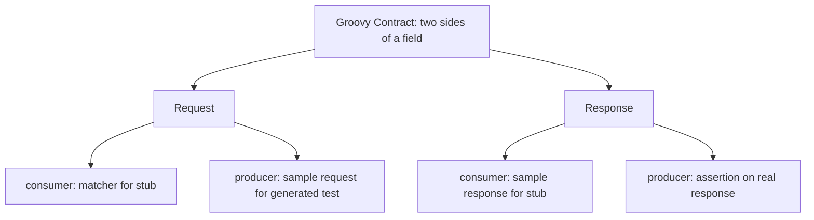
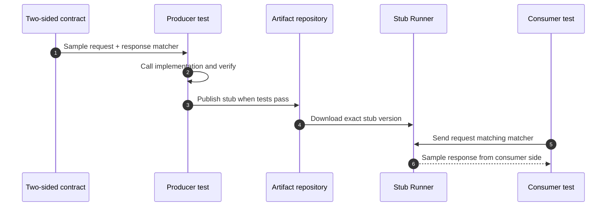

# Expressing value, consumer, producer, and Shorthand Forms

> **Chapter:** Two-Sided Values  
> **Module:** Spring Cloud Contract (`SPRING_CLOUD_CONTRACT`) — contract testing between producer and consumer using Groovy/YAML DSL, generating producer-side tests, publishing stubs, running Stub Runner, and controlling API changes through CI.

## Learning Objectives

After this lesson, you will be able to:

1. Explain the meaning of **two-sided values** in Spring Cloud Contract and why the same field may need different values when generating stubs versus generating tests.
2. Distinguish `consumer(...)` and `producer(...)` in both **request** and **response**, without getting confused by HTTP data flow direction.
3. Write `value(consumer(...), producer(...))`, `$(consumer(...), producer(...))`, along with aliases `c/p`, `stub/test`, and `client/server`.
4. Use single-sided shorthand forms and `any...()` helpers in appropriate cases.
5. Convert a Groovy contract with dynamic values to **YAML with matchers**, preserving behavior.
6. Verify producer tests, consumer stubs, and CI workflows when an API has identifiers, correlation IDs, or data that varies per request.

## 1. Why Do We Need Two Values for the Same Field?

Suppose two services communicate over HTTP:

- **`checkout-service` — consumer:** creates a request to receive a quote.
- **`quote-service` — producer:** receives the request and returns a new quote ID.

The consumer sends:

```http
POST /api/quotes HTTP/1.1
Content-Type: application/json
Accept: application/json

{
  "clientRequestId": "REQ-0042",
  "sku": "SKU-001",
  "quantity": 2
}
```

The producer returns:

```http
HTTP/1.1 201 Created
Content-Type: application/json

{
  "quoteId": "62bf989a-2c31-49d2-a10d-56d4764088b4",
  "status": "CREATED",
  "amount": 100000
}
```

In this example:

- Each time the consumer creates a request, `clientRequestId` may change: `REQ-0042`, `REQ-0103`, or `REQ-9999`.
- The producer generates `quoteId` itself; each call may produce a different UUID.
- The consumer still needs to verify status `CREATED` and amount `100000` for the defined scenario.

If the contract fixes the **request ID** to `REQ-0042`, Stub Runner can only match a single request while the real client generates new IDs. If the contract fixes the **response ID** to a sample UUID, the producer test will fail even when the producer generates a valid UUID.

Spring Cloud Contract's solution is to describe **the same field with separate representations for the consumer side and the producer side**. This mechanism is especially useful for UUIDs, timestamps, transaction IDs, correlation IDs, parameterized URLs, and dynamic data.

## 2. Understanding Both Sides Correctly in Spring Cloud Contract

In Groovy DSL, a dynamic value can be written as:

```groovy
value(
    consumer(...),
    producer(...)
)
```

The two branches **do not simply mean "request value" and "response value"**. They are two **perspectives when Spring Cloud Contract generates different artifacts**:

- `consumer(...)`: the value or rule to put into the **stub for the consumer to use**.
- `producer(...)`: the value or rule to put into the **test verifying the producer's implementation**.

The reversal occurs because:

- In a **request**, the stub needs to accept **many valid requests** from the consumer, while the producer test needs **one concrete request** to send.
- In a **response**, the stub needs **one concrete sample response** to return to the consumer, while the producer test usually needs to **verify a rule** on a dynamic response.

### 2.1. Matrix to Remember

| Field Location in Contract | `consumer(...)` / Stub Side | `producer(...)` / Test Side |
| --- | --- | --- |
| **Request** | Matching condition for requests sent by consumer; can be a regex | Concrete value that the generated test sends to the producer |
| **Response** | Concrete value that the stub returns to the consumer | Value/condition used to verify the producer's real response |
| **Request ID example** | `regex('REQ-[0-9]{4}')` | `'REQ-0042'` |
| **Response UUID example** | `'62bf989a-2c31-49d2-a10d-56d4764088b4'` | `regex('...UUID...')` |

One way to remember: **request: consumer matches, producer sends; response: consumer receives, producer is verified**.



### 2.2. What the Two Branches Do Not Automatically Guarantee

A request matcher like `REQ-[0-9]{4}` enables the stub to accept `REQ-0731`; it **does not automatically prove** that the real API also accepts every matching code. Producer verification only sends the sample requests generated by the test. If behavior across multiple variants is required, add more test data or related contracts.

Similarly, a UUID-style producer response matcher verifies format, **not** that two calls return unique UUIDs. Uniqueness, business validity, and cross-field relationships require corresponding unit/integration tests.

## 3. Full Syntax: value(consumer, producer)

Place the following inside the `request` block of a Groovy contract:

```groovy
body(
    clientRequestId: value(
        consumer(regex('REQ-[0-9]{4}')),
        producer('REQ-0042')
    ),
    sku: 'SKU-001',
    quantity: 2
)
```

How to interpret this:

1. `consumer(regex('REQ-[0-9]{4}'))` makes the stub accept request IDs matching the pattern.
2. `producer('REQ-0042')` makes the producer verification test send the **concrete value** `REQ-0042`.
3. `sku` and `quantity` are fixed values on both sides, because the scenario being tested does not need them to be dynamic.

In the `response` block, we do the opposite:

```groovy
body(
    quoteId: value(
        consumer('62bf989a-2c31-49d2-a10d-56d4764088b4'),
        producer(regex(
            '[0-9a-fA-F]{8}-[0-9a-fA-F]{4}-[0-9a-fA-F]{4}-[0-9a-fA-F]{4}-[0-9a-fA-F]{12}'
        ))
    ),
    status: 'CREATED',
    amount: 100000
)
```

- The stub returns a specific, stable `quoteId` so the consumer can parse it.
- The producer test allows a UUID different from the sample value, provided it satisfies the regex.
- `status` and `amount` must still equal the expected values in the contract.

**Why is the regex in the response placed under `producer`?** Because it is the verification rule for the **real response produced by the producer**. Putting a regex in the `consumer` branch of a response would specify a value unsuitable to return directly from an HTTP stub to the consumer application.

## 4. Shorthand Form with $()

In Groovy DSL, when writing a body using map notation, `value(...)` can be shortened to `$(...)`:

```groovy
body(
    clientRequestId: $(
        consumer(regex('REQ-[0-9]{4}')),
        producer('REQ-0042')
    ),
    sku: 'SKU-001',
    quantity: 2
)
```

This snippet is equivalent in two-sided role to the `value(...)` version in request in section 3.

The response works the same way:

```groovy
body(
    quoteId: $(
        consumer('62bf989a-2c31-49d2-a10d-56d4764088b4'),
        producer(regex(
            '[0-9a-fA-F]{8}-[0-9a-fA-F]{4}-[0-9a-fA-F]{4}-[0-9a-fA-F]{4}-[0-9a-fA-F]{12}'
        ))
    ),
    status: 'CREATED',
    amount: 100000
)
```

Here `$` is **a Contract DSL helper**, not an environment variable symbol or Groovy `GString` syntax. Wrapping values with `$(...)` preserves the structure of data in the map.

Some projects prefer `value(...)` so newcomers clearly see it is a *DSL value*, and `$(...)` when there are many fields to keep it concise. Both forms are supported by Spring Cloud Contract.

## 5. Aliases and Short Forms: c/p, stub/test, client/server

Spring Cloud Contract supports several names for the two sides:

| Form | Consumer Side | Producer Side | Meaning |
| --- | --- | --- | --- |
| Full form | `consumer(...)` | `producer(...)` | Named by role |
| Short form | `c(...)` | `p(...)` | Concise form for long contracts |
| By artifact | `stub(...)` | `test(...)` | Emphasizes stub and producer test |
| By system | `client(...)` | `server(...)` | Emphasizes HTTP client and server |

Therefore, the following forms express **the exact same pair of values**:

```groovy
value(consumer('ABC-001'), producer(regex('ABC-[0-9]{3}')))
value(c('ABC-001'), p(regex('ABC-[0-9]{3}')))
value(stub('ABC-001'), test(regex('ABC-[0-9]{3}')))
value(client('ABC-001'), server(regex('ABC-[0-9]{3}')))
```

And these forms are also equivalent:

```groovy
$(consumer('ABC-001'), producer(regex('ABC-[0-9]{3}')))
$(c('ABC-001'), p(regex('ABC-[0-9]{3}')))
$(stub('ABC-001'), test(regex('ABC-[0-9]{3}')))
$(client('ABC-001'), server(regex('ABC-[0-9]{3}')))
```

All of the lines above are **interchangeable expressions** in an appropriate position in a contract. Do not put eight consecutive expressions into the same field; pick one style and stay consistent across the repository.

### 5.1. Two Common Misconceptions About Aliases

- `test(...)` **does not mean** "this snippet only appears in hand-written test code". It represents the value/condition for the **generated producer verification test**.
- `server(...)` **is not** an HTTP call to the server at contract-writing time; it is an alias for the `producer(...)` side.

`stub` and `client` are aliases for `consumer`; `test` and `server` are aliases for `producer`. Therefore, the request/response rules in section 2 remain unchanged when switching alias names.

## 6. Complete Groovy Example: One Contract for Both Sides

Create the file `src/test/resources/contracts/quote_created.groovy` in the producer project:

```groovy
org.springframework.cloud.contract.spec.Contract.make {
    name 'quote_created'

    request {
        method 'POST'
        url '/api/quotes'
        headers {
            contentType(applicationJson())
            header 'Accept': 'application/json'
            header 'X-Correlation-Id': $(
                consumer(regex('corr-[0-9]{4}')),
                producer('corr-0042')
            )
        }
        body(
            clientRequestId: value(
                consumer(regex('REQ-[0-9]{4}')),
                producer('REQ-0042')
            ),
            sku: 'SKU-001',
            quantity: 2
        )
    }

    response {
        status 201
        headers {
            contentType(applicationJson())
        }
        body(
            quoteId: $(
                consumer('62bf989a-2c31-49d2-a10d-56d4764088b4'),
                producer(regex(
                    '[0-9a-fA-F]{8}-[0-9a-fA-F]{4}-[0-9a-fA-F]{4}-[0-9a-fA-F]{4}-[0-9a-fA-F]{12}'
                ))
            ),
            status: 'CREATED',
            amount: 100000
        )
    }
}
```

The contract covers one HTTP scenario: creating a quote successfully. It demonstrates dynamic data in **both request and response** without sacrificing important checks.

### 6.1. What Will the Consumer Side See?

Suppose Stub Runner starts a stub from the contract above. The consumer calls:

```http
POST /api/quotes HTTP/1.1
Content-Type: application/json
Accept: application/json
X-Correlation-Id: corr-0723

{
  "clientRequestId": "REQ-0234",
  "sku": "SKU-001",
  "quantity": 2
}
```

The stub can **match** `corr-0723` and `REQ-0234` because both satisfy the regexes. The sample response is:

```http
HTTP/1.1 201 Created
Content-Type: application/json

{
  "quoteId": "62bf989a-2c31-49d2-a10d-56d4764088b4",
  "status": "CREATED",
  "amount": 100000
}
```

If the consumer sends `clientRequestId: "bad"`, the stub does not match the matcher for that request. In WireMock, when no mapping matches, a 404 is typically returned; that is **stub behavior** and does not automatically assert that the real producer must return 404 for invalid values.

### 6.2. What Will Producer Verification See?

The generated producer test will send a **concrete** request along the lines of:

```http
POST /api/quotes HTTP/1.1
Content-Type: application/json
Accept: application/json
X-Correlation-Id: corr-0042

{
  "clientRequestId": "REQ-0042",
  "sku": "SKU-001",
  "quantity": 2
}
```

It then verifies the producer returns `201`, `Content-Type: application/json`, and a body with `status: CREATED` and `amount: 100000`; `quoteId` specifically is verified against the UUID regex.

The producer is not forced to return exact `62bf989a-2c31-49d2-a10d-56d4764088b4`. If the application generates a different valid UUID, contract verification still passes.

### 6.3. What Remains Unverified?

Even if the producer test passes, we have not proven:

- That the producer actually rejects **all** malformed request IDs (since the generated test sends one valid sample).
- That the `X-Correlation-Id` header is mandatory on every path or must be echoed back in the response.
- That two calls create two distinct `quoteId` values.
- That `amount` is calculated correctly across all combinations of SKU and quantity.

Those rules require additional negative-case contracts, unit/integration tests, or appropriate E2E scenarios.

## 7. Single-Sided Shorthand Declarations

When you provide **only one side with a regex**, Spring Cloud Contract can auto-generate a value for the other side **that satisfies the regex**. For example, in a Groovy DSL request:

```groovy
request {
    method 'GET'
    url value(consumer(regex('/api/quotes/[0-9]{5}')))
}
```

- The stub side gets a regex to match multiple URLs like `/api/quotes/12345` and `/api/quotes/54321`.
- The producer test side gets **a concrete URL** generated by the tool matching the regex to call the implementation.

In a response:

```groovy
response {
    status 200
    body(
        referenceCode: $(producer(regex('Q-[0-9]{5}')))
    )
}
```

- Producer verification checks the code against regex `Q-[0-9]{5}`.
- The tool can generate a **consumer/stub-side sample value** matching the regex.

### 7.1. When Should You Use the Single-Sided Form?

This style works well when **the sample value carries no special meaning**: a dummy code that just needs the right format, a response ID for the consumer to test parsing, or an arbitrary request path for testing.

However, when the producer test needs to **hit exact prepared data**, declare both sides:

```groovy
url value(
    consumer(regex('/api/quotes/[0-9]{5}')),
    producer('/api/quotes/12345')
)
```

Otherwise, the test might send a randomly generated ID whose record does not exist in the test database; the response becomes `404` and the test fails because of **test data**, not a broken contract.

For responses, if the consumer test has an assertion comparing against an exact sample ID, also provide it explicitly:

```groovy
body(
    referenceCode: value(
        consumer('Q-00421'),
        producer(regex('Q-[0-9]{5}'))
    )
)
```

**Note on regexes and data generation:** regex-matching string generation has limitations. Spring Cloud Contract documentation recommends avoiding `^` and `$` if relying on automatic string generation. When formats are complex, specify sample values explicitly and inspect the generated test/stub output.

## 8. The any...() Helpers That Shorten Matcher Declarations

Spring Cloud Contract provides many helpers for common data types, for example:

| Groovy Helper | Representation Need |
| --- | --- |
| `anyUuid()` | UUID |
| `anyInteger()` | Integer |
| `anyPositiveInt()` | Positive integer |
| `anyNumber()` | Numeric value |
| `anyAlphaNumeric()` | Alphanumeric string |
| `anyEmail()` | Email |
| `anyUrl()` | URL |
| `anyDate()` | Date |
| `anyDateTime()` | Date and time |
| `anyIso8601WithOffset()` | ISO 8601 date-time with offset |
| `anyNonBlankString()` | String not consisting solely of whitespace |
| `aBoolean()` | Boolean |

Instead of writing a long UUID regex, you can use:

```groovy
response {
    status 201
    body(
        quoteId: $(anyUuid()),
        amount: $(anyNumber()),
        status: 'CREATED'
    )
}
```

This is a concise syntax supported in Groovy DSL. However, verify the **generated output**: helpers using regex/matchers may cause the opposite side's value to be auto-generated. If the consumer needs a stable sample response or the producer test needs pre-seeded data, the explicit two-sided form is usually easier to control.

Furthermore, `anyNumber()` does not automatically prove **a positive amount** or **a correct pricing formula**. If the contract commits to `amount = 100000`, keep an exact assertion; if it commits to `amount > 0`, verify that rule with an appropriate matcher/validator or business test.

## 9. Using Two-Sided Values in Headers and URLs

The `consumer/producer` pair is not limited to the JSON body. Groovy DSL allows using it in other components such as URLs, request headers, or response headers when representing dynamic values.

### 9.1. Dynamic Request Header

```groovy
headers {
    contentType(applicationJson())
    header 'X-Request-Id': value(
        consumer(regex('req-[0-9]{4}')),
        producer('req-0042')
    )
}
```

The consumer side sends request IDs matching the pattern; the producer test sends `req-0042`. If this header is part of a security or authorization requirement, a passing test with one valid value still **does not prove** that forbidden values will be rejected.

### 9.2. URL Containing Dynamic Parameters

```groovy
request {
    method 'GET'
    url $(
        consumer(regex('/api/orders/[0-9]{2}')),
        producer('/api/orders/42')
    )
}
```

The stub can match different paths with two digits. The producer test calls `/api/orders/42`, which fits well when you have pre-created order 42 in the test database.

### 9.3. Dynamic Response Header

```groovy
response {
    status 201
    headers {
        header 'X-Trace-Id': $(
            consumer('TRACE-0042'),
            producer(regex('TRACE-[0-9]{4}'))
        )
    }
}
```

The stub returns `TRACE-0042`; the producer test verifies that the response header from the server satisfies the regex. **Only use this contract when the real producer actually returns that header.** It does not automatically prove the response header equals the request header unless you add a request–response correlation rule.

## 10. Same Meaning in YAML DSL

Spring Cloud Contract's YAML DSL **does not directly use** `value(...)`, `$(...)`, or `c/p` aliases like Groovy. In YAML, the equivalent approach is:

1. Put **concrete sample values** in `request.body` and `response.body`.
2. Declare **request matchers** so the stub accepts dynamic requests.
3. Declare **response matchers** so producer verification checks dynamic responses.

A YAML example behaviorally equivalent to the Groovy contract in section 6:

```yaml
name: quote_created
request:
  method: POST
  url: /api/quotes
  headers:
    Content-Type: application/json
    Accept: application/json
    X-Correlation-Id: corr-0042
  body:
    clientRequestId: REQ-0042
    sku: SKU-001
    quantity: 2
  matchers:
    headers:
      - key: X-Correlation-Id
        regex: 'corr-[0-9]{4}'
    body:
      - path: $.clientRequestId
        type: by_regex
        value: 'REQ-[0-9]{4}'

response:
  status: 201
  headers:
    Content-Type: application/json
  body:
    quoteId: 62bf989a-2c31-49d2-a10d-56d4764088b4
    status: CREATED
    amount: 100000
  matchers:
    body:
      - path: $.quoteId
        type: by_regex
        predefined: uuid
```

Comparison table:

| Groovy DSL | YAML DSL | Purpose |
| --- | --- | --- |
| `consumer(regex('REQ-[0-9]{4}'))` in request | `request.matchers.body` at `$.clientRequestId` | Stub accepts request ID matching pattern |
| `producer('REQ-0042')` in request | `request.body.clientRequestId: REQ-0042` | Producer test sends sample request |
| `consumer('...UUID...')` in response | `response.body.quoteId: ...` | Stub returns sample response |
| `producer(regex('...UUID...'))` in response | `response.matchers.body` at `$.quoteId` | Producer test validates UUID format |
| Two-sided request header `X-Correlation-Id` | `request.headers` + `request.matchers.headers` | Stub matches dynamic header, producer test has sample value |

**Do not turn `value(consumer(...), producer(...))` into a YAML string:** the YAML file may parse, but it is just a data string, not a Groovy Contract DSL directive.

With matchers in YAML, `path` must reference a field that actually exists in the sample body; `predefined: uuid` is a built-in regex matcher. If the sample value is `"123"` (string) while the real API returns `123` (number), the data type may differ from your intent; preserve exact JSON types in YAML.

### 10.1. YAML Matchers Serve the Same Role, Not Necessarily the Same Syntax

| Type | Groovy DSL | YAML DSL |
| --- | --- | --- |
| Request body regex | `bodyMatchers { jsonPath('$.id', byRegex('...')) }` | `request.matchers.body` with `type: by_regex` |
| Response body regex | `bodyMatchers { jsonPath('$.id', byRegex('...')) }` | `response.matchers.body` with `type: by_regex` |
| Request header regex | `header 'X-Id': $(c(regex('...')), p('ID-1'))` | `request.headers` + `request.matchers.headers` |
| Response body type | `jsonPath('$.amount', byType())` | `response.matchers.body` with `type: by_type` |

Groovy allows two styles: **putting dynamic values directly in the body** or **putting them in `bodyMatchers`**. YAML only has the `matchers` mechanism for dynamic parts. When converting, what matters is preserving the **actual matching condition**, not the shape of the syntax.

## 11. Connecting with Producer Tests and Stub Runner

When building the producer with Spring Cloud Contract Verifier:

1. The plugin reads Groovy/YAML contracts.
2. Generates tests using the **producer-side value of the request** to send to the producer's controller/server.
3. Verifies the real response using the **producer-side value of the response**.
4. Generates stub mappings using the **consumer-side values** for consumer tests to execute.
5. After verification passes, packages the stub JAR with classifier `stubs` and publishes it under the verified version.



Consumer test example (assuming `QuoteClient`, `QuoteResponse`, and `quotes.base-url` configuration already exist):

```java
@SpringBootTest(properties = "quotes.base-url=http://localhost:8090")
@AutoConfigureStubRunner(
    ids = "com.example:quote-service:1.0.0:stubs:8090",
    stubsMode = StubRunnerProperties.StubsMode.LOCAL
)
class QuoteClientContractTest {

    @Autowired
    QuoteClient client;

    @Test
    void createQuoteAndReadUuid() {
        QuoteResponse response =
            client.create("REQ-0723", "SKU-001", 2, "corr-0723");

        UUID.fromString(response.quoteId());
        assertEquals("CREATED", response.status());
        assertEquals(100000, response.amount());
    }
}
```

This snippet illustrates the call flow without imports or the `QuoteClient` implementation. The key point: the consumer sends a **valid dynamic request** to the stub and receives a **concrete sample response**. The consumer test does not need to start the real producer.

A Maven producer setup typically runs:

```bash
mvn clean verify
mvn clean install
```

To use `StubsMode.LOCAL` in the consumer, the stub must already exist in the local Maven repository from the `install` step. In CI across separate jobs/machines, transfer the artifact or publish it to a Maven/Nexus/Artifactory repository and use `StubsMode.REMOTE` with the appropriate repository. **Never skip producer verification** and treat the published stub as proof that the implementation complies with the contract.

## 12. Distinguishing Valid Dynamic Variants from Contract-Breaking Changes

Suppose a contract specifies a UUID `quoteId`, `status: CREATED`, and `amount: 100000`.

| What Does the Producer Change? | Expected Result | Why |
| --- | --- | --- |
| Generates a new valid UUID for each quote | **PASS** | Producer matcher allows UUID format |
| Returns `quoteId: "INVALID"` | **FAIL** | Does not satisfy UUID regex |
| Returns `status: "PENDING"` | **FAIL** | Invariant field changed |
| Changes `amount` to `"100000"` | **FAIL** | String differs from number in contract |
| Changes `201` to `200` | **FAIL** | Wrong HTTP status |
| Accepts `REQ-0723` in production | **Not yet proven** by a single producer test | Producer test sent `REQ-0042` |
| Consumer using old stub still passes after new producer breaks UUID | **Can happen** | Consumer test only runs against the selected stub/version |

This verification works well when **matchers are flexible enough to avoid brittle tests without loosening promises the consumer genuinely relies on**.

Do not use `producer(regex('.*'))` on responses just to make all producer tests green. If the client expects a UUID to parse, an overly broad regex destroys compatibility bug detection.

## 13. Common Mistakes

| Symptom / Misconception | Cause | Fix |
| --- | --- | --- |
| Stub only accepts `REQ-0042` | Request uses a fixed value on the consumer side | Put `consumer(regex(...))` in the request |
| Producer test turns red because UUID changes | Response was fixed on the producer side | Put `producer(regex(...))` in the response |
| Producer test sends an ID missing from DB | Wrote single-sided request regex, tool auto-generated another value | Explicitly declare `producer('seeded ID')` |
| Consumer test expects sample ID but gets a different value | Relied on auto-generation from regex | Explicitly declare `consumer('sample ID')` |
| Confusing `client` with request and `server` with response | Reading aliases by HTTP direction | Use the two-sided matrix in section 2 |
| Thinking `test(...)` is a hand-written test | Misunderstanding generated artifacts | `test` is an alias for `producer` |
| Groovy regex placed verbatim as a JSON string | Missing `regex(...)` helper or misplaced `value`/`$(...)` | Check DSL and generated tests/stubs |
| YAML contains literal `$()` characters | Copied Groovy syntax into YAML | Use `request/response.matchers` |
| Request regex is too broad | Stub matches requests that should be invalid | Choose patterns reflecting the agreement, add negative tests |
| Response regex is too broad | Producer returns malformed data and still passes | Use UUIDs, data types, and concrete invariants |
| Consumer test passes while real API drifts | Outdated stub artifact/version or unverified producer | Run verifier before publishing, check version |
| Matchers pass but relationship between two fields is wrong | Only tested each field's format individually | Add relational assertions and business tests |

## 14. Self-Check Practice

**Exercise 1 — Explain both sides.** Read:

```groovy
request {
    method 'GET'
    url $(
        consumer(regex('/api/orders/[0-9]{2}')),
        producer('/api/orders/42')
    )
}
```

Answer: Which URLs does the stub accept? Which URL does the producer test send? Why is using exact `/api/orders/42` beneficial when the test database only contains order 42?

**Exercise 2 — Convert to shorthand forms.** Rewrite using the three styles `c/p`, `stub/test`, and `client/server`:

```groovy
value(
    consumer('Q-00042'),
    producer(regex('Q-[0-9]{5}'))
)
```

Explain whether they change the two-sided roles when placed in a `response`.

**Exercise 3 — Single-sided form.** Write a `response.body` in Groovy using only `producer(regex('INV-[0-9]{6}'))`, then explain the risk if the consumer test needs to assert the exact code `INV-001234`.

**Exercise 4 — Compare Groovy and YAML.** Convert a request field `clientRequestId` with regex `REQ-[0-9]{4}` and test value `REQ-0042` to YAML. Identify where the sample value goes in `request.body` and at which JSONPath the matcher belongs.

**Exercise 5 — Detect a breaking change.** The producer changes `quoteId` from a UUID to an auto-incrementing integer while the consumer still parses a UUID. Which test must fail? If the consumer still uses the old stub, why might its test still pass? State the necessary order of steps in CI.

**Exercise 6 — Check limits.** The consumer requires `status = CREATED` and `amount > 0`. Why is `amount: $(anyNumber())` not enough to guarantee a positive amount? Add an appropriate condition or test.

### Suggested Answers

1. The stub accepts two-digit URLs matching the pattern; the producer test sends exact `/api/orders/42`. A concrete sample value keeps the test aligned with seeded data.
2. Aliases do not change semantics, only naming. `stub/client/c` are all on the consumer side; `test/server/p` are all on the producer side.
3. You can write `body(invoiceId: $(producer(regex('INV-[0-9]{6}'))))`; when a stable sample is needed, add `consumer('INV-001234')`.
4. `request.body.clientRequestId: REQ-0042` and `request.matchers.body` containing `path: $.clientRequestId`, `type: by_regex`, `value: 'REQ-[0-9]{4}'`.
5. Producer verification must fail if the UUID contract is kept; consumer tests using the old stub cannot observe the new implementation directly. Agree on the version, update the contract, test the producer, publish the stub, and verify consumer compatibility.
6. `anyNumber()` only expresses numeric data. If positivity is required, use an appropriate matcher (e.g., `anyPositiveInt()` when the amount is strictly a positive integer) or a business assertion.

## 15. Key Takeaways

`value(consumer(...), producer(...))` and `$(consumer(...), producer(...))` are two forms of **a value with two perspectives** in Groovy DSL; the aliases `c/p`, `stub/test`, and `client/server` preserve the exact same meaning.

Core rule:

- **Request:** `consumer` is the condition for the stub to accept the request; `producer` is the value the test sends to the producer.
- **Response:** `consumer` is the data the stub returns; `producer` is the condition verifying the real response.

Some shorthand forms only require a single-sided regex or `any...()` helper, but when tests need seeded data or stable sample responses, declare both sides explicitly. YAML expresses the equivalent using **sample bodies and matchers**.

With Spring Cloud Contract, contracts become valuable when **producer verification runs**, stubs are published from verified builds, consumers test HTTP clients with Stub Runner, and CI blocks incompatible API changes.

## References

- [Spring Cloud Contract — Dynamic properties](https://docs.spring.io/spring-cloud-contract/reference/project-features-contract/dsl-dynamic-properties.html): `value`, `$`, two-sided aliases, regexes, and matchers.
- [Spring Cloud Contract — How Can I Provide Dynamic Values to a Contract?](https://docs.spring.io/spring-cloud-contract/reference/howto/how-to-provide-dynamic-values.html): understanding request/response from both perspectives.
- [Spring Cloud Contract — Contract DSL](https://docs.spring.io/spring-cloud-contract/reference/project-features-contract.html): contract structure and DSL.
- [Spring Cloud Contract — Stub Runner Core](https://docs.spring.io/spring-cloud-contract/reference/project-features-stubrunner/stub-runner-core.html): running stubs on the consumer side.
- [Spring Cloud Contract — YML Schema](https://docs.spring.io/spring-cloud-contract/reference/yml-schema.html): YAML structure and matchers.
