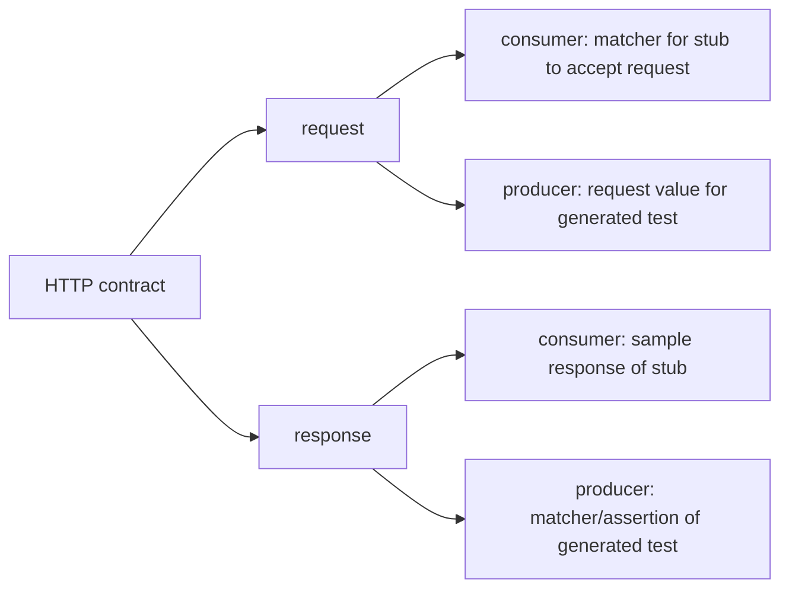
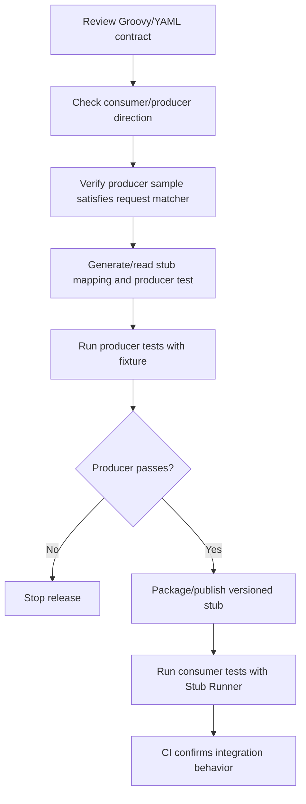

# Matcher Used When Receiving Requests and Sample Value Used When Generating Tests

## 1. One Contract, Two Ways of Using Values

In **Spring Cloud Contract** (module `SPRING_CLOUD_CONTRACT`), the producer and consumer rely on a shared contract to agree on HTTP or messaging behavior. Contracts are written in **Groovy DSL** or **YAML DSL**; the tooling uses them to **generate producer-side tests** and **create stubs for the consumer**. Stub Runner helps the consumer download and launch stubs by version; CI checks whether API changes break the contract.

For an HTTP request, there is a very practical problem: **the consumer does not always send the same value**, whereas **the producer test needs specific input data to run reliably**.

Suppose `POST /api/orders` requires header `X-Request-Id` formatted as `req-` followed by four digits. The consumer might send `req-4821` or `req-7360`. If the stub only accepts one fixed value, many valid requests will fail to match. Yet if the producer test only carries a regex expression as its input data, it has no concrete request to execute.

**Spring Cloud Contract solves both needs with dual-sided values**: one side serves as the rule for matching consumer requests, and the other serves as the concrete value the generated producer test sends to the real application.

After this lesson, you will be able to:

- Distinguish the roles of `consumer(...)` and `producer(...)` in **request** and **response**.
- Write request matchers in Groovy DSL using `$(consumer(regex(...)), producer(...))`.
- Choose sample values for producer tests that **satisfy the matcher** and are reproducible.
- Explain how the stub matches requests and which exact value the generated producer test sends.
- Avoid overly broad matchers, overlapping stub branches, and sample data that fails to reflect real behavior.
- Connect this with YAML DSL, producer verification, Stub Runner, and CI checks.

## 2. Two Data Directions to Remember

Spring Cloud Contract uses **consumer** to refer to the application consuming the API, and **producer** to refer to the application providing the API. For an HTTP contract, the tool views the same specification from two angles:

| Where Is It? | `consumer(...)` Side | `producer(...)` Side |
| --- | --- | --- |
| **Request** | Condition for the stub to **accept requests** sent by consumer; can be a regex/matcher | **Concrete** value the generated producer test uses when calling the real application |
| **Response** | **Sample** value the stub returns to consumer when request matches | Condition the generated producer test uses to **verify the real response**; can be a regex/matcher |

Read the table according to the questions the tool must answer:

1. **What requests does the stub accept?** Look at the `consumer` part of **request**.
2. **What request does the generated test send to the producer?** Look at the `producer` part of **request**.
3. **What does the stub return to the consumer?** Look at the `consumer` part of **response**.
4. **How does the generated test validate the real response?** Look at the `producer` part of **response**.



> **Common pitfall:** the names `consumer` and `producer` do not mean "the value is always randomly generated by that side". They specify **the perspective of using the contract**. The same `consumer(...)` can hold a matcher in a request, while in a response it is usually a sample value emitted by the stub.

## 3. Basic Syntax in Groovy DSL

Common syntax:

```groovy
$(consumer(regex('req-[0-9]{4}')), producer('req-1234'))
```

In this example:

- `$(...)` expresses a two-sided value; you may also see `value(...)` in Groovy DSL docs/examples.
- `consumer(regex('req-[0-9]{4}'))` tells the stub to accept strings starting with `req-` followed by four digits.
- `producer('req-1234')` supplies a **concrete** sample string for the producer test to send.

Do not rely on **argument order inside the expression** to infer roles: read the names `consumer` and `producer`. Some docs/DSL versions also use `client` and `server` to denote the corresponding sides; when practicing, follow the syntax supported by your active Spring Cloud Contract version.

Choosing `req-1234` is intentional because it **matches** `req-[0-9]{4}`. Conversely, `producer('request-abc')` is sample data that violates the rule: it would produce a test suite that does not represent the class of requests served by the stub.

### 3.1. A Regex Is a Condition, Not the Request Sent

```text
Matcher: req-[0-9]{4}
  req-0001   -> in the valid class
  req-8394   -> in the valid class
  req-12     -> not in the valid class
  abc-8394   -> not in the valid class
```

The regex here is a **matching pattern**, not a literal string the HTTP client must send verbatim. When the generated producer test executes, it uses `req-1234` from the `producer` side rather than sending `req-[0-9]{4}` as the header value.

The regexes in this lesson use Groovy single-quoted strings and the `[0-9]` character class for readability. When using `\d`, backslashes may require different escaping depending on string style and DSL location; inspect the generated test/mapping instead of guessing.

## 4. Complete Example: Request Matcher and Sample Response

Suppose an order creation API accepts `POST /api/orders`:

- Header `X-Request-Id` has format `req-` and four digits.
- Body contains `productId = SKU-001` and `quantity = 2`.
- When the product is in stock, the producer returns `201 Created` and JSON containing `id` and `status = CREATED`.
- Order ID is generated dynamically with format `ord-` and four digits.

These are **hypothetical rules for this lesson**. The producer test fixture must establish the in-stock condition and return the success-branch response.

### 4.1. Groovy Contract

File `create_order_dynamic_values.groovy`:

```groovy
import org.springframework.cloud.contract.spec.Contract

Contract.make {
    name 'create_order_dynamic_values'
    description 'Accept properly formatted request ID and create order with dynamic ID'

    request {
        method POST()
        url '/api/orders'
        headers {
            contentType(applicationJson())
            header 'X-Request-Id': $(consumer(regex('req-[0-9]{4}')), producer('req-1234'))
        }
        body([
            productId: 'SKU-001',
            quantity : 2
        ])
    }

    response {
        status 201
        headers {
            contentType(applicationJson())
        }
        body([
            id    : $(consumer('ord-1001'),
                      producer(regex('ord-[0-9]{4}'))),
            status: 'CREATED'
        ])
    }
}
```

When run with valid plugin configuration, the contract is used in two ways:

**Path A — Stub Runner serving the consumer:**

1. The stub receives `POST /api/orders`.
2. The stub checks `X-Request-Id` against matcher `req-[0-9]{4}`, along with the declared method, body, and content type.
3. When the request matches, the stub returns `201` with the sample body:

```json
{
  "id": "ord-1001",
  "status": "CREATED"
}
```

**Path B — Generated producer test verifying the real application:**

1. The test sends `POST /api/orders` with header **`X-Request-Id: req-1234`** and body containing `SKU-001`, `2`.
2. The test expects HTTP status `201` and the committed `Content-Type`.
3. The test verifies response `id` with regex `ord-[0-9]{4}`; the test does not force the producer to always return `ord-1001`.
4. The test checks `status` against the concrete value `CREATED`.

### 4.2. Observation Matrix

| Case | Does the Stub Match the Request? | Does the Producer Test Send This Request? |
| --- | --- | --- |
| `X-Request-Id: req-1234`, valid body | Yes | **Yes**, this is the `producer` sample |
| `X-Request-Id: req-9876`, valid body | Yes | No, though it still belongs to the stub matcher |
| `X-Request-Id: req-12`, valid body | Does not match this header matcher | No |
| `X-Request-Id: abc-1234`, valid body | Does not match this header matcher | No |
| Valid header but different `productId` | Does not match declared sample body, unless an alternate matcher exists | No |

The actual outcome when a request **does not match any mapping** depends on the stub engine and configuration: usually a mapping-not-found response, **not** automatically a `400` business error from the real producer. If the API exposes a `400 INVALID_REQUEST_ID` branch, write a **separate contract** for that branch to protect the error behavior.

### 4.3. Why Doesn't the Response Use the Same Matcher Side as the Request?

If written mistakenly as:

```groovy
response {
    status 201
    body([
        id: $(consumer(regex('ord-[0-9]{4}')),
              producer('ord-1001'))
    ])
}
```

then the meaning diverges from the original goal: the `producer` side is now a **concrete value** `ord-1001` instead of a condition accepting multiple IDs, while the `consumer` side no longer has a clear sample ID as intended. This is a **side-reversal bug**, not merely a stylistic difference. Whether the converter accepts an arbitrary structure must be checked with the actual DSL version in use.

Keep the rule **request: matcher for stub, sample for producer test; response: sample for stub, matcher for producer test** whenever a value can vary and requires two distinct sides.

## 5. Choosing Where to Place Matchers in the Request

Not every field needs `$(...)`. Only use matchers for parts the consumer is allowed to vary without **switching to a different behavioral branch**.

### 5.1. In Headers

```groovy
request {
    method POST()
    url '/api/orders'
    headers {
        contentType(applicationJson())
        header 'X-Request-Id': $(consumer(regex('req-[0-9]{4}')), producer('req-1234'))
    }
    body([productId: 'SKU-001', quantity: 2])
}
```

Headers are a natural place for request IDs or correlation IDs. **Never use a real login token** as a producer test sample. If a header carries authentication semantics, the producer test also needs proper fixtures/security setup rather than merely checking a string format.

### 5.2. In JSON Request Body

Example of an endpoint **validating reference code format**, where every valid code shares the same behavior:

```groovy
request {
    method POST()
    url '/api/references/validate-format'
    headers {
        contentType(applicationJson())
    }
    body([
        reference: $(consumer(regex('REF-[0-9]{6}')),
                     producer('REF-123456'))
    ])
}
response {
    status 200
    headers {
        contentType(applicationJson())
    }
    body([valid: true])
}
```

This makes sense: the endpoint only **validates format**, so every `REF-######` can return the same `valid: true` response. If the API actually **looks up** a reference code, do not widen the matcher to all codes, because some codes exist and others do not; those two cases need separate stubs/contracts.

### 5.3. In URL/Path

When multiple paths lead to the same outcome branch, a matcher can be applied to the URL:

```groovy
request {
    method GET()
    url($(consumer(regex('/api/references/REF-[0-9]{6}/format')),
           producer('/api/references/REF-123456/format')))
}
response {
    status 200
    body([valid: true])
}
```

This is also a **format-checking** API, so the response is identical across the accepted path class. For `GET /api/orders/{id}` returning data for a specific order, using one regex covering many IDs while the stub always returns a single fixed order can be misleading. When different IDs must be supported, design mappings/fixtures and validation logic appropriately for each behavior class.

In addition to `url`, the DSL provides `urlPath` to describe the path and query parameters separately. You can declare matchers for query parameters if the API allows multiple values with equivalent behavior. When using queries, pay attention to URL encoding, data types, and the DSL syntax of your version.

## 6. The Producer Test Sample Value Must Be Representative Enough

Look at the request:

```groovy
$(consumer(regex('req-[0-9]{4}')), producer('req-1234'))
```

A good producer value must:

1. **Satisfy the matcher condition.** `req-1234` fits the pattern; `req-12` does not.
2. **Trigger the right business branch.** If testing only the success branch, the fixture must make this request succeed.
3. **Remain stable across runs.** Do not depend on an unseeded random ID or leftover database state from a previous build.
4. **Be clear in logs.** Names and values should reflect field meaning to aid debugging.
5. **Be safe to store in the repository.** Never include API keys, passwords, session cookies, or real user data.

| Request Matcher | Good Producer Sample | Unsuitable Sample | Reason |
| --- | --- | --- | --- |
| `req-[0-9]{4}` | `req-1234` | `req-1` | Fewer than four digits |
| `REF-[0-9]{6}` | `REF-123456` | `REF-ABCDEF` | Wrong character class |
| `SKU-(001|002)` | `SKU-001` | `SKU-999` | Not in the allowed list |
| `[a-z]{2}-[A-Z]{2}` | `vi-VN` | `VI-vn` | Wrong letter casing format |

**Do not treat a single sample value as proof that the entire regex class has been tested.** The generated producer test with `req-1234` sends only **one concrete request**. If processing rules have critical edge cases, add unit/parameterized tests or additional contracts whenever the consumer needs a distinct observable branch.

### 6.1. When to Add a Contract Instead of Widening the Regex?

Suppose `POST /api/orders` returns:

- `201` when `quantity` is valid and stock is available.
- `400` when `quantity = 0`.
- `409` when `quantity` is valid but out of stock.

Do not use matcher `quantity: .*` for a contract returning `201`. It would match requests that belong to error branches. Instead, group by **outcomes the consumer must handle** and create representative contracts for each meaningful branch.

A stub matches requests solely on declared data; it does not compute inventory or database state itself. The broader the matcher, the easier it is to turn the stub into a misleading model of the producer.

## 7. Response: Sample Value for Stub, Matcher for Producer

In the response direction, the responsibilities of the two sides are **reversed compared to the request**:

```groovy
response {
    status 201
    headers {
        contentType(applicationJson())
    }
    body([
        id: $(consumer('ord-1001'),
              producer(regex('ord-[0-9]{4}')))
    ])
}
```

The consumer test always receives a predictable sample ID from the stub: `ord-1001`. The producer test accepts any properly formatted ID generated by the real producer, such as `ord-9832`.

This is useful when the API dynamically generates:

- Transaction/order IDs.
- Timestamps or dates.
- Correlation IDs.
- Locations or temporary tokens with a published format.

However, **a matcher does not equal full business correctness**. If an order creation request has `quantity = 2`, an ID regex does not verify that the order was persisted or properly linked to the product. Integration tests or additional assertions are needed for critical data relationships.

### 7.1. An Example with `bodyMatchers`

Spring Cloud Contract also provides a way to describe matchers for the response body:

```groovy
response {
    status 200
    headers {
        contentType(applicationJson())
    }
    body([
        id    : 'ord-1001',
        status: 'CREATED'
    ])
    bodyMatchers {
        jsonPath('$.id', byRegex('ord-[0-9]{4}'))
    }
}
```

Here `body` declares the **sample value** for the stub, while `bodyMatchers` describes how the generated producer test matches `$.id`. Choose one representation deliberately; avoid applying two overlapping matchers to the same field without reason.

An overly broad regex like `.*` can cause the producer test to accept invalid values. Regexes should only protect the **committed format**, while type, length, nullability, and relationships between fields must be considered separately.

### 7.2. Individual Matchers Do Not Automatically Check Relationships Between Two Fields

Suppose the response has:

```json
{
  "id": "ord-1001",
  "location": "/api/orders/ord-9999"
}
```

If you only match independent regexes for `id` and `location`, both values can **pass format validation yet be inconsistent**. When the API commits that `location` must point to the exact `id` in the body, you need a relationship-checking mechanism (such as a test assertion/integration test or suitable DSL capability) rather than two independent regexes.

## 8. How Does YAML DSL Express Both Perspectives?

In **YAML DSL**, sample data typically lives in `request`/`response`, while matching conditions live in the corresponding `matchers` sections. The syntax differs from Groovy, but the goal is identical: **the stub accepts valid requests; the generated producer test uses sample inputs and verifies real outputs**.

The example below represents the same order creation scenario from section 4 in YAML (this is an **alternative representation**; do not keep two behaviorally duplicate files in the contracts directory simultaneously):

```yaml
name: create_order_dynamic_values
request:
  method: POST
  url: /api/orders
  headers:
    Content-Type: application/json
    X-Request-Id: req-1234
  body:
    productId: SKU-001
    quantity: 2
  matchers:
    headers:
      - key: X-Request-Id
        regex: 'req-[0-9]{4}'
response:
  status: 201
  headers:
    Content-Type: application/json
  body:
    id: ord-1001
    status: CREATED
  matchers:
    body:
      - path: '$.id'
        type: by_regex
        value: 'ord-[0-9]{4}'
```

Let's read the two data groups:

| YAML | What Is It Used For? |
| --- | --- |
| `request.headers.X-Request-Id: req-1234` | Sample value for the generated producer test's request |
| `request.matchers.headers.regex` | Rule for accepting headers from requests sent to the stub |
| `response.body.id: ord-1001` | Sample value in the HTTP stub response |
| `response.matchers.body` with `$.id` | Matcher to check the `id` field in the real producer's response |

The structure above is standard illustrative Spring Cloud Contract YAML DSL syntax; when applying it, confirm your plugin/DSL version understands this `matchers` section and inspect the generated mappings/tests. Tool versions may differ in matcher capabilities or syntax, but **data direction must stay consistent**.

## 9. Distinguishing "Stub Match" from "Producer Handles Properly"

Suppose Stub Runner is running the contract from section 4. A consumer sends:

```http
POST /api/orders HTTP/1.1
Content-Type: application/json
X-Request-Id: req-9876

{"productId":"SKU-001","quantity":2}
```

The stub returns `201` with `id = ord-1001` because the header matches the regex. The stub returning `201` **does not prove** the real producer successfully handled `req-9876`. It only proves that the request matches a scenario **declared in the contract**.

Meanwhile, the generated producer test sends exact sample `req-1234`. If the real producer returns `201` and ID `ord-9201`, the test passes against regex `ord-[0-9]{4}`; if it returns `id = abc`, the test must fail when the matcher is applied.

| Observed in Test Results | Conclusion You Can Draw | Not Yet Proven |
| --- | --- | --- |
| Stub accepts `req-9876` | That request fits the stub mapping | Real producer accepts every ID in the regex |
| Generated producer test sends `req-1234` and passes | Producer handles the test sample properly and returns matching response | Every string `req-0000` through `req-9999` is handled properly |
| Consumer test handles `ord-1001` successfully | Consumer logic handles the sample payload | Consumer handles all runtime IDs |
| Producer test accepts `ord-9201` | Producer ID has valid format | ID is unique, persisted in DB, or matches `Location` |

To protect those additional requirements, combine contracts with unit tests, parameterized tests, integration tests, and realistic consumer tests. **Matcher breadth must match the scope of conclusions you are entitled to draw.**

## 10. Common Mistakes When Writing Two-Sided Values

| Mistake | Consequence | How to Fix |
| --- | --- | --- |
| Putting the matcher on `producer` in **request** | Producer test lacks the expected sample value; stub may fail to accept requests per desired rule | Put `consumer(regex(...))` and `producer('sample-value')` in request |
| Putting a sample value on `producer` in **response** when dynamic ID is needed | Generated producer test may unintentionally enforce a fixed value | Put `consumer('sample-id')` and `producer(regex(...))` in response |
| Producer sample does not match request matcher | Test verifies a case outside the request class published by the stub | Pick a valid sample and re-check the regex |
| Using `.*` matcher for all fields | Stub hits wrong branches or tests miss real divergences | Restrict regex to concrete type/format |
| Multiple mappings match the same request with different responses | Stub returns unstable branches, hard to diagnose | Separate requests by method, path, body, query, and headers properly |
| Treating response sample value as an assertion on exact producer output | Test fails when dynamic ID/timestamp changes validly | Use a producer-side matcher for dynamic fields |
| Only asserting ID matches regex | Misses uniqueness, body/header relationships, or persisted data checks | Add appropriate integration/relational assertions |
| Using fixtures with secrets or real data | Stub artifacts may leak sensitive data | Use fake, reproducible values |
| Changing matchers to make tests pass without checking business requirements | Contract loses defect-detection power | Cross-check API agreement and consumer needs first |

### 10.1. Diagnosing When the Stub Does Not Match

Check in order:

1. Do **method and path** match the mapping?
2. Does the **`Content-Type` header** match what the contract declares?
3. Do **header/body/query values using matchers** actually satisfy the regex?
4. Is **another mapping** intercepting the same request?
5. Has Stub Runner loaded the **right stub version**?
6. Does the generated stub mapping actually contain the expected matcher?

For example, a client sends `X-Request-Id: req-12345` (five digits). With matcher `req-[0-9]{4}`, that request is outside the valid class; do not change the regex to `.*` just to make it match. Clarify whether the contract intends to accept strictly four or more digits and update both producer and consumer when requirements change.

### 10.2. Diagnosing When the Generated Producer Test Fails

If the test fails because the producer returns `id = order-1001` while the matcher expects `ord-[0-9]{4}`:

- Check whether the producer actually changed its ID format.
- Verify whether the new format was agreed upon with the consumer.
- If the change is intentional, update the contract and add appropriate consumer tests before deploying.
- If unintentional, fix the producer and keep the contract as a safeguard.

If the test fails because request `req-1234` is rejected, inspect the test fixture, authentication filters, validation, header configuration, and inventory seeding. Do not assume every generated-test failure is a matcher bug.

## 11. Verification Workflow in CI



A practical workflow:

1. **Review the contract:** inspect dynamic values, `consumer/producer` direction, and interaction branches. Decide when multiple values are allowed and when values must stay fixed.
2. **Verify DSL/generator:** the plugin must parse the contract and generate the right stub/test. Inspect the generated mapping to ensure the regex became a request matcher rather than a literal string.
3. **Run producer verification:** the test base prepares data so sample request `req-1234` genuinely hits the success branch. The test verifies `201`, body, and ID matcher.
4. **Package artifact:** publish a versioned stub, e.g., `com.example:orders-producer:1.4.2:stubs`, after producer tests pass.
5. **Run consumer tests:** Stub Runner downloads the desired version; consumer tests send at least the sample request and another valid request like `req-9876` when test scope requires it, asserting that consumer logic handles the sample response properly.
6. **Protect error branches:** for invalid requests or out-of-stock orders, add dedicated contracts/tests instead of relying on missing stub mappings.

For reproducible CI, **pin stub versions**. A `SNAPSHOT` or dynamic version can change contents while consumer code stays unchanged, making root-cause debugging harder.

## 12. Practice Exercise: Request Matcher and Test Sample for Transactions

Suppose `POST /api/payments` receives JSON:

```json
{
  "clientReference": "PAY-2026-123456",
  "amount": 50000
}
```

The API requires `clientReference` to follow format `PAY-2026-` plus six digits; for valid data, the producer returns `202 Accepted`, with JSON containing `paymentId` formatted as `pmt-` plus six digits and `status = PENDING`.

### 12.1. Requirements

1. Write the Groovy contract `create_payment_accepted.groovy`.
2. In the request, use `consumer(regex('PAY-2026-[0-9]{6}'))` and choose sample `producer('PAY-2026-123456')`.
3. In the response, use sample `consumer('pmt-100001')` for the stub and `producer(regex('pmt-[0-9]{6}'))` for the generated producer test.
4. Keep `amount = 50000` fixed if this value represents the same valid branch.
5. Explain what happens if the stub receives `PAY-2026-999999`, and why the producer test still sends only `PAY-2026-123456`.
6. Describe how to test invalid transactions if `amount = 0` returns `400`: a separate contract and sample data matching the error branch.

### 12.2. Reference Solution

```groovy
import org.springframework.cloud.contract.spec.Contract

Contract.make {
    name 'create_payment_accepted'

    request {
        method POST()
        url '/api/payments'
        headers {
            contentType(applicationJson())
        }
        body([
            clientReference: $(consumer(regex('PAY-2026-[0-9]{6}')),
                               producer('PAY-2026-123456')),
            amount: 50000
        ])
    }

    response {
        status 202
        headers {
            contentType(applicationJson())
        }
        body([
            paymentId: $(consumer('pmt-100001'),
                         producer(regex('pmt-[0-9]{6}'))),
            status   : 'PENDING'
        ])
    }
}
```

**Explanation:** The stub can accept many properly formatted `clientReference` values and return a sample `paymentId`. The generated test sends only `PAY-2026-123456` and verifies the ID returned by the real producer via regex. ID names and formats are hypothetical for this exercise; teams should replace them with real API agreements and fixtures in practice.

### 12.3. Self-Check

| Question | Answer |
| --- | --- |
| Does the request stub accept `PAY-2026-654321`? | Yes, if all other request conditions match |
| Which string does the generated producer test send? | `PAY-2026-123456` |
| Which `paymentId` does the stub return? | `pmt-100001` |
| If the real producer returns `pmt-654321`, does the matcher accept it? | Yes, provided the response satisfies the other commitments |
| What if the real producer returns `payment-654321`? | Does not match regex `pmt-[0-9]{6}` |
| Does the stub not matching `amount = 0` prove the producer returns `400`? | No; there must be a dedicated contract and tests for the error branch |

### Checklist Before Finalizing Two-Sided Values

- [ ] Clearly know whether you are handling **request** or **response**.
- [ ] Request matcher is on the **consumer** side; producer test value is on the **producer** side.
- [ ] Stub response has a **consumer** sample value; generated producer test has a **producer** matcher for dynamic fields.
- [ ] Producer sample value satisfies the request matcher and triggers the right branch.
- [ ] Regex is tight enough to distinguish branches and reject malformed requests.
- [ ] Fixed fields remain verified against committed values.
- [ ] Inspected the stub mapping and generated producer test after generation.
- [ ] Fixtures are reproducible; fake data contains no secrets.
- [ ] Producer tests, consumer tests, and CI use the exact contract/stub version.

**Key takeaway:** for **requests**, use a consumer-side matcher so the stub accepts valid values and a producer-side sample value so the generated test sends a deterministic request. For **responses**, the stub needs a consumer-side sample value, while the producer test can use a producer-side matcher to validate dynamic data. Getting both directions right keeps the contract suite flexible for the consumer yet precise enough to catch incompatible changes.
