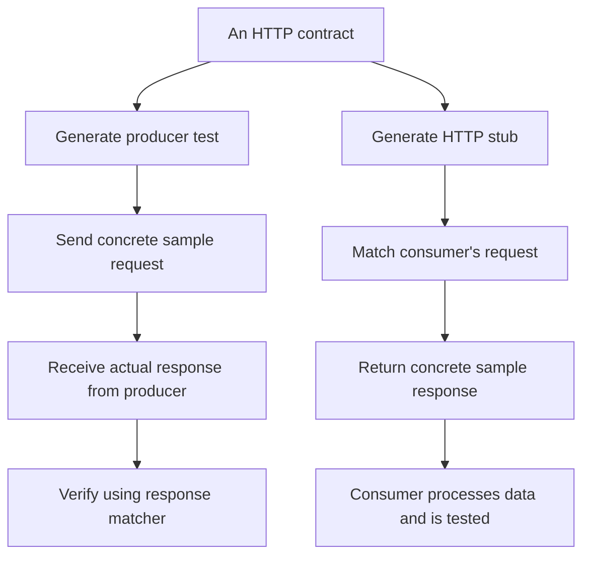
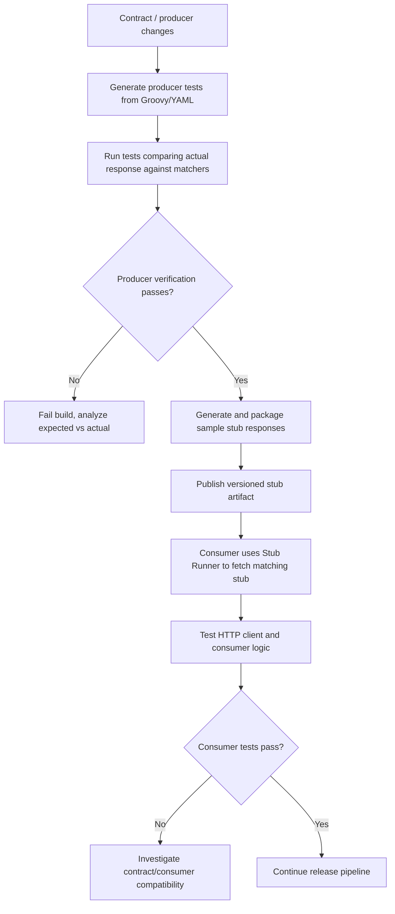

# Matcher Used When Verifying Responses and Value Returned in Stubs

## 1. The Problem: Producer Returns Dynamic Data, Consumer Needs a Usable Response

In a multi-service system, HTTP responses often contain values generated at processing time: transaction IDs, receipt numbers, payment timestamps, sequence numbers, or correlation identifiers. If the contract requires the producer to return **the exact same fixed ID string and timestamp** on every run, tests will fail even when the API still satisfies the consumer's needs.

Conversely, when `Order Service` (consumer) runs tests against a stub of `Payment Service` (producer), it needs to receive **a concrete JSON payload** to deserialize and make decisions on, rather than receiving a regex expression as a JSON value.

For example, a real payment response might look like:

```json
{
  "receiptId": "RC-84721",
  "status": "PAID",
  "amount": 125000,
  "currency": "VND"
}
```

In another environment, the producer returns `receiptId = "RC-90118"`; both are valid if the agreed format is `RC-` followed by digits. Meanwhile, the consumer test can use the sample response `"RC-42"` to verify its mapping logic.

**Spring Cloud Contract** resolves this conflict using **two-sided values** in Groovy DSL and **response matchers** in YAML DSL. The contract supports generating producer verification tests as well as stubs for the consumer via Stub Runner. When integrated into CI, the tests protect API compatibility without locking down validly varying data.

After this lesson, you will know how to:

1. Distinguish the **response value used in the stub** from the **response matcher used in producer verification**.
2. Understand the meaning of `consumer`/`producer`, their abbreviations, and their aliases.
3. Write Groovy/YAML contracts with separate sample data and verification conditions.
4. Check fields, data types, formats, and semantics without confusing matchers with returned values.
5. Diagnose when producer tests pass but consumer tests fail, or vice versa.

## 2. Two Sides in a Contract Are Not Two Independent HTTP Responses

One contract describes **the same interaction**, yet is used in two directions when generating artifacts:

| Contract Section | Producer Side | Consumer Side |
| --- | --- | --- |
| HTTP `request` | Test needs a **concrete request value** to call the real application | Stub needs a **request matching condition**, which can be a regex |
| HTTP `response` | Test needs a **condition to verify the actual response**, which can be a regex or type check | Stub needs a **concrete response value** to return to the consumer |

This is the easiest point to mix up: for **requests**, flexible expressions usually serve **stub matching**; for **responses**, flexible expressions usually serve **producer verification**.



A stub normally returns the **sample response** written in the contract; the producer's regex does not turn into a JSON field containing a regex string. And the producer test does not force the actual response to match the sample literally if the matcher allows a range of values.

### 2.1. Quick Comparison Example

Suppose the contract wants to enforce the rule that `receiptId` matches pattern `RC-[0-9]+`:

| Case | Value | Conclusion |
| --- | --- | --- |
| Stub returns to consumer | `"RC-42"` | Concrete value; consumer reads it as a normal string |
| Real producer returns | `"RC-84721"` | Valid because it matches the regex |
| Real producer returns | `"RECEIPT-A"` | Violates the regex |
| Real producer omits `receiptId` | Field missing | Violates contract if field is committed as required |

**Matchers do not generate the producer's values.** The producer returns data from its real controller/service; the matcher only checks whether that data satisfies the contract.

## 3. Syntax of `consumer` and `producer` in Groovy DSL

Spring Cloud Contract's Groovy DSL supports two-sided expressions in the form:

```groovy
value(consumer(...), producer(...))
value(c(...), p(...))
value(stub(...), test(...))
value(client(...), server(...))
```

When using a Groovy map for the body, you can write the shorthand:

```groovy
$(consumer(...), producer(...))
$(c(...), p(...))
$(stub(...), test(...))
$(client(...), server(...))
```

The names `consumer`, `c`, `stub`, `client` denote the **same consuming side**, while `producer`, `p`, `test`, `server` denote the **same providing/producer-testing side**. They are different ways of expressing the same role, not four different tools.

Example of a single field in a **response body**:

```groovy
receiptId: $(consumer('RC-42'), producer(regex('RC-[0-9]+')))
```

Correct reading:

- `consumer('RC-42')` supplies the **concrete value in the stub response**.
- `producer(regex('RC-[0-9]+'))` supplies the **verification condition for the response actually returned by the producer**.

This can be written equivalently as:

```groovy
receiptId: $(c('RC-42'), p(regex('RC-[0-9]+')))
```

**Do not infer from the name `consumer` that the consumer will execute this matcher.** For a field in the response, the consumer receives sample data; checking the real response against the regex happens inside the producer test.

## 4. Complete Groovy Contract: Stub Sample and Producer Matcher

Suppose Payment Service exposes `GET /api/payments/42` and commits to:

- HTTP status `200`, `Content-Type: application/json`.
- `receiptId` is a string starting with `RC-` followed by digits.
- `status` must be exact `PAID`.
- `amount` is a number, allowed to vary across test datasets.
- `currency` must be exact `VND`.

Groovy contract:

```groovy
import org.springframework.cloud.contract.spec.Contract

Contract.make {
    description 'Look up completed payment'

    request {
        method GET()
        url '/api/payments/42'
    }

    response {
        status OK()
        headers {
            contentType(applicationJson())
        }
        body(
            receiptId: $(consumer('RC-42'),
                         producer(regex('RC-[0-9]+'))),
            status: 'PAID',
            amount: 125000,
            currency: 'VND'
        )
        bodyMatchers {
            jsonPath('$.amount', byType())
        }
    }
}
```

The contract combines two ways of modeling dynamic data in Groovy:

1. **Inline two-sided value** on `receiptId`: one branch supplies the sample response for the stub, and the other describes the producer matcher.
2. **`response.bodyMatchers`** on `amount`: the body holds the sample value `125000`, while the producer test verifies the numeric type instead of enforcing one exact value.

`status` and `currency` remain fixed values. This is intentional: if the consumer only understands `PAID` in this scenario and requires `VND`, do not turn both fields into broad regexes just so tests pass easily.

### 4.1. How Do the Two Generated Artifacts Differ?

**On the Stub Runner / WireMock side**, the response is simulated using the concrete data:

```http
HTTP/1.1 200 OK
Content-Type: application/json

{
  "receiptId": "RC-42",
  "status": "PAID",
  "amount": 125000,
  "currency": "VND"
}
```

**On the producer test side**, the test calls the real API and verifies:

| Condition | Actual Response Check |
| --- | --- |
| HTTP status | Must be `200` |
| Media type | Must match the `Content-Type` condition in the contract |
| `receiptId` | Must match `RC-[0-9]+` |
| `status` | Must be `PAID` |
| `amount` | Must have a data type matching the sample per `byType()` |
| `currency` | Must be `VND` |

For example, a producer returning `"receiptId":"RC-84721"` with `"amount":130000` satisfies the matchers above. However, if the consumer needs to ensure `amount` equals the transaction's exact amount, checking **only data type** is not enough; add business conditions or other appropriate tests.

**Note:** The snippet above is a DSL illustration. To run it, the project needs Spring Cloud Contract Verifier, the Maven/Gradle plugin, a test base class, and data fixtures for payment `42`.

## 5. YAML DSL: Sample Value in `body`, Matcher Under `response.matchers`

In YAML DSL, Spring Cloud Contract uses a `matchers` section instead of embedding `$(consumer(...), producer(...))` directly into body scalars.

YAML contract expressing the same policy as the Groovy example:

```yaml
description: Look up completed payment
request:
  method: GET
  url: /api/payments/42
response:
  status: 200
  headers:
    Content-Type: application/json
  body:
    receiptId: "RC-42"
    status: "PAID"
    amount: 125000
    currency: "VND"
  matchers:
    body:
      - path: '$.receiptId'
        type: by_regex
        value: 'RC-[0-9]+'
      - path: '$.amount'
        type: by_type
```

Reading part by part:

- `response.body.receiptId: "RC-42"` is the **sample response used to build the stub**.
- `response.matchers.body[0]` with JSONPath `$.receiptId` is the **condition the producer test uses when checking that field**.
- `response.matchers.body[1]` with `by_type` requires `amount` to match the sample's data type.
- `status` and `currency` have no dedicated matcher, so the fixed values in the contract remain the expectation.

**Mandatory rule:** JSONPaths in `response.matchers` must point to fields that exist in the contract's sample `response.body`. You cannot declare a matcher for `$.receiptId`, omit `receiptId` from the sample body, and expect the tool to know what value to return for the stub.

### 5.1. Why Doesn't YAML Write `consumer` and `producer` Like Groovy?

Groovy allows embedding dynamic values into the body using DSL expressions; YAML uses a static data format, so Spring Cloud Contract designed a separate `matchers` section. It is not that YAML lacks support for dynamic data: the same sample body and matchers still produce a **concrete stub response** and a **flexible producer assertion**.

If your project has specific syntax requirements for individual matchers, check the exact Spring Cloud Contract version and YAML schema in use; avoid copying `bodyMatchers { ... }` verbatim from Groovy into YAML.

## 6. Reversal Between Request and Response

A single contract can need both a **flexible request on the stub** and a **flexible response in the producer test**. Those are two distinct problems, yet both use the two-sided concept.

Consider a lookup-by-path endpoint:

```groovy
import org.springframework.cloud.contract.spec.Contract

Contract.make {
    description 'Look up by payment ID'

    request {
        method GET()
        url $(consumer(regex('/api/payments/[0-9]+')),
              producer('/api/payments/42'))
    }

    response {
        status OK()
        headers {
            contentType(applicationJson())
        }
        body(
            receiptId: $(consumer('RC-42'),
                         producer(regex('RC-[0-9]+'))),
            status: 'PAID'
        )
    }
}
```

In the **request**:

- `consumer(regex('/api/payments/[0-9]+'))`: the stub can match URLs of consumer requests fitting the regex.
- `producer('/api/payments/42')`: the generated test needs a **concrete** path to call the real API.

In the **response**:

- `consumer('RC-42')`: the stub returns a concrete response for the client to process.
- `producer(regex('RC-[0-9]+'))`: the producer test allows real IDs matching the format.

| Direction | Concrete Data | Flexible Matcher |
| --- | --- | --- |
| Request | Producer test | Consumer-side stub matching |
| Response | Consumer-side stub response | Producer verification |

**Scope warning:** The example request regex matches many IDs while the stub returns the same sample response `RC-42`. This is suitable for testing client deserialization when the contract only needs one representative response; it does **not** mean the stub simulates a one-to-one mapping between each `paymentId` and a distinct `receiptId`. If the client depends on that relationship, use separate contracts or appropriate response templating.

## 7. Choosing the Right Matcher Type When Verifying Responses

Spring Cloud Contract supports several matcher types for responses. Using the right matcher keeps tests flexible enough yet strict enough to catch dangerous changes.

| Matcher in Groovy | YAML Equivalent | Suitable For |
| --- | --- | --- |
| `byEquality()` | `by_equality` | Ensuring actual value equals sample data |
| `byRegex('...')` | `by_regex` | ID formats, status sets, structured strings |
| `byType()` | `by_type` | Data type, e.g., number/string/boolean |
| `byDate()` | `by_date` | Date string in supported format |
| `byTime()` | `by_time` | Time string |
| `byTimestamp()` | `by_timestamp` | Date-time string |
| `byNull()` | `by_null` | Committed JSON `null` value |
| `byCommand('...')` | Version/support dependent | Custom check condition using a project-provided method |

YAML matcher type names and per-version capabilities can vary; the table above serves as a guide for common matchers. Verify the YAML schema and generated tests against the version pinned in your build.

### 7.1. `byRegex`: The Format Must Be Meaningful

For example, `status` belongs to a small set of values:

```groovy
body(
    status: 'PAID'
)
bodyMatchers {
    jsonPath('$.status', byRegex('PAID|PENDING|FAILED'))
}
```

This is a **fragment inside `response`**, not a standalone contract. If a contract uses the matcher above, a producer returning `PENDING` still passes the `status` condition. However, that may be **wrong from a business perspective** if the request was named "look up paid transaction". Do not loosen a matcher just because multiple statuses exist system-wide; consider **the context of each scenario**.

### 7.2. `byType`: Checks Type, Not Semantics

For example, `amount` in the sample body is a number:

```groovy
body(amount: 125000)
bodyMatchers {
    jsonPath('$.amount', byType())
}
```

Then `125000` and `130000` both satisfy the type; `"125000"` is a string and will fail as a type mismatch. However, `-9999` is also a number; if the business forbids negative amounts, add an extra assertion or a specialized matcher.

### 7.3. JSON `null` and Missing Fields Are Not the Same

These three responses are different:

```json
{"receiptUrl": null}
```

```json
{}
```

```json
{"receiptUrl": ""}
```

If the contract requires `receiptUrl` to be present with value `null`, `byNull()` expresses that expectation. If `receiptUrl` **is allowed to be absent**, consider an appropriate optional condition or separate scenarios with/without the field. Neither `byType()` nor `byRegex()` automatically makes a required field optional.

### 7.4. Arrays and Nested Objects

For a response:

```json
{
  "receiptId": "RC-42",
  "items": [
    {"sku": "BOOK-01", "quantity": 2},
    {"sku": "PEN-02", "quantity": 1}
  ]
}
```

JSONPaths such as `$.items[0].sku` or `$.items[*].quantity` can be used in matchers depending on the rule being verified. However, a type matcher on `items[0].quantity` does not prove the entire array has the right schema, order, or size. If those properties matter to the consumer, add further conditions or separate tests.

## 8. Concrete Stub Values Must Represent Real Behavior

Having fixed sample data in a stub response is **intentional**, but that does not mean just any sample data is good. Choose values that help the consumer test the right behavior:

- `receiptId` with a realistic format, e.g., `RC-42`, instead of `"anything"`.
- `status` matching the business case, e.g., `PAID` for a completed-payment scenario.
- `amount` with a concrete number so the consumer can verify DTO mapping and its own calculations.
- `currency` with a value supported by the consumer, e.g., `VND`.
- Separate contracts for errors or other states if the consumer has different handling branches.

### 8.1. Two Scenarios, Two Stubs

Suppose the consumer needs to handle both successful and failed payments:

| Scenario | Request | Sample Stub Response | Producer Must Satisfy |
| --- | --- | --- | --- |
| Successful payment | `GET /api/payments/42` | `200`, `status=PAID`, `receiptId=RC-42` | Required fields, data types, ID format |
| Failed payment | `GET /api/payments/43` | `200`, `status=FAILED`, `failureCode=CARD_DECLINED` | `FAILED` value, valid error code |

Do not write **one** stub that always returns `PAID` for every scenario and conclude the consumer has been tested for `FAILED`. Stub Runner only returns samples/behaviors that were described and matched to requests; consumer tests must actively invoke the right scenarios.

### 8.2. When Is Response Templating Needed?

Some APIs require the response to echo a value from the request (such as `correlationId` or `orderId`). A stub returning a fixed value may not suffice to verify that link. Spring Cloud Contract has mechanisms to reference values from the request in the response, such as `fromRequest()` in Groovy DSL and corresponding Handlebars expressions in certain other DSLs.

This is a **different** need from producer matchers: matchers only verify a real response, whereas response templating determines **how the stub returns dynamic data** based on the request. Enable templating only when the API policy requires that relationship; verify WireMock/Stub Runner configuration and your DSL version accordingly.

## 9. Reading Generated Tests and Verifying the Producer

A valid response must come from **the producer application running in the test environment**. Spring Cloud Contract Verifier reads the contract, generates tests, calls the API, and checks the actual response.

Illustrative example of equivalent assertions in a Spring MVC test:

```java
mockMvc.perform(get("/api/payments/42"))
    .andExpect(status().isOk())
    .andExpect(content()
        .contentTypeCompatibleWith(MediaType.APPLICATION_JSON))
    .andExpect(jsonPath("$.receiptId",
        matchesPattern("RC-[0-9]+")))
    .andExpect(jsonPath("$.status").value("PAID"))
    .andExpect(jsonPath("$.amount").isNumber())
    .andExpect(jsonPath("$.currency").value("VND"));
```

This is only a **logical illustration**; it is not Java code guaranteed to be generated verbatim by Spring Cloud Contract. For instance, it requires imports, corresponding Hamcrest/JUnit matchers, and a configured test context. Actual execution depends on the plugin version and MockMvc/REST Assured choice.

For trustworthy results:

1. Ensure `GET /api/payments/42` has data/fixtures in the test environment.
2. Run generated producer tests against the real controller/serialization rather than mocking out the final response.
3. Read the exact generated conditions for `receiptId`, `status`, `amount`, and `currency`.
4. Verify the actual count of executed contract tests, avoiding a green pipeline where all tests were skipped.
5. If a test fails, compare the actual response against consumer expectations before modifying the DSL.

Example failure report:

```text
GET /api/payments/42
Expected response matcher: $.receiptId matches RC-[0-9]+
Actual response: {"receiptId":"RECEIPT-42","status":"PAID",
                  "amount":125000,"currency":"VND"}
Result: FAIL
```

The value `"RECEIPT-42"` **may look like a valid ID string from the producer's internal perspective**, but if the contract published `RC-...` and the consumer depends on that format, the change is likely incompatible.

## 10. How Does Stub Runner Test the Consumer Side?

After producer verification passes, the build can package a stub artifact. The consumer uses Stub Runner to fetch the exact artifact version, start the stub, and send requests using its own HTTP client.

Example configuration on the consumer side:

```java
@SpringBootTest
@AutoConfigureStubRunner(
    ids = "com.example:payment-service:1.0.0:stubs:8085",
    stubsMode = StubRunnerProperties.StubsMode.LOCAL
)
class PaymentClientContractTest {
    // Call PaymentClient against localhost:8085 and verify:
    // - receiptId is mapped to String;
    // - PAID status is handled;
    // - amount and currency are read correctly.
}
```

This is illustrative code; it needs imports, the HTTP client URL configuration, and actual consumer assertions. `LOCAL` works when the stub is already in the local Maven repository; CI pipelines usually need an appropriate artifact repository to download stubs.

**The version `1.0.0` above is the artifact version of `payment-service`, not the Spring Cloud Contract library version.**

In this test, the stub may return `receiptId: "RC-42"` even though the real producer in another environment might return `"RC-84721"`. That is **not a bug** as long as both belong to the agreed value domain. However, testing the consumer with a single sample does not cover every ID; if parsing or logic depends on other variants, add corresponding tests.

## 11. PASS/FAIL Matrix When the Real Producer Returns Data

Assuming the sample contract from section 4:

- `receiptId`: pattern `RC-[0-9]+`.
- `status`: equals `PAID`.
- `amount`: numeric type.
- `currency`: equals `VND`.
- HTTP status `200`, valid JSON body.

| Actual Producer Response | Expected Result | Explanation |
| --- | --- | --- |
| `receiptId="RC-42"`, `amount=125000` | PASS | Matches sample and matcher |
| `receiptId="RC-84721"`, `amount=130000` | PASS per declared matchers | ID matches pattern, amount is still a number |
| `receiptId="RECEIPT-42"` | FAIL | Does not match format |
| `receiptId=42` | FAIL | Not a string matching the regex |
| Missing `receiptId` | FAIL | Required field removed |
| `status="PENDING"` | FAIL | Violates `PAID` expectation for this scenario |
| `amount="125000"` | FAIL | String instead of numeric type |
| `currency="USD"` | FAIL | Violates `VND` expectation |
| Returns HTTP `204` | FAIL | Wrong response status code |

The table only considers the described fields/conditions. Whether adding a new response field causes failure depends on the JSON comparison mechanism and generated test settings. If protecting against extra fields is unnecessary, avoid locking the contract too tightly; at the same time, ensure the client can ignore unknown fields.

## 12. Common Mistakes When Using Two-Sided Values

### 12.1. Putting a Regex on the `consumer` Side of a Response and Expecting the Producer Test to Use It

Wrong in intent:

```groovy
receiptId: $(consumer(regex('RC-[0-9]+')),
             producer('RC-42'))
```

This puts the flexible condition on the stub response side and the fixed value on the producer side, **the opposite of the intended goal**. For a response with a dynamic ID, use:

```groovy
receiptId: $(consumer('RC-42'),
             producer(regex('RC-[0-9]+')))
```

When the direction is reversed, the producer test may get locked to a hardcoded value or the stub may fail to emit the intended data. Inspect the generated test and stub mapping instead of relying solely on Groovy DSL parsing successfully.

### 12.2. Assuming the Regex Will Be Sent to the Consumer as JSON

A regex is a **verification rule**, not business data. The consumer test needs a valid sample response. If you want the stub to return data varying by request or state, write corresponding contracts or use explicit templating mechanisms.

### 12.3. Using `byType()` for a Field with a Small Domain

If `status` is only allowed to be `PAID`, `PENDING`, or `FAILED`, checking "it is a string" is far too broad. Keep a fixed value per scenario or use a regex restricted to the exact set of values the consumer can handle.

### 12.4. Changing Stub Data Without Reviewing Consumer Tests

Changing the stub's `receiptId` from `RC-42` to `RC-43` might not alter the producer's obligation, yet it will break consumer tests asserting against the sample value. Distinguish **fixture changes** from **interface changes**; only adjust client tests if the sample value no longer matters, and ensure business scenarios remain covered.

### 12.5. Publishing Stubs Before Producer Verification Passes

Stubs describe the contract but do not directly measure the actual response. If producer tests are skipped, the consumer can work flawlessly with `"RC-42"` while the real producer has started returning `"RECEIPT-42"`. Only publish a stub as a **verified** contract after producer tests pass.

### 12.6. An Overly General Matcher Hiding Business Bugs

A `.*` regex or type-only matcher can still PASS when data is nonsensical. Prefer constraints on format, value domain, and required fields that the consumer genuinely relies upon.

## 13. Integrating CI So Both Sides Do Not Drift Apart

A recommended test flow:



In CI, you should:

1. **Pin versions** of Spring Cloud Contract dependencies/plugins compatible with your Spring Boot/Cloud BOM.
2. **Verify contract sources are read**, test code is generated, and the test count executed.
3. **Inspect actual responses** when assertions fail, distinguishing real API changes from missing fixture data.
4. **Never loosen matchers on your own** just to turn the build green; confirm which formats consumers depend on.
5. **Only publish stubs already verified by the producer**, version the artifact, and have consumers test against the exact version.
6. **Keep necessary integration/E2E tests** to verify networking, security, broker configuration, and business flows outside contract scope.

Producer tests and consumer tests guard two sides of the same agreement; **one side passing does not replace the other**.

## 14. Self-Check Practice Exercise

An `Invoice Service` system has the API `GET /api/invoices/900`, returning JSON:

```json
{
  "invoiceCode": "INV-900",
  "state": "ISSUED",
  "total": 220000,
  "currency": "VND"
}
```

Requirements:

- `invoiceCode` always follows regex `INV-[0-9]+`, though the producer may return an ID different from the sample.
- `state` for this scenario must be `ISSUED`.
- `total` is a number; `currency` equals `VND`.
- The consumer test wants to receive `invoiceCode = INV-900` as an example.

Complete these four steps yourself:

1. In Groovy DSL, write `invoiceCode` using `$(consumer(...), producer(...))`.
2. Write `response.bodyMatchers` to verify `total` by type.
3. Convert the contract to YAML, keeping `INV-900` in `response.body` and adding `response.matchers.body` for `invoiceCode` and `total`.
4. Evaluate a response with `invoiceCode = "INV-A"`, `state = "ISSUED"`: should the producer test PASS or FAIL? Does the stub response necessarily change along with the actual response?

**Groovy Hint:**

```groovy
body(
    invoiceCode: $(consumer('INV-900'),
                   producer(regex('INV-[0-9]+'))),
    state: 'ISSUED',
    total: 220000,
    currency: 'VND'
)
bodyMatchers {
    jsonPath('$.total', byType())
}
```

This is a snippet placed inside `response`, not a complete contract file. With actual `"INV-A"`, the producer test **must fail** because it does not match the regex; however, the stub can still return sample `INV-900`. If the invoice code format needs to change, the team must align with the consumer and update the contract under a compatibility plan.

## 15. Checklist Before Reviewing a Contract

- For each dynamic response field, clearly distinguished **the value returned in the stub** from **the matcher verifying the actual producer response**?
- Does Groovy DSL place `consumer(...)` on the sample data branch and `producer(...)` on the verification branch appropriately for `response`?
- Does YAML have a valid sample body and matchers referencing JSONPaths that actually exist?
- Do `byRegex`, `byType`, or fixed values reflect the consumer's real requirements?
- Are required fields, optional fields, `null`, and array structures tested according to business rules?
- Is Stub Runner using the stub artifact from the exact producer-verified version?
- Does CI run all generated producer tests before publishing stubs, and does the consumer test critical sample responses?

**Official docs for checking version-specific syntax:**

- [Spring Cloud Contract — Dynamic properties](https://docs.spring.io/spring-cloud-contract/reference/project-features-contract/dsl-dynamic-properties.html)
- [Spring Cloud Contract — How Can I Provide Dynamic Values to a Contract?](https://docs.spring.io/spring-cloud-contract/reference/howto/how-to-provide-dynamic-values.html)

**Key takeaway:** In a **response**, `consumer` (or `stub`/`client`) describes **the concrete value returned by the stub**, while `producer` (or `test`/`server`) can describe **the matcher used to verify the real response**. In YAML, place sample values in `response.body` and matchers in `response.matchers.body`. Mastering both sides makes Spring Cloud Contract tests capable of catching incompatible APIs while providing stable stubs for consumers.
