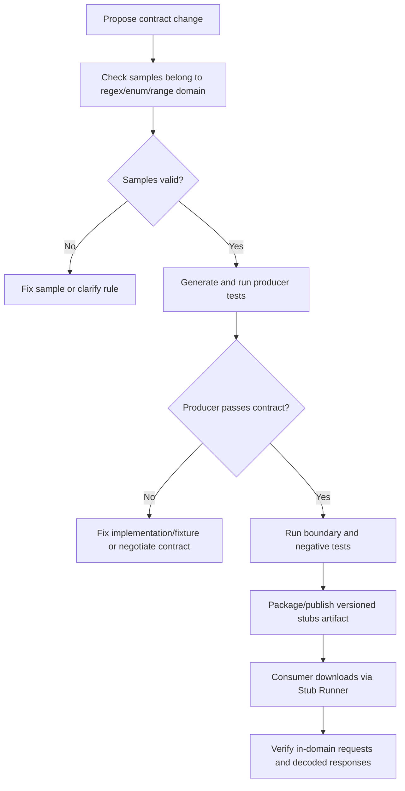

# Choosing Sample Values That Satisfy the Specified Expression

In **Spring Cloud Contract**, a contract can both provide **concrete sample values** to build HTTP requests/responses and describe **specified expressions** (such as regular expressions) that producer or consumer data must satisfy. These two parts must be consistent: **the sample value must belong to the set of values permitted by the expression**. For instance, if a contract requires customer IDs to match `CUST-[1-9][0-9]{3}` yet chooses sample `CUST-0042`, the sample violates the very rule being published.

This lesson belongs to the **Two-Sided Values** chapter in the **SPRING_CLOUD_CONTRACT** module. The goal is to choose reliable sample values when describing HTTP behavior with **Groovy/YAML DSL**, understand where samples and matchers are used in **generated producer tests** and **stubs**, and bring those verification rules into producer, consumer, and CI testing workflows. The same principle also applies to message contract payloads, even though messaging test execution differs from HTTP.

## 1. Sample Values and Specified Expressions Are Complementary Parts

Suppose **Order Service** (producer) exposes an order creation API to **Checkout Service** (consumer):

```http
POST /api/orders
Content-Type: application/json

{"customerId":"CUST-1042","quantity":2}
```

Success response:

```http
HTTP/1.1 201 Created
Content-Type: application/json

{"orderId":"ORD-9001","status":"CREATED"}
```

The team agrees on the example formats:

| Field | Specified Expression / Condition | Sample That **Satisfies** | Sample That **Fails** |
| --- | --- | --- | --- |
| `customerId` | `CUST-[1-9][0-9]{3}` | `CUST-1042` | `CUST-0042`, `CUST-ABC` |
| `orderId` | `ORD-[0-9]{4}` | `ORD-9001` | `ORD-91`, `ord-9001` |
| `quantity` | Integer from 1 to 10, per the example's business rules | `2` | `0`, `11`, `"2"` if type coercion is disallowed |
| `status` in order creation success response | Equals `CREATED` | `CREATED` | `SUCCESS` |

**The sample value** answers: "In one concrete test run, what data will we send/receive?". **The specified expression** answers: "Which data values are considered compliant with what was committed?". If we call the valid domain `D`, sample `e` must satisfy:

\[
e \in D
\]

With regex `CUST-[1-9][0-9]{3}`, example `CUST-1042` belongs to the domain by **format**. That **does not prove** customer 1042 exists, is allowed to place orders, or belongs to the right account; conditions tied to system state require separate business tests and fixtures.

Do not equate **"one valid example"** with **"every value in the domain works"**. A generated producer test using only `CUST-1042` can pass even if the producer accidentally rejects `CUST-2356`, although the second sample is also well-formatted. Therefore, beyond choosing valid samples, build representative and boundary tests when the domain is wide or has complex business constraints.

## 2. Why Must Spring Cloud Contract Know Values on Both Sides?

Spring Cloud Contract uses one contract for **two testing flows**:

1. **Producer testing:** Contract Verifier generates tests that run against the real implementation. The test needs a **concrete request** it can send and a **rule to validate the real response**.
2. **Consumer testing:** from the contract, the tool creates stubs; **Stub Runner** starts the stub so the consumer can invoke its real HTTP client code. The stub needs to know **which requests to accept** and **which concrete response to return**.

When using **Groovy DSL**, the `consumer(...)` and `producer(...)` pair inside `$(...)` lets you express both perspectives. Choosing **sample** and **matcher** is usually symmetric as follows:

| Location in Contract | `consumer(...)` Perspective | `producer(...)` Perspective |
| --- | --- | --- |
| **Request** | Matcher for the stub to recognize requests sent by the consumer. | Concrete sample for the generated test to send to the real producer. |
| **Response** | Concrete sample for the stub to return to the consumer test. | Matcher for the generated test to check the producer's real response. |

Example:

```groovy
// Inside request.body:
customerId: $(consumer(regex('CUST-[1-9][0-9]{3}')),
              producer('CUST-1042'))

// Inside response.body:
orderId: $(consumer('ORD-9001'),
           producer(regex('ORD-[0-9]{4}')))
```

Here `CUST-1042` is the **producer test request sample**, while `ORD-9001` is the **stub response sample**. Both strings must match the expression on their corresponding opposite side. If you swap sample and matcher in the wrong direction, you risk making the generated test assert a fixed ID the producer never promised to return, or making the stub reject valid consumer IDs.

Remember: "consumer" and "producer" represent **data perspectives in the test/stub generation mechanism**, not that only one team is allowed to require a constraint. Contracts must be agreed upon and reviewed by both sides when modified.

## 3. Complete Groovy DSL Example with Valid Samples

In the producer, create `src/test/resources/contracts/orders/create_order.groovy`:

```groovy
import org.springframework.cloud.contract.spec.Contract

Contract.make {
    name 'shouldCreateOrder'
    description 'Create order for properly formatted customerId'

    request {
        method 'POST'
        url '/api/orders'
        headers {
            contentType(applicationJson())
        }
        body(
            customerId: $(consumer(regex('CUST-[1-9][0-9]{3}')),
                          producer('CUST-1042')),
            quantity: 2
        )
    }

    response {
        status 201
        headers {
            contentType(applicationJson())
        }
        body(
            orderId: $(consumer('ORD-9001'),
                       producer(regex('ORD-[0-9]{4}'))),
            status: 'CREATED'
        )
    }
}
```

From this single contract, the two test ends mean:

- **Generated producer test** sends `{"customerId":"CUST-1042","quantity":2}`, then checks HTTP 201, real `orderId` matching `ORD-[0-9]{4}`, and `status` equal to `CREATED`.
- **HTTP stub** can match requests with `customerId` conforming to `CUST-[1-9][0-9]{3}` (along with the contract's other conditions), and return sample body `{"orderId":"ORD-9001","status":"CREATED"}`.

In this example, `quantity: 2` is **a literal value**, not the rule "1 to 10". If you want to protect a range constraint, add appropriate matchers or boundary tests/contracts according to your DSL version's capabilities. Never infer from the literal `2` that every valid integer will be accepted by the stub.

### 3.1. What Happens If a Sample Does Not Match the Matcher?

Consider a miswritten request part:

```groovy
customerId: $(consumer(regex('CUST-[1-9][0-9]{3}')),
              producer('CUST-0042'))
```

`CUST-0042` **is outside the domain** because the first digit after `CUST-` is `0`. Similarly, the following response is inconsistent:

```groovy
orderId: $(consumer('ORD-91'),
           producer(regex('ORD-[0-9]{4}')))
```

`ORD-91` has only two digits. Such mismatches must be caught during review or automated contract checks. Depending on the version and code generation path, the tool may report errors on certain conflicting value pairs; **do not treat a successful plugin run as general proof that every sample is in-domain**. Proactively verify with matcher tests before publishing artifacts.

If the team needs to test an **invalid** value, define a **separate error scenario** with its corresponding response (e.g., HTTP 400 with an error code), rather than putting an invalid sample into a contract describing valid requests returning HTTP 201.

## 4. Six-Step Process for Choosing Reliable Samples

A workflow you can apply to each field in a contract:

1. **Identify business meaning:** e.g., `customerId` is a syntactically valid customer identifier; `orderId` is generated by the producer; `quantity` is an integer count.
2. **Define the domain with clear conditions:** JSON data type, format, enum set, numeric range, nullability, and whether the field is required.
3. **Pick a concrete in-domain sample:** prefer stable, readable values containing no real customer data or secrets.
4. **Test the sample against the exact condition:** for regexes, use full-string matching and add counterexamples; for ranges, check lower and upper bounds; for enums, check exact letter casing.
5. **Place the sample on the right DSL side:** request example serves generated producer tests, response example serves the stub; matchers go on the opposite side per the table in section 2.
6. **Run both ends in practice:** inspect the generated producer test, mappings inside the `stubs` artifact, and consumer tests with Stub Runner. Test both requests that should match and requests that should not.

These steps reduce situations where **both sides assume different meanings** for the same field, or the stub artifact accepts broader data than the agreed business contract.

## 5. Verifying Regex Samples with a Small Test Before Writing DSL

For regexes designed to describe **an entire string**, you can quickly test them using `java.util.regex.Pattern`. Below is an illustrative JUnit 5 test, independent of Spring Cloud Contract:

```java
import org.junit.jupiter.api.Test;

import java.util.regex.Pattern;

import static org.assertj.core.api.Assertions.assertThat;

class ContractSamplePatternTest {

    private static final Pattern CUSTOMER_ID =
            Pattern.compile("CUST-[1-9][0-9]{3}");

    private static final Pattern ORDER_ID =
            Pattern.compile("ORD-[0-9]{4}");

    @Test
    void requestSampleBelongsToDeclaredFormat() {
        assertThat(CUSTOMER_ID.matcher("CUST-1042").matches()).isTrue();
        assertThat(CUSTOMER_ID.matcher("CUST-2356").matches()).isTrue();
        assertThat(CUSTOMER_ID.matcher("CUST-0042").matches()).isFalse();
        assertThat(CUSTOMER_ID.matcher("CUST-ABC").matches()).isFalse();
        assertThat(CUSTOMER_ID.matcher("X-CUST-1042").matches()).isFalse();
    }

    @Test
    void responseSampleBelongsToDeclaredFormat() {
        assertThat(ORDER_ID.matcher("ORD-9001").matches()).isTrue();
        assertThat(ORDER_ID.matcher("ORD-0000").matches()).isTrue();
        assertThat(ORDER_ID.matcher("ORD-91").matches()).isFalse();
        assertThat(ORDER_ID.matcher("ord-9001").matches()).isFalse();
        assertThat(ORDER_ID.matcher("ORD-9001-extra").matches()).isFalse();
    }
}
```

`matcher(...).matches()` requires the **entire string** to match, unlike `find()` which only needs a matching substring. If test code uses `find()` while the stub uses full-string matching, you can draw false conclusions about a sample. Confirm the actual matcher semantics used by your plugin and WireMock; for more complex DSL matchers, directly inspect the generated output from the contract.

In the example, `ORD-0000` fits the **format** `ORD-[0-9]{4}`, even though a separate business rule might forbid an all-zero ID. If the business forbids `ORD-0000`, tighten the condition to match that meaning or add corresponding validation tests. Never equate "matches regex" with "valid in every context".

### 5.1. Counterexample Suite That Exposes Overly Broad Matchers

For sample `CUST-1042`, try at least:

| Variant | Value | What It Tests |
| --- | --- | --- |
| Missing character | `CUST-142` | Protects minimum length. |
| Extra character | `CUST-10420` | Protects maximum length. |
| Wrong prefix | `USER-1042` | Protects ID namespace. |
| Different letter case | `cust-1042` | Protects casing if the API is case-sensitive. |
| Invalid leading digit | `CUST-0042` | Protects the leading-digit rule of 1 to 9. |
| Whitespace | ` CUST-1042 ` | Catches unintended trimming or whitespace acceptance. |
| Wrong data type | JSON number `1042` | Distinguishes string from number in requests. |

Expected results depend on real API requirements. If the API intentionally trims whitespace or normalizes casing, document that clearly; do not impose strict rules solely because the illustrative example uses a strict regex.

## 6. Sample Values Must Match Both JSON Type and Expression

A string that looks like a number **is not identical** to a JSON number:

```json
{"quantity": 2}
```

```json
{"quantity": "2"}
```

For an API requiring `quantity` to be an **integer** from 1 to 10, sample `2` matches both type and domain; sample `"2"` is merely a string, even though `[0-9]+` can match its text contents. If the API permits automatic type coercion, that is separate behavior that must be documented and tested; do not rely on Jackson's implicit coercion without a contract.

Likewise, `null`, empty string `""`, and **a completely absent field** are not the same:

```json
{}
```

```json
{"customerId": null}
```

```json
{"customerId": ""}
```

A string-pattern matcher does not by itself decide whether the API accepts `null` or missing fields. If this distinction matters, write clear contracts for **required/nullable** behavior and error cases. Do not put `null` as a sample in a success contract when the format requires `customerId` to be a non-empty string.

## 7. Choosing Samples for Timestamps, UUIDs, Enums, and Identifiers

The same principle applies to fields that commonly cause integration failures:

| Data Type | Illustrative Sample | Rules That May Be Needed | Common Pitfalls |
| --- | --- | --- | --- |
| String UUID | `550e8400-e29b-41d4-a716-446655440000` | Exact UUID pattern and version if API restricts it. | Using wrong group lengths, or treating any 36-char string as a UUID. |
| UTC Timestamp | `2026-03-05T08:15:30Z` | ISO 8601 / RFC 3339 as agreed, with offset rules. | Sample with wrong timezone, missing `Z` when API requires UTC. |
| Calendar Date | `2026-03-05` | Valid calendar date and `yyyy-MM-dd` format. | Regex accepts `2026-02-31` even though that date does not exist. |
| Status Enum | `CREATED` | One of `CREATED`, `PAID`, `CANCELLED`, depending on endpoint. | Using `created` when API is case-sensitive. |
| Currency Code | `VND` | Set of codes supported by the system, uppercase format. | `[A-Z]{3}` matcher accepts unsupported currency codes. |
| Monetary Amount | `125000` | Numeric type and unit (e.g., VND), range, and precision. | Ambiguity between major units and minor subunits. |

Especially with dates, times, and UUIDs, **a regex may only check shape**, not full semantic validity. A date regex can allow February 31; a UUID regex can ignore version or variant bits. To protect deeper semantics, combine contracts with producer-side validation and tests.

### 7.1. Avoid Non-Reproducible Random Samples

Suppose a contract uses the current timestamp or a random ID at script evaluation time. Then generated tests, stub mappings, and consumer tests may not observe the same value, especially across different builds. For **sample values** where a deterministic request/response is needed, use a fixed value like `ORD-9001`. For data **genuinely allowed to vary** in producer responses, use a field-level matcher and fixtures/tests that do not depend on that fixed value.

Never copy real user identifiers, email addresses, tokens, or phone numbers into contracts. Use realistic fake data matching the format and isolate any test secrets in secure CI configuration.

## 8. Writing the Same Idea in YAML DSL

In **YAML DSL**, sample values typically appear in `request.body` and `response.body`, while matchers are declared under `matchers`. File `src/test/resources/contracts/orders/create_order.yml` can describe the same behavior:

```yaml
description: Create order with properly formatted customerId
request:
  method: POST
  url: /api/orders
  headers:
    Content-Type: application/json
  body:
    customerId: CUST-1042
    quantity: 2
  matchers:
    body:
      - path: $.customerId
        type: by_regex
        value: 'CUST-[1-9][0-9]{3}'
response:
  status: 201
  headers:
    Content-Type: application/json
  body:
    orderId: ORD-9001
    status: CREATED
  matchers:
    body:
      - path: $.orderId
        type: by_regex
        value: 'ORD-[0-9]{4}'
```

In this illustrative YAML structure, **request example** `CUST-1042` is the concrete value the producer test sends; request matcher `$.customerId` expresses the format the stub checks when receiving consumer requests. **Response example** `ORD-9001` is the value the stub returns; response matcher `$.orderId` is the condition the generated test uses to verify the real response.

Notes:

- Use **single quotes** around regexes in YAML to represent the string cleanly and avoid certain double-quote escaping rules.
- `path: $.customerId` points to a JSON field, not a filesystem path; `$.` here is JSONPath syntax.
- A **syntactically valid** YAML file is not automatically a valid contract for your Spring Cloud Contract version. Run the plugin to verify the matcher is loaded and active in generated tests/stubs.
- Within a single build, keep **only one active contract** per interaction; do not leave equivalent Groovy and YAML files together in the scanned directory just to compare syntax.

YAML and Groovy are two ways of expressing a specification; neither exempts you from **samples matching rules**. If you change a sample in `body`, re-check the matcher; if you change a matcher, re-check the samples used in the contract.

## 9. Why One Valid Sample Is Not Enough to Prove the Entire Domain

Suppose the producer is implemented incorrectly:

```java
if ("CUST-1042".equals(request.customerId())) {
    return new OrderResponse("ORD-9001", "CREATED");
}
throw new IllegalArgumentException("Unknown customer");
```

The generated producer test sending `CUST-1042` will **PASS**, and the consumer test using a stub with the regex matcher will **PASS** when sending `CUST-2356`. Yet the real producer still rejects `CUST-2356`. This proves that a contract with a matcher does not automatically turn the generated test into an exhaustive domain test.

Distinguish two levels of assurance:

1. **Contract-generated producer tests** confirm the implementation satisfies **the generated concrete samples** and declared response conditions.
2. **Producer-side validation, parameterized tests, and boundary tests** protect the broader data domain, especially when a request matcher allows many inputs.

Example parameterized test on the producer (illustrative snippet; requires real HTTP calls and fixtures):

```java
@ParameterizedTest
@ValueSource(strings = {"CUST-1000", "CUST-1042", "CUST-2356", "CUST-9999"})
void acceptsSupportedCustomerIds(String customerId) {
    // Prepare appropriate customer data for each code.
    // Call the real producer, verify response per published business rules.
}
```

If customer IDs must **exist**, those tests must seed corresponding customers or separate **format** tests from **existence** tests. Do not expect every regex-matching string to succeed in creating an order regardless of data and permissions.

## 10. Inspecting the Stub to Confirm Samples and Matchers Work in the Right Direction

After generated producer tests pass, the producer can package a versioned stub, e.g.:

```text
com.acme:order-service:1.0.0:stubs
```

The artifact may contain WireMock mappings for HTTP. The example below **illustrates the intent**, not JSON guaranteed to match plugin output verbatim:

```json
{
  "request": {
    "method": "POST",
    "url": "/api/orders",
    "bodyPatterns": [
      {
        "matchesJsonPath": {
          "expression": "$.customerId",
          "matches": "CUST-[1-9][0-9]{3}"
        }
      }
    ]
  },
  "response": {
    "status": 201,
    "jsonBody": {
      "orderId": "ORD-9001",
      "status": "CREATED"
    }
  }
}
```

**The snippet above does not fully describe** the `quantity=2` condition or all headers in the contract; actual mappings must be inspected from the generated artifact. What to check is whether the request matcher for `customerId` applies the expected format and whether the response returns **sample** `ORD-9001` as intended.

With two requests:

```http
POST /api/orders
Content-Type: application/json

{"customerId":"CUST-1042","quantity":2}
```

and:

```http
POST /api/orders
Content-Type: application/json

{"customerId":"CUST-2356","quantity":2}
```

A stub with properly generated matchers can return the same sample response for both. This is **useful for consumer tests**, though it does not prove the real producer generates unique IDs or persists two separate orders in a database.

Try `CUST-0042`, `CUST-ABC`, or `CUST-1042-extra` as well. Those out-of-format requests **should not match this success mapping**. If the stub returns 404 due to **no matching mapping**, that is a stub no-match error, not a business 404 error response defined by the real producer. To test business errors, write dedicated contracts with explicit error statuses and bodies.

## 11. Testing the Consumer with Stub Runner

In the consumer project, the HTTP client should use a configurable base URL; in tests, the URL points to Stub Runner's port. The JUnit snippet below illustrates this:

```java
import org.junit.jupiter.api.Test;
import org.springframework.beans.factory.annotation.Autowired;
import org.springframework.boot.test.context.SpringBootTest;
import org.springframework.cloud.contract.stubrunner.spring.AutoConfigureStubRunner;
import org.springframework.cloud.contract.stubrunner.spring.StubRunnerProperties;

import static org.assertj.core.api.Assertions.assertThat;

@SpringBootTest(properties = "orders.base-url=http://localhost:8089")
@AutoConfigureStubRunner(
    ids = "com.acme:order-service:1.0.0:stubs:8089",
    stubsMode = StubRunnerProperties.StubsMode.LOCAL
)
class OrderClientStubTest {

    @Autowired OrderClient orderClient;

    @Test
    void acceptsDeclaredRequestExample() {
        OrderReceipt result = orderClient.createOrder("CUST-1042", 2);
        assertThat(result.orderId()).isEqualTo("ORD-9001");
        assertThat(result.status()).isEqualTo("CREATED");
    }

    @Test
    void acceptsAnotherValueMatchingTheExpression() {
        OrderReceipt result = orderClient.createOrder("CUST-2356", 2);
        assertThat(result.orderId()).isEqualTo("ORD-9001");
        assertThat(result.status()).isEqualTo("CREATED");
    }
}
```

This is a **test illustration**, assuming the consumer already has:

- `OrderClient.createOrder(String customerId, int quantity)` sending HTTP `POST /api/orders`, serializing the JSON body, and reading the base URL from `orders.base-url`.
- `OrderReceipt` as a DTO/record with `orderId` and `status`.
- Spring Boot Test, AssertJ, and `spring-cloud-starter-contract-stub-runner` dependencies.
- Artifact `com.acme:order-service:1.0.0:stubs` installed in local Maven, matching `LOCAL`.

For artifacts **published to a Maven repository**, consumer CI usually uses `StubsMode.REMOTE`, configuring `repositoryRoot` and proper credentials. Pin a specific version so results are repeatable. If using fixed port `8089`, ensure the port is free; when running in parallel, configure dynamic ports and sync the client URL with Stub Runner.

These two tests show that **real consumer code** can send format-valid requests and decode the sample response. Do not use that result to claim the producer accepts all format-valid customer IDs or generates unique order IDs.

## 12. When Changing a Regex or Sample, What Is a Compatible Change?

Changing a sample value and changing a specified expression can have very different impacts:

| Change | Meaning | What to Check |
| --- | --- | --- |
| Change request example from `CUST-1042` to `CUST-2356`, keeping matcher. | Usually changes **producer test data** if both are in-domain. | Does the fixture have enough data, and do producer tests still protect the business rule? |
| Change response example from `ORD-9001` to `ORD-9002`, keeping matcher. | Changes **stub return value** for consumer tests. | Is any consumer wrongly depending on a fixed sample ID? |
| Narrow request regex from `CUST-[0-9]{4}` to `CUST-[1-9][0-9]{3}`. | May reject previously accepted inputs. | Which consumers still send IDs starting with 0? Is there a migration plan? |
| Widen response regex from `ORD-[0-9]{4}` to `ORD-.*`. | Weakens detection of producer format changes. | Does the consumer rely on four digits or a stable ID structure? |
| Change `status` from `CREATED` to `DONE`. | May alter consumer control flow. | How do older consumers parse the enum/status? |
| Change JSON type of `quantity` from number to string. | Changes schema even if the string looks numeric. | Are DTOs/parsers and tests of all consumers compatible? |

Changing a sample is not always harmless: consumer tests may assert against a specific stub value by test design, so review test impact. Even so, **changing the accepted domain or field semantics** is usually more critical because it directly affects requests/responses that consumers legitimately expect.

If the producer and a new consumer jointly edit the contract to turn tests green, that **does not prove backward compatibility**. Existing contracts relied upon by older consumers and API versioning policies must be protected separately in CI/release workflows.

## 13. Integrating Sample Value Validation into CI

A pipeline should enforce two layers of consistency: **internal contract validity** and **two-sided runtime execution**.



Key points to monitor:

1. **Before the build**, verify critical static samples against regexes and counterexamples as in section 5. For ranges, enums, and JSON types, use matching checks; regex does not replace every constraint type.
2. **Producer CI** must actually generate and execute contract tests; seeing `BUILD SUCCESS` with zero generated tests is insufficient proof.
3. **Boundary tests** check important values beyond the request example, especially when the request matcher allows many inputs while the generated producer test sends only one sample.
4. **Publish stubs** only after producer verification succeeds. Tooling may build stub artifacts before all tests finish; the pipeline is responsible for blocking release when prerequisites fail.
5. **Consumer CI** uses the chosen version of the stub artifact, verifying in-domain requests and proper response handling in real client code. No-match tests do not substitute for business error contracts.

With Maven, a producer configured with Contract Verifier in its lifecycle can run `mvn verify`; once passing, appropriate steps create/install or publish the `stubs` artifact. The consumer runs `mvn test` or the equivalent task using the available artifact version. Exact setup depends on the project; this step alone does not prove matcher adequacy without inspecting test reports and testing boundary data.

## 14. Common Mistakes

| Mistake | Symptom | Fix |
| --- | --- | --- |
| Choosing a sample outside the regex. | `producer('CUST-0042')` while matcher starts with `[1-9]`. | Choose `CUST-1042` or renegotiate the expression; do not loosen the matcher just to pass tests. |
| Putting response sample in the wrong direction. | Stub lacks a clear concrete value; producer test gets locked to an unnecessary static ID. | Re-check `consumer(...)` and `producer(...)` in **response**, distinguishing stub sample from producer matcher. |
| Testing only a single valid sample. | Producer accepts `CUST-1042` but rejects well-formatted `CUST-2356`. | Add parameterized/boundary producer tests and fixtures. |
| Overly broad regex. | `CUST-ABC` or empty strings are accepted by the stub. | Review the expression and run a counterexample suite. |
| Using only a numeric type matcher. | `quantity=0` passes when business requires 1–10. | Add range validation and test 0/1/10/11. |
| Not distinguishing JSON number from string. | `"quantity":"2"` is unintentionally accepted. | Check JSON types in contract/tests and deserialization config. |
| Using random IDs/timestamps directly in sample values. | Different builds produce different requests/stubs, hard to reproduce failures. | Use fixed examples; for dynamic producer values, use matchers and stable fixtures. |
| Reading only Groovy/YAML without inspecting stub mappings. | Generated matcher behaves unexpectedly on complex bodies. | Read the stub artifact and test both matching and non-matching requests. |
| Treating WireMock 404 no-match as business validation. | Consumer error tests pass despite missing error-response mappings. | Write dedicated error contracts and assert business bodies/codes. |
| Deleting old contracts when changing domains. | New tests pass while older consumers hit breaking changes. | Keep valid expectations active and plan versioning/migration. |

## 15. Practice Exercise: Choose Valid Samples, Prove Invalid Ones

In a Spring Boot project using Spring Cloud Contract Verifier on the producer and Stub Runner on the consumer, do the following:

1. Create the `POST /api/orders` contract per section 3, choosing `CUST-1042` and `ORD-9001` as sample values; keep both stated regexes.
2. Write a test using `Pattern.matcher(...).matches()` confirming both samples are valid while `CUST-0042`, `CUST-ABC`, and `ORD-91` are invalid.
3. Temporarily change the request example to `CUST-0042`; explain why it contradicts the matcher. Revert before building a trustworthy stub.
4. Run the generated producer test against a compliant producer, check the report to confirm the test actually ran and received an `orderId` satisfying the expression.
5. Replace the real response ID with `ord-9001` and rerun; confirm the producer test fails due to casing rules.
6. Package/install the stub artifact and run consumer tests with `CUST-1042`, then with `CUST-2356`; both in-domain requests must be handled by the stub per the contract.
7. Try `CUST-ABC` and `CUST-1042-extra`; confirm they **do not match the success mapping**. Distinguish a no-match error from a business error response.
8. Add the quantity 1-to-10 constraint to producer tests: run values 0, 1, 10, and 11 to demonstrate why sample `2` cannot represent the entire range rule.
9. Propose a `customerId` regex change and describe which consumers risk being affected; publish the new stub version only after producer tests and relevant consumer tests pass.

Record **which sample is sent in the producer test**, **which expression verifies the producer response**, **which sample the stub returns to the consumer**, and **which requests the stub accepts per its matcher**. Those four observations help you accurately separate "sample value" from a contract's "valid domain".

## 16. Self-Check Questions

1. Does `CUST-0042` satisfy `CUST-[1-9][0-9]{3}`? Explain based on each part of the regex.
2. In the **request** section of Groovy DSL, why is the concrete sample usually placed in `producer(...)` and the regex in `consumer(...)`?
3. In the **response** section, why do we use `consumer('ORD-9001')` and `producer(regex('ORD-[0-9]{4}'))`?
4. If `ORD-9001` matches the regex but `ORD-0000` is forbidden by business rules, what else must be tested?
5. Does `quantity=2` prove that `quantity=10` and `quantity=11` are handled properly by the producer?
6. If Stub Runner accepts `CUST-2356` while the real producer only accepts `CUST-1042`, what layer of tests must be added?
7. Why does a validly formatted UUID sample not prove that the corresponding record exists or that the user has access?
8. In CI, why must you verify **samples match matchers** before publishing the `stubs` artifact, and still run both producer tests and consumer tests?

**Key takeaway:** Sample values must **satisfy the specified expression**, yet a single valid sample does not replace testing the whole domain. In Spring Cloud Contract, choose stable samples for **producer test requests** and **stub responses**, place matchers in the right direction for **stub requests** and **producer test responses**, intentionally test invalid values, and verify both sides with generated tests and Stub Runner. Only when samples and domains align does the contract become a reliable source of truth for catching incompatible API changes.
