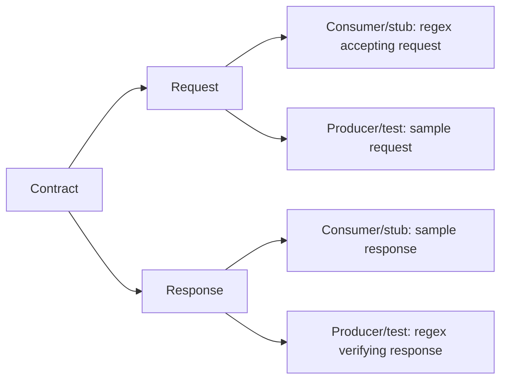
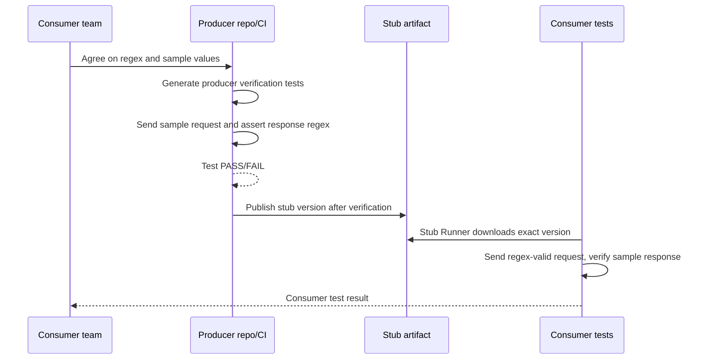

# Using Regex for Dynamic Data While Keeping Clear Expectations

## 1. When Data Varies, the Contract Must Still Be Meaningful

In a system with a **producer** and a **consumer**, many exchanged values are not fixed: order IDs, transaction IDs, correlation IDs, timestamps, tracking codes, callback URLs. If a contract forces the producer to always return a single ID like `PAY-1001`, tests will easily fail when the application generates another ID even though the interface remains compatible. Conversely, requiring every field to match `.*` allows the contract to miss broken formats, invalid enums, or malformed data.

**Regular expressions (regex)** describe a *set of valid values* instead of a single value. However, a regex is only useful when it protects what the consumer genuinely needs: prefix, length, character set, format, type, and related business conditions.

In **Spring Cloud Contract (SCC)**, we can write HTTP or messaging contracts using **Groovy/YAML DSL**, generate **producer verification tests**, build and publish **stubs**, run **Stub Runner** on the consumer, and integrate into CI to catch incompatible API changes. Regex is part of the **verified contract behavior**, not a way to replace every value with a wildcard.

**Learning objectives:**

- Understand when data should be constrained by a fixed value, regex, or data-type matcher.
- Distinguish regex in **request** and **response**, on the **consumer/stub** side and **producer/test** side.
- Write Groovy DSL examples using `value(consumer(...), producer(...))` and YAML DSL using `body` + `matchers`.
- Choose sufficiently tight regexes, test valid and invalid examples, and avoid data-type mismatches and overly broad regexes.
- Interpret test/stub results within their true scope and combine them with supplementary tests in CI.

> **Principle:** A regex must express a concrete commitment that the consumer actually depends on. "Any value" is usually a sign that the contract needs clarification, not a default solution.

## 2. Why Can't All Data Be Fixed?

Suppose producer `payment-service` receives a request to create a payment:

```http
POST /api/payments HTTP/1.1
Content-Type: application/json

{
  "orderId": "ORD-42",
  "amount": 150000,
  "currency": "VND"
}
```

The producer might return:

```http
HTTP/1.1 201 Created
Content-Type: application/json

{
  "paymentId": "PAY-1001",
  "state": "ACCEPTED"
}
```

On another test run, the system might generate `PAY-7834` instead of `PAY-1001`. If the consumer only needs an ID formatted as `PAY-` followed by digits and needs the exact status `ACCEPTED`, a well-designed contract can keep:

- `response.status = 201`: **exact**, because the consumer distinguishes successful creation from other branches.
- `response.body.state = "ACCEPTED"`: **exact**, because it is an enum value carrying business meaning.
- `response.body.paymentId`: **format-constrained**, e.g., `PAY-[0-9]{4,10}`; the numeric part can vary.
- `request.body.orderId`: **a fixed example for the producer test**, while the stub can accept many properly formatted order IDs.
- `request.body.amount = 150000` and `currency = "VND"`: fixed in this scenario, because payment semantics must also be protected.

Thus, flexibility is granted only to the parts **genuinely allowed to vary**.

## 3. Two Sides of a Regex: Request and Response Directions

Spring Cloud Contract uses a single contract as input for **two testing branches**:

1. **Producer verification:** the tool generates tests that send a sample request to the producer and inspect the real producer's response.
2. **Consumer verification:** the tool generates a stub; the consumer uses Stub Runner to send requests to the stub and receive a sample response.

When dynamic values are needed, you must understand *which side uses a sample value* and *which side uses a regex*.

| Location | Consumer / Stub Side | Producer / Generated Test Side |
|---|---|---|
| **Request** | Regex used to recognize requests that match the stub | A concrete request value for the test to send |
| **Response** | A concrete value for the stub to return | Regex used to check the real response from the producer |
| **Fixed value** | Protects simulated behavior with agreed value | Protects assertion in real test |
| **Dynamic value** | Allows consumer to send many valid requests | Allows producer to return varying yet well-formatted data |



A very common mistake is seeing the word **producer** in `value(consumer(...), producer(...))` and assuming it always means "the value the producer returns". In a **request**, the producer side is actually **the input data the test sends to the producer**. In a **response**, the producer side is **the expectation used to check what the producer returns**.

Example of intent per field:

| Field | Sample Data | Regex | Correct Reading |
|---|---|---|---|
| Request `orderId` | `ORD-42` | `ORD-[0-9]{2,8}` | Stub accepts many matching codes; producer test sends `ORD-42` |
| Response `paymentId` | `PAY-1001` | `PAY-[0-9]{4,10}` | Stub returns `PAY-1001`; producer test accepts other IDs matching the pattern |
| Response `state` | `ACCEPTED` | Not used | Producer must return exact `ACCEPTED` in this scenario |
| Response `amount` | `150000` | Not used | Producer may not alter the amount in the defined fixture |

## 4. Groovy DSL Example with Two-Sided Values

In **Groovy DSL**, Spring Cloud Contract supports `value(consumer(...), producer(...))` or the shorthand `$(consumer(...), producer(...))`. Aliases `client/server` or `stub/test` also exist, though `consumer/producer` makes the lesson's intent clear.

File `create-payment.groovy`:

```groovy
import org.springframework.cloud.contract.spec.Contract

Contract.make {
    name('create_payment_with_dynamic_id')
    description('Create payment and return properly formatted ID')

    request {
        method POST()
        url '/api/payments'
        headers {
            contentType(applicationJson())
        }
        body(
            orderId: value(
                consumer(regex('ORD-[0-9]{2,8}')),
                producer('ORD-42')
            ),
            amount: 150000,
            currency: 'VND'
        )
    }

    response {
        status CREATED()
        headers {
            contentType(applicationJson())
        }
        body(
            paymentId: value(
                consumer('PAY-1001'),
                producer(regex('PAY-[0-9]{4,10}'))
            ),
            state: 'ACCEPTED'
        )
    }
}
```

How to interpret this:

- **Request:** `consumer(regex('ORD-[0-9]{2,8}'))` describes the stub's request matching condition. `producer('ORD-42')` supplies a fixed value for the producer verification test.
- **Response:** `consumer('PAY-1001')` is the example ID returned by the stub to the consumer. `producer(regex('PAY-[0-9]{4,10}'))` is the constraint the producer verification test uses to check the real producer's ID.
- **Tight constraints:** `amount`, `currency`, HTTP `201`, and `state` remain exact scenario expectations.

You do not have to wrap every field in `value()`. For values that must be exact like state `ACCEPTED`, writing a fixed value is simpler and protects the consumer better.

### 4.1. Single-Sided Regex

Some coded DSL forms allow writing a regex on only one side so Spring Cloud Contract **auto-generates a matching value for the other side**. However, automatic data generation can make examples unpredictable. For contracts used as team documentation or in reproducible CI runs, prefer providing an explicit **valid fixed sample** for the other side whenever possible.

In particular, if the producer test needs a fixture for order `ORD-42`, letting the tool generate another random order ID will cause the test to fail because the corresponding record does not exist. Auto-generating a regex-compliant value does not automatically seed business data in the database.

### 4.2. Regex Does Not Replace Cross-Field Relationships

Suppose the producer must return an `orderId` in the response **identical** to the request's `orderId`. Two identical regexes:

```text
request.orderId  matches  ORD-[0-9]{2,8}
response.orderId matches  ORD-[0-9]{2,8}
```

**do not prove the two values are equal**. `ORD-42` in the request and `ORD-99` in the response both match the same pattern without preserving correlation. This case requires Spring Cloud Contract's mechanism for referencing the request in the response (e.g., `fromRequest()` in Groovy DSL or appropriate Handlebars helpers in YAML) or extra assertions. That is a **value-relationship** constraint, not just **individual format**.

## 5. YAML DSL: Separating Sample Body from Dynamic Matchers

**YAML does not directly use the Groovy `value(consumer(...), producer(...))` syntax.** In YAML, example data is declared under `request.body` and `response.body`; flexible parts are declared separately under `request.matchers` and `response.matchers`.

File `create-payment.yml` expressing the same behavior:

```yaml
name: create_payment_with_dynamic_id
description: "Create payment and return properly formatted ID"
request:
  method: POST
  url: /api/payments
  headers:
    Content-Type: application/json
  body:
    orderId: "ORD-42"
    amount: 150000
    currency: "VND"
  matchers:
    body:
      - path: $.orderId
        type: by_regex
        value: 'ORD-[0-9]{2,8}'
response:
  status: 201
  headers:
    Content-Type: application/json
  body:
    paymentId: "PAY-1001"
    state: "ACCEPTED"
  matchers:
    body:
      - path: $.paymentId
        type: by_regex
        value: 'PAY-[0-9]{4,10}'
```

**Reading YAML by test direction:**

- `request.body.orderId`: sample request `ORD-42` used by the generated producer test.
- `request.matchers.body`: rule allowing the stub to accept other order IDs if they match the regex.
- `response.body.paymentId`: sample `PAY-1001` for the stub to return to the consumer.
- `response.matchers.body`: rule checking the real payment ID returned by the producer.
- `response.body.state`: keeps exact value `ACCEPTED`; no alternative matcher declared.

Comparison table between the two representations:

| Goal | Groovy DSL | YAML DSL |
|---|---|---|
| Stub accepts dynamic order IDs | `consumer(regex('ORD-[0-9]{2,8}'))` in request | `request.matchers.body` + `by_regex` |
| Producer test sends sample order ID | `producer('ORD-42')` in request | `request.body.orderId: "ORD-42"` |
| Stub returns sample payment ID | `consumer('PAY-1001')` in response | `response.body.paymentId: "PAY-1001"` |
| Producer test checks ID format | `producer(regex('PAY-[0-9]{4,10}'))` in response | `response.matchers.body` + `by_regex` |

Matchers in YAML must sit in the **right section** (`request` or `response`) and reference **fields present in the sample payload**. Putting a matcher for `$.paymentId` under `request` will not substitute for a response assertion.

### 5.1. Common Syntax Mistake

The snippet below **does not express two-sided values properly** in YAML DSL:

```yaml
# Do not use this as SCC syntax for dynamic values
response:
  body:
    paymentId:
      consumer: "PAY-1001"
      producer: 'PAY-[0-9]{4,10}'
```

A YAML parser treats `paymentId` as an **object** containing two keys `consumer` and `producer`, rather than turning it into a matcher. Use `body` and `matchers` as in the official example to preserve the intended meaning.

## 6. Writing Tight Enough Regexes: From Examples to Valid Value Sets

Regex is a **language for describing character patterns**. The set of values it accepts should be determined by API requirements and the client versions you need to protect.

For example, the team wants to define a payment code:

> Starts with `PAY-`, followed by **4 to 10 ASCII digits**, containing no spaces or other characters.

Suitable pattern:

```regex
PAY-[0-9]{4,10}
```

In Spring Cloud Contract's documented regex matching, the expression must **match the entire value**, following `Pattern.matches()` behavior. Therefore, `PAY-[0-9]{4,10}` should not be read as "any matching substring inside the string is enough". Even so, when carrying a regex to other tools like databases, JavaScript, or log systems, re-verify full-string matching semantics and escaping rules.

### 6.1. Choosing Patterns by Constraint

| Requirement | Example Regex | Valid | Invalid |
|---|---|---|---|
| Payment code with prefix and 4–10 digits | `PAY-[0-9]{4,10}` | `PAY-1001`, `PAY-1234567890` | `PAY-1`, `X-PAY-1001` |
| Order code with 2–8 digits | `ORD-[0-9]{2,8}` | `ORD-42` | `ORD-A2`, `ORD-4` |
| Restricted event type code | `ORDER_CREATED\|ORDER_PAID` | `ORDER_PAID` | `ORDER_DELETED` |
| Item code: 3 uppercase letters, hyphen, 3 digits | `[A-Z]{3}-[0-9]{3}` | `ABC-120` | `abc-120` |
| Version in major.minor.patch format | `[0-9]+\.[0-9]+\.[0-9]+` | `1.20.3` | `v1.20`, `1-20-3` |
| Positive integer from 1 upward in decimal digits | `[1-9][0-9]*` | `1`, `25` | `0`, `-1` |

These patterns are **format constraint examples**, not replacements for business validation. For example, `[1-9][0-9]*` does not check transaction caps, length limits, or Java integer maximums.

### 6.2. Using Common Regex Tokens

| Syntax | Meaning | Watch Out For |
|---|---|---|
| `[0-9]` | One digit from 0 to 9 | Unambiguous ASCII; may differ from `\d` depending on flags/engine |
| `[A-Z]` | One uppercase ASCII Latin letter | Does not cover Vietnamese diacritics |
| `{4,10}` | Repeat 4 to 10 times | Defines explicit length bounds |
| `+` | At least once | No upper bound on repetitions |
| `*` | Zero or more times | Can permit empty strings |
| `?` | Zero or one time | Use for intentional optional parts |
| `(A\|B)` | Accepts either branch | Parenthesize properly when combined with other parts |
| `\.` | Literal dot | Unescaped `.` matches any character |
| `^` and `$` | Start/end anchors in many regex engines | Cannot substitute for semantic validation or engine match mode |

Avoid picking `.*`, `.+`, or `[A-Za-z0-9-]+` just to "keep tests from turning red". If the consumer expects a `PAY-` code, `.*` will accept `ERROR` or an empty string, turning tests green even when the client can no longer process the data.

### 6.3. Length Bounds Are Often Part of the Contract

Compare:

```regex
PAY-[0-9]+
```

and:

```regex
PAY-[0-9]{4,10}
```

The first expression accepts an unlimited number of digits; the second enforces length limits. If the consumer stores the payment code in a 14-character column, or displays it in a fixed-width UI, the difference matters. Length, character limits, and prefixes must reflect the **agreed interface**, rather than imposing arbitrary bounds just because current examples happen to be short.

### 6.4. Regex and Escaping in YAML/Groovy

In YAML, the preferred way to write regexes is **single-quoted strings**:

```yaml
response:
  status: 200
  body:
    version: "1.20.3"
  matchers:
    body:
      - path: $.version
        type: by_regex
        value: '[0-9]+\.[0-9]+\.[0-9]+'
```

YAML single quotes treat backslashes as literal characters; in YAML double-quoted strings, you must follow escape rules. In Groovy, regexes inside strings or regex literals can have **different escaping rules**. When converting from Groovy to YAML, check the **actual regex string passed to the engine**, not just character-by-character copying.

Using overly complex regexes, deeply nested quantifiers, or unbounded wildcards hurts readability and can cause high matching overhead. Prefer simple, bounded patterns backed by accept/reject examples; for constraints hard to express in regex, use dedicated assertions or specialized tests.

## 7. Regex, Data Types, and Fixed Values: Choosing the Right Tool

Spring Cloud Contract YAML DSL provides matchers such as `by_equality`, `by_regex`, `by_type`, and date/time matchers. They enforce different constraint levels:

| Scenario | Usually Suitable Choice | Why |
|---|---|---|
| Paid order status must be `PAID` | Fixed value or `by_equality` | Protects exact semantics |
| ID with fixed prefix and digit count | `by_regex` | Protects format while allowing variation |
| Field must be numeric while value depends on fixture | `by_type` if type suffices, or regex with numeric type | Avoids locking onto an arbitrary value |
| Standard ISO timestamp in response | Built-in date/time matcher when suitable | Avoids hand-writing error-prone date/time regexes |
| UUID in response | Predefined `uuid` regex when supported | Reduces pattern-authoring mistakes |
| Total must equal sum of line items | Business assertion or suitable `by_command` | Regex cannot compute cross-field math |
| Field can only be `PENDING` or `PAID` | Bounded alternation regex, if both are truly valid | Rejects arbitrary enum values |
| JSON array has at least two elements | Appropriate matcher/size assertion or extra test | Regex on a JSON string is unreliable |

**Valid format does not equal valid semantics.** String `PAY-1234` can pass a regex yet point to a non-existent payment. Total `150000` can have the right numeric type yet use the wrong unit or miscalculated sum. Contracts protect the described interface; business rules need separate testing.

### 7.1. Regex for Numeric Values Must Respect JSON Types

If a response has:

```yaml
response:
  status: 200
  body:
    retryCount: 3
  matchers:
    body:
      - path: $.retryCount
        type: by_regex
        value: '[0-9]+'
        regexType: as_integer
```

then `retryCount` is a **JSON number** in the sample body, not the string `"3"`. The `regexType` property specifies the numeric type the tool should use when applying the matcher. Supported values per DSL documentation can include `as_integer`, `as_long`, `as_double`, `as_float`, `as_short`, and `as_boolean`. Verify against your exact plugin version and inspect the generated assertion to confirm expected behavior.

Do not assume `value: '[0-9]+'` enforces numeric type limits or maximum bounds. A value with hundreds of digits still matches the pattern yet overflows client data types.

### 7.2. Using Predefined Patterns When Appropriate

SCC YAML supports `predefined` for several built-in regexes, such as `uuid`:

```yaml
response:
  status: 200
  body:
    correlationId: "550e8400-e29b-41d4-a716-446655440000"
  matchers:
    body:
      - path: $.correlationId
        type: by_regex
        predefined: uuid
```

This works well when the contract needs **a valid UUID**, instead of maintaining a long custom regex. Other predefined patterns may include `email`, `hostname`, `url`, `ip_address`, `iso_date`, `iso_date_time`, `non_empty`, or `non_blank`; check the exact list for your SCC version.

If the requirement allows only a **specific UUID version**, verify whether the predefined pattern has the necessary strictness. A generic `uuid` pattern may be broader than a system's "UUID v4" requirement.

### 7.3. Use Date/Time Matchers Instead of Overly Complex Regexes

When a contract must protect timestamps, you can use the `by_timestamp` matcher if its supported format aligns with your interface. If timestamps carry specific timezones, offsets, or millisecond precision, state that explicitly in the contract and test per version. A string matching ISO format does not prove business time correctness, absence of timezone drift, or acceptable bounds.

## 8. Testing Regexes with Both Valid and Invalid Examples

A regex can look reasonable while still accepting too many values. Before putting a pattern into a contract, build a table testing **positive cases** and **negative cases**.

Example requiring payment code `PAY-` + 4–10 digits:

| Value | Expectation | Explanation |
|---|---|---|
| `PAY-1001` | Accept | Four digits |
| `PAY-0000` | Accept if leading zeros are valid | Fits pattern; ID semantics still need confirmation |
| `PAY-1234567890` | Accept | Ten digits |
| `PAY-1` | Reject | Too short |
| `PAY-12345678901` | Reject | Too long |
| `PAY-A001` | Reject | Letter in numeric portion |
| `pay-1001` | Reject | Wrong casing |
| `X-PAY-1001` | Reject | Extra leading characters |
| `PAY-1001 ` | Reject | Trailing whitespace |
| `PAY-` | Reject | No digits |

This is a **table for reviewing the regex**, not automatic HTTP contracts for every case. If the API specifies that malformed requests return `400 Bad Request`, the team needs **dedicated error contracts/scenarios** and producer tests that actually send those malformed requests.

For instance:

```yaml
name: invalid_order_id
description: "Reject invalid order ID"
request:
  method: POST
  url: /api/payments
  headers:
    Content-Type: application/json
  body:
    orderId: "NOT-AN-ORDER"
    amount: 150000
    currency: "VND"
response:
  status: 400
  headers:
    Content-Type: application/json
  body:
    code: INVALID_ORDER_ID
```

This is an **illustrative API that teams must agree upon**, not an automatic response generated by a stub regex. **Failing to match a stub mapping** does not mean the verified producer will return exact `400` with `INVALID_ORDER_ID`. To protect input validation errors, write and execute proper error scenarios.

## 9. Regex in Headers, URLs, and JSON Bodies

Most examples start with the JSON body, yet real requests also have **paths**, **query parameters**, and **headers**. Dynamic data at each location must use the location-appropriate matcher mechanism for your DSL/version.

### 9.1. Dynamic Request Header

Suppose the consumer sends `X-Correlation-Id` formatted as `trace-` followed by 4–8 digits. YAML can express it as:

```yaml
name: order_with_correlation_id
request:
  method: GET
  url: /api/orders/42
  headers:
    X-Correlation-Id: "trace-1234"
  matchers:
    headers:
      - key: X-Correlation-Id
        regex: 'trace-[0-9]{4,8}'
response:
  status: 200
  body:
    id: 42
    status: PAID
```

The header matcher structure here uses `key` and `regex`, unlike `body` matchers which use `path`, `type`, and `value`. The stub can accept requests with pattern-compliant correlation IDs, while the generated producer test has sample `trace-1234` to send. If the producer must **echo back the same correlation ID**, use a contract expressing request/response correlation or a separate assertion; two identical regexes do not prove the values are equal.

### 9.2. URL with Path Variable

In Groovy DSL, you can specify a dynamic request path alongside a sample URL for testing:

```groovy
request {
    method GET()
    url value(
        consumer(regex('/api/orders/[0-9]{1,6}')),
        producer('/api/orders/42')
    )
}
```

Meaning: the stub accepts matching paths; the producer test calls `/api/orders/42`. This example describes a **URL pattern**, so do not use JSONPath `$.id` since the ID is not in a JSON body. Check `/` escaping, URL/path matching rules, and actual stub conversion settings for your version.

For complex query parameters and headers, use dedicated matchers supported by the DSL; do not apply a regex over the entire raw HTTP string and assume every part is protected.

### 9.3. Objects and Arrays in the Body

If a payload has:

```json
{
  "items": [
    { "sku": "ABC-101" },
    { "sku": "XYZ-202" }
  ]
}
```

a matcher at `$.items[0].sku` usually applies only to **the first element**, not automatically every item. Do not infer that a regex on `items[0]` protects array length or `items[1]`. When the consumer requires all SKUs to be valid, design matchers with appropriate JSONPath/collection checks and inspect generated assertions, or write purposeful supplementary tests.

## 10. Limitations to Understand Clearly

### 10.1. Regex Checks Structure, Not Existence

`ORD-42` and `ORD-99` can both match `ORD-[0-9]{2,8}`. That does not confirm order `ORD-99` exists in the system. Producer tests need proper fixtures; checking existence, authorization, side effects, and transactions belongs to separate test layers or concrete contract scenarios.

### 10.2. Regex Does Not Check Logical Comparisons Between Fields

Two fields `startAt` and `endAt` can both match timestamp patterns yet be out of order. `totalAmount` and the sum of `lineItems` are both numbers yet may disagree. If the consumer relies on relationships between values, use custom assertions, business tests, or supported referencing mechanisms instead of two independent regexes.

### 10.3. Regex Does Not Automatically Prove Full API Compatibility

A contract for `POST /api/payments` with `ORD-42` does not cover every amount, currency, authentication header, network error, or retry policy. Passing on one concrete request proves only the executed scenario. When multiple consumer versions exist, verify all supported version combinations.

### 10.4. Stub Samples Do Not Replace Real Producer Verification

Stub Runner may return `PAY-1001` while a newer producer returns `paymentId: "1001"`. Consumer tests still pass when running against the old stub; **producer verification tests** must run on the exact commit/artifact to catch format drift. Building regexes into stubs without running generated producer tests produces no evidence that the producer complies.

### 10.5. Regex Is Not a Data Security Mechanism

Regex does not replace authentication, authorization, PII leak prevention, resource limits, or malicious-input handling. Complex patterns risk becoming hard to review or expensive to evaluate if poorly designed. Use dedicated input validation and security testing where needed.

## 11. CI Integration Flow So Regexes Deliver Value

A Spring Cloud Contract workflow may look like:



Items to confirm in CI:

1. **Contract input:** clear contract version and commit, placed in the exact directory scanned by the plugin.
2. **Test generation:** the SCC Maven/Gradle plugin actually generates producer verification tests from the contracts.
3. **Test execution:** the producer test base seeds fixtures matching the samples, tests call the real API, and regex assertions execute.
4. **Failure reporting:** changing `PAY-1001` to `XYZ` or breaking `state` fails the test, and the CI job fails instead of skipping.
5. **Stub packaging:** stub artifacts are published per policy only after producer verification succeeds, with traceable versioning.
6. **Consumer tests:** Stub Runner runs the exact stub version; tests verify the client sends pattern-valid requests and handles sample responses.
7. **Version compatibility checks:** if multiple consumers exist, identify which versions are guarded by current contracts/CI.

A pipeline that only **generates stubs** or only runs consumer tests against an outdated stub cannot prove the current producer returns the right format. Likewise, a producer test with an overly broad regex fails to catch regressions even when faithfully executed.

## 12. Common Mistakes and How to Fix Them

| Mistake | Consequence | Fix |
|---|---|---|
| Using `.*` for all IDs | Accepts empty or malformed values | Agree on prefix, character set, length, then write a specific pattern |
| Using `by_type` when consumer expects a specific enum | `FAILED` and `PAID` are both strings | Keep fixed values or an approved enum regex |
| Putting response regex under `request.matchers` | Fails to verify response field properly | Use `response.matchers` in the right place |
| Putting request regex under `response.matchers` | Stub only matches fixed sample or behaves wrongly | Use `request.matchers` in the right place |
| Sample does not match regex | Stub and producer test express conflicting expectations | Choose valid sample values and test positive cases |
| Unbounded `[0-9]+` regex | Accepts huge numbers causing client failures | Set length bounds and consider data types |
| Using string matchers for numbers/booleans carelessly | JSON type may loosen or shift | Use `regexType`/`by_type` appropriately and inspect generated code |
| Confusing full-string regex match with substring search | Accepts/rejects wrong values across engines | Verify full-match semantics and escaping |
| Regexing only ID while skipping business status checks | Changing `PAID` to `CANCELLED` still passes | Keep exact status fields and HTTP codes |
| Assuming identical regexes on two fields prove equality | Response returns a different ID than request and still matches | Use `fromRequest`/Handlebars or relational assertions |
| Testing only valid requests | Leaves `400`/`422` branches unprotected | Write separate contracts for key invalid requests |
| Using only Stub Runner on consumer | Newer producer may return data incompatible with stub | Require producer verification on the exact version |
| Widening regex to "fix" failing tests | Masks breaking compatibility changes | Investigate root cause, review with consumer, update API deliberately |

## 13. Practice: Designing Reviewable Regexes

**Context:** Consumer `shipping-ui` calls producer `shipping-service` to look up a shipment. The consumer sends a code `TRK-` followed by **3–8 digits**, such as `TRK-123`. The producer returns HTTP `200` with an `eventId` formatted as `EVT-` followed by **4–6 digits**; the `deliveryStatus` field in this scenario must be `IN_TRANSIT`.

### Requirements

1. Write a YAML contract for `POST /api/tracking/lookup`.
2. Use sample request `trackingCode: "TRK-123"` and a matcher accepting `TRK-4567` while rejecting `TRK-A12` or `TRK-12`.
3. Use sample response `eventId: "EVT-1001"`, and a matcher allowing the producer to return `EVT-999999` while rejecting `EVT-1`.
4. Keep `deliveryStatus: "IN_TRANSIT"` fixed; do not use `.*`.
5. Identify which side uses the sample and which side uses the regex in request and response.
6. Propose a separate contract for an invalid tracking code returning HTTP `400`.
7. List the CI steps to run before publishing stubs and verifying the consumer with Stub Runner.

### Reference YAML Solution

```yaml
name: tracking_lookup
description: "Look up shipment by properly formatted tracking code"
request:
  method: POST
  url: /api/tracking/lookup
  headers:
    Content-Type: application/json
  body:
    trackingCode: "TRK-123"
  matchers:
    body:
      - path: $.trackingCode
        type: by_regex
        value: 'TRK-[0-9]{3,8}'
response:
  status: 200
  headers:
    Content-Type: application/json
  body:
    eventId: "EVT-1001"
    deliveryStatus: "IN_TRANSIT"
  matchers:
    body:
      - path: $.eventId
        type: by_regex
        value: 'EVT-[0-9]{4,6}'
```

**Producer side:** the generated test uses sample request `TRK-123`; response `eventId` may differ from `EVT-1001` as long as it matches the pattern, and `deliveryStatus` must be `IN_TRANSIT`. **Consumer side:** the stub accepts `TRK-4567` if it matches the matcher and returns a sample response containing `EVT-1001`. The consumer test must verify how the client processes the data, not merely that the stub starts.

### Regex Verification Table

| Input / Output | Pattern | Expected Outcome |
|---|---|---|
| `TRK-123` | `TRK-[0-9]{3,8}` | Pass |
| `TRK-4567` | `TRK-[0-9]{3,8}` | Pass |
| `TRK-12` | `TRK-[0-9]{3,8}` | Fail |
| `TRK-A12` | `TRK-[0-9]{3,8}` | Fail |
| `EVT-1001` | `EVT-[0-9]{4,6}` | Pass |
| `EVT-999999` | `EVT-[0-9]{4,6}` | Pass |
| `EVT-1` | `EVT-[0-9]{4,6}` | Fail |

If the business rule changes to allow letters in tracking codes, the team must review with the consumer, update the pattern, and re-test published compatibility cases. Never change a pattern on one side while forgetting the generated producer test or the stub artifact used by the consumer.

## 14. Checklist Before Finalizing a Regex in a Contract

- [ ] Identified which consumer needs the field and the **meaning** of the data.
- [ ] Classified the field: **fixed**, **format-constrained dynamic**, **type-only**, or **relational check required**.
- [ ] Regex has appropriate prefix, character set, length bounds, and alternation groups.
- [ ] Tested both **matching** and **non-matching** examples, including too-short/too-long values, whitespace, and wrong casing.
- [ ] Sample in `request.body` satisfies the request regex; sample in `response.body` satisfies the response regex.
- [ ] Matcher is on the right side and in the right section: `request.matchers` or `response.matchers`.
- [ ] JSONPath points to an existing field; header/path matchers use their DSL-specific syntax.
- [ ] If the value is a number/boolean, checked JSON type and `regexType` when needed.
- [ ] Did not widen regexes to weaken commitments on enums, statuses, error codes, currency, or critical quantities.
- [ ] If two fields must be equal or mathematically related, added appropriate assertions/mechanisms.
- [ ] Inspected generated producer tests to confirm the regex actually became an assertion, and verified tests **run** in CI.
- [ ] Verified stub mappings and consumer tests through Stub Runner with the exact version.
- [ ] Added supplementary tests for error branches and business rules beyond regex scope.

## 15. Key Takeaways and References

In **Spring Cloud Contract**, regexes keep contracts flexible for IDs, timestamps, and varying values while maintaining verifiable expectations. The decisive point is understanding **data direction**: in requests, the consumer-side regex serves the stub while the producer side uses a sample request; in responses, the stub serves a sample value while the producer test uses a matcher.

**Groovy DSL** can express this with `value(consumer(regex(...)), producer(...))` and the reverse direction in responses. **YAML DSL** places samples in `body` and regexes in the corresponding `matchers`. Patterns must be tight enough to protect formats the consumer relies on, while avoiding confusing "matches regex" with "business valid".

To genuinely catch incompatible API changes, run generated producer tests, publish versioned stubs, and verify consumers with Stub Runner in CI. Keep unit, integration, security, and business tests for everything regex cannot prove.

Official documentation to cross-check for your active SCC version:

- [Spring Cloud Contract — Dynamic properties, regular expressions, and matchers](https://docs.spring.io/spring-cloud-contract/reference/project-features-contract/dsl-dynamic-properties.html).
- [Spring Cloud Contract 4.2 — Dynamic properties (YAML and coded DSL)](https://docs.spring.io/spring-cloud-contract/reference/4.2/project-features-contract/dsl-dynamic-properties.html).
- [Spring Cloud Contract — Contract DSL and HTTP contracts](https://docs.spring.io/spring-cloud-contract/reference/project-features-contract/http.html).
