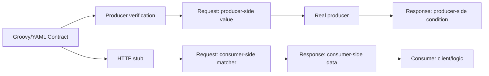
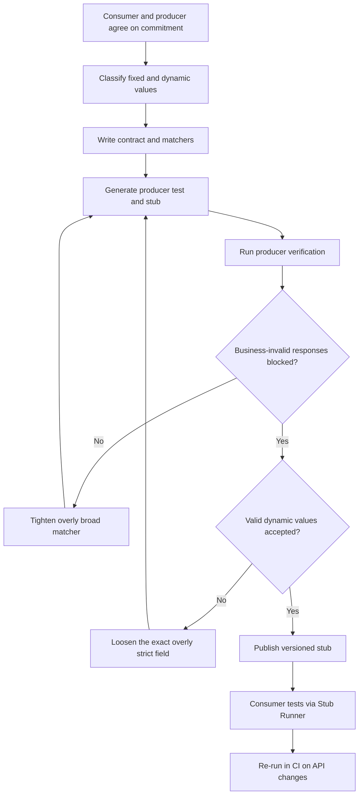

# Practice Fixing Contracts That Match Too Broadly or Too Strictly

## 1. When a Contract Still Passes "Green" Yet Fails to Protect the Consumer

In a microservices architecture, `checkout-service` (consumer) calls the HTTP API of `payment-service` (producer) to create a payment. Both teams agree that a valid request must specify the order, amount, and currency; a successful creation response must contain a payment ID and status `CREATED`.

**Spring Cloud Contract** lets you define these commitments in **Groovy or YAML DSL**, generate producer tests, build stubs for the consumer to run via **Stub Runner**, and integrate into CI to catch incompatible API changes. Yet if matchers are written poorly, the entire pipeline can still report success without guaranteeing the required behavior.

There are two extremes:

- **Overmatching:** the contract accepts requests/responses that violate business rules. For example, `status` is matched with `.*`, so a producer returning `FAILED` still passes tests while the consumer requires `CREATED`.
- **Overly strict matching:** the contract enforces details that are legitimately allowed to vary. For example, requiring `paymentId` to equal exact `PAY-1001` even though the producer issues a new ID per transaction; tests fail even though the API remains compatible.

**Lesson goal:** expose both kinds of mistakes with purposeful tests, identify the consumer/producer side of a dynamic value, fix the Groovy DSL, write the equivalent YAML version, and verify both producer verification and consumer stubs in CI.

> A good contract must be **strict on business commitments** and **flexible on truly dynamic parts**. Do not optimize for the number of green tests; optimize for catching bugs the consumer would actually hit.

## 2. Two Sides of a Value in Spring Cloud Contract

Before fixing matchers, you must understand `consumer(...)` and `producer(...)`. In Groovy DSL, you can write:

```groovy
value(consumer(...), producer(...))
// Or use the shorthand form:
$(consumer(...), producer(...))
// Supported aliases: c()/p(), stub()/test(), client()/server().
```

The meaning depends on **whether the value is in the request or response**:

| Location in Contract | `consumer(...)` Side | `producer(...)` Side |
| --- | --- | --- |
| **Request** | Condition for the stub to recognize consumer requests: can be a regex/matcher. | Concrete value for the generated test to send to the producer. |
| **Response** | Sample value the stub returns to the consumer. | Condition or matcher producer verification applies to the real response. |

Visualizing the test flow:



Short example:

```groovy
// In request: stub accepts matching codes; producer test sends ORD-2001.
orderId: $(consumer(regex('ORD-[0-9]{4}')),
           producer('ORD-2001'))

// In response: stub returns PAY-1001; producer test accepts matching codes.
paymentId: $(consumer('PAY-1001'),
             producer(regex('PAY-[0-9]{4}')))
```

These are only illustrative fields inside a `body([ ... ])` block, not a complete contract. **Never swap the two sides arbitrarily.** Putting a regex on the `producer` side of a request can cause the generator to construct requests with a different intent; putting a dynamic matcher on the `consumer` side of a response leaves the stub without the deterministic sample value the consumer needs.

The regexes in this lesson express **data shape**. Even with full-string matching in Spring Cloud Contract's regex mechanism, a regex does not inherently understand business relationships between fields.

## 3. Classifying Values Before Choosing Matchers

Group the fields of the payment creation API into three categories:

| Field | Example | Recommended Decision | Why |
| --- | --- | --- | --- |
| `orderId` in a fixed fixture | `ORD-2001` | Exact match in this scenario. | Response/fixture data must belong to the exact requested order. |
| `amount` | `250000` | Exact match if this is the scenario's amount. | Changing the amount changes the business case. |
| `currency` | `VND` | Exact match. | `VND` and `USD` are not interchangeable. |
| `status` | `CREATED` | Exact match or an agreed status set. | Consumer branches based on status. |
| Newly created `paymentId` | `PAY-1001` | Stub returns fixed sample; producer test uses a **tight** regex. | Dynamically generated ID that must follow convention. |
| Client-generated `X-Request-Id` | `REQ-ABC12345` | Stub accepts many properly formatted IDs; producer test sends one valid value. | Request ID changes across calls. |
| `createdAt` | `2026-01-15T09:00:00Z` | Pin clock **or** verify valid timestamp. | Should not depend on when the CI machine runs. |
| `items` in response | Non-empty list | Type/size matcher **if that is the commitment**. | `byType()` alone does not guarantee elements exist. |

Selection rules:

1. Ask **what decision the consumer makes using this field**. If changing the value alters the decision, it usually needs strict verification.
2. Ask **whether the producer is allowed to return a different value across two valid calls**. If yes, identify which constraints must still hold.
3. Pick **stable sample data for the stub**, then pick an **appropriate matcher for producer verification**.
4. If a relationship between two fields is committed (`orderId` in request and response must match), **separate per-field regexes are not enough**. Match the relationship via fixtures, request referencing, or supplementary tests.

## 4. Mistake 1: Overly Broad Response Matcher

An initial contract from the Payment team might read:

```groovy
response {
    status 201
    headers {
        contentType(applicationJson())
    }
    body([
        paymentId: $(consumer('PAY-1001'), producer(regex('.*'))),
        status: $(consumer('CREATED'), producer(regex('.*'))),
        currency: $(consumer('VND'), producer(regex('.*')))
    ])
}
```

This is **wrong in constraint level**, even though the two-sided value syntax looks valid:

- `paymentId` could be empty or contain a completely malformed string.
- `status` could be `DECLINED`, `FAILED`, or anything else, while the consumer expects `CREATED`.
- `currency` could become `USD` without the test noticing.

For non-null string values, `.*` matches even an empty string. If a field disappears completely or changes type, JSONPath matchers may behave differently across versions, yet that **does not excuse** a matcher permitting far too many invalid values.

### Fixing Matchers by Data Type

```groovy
response {
    status 201
    headers {
        contentType(applicationJson())
    }
    body([
        paymentId: $(consumer('PAY-1001'),
                     producer(regex('PAY-[0-9]{4}'))),
        status: 'CREATED',
        currency: 'VND'
    ])
}
```

**What changed:** only `paymentId` is allowed to vary within the committed ID format; `status` and `currency` remain exact. This example assumes valid codes are `PAY-` followed by four digits. If the real system uses UUIDs or another convention, the matcher must reflect the **real API contract**, not assume every code has four digits.

Verification **capable of catching bugs**:

| Producer Returns | Expected Outcome |
| --- | --- |
| `paymentId=PAY-1002`, `status=CREATED`, `currency=VND` | Passes if all other conditions hold. |
| `paymentId=abc`, `status=CREATED`, `currency=VND` | Fails because ID format is wrong. |
| `paymentId=""` | Fails because it violates the ID convention. |
| `status=FAILED` | Fails even if payment ID is valid. |
| `currency=USD` | Fails for breaking committed currency. |
| Missing `paymentId` | Must be caught; inspect generated test to ensure presence is verified. |

Do not "fix" `status` errors with `(CREATED|FAILED|PENDING)` if the **success scenario** contract only promises `CREATED`. Failure branches belong in separate contracts with business-accurate HTTP statuses and payloads.

## 5. Mistake 2: Overly Strict Response Matcher

Going the other direction: another contract forces every response to return the exact fixture ID and timestamp:

```groovy
response {
    status 201
    body([
        paymentId: 'PAY-1001',
        status: 'CREATED',
        createdAt: '2026-01-15T09:00:00Z'
    ])
}
```

If `paymentId` and `createdAt` are newly generated by the server per request, the contract is testing **incidental implementation values** rather than the commitment. A producer returning:

```json
{
  "paymentId": "PAY-4827",
  "status": "CREATED",
  "createdAt": "2026-08-10T14:25:30Z"
}
```

still complies with the real API contract, yet tests fail due to literal mismatches.

### Fixing with Dynamic Values

```groovy
response {
    status 201
    headers {
        contentType(applicationJson())
    }
    body([
        paymentId: $(consumer('PAY-1001'),
                     producer(regex('PAY-[0-9]{4}'))),
        status: 'CREATED',
        createdAt: $(consumer('2026-01-15T09:00:00Z'),
                     producer(regex(iso8601WithOffset())))
    ])
}
```

In the response:

- **The consumer's stub** always returns `PAY-1001` and sample timestamp `2026-01-15T09:00:00Z`, giving consumer tests repeatable inputs.
- **Producer verification** accepts properly formatted `paymentId` values and timestamps conforming to the supported ISO 8601 with offset matcher.
- **`status` remains fixed** because the consumer relies on that value to pick processing branches.

If the business requires `createdAt` to be **close to transaction creation time**, or `expiresAt > createdAt`, checking timestamp format alone is not enough. Control `Clock` or add relational/timing assertions. If the actual timestamp **is allowed to be fixed** by a fixture, keeping an exact value is completely reasonable. Loosen a matcher only when justified by the commitment.

Another option for producer tests is injecting:

```java
Clock fixedClock = Clock.fixed(
    Instant.parse("2026-01-15T09:00:00Z"),
    ZoneOffset.UTC
);
```

When application logic uses `fixedClock`, tests can assert exact timestamps; this is especially helpful for testing payment expiration rules. The snippet only illustrates three Java types: the project needs imports for `Clock`, `Instant`, and `ZoneOffset`, as well as actual clock injection design.

## 6. Mistake 3: Stub Request Matches Too Broadly

On the request side, the matcher first decides **which consumer requests the stub will respond to**. Consider a payment creation request with a consumer-generated `X-Request-Id` header:

```groovy
request {
    method 'POST'
    urlPath '/api/payments'
    headers {
        contentType(applicationJson())
        header('X-Request-Id', $(
            consumer(regex('.*')),
            producer('REQ-ABC12345')
        ))
    }
    body([
        orderId: 'ORD-2001',
        amount: 250000,
        currency: 'VND'
    ])
}
```

Here, the producer still receives sample header `REQ-ABC12345` when the generator builds tests. However, the stub accepts nearly any header string, even `""`, preventing consumer tests from catching a client emitting malformed request IDs.

### Fixing the Request Matcher

```groovy
request {
    method 'POST'
    urlPath '/api/payments'
    headers {
        contentType(applicationJson())
        header('X-Request-Id', $(
            consumer(regex('REQ-[A-Z0-9]{8}')),
            producer('REQ-ABC12345')
        ))
    }
    body([
        orderId: 'ORD-2001',
        amount: 250000,
        currency: 'VND'
    ])
}
```

After this fix:

- The stub accepts headers like `REQ-ABC12345` or `REQ-XYZW9876` (properly formatted), while rejecting `abc` or empty strings.
- The producer test still sends a **fixed** example header `REQ-ABC12345` to exercise producer code.
- `orderId`, `amount`, and `currency` stay unchanged so a stub meant for `ORD-2001` does not accidentally accept payments for every order.

A stub failing to match a request usually returns a **mapping-not-found** error from the stub server, which **does not mean** the real producer API commits to returning `400 Bad Request`. If the API validates headers and returns `400` on errors, add a dedicated contract/test for that error branch.

### Do Not Loosen Requests While Forgetting Request–Response Relationships

The snippet below looks convenient yet has a design flaw:

```groovy
request {
    body([
        orderId: $(consumer(regex('ORD-[0-9]{4}')),
                   producer('ORD-2001'))
    ])
}
response {
    body([
        orderId: 'ORD-2001',
        status: 'CREATED'
    ])
}
```

If the stub accepts `ORD-9999` yet always returns `ORD-2001`, the consumer may process the wrong order. When the response **must echo a value from the request**, use one of two approaches:

1. Keep request `orderId = ORD-2001` **fixed** if the contract only represents one specific fixture; add another contract for other scenarios.
2. If the stub must serve multiple order IDs, use **referencing request values in the response** (such as `fromRequest().body('$.orderId')` in Groovy DSL per supported version) and inspect the generated template in the stub. If the invariant must hold on the producer, add appropriate assertions verifying the relationship, not just per-field regexes.

Regex checks the shape of each string; **it does not automatically guarantee two strings are equal**.

## 7. Mistake 4: Request Too Strict Because It Locks Down a Value Allowed to Vary

Suppose the producer commits to accepting any valid `X-Request-Id` header, yet the contract writes:

```groovy
request {
    method 'POST'
    urlPath '/api/payments'
    headers {
        header 'X-Request-Id': 'REQ-ABC12345'
    }
}
```

The stub generated from that contract matches only a single sample ID. In practice, the consumer emits `REQ-XYZW9876`, so the consumer test gets a "no mapping found" response even though the request is completely valid by design.

Fix it with a two-sided **request** pair as in section 6:

```groovy
header('X-Request-Id',
       $(consumer(regex('REQ-[A-Z0-9]{8}')),
         producer('REQ-ABC12345')))
```

Avoid using `consumer(regex(...))` for data that must not change. For example, if the contract represents **a transaction for `ORD-2001` of `250000 VND`**, loosening `currency` from `'VND'` to `'.*'` lets the stub accept a `USD` request and wrongly return success.

## 8. Complete Fixed Groovy DSL Example

Here is a self-contained contract for the **payment creation success** branch, combining the right decisions above:

```groovy
import org.springframework.cloud.contract.spec.Contract

Contract.make {
    name 'create_payment_with_valid_request_id'
    description 'Create payment for ORD-2001, accepting valid request IDs'

    request {
        method 'POST'
        urlPath '/api/payments'
        headers {
            contentType(applicationJson())
            header('X-Request-Id', $(
                consumer(regex('REQ-[A-Z0-9]{8}')),
                producer('REQ-ABC12345')
            ))
        }
        body([
            orderId: 'ORD-2001',
            amount: 250000,
            currency: 'VND'
        ])
    }

    response {
        status 201
        headers {
            contentType(applicationJson())
        }
        body([
            paymentId: $(consumer('PAY-1001'),
                         producer(regex('PAY-[0-9]{4}'))),
            orderId: 'ORD-2001',
            status: 'CREATED',
            amount: 250000,
            currency: 'VND',
            createdAt: $(consumer('2026-01-15T09:00:00Z'),
                         producer(regex(iso8601WithOffset())))
        ])
    }
}
```

Reading the contract in both directions:

**Producer verification:** the generator creates sample request `POST /api/payments`, body for `ORD-2001`, `amount=250000`, `currency=VND`, header `REQ-ABC12345`. The producer must return HTTP `201`, JSON with accurate business values; `paymentId` and `createdAt` are checked via matchers instead of byte-for-byte fixture equality.

**Consumer test via Stub Runner:** the stub accepts requests with exact `orderId`/`amount`/`currency` and a regex-valid request ID header; it returns `PAY-1001` with the sample timestamp and `status=CREATED` so the consumer gets stable data.

This contract protects **one concrete business scenario**. It does not by itself prove the producer accepts **every** valid request ID: generated producer tests typically send **one sample value**. If the API must support boundary values too, add input validation tests or property-based tests. Tests verifying `createdAt` is near current time, `paymentId` uniqueness, idempotency by `X-Request-Id`, or multi-order relationships must also be written separately when those are commitments.

## 9. Translating the Same Idea to YAML DSL

In YAML DSL, you do not embed `consumer(...)`/`producer(...)` into individual JSON fields using Groovy syntax. Instead, keep **sample values** in `body`/`headers`, and place matchers in the corresponding `matchers` sections.

YAML example equivalent to the contract in section 8:

```yaml
description: Create payment for ORD-2001, accepting valid request IDs
name: create_payment_with_valid_request_id
request:
  method: POST
  urlPath: /api/payments
  headers:
    Content-Type: application/json
    X-Request-Id: REQ-ABC12345
  body:
    orderId: ORD-2001
    amount: 250000
    currency: VND
  matchers:
    headers:
      - key: X-Request-Id
        regex: 'REQ-[A-Z0-9]{8}'
response:
  status: 201
  headers:
    Content-Type: application/json
  body:
    paymentId: PAY-1001
    orderId: ORD-2001
    status: CREATED
    amount: 250000
    currency: VND
    createdAt: "2026-01-15T09:00:00Z"
  matchers:
    body:
      - path: $.paymentId
        type: by_regex
        value: 'PAY-[0-9]{4}'
      - path: $.createdAt
        type: by_regex
        predefined: iso_8601_with_offset
```

In this YAML:

- Header `X-Request-Id` has **sample value** `REQ-ABC12345` for the producer test and a **matcher** for the stub.
- The response has **sample values** `PAY-1001`/fixed timestamp for the stub, while response matchers verify the data actually returned by the producer.
- Fields without matchers such as `status` or `currency` must still be verified per commitment; inspect generated test output to confirm key assertions are present.

These are two **alternative formats** for the same contract. In a real repository, choose either Groovy **or** YAML for this scenario to avoid accidentally publishing two duplicate stubs.

YAML property names, predefined matchers, and header matcher types must match **your project's Spring Cloud Contract version**. When converting from Groovy to YAML, always regenerate tests/stubs and inspect outputs to confirm request/response semantics did not shift.

## 10. `bodyMatchers`: Use for Its Intended Purpose, Not to Replace Business Meaning

Spring Cloud Contract also lets you separate matchers from the body block in Groovy DSL. The two scopes apply differently:

- **`request { bodyMatchers { ... } }`:** constrains requests the stub accepts from the consumer.
- **`response { bodyMatchers { ... } }`:** constrains responses verified by generated producer tests.

Example checking ID format while keeping status exact:

```groovy
response {
    status 201
    headers {
        contentType(applicationJson())
    }
    body([
        paymentId: 'PAY-1001',
        status: 'CREATED',
        amount: 250000,
        currency: 'VND'
    ])
    bodyMatchers {
        jsonPath('$.paymentId',
                 byRegex('PAY-[0-9]{4}'))
        jsonPath('$.status', byEquality())
        jsonPath('$.amount', byEquality())
        jsonPath('$.currency', byEquality())
    }
}
```

This is an **alternative way** to express response constraints; do not combine it with a duplicate dynamic matcher on the `paymentId` field itself. The sample value still supplies a deterministic response for the stub.

### Why Is `byType()` Easily Too Broad?

Suppose the initial code used:

```groovy
response {
    body([
        status: 'CREATED',
        currency: 'VND'
    ])
    bodyMatchers {
        jsonPath('$.status', byType())
        jsonPath('$.currency', byType())
    }
}
```

If the generated test checks only **String type**, it will accept `'FAILED'` or `'USD'`. Fix it with `byEquality()` or remove the type matcher and verify exact literals per your version's generator behavior.

`byType()` fits when **data type** itself is the desired constraint, such as a notes field allowed to hold arbitrary string text. For lists, the DSL may offer `minOccurrence/maxOccurrence` to bound element count; however, if you need "every element has `currency = VND`", checking list size alone is not enough.

### Even Sufficiently Specific Regexes Have Limits

| Matcher | Example Bug That Can Slip Through | How to Increase Confidence |
| --- | --- | --- |
| `.*` | Empty ID or completely wrong status. | Replace with business pattern/value set. |
| `[0-9]+` | Huge numbers, disallowed negatives, or unchecked numeric bounds. | Verify type/value range via business tests. |
| `PAY-[0-9]{4}` | Well-formatted ID that does not belong to the order being processed. | Assert request–response correlation or add lookup-by-ID tests. |
| `iso8601WithOffset()` | Valid timestamp outside expected time window. | Inject `Clock` and verify timing/expiration rules. |
| `byType()` on `status` | `FAILED` is still a string just like `CREATED`. | `byEquality()` or dedicated scenarios per status. |

**No matcher substitutes for defining business commitments.** The more flexible a matcher is, the more negative-scenario tests are needed to ensure it does not accept behavior that should be blocked.

## 11. Practicing Two-Way Matcher Verification

After fixing the contract, do not just run producer tests once. Use the verification matrix below:

| Experiment | Simulated Input / Response | Expected Result | Goal |
| --- | --- | --- | --- |
| 1. Standard valid request | `X-Request-Id=REQ-ABC12345`, `ORD-2001`, `250000 VND` | Stub matches. | Verify baseline case. |
| 2. Different valid request ID | `X-Request-Id=REQ-XYZW9876`, everything else identical | Stub still matches. | Avoid overly strict matcher. |
| 3. Invalid request ID | `X-Request-Id=abc` | Stub **does not** match success contract. | Avoid overly broad matcher. |
| 4. Wrong currency | `currency=USD` | Does not match this success contract. | Protect business data. |
| 5. Producer generates new ID | `paymentId=PAY-4827`, remaining fields valid | Producer verification passes. | Avoid overly strict response. |
| 6. Producer generates bad ID | `paymentId=ABC` | Producer verification fails. | Protect ID format. |
| 7. Producer changes status | `status=FAILED` | Producer verification fails. | Protect committed status. |
| 8. Producer changes amount | `amount=250001` | Producer verification fails. | Protect scenario's exact value. |
| 9. Producer returns new valid timestamp | `createdAt=2026-08-10T14:25:30Z` | Passes if other time constraints hold. | Avoid coupling to runner machine clock. |
| 10. Missing required field | Missing `currency` | Producer verification must catch it. | Verify presence/required-field assertions. |

**Distinguish "stub did not match" from "producer returned error code":** WireMock/Stub Runner returning mapping-not-found is an outcome of the **test double**, not proof of how the real producer handles bad requests. If the API must return `400` or `422` for invalid inputs, write a dedicated error contract and corresponding producer test.

### Inspect Both Generated Tests and Stubs

When checking outputs:

1. **Producer test:** verify the request sends sample value `REQ-ABC12345`, and asserts HTTP `201`, `status=CREATED`, `currency=VND`, `amount=250000`, and ID/timestamp matchers.
2. **Stub request matcher:** verify the request ID header uses the pattern; request body matches only the defined `ORD-2001`, `250000`, `VND` scenario.
3. **Stub response:** verify it returns deterministic sample data `PAY-1001`, `CREATED`, and sample timestamp, not raw regex strings.
4. **Consumer test:** call through Checkout's real HTTP client and assert business decisions.

Seeing generated files while the test runner executes zero tests means the pipeline is still unverified. Check Maven/Gradle test reports and ensure tests run as part of the CI lifecycle.

## 12. Blocking Both Failure Modes in CI

A workflow:



In CI, keep these steps explicit:

- **Contract review:** document why each field uses an exact value, regex, or data type.
- **Test/stub generation:** use the same contract commit and matching dependency configuration.
- **Run producer verification:** if the producer intentionally switches `CREATED` to `FAILED` and tests stay green, the matcher is too broad or tests did not execute.
- **Test valid variation:** if a new well-formed ID causes tests to fail, the matcher is too strict or fixtures are uncontrolled.
- **Publish verified stubs:** pin artifact versions; never rely on a silently mutating "latest" stub.
- **Run consumer tests with Stub Runner:** test valid requests, malformed requests (failing to match the success stub), and response handling against business codes.
- **Compatibility checks:** every change to paths, JSON keys, statuses, currencies, or data types must be checked against supported consumers.

Note: Spring Cloud Contract automates converting contracts into tests and stubs; it **does not automatically decide** which regex reflects business rules. That decision is a joint responsibility of producer and consumer.

## 13. Exercise: Fixing a Contract with Four Bugs

A new team member wrote the following contract for payment transactions:

```groovy
import org.springframework.cloud.contract.spec.Contract

Contract.make {
    name 'payment_created'
    request {
        method 'POST'
        urlPath '/api/payments'
        headers {
            contentType(applicationJson())
            header 'X-Request-Id': 'REQ-ABC12345'
        }
        body([
            orderId: 'ORD-2001',
            amount: 250000,
            currency: $(consumer(regex('.*')), producer('VND'))
        ])
    }
    response {
        status 201
        headers {
            contentType(applicationJson())
        }
        body([
            paymentId: 'PAY-1001',
            orderId: 'ORD-2001',
            status: $(consumer('CREATED'), producer(regex('.*'))),
            amount: 250000,
            currency: 'VND'
        ])
    }
}
```

**Tasks:**

1. Find **two overly broad matchers** and **two overly strict constraints**. Explain which tests could false-pass or false-fail.
2. Keep `currency = VND` and `status = CREATED` in the success scenario. Explain why `.*` should not be used.
3. Loosen the request ID header so the stub accepts `REQ-XYZW9876` while rejecting `abc`; the producer test still sends `REQ-ABC12345`.
4. Loosen response `paymentId` so the producer can return any code of the form `PAY-` + four digits; the stub still returns `PAY-1001`.
5. Explain why `orderId = ORD-2001` in request and response **is not necessarily overly strict** in a fixed-ID fixture scenario.
6. Write the YAML version of the fixed contract using `request.matchers.headers` and `response.matchers.body`.
7. Run or describe how to run generated producer tests, inspect stub request/response; create a negative case where the producer returns `FAILED`, and an allowed case where the producer returns `PAY-4827`.
8. If `orderId` is widened to a regex for multiple orders, propose a mechanism to preserve the request–response relationship and add tests preventing wrong-order responses.

**Self-check hint:** a strong solution includes **at least one before/after experiment** proving the fixed matcher catches business errors while still accepting valid dynamic values. Merely swapping one `.*` regex for another without explaining its impact on stubs/tests is insufficient.

## 14. Key Takeaways

- For **requests**, `consumer(...)` describes the stub's request condition, while `producer(...)` supplies data for the generated producer verification test.
- For **responses**, `consumer(...)` is the sample data returned by the stub, while `producer(...)` describes the verification condition for the producer's response.
- **Too broad:** `.*` or `byType()` on status/currency can let business bugs slip through; tighten using concrete values or domain-accurate constraints.
- **Too strict:** dynamic IDs/timestamps pinned to a literal break producer tests or prevent stubs from matching valid requests; use two-sided value pairs or control fixtures/`Clock`.
- Regex checks only **shape**, not request–response correlation or business ordering.
- With YAML, put sample values in body/headers and appropriate matchers on each side; always inspect **generated tests and stubs** to confirm semantic equivalence with Groovy.
- In CI, test both **invalid must fail** and **valid must pass**, then publish versioned stubs and run consumer tests through Stub Runner.

### References

- [Spring Cloud Contract — Dynamic Properties](https://docs.spring.io/spring-cloud-contract/reference/project-features-contract/dsl-dynamic-properties.html): `consumer/producer`, `value`, `$()`, regexes, and request referencing.
- [Spring Cloud Contract — Contract DSL](https://docs.spring.io/spring-cloud-contract/reference/project-features-contract.html): defining request/response with Groovy and YAML.
- [Spring Cloud Contract — HTTP Contracts](https://docs.spring.io/spring-cloud-contract/reference/project-features-contract/http.html): HTTP methods, URLs, headers, and bodies.
- [Spring Cloud Contract — Stub Runner](https://docs.spring.io/spring-cloud-contract/reference/project-features-stubrunner.html): using producer stubs in consumer tests.
