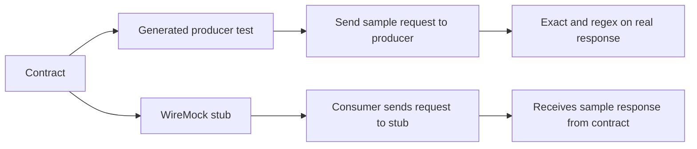
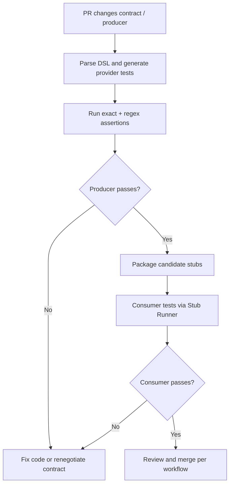

# Exact Matching and Regular Expression Matching in Spring Cloud Contract

**Spring Cloud Contract (SCC)** helps producers and consumers agree on communication behavior over HTTP or messaging. Contracts written in **Groovy DSL or YAML DSL** can be used to generate tests that verify the producer and create stubs for the consumer to run with **Stub Runner**. An important part of a contract is choosing how to match data: must a value be **exact**, or does it only need to **match a regular expression**?

This lesson in the **Matchers and Assertions** chapter explains both matching approaches through the `order-producer` and `order-consumer` examples. The goal is to write contracts strict enough to catch incompatible API changes, yet not overly rigid with dynamic data such as order IDs, correlation IDs, and timestamps.

## 1. When to Use Exact, When to Use Regex?

Suppose the order API returns a response:

```http
HTTP/1.1 200 OK
Content-Type: application/json

{
  "orderId": "ORD-123456",
  "status": "CREATED",
  "currency": "VND",
  "createdAt": "2026-11-24T03:15:30.123Z"
}
```

Not every field in JSON needs the same matcher type:

| Contract Part | Desired Rule | Match Type |
| --- | --- | --- |
| HTTP method | Exactly `GET` | Exact |
| Test case HTTP URL | `/api/orders/1001` | Exact |
| Response status | `200` | Exact |
| `Content-Type` | JSON response as agreed | Exact or media type check |
| `status` | `CREATED` in the newly created order scenario | Exact |
| `currency` | `VND` | Exact |
| `orderId` | Prefix `ORD-` and exactly six digits | Regex |
| `createdAt` | Published UTC format | Regex combined with date/time validation if needed |

If you hardcode `orderId: ORD-123456`, the provider verification test may fail when a valid producer returns `ORD-654321`. On the other hand, if you replace `status: CREATED` with the regex `.*`, the producer could return `UNKNOWN` and the test would still pass even though the consumer does not know how to handle that status.

**Rule of thumb:** use exact for values with fixed meaning; use regex when multiple values are allowed and those values must follow a clear rule.

## 2. What Does Exact Matching Check?

Exact matching requires the actual value to equal the expected value according to how the test tool interprets the data.

```text
Expected HTTP status = 200     Actual = 200       PASS
Expected HTTP status = 200     Actual = 201       FAIL
Expected status = "CREATED"    Actual = "CREATED" PASS
Expected status = "CREATED"    Actual = "PAID"    FAIL
Expected quantity = 2         Actual = "2"       Different JSON type
```

An important note: **comparing values in JSON does not mean byte-for-byte comparison of the JSON string**. Two objects can differ in field order or whitespace and still represent equivalent data:

```json
{"id":1001,"status":"CREATED"}
```

```json
{
  "status": "CREATED",
  "id": 1001
}
```

Generated tests can compare data by structure and JSONPath. Do not assume that a contract by default checks object field ordering, the absence of any extra fields, or verbatim comparison of the entire body. If the consumer depends on a specific condition, declare the appropriate matcher/assertion and verify whether the generated test enforces that condition.

### 2.1. HTTP Example Using Exact in Groovy DSL

File `src/test/resources/contracts/http/get-order-created.groovy`:

```groovy
import org.springframework.cloud.contract.spec.Contract

Contract.make {
    description 'GET order 1001 returns status CREATED'

    request {
        method GET()
        url '/api/orders/1001'
        headers {
            header('Accept', 'application/json')
        }
    }

    response {
        status OK()
        headers {
            contentType(applicationJson())
        }
        body(
            id: 1001,
            status: 'CREATED',
            currency: 'VND'
        )
    }
}
```

In this contract:

- `method GET()` and `url` specify the request the producer must receive.
- `status OK()` constrains the response to have HTTP 200.
- `contentType(applicationJson())` expresses the response media type agreement.
- The `id`, `status`, and `currency` fields have concrete example values.
- `description` helps reviewers understand the scenario; the verification conditions live inside `request` and `response`.

If the producer changes the `status` response field from `CREATED` to `PAID` in this scenario, a properly generated provider verification test must alert you. The same happens if the HTTP status changes from 200 to 404.

### 2.2. YAML DSL for the Same Scenario

Equivalent `get-order-created.yml` file:

```yaml
description: "GET order 1001 returns status CREATED"
request:
  method: GET
  url: /api/orders/1001
  headers:
    Accept: application/json
response:
  status: 200
  headers:
    Content-Type: application/json
  body:
    id: 1001
    status: CREATED
    currency: VND
```

The two formats illustrate the same intent, but in an actual build **include only one version in the contracts directory** to avoid duplicate generated tests and stubs.

With YAML, pay attention to scalar types:

```yaml
body:
  quantity: 2
  quantityText: "2"
  active: true
```

`2` is a number; `"2"` is a string; `true` is a boolean. When the consumer deserializes into a DTO, a data type change can break the API even though the values look similar. Exact matching must be paired with the right type expectation.

### 2.3. Which Fields Should Use Exact?

| Category | Example | Reason |
| --- | --- | --- |
| HTTP method or status | `POST`, `201` | Consumer handles outcomes differently |
| Enum of a fixed business case | `CREATED` | Other statuses are unacceptable in this case |
| Error code | `INVALID_QUANTITY` | Consumer may branch on error code |
| Currency | `VND` | Changing unit has major impact |
| Computed result for fixed input | `totalMinor: 250000` | Using regex would hide calculation bugs |
| Request used to trigger a scenario | `quantity: 0` | Separates validation test from success test |

Exact is especially suitable when **the specific value**, not just the format, is part of the agreement.

## 3. Regex Matching: Allowing Valid Varying Values

A **regular expression (regex)** describes a set of strings. For example:

```regex
^ORD-[0-9]{6}$
```

| Component | Meaning |
| --- | --- |
| `^` | Start of string |
| `ORD-` | Fixed prefix |
| `[0-9]` | A digit from 0 to 9 |
| `{6}` | Exactly six times |
| `$` | End of string |

Sample results:

```text
ORD-123456     PASS
ORD-000001     PASS
ORD-999999     PASS
ORD-12345      FAIL (missing digit)
ORD-1234567    FAIL (extra digit)
ORD-12A456     FAIL (contains letter)
ord-123456     FAIL (wrong case)
PRE-ORD-123456 FAIL (wrong prefix)
```

Using the `^` and `$` anchors makes it clear that **the entire string** must match. Do not rely on assuming every matcher/library uses the same full-string match vs. substring search mode.

### 3.1. An Overly Broad Regex Can Mask Breaking Changes

| Regex | Accepts | Notes |
| --- | --- | --- |
| `.*` | Any number of characters, including empty | Too loose for an ID |
| `.+` | At least one character | Does not validate business shape |
| `[A-Z0-9-]+` | Sequence of allowed characters | Missing prefix and length constraints |
| `^ORD-[0-9]{6}$` | Exactly six-digit ID | Clear requirement |
| `^(CREATED|PAID|CANCELLED)$` | Three listed statuses | Valid only if the same test case allows all three |

Do not change exact `CREATED` to `^(CREATED|PAID|CANCELLED)$` just to make a test green when the producer unexpectedly returns `PAID`. First check whether that change aligns with the consumer's commitment.

### 3.2. Regex Only Checks Pattern, Not Business Logic

A UTC timestamp pattern with exactly three fractional second digits:

```regex
^[0-9]{4}-[0-9]{2}-[0-9]{2}T[0-9]{2}:[0-9]{2}:[0-9]{2}[.][0-9]{3}Z$
```

It accepts the shape `YYYY-MM-DDTHH:mm:ss.SSSZ`, but **does not verify a valid date/time**. The string `2026-99-99T99:99:99.999Z` can pass the regex. If the consumer requires an actual instant in time, parse with `java.time.Instant` and add business-meaningful assertions.

Similarly, a code matching `ORD-123456` does not prove that order exists in the database or matches the ID in the URL. Contracts need additional relational or business tests if the consumer depends on that.

## 4. Response Body Matchers in Groovy DSL

A producer may return a system-generated `orderId`, provided the code conforms to a format. Instead of locking down the entire value, use `bodyMatchers`:

```groovy
import org.springframework.cloud.contract.spec.Contract

Contract.make {
    description 'GET order with valid ID format and status CREATED'

    request {
        method GET()
        url '/api/orders/1001'
    }

    response {
        status OK()
        headers {
            contentType(applicationJson())
        }
        body(
            orderId: 'ORD-123456',
            status: 'CREATED',
            currency: 'VND'
        )
        bodyMatchers {
            jsonPath('$.orderId', byRegex('^ORD-[0-9]{6}$'))
        }
    }
}
```

How to read each part:

1. `body.orderId = 'ORD-123456'` provides an **example value** used in the contract and stub response.
2. `jsonPath('$.orderId', ...)` selects the `orderId` field in JSON.
3. `byRegex('^ORD-[0-9]{6}$')` expresses the rule for the dynamic value.
4. `status: 'CREATED'` and `currency: 'VND'` remain exact for the scenario.
5. Producer verification can accept `ORD-654321` while catching `BAD-ID`, as long as the generated test uses the declared matcher.
6. The stub returns the example value from the contract so the consumer test has a stable response.

The key point is that **response body matchers help provider tests validate dynamic values**, while consumer stubs typically need **a valid example value**. When running the build, inspect the generated provider test and WireMock mapping to ensure the tool interpreted both sides properly.

### 4.1. Multiple Matchers on One Response

```groovy
response {
    status OK()
    headers {
        contentType(applicationJson())
    }
    body(
        orderId: 'ORD-123456',
        status: 'CREATED',
        currency: 'VND',
        createdAt: '2026-11-24T03:15:30.123Z'
    )
    bodyMatchers {
        jsonPath('$.orderId',
            byRegex('^ORD-[0-9]{6}$'))
        jsonPath('$.createdAt',
            byRegex('^[0-9]{4}-[0-9]{2}-[0-9]{2}T[0-9]{2}:[0-9]{2}:[0-9]{2}[.][0-9]{3}Z$'))
    }
}
```

A timestamp regex only checks format. When the time must equal an expected instant, consider using `Clock.fixed` in the producer test or parsing assertions on the timestamp. A loose matcher cannot substitute for exact calculation requirements.

### 4.2. JSONPath for Nested Data

Suppose the response is:

```json
{
  "order": {
    "id": "ORD-123456",
    "status": "CREATED"
  },
  "items": [{"sku":"BOOK-01","quantity":2}]
}
```

To check the nested ID:

```groovy
bodyMatchers {
    jsonPath('$.order.id',
        byRegex('^ORD-[0-9]{6}$'))
}
```

`$.order.id` is a JSONPath; `$.items[0].sku` points to the first SKU in the array. If array order can change, a matcher relying on `[0]` can be too brittle. Choose paths according to the structure the consumer actually relies on.

### 4.3. Regex Is Not a Good Choice for Every JSON Field

Regex is usually useful for **strings**: IDs, correlation IDs, formatted codes, formatted timestamps. For JSON numbers, booleans, or fields where **data type** matters, use exact or type-based matchers (for example `byType()` when appropriate). A regex that only inspects string representations can hide a bug where the producer changes JSON number `2` to JSON string `"2"`.

For monetary amounts, such as `totalMinor: 250000` calculated from fixed inputs, compare the exact number or perform business assertions rather than only verifying it has multiple digits.

## 5. Request Matchers: Helping Stubs Accept Requests with Varying Data

On the **request** side, matcher usage works in the opposite direction from responses:

- **Generated producer tests** need to send a concrete example request to invoke the producer.
- **HTTP stubs** need to recognize consumer requests, potentially allowing multiple values that conform to the pattern.

Example of POSTing an order with an external reference code:

```groovy
import org.springframework.cloud.contract.spec.Contract

Contract.make {
    description 'Create order with externalRef matching EXT and six digits'

    request {
        method POST()
        url '/api/orders'
        headers {
            contentType(applicationJson())
        }
        body(
            externalRef: 'EXT-100001',
            quantity: 2
        )
        bodyMatchers {
            jsonPath('$.externalRef',
                byRegex('^EXT-[0-9]{6}$'))
        }
    }

    response {
        status CREATED()
        headers {
            contentType(applicationJson())
        }
        body(
            status: 'CREATED'
        )
    }
}
```

Expected request matching:

| Request JSON | Match Intent | Explanation |
| --- | --- | --- |
| `{"externalRef":"EXT-100001","quantity":2}` | Match | Valid sample |
| `{"externalRef":"EXT-999999","quantity":2}` | Match | Different value but matches regex |
| `{"externalRef":"BAD-999999","quantity":2}` | No match | Wrong prefix |
| `{"externalRef":"EXT-999999","quantity":3}` | Does not match sample scenario | Contract `quantity` is fixed at 2 |

The table above reflects **contract intent**. How the WireMock mapping checks fields and body conditions without matchers also depends on SCC's generated output per configuration. When encountering unexpected results, inspect the generated mapping before concluding it is a regex issue.

The generated producer test uses `EXT-100001` to call the real producer. It does not automatically prove the producer supports **every string** in the regex set; such requirements may need parameterized tests or property-based tests.

## 6. YAML DSL: Defining Matchers with JSONPath and by_regex

YAML DSL uses the `matchers`, `body`, `path`, `type`, and `value` fields to describe matchers as structured data.

### 6.1. Response Matcher in YAML

```yaml
description: "GET order with valid ID format and status CREATED"
request:
  method: GET
  url: /api/orders/1001
response:
  status: 200
  headers:
    Content-Type: application/json
  body:
    orderId: ORD-123456
    status: CREATED
    currency: VND
  matchers:
    body:
      - path: $.orderId
        type: by_regex
        value: '^ORD-[0-9]{6}$'
```

`response.matchers.body` is declared at the same level as `response.body`. It expresses the same rule as Groovy `jsonPath('$.orderId', byRegex(...))`.

### 6.2. Request Matcher in YAML

```yaml
description: "Create order with externalRef formatted as EXT"
request:
  method: POST
  url: /api/orders
  headers:
    Content-Type: application/json
  body:
    externalRef: EXT-100001
    quantity: 2
  matchers:
    body:
      - path: $.externalRef
        type: by_regex
        value: '^EXT-[0-9]{6}$'
response:
  status: 201
  headers:
    Content-Type: application/json
  body:
    status: CREATED
```

Points to check:

- `request.matchers.body` applies to the request body; `response.matchers.body` applies to the response.
- `path` is a **JSONPath**, not a URL path.
- `type: by_regex` specifies the regex mechanism; `value` is the expression.
- The sample body must conform to the regex so the stub and generated tests describe the same scenario.
- The YAML structure must be parsed by **the exact Spring Cloud Contract version used by the project**. A syntactically valid YAML file can still violate the SCC schema.

Choose only one version (Groovy or YAML) for the same scenario in an actual build to avoid generating duplicate stubs.

### 6.3. Escaping Patterns in Groovy and YAML

A regex is a string passing through multiple parsing layers, so the backslash (`\`) is easily mis-escaped. For example, a pattern checking six digits can be written as `[0-9]{6}` to avoid differences.

If you want to use `\d`:

```text
Intended regex:      ^ORD-\d{6}$
Groovy single quote: '^ORD-\\d{6}$'
YAML single quote:   '^ORD-\d{6}$'
```

A Groovy single-quoted string must escape the backslash so the regex receives the literal `\d`. A YAML single-quoted scalar generally preserves backslashes verbatim; a YAML double-quoted scalar has its own escaping rules. When editing a regex, inspect the generated test and WireMock mapping to be sure the expression was parsed properly.

## 7. Exact and Regex in URL, Query Parameters, and Headers

Matchers are not limited to JSON bodies. However, each location has different DSL expressions and stub generation behavior.

### 7.1. HTTP Method and Status

```groovy
request {
    method GET()
    url '/api/orders/1001'
}
response {
    status OK()
}
```

A scenario's method and status should usually be matched **exact**. If the producer changes GET to POST or returns 201 instead of 200, the contract should warn when that is an incompatible change.

### 7.2. Query Parameters

For `GET /api/orders?status=CREATED&limit=10`, declare the structure separately:

```groovy
request {
    method GET()
    urlPath('/api/orders') {
        queryParameters {
            parameter 'status': 'CREATED'
            parameter 'limit': '10'
        }
    }
}
```

`status` and `limit` are fixed values here. If a query parameter has multiple valid values, SCC has corresponding matcher/dynamic value mechanisms, though you should verify the exact syntax for your project version.

Do not write `url '/api/orders/{id}'` assuming `{id}` automatically becomes a regex; that may just be a literal string in the contract. Use a concrete example URL or declare matchers explicitly per the DSL.

### 7.3. Fixed and Dynamic Headers

| Header | Communication Side | Reasonable Check |
| --- | --- | --- |
| `Content-Type: application/json` | Request or response depending on body | Exact or media type as agreed |
| `X-Api-Version: v1` | Request/response | Exact when API version is fixed |
| `X-Correlation-Id` | Usually sent by consumer | Regex/format if ID varies |
| `X-Request-Id` | Usually generated by producer | Regex/presence if dynamically generated |
| `Location` | Resource creation response | Exact if URI is fixed; matcher if ID is dynamic |

To use matchers directly on header values, Spring Cloud Contract provides mechanisms to declare consumer/producer-side values. You must correctly identify **who sends the data and who verifies it** before implementing—do not copy a response body matcher snippet to a header assuming identical syntax.

## 8. How Producer Assertions and Consumer Stubs Differ

One contract drives two usage directions:



With a response contract:

```groovy
body(orderId: 'ORD-123456', status: 'CREATED')
bodyMatchers {
    jsonPath('$.orderId', byRegex('^ORD-[0-9]{6}$'))
}
```

The producer test verifies that the actual response has an `orderId` matching the regex and a `status` matching the agreed value. The stub returns a sample response so the consumer can exercise parsing, DTO mapping, and business handling.

With **request matchers**, the generated producer test uses the sample request, while the stub can apply the regex to accept consumer requests.

This is why **a stub returning the right data does not prove the real producer complies with the contract**. Provider verification tests and consumer tests must be run separately.

### 8.1. Pseudocode for Assertions

Generated test syntax varies by version and test framework. Logically, a test may execute:

```text
1. Send GET /api/orders/1001.
2. Check HTTP status == 200.
3. Parse JSON response.
4. Check $.status == "CREATED".
5. Check $.currency == "VND".
6. Check $.orderId matches ^ORD-[0-9]{6}$.
```

This is a behavioral description, **not fixed SCC generated code**. When a test fails, open the generated test to find the actual assertions and patterns used.

## 9. Testing Regex with Pass, Fail, and Boundary Cases

A good pattern needs examples that are accepted and rejected.

Pattern `^ORD-[0-9]{6}$`:

| Value | Expected | Reason |
| --- | --- | --- |
| `ORD-000000` | Pass by format | Exactly six digits |
| `ORD-123456` | Pass | Valid |
| `ORD-999999` | Pass | Valid |
| `ORD-12345` | Fail | Missing digit |
| `ORD-1234567` | Fail | Extra digit |
| `ORD-12A456` | Fail | Invalid character |
| `ord-123456` | Fail | Wrong case |
| `XXORD-123456YY` | Fail | Extra characters outside pattern |
| Empty string | Fail | Insufficient structure |

If `ORD-000000` is disallowed by business rules, the current regex still accepts it. You need separate rules or assertions; a pattern only checks what is written.

### 9.1. Exact for Enums in a Specific Scenario

In the scenario "successful order creation returns status CREATED":

```text
CREATED -> PASS
PAID    -> FAIL
UNKNOWN -> FAIL
```

Do not loosen it to a regex accepting every enum just because the producer accidentally returned a different value. Evaluate whether the status change affects the consumer, then update code/contracts according to the agreed decision.

### 9.2. Regex Can Mask Type Errors

Two bodies:

```json
{"quantity":2}
```

```json
{"quantity":"2"}
```

have different data types. A regex inspecting only digit characters may fail to protect the consumer's requirement for a **JSON number**. Use exact or an appropriate data-type matcher, and add tests checking negative numbers, ranges, or calculations if needed.

## 10. Common Mistakes When Writing Matchers

| Mistake | Consequence | Fix |
| --- | --- | --- |
| Using regex `.*` | Allows meaningless values | Constrain prefix, length, characters |
| Unintentionally omitting anchors | May match substrings | Use `^...$` when full-string match is needed |
| Incorrect `\` escaping | Pattern behaves unexpectedly | Check generated output and test failing cases |
| Regex for timestamps without parsing | Invalid dates/times still pass | Use `Instant`, `LocalDate`, or validator |
| Using regex instead of amount checks | Misses calculation bugs | Exact matching and business tests |
| Mixing numbers with numeric strings | Consumer deserializes incorrectly | Verify JSON type |
| Wrong JSONPath | Assertion checks wrong field | Verify nested body structure |
| Sample body violates matcher | Stub or test contradicts itself | Synchronize sample and rule |
| Putting matcher on wrong request/response side | Relaxes test/stub in wrong direction | Check placement and generated output |
| Unbounded nested repetition regex | Matching can become unusually slow | Use simple patterns with bounded lengths |

Regexes can suffer from **catastrophic backtracking** with complex patterns having multiple nested repeating groups when processing long inputs. In contracts, prefer short, easy-to-review expressions; when validating specialized formats like UUIDs, dates/times, or monetary amounts, a semantic parser/assertion may be needed instead of a general regex.

## 11. Verifying the Producer with Spring Cloud Contract Verifier

Once the producer integrates Contract Verifier and the appropriate build plugin, Groovy/YAML contracts are used to generate provider verification tests. With Maven:

```bash
mvn clean verify
```

After the build, verify:

1. Generated contract tests were **generated and actually executed**.
2. The `status` field uses an exact comparison.
3. The `orderId` field has the `^ORD-[0-9]{6}$` matcher as agreed.
4. When the producer returns `ORD-654321`, the test still passes if only the formatted value changes.
5. When the producer returns `BAD-ID`, the test fails.
6. When the producer changes `CREATED` to `UNKNOWN`, the test fails.
7. For request matchers, the generated test sends sample data and the producer handles the scenario properly.

A green build when the plugin generated no tests **is not proof** that the producer meets the contract. If assertions do not behave as expected, check test mode, contract file location, JSONPath, and the generated mappings.

## 12. Consumer Tests with Stub Runner

After the producer publishes the stubs JAR (typically classifier `stubs`), the consumer runs Stub Runner to call the HTTP stub. With an example artifact `com.example:order-producer:1.0.0:stubs` installed in the local Maven repository, you can write:

```java
import static org.junit.jupiter.api.Assertions.assertEquals;
import static org.junit.jupiter.api.Assertions.assertTrue;

import java.util.Map;
import org.junit.jupiter.api.Test;
import org.springframework.boot.test.context.SpringBootTest;
import org.springframework.cloud.contract.stubrunner.spring.AutoConfigureStubRunner;
import org.springframework.cloud.contract.stubrunner.spring.StubRunnerProperties;
import org.springframework.web.client.RestTemplate;

@SpringBootTest
@AutoConfigureStubRunner(
    ids = "com.example:order-producer:1.0.0:stubs:8085",
    stubsMode = StubRunnerProperties.StubsMode.LOCAL
)
class OrderConsumerTest {

    @Test
    void readsOrderIdFromStub() {
        RestTemplate client = new RestTemplate();

        Map<?, ?> result = client.getForObject(
            "http://localhost:8085/api/orders/1001",
            Map.class
        );

        String id = (String) result.get("orderId");
        assertTrue(id.matches("^ORD-[0-9]{6}$"));
        assertEquals("CREATED", result.get("status"));
        assertEquals("VND", result.get("currency"));
    }
}
```

This example assumes the stub is generated from the `get-order-with-generated-id.groovy` response contract shown earlier. It illustrates consumer-side assertions; in a real application, call **the consumer's own HTTP client** and configure the base URL pointing to the stub server via properties.

The coordinate `com.example:order-producer:1.0.0:stubs:8085` consists of groupId, artifactId, version, classifier, and port. In CI, use **candidate stubs matching the exact producer version under test**, avoiding stale artifacts that give false green consumer tests.

### 12.1. Two Verifications Protect Different Things

| Error | Producer Test | Consumer Test with Stub Runner |
| --- | --- | --- |
| Producer returns `BAD-ID` | Can fail regex | Stub still returns valid sample ID |
| Producer returns `UNKNOWN` | Fails exact status field | Stub still returns `CREATED` |
| Consumer parses `orderId` wrongly | May not detect | Consumer test can fail |
| Consumer calls wrong URL | Producer test may still pass | Stub does not match request |
| Consumer uses old stub version | Cannot be inferred from producer build | Easily gives false signals |

A stub is a contract simulation, so it **does not replace provider verification**. For message contracts, the same principles apply to payload matchers, though with the appropriate message verifier, test binder/transport, and trigger labels.

## 13. Integrating Matchers and Assertions into CI



In CI, check:

- Contract files were discovered properly and the expected test suite was generated.
- Fields that must be fixed were not replaced with overly broad matchers.
- Regexes are tested with passing, failing, and boundary values.
- Sample bodies used for stubs conform to matcher rules themselves.
- Producer tests run against the real implementation with the right test mode.
- Consumer tests use version-pinned candidate stubs.
- Changes to important methods, URLs, statuses, enums, or ID formats cause the corresponding verification step to fail.

Intentional failure test matrix:

| Change | Expected Result |
| --- | --- |
| `CREATED` → `UNKNOWN` | Provider verification fails exact |
| `ORD-123456` → `BAD-123456` | Provider verification fails regex |
| `ORD-123456` → `ORD-654321` | Provider verification passes regex |
| JSON number `2` → JSON string `"2"` | Type-checking test should fail |
| `GET` → `POST` | GET provider test fails |
| Consumer calls wrong URL | Stub does not match per contract |

If a change that should fail still leaves the pipeline green, inspect generated tests, matchers, stub versions, and scenario scope. Do not assume a matcher automatically catches every possible discrepancy.

## 14. Hands-on Exercises and Self-Assessment

Create `order-producer` and `order-consumer` configured with Spring Cloud Contract. Use one primary DSL in the build; use the other DSL for comparison on an experimental branch.

1. **Exact:** Write a GET contract returning status 200, `status: CREATED`, `currency: VND`. Change the producer's status to `PAID`, and confirm the provider test fails.
2. **Response regex:** Add `orderId` matching `^ORD-[0-9]{6}$`. Test `ORD-654321` and `BAD-ID` in turn, observing pass/fail.
3. **Request regex:** Write a POST with `externalRef` matching `^EXT-[0-9]{6}$` and `quantity: 2`. Have the consumer call Stub Runner with several values and inspect the actual mapping.
4. **JSONPath:** Move the ID into `order.id`; update the matcher to `$.order.id`, and re-run the generated test.
5. **Escaping:** Compare regexes written with `[0-9]` vs. `\d` in Groovy and YAML; inspect the parsed output.
6. **Timestamp:** Add a UTC format matcher; test a correctly formatted string with an invalid calendar date to see that regex does not replace a parser.
7. **Boundaries:** Test IDs missing/having extra digits, lowercase letters, empty strings, and characters outside the pattern.
8. **Consumer stub:** Package the stubs JAR, and run a consumer test checking ID parsing along with exact status/currency.
9. **CI:** Pin the candidate stub version and try introducing a breaking change to see the pipeline report errors.

Self-assessment checklist:

| Criterion | Evidence |
| --- | --- |
| Understand exact vs. regex | Choose the right matcher type per field |
| Correct request/response direction | Explain impact on generated producer tests and stubs |
| Groovy DSL | Can write `bodyMatchers`, `jsonPath`, `byRegex` |
| YAML DSL | Correctly use `matchers.body.path/type/value` |
| Tight regex | Have pass/fail examples, anchors, and escape handling |
| Producer verification | Generated tests run and catch invalid data |
| Stub Runner | Consumer tests use exact artifact version and useful assertions |
| CI | Breaking API changes cause appropriate tests to fail |

**Takeaway:** **exact** protects values that must be strictly right; **regex** allows variation within a clearly defined pattern. Preserve commitments the consumer relies on, place matchers on the correct request/response side, inspect generated tests and stubs, and run both producer and consumer in CI to detect incompatible changes early.
