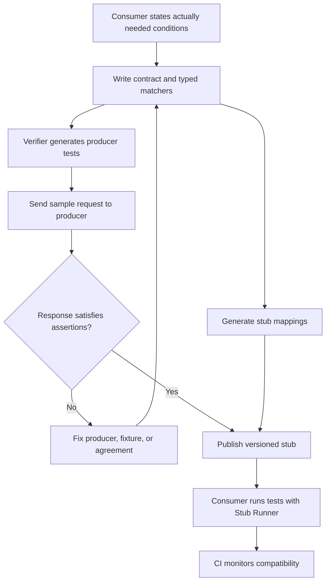

# Data Type Matchers

When testing contracts between a **producer** and a **consumer** with **Spring Cloud Contract**, an HTTP response can be business-valid even though values change on every run. For example, reservation codes `RES-7042` and `RES-8113` can both be valid; the order creation timestamp advances with the clock; and the item list may vary in length. Conversely, changing a JSON number to a JSON string, a boolean to the string `"true"`, or status `HELD` to `PENDING` can break the consumer even though the payload looks similar at a glance.

Therefore, in the **Matchers and Assertions** chapter of **Spring Cloud Contract**, we must choose **matchers by data type and semantics**: when to assert equality, when to check data type, when regex is needed, and when dedicated checks are needed for dates/times, `null`, lists, or objects. Matchers are expressed in Groovy/YAML DSL to generate producer-side tests and consumer-side stubs. Selecting the right matcher is an essential part of publishing stubs, using Stub Runner, and running CI to detect incompatible API changes.

After this lesson, you will be able to:

- Distinguish assertions by **value**, **JSON type**, **format**, and **business rule**.
- Use `bodyMatchers` and JSONPath to target the right fields in a request/response.
- Choose `byEquality()`, `byType()`, `byRegex(...)`, `byDate()`, `byTime()`, `byTimestamp()`, and `byNull()` in the appropriate context.
- Identify the limitations of matchers for strings, numbers, booleans, dates/times, arrays, and nested objects.
- Understand the difference between stub request matchers and response assertions in generated producer tests.
- Design supplementary test cases when matchers alone do not prove business semantics.

## 1. A Matcher Is a Verification Condition, Not Just a Data Example

Suppose `OrderService` calls `InventoryService` to retrieve a reservation. The producer returns:

```json
{
  "reservationId": "RES-7042",
  "status": "HELD",
  "quantityReserved": 2,
  "active": true,
  "expiresAt": "2026-11-24T09:30:00Z",
  "items": [
    { "sku": "SKU-001", "quantity": 2 }
  ]
}
```

The consumer depends on each field differently:

| Field | JSON Type | What the Consumer Needs | Appropriate Matcher to Consider |
| --- | --- | --- | --- |
| `reservationId` | String | ID formatted as `RES-` followed by digits | Regex, if this format is truly guaranteed |
| `status` | String | Must equal `HELD` in the success scenario | Equality |
| `quantityReserved` | Number | Must be a number, exact reserved quantity | Type to check data type; equality/additional test to verify exact quantity |
| `active` | Boolean | Means still valid/active | Equality with `true` if consumer depends on the exact value |
| `expiresAt` | String | Valid timestamp string per convention | Date/time matcher or format-appropriate regex |
| `items` | Array | Contains valid items, appropriate element count | Type and element count bounds; inspect items further if needed |

An **example value** in a contract primarily provides concrete data. A **matcher** states what is permitted to vary or what must hold true. Choosing the wrong matcher easily leads to two extremes: **brittle** tests because every valid ID is forced to equal one fixed string; or **overly loose** tests because any type and any value is accepted.

## 2. Distinguishing Four Levels of Verification

Before writing DSL, determine which level you need to protect.

| Level | Example | What It Proves | What It Does Not Prove |
| --- | --- | --- | --- |
| Exact value | `status == "HELD"` | Status matches the exact agreed string | Whether this status reflects accurate internal data |
| Data type | `active` is boolean | Producer did not change it to string/number | That `active` must always be `true` |
| Format | ID matches `RES-[0-9]+` | ID has the required structure | Whether the ID is unique or persisted in the database |
| Business rule | Reserved quantity does not exceed stock | Correct business behavior across states | Cannot be inferred from a single data-type matcher |

For instance, `byType()` on `quantityReserved` protects the JSON number type, but does not automatically guarantee the quantity equals `2` or is greater than `0`. If `OrderService` requires exactly two units after reserving, verify that via equality or an appropriate business test.

**Principle:** write matchers according to what the consumer actually relies on, then determine which business invariants must be tested outside a single HTTP response.

## 3. `bodyMatchers` and JSONPath in Groovy DSL

Spring Cloud Contract Groovy DSL allows declaring `bodyMatchers` inside `request` or `response`. For JSON, we commonly use `jsonPath(path, matcher)` to select a field or part of the JSON tree.

Example response snippet:

```groovy
response {
    status 200
    headers {
        contentType(applicationJson())
    }
    body([
        reservationId: 'RES-7042',
        status       : 'HELD',
        active       : true
    ])
    bodyMatchers {
        jsonPath('$.reservationId', byRegex('RES-[0-9]+'))
        jsonPath('$.status', byEquality())
        jsonPath('$.active', byType())
    }
}
```

In this snippet:

- `body` supplies the sample JSON content and also serves as the data source for the stub.
- `jsonPath('$.reservationId', ...)` selects the `reservationId` field at the root object.
- `byRegex(...)` checks the ID field against a pattern instead of requiring a fixed ID.
- `byEquality()` requires `status` to match the value in the sample body, here `HELD`.
- `byType()` targets the data type of `active`, here a JSON boolean.

Common JSONPath notation:

| Syntax | Meaning |
| --- | --- |
| `$` | Root of the JSON document |
| `$.reservationId` | `reservationId` field at root |
| `$.customer.id` | Nested field `customer.id` |
| `$.items[0].sku` | SKU of the first element in the array |
| `$.items[*].sku` | SKUs across elements of the array |

JSONPath identifies **where to match**. It does not impose content constraints on its own: an appropriate matcher must be attached. For JSONPath expressions that select multiple values, understand how the current version's generator applies matchers and inspect the generated assertions, especially if the requirement is "every element must be valid."

### Where Do Request Matchers and Response Matchers Run?

A crucial point in the consumer–producer model:

| `bodyMatchers` Location | Typical Role |
| --- | --- |
| Inside `request` | Defines how the stub matches requests sent by the consumer |
| Inside `response` | Defines the assertions generated tests use to check the real producer's response |

Producer-side tests usually send the **sample request** from the contract. The stub accepts requests using request matcher conditions and returns the contract's **sample response**. A matcher in `response` does not mean the stub generates random responses satisfying the matcher.

## 4. `byEquality()`: When the Value Must Be Exact

Use `byEquality()` when the **specific value** is the commitment, such as statuses, error codes, currency, or a boolean that determines control-flow branching.

```groovy
body([
    status  : 'HELD',
    currency: 'VND',
    active  : true
])
bodyMatchers {
    jsonPath('$.status', byEquality())
    jsonPath('$.currency', byEquality())
    jsonPath('$.active', byEquality())
}
```

The snippet above illustrates the `body` and `bodyMatchers` parts to place in a complete `response`. Expected outcome:

- `status` must be `"HELD"`.
- `currency` must be `"VND"`.
- `active` must be JSON boolean `true`.

Why not use `byType()` for everything? If you only check that `status` is a string, a producer changing `HELD` to `CANCELLED` could still pass. If the consumer proceeds to payment only when status is `HELD`, that is an incompatible change that must be blocked.

**Tip:** literal fields in a body may already be verified by equality by default depending on context and generator. `byEquality()` is helpful when the team wants to make the condition explicit and combine it with other matchers; you do not necessarily have to rewrite equality matchers for every invariant field in every contract.

## 5. `byType()`: Protecting the JSON Type

`byType()` is useful for values that may change while their **data type must remain stable**. For example, a response containing an item count, a boolean flag, and an object with an identifier:

```groovy
body([
    itemCount: 7,
    active   : true,
    customer : [
        id: 'C-100'
    ]
])
bodyMatchers {
    jsonPath('$.itemCount', byType())
    jsonPath('$.active', byType())
    jsonPath('$.customer.id', byType())
}
```

Meaning of the three conditions:

- `itemCount` must be a numeric type per the test tool's matcher, though its value does not have to equal `7` just because the sample is `7`.
- `active` must be a boolean type, though it could be `true` or `false` unless another assertion restricts it.
- `customer.id` must be a string type, though not necessarily equal to `C-100`.

Do not confuse `byType()` with validating the **entire schema**. Depending on the JSONPath expression and how assertions are generated, a matcher on `$.customer.id` does not protect all fields inside `customer`, nor does it validate each ID's business validity.

### Is a Number Always an Integer?

JSON only has a **number** type—it does not distinguish `int`, `long`, or `decimal` in the JSON specification. Java libraries may parse these numbers into different numeric types, so do not assume `byType()` alone guarantees a number is always an integer or within a specific range.

If the consumer requires:

- `quantityReserved == 2`: use equality or the corresponding assertion.
- `quantityReserved > 0`: add a value constraint or supplementary business test.
- `amount` is currency in the smallest unit (e.g., VND): document the unit and exact calculation explicitly, rather than checking only that it is a number.

In many APIs, fields like `totalAmount` are represented as JSON numbers yet can still suffer from unit or rounding bugs. A data-type matcher will not detect those semantic changes.

## 6. `byRegex(...)`: When a String Must Follow a Format

Regex is useful for string fields with a **stable structure** but **varying values**.

```groovy
body([
    reservationId: 'RES-7042',
    sku          : 'SKU-001',
    status       : 'HELD'
])
bodyMatchers {
    jsonPath('$.reservationId', byRegex('RES-[0-9]+'))
    jsonPath('$.sku', byRegex('SKU-[0-9]{3}'))
    jsonPath('$.status', byEquality())
}
```

| Regex | Matching Example | Non-Matching | Use Case |
| --- | --- | --- | --- |
| `RES-[0-9]+` | `RES-7042` | `RES-ABCD` | ID with prefix and digits |
| `SKU-[0-9]{3}` | `SKU-001` | `SKU-1` | Item code with three digits |
| Two allowed statuses | `HELD`, `EXPIRED` | `PENDING` | When the contract genuinely allows both statuses |
| `[A-Z]{2}-[0-9]{4}` | `VN-2026` | `vn-2026` | Fixed uppercase format code |

For a set of two allowed statuses, the Groovy pattern is `byRegex('(HELD|EXPIRED)')`: the `|` character in regex means "or." However, if the scenario must return `HELD` specifically, keep `byEquality()` so `EXPIRED` is not accidentally accepted.

Teams should not make `status` match `.*` just to be "flexible." When the consumer must make decisions based on an enum, the matcher should protect **the exact set of allowed values**, or keep equality per scenario.

Some built-in DSL matchers such as `nonEmpty()`, `number()`, or other regex helpers can be more convenient than typing patterns manually, depending on the Spring Cloud Contract version. However, choose helpers based on **actual semantics** and inspect the generated test code rather than assuming from a helper's name that all business conditions are checked.

### Regex Does Not Replace Validation

The matcher `RES-[0-9]+` can verify format, but it does not prove:

1. The ID exists in the data store.
2. The ID is unique across all reservations.
3. The reservation belongs to the currently accessing user.
4. Data referenced by the ID is still valid.

Those requirements need state, security, business-rule tests, or follow-up HTTP scenarios.

## 7. Booleans: Check Type or Check Value?

Suppose the producer returns:

```json
{
  "available": true,
  "canReserve": false
}
```

Two completely different questions:

- **Field must be a boolean type:** use `byType()` if you only need to ensure a JSON boolean.
- **Field must be `true` or `false` in the scenario:** use `byEquality()` or exact value checking.

Example:

```groovy
body([
    available : true,
    canReserve: false
])
bodyMatchers {
    jsonPath('$.available', byType())
    jsonPath('$.canReserve', byEquality())
}
```

If `available` changes from `true` to `false`, the `byType()` condition can still pass; however, `canReserve` changing from `false` to `true` must fail for this equality scenario.

Distinguish between these responses:

| JSON | Data Type | Equivalent to boolean `true`? |
| --- | --- | --- |
| `true` | Boolean | Yes |
| `"true"` | String | No |
| `1` | Number | No |
| `null` | Null | No |
| Field absent | No field | No |

A consumer deserializing into a DTO with a boolean field can break when the producer changes the type even though the value looks similar. That is precisely the kind of change data-type matchers help catch.

## 8. Dates, Times, and Timestamps

Time values are usually dynamic, so matching a single fixed timestamp makes tests brittle. Spring Cloud Contract includes matchers supporting date and time types, including `byDate()`, `byTime()`, and `byTimestamp()`.

Structure example:

```groovy
body([
    businessDate: '2026-11-24',
    localTime   : '09:30:00',
    createdAt   : '2026-11-24T09:30:00.000+07:00'
])
bodyMatchers {
    jsonPath('$.businessDate', byDate())
    jsonPath('$.localTime', byTime())
    jsonPath('$.createdAt', byTimestamp())
}
```

**Important:** default formats and details of how dates/times are recognized can depend on the Spring Cloud Contract version and matcher engine. Before choosing `byTimestamp()` for a specific ISO 8601 format, inspect the generated assertion and test with several valid/invalid values your real system uses. When the contract requires **a strict custom format**, use regex or dedicated checks rather than assuming the default matcher covers every variant.

The following requirements **are not proven merely because a string looks like a valid time**:

- `expiresAt` must be after `createdAt`.
- `expiresAt` must be at least a certain duration in the future from now.
- Time must be in UTC rather than server local time.
- Two events must be ordered correctly.

These are conditions comparing **across multiple values or against a clock**, so they require relational assertions or appropriate business tests.

### Timestamps with Offsets

For example, `2026-11-24T02:30:00Z` and `2026-11-24T09:30:00+07:00` can represent **the same instant in time**. If the consumer only needs the absolute instant, exact string comparison may be unnecessary. Conversely, if the API mandates UTC with a trailing `Z`, that is a format commitment that must be verified.

## 9. `null`, Missing Fields, and Empty Values

The following three JSON responses **are not the same**:

```json
{"cancelledAt": null}
```

```json
{}
```

```json
{"cancelledAt": ""}
```

- `null`: the field **is present** with JSON value null.
- Missing field: there is no `cancelledAt` key in the object.
- Empty string: the field is present with string type and length 0.

If the contract specifies that a field must be JSON null, Groovy DSL has the `byNull()` matcher:

```groovy
body([
    reservationId: 'RES-7042',
    cancelledAt  : null
])
bodyMatchers {
    jsonPath('$.reservationId', byRegex('RES-[0-9]+'))
    jsonPath('$.cancelledAt', byNull())
}
```

This snippet is intended to verify the null value of `cancelledAt`. However, testing **field non-existence** requires distinguishing key presence from a null value; do not assume `byNull()` means "the key may be absent." When a consumer distinguishes those two cases, design separate contracts/tests and verify that the generator produces presence assertions as expected.

**Avoid ambiguously using `byType()` for nullable fields** if the consumer needs a clear guarantee that the field is a valid string or null in two distinct scenarios. Write scenarios that clearly express the semantics to avoid ending up with an overly loose contract.

## 10. Arrays and Element Counts

For JSON arrays, there are two separate concerns:

1. **Element structure:** each element contains required fields with the right types.
2. **Element count:** at least one element, at most some count, or an exact count.

Suppose the producer returns:

```json
{
  "items": [
    { "sku": "SKU-001", "quantity": 2 }
  ]
}
```

In Groovy DSL, you can declare type and occurrence count constraints:

```groovy
body([
    items: [
        [sku: 'SKU-001', quantity: 2]
    ]
])
bodyMatchers {
    jsonPath('$.items', byType {
        minOccurrence(1)
        maxOccurrence(5)
    })
    jsonPath('$.items[0].sku', byRegex('SKU-[0-9]{3}'))
    jsonPath('$.items[0].quantity', byType())
}
```

`minOccurrence`/`maxOccurrence` constraints on collections are supported in applicable matcher cases. Verify how your project version's generator interprets the target JSONPath and occurrence bounds.

Do not interpret checking `$.items[0].sku` as verifying **every** element. If the array has five elements and only the first element's SKU is checked, the remaining four elements may not be constrained by that assertion. When the requirement is "every element has a properly formatted SKU and positive quantity," you need matchers across the respective elements or a dedicated test inspecting the full collection.

### When Should You Keep Array Equality?

If the contract describes a **fixed** result—such as a list of two valid permissions in a guaranteed order—full array equality can be the right choice. Conversely, if item order does not matter or element count varies, full array equality can fail tests due to ordering while the consumer still functions properly.

Before choosing a matcher, agree on:

- Is ordering part of the contract?
- Can the list be empty?
- Does the consumer use all elements or look up one element by key?
- Can duplicate elements appear?
- Are fields inside each element mandatory?

An element-count matcher only addresses part of these questions.

## 11. Nested Objects and Required Fields

For nested objects, target JSONPaths at the fields the consumer actually uses:

```groovy
body([
    customer: [
        id  : 'CUS-1001',
        type: 'BUSINESS'
    ],
    pricing: [
        currency: 'VND',
        amount  : 120000
    ]
])
bodyMatchers {
    jsonPath('$.customer.id', byRegex('CUS-[0-9]+'))
    jsonPath('$.customer.type', byEquality())
    jsonPath('$.pricing.currency', byEquality())
    jsonPath('$.pricing.amount', byType())
}
```

Here the producer can generate different customer IDs, while `type` and `currency` remain exact in the scenario. `amount` is only type-checked; if the consumer needs an exact payment amount, keep an equality assertion or use a business test verifying the total.

**Do not equate JSON objects with Java DTOs.** Contracts observe data exchanged over HTTP. A field typed as Java `BigDecimal` in the producer that serializes as a JSON string appears as a **string** to the consumer. Contracts must reflect types on the **wire format**, not just Java variable types in the implementation.

## 12. Full Groovy DSL Example: Multi-Type Response Verification

Suppose `OrderService` calls `InventoryService` to read reservation `1042`. The team agrees on a scenario returning `200`, status `HELD`, and reserved quantity exactly 2. The ID and timestamp may vary, but must retain valid formats.

```groovy
import org.springframework.cloud.contract.spec.Contract

Contract.make {
    name 'get_reservation_with_typed_matchers'
    description '''
        OrderService reads reservation to continue payment.
        Status and quantity must match scenario; ID and timestamp
        may vary but must follow the agreed format.
    '''

    request {
        method 'GET'
        url '/api/v1/reservations/1042'
    }

    response {
        status 200
        headers {
            contentType(applicationJson())
        }
        body([
            reservationId   : 'RES-7042',
            status          : 'HELD',
            quantityReserved: 2,
            active          : true,
            expiresAt       : '2026-11-24T09:30:00.000+07:00',
            items           : [
                [sku: 'SKU-001', quantity: 2]
            ]
        ])
        bodyMatchers {
            jsonPath('$.reservationId', byRegex('RES-[0-9]+'))
            jsonPath('$.status', byEquality())
            jsonPath('$.quantityReserved', byEquality())
            jsonPath('$.active', byEquality())
            jsonPath('$.expiresAt', byTimestamp())
            jsonPath('$.items', byType {
                minOccurrence(1)
                maxOccurrence(5)
            })
            jsonPath('$.items[0].sku', byRegex('SKU-[0-9]{3}'))
            jsonPath('$.items[0].quantity', byType())
        }
    }
}
```

This is a learning example of the DSL; you need Spring Cloud Contract Verifier configuration, a base class, fixture data, and compatible Spring versions to generate and run tests.

With this contract, expected producer test outcomes:

| If producer changes... | Expected Result | Reason |
| --- | --- | --- |
| `reservationId` from `RES-7042` to `RES-8113` | Pass if other conditions hold | ID still matches format |
| `reservationId` to `abc` | Fail | Does not match regex |
| `status` from `HELD` to `PENDING` | Fail | `byEquality()` requires exact `HELD` |
| `quantityReserved` from `2` to `3` | Fail | Scenario guarantees reserving exactly 2 |
| `active` from `true` to `false` | Fail | Boolean has right type but wrong value |
| `items` to empty array | Fail occurrence bounds | Requires at least one item |
| `items[0].sku` to `BAD` | Fail | Invalid SKU format |
| `expiresAt` to another instant in a supported format | May pass | Goal is checking timestamp format |

A pass still does not prove the reservation was persisted, did not double-deduct stock, or expires on schedule. Those sit outside the scope of the current assertions.

## 13. Request Matchers: Helping the Stub Pick the Right Scenario

In `request.bodyMatchers`, the primary goal is letting the stub accept matching requests from the consumer. Reservation API example:

```groovy
import org.springframework.cloud.contract.spec.Contract

Contract.make {
    name 'create_reservation_request_matchers'

    request {
        method 'POST'
        url '/api/v1/reservations'
        headers {
            contentType(applicationJson())
        }
        body([
            orderId : 'ORD-1001',
            sku     : 'SKU-001',
            quantity: 2
        ])
        bodyMatchers {
            jsonPath('$.orderId', byRegex('ORD-[0-9]+'))
            jsonPath('$.sku', byRegex('SKU-[0-9]{3}'))
            jsonPath('$.quantity', byEquality())
        }
    }

    response {
        status 201
        headers {
            contentType(applicationJson())
        }
        body([
            reservationId: 'RES-7042',
            status       : 'HELD'
        ])
    }
}
```

At the stub:

- `orderId = ORD-1001` and `orderId = ORD-9999` can both match the pattern if other conditions hold.
- `sku = SKU-001` has a valid format; `sku = ABC` does not match.
- `quantity` must still be `2` in this scenario.

However, the generated **producer test** typically sends the sample values in `request.body`, namely `ORD-1001` and `SKU-001`. It does not automatically run tests for every `orderId` matching the regex.

If the API must return `409` when inventory is insufficient, create a separate contract with distinguishable fixtures and requests. Do not use an overly broad matcher that causes the same request to match both the `201` stub and the `409` stub. Actual stub mapping structure must be checked upon publishing.

## 14. Distinguishing `byRegex(...)` in bodyMatchers from `consumer/producer`

Beyond `bodyMatchers`, Groovy DSL also offers **two-sided values** via `$(consumer(...), producer(...))`. Both techniques solve dynamic values, though they differ in declaration placement.

**Request** typically uses a matcher on the consumer side and a concrete value on the producer side:

```groovy
body([
    orderId: $(consumer(regex('ORD-[0-9]+')),
               producer('ORD-1001'))
])
```

**Response** typically uses a concrete value for the stub and a matcher on the producer side:

```groovy
body([
    reservationId: $(consumer('RES-7042'),
                     producer(regex('RES-[0-9]+')))
])
```

There is no need to declare both `$(...)` and `bodyMatchers` for the same field if doing so duplicates or conflicts. A team can pick one clear style, inspect the generated tests/stubs, and apply it consistently.

| Style | Primary Effect | Notes |
| --- | --- | --- |
| `response.bodyMatchers { jsonPath(..., byRegex(...)) }` | Defines assertions on producer response | Sample body is still used as stub data |
| `request.bodyMatchers { jsonPath(..., byRegex(...)) }` | Helps stub match requests | Producer test still needs a sample request |
| `$(consumer(...), producer(...))` | Separates values/matchers for two perspectives | Must read direction carefully by request/response |

## 15. YAML DSL and Data Type Matchers

Spring Cloud Contract also supports **YAML DSL**, though you do not embed raw Groovy `bodyMatchers { jsonPath(...) }` text directly in YAML. Supported versions provide request/response matcher structures according to the YAML schema.

YAML example using **concrete values**, before dynamic matchers:

```yaml
name: get_reservation_literal_response
description: OrderService retrieves reservation status
request:
  method: GET
  url: /api/v1/reservations/1042
response:
  status: 200
  headers:
    Content-Type: application/json
  body:
    reservationId: RES-7042
    status: HELD
    quantityReserved: 2
    active: true
```

To check `reservationId` via regex or `active` as a boolean type in YAML, consult **the YAML matcher syntax for your active Spring Cloud Contract version** and run the generator to verify. Do not copy `byRegex(...)` or `$(consumer(...), producer(...))` verbatim as YAML strings expecting them to be evaluated like Groovy.

In particular, YAML has its own type representation: `true` is boolean while `"true"` is a string; `2` is a number while `"2"` is a string. When writing contracts, avoid accidental quotes that alter the **wire format type**.

## 16. Matchers for HTTP Headers, Cookies, and Messages

`bodyMatchers` apply to the **body**; they do not replace every kind of condition for headers, cookies, or messages.

For example:

- `Content-Type` should be checked with an appropriate header matcher/assertion, since it belongs to **response headers**, not the JSON body.
- `Location` containing a dynamic ID can be expressed with an appropriate value/matcher in `headers`.
- `Set-Cookie` contains multiple attributes; full-string matching can be brittle if attribute order changes.
- For **message contracts**, payloads may have dynamic ID or timestamp fields; use supported matchers in `outputMessage` and verify the corresponding message emission path.

Example partial response with a dynamic Location header:

```groovy
response {
    status 201
    headers {
        header('Location',
               $(consumer('/api/v1/reservations/RES-7042'),
                 producer(regex('/api/v1/reservations/RES-[0-9]+'))))
    }
}
```

The stub receives a specific sample URI; the generated producer test checks the URI against the pattern. One regex for Location and a separate regex for an ID in the body **do not yet prove the two IDs are equal**. When the consumer depends on that relationship, add value-linking assertions or supplementary integration tests.

## 17. Integrating Matchers into Producer Tests, Stubs, and CI



In a Maven project integrated with Spring Cloud Contract Verifier, the standard check command is:

```bash
mvn -B -ntp clean verify
```

During the build, verify:

1. Did the plugin read the contracts and **generate tests** accordingly?
2. Were generated tests actually **executed**, rather than passing green with 0 tests?
3. Do generated assertions check the right JSONPath and chosen matcher type?
4. Do request matchers in the stub accept valid requests, reject invalid ones, and avoid colliding with error branches?
5. Does the stub artifact use the exact version of the verified producer?
6. Do consumer tests via Stub Runner cover how the consumer reads and processes the fields it actually relies on?

A passing test using `byType()` only tells you the value passed the matcher's generated type check; it does not prove every business property. If a change turns a JSON number into a string, a type matcher can help catch it early. If an amount changes from 120000 VND to 120000 cents while remaining a number, semantic tests are still required.

## 18. Common Matcher Selection Mistakes

| Mistake | Risk | Mitigation |
| --- | --- | --- |
| Exact-matching dynamic timestamps/IDs | Brittle tests on valid changes | Use format matchers or deterministic fixtures |
| Using `byType()` for `status` requiring exact `HELD` | Producer changes status and test still passes | Use equality or allowed enum set |
| Using `byRegex('.*')` for required data | Accepts meaningless strings | Use a clearly bounded pattern |
| Using string regex for JSON number fields | Risks bypassing data type check | Check JSON type first, then add numeric constraints |
| Using `byType()` to prove positive integers | Misses negative numbers or wrong units | Check values, ranges, or business tests |
| Using timestamp matcher then claiming unexpired time | Only checks string shape | Add time/state comparison tests |
| Equating `null` with missing fields | Consumer may handle them differently | Separate cases and verify field presence |
| Checking only `items[0]` and assuming all items valid | Misses subsequent elements | Check whole collection or relevant fields |
| Overly broad request matcher on success branch | Stub may return success when real producer errors | Narrow conditions and inspect mappings |
| Overly loose response matcher | API breaks semantics while build stays green | Tie matchers to behavior consumer actually uses |
| Adding conflicting matchers to the same field | Confusing assertions or stubs | Keep one clear source of truth |
| Never inspecting generated tests | Unknown what assertions DSL compiles to | Read generated output and test pass/fail cases |

## 19. Pre-Matcher Checklist

- [ ] Identified whether the field is in **request** or **response**.
- [ ] Know what the consumer uses the field for and whether an exact value is required.
- [ ] Chose the right JSON type: string, number, boolean, object, array, or null.
- [ ] Used `byEquality()` when the specific value drives business logic.
- [ ] Used `byType()` when the value may vary but the type must stay fixed.
- [ ] Used `byRegex(...)` for formats genuinely guaranteed by the producer.
- [ ] Regex is no broader than the valid data range the consumer needs.
- [ ] Not using date/time matchers in place of temporal relationship checks.
- [ ] Separated `null`, empty strings, and missing fields where necessary.
- [ ] For arrays, considered element count, per-element structure, and ordering.
- [ ] For nested objects, JSONPath targets the exact fields to protect.
- [ ] Request matchers do not cause collisions between success and error stubs.
- [ ] Inspected contract-generated assertions and actual stub scope.
- [ ] CI runs full generated producer tests; consumer uses matching stub version.

### Hands-on Exercise

`OrderService` (consumer) reads `GET /api/v1/reservations/1042` from `InventoryService` (producer). Sample response:

```json
{
  "reservationId": "RES-7042",
  "status": "HELD",
  "quantityReserved": 2,
  "active": true,
  "expiresAt": "2026-11-24T09:30:00.000+07:00",
  "items": [
    { "sku": "SKU-001", "quantity": 2 },
    { "sku": "SKU-002", "quantity": 1 }
  ]
}
```

**Requirements:**

1. Write a Groovy contract with status `200`, `Content-Type: application/json`, and the body above.
2. Use `byRegex(...)` so `reservationId` matches `RES-[0-9]+`; explain why dynamic IDs should not be exact-matched.
3. Use `byEquality()` for `status = HELD` and `active = true`; try altering them to see which tests fail.
4. Use `byType()` on a numeric field and explain why this check does not yet prove the quantity is right.
5. Choose a timestamp matcher for `expiresAt`; identify a separate test to ensure expiration time is after creation time.
6. Constrain `items` to between one and five elements; indicate what assertions are needed to validate every SKU and quantity in the array.
7. Create a `404` scenario for a nonexistent reservation. Ensure the `200` stub's request matcher does not overlap the `404` scenario.
8. Generate and run producer tests in a Spring Cloud Contract configured project. Inspect which matchers generated which tests, and catch a JSON string-vs-number type bug.
9. Use Stub Runner on the consumer side to test valid requests and requests that must be rejected; evaluate business-data discrepancies that the stub cannot catch automatically.

**Completion criteria:** you know for each JSON field whether to **verify value, type, format, presence, or business relationship**, can explain why the corresponding matcher was chosen, and can identify precisely which guarantees Spring Cloud Contract verifies in producer tests and stubs.

## References

- [Spring Cloud Contract — HTTP Contracts](https://docs.spring.io/spring-cloud-contract/reference/project-features-contract/http.html): HTTP contract structure and `bodyMatchers`.
- [Spring Cloud Contract — Dynamic Properties](https://docs.spring.io/spring-cloud-contract/reference/project-features-contract/dsl-dynamic-properties.html): data-type matchers, JSONPath, regex, and two-sided values.
