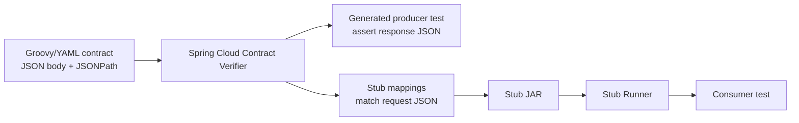

# JSONPath for Properties and Array Elements

## 1. What Problem Does JSONPath Solve in Contract Testing?

In **Spring Cloud Contract**, a contract describes HTTP or messaging behavior that a **producer** provides and a **consumer** relies on. From a **Groovy DSL** or **YAML DSL** contract, Spring Cloud Contract Verifier can generate producer-side tests and produce stubs. **Stub Runner** lets the consumer consume published stubs; CI can run tests on both sides to detect incompatible API changes.

When an HTTP body is JSON, properties are often nested inside objects or lists:

```json
{
  "orderId": "ORD-42",
  "customer": {
    "name": "Nguyễn Ánh",
    "address": {
      "city": "Hà Nội"
    }
  },
  "items": [
    {"sku": "BOOK-101", "quantity": 2, "price": 150000},
    {"sku": "BOOK-202", "quantity": 1, "price": 90000}
  ],
  "state": "PAID"
}
```

If you only compare the entire JSON against sample data, the generated producer test easily becomes brittle when a field like `orderId` is dynamically generated. Yet if you only check HTTP status `200`, the test can miss the producer dropping `items` or changing `quantity` from a number to a string.

**JSONPath** lets you point to a property, an array element, or a set of values inside JSON. Combining JSONPath with matchers such as `byEquality()`, `byRegex(...)`, `byType()`, and `byNull()` checks the exact parts of the contract the consumer needs.

This lesson in the **Matchers and Assertions** chapter focuses on practical JSONPath syntax, how to apply it to requests/responses, matcher limitations, and the verification workflow from producer to consumer.

## 2. Master JSONPath Syntax Before Writing DSL

### 2.1. Basic Path Notation

JSONPath starts with the **`$`** symbol indicating the root of the JSON document. After that, you can use dots for property names, square brackets for properties, or **0**-based array indices.

| JSONPath | What It Selects in the Example JSON? | Conceptual Result |
|---|---|---|
| `$` | Entire document | Root object |
| `$.orderId` | `orderId` property of root object | `"ORD-42"` |
| `$.customer.name` | Nested property inside `customer` | `"Nguyễn Ánh"` |
| `$.customer.address.city` | Multi-level nested property | `"Hà Nội"` |
| `$.items` | Entire value of `items` property | Array of 2 objects |
| `$.items[0]` | First element in the array | Object with `sku=BOOK-101` |
| `$.items[0].sku` | `sku` of the first element | `"BOOK-101"` |
| `$.items[1].quantity` | `quantity` of the second element | Number `1` |
| `$.items[*].sku` | `sku` of all elements | Set of values `BOOK-101`, `BOOK-202` |
| `$['customer']['name']` | Bracket notation form | `"Nguyễn Ánh"` |

**Note:** JSONPath syntax has multiple specifications and implementation variants. For example, `[*]` is a common wildcard, but how results are returned as a list and how the verifier's matcher interprets them must be verified with your project's library version. Do not assume every JSONPath feature behaves identically in every context.

### 2.2. Properties with Dots, Spaces, or Hyphens

A property named `order-id` is not standard dot-access syntax across every parser. For names containing dots, spaces, or hyphens, bracket notation expresses them unambiguously:

```json
{
  "order-id": "ORD-42",
  "customer.name": "Nguyễn Ánh",
  "display name": "Nguyễn Ánh"
}
```

```text
$['order-id']
$['customer.name']
$['display name']
```

`$.customer.name` and `$['customer.name']` **are different**: the former looks up `name` inside the `customer` object, whereas the latter looks up a root property literally named `customer.name`. When writing paths containing single quotes inside Groovy, choose the appropriate string quoting or escaping to avoid syntax errors.

### 2.3. Distinguishing Properties, Array Elements, and Root Arrays

Given two responses:

```json
{"items":[{"id":42}]}
```

```json
[{"id":42}]
```

For the first response, ID is at `$.items[0].id`. For the second response, ID is at **`$[0].id`** because the root itself is an array. Getting the root wrong causes JSONPath not to find the value even when the JSON is valid.

## 3. JSONPath and Spring Cloud Contract's Two Verification Directions

In Spring Cloud Contract, JSONPath typically appears inside `bodyMatchers` within a `request` or `response` block.

| Location | Who Uses It? | Goal |
|---|---|---|
| `request { bodyMatchers { ... } }` | Consumer-side **stub**, usually via WireMock mapping | Accept requests whose JSON body meets the conditions |
| `response { bodyMatchers { ... } }` | **Generated producer test** | Verify the actual JSON response from the producer |

A **request matcher** does not automatically generate multiple producer tests; the generated test still sends one sample request from `body`. A **response matcher** does not make the stub synthesize dynamic data on its own; the stub usually returns the sample value declared in `body`. Understand this distinction before choosing paths and matchers.



**JSONPath specifies how to locate data; the matcher is the rule that validates that data.** For instance, `$.items[0].sku` only identifies the position, while `byRegex('BOOK-[0-9]+')` defines the acceptable value shape.

## 4. Groovy DSL Example: Checking Nested Properties in Response

Suppose `GET /api/orders/42` returns order details; `customer.name` and `state` must be exact, while `receiptId` is dynamically generated in the format `RCT-` plus eight digits.

```groovy
import org.springframework.cloud.contract.spec.Contract

Contract.make {
    description 'Order details and receipt ID'

    request {
        method GET()
        url '/api/orders/42'
        headers {
            header 'Accept', 'application/json'
        }
    }

    response {
        status OK()
        headers {
            contentType(applicationJson())
        }
        body(
            orderId: 42,
            customer: [
                name: 'Nguyễn Ánh'
            ],
            state: 'PAID',
            receiptId: 'RCT-00001234'
        )
        bodyMatchers {
            jsonPath('$.orderId', byEquality())
            jsonPath('$.customer.name', byEquality())
            jsonPath('$.state', byEquality())
            jsonPath('$.receiptId', byRegex('RCT-[0-9]{8}'))
        }
    }
}
```

Role of each matcher:

- `byEquality()` requires the selected value to match the value described in `body`. For `state`, this protects the business meaning `PAID`.
- `byRegex('RCT-[0-9]{8}')` accepts a dynamic receipt ID matching the format; the producer does not have to return `RCT-00001234` on every run.
- `'$.customer.name'` selects the exact nested property, without confusing it with a root property `name`.
- The consumer-side stub can still return the example `receiptId = RCT-00001234`; consumer tests use that sample data to verify handling.

The value `orderId=42` requires the producer test to set up the corresponding fixture. If no order with ID 42 exists in the test environment, the test can fail due to missing data, not an incorrect JSONPath.

### 4.1. When Should You Use Fixed Values?

Fields like `state=PAID` or `currency=VND` in a specific scenario should normally be compared exactly. Replacing them with `byRegex('.*')` allows the producer to return `UNKNOWN` while tests still pass. JSONPath does not make a matcher stronger if the underlying match rule is too broad.

## 5. JSONPath for Array Elements: Indices and Properties

Suppose the response is:

```json
{
  "items": [
    {"sku":"BOOK-101","quantity":2,"price":150000},
    {"sku":"BOOK-202","quantity":1,"price":90000}
  ],
  "total": 2
}
```

### 5.1. Selecting the First and Second Elements

```groovy
response {
    status OK()
    headers {
        contentType(applicationJson())
    }
    body(
        items: [
            [sku: 'BOOK-101', quantity: 2, price: 150000],
            [sku: 'BOOK-202', quantity: 1, price: 90000]
        ],
        total: 2
    )
    bodyMatchers {
        jsonPath('$.items[0].sku', byEquality())
        jsonPath('$.items[0].quantity', byEquality())
        jsonPath('$.items[1].sku', byEquality())
        jsonPath('$.items[1].quantity', byEquality())
        jsonPath('$.total', byEquality())
    }
}
```

Array indices start at `0`; `$.items[0].sku` and `$.items[1].sku` check **two different positions**. Checking by index is appropriate when the API guarantees ordering: for example, `items` sorted by SKU or a request with `sort=price,desc`.

**If the API does not guarantee ordering**, a contract locking `BOOK-101` at index 0 can break when the producer merely changes its internal sorting. In that case, verify value sets, element conditions, or business invariants with appropriate matchers and supplementary tests instead of asserting an ordering absent from the contract.

### 5.2. Wildcard `[*]` Does Not Mean "Automatically Check Every Element"

Expressions such as:

```text
$.items[*]
$.items[*].sku
$.items[*].quantity
```

typically select multiple elements. However, a matcher configured only on `$.items[0].sku` **cannot** prove the second element's SKU has the right format. Conversely, putting a wildcard in `jsonPath(...)` does not mean every verifier version automatically generates the exact **per-element** assertion you expect.

To protect every element of a dynamically sized array, verify how the JSONPath library returns the list, which matcher compares the list, and what the generated test code actually does. When rules are complex, add a producer test iterating over parsed elements instead of relying on assumptions about wildcards.

### 5.3. JSONPath for a Root-Level Array

If the API returns:

```json
[
  {"sku":"BOOK-101","quantity":2},
  {"sku":"BOOK-202","quantity":1}
]
```

then JSONPath must start at `$[0]` or `$[1]`:

```groovy
response {
    status OK()
    headers {
        contentType(applicationJson())
    }
    body([
        [sku: 'BOOK-101', quantity: 2],
        [sku: 'BOOK-202', quantity: 1]
    ])
    bodyMatchers {
        jsonPath('$[0].sku', byEquality())
        jsonPath('$[1].quantity', byEquality())
    }
}
```

Do not use `$.items[0]` for a root array because the document has no `items` property. For an empty-array response, explicitly declare `body([])` and verify that the generated assertion actually enforces an empty array, not merely "value is an array."

## 6. Checking Data Types, Regex, and Element Counts

### 6.1. Common Matchers

| Matcher | Meaning | Usage Example |
|---|---|---|
| `byEquality()` | Equals the value in `body` | `state=PAID`, `total=2` |
| `byRegex('...')` | Matches string/value pattern per verifier rules | SKU code, reference code |
| `byType()` | Checks data type based on sample value | String, number, boolean, object, array |
| `byType { minOccurrence(...); maxOccurrence(...) }` | Constrains collection element count in supported contexts | Result lists |
| `byNull()` | Selected value must be JSON `null` in response | Intentionally null fields |
| `byDate()`, `byTime()`, `byTimestamp()` | Checks supported date/time formats | Dynamic timestamps |
| `byCommand('...')` | Invokes a check method on the base test in generated producer tests | Complex business rules |

**JSON type is part of the contract.** The number `42` is not equivalent to the string `"42"`; the boolean `true` differs from the string `"true"`. Using only a regex for `[0-9]+` may not suffice to protect a numeric type in some contexts. `byType()` or explicit type checking is helpful when the consumer relies on strict deserialization.

### 6.2. Constraining Element Counts with `byType`

Example of a list returning 1 to 5 products:

```groovy
response {
    status OK()
    headers {
        contentType(applicationJson())
    }
    body(
        items: [
            [sku: 'BOOK-101', quantity: 2]
        ]
    )
    bodyMatchers {
        jsonPath('$.items', byType {
            minOccurrence(1)
            maxOccurrence(5)
        })
    }
}
```

Here the intent is that `items` is a collection with at least 1 and at most 5 elements. **This does not check the status, SKU, or quantity of each item.** To protect element structure, add corresponding matchers and check whether the generated test truly covers the entire array as required.

If the API guarantees that **no results** must be `[]`, write a separate contract with `body(items: [])` or `body([])` and avoid matchers that accept lists longer than 0. Nor is an `items` field set to `null` or omitted implicitly equivalent to `[]`.

### 6.3. Null Type and Missing Properties

Consider:

```json
{"receiptId": null}
```

and:

```json
{}
```

These are **two different JSON structures**. The `byNull()` matcher targets a selected null value; do not assume it automatically verifies that a field is completely **absent**. Some JSONPath engines return nothing when a path does not exist, or have distinct modes for "missing path" vs. "path holding null." When the API requires a property to be absent, write a scenario/assertion verifying that exact intent.

## 7. JSONPath in Requests: Validating Consumer-Sent Data

In requests, JSONPath can point to properties or body elements that the **stub** must match. For example, a consumer sends an order creation request:

```json
{
  "customerId": "CUS-42",
  "items": [
    {"sku":"BOOK-101","quantity":2}
  ]
}
```

Groovy contract:

```groovy
import org.springframework.cloud.contract.spec.Contract

Contract.make {
    description 'Create order with properly formatted customer and product codes'

    request {
        method POST()
        url '/api/orders'
        headers {
            contentType(applicationJson())
        }
        body(
            customerId: 'CUS-42',
            items: [
                [sku: 'BOOK-101', quantity: 2]
            ]
        )
        bodyMatchers {
            jsonPath('$.customerId', byRegex('CUS-[0-9]+'))
            jsonPath('$.items[0].sku', byRegex('BOOK-[0-9]+'))
        }
    }

    response {
        status 201
        headers {
            contentType(applicationJson())
        }
        body(
            orderId: 42,
            state: 'CREATED'
        )
    }
}
```

The two matchers in **request** help the stub determine which incoming requests are accepted. However, the producer test still sends the sample body `customerId = CUS-42`, `sku = BOOK-101`. The generated test **does not automatically send extra requests** with `CUS-43` or a multi-element array just because a regex is present.

**Consistency note:** if the stub accepts many `customerId` values yet always returns `orderId=42`, that is merely simulated data. Do not mislead the consumer into assuming `orderId=42` is always the business result for every customer; use stubs with scenario-appropriate data or supported dynamic responses if the consumer needs to verify input/output relationships.

### 7.1. Request Matchers Differ from Response Assertions

- `request.bodyMatchers.jsonPath(...)` participates in **stub selection** for consumer requests.
- `response.bodyMatchers.jsonPath(...)` participates in **asserting** the producer's response in generated tests.
- To verify that the producer rejects a body missing `customerId`, you need a **missing-field request scenario** with a concrete error response; a single valid-request scenario is not enough to prove required-field validation.

## 8. YAML DSL: Expressing Matchers for Properties and Array Elements

YAML DSL can describe bodies using mappings/lists and declare matchers via JSONPath. For a response contract, an illustrative structure is:

```yaml
description: Product list with properly formatted SKU codes
request:
  method: GET
  url: /api/products?category=BOOK
response:
  status: 200
  headers:
    Content-Type: application/json
  body:
    items:
      - sku: BOOK-101
        quantity: 2
      - sku: BOOK-202
        quantity: 1
  matchers:
    body:
      - path: $.items[0].sku
        type: by_regex
        value: "BOOK-[0-9]+"
      - path: $.items[1].sku
        type: by_regex
        value: "BOOK-[0-9]+"
```

In this YAML, `response.body.items` is a list of two objects; the matchers use two paths `$.items[0].sku` and `$.items[1].sku`. The stub returns the declared sample values, while the producer test applies the matcher validation conditions.

A contract whose response body is a **root array** can be written as a YAML sequence:

```yaml
description: Return array of results
request:
  method: GET
  url: /api/products/top
response:
  status: 200
  headers:
    Content-Type: application/json
  body:
    - sku: BOOK-101
      quantity: 2
  matchers:
    body:
      - path: $[0].sku
        type: by_regex
        value: "BOOK-[0-9]+"
```

YAML matchers use `type` names like `by_regex`, whereas Groovy uses method calls like `byRegex(...)`; **do not copy Groovy closure syntax verbatim into YAML**. Supported syntax can depend on the Spring Cloud Contract version; when using complex matchers, verify that the contract file parses and inspect the generated tests and mappings in your project's actual build.

## 9. Advanced JSONPath: Wildcards and Filters Have Limits

Many JSONPath implementations support advanced selectors:

```text
$.items[*].sku
$.items[0:2].sku
$.items[?(@.quantity > 1)].sku
$..sku
```

Common meanings:

- `[*]`: selects multiple array elements.
- `[0:2]`: selects an array slice, typically indices 0 and 1.
- `[?(@.quantity > 1)]`: filters elements by predicate.
- `..sku`: finds `sku` properties via recursive descent.

**Do not assume all of these selectors act as equivalent matchers in Spring Cloud Contract.** The JSONPath engine, translation into WireMock matchers, and how generated assertions handle lists can vary. In particular, wildcards/filters returning multiple values can prevent a single-string regex from behaving as expected.

A practical verification step is to return a response containing **two elements**, intentionally break the second element's `sku`, and run the generated test. If the test still passes, the matcher is not protecting the rule the consumer needs. You can add producer integration tests in Java iterating over the list when "every element" logic is complex.

### 9.1. Example of Supplementary All-Elements Assertion on the Producer Side

Assuming JSON was obtained from the HTTP response and stored in `responseJson`, you can use JsonPath in standard Java test code:

```java
import com.jayway.jsonpath.JsonPath;
import java.util.List;

List<String> skus = JsonPath.read(responseJson, "$.items[*].sku");
assertThat(skus).isNotEmpty();
assertThat(skus).allMatch(s -> s.matches("BOOK-[0-9]+"));
```

This is an example of a **supplementary assertion**, not code automatically generated in all contract tests. It helps when you must check **every element** and have not confirmed that the DSL matcher generates that exact rule. Assertion library imports and the `responseJson` source must be provided by the test project.

## 10. Common JSONPath Mistakes

| Error | Consequence | Fix |
|---|---|---|
| Using `$.items[0].id` when response is a root array | Cannot find `items` property | Use `$[0].id` |
| Confusing `$.customer.name` with `$['customer.name']` | Selects wrong property | Use bracket notation for special property names |
| Indexing arrays from 1 | Selects wrong element | Standard JSONPath is `0`-based |
| Claiming `$.items[0].sku` protects all elements | Misses errors in other elements | Add suitable matchers and test the whole array |
| Using wildcard with regex without checking result | Matcher operates on list instead of each string | Inspect generated test and WireMock mapping |
| Using `byType()` instead of checking `state=PAID` | Business-wrong value still has string type | Use equality or domain-accurate matcher |
| Using `byRegex('.*')` for every field | Assertions lack bug-catching power | Match critical fields precisely |
| Treating JSON null like a missing property | Tests miss schema errors | Separate null and absent-key contracts |
| Comparing `42` like string `"42"` | Consumer may fail deserialization | Verify exact JSON type |
| Enforcing array order when API makes no promise | Tests fail on harmless changes | Define sort contract or check value set |
| Skipping empty-array cases | Failures when returning `null` or `{}` | Write `body([])` or `items: []` contracts |
| Running only stubs without producer tests | Stub passes while real API changed | Run both sides in CI |

## 11. Practical Workflow: Verifying Multi-Element Responses and Catching Breaking Changes

**Context:** `checkout-service` calls `GET /api/orders/42` and needs the order ID, status, and items. `order-service` wants to change how SKUs are generated and add metadata fields. The goal is to preserve the commitments the consumer relies on.

**API Requirements:**

1. The response has numeric `orderId` and `state` equal to `PAID`.
2. The `items` property is an array with at least one element in the paid scenario.
3. Each SKU follows `BOOK-` plus digits; `quantity` must be a positive integer.
4. If the API guarantees ordering, results must keep the published order; otherwise, the consumer should not rely on a fixed position.

**Suggested Groovy contract:**

```groovy
import org.springframework.cloud.contract.spec.Contract

Contract.make {
    description 'PAID order has properly formatted products'
    request {
        method GET()
        url '/api/orders/42'
    }
    response {
        status OK()
        headers {
            contentType(applicationJson())
        }
        body(
            orderId: 42,
            state: 'PAID',
            items: [
                [sku: 'BOOK-101', quantity: 2],
                [sku: 'BOOK-202', quantity: 1]
            ]
        )
        bodyMatchers {
            jsonPath('$.orderId', byEquality())
            jsonPath('$.state', byEquality())
            jsonPath('$.items', byType {
                minOccurrence(1)
                maxOccurrence(10)
            })
            jsonPath('$.items[0].sku', byRegex('BOOK-[0-9]+'))
            jsonPath('$.items[1].sku', byRegex('BOOK-[0-9]+'))
        }
    }
}
```

This example protects two sample elements and a count between 1–10. If production data can have more than two elements, extend testing to additional elements or write a list assertion to protect **all SKUs**, rather than treating two fixed-index JSONPaths as covering the entire list.

**Step-by-step practice:**

1. Place the contract in the directory scanned by Verifier; set up an order ID 42 fixture with two products in the base test.
2. Run the producer build to generate and execute contract tests. Check status code, JSONPaths for `orderId`, `state`, `items`, and both SKUs.
3. Intentionally change `state` to `COMPLETED` and observe the producer test fail because it differs from `PAID`.
4. Intentionally change the second SKU to `PEN-202`. If the matcher catches it, the test fails; if not, review matcher scope and generated assertions.
5. Produce a versioned stub artifact. In the consumer, run the stub with Stub Runner and call it via the real HTTP client.
6. The consumer test confirms the DTO reads the array, payment status, and SKUs—not just that the stub started.
7. Integrate producer tests, stub publishing, and consumer tests into CI; review API changes before deployment.

### 11.1. When Is a Passing Test a Sign of Insufficient Coverage?

For instance, the generated producer test passes when:

- The response has valid `items[0].sku`, but `items[2].sku` is invalid.
- `quantity` changed to a string because the matcher only checked SKU.
- The API drops `items` when empty, yet there is no contract for an empty list.
- The stub uses an old version and consumer tests did not run against the new artifact.

This is not a JSONPath bug, but a **gap in the scope of documented and enforced commitments**. When adding contracts or matchers, pick scenarios with real risk rather than duplicating assertions that add no value.

## 12. Checklist for Reviewing JSONPath in Contracts

- [ ] Path starts at the right root: object or array.
- [ ] Nested properties, special names, and array indices are written accurately.
- [ ] Each matcher has a clear purpose: equality, format, type, null, or element count.
- [ ] Matchers in `request` are understood as stub matching conditions; matchers in `response` as producer test assertions.
- [ ] Sample values and producer fixtures are consistent with the JSONPaths used in tests.
- [ ] Wildcards/filters are used only after verifying the JSONPath and generated matcher behavior in the project's version.
- [ ] If every element must be protected, a test proves any single invalid element will be caught.
- [ ] Empty lists, null, and missing properties are distinguished where the consumer requires it.
- [ ] Array order is enforced only when the API promises ordering.
- [ ] Stubs are published with versions; consumer tests use a real client and verify behavior when reading JSON.
- [ ] CI runs producer verification and consumer stub tests to catch incompatible changes.

**Takeaway:** JSONPath only specifies **where to look for data**. A reliable contract also needs the **right matcher rule**, a scenario with controlled fixtures, and executed tests on both producer and consumer sides. When these pieces work together properly, Spring Cloud Contract catches structural object changes, altered array fields, or broken values that the consumer truly depends on.
