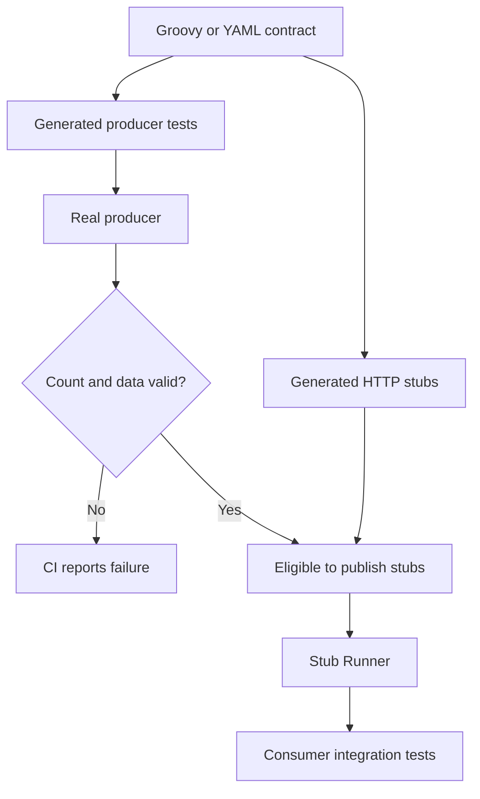

# Element Counts and Collection Conditions

## 1. Why Is Element Count Part of a Contract?

In **Spring Cloud Contract**, a contract describes the commitments that a **producer** (the service providing the API) must uphold so that a **consumer** (the service calling the API) works properly. For HTTP, contracts are written in **Groovy/YAML DSL** and used to generate producer tests and create stubs for the consumer via **Stub Runner**. When run in CI, these tests help catch incompatible API changes before release.

Testing a response containing a single object is relatively straightforward. However, APIs returning lists typically carry more commitments than "HTTP 200 and body is JSON":

- May the list be **empty**? Must there be **at least one** element or **exactly one** element?
- Is there a **maximum** number of elements per page?
- Must **every element** contain valid `id`, `sku`, and `quantity`?
- Does the consumer need **all** elements to satisfy a filter, or merely **at least one** matching element?
- Must **no duplicate IDs** or **specific ordering** be guaranteed?
- Must `totalElements` equal the length of the currently returned list, or is it the total record count across all pages?

A contract checking only "`items` is an array" misses many bugs related to counts and collection conditions. Conversely, hardcoding the entire list to a fixed snapshot can fail tests when the producer merely adds one valid element. This lesson guides you on choosing the right constraint level, using Spring Cloud Contract matchers/JSONPath when appropriate, and adding dedicated assertions when needed.

## 2. Distinguishing Lists, Sets, and Query Results

Consider the endpoint:

```http
GET /api/orders?status=CONFIRMED&page=0&size=3
Accept: application/json
```

The producer may return:

```json
{
  "page": 0,
  "size": 3,
  "totalElements": 7,
  "items": [
    { "orderId": "ord-101", "status": "CONFIRMED", "amount": 120000 },
    { "orderId": "ord-102", "status": "CONFIRMED", "amount": 250000 }
  ]
}
```

There are three distinct numbers here:

| Concept | Example Value | Meaning |
| --- | ---: | --- |
| `items.length` | 2 | Number of elements **actually** returned in this response |
| `size` | 3 | Requested/declared page size, not required to equal the received item count |
| `totalElements` | 7 | Total records **matching the query** across all pages (per pagination convention) |

Therefore, asserting "`items.length == totalElements`" is **wrong** for paginated results. A reasonable rule is usually `0 <= items.length <= size`; however, if the API permits empty pages, shorter last pages, or fewer items due to specific policies, adjust to match the agreed contract.

A **list** (`array/list`) is ordered. A **set** in business terms may disregard order and forbid duplicate keys. JSON has no distinct `Set` type: the producer still returns an array, while checking "no duplicates" must rely on key fields and independent checks.

## 3. Choosing the Type of Count Constraint

| Commitment Type | Example | When to Use | Bug to Catch |
| --- | --- | --- | --- |
| Empty list allowed | `items.length >= 0` | Query may yield no results | `items = null` when consumer requires an array |
| At least one element | `items.length >= 1` | Action only succeeds with results | Producer returns `[]` when data must exist |
| At most N elements | `items.length <= 3` | API has `size=3` limit | Producer returns 5 elements, overflowing client handling |
| Within range | `1 <= items.length <= 3` | Scenario has at least one result and page cap | 0 or 4 elements |
| Exactly N elements | `items.length == 2` | N is a business invariant of the scenario | One element too many or too few |
| Unique keys | Distinct `orderId`s | List represents unique orders | Same order appears twice |
| All elements valid | Every `status = CONFIRMED` | API is filtered by status | A `CANCELLED` item slips through |
| At least one valid element | Exists `amount > 0` | Consumer only needs one qualifying choice | No qualifying choice present |
| Proper ordering | `createdAt` descending | Consumer relies on API sort | Producer reverses order despite unchanged item set |

**Not every condition is well expressed by a one-line matcher.** Spring Cloud Contract provides JSONPath matchers and occurrence-count constraints; complex invariants like monetary sums, key uniqueness, or stable sorting often require supplementary business assertions on the producer/consumer.

## 4. JSONPath and Occurrence Counts in Spring Cloud Contract

JSONPath lets you select nodes in JSON. Common expressions:

| JSONPath | What It Selects? | Key Caveat |
| --- | --- | --- |
| `$.items` | **One array node** `items` | One node does not mean the array has one element |
| `$.items[*]` | Direct elements of the array | Matched node count usually reflects element count at this level |
| `$.items[*].orderId` | `orderId` fields present inside elements | Can be fewer than element count if an element lacks `orderId` |
| `$.items[0]` | First element | Does not check the entire array |
| `$.items[*].status` | `status` fields | To prove **every** element has a valid status, compare against element count or use another assertion |

In **Groovy DSL**, Spring Cloud Contract provides body matchers like `byEquality()`, `byRegex(...)`, `byType()`. With supporting configurations, `byType` can combine `minOccurrence` and `maxOccurrence` to control how many times a JSONPath matches. Example **response section** of a contract:

```groovy
response {
    status OK()
    headers {
        contentType(applicationJson())
    }
    body([
        items: [
            [orderId: 'ord-101', status: 'CONFIRMED']
        ]
    ])
    bodyMatchers {
        jsonPath('$.items[*]', byType {
            minOccurrence(1)
            maxOccurrence(3)
        })
    }
}
```

The **intent of this example** is to verify between **1 and 3 element nodes** selected by JSONPath `$.items[*]`. `body.items` provides a **sample response** for stub generation; it does not mean the real producer must always return exact element `ord-101` if matcher configuration permits variation.

Mandatory check when applying this: `minOccurrence`/`maxOccurrence` controls **how many times the path matches in the generated assertion**, not a general proof of every business property of the collection. How the plugin translates sample bodies, body matchers, and lists into assertions can vary by version and configuration. **Open the generated producer test** to confirm it genuinely checks the `1..3` bounds instead of accidentally hard-comparing the entire sample array.

### Matched Node Count Is Not Necessarily Element Count

If you use `$.items[*].orderId` to check `minOccurrence(2)`, the matcher may count **two `orderId` fields found**, without proving the array has exactly two elements or that every element has an `orderId`. Example:

```json
{
  "items": [
    { "orderId": "ord-101" },
    { "orderId": "ord-102" },
    { "status": "CONFIRMED" }
  ]
}
```

The path `$.items[*].orderId` finds two values, yet the array has three elements and one element lacks an ID. If the contract requires **every element to have an ID**, check field presence on each element and compare the two selected sets, or write a dedicated test for this invariant.

### Limits of Max/Min and Boundary Cases

For collections allowed to be empty, explicitly test the `[]` case and distinguish it from `null` or an omitted `items` field. Do not assume declaring `minOccurrence(0)` automatically proves the `items` field always exists and is an array. When expecting `items: []`, verify **presence and array type** alongside the count constraint.

If the API requires **exactly two** elements, the goal calls for both min and max equal to 2. Still, asserting exact count `2` via matchers should be cross-checked against the generated test; for complex business rules, asserting directly on the JSON array or DTO is clearer and easier to verify.

## 5. Expressing the Corresponding Intent in YAML DSL

In YAML DSL, sample data lives in `response.body`; matchers live in `response.matchers.body`. One corresponding representation in common matcher form is:

```yaml
description: List up to three confirmed orders
request:
  method: GET
  url: /api/orders?status=CONFIRMED&page=0&size=3
  headers:
    Accept: application/json
response:
  status: 200
  headers:
    Content-Type: application/json
  body:
    items:
      - orderId: "ord-101"
        status: "CONFIRMED"
  matchers:
    body:
      - path: $.items[*]
        type: by_type
        minOccurrence: 1
        maxOccurrence: 3
```

The `items` sample has one element so the **stub has fixed data** for consumer tests. `minOccurrence` and `maxOccurrence` express the **intent for how many times the JSONPath matches** when producer tests run. Matcher field syntax and assertion-generation rules depend on the Spring Cloud Contract version; confirm your plugin's YAML schema and read the generated tests. If the plugin/version does not support the exact condition needed, use a supplementary testing approach rather than assuming the matcher takes effect.

**Do not place both Groovy and YAML versions of the same scenario in the primary contracts directory** to avoid generating duplicate tests or stubs. Format conversion must preserve test behavior, not just translate property names.

### Be Careful with Request URLs

In the YAML example, the URL has a fixed query string for the scenario. If the consumer is allowed to reorder query parameters, or the API has optional parameters that do not affect results, describe paths and query matchers appropriately instead of locking the entire URL string. The same principle applies to pagination: the contract must state clearly what conditions `page`, `size`, and `status` represent on the request.

## 6. Per-Element Conditions

Count checks are insufficient if returned elements are invalid. For a response filtered by `status=CONFIRMED`, a meaningful condition is:

> Every element in `items` must have a valid `orderId` and `status = CONFIRMED`.

Common assertions:

| Condition | Example | Risk of Checking Only One JSONPath |
| --- | --- | --- |
| **All** elements satisfy condition | Every `status = CONFIRMED` | Matcher `$.items[0].status` checks only the first element |
| **Exists** an element satisfying condition | At least one `amount > 100000` | Path pointing to the first sample can miss other elements |
| **No** invalid element | No `status = CANCELLED` | Matcher validating one valid element does not prove the negative condition |
| **No duplicate IDs** | Unique `orderId`s within the page | Individual ID regex still permits two identical IDs |
| **Maintain cross-field relationships** | `discount <= amount` | Checking each field is numeric does not prove the relationship |
| **Complete structure** | Every element has `orderId` and `status` | Number of found fields can be less than array length |

JSONPath matchers help check a field or a specific set of values, but **do not assume a matcher automatically implies "all elements."** Semantics could be "path exists," "some value matches," or a plugin-specific generated assertion; read the generated code. When the requirement is a universal invariant like "all elements satisfy," test with a multi-element array and intentionally add one invalid element to confirm the test actually catches it.

### Example Supplementary Assertion in Java

The snippet below illustrates checking a **JSON response received from the producer** using Jackson and AssertJ. It can be used in an integration test or a dedicated check alongside generated producer tests; imports, HTTP client setup, and obtaining `responseBody` live in the actual test class:

```java
JsonNode root = objectMapper.readTree(responseBody);
JsonNode items = root.path("items");

assertThat(items.isArray()).isTrue();

List<JsonNode> rows = StreamSupport.stream(
    items.spliterator(), false
).toList();

assertThat(rows.size()).isBetween(1, 3);

assertThat(rows).allSatisfy(item -> {
    assertThat(item.path("orderId").isTextual()).isTrue();
    assertThat(item.path("orderId").asText())
        .matches("ord-[0-9]+");
    assertThat(item.path("status").asText())
        .isEqualTo("CONFIRMED");
});

List<String> ids = rows.stream()
    .map(item -> item.path("orderId").asText())
    .toList();
assertThat(ids).doesNotHaveDuplicates();
```

This test verifies specific things:

1. `items` exists **and is an array**; `null` or an object is rejected.
2. Array length is in the range `1..3`.
3. **Every element** has a string `orderId` matching the pattern and `status` equal to `CONFIRMED`.
4. IDs in the response have no duplicates.

**Note:** This is a supplementary assertion, not Contract DSL syntax. Writing dedicated tests is sensible when generated matchers cannot clearly express collection invariants. Placing the test on the producer verifies the implementation; the consumer also needs its own tests if list-processing logic is complex.

## 7. When Element Ordering Does and Does Not Matter

A JSON array always has an element order, yet **not every API guarantees that order**.

Example default endpoint without `sort`:

```json
{
  "items": [
    { "orderId": "ord-101" },
    { "orderId": "ord-102" }
  ]
}
```

If the consumer simply builds a map `orderId -> order`, the producer returning `ord-102` before `ord-101` can be completely compatible. Equality-comparing the whole array in exact sample order imposes an unnecessary constraint.

Conversely, if the request is `GET /api/orders?sort=createdAt,desc` and the UI relies on server ordering, then **descending order by `createdAt`** is part of the contract. A test checking only element presence would miss a reversed sort direction bug.

An illustrative assertion for non-increasing sorted order:

```java
List<Instant> times = rows.stream()
    .map(item -> Instant.parse(item.path("createdAt").asText()))
    .toList();

for (int i = 1; i < times.size(); i++) {
    assertThat(times.get(i)).isBeforeOrEqualTo(times.get(i - 1));
}
```

This checks **non-increasing** order (descending or equal), suitable when records share timestamps. If the API needs a tie-breaker sort rule on equal timestamps (e.g., `orderId` ascending), add an assertion for stable pagination and results.

## 8. Empty Pages, Zero Count, and Page Bounds

The following responses **are not equivalent** if the consumer expects an array:

```json
{ "items": [] }
```

```json
{ "items": null }
```

```json
{}
```

A consistently designed API typically returns `items: []` when a query has no results, along with appropriate pagination metadata:

```json
{
  "page": 4,
  "size": 3,
  "totalElements": 7,
  "items": []
}
```

For a page beyond the data range, `items` can be empty even while `totalElements` remains 7. If the consumer iterates over `items`, `[]` avoids `null` handling. Still, this is just **one common API policy**; if the API already has a different convention, the contract should reflect the actual convention and switching to `[]` must be evaluated for compatibility.

To protect the empty branch, write a **dedicated contract for an empty-result request**, with HTTP status, sample body, and required fields clearly defined. Do not rely solely on a `minOccurrence(0)` matcher inside a contract meant to describe a non-empty list.

### Pagination Conditions to Distinguish

For paginated responses, rules may include:

- `page >= 0` and `size > 0` per protocol.
- `0 <= items.length <= size`.
- `totalElements >= 0`, reflecting the total records matching the filter.
- `totalPages`, if provided, must be consistent with `totalElements` and `size` per the API's rounding rule.
- If the API includes `hasNext` or a cursor, the value must match the published navigation convention.

Do not assert `items.length == size` for every page, since the last page or out-of-range pages often have fewer items. For **cursor pagination**, `totalElements` or `totalPages` rules may not exist; check only the metadata the producer actually commits to.

## 9. Filtered Requests and Corresponding Results

A collection contract should not check only **output** while ignoring **input** filters. Suppose the consumer calls:

```http
GET /api/orders?status=CONFIRMED&size=3
```

If the producer ignores `status=CONFIRMED` yet the response still contains at least one element, a count assertion may pass while the consumer receives `CANCELLED` orders. Therefore specify each rule:

1. The request must include the `status=CONFIRMED` filter when required by the scenario.
2. The response must have a stable collection structure (array, metadata).
3. Element count must not exceed `size=3`.
4. Returned elements must genuinely satisfy the filter.
5. If the consumer requires ordering, results must preserve the sort rule.

**Do not equate `items.length` with the total matching records in the database.** With pagination, the producer can return fewer elements than the full result set. HTTP contracts check the interface seen by the consumer; query correctness, data security, and cross-page invariants may require data integration tests on the producer.

### "At Least One" Differs from "All"

Consider the response:

```json
{
  "items": [
    { "orderId": "ord-101", "status": "CONFIRMED" },
    { "orderId": "ord-102", "status": "CANCELLED" }
  ]
}
```

The condition "**there exists** a `status=CONFIRMED`" is **true**, whereas "**all** have `status=CONFIRMED`" is **false**. If the producer guarantees a filtered endpoint, the second condition is the requirement to protect. A matcher proving only that at least one `CONFIRMED` value exists is insufficient.

Similarly, if `items` holds line items and the consumer uses a total amount, you may need to verify each `quantity > 0` and `price >= 0`, along with `total == sum(quantity * price)`. Individual field matchers do not prove arithmetic sums; a producer integration test or dedicated assertion is required.

## 10. Stub Has One Sample List, Producer Test Has Matchers

With Spring Cloud Contract, a contract typically serves two pipelines:



**Producer tests** verify the real implementation against generated assertions and matchers. If the requirement is `1..3` elements, tests should catch an empty response or four elements, provided the matcher and plugin configuration actually generate the corresponding checks.

**Stubs** normally return the **concrete sample data** declared in `response.body`. For example, the stub may return one item `ord-101`, even though the real producer is permitted to return two or three items per the matcher. Consequently:

- A consumer test run against a single-element stub proves the consumer handles **one valid example**, not that it handles empty lists, long lists, multiple items, or duplicate items properly.
- If the consumer has important branches for `[]`, one item, last page, or `400` errors on bad `size`, write **separate contracts/scenarios** or supplementary consumer tests, keeping requests distinct to avoid colliding WireMock mappings.
- With varying data, do not expect the stub to generate arbitrary element counts automatically unless the project configured that capability for a clear testing reason.

Example Stub Runner configuration on the consumer side (illustrative snippet; requires project dependencies and test framework):

```java
import org.springframework.cloud.contract.stubrunner.StubRunnerProperties;
import org.springframework.cloud.contract.stubrunner.spring.AutoConfigureStubRunner;

@AutoConfigureStubRunner(
    ids = "com.example:order-service:1.2.0:stubs:9090",
    stubsMode = StubRunnerProperties.StubsMode.LOCAL
)
class OrdersConsumerContractTest {
    // Real consumer HTTP client calls http://localhost:9090.
    // Verifies pagination logic, empty results, and multiple items.
}
```

`LOCAL` mode requires the stubs JAR to already exist in the Maven local repository. In CI, fetch the artifact from a remote repository with appropriate mode and repository settings. Stub coordinates must pin **the exact contract version already verified by producer tests**, rather than grabbing an arbitrary version whose response looks similar.

## 11. Boundary Testing Matrix for Collections

To prove a contract is valuable, do not test only **one** valid response. Try boundary mutations:

| What Producer Returns | Expected under `1 <= length <= 3` and all `status=CONFIRMED` | Why? |
| --- | --- | --- |
| `items` has 1 valid element | Pass | At lower bound |
| `items` has 3 valid elements | Pass | At upper bound |
| `items: []` | Fail in scenario requiring data | Fewer than 1 element |
| `items` has 4 elements | Fail | Exceeds upper bound |
| `items` has 2 elements, one `CANCELLED` | Fail | Violates business filter |
| `items` has 2 elements with same `orderId` | Fail **if** contract commits to uniqueness | Duplicate key |
| `items: null` | Fail **if** schema requires array | Wrong type |
| `items` field omitted | Fail **if** field is required | Missing field |
| Swapped order of two elements | Pass if order not promised; fail if sort promised | Depends on API agreement |
| Extra metadata field added to each element | Usually should pass if consumer ignores it and matching allows extension | Avoids over-constraining |

The "pass/fail" outcomes in the table are **contract goals**. Do not claim the plugin automatically checks all of them simply because `minOccurrence`/`maxOccurrence` is present. Confirm generated assertions and write dedicated tests for conditions the DSL cannot adequately express.

### Checking Consistency Across Multiple Pages

If the producer supports pagination, the consumer may require:

- The same `orderId` never repeats across two consecutive pages within a stable snapshot.
- The next cursor does not repeat previously returned elements.
- Total record count and ordering align with the published pagination behavior.

These conditions typically require **multiple related requests** and fixed test data. A single contract for the first page response cannot prove full cross-page correctness. Add seeded integration tests or deliberate multi-step scenarios.

## 12. Hands-on Exercise: List of Products Eligible for Delivery

A consumer application calls:

```http
GET /api/products?available=true&limit=3
Accept: application/json
```

The producer returns a list of at most three in-stock products:

```json
{
  "limit": 3,
  "totalElements": 5,
  "products": [
    { "sku": "SKU-101", "available": true, "stock": 4 },
    { "sku": "SKU-102", "available": true, "stock": 1 }
  ]
}
```

The consumer needs a product list with **no duplicate SKUs**, where all items have `available = true` and `stock > 0`. The API is permitted to return `0..3` elements because stock could run out on a given query.

**Requirements:**

1. Write a Groovy or YAML contract for method, URL/query, HTTP `200`, JSON body, and sample data. Distinguish `limit=3` from the returned element count.
2. Propose how to use a JSONPath matcher for occurrence bounds. Explain why `$.products[*]` fits better than `$.products` when counting elements directly.
3. Design supplementary assertions for **every `available = true`**, **every `stock > 0`**, and **no duplicate `sku`**.
4. Test `products: []`, four elements, one element with `available=false`, one missing `sku`, and two elements sharing the same SKU.
5. On the consumer side, create at least two stub scenarios: a populated list and an empty list. Verify UI/client handling of each case.
6. Integrate producer and consumer tests into CI, specifying the stubs JAR version explicitly.

### Suggested Solution and Acceptance Criteria

**What must hold** is that `products` has array type, element count within `0..3`, each product has a valid SKU, is available with `stock > 0`, and has no duplicate keys. `totalElements = 5` in the example is the **total matching count** (if the API commits to that calculation), not `products.length`.

Partial Groovy response example illustrating the occurrence matcher:

```groovy
response {
    status OK()
    headers {
        contentType(applicationJson())
    }
    body([
        limit: 3,
        totalElements: 5,
        products: [
            [sku: 'SKU-101', available: true, stock: 4],
            [sku: 'SKU-102', available: true, stock: 1]
        ]
    ])
    bodyMatchers {
        jsonPath('$.products[*]', byType {
            minOccurrence(0)
            maxOccurrence(3)
        })
    }
}
```

Verify availability of `minOccurrence(0)` and `maxOccurrence(3)` in your active plugin, then inspect the **generated assertions** to ensure an empty array is genuinely permitted and `products` is always verified as an array. Otherwise, add a dedicated contract/test for the empty branch and direct type/length assertions. To verify **every product is available, has positive stock, and has a unique SKU**, use dedicated assertions like the Java example in Section 6, adapting conditions to `available`, `stock`, and `sku`.

**Expected outcome:** An empty list remains accepted in the empty-allowed scenario; a four-product list must be rejected; items with `available=false`, `stock=0`, missing SKU, or duplicate SKU must be caught once all conditions are tested.

## 13. Common Matcher Design Mistakes

| Mistake | Impact | Mitigation |
| --- | --- | --- |
| Using `$.items` thinking it counts elements | May match only one array node | Use element JSONPath or size assertions |
| Pinning the entire array because sample has two items | Valid count changes break tests | Match according to conditions consumer actually uses |
| Checking only the first element | Later elements can have wrong status/type | Assert across all elements |
| Counting IDs instead of objects | Elements missing an ID slip through | Verify array type/length and every object |
| Comparing `items.length` with `totalElements` | Wrong for paginated APIs | Distinguish page count from total records |
| Ignoring `[]` case | Consumer crashes on empty lists | Dedicated contract/scenario for empty collections |
| Enforcing exact order when API makes no promise | False test failures when DB order changes | Check order only when sorting is specified |
| Using regex for every value | Fails to protect status or monetary invariants | Combine equality, type, and business assertions |
| Seeing two items in stub and assuming producer always returns two | Confuses sample data with producer matchers | Read generated producer tests and run boundary tests |
| Green pipeline with 0 contract tests | Loses compatibility safety net | Inspect generated tests and executed test count |

## 14. Checklist Before Releasing a Collection Contract

- [ ] Determined whether `items` is mandatory and must always be an array.
- [ ] Clarified whether expected count is empty, exactly N, at least N, at most N, or a range.
- [ ] Distinguished current page length from `size`, `totalElements`, and `totalPages`.
- [ ] JSONPath selects the exact **elements** to count, without confusing the array node with its elements.
- [ ] `minOccurrence`/`maxOccurrence` matchers are supported by the plugin and generated assertions were inspected.
- [ ] "All elements," "exists," uniqueness, and data-relationship conditions are protected by suitable assertions.
- [ ] Ordering is constrained only if the consumer actually uses it; ties have clear rules.
- [ ] Separate scenarios exist for empty collections, last pages, multi-element data, and request errors if needed.
- [ ] Stubs use meaningful sample data; consumer tests cover key handling branches.
- [ ] Producer tests are generated, compiled, and executed; CI catches bound violations and invalid elements.
- [ ] Stubs JAR has a traceable version and is published only after producer tests pass.

**Takeaway:** For collection data, a strong contract distinguishes **element count**, **matched JSONPath node count**, and **business conditions across elements**. Spring Cloud Contract provides matchers to express many constraints, but inspect generated assertions and add supplementary tests when protecting "all elements," uniqueness, ordering, or paginated data. Together, producer tests and stubs catch incompatible API changes without imposing unnecessary rigidity.
