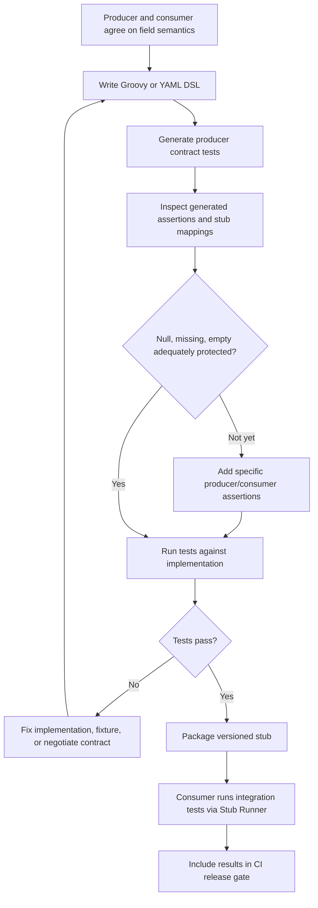

# Checking Present, Missing, Null, or Empty According to Supported Semantics

A JSON response can **omit a property**, **include the property with value `null`**, or **include the property with an empty string, array, or object**. To humans, these cases are easily lumped together as "no data." To a consumer, they can trigger **completely different behaviors**: ignoring the value, clearing stored data, displaying an empty string, or flagging the data as invalid.

In **Spring Cloud Contract**, producers and consumers use **Groovy/YAML DSL** contracts to agree on HTTP or messaging behavior. The tooling generates tests for the producer and stubs for the consumer via **Stub Runner**. When writing matchers and assertions, distinguish clearly between what the **DSL describes**, what the **generated test actually checks**, and what must be supplemented with **dedicated JSON structural tests**.

This lesson belongs to the **Matchers and Assertions** chapter of the **SPRING_CLOUD_CONTRACT** track. The focus is accurately specifying "present," "missing," "`null`," and "empty" semantics in requests/responses while avoiding the assumption that every Spring Cloud Contract version provides identical matchers for all cases.

## 1. Four Non-Equivalent Data States

Suppose Profile Service returns user display information:

```json
{
  "id": "USER-42",
  "displayName": "",
  "middleName": null,
  "tags": [],
  "preferences": {}
}
```

In this response, the `legacyCode` key is **absent**. That differs from the `legacyCode` key appearing with value `null`.

| State | Example JSON | Question to Verify |
|---|---|---|
| **Present with non-`null` value** | `"id": "USER-42"` | Key exists, value matches expected type or value? |
| **Missing field** | No `legacyCode` key | Does the object truly omit the key? |
| **Present with `null`** | `"middleName": null` | Key is present and JSON value is `null`? |
| **Empty string** | `"displayName": ""` | Key is present, value is a zero-length string? |
| **Empty array** | `"tags": []` | Key is present, value is a zero-element array? |
| **Empty object** | `"preferences": {}` | Key is present, value is a zero-property object? |
| **Whitespace-only string** | `"displayName": "   "` | Non-empty by length yet may be considered blank by business logic |
| **HTTP body with no content** | `204 No Content` response | Response body has no bytes/payload? |
| **JSON body is `null`** | Body contains literal `null` | Body has valid JSON payload equal to null, distinct from no body |

**Core rule:** `{}`, `{"field": null}`, `{"field": ""}`, and `{"field": []}` are four **distinct** JSON payloads. A consumer might treat them equivalently if the API specifies so, but never assume this on your own.

### 1.1. "Present" Does Not Always Mean "Non-Null"

A **field exists** check only answers whether the key is present. It does not confirm that the value has the expected type or is non-`null`. Given JSON:

```json
{"middleName": null}
```

The following statements have different truth values:

- "Object contains key `middleName`": **true**.
- "`middleName` is non-`null`": **false**.
- "`middleName` holds a non-empty string": **false**.
- "Field `middleName` is absent": **false**.

Conversely, for `{}`, "field is absent" is true, but you must not infer that the producer is returning a field with value null.

### 1.2. Empty and Blank Also Differ

Between the strings:

```json
{"note": ""}
```

and:

```json
{"note": "   "}
```

there is a length difference: the first has `length == 0`, while the second has three whitespace characters. If business rules reject whitespace-only names, check **blank**, not merely **empty**. How this is checked depends on the tooling; regex or Bean Validation such as `@NotBlank` can help in dedicated tests, though not every "empty" matcher automatically rejects whitespace.

## 2. Why Distinguishing States Matters to the Consumer

Consider two profile-update designs:

- In a PATCH API, **omitting `middleName`** may mean **keep the existing middle name**.
- **`middleName: null`** may mean **delete the middle name**.
- **`middleName: ""`** may mean **set middle name to empty string** or **reject as invalid**, depending on design.

For **JSON Merge Patch** payloads (`Content-Type: application/merge-patch+json`, RFC 7396), omitting a member in the patch object generally preserves the target member; a `null` value indicates removing that member. This is the **semantics of the JSON Merge Patch format**, not a rule automatically applied to every `PUT` or `PATCH`.

Another example where consumers distinguish:

| Response | Possible API-Agreed Meaning |
|---|---|
| `"discounts": []` | Discount list was computed and yielded no items |
| `"discounts": null` | Discount data unavailable / not yet computed |
| Missing `discounts` | Response version or mode does not return this field |
| `"discounts": {}` | Returned an object breaking expected schema, likely an API-breaking bug |

Actual meaning must be **agreed upon by producer and consumer**. Contract testing protects the distinctions the consumer actually relies on.

## 3. Designing Contracts Around Agreed Behavior

Suppose Profile Service exposes:

```http
GET /api/profiles/USER-42
Accept: application/json
```

and the agreed response is:

```http
HTTP/1.1 200 OK
Content-Type: application/json

{
  "id": "USER-42",
  "displayName": "",
  "middleName": null,
  "tags": [],
  "preferences": {}
}
```

Agreed requirements:

1. `id` **must exist** and be the user-identifying string.
2. `displayName` **must exist**, and `""` is allowed.
3. `middleName` **must exist with JSON null** when no middle name is set.
4. `tags` **must be an array**, which may contain zero elements.
5. `preferences` **must be an object**, which may contain zero properties.
6. `legacyCode` **must be absent**, because the API discontinued publishing this field.

Requirement 6 differs from merely omitting `legacyCode` from the sample body. **Omitting a field from the sample response is not always equivalent to asserting "the field must not exist"**; generated tests may inspect only the described paths while still permitting the producer to return extra properties. Inspect generated tests/mappings and use explicit structural assertions for "absent" conditions.

## 4. Groovy DSL: Meaningful Sample Bodies and Matchers

A Groovy contract describing the response in Section 3:

```groovy
import org.springframework.cloud.contract.spec.Contract

Contract.make {
    name 'profile_get_nullable_and_empty_fields_200'
    description 'Profile API distinguishes null, empty string, and empty collections'

    request {
        method GET()
        url '/api/profiles/USER-42'
        headers {
            header 'Accept', 'application/json'
        }
    }

    response {
        status OK()
        headers {
            contentType(applicationJson())
        }
        body(
            id: 'USER-42',
            displayName: '',
            middleName: null,
            tags: [],
            preferences: [:]
        )
    }
}
```

In Groovy, `[:]` is an empty map and `[]` is an empty list. When serialized to JSON, the expected shapes are `{}` and `[]` respectively. However, the producer's serialization configuration might strip `null` or empty fields; therefore **inspect the actual response and generated assertions**, not only the DSL file.

The snippet above **does not universally guarantee** that `legacyCode` is absent. To make that requirement enforced in CI, add a dedicated check (Section 7) or use an **absence** verification matcher documented for **your exact** Spring Cloud Contract version.

### 4.1. `bodyMatchers` Example for Valued Properties

Alongside a sample body, Groovy DSL can use matchers to enforce necessary constraints rather than hardcoding every value:

```groovy
response {
    status OK()
    headers {
        contentType(applicationJson())
    }
    body(
        id: 'USER-42',
        status: 'ACTIVE',
        age: 25
    )
    bodyMatchers {
        jsonPath('$.id', byRegex('USER-[0-9]+'))
        jsonPath('$.status', byEquality())
        jsonPath('$.age', byType())
    }
}
```

This is an illustrative snippet placed inside `Contract.make { ... }` and needs a `request` block when used as a complete contract. The matchers have distinct purposes:

- `byEquality()`: matches the expected value described.
- `byType()`: matches the value's type; **does not replace** business constraints, such as age being non-negative.
- `byRegex(...)`: matches string format against a regular expression.

**Pitfall to avoid:** `byType()` on a string does not mean the string is **non-empty**. `byRegex('.*')` can accept an empty string. To require a non-empty string, use a stricter condition—such as `.+` if the value domain allows—and if whitespace must also be excluded, use a rule tailored to the agreed format.

### 4.2. Specialized Matchers for Null or Absent Depend on Version

Across Spring Cloud Contract versions, the DSL/matcher set and how they compile to Java assertions or WireMock predicates can vary. Some documentation examples or related libraries mention matchers for null, non-null, or field absence; **never assume** every `byNull`, `byNotNull`, `absent`, or similar form is valid in every `bodyMatchers`, `request`, or version.

When you need exact "JSON path exists and value is null" or "JSON path does not exist at all," follow this sequence:

1. Check the **DSL documentation for your pinned Spring Cloud Contract version** and which matcher locations are supported: request vs. response, body vs. header.
2. Run the project's producer test/stub generation task.
3. Read the **generated test assertions** and **stub mappings** to see what they actually check.
4. Write **supplementary producer tests** for semantics the current DSL/generator cannot express precisely.
5. Publish stubs only after both producer contract tests and required supplementary tests pass.

The following section uses **Spring MockMvc/Jackson**, which lets you express these states explicitly in the producer's HTTP test layer.

## 5. YAML DSL: Representing Null, Empty, and Undeclared Fields

The same scenario from Section 4 can be described in YAML:

```yaml
name: profile_get_nullable_and_empty_fields_200
description: Profile API distinguishes null, empty string, and empty collections
request:
  method: GET
  url: /api/profiles/USER-42
  headers:
    Accept: application/json
response:
  status: 200
  headers:
    Content-Type: application/json
  body:
    id: USER-42
    displayName: ''
    middleName: null
    tags: []
    preferences: {}
```

Pay attention to the values:

| YAML | Expected JSON | Notes |
|---|---|---|
| `middleName: null` | `"middleName": null` | YAML null has dedicated meaning, not the string `"null"` |
| `displayName: ''` | `"displayName": ""` | Quotes keep the value as an empty string |
| `tags: []` | `"tags": []` | Empty list, not null |
| `preferences: {}` | `"preferences": {}` | Empty map/object |
| `legacyCode` omitted | No sample expectation for `legacyCode` | **Do not automatically treat as an absent-key assertion** |
| `displayName: '   '` | `"displayName": "   "` | Contains spaces, distinct from empty string |

If YAML writes `middleName: 'null'` (quoted), the value is a **four-character string** `null`, not JSON null. Likewise, `tags: '[]'` is the string `[]`, not an empty array.

**Important:** The Groovy and YAML snippets above are **two representations of the same contract**. In a project, pick only one as the canonical source for that scenario; avoid unintentionally generating two tests/mappings with identical requests and responses.

### 5.1. When to Use YAML Matchers?

When data is dynamic, YAML DSL in supported Spring Cloud Contract versions allows declaring matchers for response/body per the corresponding schema, such as value types or regex. However, **YAML matcher structure and `type` values must match the documentation of the version in use**.

To enforce "field must be absent," do not invent a YAML key like `notExists: true` unless supported by the plugin. The YAML may remain syntactically valid while the plugin ignores it, errors out, or fails to generate the desired assertion. An explicit JSON structural test is usually safer and clearer when absence requirements are not fully supported by that version's DSL.

## 6. Comparison of Assertions in Spring MockMvc

**Spring MockMvc** provides useful JSONPath assertions for verifying the producer at the HTTP layer. The existence methods of `JsonPathResultMatchers` carry important semantics:

| Assertion | Semantics to Remember |
|---|---|
| `jsonPath("$.name").exists()` | Path exists and value is **non-null** |
| `jsonPath("$.name").doesNotExist()` | No non-null value at path; may pass when path is **missing or null** |
| `jsonPath("$.name").hasJsonPath()` | Path **exists**, even if value is `null` |
| `jsonPath("$.name").doesNotHaveJsonPath()` | Path **does not exist**, distinctly separated from a path holding `null` |
| `jsonPath("$.name").value(nullValue())` | Value is JSON `null`; best combined with confirming path presence |
| `jsonPath("$.name").value("")` | Exactly the empty string |
| `jsonPath("$.tags").isArray()` | Value has array type |
| `jsonPath("$.tags").value(hasSize(0))` | Array has 0 elements (with appropriate matcher import) |
| `jsonPath("$.prefs").isMap()` | Value has object/map type |
| `jsonPath("$.id").isString()` | Value has string type |

These methods belong to the **Spring MVC Test** API, not DSL directives guaranteed to be auto-generated by Spring Cloud Contract. Cross-check your project's Spring Framework version; for instance, methods distinguishing path existence even when null require a supporting Framework version.

### 6.1. Common Trap with `doesNotExist()`

Suppose a test asserts:

```java
.andExpect(jsonPath("$.legacyCode").doesNotExist());
```

It may **still pass when the producer returns**:

```json
{"legacyCode": null}
```

If the requirement is "the API must never return the `legacyCode` key," use a **path-absent** check such as:

```java
.andExpect(jsonPath("$.legacyCode").doesNotHaveJsonPath());
```

Conversely, if the requirement is "the `middleName` key must exist and hold null," check:

```java
.andExpect(jsonPath("$.middleName").hasJsonPath())
.andExpect(jsonPath("$.middleName").value(nullValue()));
```

That way the test does not confuse **null** with **absent**.

### 6.2. Trap with `isEmpty()` and `isNotEmpty()`

Some library "empty" checks use a generic definition of **empty value**, which can encompass `""`, empty collections, and sometimes `null`. If the consumer requires **one specific empty type**, verify both type and length/element count:

```java
.andExpect(jsonPath("$.displayName").isString())
.andExpect(jsonPath("$.displayName").value(""))
.andExpect(jsonPath("$.tags").isArray())
.andExpect(jsonPath("$.tags").value(hasSize(0)))
.andExpect(jsonPath("$.preferences").isMap())
.andExpect(jsonPath("$.preferences").value(anEmptyMap()));
```

The `hasSize(0)` and `anEmptyMap()` matchers come from **Hamcrest**; appropriate test imports and dependencies are required. This assertion makes explicit that `[]` differs from `{}`. If you want to verify a string is **not blank**, `isNotEmpty()` alone is insufficient because `"   "` does not have length 0.

## 7. A Producer Test Clearly Checking All Four States

When a requirement is too specific for the active DSL matchers, you can add a **Spring MVC integration test** on the producer. Complete structural example:

```java
import com.fasterxml.jackson.databind.JsonNode;
import com.fasterxml.jackson.databind.ObjectMapper;
import org.junit.jupiter.api.Test;
import org.springframework.beans.factory.annotation.Autowired;
import org.springframework.boot.test.autoconfigure.web.servlet.AutoConfigureMockMvc;
import org.springframework.boot.test.context.SpringBootTest;
import org.springframework.http.MediaType;
import org.springframework.test.web.servlet.MockMvc;
import org.springframework.test.web.servlet.MvcResult;

import static org.junit.jupiter.api.Assertions.*;
import static org.springframework.test.web.servlet.request.MockMvcRequestBuilders.get;
import static org.springframework.test.web.servlet.result.MockMvcResultMatchers.*;

@SpringBootTest
@AutoConfigureMockMvc
class ProfileResponseShapeTest {

    @Autowired MockMvc mockMvc;
    @Autowired ObjectMapper objectMapper;

    @Test
    void distinguishesMissingNullAndEmpty() throws Exception {
        MvcResult result = mockMvc.perform(
                get("/api/profiles/USER-42")
                    .accept(MediaType.APPLICATION_JSON))
            .andExpect(status().isOk())
            .andExpect(content()
                .contentTypeCompatibleWith(MediaType.APPLICATION_JSON))
            .andReturn();

        JsonNode root = objectMapper.readTree(
            result.getResponse().getContentAsString());

        assertTrue(root.has("id"));
        assertEquals("USER-42", root.get("id").asText());

        assertTrue(root.has("middleName"));
        assertTrue(root.get("middleName").isNull());

        assertFalse(root.has("legacyCode"));

        assertTrue(root.has("displayName"));
        assertTrue(root.get("displayName").isTextual());
        assertEquals("", root.get("displayName").textValue());

        assertTrue(root.has("tags"));
        assertTrue(root.get("tags").isArray());
        assertEquals(0, root.get("tags").size());

        assertTrue(root.has("preferences"));
        assertTrue(root.get("preferences").isObject());
        assertEquals(0, root.get("preferences").size());
    }
}
```

**Execution prerequisites:** the test context must have the `/api/profiles/USER-42` endpoint, matching fixture data, and Spring MVC Test/Jackson/JUnit dependencies. These imports reflect a typical Spring Boot test; the project must configure security or test identities if the endpoint requires authentication.

Here, `JsonNode.has("field")` checks only **key presence**, even when the value is null. `root.get("field").isNull()` checks for **an actual null value**. `isTextual()/isArray()/isObject()` protect the data type before checking emptiness. This approach avoids ambiguity from reusing a single "empty" helper across multiple types.

### 7.1. Using Jackson's `path()` or `get()`?

Jackson's `JsonNode.get("field")` returns Java `null` when the **field is absent**, yet returns a `NullNode` when JSON contains `"field": null`. Those are two distinct things.

`JsonNode.path("field")` typically returns `MissingNode` if the field is absent, allowing null-safe traversal; however, to distinguish reliably, use `has`, `isMissingNode`, `isNull`, and appropriate type checks.

Example:

```java
JsonNode root = mapper.readTree("{\"value\":null}");

assertTrue(root.has("value"));
assertTrue(root.get("value").isNull());
assertTrue(root.path("missing").isMissingNode());
assertFalse(root.has("missing"));
```

Here `mapper` is an initialized `ObjectMapper`; the snippet illustrates the Jackson API, not a full test class.

## 8. Checking Missing Fields in Requests

The same API may distinguish requests with vs. without a property. For example, `PATCH /api/profiles/USER-42`:

```http
PATCH /api/profiles/USER-42
Content-Type: application/merge-patch+json

{"displayName":"Lan"}
```

versus:

```http
PATCH /api/profiles/USER-42
Content-Type: application/merge-patch+json

{"displayName":"Lan","middleName":null}
```

If the producer applies **JSON Merge Patch**, the first request **leaves `middleName` untouched**, while the second can **delete the `middleName` value**. With other custom JSON PATCH APIs, rules may differ; do not infer semantics solely from the HTTP `PATCH` method.

To test both scenarios properly, you need:

1. Two request fixtures that **differ structurally**, not merely in contract filenames.
2. Initial producer state populated with a `middleName` so keep-vs.-delete behavior is observable.
3. Verification of both the response and post-update state, if that is part of the commitment.
4. Stub matchers sufficiently distinct to differentiate the two requests if the consumer uses stubs for both.

### 8.1. Why Do Missing-Field Requests Easily Cause Overlapping Mappings?

Two contracts both targeting `PATCH /api/profiles/USER-42`, where one checks only `displayName` and the other also checks `middleName: null`, can produce **two WireMock mappings that both match** if body matcher conditions do not differentiate structure as the team expects. The stub server picks a mapping according to its matching mechanics, without understanding "update case" vs. "delete case."

Do not try to work around this merely by renaming files or changing mapping load order. Inspect the **actual generated request mappings**, verify whether **missing-field** or **null-value** matchers are accurately supported by your WireMock/DSL version, and test both requests against the stub.

If your project's tooling version cannot express an absence constraint as desired, use **independent producer tests** to protect that semantics, and test the specific consumer branch with controlled stubs/mappings.

## 9. Missing, Null, and Empty Fields in Java DTOs

Even when a contract is written accurately, the producer can serialize incorrectly due to DTO design and Jackson configuration.

Example:

```java
public record ProfileResponse(
    String id,
    String displayName,
    String middleName,
    java.util.List<String> tags
) {}
```

A `String middleName` does not by itself determine whether JSON omits null fields. The serializer can be configured under multiple policies.

| Configuration / Characteristic | Consequence to Inspect |
|---|---|
| Default Jackson usually serializes nulls | `"middleName": null` may appear |
| `@JsonInclude(NON_NULL)` | Null properties may be **omitted from JSON** |
| `@JsonInclude(NON_EMPTY)` | May drop nulls, empty strings, and empty collections |
| DTO with default values | Request missing a field may receive a default, erasing the distinction |
| Primitive `int` instead of `Integer` | Cannot directly represent null on the Java field |
| Deserialization into nullable fields | Missing field and JSON null may both map to Java null |
| Custom mapper/DTO | Can record extra metadata on whether the field was actually present |

**Do not infer "request omitted field" from a Java field being null** if you need to distinguish it from a request sending JSON null. For PATCH requiring three-state semantics, consider handling `JsonNode`, presence-tracking wrapper types, or update DTOs with explicit presence tracking; then test all three cases.

### 9.1. Bean Validation Is Not Equivalent to JSON Presence Assertions

Common annotations serve different purposes:

- `@NotNull`: rejects Java `null`.
- `@NotEmpty`: rejects empty values on supported types such as strings/collections/maps.
- `@NotBlank`: for strings, rejects null, empty strings, or whitespace-only strings.

They are **validation rules when triggered** inside the application—they do not automatically become Spring Cloud Contract assertions, nor do they preserve the difference between a missing JSON field and a JSON null field after deserialization. When that distinction affects the API, test it at the HTTP payload level.

## 10. HTTP Headers and Body: Missing Does Not Mean Empty

"Missing/null/empty" semantics do not apply solely to JSON fields.

### 10.1. Non-Existent Headers vs. Empty Headers

Two responses:

```http
HTTP/1.1 200 OK
X-Correlation-Id:
```

and a response **completely lacking the `X-Correlation-Id` header** are different.

With Spring MockMvc, you can check:

```java
.andExpect(header().doesNotExist("X-Legacy-Flag"));
```

or:

```java
.andExpect(header().string("X-Correlation-Id", ""));
```

Use these checks only when the API genuinely commits to the corresponding semantics. There is no "null header" in JSON syntax terms: HTTP transmits header fields, empty header values, or absent fields. In addition, the Spring HTTP stack may canonicalize header names; HTTP header names are case-insensitive per protocol.

### 10.2. No Body, Empty Body, and JSON Null

| Case | Example Response | Technical Meaning |
|---|---|---|
| No response body | `204 No Content` | No response payload sent |
| Zero-length byte body | `200 OK` with empty body | May behave differently from `204` in status and client handling |
| JSON literal `null` | `200 OK` + body `null` | JSON payload present, value is JSON null |
| Empty JSON object | Body `{}` | An object with zero properties |
| Empty JSON array | Body `[]` | An array with zero elements |

Contracts for `204` normally describe only the status and relevant headers, without declaring a JSON body like `null` or `{}` if the API returns no payload.

Groovy example:

```groovy
import org.springframework.cloud.contract.spec.Contract

Contract.make {
    name 'profile_delete_no_content_204'

    request {
        method DELETE()
        url '/api/profiles/USER-42'
    }

    response {
        status NO_CONTENT()
    }
}
```

If the consumer relies on **having no body**, add a producer integration test confirming the response has no payload. Do not use `{"value":null}` as a stand-in representation for no content.

## 11. What Stub Runner Tests, and What It Easily Misses

Spring Cloud Contract can generate HTTP stub mappings for the consumer to run via **Stub Runner**. Once the producer passes contract tests, versioned stubs let the consumer develop without starting the producer.

However, Stub Runner returns responses from predefined mappings. It **does not run the producer's JSON serialization code** on every request.

For example, the consumer reads:

```json
{"id":"USER-42","middleName":null,"tags":[]}
```

The stub might always return `middleName: null`, while the real producer enabled `@JsonInclude(NON_NULL)` and **omits the field**. If producer verification only checks a few other fields or generated tests fail to enforce absence/null properly, consumer tests against the stub still stay green.

Therefore both sides are needed:

| Side | Must Verify |
|---|---|
| **Producer** | Does the real implementation produce exact null/absence/empty per the contract? |
| **Consumer** | Does the client parse null, missing fields, `""`, `[]`, or `{}` as promised by the API? |
| **Release CI** | Did producer verification and supplementary assertions pass before publishing stubs? |
| **Artifact management** | Is Stub Runner loading the exact verified stub version? |

### 11.1. How Does the Consumer Handle Different States?

For instance, the consumer may need to:

- `middleName: null` → display "No middle name".
- `displayName: ""` → display placeholder rather than a blank box.
- `tags: []` → display "No tags".
- `legacyCode` absent → skip handling branch for deprecated data.
- `tags: null` → handle per explicit policy; do not default to empty list if the API forbids null.

A good consumer test calls **the consumer's real HTTP client** against Stub Runner and verifies data-mapping logic. Do not call WireMock directly using a different test client, as that bypasses the consumer's deserializers and mappers.

### 11.2. Do Not Confuse Unmatched Stub Requests with `404` Scenarios

When a request matches no mapping, WireMock/Stub Runner may return a default `404` response. That response **does not mean** the real producer publishes a business `404` error or body `{"code":"PROFILE_NOT_FOUND"}`.

To test not-found cases, write a dedicated contract for the `404` request and response, backed by prepared producer test data. Do not mistake any `404` from the stub server for passing consumer error handling.

## 12. Testing with Message Contracts

For **message** contracts, null/empty states are equally important when payloads use JSON or another format that distinguishes them:

```json
{
  "eventType": "PROFILE_UPDATED",
  "middleName": null,
  "tags": []
}
```

A message consumer might interpret:

- `middleName: null` → clear middle name data in the projection.
- Missing `middleName` → keep middle name unchanged in the projection.
- `tags: []` → set tag list to empty.
- `tags: null` → handle differently or report schema error.

Nevertheless, **not every message broker, serializer, and schema format** represents missing/null/empty like JSON. For instance, Avro/Protobuf have distinct rules for presence, defaults, and nullability. Check the **actual message schema** alongside serializer/deserializer behavior instead of applying JSON rules blindly across protocols.

When Spring Cloud Contract emits message stubs by `label`, ensure labels remain stable and consumer tests verify the deserialized payload. Run producer message verification with the publishing component and matching fixtures to catch changes before real events reach the broker.

## 13. Build a Verification Matrix Before Writing Matchers

A sustainable practice is to start from a table of **API meaning → JSON shape → minimum assertion**:

| Business Requirement | Allowed JSON | Required Assertion |
|---|---|---|
| User ID always present | `"id":"USER-42"` | Key exists, non-null, valid string/format |
| Middle name unset | `"middleName":null` | Key exists **and** value is null |
| Legacy field discontinued | No `legacyCode` | Key **does not exist** |
| Display name may be empty | `"displayName":""` | Key exists, is string, may be empty |
| Tags known to be empty | `"tags":[]` | Key exists, is array, size equals 0 |
| Preferences is empty object | `"preferences":{}` | Key exists, is object, size equals 0 |
| Name must not be all whitespace | `"name":"Lan"` | Valid string, not blank |
| Successful delete returns no content | `204` without body | Status `204` and response has no payload |

This table prevents designing matchers around whatever is easiest to write in DSL while **failing to reflect what the consumer depends on**.

### 13.1. Minimum Assertion Scope

There is no need to lock every JSON field if the consumer does not use it. A producer can add optional fields without breaking older consumers. However, when the consumer needs to distinguish **missing field** from **null value**, or a contract must ensure a sensitive attribute is not emitted, verifying absence is an intentional commitment and must be made explicit.

Avoid two extremes:

- **Too strict:** byte-for-byte identical body, including JSON property order or details unused by the consumer.
- **Too loose:** generic matchers on all values, ignoring differences between JSON null, empty string, and missing fields.

## 14. Matcher Verification Workflow in Build and CI

A sound verification flow:



Execution steps:

1. **Identify the actual API** and schema: required, nullable, optional keys, empty lists, empty strings, headers, or no body.
2. **Write the contract** with consistent sample data and matchers for conditions supported in your project version.
3. **Generate producer tests**, checking whether they actually enforce missing/null/empty distinctions.
4. **Add structural tests** (such as MockMvc + Jackson) when a condition cannot be fully expressed by the DSL/generator.
5. **Run producer tests against the implementation** using repeatable fixture data.
6. **Package and publish stubs** only after the producer is verified.
7. **Use Stub Runner on the consumer** with specific artifact/version coordinates, verifying how the client handles each variant.
8. **Integrate into CI** and retain test results alongside contract, producer, and stub versions for traceability.

Never use an unverified `preview` stub to conclude that the producer obeys null/absence rules.

### 14.1. Self-Checking Matcher Quality

When designing assertions, **intentionally break** the producer response:

- Change `middleName: null` to **omitting `middleName`**. The test requiring "key present with null" must fail.
- Change `displayName: ""` to `displayName: null`. The test requiring an empty string must fail.
- Change `tags: []` to `tags: {}`. The test requiring an empty array must fail.
- Add `legacyCode: null`. The test requiring the key to be absent must fail.
- Change `id: "USER-42"` to `id: 42`. The test requiring a string ID must fail.

If any of these mutations **fails to break the test**, check whether a matcher is too loose, generated tests skipped the field, or a test is being skipped.

## 15. Common Pitfalls and Troubleshooting

| Symptom | Possible Cause | How to Check |
|---|---|---|
| Contract meant to require null, response missing key still passes | Generated assertion does not distinguish null vs. missing | Inspect generated test, add `hasJsonPath` + `nullValue` or Jackson `has`/`isNull` |
| `doesNotExist()` passes even though producer returns key as null | Assertion treats null as "no value" | Use a true **absent-path** check |
| Empty test passes for an unexpected JSON type | Only used `isEmpty()` | Also check `isArray`/`isMap`/`isString` |
| YAML `'null'` produces a string | Put quotes around null | Use YAML null when JSON null is desired |
| JSON null disappears from response | Jackson `NON_NULL` config or custom serializer | Check actual response and `@JsonInclude` |
| Empty string dropped from response | `NON_EMPTY` configuration | Adjust serializer or contract via review |
| Request missing field treated like null | DTO loses property presence info | Use presence-tracking parsing/DTO for PATCH |
| Two HTTP stubs pick the wrong case | Missing/null request matchers overlap | Inspect WireMock mappings and test both requests |
| `204` checked like a JSON null body | Confused no-content with JSON literal `null` | Check status and payload separately |
| Producer test passes but consumer throws NPE | Stub/test misses null/missing branch or fake client differs from real client | Add consumer integration test via real client |
| Test fails only on older Framework version | Assertion API does not exist yet or matcher semantics differ | Check pinned Spring Framework/Contract version |
| Build passes without generating contract tests | Wrong plugin/source directory or tests skipped | Check generated sources, test count, and CI report |

When troubleshooting, clearly separate **YAML/Groovy syntax**, **generator-supported matchers**, **producer serialization**, and **consumer deserialization**. They are distinct layers requiring separate evidence before fixing.

## 16. Hands-on Exercise: Verifying User Profiles

Context: Profile Service serves `GET /api/profiles/USER-42` to a consumer displaying a user profile screen.

Contract definition:

```json
{
  "id": "USER-42",
  "displayName": "",
  "middleName": null,
  "tags": [],
  "preferences": {}
}
```

And require **`legacyCode` not to appear**.

Follow these steps:

1. **Analyze the state table:** determine precisely which keys are mandatory, nullable, must be empty, and must be absent.
2. **Write the DSL:** choose Groovy or YAML, declaring the request and response body with proper data types.
3. **Generate the producer test:** inspect the generated assertions. Determine whether the test actually enforces `middleName` presence or only allows null/missing.
4. **Add a MockMvc/Jackson test:** verify `middleName` is present and null, `legacyCode` is absent, `displayName` is an empty string, `tags` is an empty array, and `preferences` is an empty object.
5. **Try breaking the contract:** remove `middleName`, change `tags` to `{}`, add `legacyCode:null`, and confirm each mutation fails the relevant test.
6. **Package stubs:** only after the producer passes checks, create a versioned stub artifact and serve it with Stub Runner.
7. **Verify the consumer:** call through the real HTTP client, checking UI logic or data mapping when encountering null, missing fields, and empty values.
8. **Integrate into CI:** producer contract tests, supplementary assertions, and consumer tests must run on every change affecting the API.

### 16.1. Extension Exercise with PATCH

Given `PATCH /api/profiles/USER-42` using `application/merge-patch+json`. Initially `middleName` is `"Thi"`.

Test three requests:

```json
{"displayName":"Lan"}
```

```json
{"middleName":null}
```

```json
{"middleName":""}
```

Based on JSON Merge Patch and the agreed business policy, write tests verifying:

- The first request **preserves** `middleName`.
- The second request **removes** the `middleName` member from the target document per Merge Patch semantics.
- The third request **sets an empty string** or **returns a validation error**, depending on API specification; state the expected result explicitly rather than guessing.

This extension clearly shows why collapsing "missing," "null," and "empty" into one state causes consumer logic bugs.

**Completion criteria:** tests fail when the producer breaks any committed state; generated contract tests and supplementary assertions run reliably; Stub Runner and the consumer client handle data properly; and the pipeline tracks which artifact passed producer verification.

## 17. Self-Check Questions

1. **Are `{}` and `{"middleName":null}` the same?** No. One lacks the key; the other has the key holding null.
2. **Does `""` equal `"   "`?** No. The latter contains whitespace characters; empty and blank checks differ.
3. **Are `[]` and `{}` the same?** No. One is an array; the other is an object.
4. **Does simply omitting `legacyCode` from the sample body guarantee the producer never returns it?** Do not assume so. Inspect generated tests and check absence explicitly.
5. **Why might `doesNotExist()` not suffice to protect "key is absent"?** Because this style of JSONPath check can accept a path present with value null; use `doesNotHaveJsonPath()` or an equivalent structural check.
6. **How do you confirm a field exists with null in MockMvc?** Combine `hasJsonPath()` and `value(nullValue())`, or use Jackson's `has` and `isNull`.
7. **Why check data type before checking emptiness?** Because strings, arrays, and objects all have empty forms with different meanings to the consumer.
8. **In JSON Merge Patch, how do a missing field and a null field differ?** Missing generally preserves the member; null indicates removing the member from the target document.
9. **Is `204 No Content` equivalent to a JSON `null` body?** No. One has no payload; the other has a JSON literal null.
10. **If Stub Runner returns `middleName:null`, does that prove the real producer returns it too?** Not yet. You must run producer verification and check actual serialization.
11. **What should you do if your project's Spring Cloud Contract DSL version lacks the desired absence matcher?** Add producer tests at the HTTP/JSON level, inspect mappings, and verify the consumer via Stub Runner.
12. **Why can switching from `@JsonInclude(NON_NULL)` to `NON_EMPTY` break a contract?** Because previously returned empty strings/arrays/maps can be stripped from JSON, preventing the consumer from distinguishing published states.

## Conclusion

When working with **Spring Cloud Contract**, "**field present**," "**field missing**," "**null value**," and "**empty value**" must be defined according to the **data semantics agreed upon by producer and consumer**. Groovy/YAML DSL helps produce executable contracts, yet verification accuracy depends on matchers **supported by the tool version**, generated producer tests, serializers, and stub mappings. By combining **clear contract examples**, **JSONPath/Jackson assertions for states that must be distinguished**, **producer verification**, and **consumer tests via Stub Runner in CI**, teams can shield APIs from small JSON changes that cause major integration failures.
