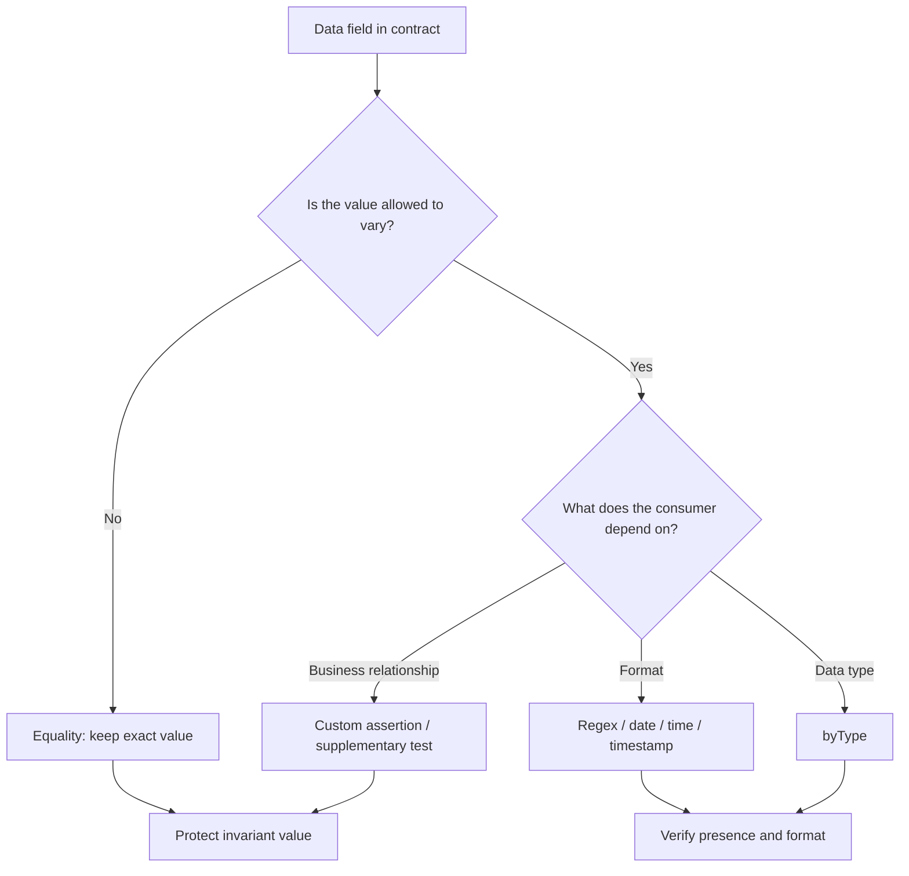
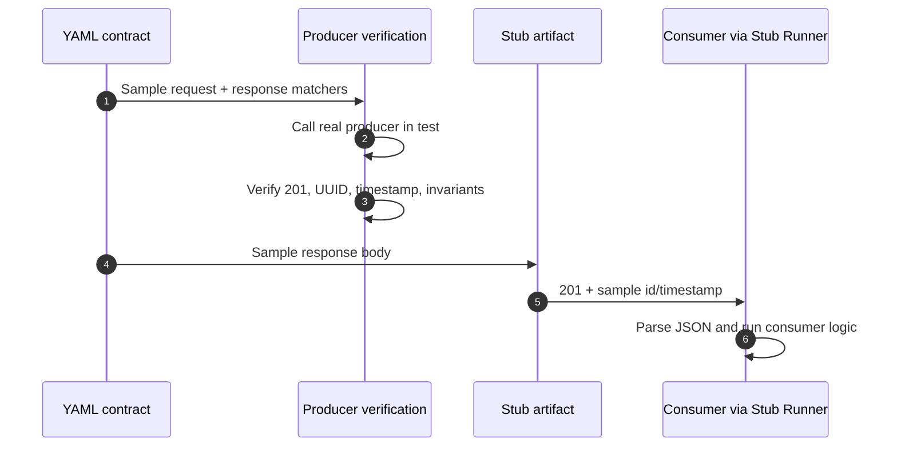
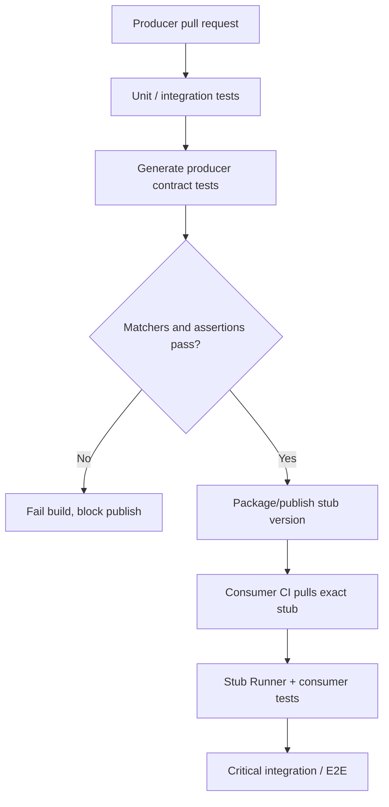

# Ignoring Dynamic Fields Without Losing Critical Behavior

> **Chapter:** Matchers and Assertions  
> **Module:** `SPRING_CLOUD_CONTRACT` — contract testing between producer and consumer with Spring Cloud Contract, defining HTTP/message contracts via Groovy or YAML DSL, generating producer tests, publishing stubs, running Stub Runner, and verifying API changes in CI.

## Learning Objectives

After this lesson, you will be able to:

1. Distinguish **ignoring the specific value of a dynamic field** from **ignoring that field's existence, type, and meaning**.
2. Classify which fields should check **equality**, and which should use **regex**, **type**, **date/time**, occurrence bounds, or supplementary business assertions.
3. Define `response.bodyMatchers` in Groovy DSL and `response.matchers.body` in YAML DSL to generate meaningful producer verification tests.
4. Understand why `response.body` still needs concrete examples to build consumer **stubs**, even when the producer generates a new UUID and timestamp every time.
5. Check invariants such as HTTP status, business `status`, monetary amounts, currency, SKU, and quantity instead of loosening the entire response.
6. Point out properties that single-field matchers do not guarantee: cross-field relationships, monotonic timestamps, ID uniqueness, calculation accuracy, and backward compatibility.
7. Combine producer verification, Stub Runner, and CI to detect contract-breaking API changes.

## 1. One Response with Both Dynamic Data and Fixed Promises

Suppose `checkout-service` calls `order-service` to create an order:

```http
POST /api/orders HTTP/1.1
Content-Type: application/json
Accept: application/json

{
  "customerReference": "WEB-0042",
  "items": [
    {"sku": "BOOK-001", "quantity": 2}
  ]
}
```

The producer returns HTTP `201` with JSON:

```http
HTTP/1.1 201 Created
Content-Type: application/json

{
  "id": "c22aaf62-1a13-4dbe-b5fb-f342d3f81fb9",
  "createdAt": "2026-11-24T09:10:11Z",
  "status": "ACCEPTED",
  "customerReference": "WEB-0042",
  "items": [
    {"sku": "BOOK-001", "quantity": 2, "unitPrice": 120000}
  ],
  "total": 240000,
  "currency": "VND"
}
```

On another call, `id` and `createdAt` may change; the following conditions still need protection:

- HTTP status is `201` and body is JSON.
- `id` is **present, has string type, and matches the UUID pattern**.
- `createdAt` is **present and matches the agreed timestamp format**.
- `status` is `ACCEPTED`; the consumer proceeds to payment only once the order is accepted.
- `customerReference` preserves the requested value in the test scenario.
- `items` accurately reflects the product/quantity the consumer is processing.
- `total` and `currency` satisfy the agreed monetary rules.

A test forcing `id` to equal the exact string in the sample response will be **brittle**, because the producer generates a new UUID. A test checking only "returns HTTP 201" is **too loose**: the producer could change `status` to `REJECTED`, return `total: 0`, change `total` to a string, or drop `id` altogether while CI stays green.

The goal is to **loosen only the fields that need to be dynamic while keeping critical invariants tight**.

## 2. Clearly Define Each Field's Contract Before Choosing Matchers

The table below is designed for **one concrete scenario**: creating an order for `BOOK-001`, quantity `2`, sample unit price `120000` VND.

| Field | What the Consumer Needs | Appropriate Assertion Type |
| --- | --- | --- |
| HTTP status | Exactly `201` | Equality on `response.status` |
| Response `Content-Type` | JSON | Header assertion matching media type |
| `id` | String formatted as UUID | `by_regex` with `uuid` matcher |
| `createdAt` | UTC timestamp in specified ISO format | Format-matching time regex/matcher |
| `status` | Exactly `ACCEPTED` | Equality |
| `customerReference` | Matches sample input data | Equality in fixed scenario; separate test for dynamic correlation |
| `items[0].sku` | Exactly `BOOK-001` | Equality |
| `items[0].quantity` | Exactly number `2` | Equality and JSON numeric type |
| `items[0].unitPrice` | Exactly number `120000` in fixture | Equality; test formula separately if price varies |
| `total` | Exactly number `240000` in fixture | Equality; total-amount relational test when needed |
| `currency` | Exactly `VND` | Equality |

The choices in the last column are valid only when they reflect what the consumer truly relies on. In an API where prices vary by promotional campaign, `total` might not be fixed; in that case shift from equality to **explicitly defined business conditions** (e.g., non-negative total, matching currency, equal to line-item sum after discount). Merely switching to `by_type` is not enough to protect those conditions.

### 2.1. Assertion Strictness Levels

We can picture three levels:



**Do not default to the weakest matcher.** Start from "what must the consumer trust to process safely?" and encode that into tests.

## 3. Anti-Pattern: Hard-Comparing the Entire Response, Then Deleting Assertions

Initial YAML contract:

```yaml
name: order_accepted
request:
  method: POST
  url: /api/orders
  headers:
    Content-Type: application/json
    Accept: application/json
  body:
    customerReference: WEB-0042
    items:
      - sku: BOOK-001
        quantity: 2

response:
  status: 201
  headers:
    Content-Type: application/json
  body:
    id: "c22aaf62-1a13-4dbe-b5fb-f342d3f81fb9"
    createdAt: "2026-11-24T09:10:11Z"
    status: ACCEPTED
    customerReference: WEB-0042
    items:
      - sku: BOOK-001
        quantity: 2
        unitPrice: 120000
    total: 240000
    currency: VND
```

If the producer uses `UUID.randomUUID()` and `Instant.now()`, the actual response will almost certainly differ from the two fixture values.

One common wrong fix is **removing `id` and `createdAt` from the contract**. Then the specification no longer verifies whether the producer emits an ID and timestamp at all. The consumer may require both to display the order and record history; removing them blinds protection on part of the API.

Another wrong fix is using regex `.*` for all strings, `by_type` for all numbers, and dropping every business value. Then `status: REJECTED` is still a string, `total: -1` is still a number, and tests can pass while the consumer misbehaves.

**The right fix:** keep `id` and `createdAt` in the **sample body**; replace exact assertions on **only those two fields** with sufficiently strong format conditions.

## 4. YAML Solution: Selective response.matchers.body

Create `src/test/resources/contracts/order_accepted.yml` in the **producer** project:

```yaml
name: order_accepted
description: "Order accepted with dynamic ID and timestamp"

request:
  method: POST
  url: /api/orders
  headers:
    Content-Type: application/json
    Accept: application/json
  body:
    customerReference: WEB-0042
    items:
      - sku: BOOK-001
        quantity: 2

response:
  status: 201
  headers:
    Content-Type: application/json
  body:
    id: "c22aaf62-1a13-4dbe-b5fb-f342d3f81fb9"
    createdAt: "2026-11-24T09:10:11Z"
    status: ACCEPTED
    customerReference: WEB-0042
    items:
      - sku: BOOK-001
        quantity: 2
        unitPrice: 120000
    total: 240000
    currency: VND
  matchers:
    body:
      - path: $.id
        type: by_regex
        predefined: uuid
      - path: $.createdAt
        type: by_regex
        value: '[0-9]{4}-[0-9]{2}-[0-9]{2}T[0-9]{2}:[0-9]{2}:[0-9]{2}Z'
```

This is a self-contained contract for the success scenario:

- `response.body.id` is the **sample** used for the stub, while `response.matchers.body` at `$.id` lets the producer return a different UUID as long as it follows the format.
- `response.body.createdAt` is the sample timestamp for the stub, while the regex on `$.createdAt` checks the shape of the real response.
- `status`, `customerReference`, `items`, `total`, and `currency` have no loosening matchers; producer verification preserves the concrete expectations described in the body.
- HTTP status `201` and the `Content-Type` header continue to be checked per the contract.

**The time regex here mainly checks shape** `YYYY-MM-DDTHH:mm:ssZ`; it does not prove Feb 31 is invalid, that the timestamp is near the system clock, or that `createdAt` advances monotonically across requests. If those are API commitments, add other checks.

Try changing `status: ACCEPTED` to `status: REJECTED` **in the implementation** while keeping the contract intact: verification must fail. This checks that loosening conditions on ID/time did not strip business assertions.

### 4.1. Why Not Delete Sample Values in YAML?

Spring Cloud Contract produces two related artifacts:



Producer verification inspects **values actually generated by the implementation**. The stub returns **sample values from the contract** so consumer tests have predictable data. By default, the stub does not generate a new random UUID on every call just because the producer matcher uses `uuid`.

A consumer receiving the sample ID can still verify ID parsing/display; testing **uniqueness** requires tests against the producer or a dedicated verified generator model.

### 4.2. When Does a Regex Need to Be Tighter?

`predefined: uuid` is appropriate if the agreement requires a **UUID**. Do not use:

```yaml
- path: $.id
  type: by_regex
  value: '.*'
```

Because that pattern accepts an empty string or unstructured values like `not-an-id`. If the application uses IDs like `ORD-000123` instead of UUIDs, specify that exact format:

```yaml
- path: $.id
  type: by_regex
  value: 'ORD-[0-9]{6}'
```

A good matcher must be **broad enough for valid data** and **tight enough that format errors genuinely turn tests red**.

## 5. The Same Contract in Groovy DSL

In Groovy, Spring Cloud Contract allows placing dynamic conditions inside `response`'s `bodyMatchers`. Below is the interaction equivalent to the YAML in Section 4:

```groovy
org.springframework.cloud.contract.spec.Contract.make {
    name 'order_accepted'

    request {
        method 'POST'
        url '/api/orders'
        headers {
            contentType(applicationJson())
            header 'Accept': 'application/json'
        }
        body(
            customerReference: 'WEB-0042',
            items: [
                [sku: 'BOOK-001', quantity: 2]
            ]
        )
    }

    response {
        status 201
        headers {
            contentType(applicationJson())
        }
        body(
            id: 'c22aaf62-1a13-4dbe-b5fb-f342d3f81fb9',
            createdAt: '2026-11-24T09:10:11Z',
            status: 'ACCEPTED',
            customerReference: 'WEB-0042',
            items: [
                [sku: 'BOOK-001', quantity: 2, unitPrice: 120000]
            ],
            total: 240000,
            currency: 'VND'
        )
        bodyMatchers {
            jsonPath('$.id', byRegex(
                '[0-9a-fA-F]{8}-[0-9a-fA-F]{4}-[0-9a-fA-F]{4}-[0-9a-fA-F]{4}-[0-9a-fA-F]{12}'
            ))
            jsonPath('$.createdAt', byRegex(
                '[0-9]{4}-[0-9]{2}-[0-9]{2}T[0-9]{2}:[0-9]{2}:[0-9]{2}Z'
            ))
        }
    }
}
```

**Do not put both `order_accepted.groovy` and `order_accepted.yml` in the same contract set if they are merely translations of the same interaction.** When learning, you can keep the other version in documentation; when running, choose one official DSL to avoid generating duplicate stubs/tests.

### 5.1. Syntax Comparison

| Intent | Groovy DSL | YAML DSL |
| --- | --- | --- |
| Define sample response body | `body(id: '...')` | `response.body.id` |
| Define response matcher | `bodyMatchers { ... }` inside `response` | `response.matchers.body` |
| Point to JSON field | `jsonPath('$.id', ...)` | `path: $.id` |
| Check regex | `byRegex('...')` | `type: by_regex` + `value` |
| Built-in regex | Suitable regex helper | `type: by_regex` + `predefined: uuid` |
| Check type | `byType()` | `type: by_type` |
| Check equality | `byEquality()` or no loosening matcher | `type: by_equality` or sample body |
| Check date/time | `byDate()`, `byTime()`, `byTimestamp()` | `by_date`, `by_time`, `by_timestamp` |

In **response**, Groovy also supports writing two-sided values directly in the body:

```groovy
id: $(
    consumer('c22aaf62-1a13-4dbe-b5fb-f342d3f81fb9'),
    producer(regex('[0-9a-fA-F]{8}-[0-9a-fA-F]{4}-[0-9a-fA-F]{4}-[0-9a-fA-F]{4}-[0-9a-fA-F]{12}'))
)
```

This is **an alternative option** for the `id` field alone; there is no need to simultaneously add `bodyMatchers` on that same field. `consumer(...)` supplies the sample response for the stub, while `producer(...)` supplies the condition for the generated test. In YAML, use `body` and `matchers` instead of `$(...)` expressions.

## 6. Choosing Matchers Based on Data Promises

Spring Cloud Contract supports several matchers with different roles. They should not be used as tools to "turn off assertions" across the whole response.

| Matcher | Meaning | Use When | What Cannot Be Inferred |
| --- | --- | --- | --- |
| `by_equality` | Value matches sample exactly | `status: ACCEPTED`, `currency: VND` | No need to loosen when value is stable |
| `by_regex` | Value matches selected text/pattern | UUID, transaction code, business format | Regex does not verify cross-field logic |
| `by_type` | Value has same type as sample body | Some fields vary in value but type must stay fixed | Right numeric type does not mean greater than 0 |
| `by_date` | Value matches DSL date rule | ISO date in supported format | Does not compare dates against each other |
| `by_time` | Value matches DSL time rule | Time in supported format | Does not check chronological order |
| `by_timestamp` | Value matches DSL date-time format | Timestamp matches selected matcher | Does not implicitly support every timezone/offset |
| `by_null` | Field has null value | A null field is committed | Differs from non-existent field |
| `by_command` | Runs custom verification helper | Specialized rule too complex for regular matchers | Requires helper and matching test config |

The DSL documentation distinguishes matchers used for **stub matching** from matchers used for **test verification**. For instance, `by_command` and `by_null` are supported for certain producer response verification scenarios; do not assume placing them in arbitrary request positions generates equivalent WireMock mappings.

### 6.1. by_type Does Not Mean "Business-Valid"

Suppose there is a field:

```yaml
body:
  total: 240000
matchers:
  body:
    - path: $.total
      type: by_type
```

This snippet is **inside `response`**, stating `total` is numeric per the sample. A producer returning `0` or `-100` can still satisfy the type constraint. If the consumer requires the exact fixture total, keep equality; if you need to protect a positive total and accurate formula, write supplementary business assertions or a suitable custom matcher.

Note that `by_type` is not a full schema validator; for instance, it does not verify that `total` matches line items, that decimals follow rounding rules, or that currency was converted properly.

### 6.2. Date and Time: Format, Instant, and Timezone Are Three Separate Issues

If the API returns:

```json
{"createdAt":"2026-11-24T09:10:11Z"}
```

different expectations may apply:

- **Format:** string has ISO shape and `Z` suffix.
- **Instant:** parses into a valid `Instant`.
- **Business:** `createdAt` is not far in the future, `expiresAt > createdAt`, and the timestamp is close to the processing clock.

Regex addresses only part of the first concern. The `by_timestamp` matcher has its own built-in pattern set; do not assume it accepts every offset string like `+07:00` without verifying the DSL version and generated tests. For this lesson's UTC `...Z` case, an explicit regex keeps the contract readable. To verify validity and temporal relationships, add unit/integration tests using a controllable `Clock`.

### 6.3. Null Differs from Missing Field

The response:

```json
{"discountCode":null}
```

differs from:

```json
{}
```

If the consumer expects the `discountCode` field always to appear even when no discount code applies, define that distinction explicitly. Spring Cloud Contract supports `by_null` in response verification, but read the generated test and verify whether a missing field is actually caught in your project's configuration/version. *Optional* fields need separate contracts or schema/serialization tests expressing the exact rule; do not use a null matcher as a catch-all for "may be present or absent."

## 7. Assertions for Arrays and Nested Objects

A multi-element list is where behavior is easily lost if you care only about its type.

Example:

```json
{
  "items": [
    {"sku":"BOOK-001","quantity":2,"unitPrice":120000},
    {"sku":"PEN-002","quantity":1,"unitPrice":10000}
  ],
  "total":250000,
  "currency":"VND"
}
```

Depending on the contract, the consumer may need:

- `items` is an array, not an object.
- The array has at least one element and stays within allowed limits.
- Each element has `sku` (string), `quantity` (number), and `unitPrice` (number).
- `total` equals the sum of `quantity * unitPrice` across elements, accounting for discounts/taxes if specified by business rules.
- `currency` matches the unit prices.

### 7.1. Checking Collection Type and Size

In YAML, `by_type` can be paired with `minOccurrence` and `maxOccurrence`. Illustrative response:

```yaml
response:
  status: 200
  headers:
    Content-Type: application/json
  body:
    items:
      - sku: BOOK-001
        quantity: 2
      - sku: PEN-002
        quantity: 1
  matchers:
    body:
      - path: $.items
        type: by_type
        minOccurrence: 1
        maxOccurrence: 10
```

The snippet above is **an independent response variant**—do not append a second `response` block to `order_accepted.yml` in Section 4.

This matcher is useful for confirming the list exists with the right shape and element count within expected bounds, **but it does not automatically verify SKUs, quantities, or total-amount accuracy**. Exact behavior can depend on how JSONPath/the generator processes flattened arrays; inspect generated assertions for deeply nested collections.

Groovy expresses this kind of length bound via:

```groovy
bodyMatchers {
    jsonPath('$.items', byType {
        minOccurrence(1)
        maxOccurrence(10)
    })
}
```

### 7.2. Check Each Element or Check the Whole List?

Suppose you only write a matcher `$.items[0].sku`. When the response has three elements, an assertion at index `0` **does not prove** the other two elements are valid. Determine:

- Does the API allow ordered lists or not?
- Does the consumer read only the first element or iterate through all of them?
- Which fields are mandatory for **every** element?
- Is `sku` uniqueness or a cap on total elements required?

For complex collections, use validation/schema tests or **custom assertions across the whole collection** on the producer rather than loosening every field to `.*`. Spring Cloud Contract supports `by_command` for certain producer response assertions; implement a full collection-checking helper in the base test class when appropriate.

Example independent business check in Java (sketch, assuming DTO `OrderResponse` exists):

```java
long calculatedTotal = order.items().stream()
    .mapToLong(item -> item.quantity() * item.unitPrice())
    .sum();

assertEquals(calculatedTotal, order.total());
assertTrue(order.items().stream()
    .allMatch(item -> item.quantity() > 0));
```

This is a **supplementary unit/integration assertion**, not direct Contract DSL syntax. It protects amount and quantity relationships that `by_type` alone misses.

## 8. When Cross-Field Relationships Matter More Than Individual Values

Suppose the producer returns:

```json
{
  "id": "c22aaf62-1a13-4dbe-b5fb-f342d3f81fb9",
  "location": "/api/orders/ffffffff-ffff-4fff-bfff-ffffffffffff"
}
```

Both fields can match UUID/URL regexes **independently**, yet `location` points to **a different ID**. If the consumer uses `location` to fetch the newly created order, the contract must protect the relationship:

```text
location == "/api/orders/" + id
```

Similarly, there can be relationships such as:

- `customerReference` in the response equals the value sent in the request.
- `total` equals line-item sum plus tax minus discount.
- `expiresAt` is later than `createdAt`.
- `available = false` when `quantity = 0`.
- `status = REJECTED` must include a valid error reason.

Per-field `by_regex` or `by_type` matchers do not infer those relationships. You can use **request-referencing** techniques in Spring Cloud Contract, custom matchers (`by_command`), or dedicated integration/application tests. Pick an approach the team can run and maintain in CI.

## 9. Request Matchers and Response Matchers Have Different Roles

This is crucial when testing dynamic HTTP interactions between producer and consumer.

In `request`, the consumer may send varying `X-Request-Id` headers. YAML can keep one sample value for generated producer tests while using a matcher so the stub accepts many valid requests:

```yaml
request:
  method: POST
  url: /api/orders
  headers:
    Content-Type: application/json
    X-Request-Id: req-0042
  body:
    customerReference: WEB-0042
    items:
      - sku: BOOK-001
        quantity: 2
  matchers:
    headers:
      - key: X-Request-Id
        regex: 'req-[0-9]{4}'
```

Conversely, `response.matchers.body` is used by producer verification to check the real response. Summary table:

| Matcher Type | Generated For What? | A Limit to Remember |
| --- | --- | --- |
| `request.matchers` | Lets stub match consumer requests; producer test uses sample request | Does not prove producer rejects every invalid input |
| `response.matchers` | Lets producer test check real response flexibly; stub has sample body | Does not guarantee stub synthesizes fresh data every time |
| `response.headers` and header matchers | Protects committed response headers | Does not verify relation to request header if checking format only |

**Do not try to turn consumer tests green by removing request matchers**, because that can let the stub accept requests the real API would reject. Likewise, do not turn producer tests green by dropping response assertions the consumer relies on.

## 10. Validating Contracts with Intentional Mutations

To find out whether matchers are strong enough, run a **controlled API-breaking experiment** on an experimental branch:

1. Keep `order_accepted.yml`.
2. Change one part of `order-service`'s response at a time.
3. Run producer contract verification.
4. Observe whether the test fails when the API promise is broken.
5. Restore the implementation after the experiment.

Prediction matrix:

| Producer Response Change | Expected Result | Reason |
| --- | --- | --- |
| Generates different valid UUID | **PASS** | `$.id` checked via UUID matcher |
| Generates different timestamp, valid UTC `...Z` format | **PASS** | `$.createdAt` matches regex |
| `id: "abc"` | **FAIL** | Fails UUID format |
| Drops `id` field | **FAIL** | JSONPath matcher cannot find field to verify |
| `createdAt: "yesterday"` | **FAIL** | Violates agreed format |
| `status: "REJECTED"` | **FAIL** | Violates invariant value `ACCEPTED` |
| `total: 0` | **FAIL** | Violates fixture `240000` |
| `total: "240000"` | **FAIL** | Different data type from sample body |
| `currency: "USD"` | **FAIL** | Consumer expects `VND` |
| Changes HTTP `201` to `200` | **FAIL** | Wrong HTTP status |
| `createdAt` matches shape but is a nonexistent calendar date | **May PASS** | Shape regex does not validate calendar dates |
| Two calls generate the same valid UUID | **May PASS** | Single-response test does not prove uniqueness |

This table reflects **assertion intent**. Inspect the actual tests generated by the plugin in your active version: JSONPath assertion generation, JSON number comparison, or header checks can vary across configurations. Do not mark something "protected" just by seeing a matcher in the DSL; observe the test actually failing on a contract-breaking change.

### 10.1. When Do You Need Contracts for Error Scenarios?

A success contract does not automatically prove the producer rejects requests with `quantity: -1`, missing `customerReference`, or an invalid SKU.

If the consumer must handle `400 Bad Request`, `404 Not Found`, or `409 Conflict`, add separate contracts for each scenario **supported by the producer and agreed by both sides**. Do not use an overly broad request matcher and try to verify conflicting responses on the same input.

## 11. Stub Runner: Stable Data and Limits to Understand

After producer verification passes and stubs are packaged, the consumer can use Stub Runner to test its client:

```java
@SpringBootTest(properties = {
    "orders.base-url=http://localhost:8090"
})
@AutoConfigureStubRunner(
    ids = "com.example:order-service:1.0.0:stubs:8090",
    stubsMode = StubRunnerProperties.StubsMode.LOCAL
)
class OrderClientContractTest {

    @Autowired
    OrderClient client; // Assumed implemented in the consumer project

    @Test
    void consumerHieuDuocResponseCuaProducer() {
        OrderResponse order = client.createOrder("WEB-0042", "BOOK-001", 2);

        UUID.fromString(order.id());
        Instant.parse(order.createdAt());
        assertEquals("ACCEPTED", order.status());
        assertEquals(240000, order.total());
        assertEquals("VND", order.currency());
    }
}
```

This is an **illustrative JUnit example**; it requires `OrderClient`, `OrderResponse`, imports, and corresponding Spring configuration to run. Host/port and artifact coordinates must match your system.

The test proves the consumer constructs a valid request and **parses a response per the contract**. It does not prove:

- The ID generated by the latest producer is valid.
- The latest producer still returns `status: ACCEPTED`.
- Every order in production has an accurate total.
- Production timestamps always increase or use the right timezone.
- The old stub currently used matches the new producer implementation.

To protect those factors, producer verification must run on the relevant producer revision, stub artifacts must carry explicit versions, and business/integration tests must cover invariants beyond matcher capabilities.

## 12. CI: Allowing Dynamic Values While Blocking Breaking Changes

A recommended pipeline:



A standard Maven command once plugins are configured:

```bash
mvn clean verify
```

Only when producer tests succeed should stubs be installed/published:

```bash
mvn clean install
```

In multi-job CI, do not assume every job shares `~/.m2`. Pass stub artifacts between jobs or publish to a Maven-compatible repository, then configure the consumer with `StubsMode.REMOTE` and the appropriate repository config.

**Every change that loosens a matcher must be reviewed:** why loosen it, what does the consumer still rely on, which fields stay exact, and are negative contracts or cross-field tests needed? For incompatible API changes, use proper versioning or migration plans instead of editing the contract just to make producer tests green while breaking existing consumers.

### 12.1. Contract Review Questions

Before approving a matcher change, ask:

- Is this field genuinely dynamic, or did it change due to a bug?
- If the field is **removed**, does the test still fail?
- If the data type is wrong (number becomes string, boolean becomes string), does the test still fail?
- If the business value is wrong (status, amount, currency), does the test still fail?
- Is the sample value in the stub sufficient for the consumer to parse properly?
- Does the matcher permit meaningless data (empty string, negative number, invalid timestamp)?
- Are there cross-field or temporal relationships that need separate checks?
- Which API version is the consumer running, and which stub has the producer verified?

These questions balance test durability against breaking-change detection.

## 13. Common Bugs and Fixes

| Symptom | Possible Cause | Fix |
| --- | --- | --- |
| Producer test red because UUID differs from sample | No response matcher for dynamic ID | Add `by_regex` / predefined `uuid` |
| Producer test green when `status` is wrong | Overly broad matcher or field omitted from contract | Keep equality on status |
| Test green when `total = -1` | Only checking `by_type` | Keep fixture value or add total assertion |
| Stub returns same sample ID every time | Stub uses fixed `response.body` | Expected behavior; test uniqueness on producer |
| Producer test misses missing field | Wrong JSONPath in matcher, test not run, or missing assertion | Inspect JSONPath, generated test, and CI execution |
| Stub rejects valid request | `request.matchers` too strict or wrong header | Check WireMock mappings and actual request |
| Matcher on `items[0]` passes while other elements are wrong | Only asserted first element | Assert whole collection or use custom test |
| Response has valid-format ID and URL that mismatch | Single-field matchers lack relationship | Add cross-field test |
| Timestamp has `Z` yet `by_timestamp` fails | Different format/timezone pattern | Pick matcher matching API format and plugin version |
| Consumer test green while new producer is broken | Stale stub version or skipped producer verification | Block publish, pin version, verify both sides |

## 14. Hands-on Exercises

**Exercise 1 — Spot Over-Loosening.** A developer edits the contract to:

```yaml
response:
  status: 201
  body:
    id: "c22aaf62-1a13-4dbe-b5fb-f342d3f81fb9"
    status: ACCEPTED
    total: 240000
  matchers:
    body:
      - path: $.id
        type: by_regex
        value: '.*'
      - path: $.status
        type: by_type
      - path: $.total
        type: by_type
```

Explain why these three matchers lose error signals. Rewrite it so `id` must be a valid UUID, `status` must equal `ACCEPTED`, and `total` must equal `240000` in the fixture.

**Exercise 2 — Time Matcher.** The API returns `createdAt` formatted as `2026-11-24T09:10:11Z`. Set up a sample response body with a regex matcher requiring the `Z` suffix. Explain which kinds of timestamp errors the regex still misses.

**Exercise 3 — List Checks.** The response has `items` containing 1 to 10 elements. Write `by_type` with `minOccurrence` and `maxOccurrence`. Then explain how to verify **every** `quantity > 0` and that `total` matches the line-item sum.

**Exercise 4 — Design a Breaking-Change Check.** The producer accidentally changes `currency` from `VND` to `USD` and `status` to `WAITING`. Which test must fail? Why might consumer tests using an old stub version still pass?

**Exercise 5 — Two-Field Relationship.** `location` must equal `/api/orders/{id}` from the response. Present a test ensuring that relationship instead of merely regex-checking each field separately.

**Exercise 6 — Messaging.** A producer emits an `OrderAccepted` event containing `eventId` (dynamic UUID), `occurredAt` (dynamic timestamp), `orderId` (UUID), and fixed `eventType`. Choose matchers for dynamic fields while keeping `eventType: OrderAccepted` invariant. Explain why verifying the broker actually delivers events in order still requires integration tests.

### Suggested Answers

1. `.*` fails to protect format; `by_type` allows `status: REJECTED` and `total: -1`. Use `predefined: uuid` for ID; keep `status` and `total` via the sample body.
2. Use `type: by_regex` and an ISO UTC regex ending in `Z`. A simple regex does not guarantee valid calendar dates or timestamps within business bounds.
3. Use `minOccurrence: 1`, `maxOccurrence: 10` on `$.items`; verify quantity/total via an assertion across the entire collection.
4. Producer verification must turn red if the contract is kept intact; Stub Runner with an old artifact only simulates old data.
5. Assert equality between `location` and the string concatenated from `id` within **the same response**.
6. ID and timestamp use appropriate format matchers; `eventType` keeps equality; broker delivery/ordering/retry are integration concerns.

## 15. Takeaways

"Ignoring dynamic fields" in contract testing means **not forcing one concrete value to repeat**, while still checking **presence, format, type, and meaningful promises**. Spring Cloud Contract lets you use `bodyMatchers` in Groovy or `matchers` in YAML to loosen only genuinely dynamic fields. Stable fields such as HTTP status, business `status`, monetary amounts, and currency must remain protected by appropriate assertions.

Writing good contracts does not end with generating stubs: you must **run producer verification**, verify generated tests preserve the right assertions, publish stubs from verified builds, use Stub Runner in consumer tests, and add unit/integration/E2E tests for invariants like totals, uniqueness, and cross-field relationships. That way the API can generate distinct IDs/timestamps on every call while CI still catches incompatible changes.

## References

- [Spring Cloud Contract — Dynamic properties](https://docs.spring.io/spring-cloud-contract/reference/project-features-contract/dsl-dynamic-properties.html): using `bodyMatchers`, `matchers`, regex, type, date/time, occurrence, and custom commands.
- [Spring Cloud Contract — YML Schema](https://docs.spring.io/spring-cloud-contract/reference/yml-schema.html): valid fields for YAML request/response matchers.
- [Spring Cloud Contract — Contract DSL](https://docs.spring.io/spring-cloud-contract/reference/project-features-contract.html): purpose and representations of contracts.
- [Spring Cloud Contract — How to Provide Dynamic Values](https://docs.spring.io/spring-cloud-contract/reference/howto/how-to-provide-dynamic-values.html): distinguishing stub and test data with dynamic values.
- [Spring Cloud Contract — Stub Runner Core](https://docs.spring.io/spring-cloud-contract/reference/project-features-stubrunner/stub-runner-core.html): running stub artifacts in consumer tests.
