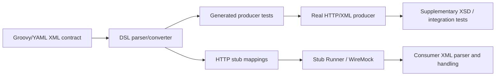

# Matchers for XML and Testing Tool Limitations

## 1. Why Does XML Need a Different Matching Approach Than JSON?

In **Spring Cloud Contract** (`SPRING_CLOUD_CONTRACT` module), a contract is a commitment about how a **producer** interacts with a **consumer**, described in **Groovy DSL** or **YAML DSL** for HTTP or messaging. From the contract, the framework can generate producer-side tests, package stubs for the consumer to use with **Stub Runner**, and combine both sides in CI to catch incompatible API changes.

In an API exchanging XML, business values typically live in **elements**, **attributes**, and **namespaces**. Comparing the entire response as a raw string can cause tests to fail over line breaks, whitespace, or attribute ordering, even though the consumer cares only about certain actual values. Conversely, an overly broad matcher can let the producer alter or omit critical fields while tests still pass.

Spring Cloud Contract supports **XML bodies** and **XPath body matchers** for HTTP contracts. XPath lets you pinpoint the exact position to verify in the XML tree: an element, text node, attribute, or a node qualified by namespace. These XPath matchers can appear in both **request** and **response**, though their verification semantics differ.

After this lesson, you will be able to:

- Write HTTP contracts with XML bodies in Groovy and YAML DSL.
- Use `xPath(path, byRegex(...))`, `byEquality()`, and appropriate matchers to target text/attributes in XML.
- Understand that **request matchers** validate consumer requests sent to stubs, whereas **response matchers** validate real producer responses.
- Recognize issues involving namespaces, ordering, whitespace, and dynamic data.
- Distinguish the capabilities of the DSL, generated tests, WireMock/Stub Runner, XSD validators, and application tests.
- Integrate appropriate checks into CI without falsely assuming one matcher validates an entire XML document.

## 2. XML Bodies in HTTP Contracts

Suppose a payment producer has an endpoint `POST /api/payments` receiving XML:

```xml
<paymentRequest>
  <clientReference>REF-123456</clientReference>
  <amount currency="VND">50000</amount>
</paymentRequest>
```

For a valid example, the producer returns `201`:

```xml
<paymentReceipt>
  <receiptId>rcpt-100001</receiptId>
  <status>ACCEPTED</status>
  <amount currency="VND">50000</amount>
</paymentReceipt>
```

Illustrative rules for this API:

- A valid `clientReference` matches `REF-` plus six digits.
- `amount` is a positive integer, unit `VND`.
- With a fixture meeting payment creation criteria, the producer returns HTTP `201`.
- Producer-generated `receiptId` matches `rcpt-` plus six digits.
- `status = ACCEPTED` is a business status, not the HTTP status.

These are **hypothetical rules for this lesson**, not default rules provided by Spring Cloud Contract.

### 2.1. An XML Body Must Be XML Text

In **Groovy DSL**, an XML body is supplied to `body` as a `String` or `GString`, usually via a multi-line string:

```groovy
body '''
<paymentRequest>
  <clientReference>REF-123456</clientReference>
  <amount currency="VND">50000</amount>
</paymentRequest>
'''
```

Unlike JSON bodies that can be expressed with Groovy maps/lists, XML has tag, attribute, and namespace syntax. Passing XML as a map without an appropriate conversion step will not automatically be interpreted as the XML structure you intend to commit to.

In **YAML DSL**, use a multi-line string `|` and `Content-Type: application/xml`:

```yaml
request:
  method: POST
  url: /api/payments
  headers:
    Content-Type: application/xml
  body: |
    <paymentRequest>
      <clientReference>REF-123456</clientReference>
      <amount currency="VND">50000</amount>
    </paymentRequest>
```

The `body` value here is an **XML string**, not a nested YAML object. Do not use JSONPath (`$.field`) to select fields from an XML body; use **XPath**.

## 3. Which Part of XML Does XPath Select?

**XPath** is an expression language for selecting nodes or values from an XML tree. In a contract, each XPath should reflect an attribute or value the consumer actually depends on.

Given the sample request:

```xml
<paymentRequest>
  <clientReference>REF-123456</clientReference>
  <amount currency="VND">50000</amount>
</paymentRequest>
```

Expressions to remember:

| XPath | Selected Component | Verification Meaning |
| --- | --- | --- |
| `/paymentRequest/clientReference/text()` | Text `REF-123456` | Reference code format |
| `/paymentRequest/amount/text()` | Text `50000` | Monetary amount |
| `/paymentRequest/amount/@currency` | Attribute `VND` | Currency unit |
| `/paymentRequest/amount` | Element node `amount` | Useful only when the matcher handles that node properly |
| `/paymentRequest/missing` | Selects no nodes | Can be used to test absence per supported matchers |

In many situations, appending `/text()` makes clear that you want to **check the text value** rather than the whole element node. To check an XML attribute, use the `@` prefix. The paths in the table apply only to XML **without namespaces**; namespaces are covered in Section 8.

### 3.1. XPath and Regex Perform Two Different Jobs

Example:

```groovy
xPath('/paymentRequest/clientReference/text()', byRegex('REF-[0-9]{6}'))
```

- `'/paymentRequest/clientReference/text()'`: selects the value inside the XML document.
- `byRegex('REF-[0-9]{6}')`: defines the validation rule for the selected value.

XPath does not enforce `REF-[0-9]{6}` on its own. Likewise, regex cannot know which element to check without the right XPath.

## 4. Complete Groovy DSL Example

Example `create_payment_xml.groovy`:

```groovy
import org.springframework.cloud.contract.spec.Contract

Contract.make {
    name 'create_payment_xml'
    description 'Create payment from valid XML request'

    request {
        method POST()
        url '/api/payments'
        headers {
            contentType(applicationXml())
        }
        body '''
<paymentRequest>
  <clientReference>REF-123456</clientReference>
  <amount currency="VND">50000</amount>
</paymentRequest>
'''
        bodyMatchers {
            xPath('/paymentRequest/clientReference/text()',
                  byRegex('REF-[0-9]{6}'))
            xPath('/paymentRequest/amount/text()', byEquality())
            xPath('/paymentRequest/amount/@currency', byEquality())
        }
    }

    response {
        status 201
        headers {
            contentType(applicationXml())
        }
        body '''
<paymentReceipt>
  <receiptId>rcpt-100001</receiptId>
  <status>ACCEPTED</status>
  <amount currency="VND">50000</amount>
</paymentReceipt>
'''
        bodyMatchers {
            xPath('/paymentReceipt/receiptId/text()',
                  byRegex('rcpt-[0-9]{6}'))
            xPath('/paymentReceipt/status/text()', byEquality())
            xPath('/paymentReceipt/amount/@currency', byEquality())
        }
    }
}
```

This is an HTTP contract with **two groups of XPath matchers**. Read them in their proper direction of operation.

### 4.1. Matchers in `request`: What Does the Stub Accept?

In `request.bodyMatchers`:

```groovy
xPath('/paymentRequest/clientReference/text()',
      byRegex('REF-[0-9]{6}'))
```

When the consumer calls the HTTP stub run by Stub Runner, this matcher allows multiple reference codes sharing the format, such as `REF-123456` and `REF-987654`. The `body` block still provides a concrete sample request for the **generated producer test** to send to the real producer.

For `amount`:

```groovy
xPath('/paymentRequest/amount/text()', byEquality())
xPath('/paymentRequest/amount/@currency', byEquality())
```

`byEquality()` compares against the corresponding values in the sample body: `50000` and `VND`. The goal is preserving the amount and currency constraints for this **representative scenario**.

That the stub accepts `REF-987654` does not prove the real producer handles **every** valid reference code; the generated producer test in this example sends only `REF-123456`. If the producer has "reference already used" or "ineligible for payment" branches, create corresponding contracts rather than letting a success regex catch every request.

### 4.2. Matchers in `response`: Verifying the Real Producer

In `response.bodyMatchers`:

```groovy
xPath('/paymentReceipt/receiptId/text()',
      byRegex('rcpt-[0-9]{6}'))
```

The stub returns the XML response with sample ID `rcpt-100001` so consumer tests have stable data. The generated producer test sends the sample request and checks `receiptId` in the **real response** against the regex, since the producer might generate `rcpt-902341`.

Conversely:

```groovy
xPath('/paymentReceipt/status/text()', byEquality())
```

pins the status field to the `ACCEPTED` value written in the sample body. If the producer changes to `PENDING` without updating the contract, this branch's producer test should detect the discrepancy.

### 4.3. What Remains Unverified?

These XPath matchers **do not by themselves prove** full payment correctness:

- The generated ID is unique or durably persisted.
- Response amount always equals request amount in every case.
- Every request with `REF-######` is accepted.
- XML satisfies every constraint in an external XSD.
- The consumer actually handles every namespace, encoding, or variant permitted by the API.

Those requirements need supplementary **business assertions**, schema validation, contracts for other branches, or integration tests depending on risk level.

## 5. YAML DSL for XML Matchers

Spring Cloud Contract also supports representing XML and matchers in **YAML DSL**. In YAML, instead of Groovy's `bodyMatchers` block, place matchers under `request.matchers.body` or `response.matchers.body`.

Semantically equivalent example (choose Groovy **or** YAML for a scenario to avoid duplicate stubs):

```yaml
name: create_payment_xml
request:
  method: POST
  url: /api/payments
  headers:
    Content-Type: application/xml
  body: |
    <paymentRequest>
      <clientReference>REF-123456</clientReference>
      <amount currency="VND">50000</amount>
    </paymentRequest>
  matchers:
    body:
      - path: /paymentRequest/clientReference/text()
        type: by_regex
        value: 'REF-[0-9]{6}'
      - path: /paymentRequest/amount/text()
        type: by_equality
      - path: /paymentRequest/amount/@currency
        type: by_equality
response:
  status: 201
  headers:
    Content-Type: application/xml
  body: |
    <paymentReceipt>
      <receiptId>rcpt-100001</receiptId>
      <status>ACCEPTED</status>
      <amount currency="VND">50000</amount>
    </paymentReceipt>
  matchers:
    body:
      - path: /paymentReceipt/receiptId/text()
        type: by_regex
        value: 'rcpt-[0-9]{6}'
      - path: /paymentReceipt/status/text()
        type: by_equality
      - path: /paymentReceipt/amount/@currency
        type: by_equality
```

**Note:** `path` in this YAML is an **XML XPath**, not a JSONPath. The values `by_regex` and `by_equality` are YAML matcher type syntax. Use a plugin version supporting these matchers, run the conversion step, and inspect the output when upgrading library versions.

## 6. Key Matcher Types and XML Limitations

Spring Cloud Contract documentation for HTTP XML supports matchers such as `byRegex`, `byEquality`, `byNull`, and date/time matchers. **Specifically, `byType()` is not supported for XML body matchers** in this part of the documentation; do not copy a JSON `byType()` example over to XPath expecting it to work.

| Matcher | Example with XPath | Purpose | Caution |
| --- | --- | --- | --- |
| `byRegex(...)` | `xPath('/receipt/id/text()', byRegex('rcpt-[0-9]{6}'))` | Check text/attribute format | Overly broad regex easily misses bugs |
| `byEquality()` | `xPath('/receipt/status/text()', byEquality())` | Compare against sample body value | Sample must reflect committed value |
| `byNull()` | `xPath('/receipt/obsolete', byNull())` | Check missing node per supported mechanism | Verify generated test semantics |
| `byDate()` | `xPath('/receipt/issuedOn/text()', byDate())` | Check date value per matcher type | Does not replace full date business rules |
| `byTime()` | `xPath('/receipt/issuedAt/text()', byTime())` | Check time value | Agree on timezone/format |
| `byTimestamp()` | `xPath('/receipt/createdAt/text()', byTimestamp())` | Check timestamp | Distinguish offset, UTC, fractional seconds |
| `byType()` | Not used for XML | Used in other DSL-supported contexts | **Not supported** for XML XPath body matchers |

Helper names/forms and support levels can change across Spring Cloud Contract versions. Do not infer that because a matcher exists in JSON DSL, the same matcher automatically has equivalent behavior in XML.

### 6.1. Text-Checking Matchers Are Not XML Schema Validation

Example:

```groovy
xPath('/paymentRequest/amount/text()', byRegex('[0-9]+'))
```

This checks that **the selected text** contains digits matching the regex. It does not verify:

- Whether XML is declared as `xs:decimal` or `xs:positiveInteger` in an XSD.
- Whether the value falls within an allowed range, e.g., 1 to 100 million.
- Whether `currency` only accepts `VND` or `USD` per a business list.
- Whether the document contains extra disallowed elements or attributes.

If the producer/consumer requires strict XSD compliance, validate the schema separately with an appropriate validator while keeping contract tests for the concrete scenarios the consumer uses.

### 6.2. Difference Between `missing`, Empty, and `xsi:nil`

These three representations do not carry the same meaning:

```xml
<!-- No <note> -->
<receipt><status>ACCEPTED</status></receipt>
```

```xml
<!-- Empty note element present -->
<receipt><note/></receipt>
```

```xml
<!-- Note element marked nil -->
<receipt xmlns:xsi="http://www.w3.org/2001/XMLSchema-instance">
  <note xsi:nil="true"/>
</receipt>
```

XPath selecting `/receipt/note`, `/receipt/note/text()`, and `/receipt/note/@xsi:nil` yields different results; the last also depends on declaring the `xsi` namespace. Matchers such as `byNull()` must be used appropriately to check **node absence** or null values per tool capabilities—do not assume they automatically understand full `xsi:nil` semantics. For contracts strict on nullability, add suitable tests/schema assertions.

## 7. Why Not Match the Entire XML as One String?

Two documents can carry identical critical data yet differ in representation:

```xml
<receipt id="rcpt-100001" currency="VND">
  <status>ACCEPTED</status>
</receipt>
```

```xml
<receipt currency="VND" id="rcpt-100001"><status>ACCEPTED</status></receipt>
```

Under **raw string** comparison, these two bodies differ in whitespace, line breaks, and attribute order. To an XML-parsing consumer, attribute order usually carries no business meaning, whereas **element order** can be part of the schema and very important.

Targeting nodes with XPath such as `/receipt/@id` and `/receipt/status/text()` eliminates irrelevant formatting differences. Even so, XPath choices can also make checks **too loose**:

- Checking only `status` misses the producer dropping `amount`.
- Selecting overly broad `//status` can accidentally match a status in a nested branch.
- Misusing `normalize-space(...)` can erase whitespace differences the consumer actually cares about.
- Ignoring element order can be inappropriate if the XSD requires `xs:sequence`.

A sound rule is to **verify the fields the consumer depends on**, while adding schema assertions if structural constraints across the whole document are part of the contract.

## 8. XML Namespaces: A Common Source of Matcher Failures

In XML, namespaces affect **element identity**, not merely the visible prefix. For example:

```xml
<ord:order xmlns:ord="urn:example:orders:v1">
  <ord:id>ord-1001</ord:id>
</ord:order>
```

The expression `/order/id/text()` will **not select** elements inside the `urn:example:orders:v1` namespace under namespace-aware XPath evaluation. Consequently, the matcher can fail even though the XML response "looks like" what the author expected.

One way to express XPath without registering prefixes is using `local-name()` and `namespace-uri()`:

```groovy
bodyMatchers {
    xPath("/*[local-name()='order' and namespace-uri()='urn:example:orders:v1']" +
          "/*[local-name()='id' and namespace-uri()='urn:example:orders:v1']/text()",
          byRegex('ord-[0-9]{4}'))
}
```

Notes:

- `local-name()` checks only the local name (e.g., `order`).
- `namespace-uri()` checks the actual namespace URI, distinguishing identically named elements across different data domains.
- Using only `local-name()='order'` without the URI when the system has multiple namespaces can cause the matcher to match the wrong element.
- Some environments let you register namespace prefixes and write XPaths like `/ord:order/ord:id/text()`; how namespace context is provided depends on the tool and test configuration.

### 8.1. Default Namespaces Also Require Handling

XML:

```xml
<order xmlns="urn:example:orders:v1">
  <id>ord-1001</id>
</order>
```

Even without an `ord:` prefix visible, the elements still belong to the default namespace. `/order/id/text()` usually **does not match** if the engine looks for elements with no namespace. You can use the combined `local-name()` and `namespace-uri()` expression shown above.

### 8.2. SOAP Adds an Envelope/Body Layer

In SOAP, the business payload typically sits beneath `Envelope` and `Body`:

```xml
<soap:Envelope xmlns:soap="http://schemas.xmlsoap.org/soap/envelope/"
               xmlns:pay="urn:example:payments:v1">
  <soap:Body>
    <pay:PaymentResult>
      <pay:receiptId>rcpt-100001</pay:receiptId>
    </pay:PaymentResult>
  </soap:Body>
</soap:Envelope>
```

An XPath searching only for `/PaymentResult/receiptId` will not select the node at this position. Include the Envelope/Body layer and namespaces in the expression, or use an XPath with sufficiently specific name and URI predicates. If the contract also commits to **SOAP Faults**, error status and body need separate examples/tests; do not assume every SOAP fault maps to the same HTTP code.

## 9. Practical Limits by Testing Tool

An XML contract passes through multiple tools, each with different capabilities and verification scope:



| Tool / Step | What It Verifies | Limits to Understand |
| --- | --- | --- |
| Groovy/YAML parser and contract converter | Contract syntax, convertibility to model/mapping | Does not know the business meaning of the entire XML |
| Generated producer tests | Real producer returns status/headers/body and described XPath assertions | Does not automatically verify all nodes, XSD, DB, or broker |
| Stub Runner/WireMock for HTTP | Accepts requests matching mapping and returns sample XML body | Stub does not guarantee real producer stays valid if producer verification is skipped |
| Consumer test | XML client actually parses and handles stub response | One sample payload does not cover all production XML variants |
| XSD validator | Schema constraints, types, cardinality, element order per XSD | Does not check business rules outside the schema |
| SOAP/XML integration test | SOAP flow, security, headers, real endpoint, serialization | More setup cost; requires suitable fixtures/infrastructure |

### 9.1. DSL-Supported Matchers May Not Be Handled Identically by Every Backend

When upgrading Spring Cloud Contract or changing HTTP test frameworks, **read the generated tests and generated mappings**, rather than only checking that Groovy/YAML files are valid. How an XPath compiles into assertions can depend on the plugin version and libraries used by generated tests.

A straightforward example:

- The contract specifies `xPath('/paymentReceipt/receiptId/text()', byRegex('rcpt-[0-9]{6}'))`.
- The generated producer test must contain an assertion checking the real response at that path.
- Stub mappings must select the right XML request based on XPaths in **request**; XPaths placed only in **response** do not alter request matching conditions.

If a build exits with success yet the contract file was never scanned by the plugin, that is **not** proof the matcher works. Confirm that the corresponding test/mapping was actually generated.

### 9.2. XPath Does Not Automatically Verify the Entire XML

An XPath proves only the property at the selected location per its matcher; it does not automatically prove:

- All XSD-required elements are present.
- Disallowed elements are absent.
- Numeric types, dates/times, and units match business rules.
- Cross-element relationships hold (e.g., total equals sum of line items).
- Namespaces and encodings are supported on every endpoint.
- Malicious XML payloads cannot exploit the parser.

If XML security requirements involve external entities / XXE, configure a hardened parser in the real environment and add security tests. Contracts can catch some malformed responses, but do not replace configuring and testing a secure XML parser.

### 9.3. HTTP XML Differs from Messaging Contracts

The examples above use **HTTP** request/response. Spring Cloud Contract also has **messaging contracts** with `input` and `outputMessage`; XML inside a message payload travels through a different transport and verification mechanism. Do not assume HTTP XPath matchers apply identically to every broker or message converter. Check the exact capabilities of your plugin/binder version and test with the actual transport in use.

## 10. Troubleshooting Flow for XPath and XML Matcher Errors

When a test fails, check in order to avoid fixing the wrong layer:

1. **Content-Type and payload:** are consumer/producer sending `application/xml` and valid XML? Are there XML declarations, BOMs, or different encodings?
2. **XML well-formedness:** are tags properly closed, `&` in text escaped (`&amp;`), attributes quoted, and namespaces declared properly?
3. **Which node XPath selects:** evaluate the XPath against the actual body; check for omitted `text()`, `@attribute`, or namespaces.
4. **Which value the matcher checks:** do regex, equality, null, or date/time apply to the right text or node? Is the sample value in the contract valid?
5. **Which step failed:** DSL conversion failed, producer test assertion failed, stub did not match request, or consumer parsing failed?
6. **Artifact version:** is Stub Runner loading the right published stub version containing the new matchers?

| Symptom | Possible Cause | Where to Inspect |
| --- | --- | --- |
| `XPath returns empty` despite tag in XML | Wrong XPath, default namespace, wrong prefix | Check namespace URI and actual XML structure |
| Stub returns unexpected response | Request matcher too narrow, different content type, overlapping mappings | Compare actual request with generated WireMock mapping |
| Producer test fails because `receiptId` differs from fixed sample | Dynamic matcher missing or placed on wrong side | Check `response.bodyMatchers` and generated assertions |
| Producer test passes despite missing business element | Contract checks only a few XPaths | Add mandatory matchers, schema checks, or integration tests |
| `byType` fails to work with XML | Unsupported matcher type | Use regex/equality/XSD type checks |
| XPath matches non-namespaced XML but fails on SOAP | `Envelope/Body` wrapper and namespaces present | Select node according to SOAP structure |
| Consumer client reads wrong XML data | Consumer deserializer/binding/schema incompatible | Run consumer integration test with new XML stub |
| CI green yet test/mapping files missing | Contracts not scanned or wrong filter | Inspect contract list, generated tests, and stub JAR |

## 11. Combining XML Matchers with Producer Tests, Stub Runner, and CI

A sensible implementation workflow:

1. **Define HTTP XML behavior**: method, path, status, headers, required XML fields, and error branches to protect.
2. **Write XML bodies and XPath matchers**: select text/attributes accurately; use flexible matchers for dynamic values.
3. **Pre-verify DSL/conversion**: confirm Groovy/YAML is parsed and generated mappings use the right XPaths.
4. **Run producer tests**: set up the `REF-123456` fixture, invoke the real producer, and verify the response XML has all critical fields.
5. **Package/publish stub** with classifier `stubs` matching the verified producer version.
6. **Run consumer tests with Stub Runner**: send a valid request and at least one important error branch; verify consumer logic parses/displays the XML body properly.
7. **Add XSD and integration tests** when strict schemas, SOAP, security, or data relationships are required.

Example artifact:

```text
com.example:payments-producer:1.5.0:stubs
```

The consumer should **pin the stub version** so CI stays reproducible. Using dynamic versions or SNAPSHOTs that change on every build can break consumer tests due to stub changes even when consumer code stays untouched.

### 11.1. When Should You Add a New XML Contract?

You do not need a contract for **every** `clientReference` value. When all valid values lead to the same behavior, matchers are appropriate. However, when different HTTP outcomes or payloads matter to the consumer, create **separate scenarios**:

| Branch | Representative Request | Published Outcome | How to Verify |
| --- | --- | --- | --- |
| Successful payment creation | `REF-123456`, `amount = 50000` | `201`, XML `paymentReceipt` | Success contract + XPath |
| Invalid amount | `amount = 0` | `400`, XML with `errorCode = INVALID_AMOUNT` | Independent error contract |
| Reference already used | `REF-DUPLICATE` per fixture data | `409`, XML with `errorCode = DUPLICATE_REFERENCE` | Independent conflict contract |

An overly broad request matcher can cause Stub Runner to return `201` even for requests that should return `400` or `409`. Separate matchers and fixtures per branch the consumer must handle.

## 12. Hands-on Exercise: Verifying Shipping Result XML

Producer `shipping-producer` exposes:

```http
GET /api/shipments/shp-1001 HTTP/1.1
Accept: application/xml
```

Success response:

```xml
<shipment>
  <id>shp-1001</id>
  <status>IN_TRANSIT</status>
  <trackingCode carrier="LOCAL">TRK-123456</trackingCode>
</shipment>
```

**Requirements:**

1. Write a Groovy contract `get_shipment_xml.groovy` for `GET /api/shipments/shp-1001`, response `200` with header `Content-Type: application/xml`.
2. Put the XML body in a multi-line string.
3. Use XPath for `/shipment/id/text()` and `/shipment/status/text()`; decide which fields require `byEquality()`.
4. Use `xPath('/shipment/trackingCode/text()', byRegex('TRK-[0-9]{6}'))` to validate the dynamically generated tracking code.
5. Use `xPath('/shipment/trackingCode/@carrier', byEquality())` for the carrier attribute.
6. Explain why the contract can pass even if the response adds a new element outside the selected XPaths. Propose adding XSD validation if undocumented elements are forbidden.
7. Replace the response with XML having default namespace `urn:example:shipping:v1` and adjust the XPaths so they still select the right nodes.
8. Outline how to run a consumer test with Stub Runner and assert that the client reads `trackingCode` properly.

### 12.1. Reference Solution for the Success Branch

```groovy
import org.springframework.cloud.contract.spec.Contract

Contract.make {
    name 'get_shipment_xml'

    request {
        method GET()
        url '/api/shipments/shp-1001'
        headers {
            header 'Accept': 'application/xml'
        }
    }

    response {
        status 200
        headers {
            contentType(applicationXml())
        }
        body '''
<shipment>
  <id>shp-1001</id>
  <status>IN_TRANSIT</status>
  <trackingCode carrier="LOCAL">TRK-123456</trackingCode>
</shipment>
'''
        bodyMatchers {
            xPath('/shipment/id/text()', byEquality())
            xPath('/shipment/status/text()', byEquality())
            xPath('/shipment/trackingCode/text()',
                  byRegex('TRK-[0-9]{6}'))
            xPath('/shipment/trackingCode/@carrier', byEquality())
        }
    }
}
```

Here, Stub Runner returns the sample XML body with `TRK-123456`. The generated producer test allows the actual tracking code to vary as long as it matches the regex; `id`, `status`, and `carrier` remain checked against the representative scenario's values. When used with a real application, you need the `shp-1001` fixture and appropriate test base configuration.

### 12.2. References

- [Spring Cloud Contract — HTTP Contracts: XML Support for HTTP](https://docs.spring.io/spring-cloud-contract/reference/project-features-contract/http.html#xml-support-for-http): XML bodies, XPath body matchers, `byType()` limits, and XML namespaces.
- [Spring Cloud Contract — Dynamic properties](https://docs.spring.io/spring-cloud-contract/reference/project-features-contract/dsl-dynamic-properties.html): dynamic values, request/response matchers, and producer/consumer sides.

### Checklist Before Finalizing XML Matchers

- [ ] Body uses an XML String/GString with the right `Content-Type`.
- [ ] XPath selects the exact **text node** or **attribute** the consumer needs.
- [ ] Matcher is in the right block: request for stub matching, response for generated producer test assertions.
- [ ] Sample values are reproducible; matchers are not overly broad.
- [ ] XML namespaces and default namespaces are handled properly.
- [ ] `byType()` is not used for XML XPath matchers.
- [ ] Clarified which requirements belong to XSD/schema validation or integration/security tests.
- [ ] Real producer verification and consumer tests with Stub Runner are in place.
- [ ] Generated tests/mappings are actually produced and contain expected matchers.
- [ ] Important XML error branches have separate contracts.

**Takeaway:** in Spring Cloud Contract, **XPath determines where to inspect in XML** while the matcher decides which values are accepted. Request XPath matchers serve stub request matching; response XPath matchers protect what the real producer returns. Combining XPath with schema, consumer, and integration tests gives meaningful XML compatibility control rather than merely verifying that an XML string looks like a sample.
