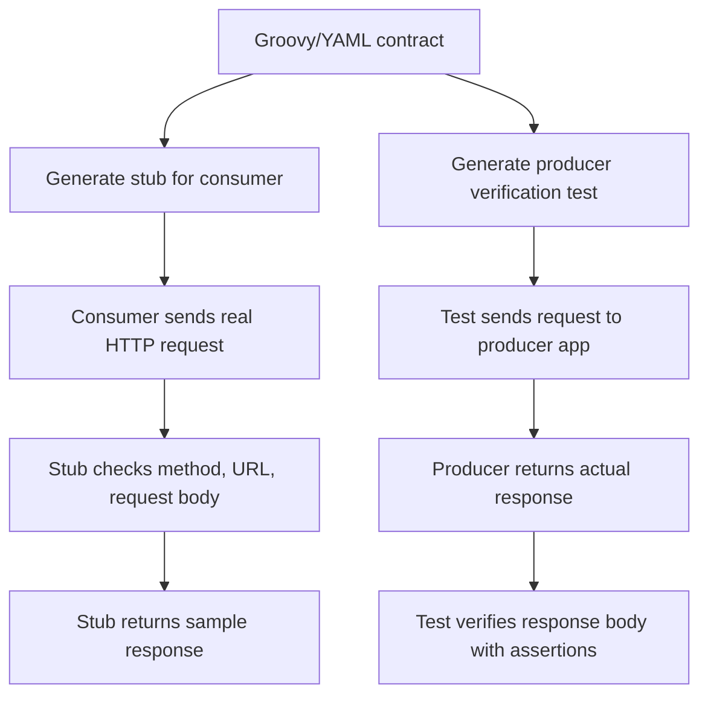
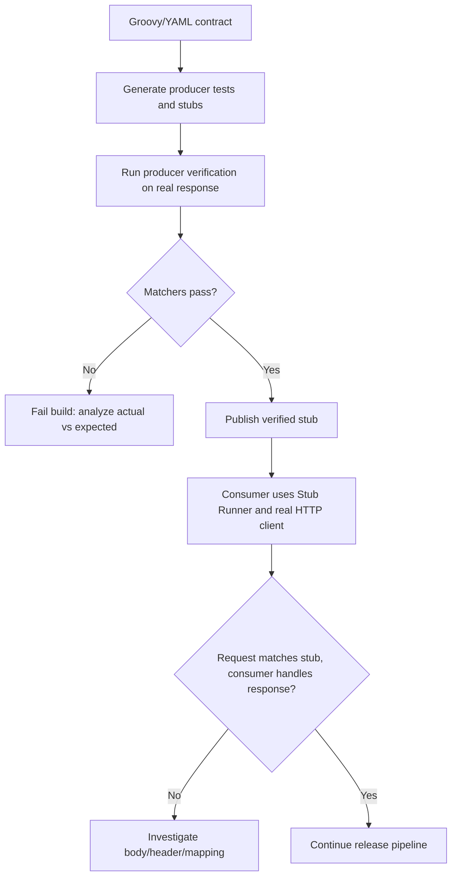

# Whitespace-Independent Body Matching

## 1. Practical Problem: Same Data, Different Line Breaks

In a microservices architecture, two services may agree on a JSON payload while **serializing** it differently. For instance, `Checkout Service` (consumer) sends an order to `Order Service` (producer); the HTTP client library emits single-line JSON, whereas the sample request documented in the contract is indented for readability.

JSON sent by the consumer:

```json
{"orderId":"O-42","amount":125000,"currency":"VND"}
```

JSON formatted in documentation or fixtures:

```json
{
  "orderId": "O-42",
  "amount": 125000,
  "currency": "VND"
}
```

The two texts differ in byte count, newlines, and spaces, yet after parsing they describe **the exact same JSON object**. If a stub checks only byte-for-byte string equality on the body, consumer tests can fail over formatting rather than an API violation.

**Spring Cloud Contract** provides Groovy/YAML DSL to describe HTTP requests/responses, matchers, and assertions, generating producer tests and consumer stubs for **Stub Runner**. Designing matchers properly helps CI detect incompatible API changes without making tests brittle over presentation whitespace.

After this lesson, learners will be able to:

1. Distinguish **formatting whitespace** from **whitespace inside data values**.
2. Describe JSON bodies structurally, applying JSONPath with `byEquality`, `byType`, and `byRegex` in Groovy/YAML DSL.
3. Understand how stub request matching differs from assertions on the producer's real response.
4. Know when to use semantic JSON comparison and when strict text/byte comparison must be kept.
5. Diagnose mismatches, inspect generated tests/stubs, and place verification steps in CI.

## 2. "Ignoring Whitespace" Must Have a Clear Scope

According to JSON grammar, whitespace **outside** tokens—such as after commas, after colons, or between lines—does not alter data values. Conversely, whitespace **inside** a JSON string is part of that string's value.

### 2.1. Differences That Do Not Change JSON Values

These three JSON objects carry identical information:

```json
{"id":42,"status":"PAID"}
```

```json
{
    "id"  : 42,
    "status" : "PAID"
}
```

```json
{"status":"PAID", "id":42}
```

Differences here involve spaces, line breaks, and **object property order**. When checking as JSON objects, do not accidentally treat these presentation differences as API changes.

### 2.2. Differences That Can Alter Real Data

Conversely, the examples below must not be considered equivalent merely because they "look similar":

| Expected JSON | Actual JSON | Why They Are Not Identical |
| --- | --- | --- |
| `{"note":"Hello world"}` | `{"note":"Hello  world"}` | There are **two** spaces inside `note` instead of one |
| `{"code":" AB "}` | `{"code":"AB"}` | Leading/trailing spaces are string content |
| `{"amount":125000}` | `{"amount":"125000"}` | Number type differs from string |
| `{"items":[1,2]}` | `{"items":[2,1]}` | Array element order changed |
| `{"receiptUrl":null}` | `{}` | Field with `null` differs from absent field |
| `{"enabled":true}` | `{"enabled":"true"}` | Boolean differs from string |
| `{"status":"PAID"}` | `{"state":"PAID"}` | Field name changed |

**Rule:** You may ignore whitespace *between JSON tokens*, but must not delete or collapse whitespace *inside strings*. Never call a helper that replaces all `\s+` with empty string before comparing bodies: that turns `"A B"` into `"AB"` and hides bugs.

### 2.3. JSON Formatting Does Not Dictate the Entire Compatibility Policy

Two objects with the same fields in different key orders are usually data-equivalent. However:

- **Arrays** are ordered: `[1,2]` differs from `[2,1]` if the contract or consumer depends on ordering.
- **Extra fields** may or may not be acceptable depending on matching policy and client deserialization.
- **Types and value domains** must be protected separately; structural JSON comparison does not inherently know `status` only accepts `PAID`, `PENDING`, `FAILED`.
- **Dynamic values** like IDs or timestamps need flexible matchers instead of matching fixed sample data.

Thus, "whitespace-independent" is just **one** property of a contract testing strategy, not a reason to drop other assertions.

## 3. Choosing the Right Matching Mechanism per Content Type

| Body Type | Approach | Which Whitespace Can Be Ignored? |
| --- | --- | --- |
| JSON object/array | Parse JSON, match fields/JSONPath or JSON equality | **Structural** whitespace between tokens |
| XML | Parse XML, use XPath/matchers or an appropriate XML comparator | Only whitespace deemed insignificant by business rules/comparator |
| Plain text | Purposeful string comparison or regex | Only parts explicitly allowed to vary by the contract |
| CSV | Parse columns/rows per format and business rules | Depends on quoting, trimming, and separator rules |
| Binary, PDF, images | Compare bytes or appropriate properties/signatures | Never strip bytes under text whitespace assumptions |

If the API requires a digital signature over raw body bytes, a canonical signed string, or a specially structured text payload, **byte-level equality** may be a real requirement. Indiscriminately ignoring whitespace in that case renders tests meaningless.

## 4. Spring Cloud Contract Separates Request and Response

An HTTP contract usually contains two blocks:

- `request`: describes what the consumer sends to the producer.
- `response`: describes what the producer returns to the consumer.

Both blocks have `body` and may have matchers, yet they are used at two different stages:



For JSON, describe data structure and business constraints rather than relying on a body string with exact whitespace. The following examples apply to one API: `POST /api/orders`.

## 5. Groovy DSL: Writing Bodies as JSON Structures

Groovy contract for an order with two items:

```groovy
import org.springframework.cloud.contract.spec.Contract

Contract.make {
    description 'Create order from structured JSON'

    request {
        method POST()
        url '/api/orders'
        headers {
            contentType(applicationJson())
        }
        body(
            orderId: 'O-42',
            customer: [
                id: 'C-7',
                name: 'Nguyen An'
            ],
            items: [
                [sku: 'BOOK-01', quantity: 2],
                [sku: 'PEN-02', quantity: 1]
            ]
        )
        bodyMatchers {
            jsonPath('$.orderId', byRegex('O-[0-9]+'))
            jsonPath('$.customer.id', byEquality())
            jsonPath('$.items[0].sku', byEquality())
        }
    }

    response {
        status CREATED()
        headers {
            contentType(applicationJson())
        }
        body(
            orderId: 'O-42',
            status: 'CREATED',
            totalQuantity: 3
        )
        bodyMatchers {
            jsonPath('$.orderId', byRegex('O-[0-9]+'))
            jsonPath('$.status', byEquality())
            jsonPath('$.totalQuantity', byType())
        }
    }
}
```

Key takeaways:

1. `body(...)` takes **Groovy maps/lists** representing objects/arrays, not a JSON string that the app must emit with an exact space count.
2. `jsonPath('$.orderId', byRegex('O-[0-9]+'))` checks **the field's value** by regex; it does not care whether JSON has line breaks between keys.
3. `byEquality()` reads the corresponding value from the sample body to compare—e.g., `$.customer.id` must be `C-7` and response `$.status` must be `CREATED`.
4. `byType()` verifies the data type matches the sample; it does not require `totalQuantity` to equal `3` as long as the actual value has the allowed type.
5. Element order in `items` may matter; matcher `$.items[0].sku` explicitly verifies **the first element**.

**Distinguish the two directions of matcher usage:** `request.bodyMatchers` mainly generates matching rules in the **stub** when the consumer sends requests; `response.bodyMatchers` generates assertions to check the **producer's actual response**. Generated producer tests use concrete request data from the contract; the stub returns the sample response declared in `response.body`.

### 5.1. Same Request Serialized Differently

The consumer may send:

```json
{"orderId":"O-42","customer":{"id":"C-7","name":"Nguyen An"},"items":[{"sku":"BOOK-01","quantity":2},{"sku":"PEN-02","quantity":1}]}
```

Or:

```json
{
  "items": [
    {"quantity": 2, "sku": "BOOK-01"},
    {"quantity": 1, "sku": "PEN-02"}
  ],
  "customer": {"name": "Nguyen An", "id": "C-7"},
  "orderId": "O-42"
}
```

In JSON terms, corresponding fields and elements have identical values; only whitespace and **object key order** differ. A JSON/JSONPath value-based matcher does not need to lock onto pretty printing. Still, whether the consumer matches the stub depends on the **actual generated mapping**, WireMock version, and other conditions such as headers.

### 5.2. Do Not Use Full-Body Regex When JSONPath Suffices

A regex over the whole body string, such as:

```regex
.*"orderId"\s*:\s*"O-42".*
```

can break due to line breaks, key order, escaping, or a field appearing in the wrong nesting level. It also struggles to guarantee valid JSON. When the body is structured JSON, use JSONPath for the target fields; use regex only for **values at a field**, such as `O-[0-9]+`.

Full-body regex can help with specialized text formats, but is not the default choice for making a JSON contract "whitespace-tolerant."

## 6. YAML DSL: Body Mappings and JSONPath Matchers

YAML example corresponding to the Groovy DSL above:

```yaml
description: Create order from structured JSON
request:
  method: POST
  url: /api/orders
  headers:
    Content-Type: application/json
  body:
    orderId: "O-42"
    customer:
      id: "C-7"
      name: "Nguyen An"
    items:
      - sku: "BOOK-01"
        quantity: 2
      - sku: "PEN-02"
        quantity: 1
  matchers:
    body:
      - path: '$.orderId'
        type: by_regex
        value: 'O-[0-9]+'
      - path: '$.customer.id'
        type: by_equality
      - path: '$.items[0].sku'
        type: by_equality
response:
  status: 201
  headers:
    Content-Type: application/json
  body:
    orderId: "O-42"
    status: "CREATED"
    totalQuantity: 3
  matchers:
    body:
      - path: '$.orderId'
        type: by_regex
        value: 'O-[0-9]+'
      - path: '$.status'
        type: by_equality
      - path: '$.totalQuantity'
        type: by_type
```

Meaning of both `matchers` locations:

| YAML Path | Where the Condition Is Used | Example |
| --- | --- | --- |
| `request.matchers.body` | Primarily in stub request matching | Consumer sends `orderId` matching regex |
| `response.matchers.body` | In producer verification | Actual response has `status` matching sample |

YAML syntax uses `type: by_regex`, `by_equality`, `by_type`, rather than copying Groovy's `byRegex()` method verbatim into YAML. JSONPath matchers point to fields in the sample body; the sample body still needs concrete values to generate test requests or stub responses.

**Note:** Do not assume `by_type` equals "ignore all structure." For arrays, check type, element count, and ordering as required. For dynamic fields, you may need format or range matchers instead of type-only constraints.

## 7. Producer Verification: Inspecting the Response After Parsing JSON

For contracts with `response.bodyMatchers`, Spring Cloud Contract Verifier generates tests that call the real producer app and verify the response. Assertions typically inspect content via JSONPath or corresponding JSON comparison APIs; exact generated code depends on plugin version and test mode.

Hand-written Java example **to illustrate intent**, not claiming to be verbatim Spring Cloud Contract generated code:

```java
@SpringBootTest
@AutoConfigureMockMvc
class CreateOrderContractExampleTest {
    @Autowired
    MockMvc mockMvc;

    @Test
    void createdOrderMatchesExpectedFields() throws Exception {
        mockMvc.perform(post("/api/orders")
                .contentType(MediaType.APPLICATION_JSON)
                .content("""
                    {"orderId":"O-42","customer":{"id":"C-7","name":"Nguyen An"},
                     "items":[{"sku":"BOOK-01","quantity":2},
                              {"sku":"PEN-02","quantity":1}]}
                    """))
            .andExpect(status().isCreated())
            .andExpect(content()
                .contentTypeCompatibleWith(MediaType.APPLICATION_JSON))
            .andExpect(jsonPath("$.status").value("CREATED"))
            .andExpect(jsonPath("$.totalQuantity").isNumber())
            .andExpect(jsonPath("$.orderId").isString());
    }
}
```

This example assumes Java supporting text blocks, Spring Boot Test, MockMvc, JUnit, and appropriate imports. The snippet expresses only part of the goal: `isString()` does not substitute for checking regex `O-[0-9]+`. For full verification, rely on the actual generated tests to confirm regex constraints are enforced as well.

Example compact producer response:

```json
{"totalQuantity":3,"orderId":"O-99","status":"CREATED"}
```

If the contract permits `orderId` matching `O-[0-9]+` and numeric `totalQuantity`, differences in key order, whitespace, and valid ID values are accepted. If the producer returns `"totalQuantity":"3"` or `"status":"CANCELLED"`, the type and value conditions should fail the test.

### 7.1. Structural JSON Comparison in Supporting Tests

When you need a **whole-JSON** check rather than just a few JSONPaths, parse expected and actual into JSON trees for semantic comparison:

```java
ObjectMapper mapper = new ObjectMapper();

String expected = """
    {"status":"CREATED","orderId":"O-42"}
    """;

String actual = """
    {
      "orderId": "O-42",
      "status" : "CREATED"
    }
    """;

JsonNode expectedTree = mapper.readTree(expected);
JsonNode actualTree = mapper.readTree(actual);

assertEquals(expectedTree, actualTree);
```

This is a way to **write a supplementary Java assertion**, not Spring Cloud Contract DSL syntax. Parsing into `JsonNode` prevents formatting spaces and object property ordering from causing mismatches, while string values and data structures are still compared. Know how your comparison library handles numeric values and JSON details if the API has exact numeric type requirements.

Do not implement a `replaceAll` step stripping whitespace from raw body strings before comparison. A JSON parser is the right tool to separate structural whitespace from content.

## 8. Stub Runner and JSON Request Matching

On the consumer side, Stub Runner typically starts HTTP stubs generated from contracts. For stubs backed by **WireMock**, the underlying engine provides multiple matcher types:

| WireMock Matcher | Matching Level | Application |
| --- | --- | --- |
| `equalTo` | Text string comparison | Text must match character-for-character, including whitespace |
| `equalToJson` | Structural JSON comparison | JSON formatted differently with identical content |
| `matchesJsonPath` | Selects part of JSON by path | Constrains only required fields or values |
| `binaryEqualTo` | Byte comparison | Binary data or content needing byte-exact match |

**Technical note:** These are **WireMock** matcher names, not keys you can drop directly into arbitrary spots of Groovy/YAML DSL. Spring Cloud Contract generates stub mappings according to its version and declared matchers; to see whether `equalToJson` or `matchesJsonPath` is actually used, inspect the generated mapping file.

### 8.1. Standalone Illustrative WireMock Mapping Example

A hand-written WireMock mapping can inspect a JSON request structurally:

```json
{
  "request": {
    "method": "POST",
    "url": "/api/orders",
    "bodyPatterns": [
      {
        "equalToJson": {
          "orderId": "O-42",
          "customer": {"id": "C-7", "name": "Nguyen An"},
          "items": [
            {"sku": "BOOK-01", "quantity": 2},
            {"sku": "PEN-02", "quantity": 1}
          ]
        }
      }
    ]
  },
  "response": {
    "status": 201,
    "headers": {"Content-Type": "application/json"},
    "jsonBody": {
      "orderId": "O-42",
      "status": "CREATED",
      "totalQuantity": 3
    }
  }
}
```

This is a **WireMock configuration illustrating the mechanism**, not guaranteed to match verbatim what Spring Cloud Contract generates. `equalToJson` compares JSON content rather than requiring identical whitespace. By default, differences such as array element order and extra object properties can prevent this matcher from matching.

### 8.2. Controlled Relaxation of Arrays and Extra Fields

WireMock lets you tune JSON comparison policies, for example:

```json
{
  "equalToJson": {
    "orderId": "O-42",
    "items": [
      {"sku": "BOOK-01"},
      {"sku": "PEN-02"}
    ]
  },
  "ignoreArrayOrder": true,
  "ignoreExtraElements": true
}
```

This snippet is a **standalone WireMock body pattern**, not a Spring Cloud Contract YAML contract. `ignoreArrayOrder` allows array element permutations during matching; `ignoreExtraElements` allows extra object fields. Both options **differ from ignoring whitespace** and should not be enabled if the consumer depends on ordering or requires a strict schema.

When using Spring Cloud Contract, verify how stub mappings are generated in your active version or write appropriate JSONPath matchers in the DSL. Do not assume placing these two WireMock flags at arbitrary spots in a YAML contract is supported.

## 9. XML and Plain Text: Do Not Overgeneralize JSON Rules

### 9.1. For XML

These two XML documents differ in indentation:

```xml
<payment>
  <id>42</id>
  <status>PAID</status>
</payment>
```

```xml
<payment><id>42</id><status>PAID</status></payment>
```

Programs reading XML via an element model may treat them as carrying the same business data, yet **not every XML comparator automatically ignores all whitespace text nodes**. Spaces inside `<message>Hello  user</message>` may be part of the value.

Spring Cloud Contract supports XML bodies and XPath matchers in Groovy DSL, such as:

```groovy
import org.springframework.cloud.contract.spec.Contract

Contract.make {
    request {
        method GET()
        url '/api/payments/42/xml'
    }
    response {
        status OK()
        headers {
            contentType(applicationXml())
        }
        body('''<payment>
            <id>42</id>
            <status>PAID</status>
        </payment>''')
        bodyMatchers {
            xPath('/payment/id/text()', byEquality())
            xPath('/payment/status/text()', byEquality())
        }
    }
}
```

XPath focuses on the nodes to check instead of forcing XML source to follow one indentation style. However, if whitespace inside a text node carries meaning, still verify it. When full semantic XML comparison is needed, choose a comparator/XMLUnit configuration suited to your application's namespace, node ordering, and text content requirements.

### 9.2. For Plain Text

If an endpoint returns `text/plain`, `"Order paid"` and `"Order  paid"` may **differ** if the consumer renders the exact wording. If business rules allow multiple spaces, use a dedicated matcher or **bounded** normalization assertions like leading/trailing trim. Do not apply JSON rules to plain text.

### 9.3. For Signed Bodies or Binary Payloads

If the receiver verifies an HMAC signature over raw body bytes, even a single added newline changes the signature. In that case, protect **exact byte data** and the signing/verification flow rather than loosening matchers to skip whitespace. PDFs, ZIPs, or images must likewise be checked with mechanisms suited to bytes and metadata.

## 10. Test Matrix: Whitespace Difference or Contract Difference?

Suppose expected is:

```json
{"paymentId":42,"status":"PAID","note":"A B","items":[1,2]}
```

| Actual JSON | Result under Strict Structural JSON Comparison | Explanation |
| --- | --- | --- |
| Same data, multi-line / indented | **PASS** | Whitespace outside tokens is insignificant |
| Reordered object keys | **PASS** | JSON object key order carries no meaning |
| `"note":"A  B"` | **FAIL** | Spaces inside string differ |
| `"paymentId":"42"` | **FAIL** | String differs from number |
| `"items":[2,1]` | **FAIL** under order-sensitive comparison | Array order reversed |
| Added `"traceId":"x"` | **FAIL** under strict whole-object comparison | Extra field present; may be permitted by explicit policy |
| Missing `"status"` | **FAIL** | Required field lost |
| `"status":"PENDING"` | **FAIL** | Different business value |
| `"items":[]` | **FAIL** | Changed element count and data |

This table describes **strict whole-structure JSON comparison**, not a claim that every Spring Cloud Contract generated test implements this exact table. When using JSONPath matchers for specific fields, conditions outside the matcher list and sample body must be verified from the generated test code.

## 11. Common Matcher Configuration Mistakes

### 11.1. Comparing JSON as Raw Text Strings

**Symptom:** tests fail when a developer turns on pretty printing or an HTTP client changes serialization. **Fix:** use body maps/sequences and JSONPath in Spring Cloud Contract; when writing manual WireMock mappings, consider `equalToJson` instead of `equalTo`.

### 11.2. Stripping All Whitespace Before Comparing

**Symptom:** tests pass even though `message`, `name`, or `address` changed internal spaces. **Fix:** parse JSON first; compare string values intact on fields that must be protected.

### 11.3. Using `byType()` for Every Field

**Symptom:** producer changes `status` from `PAID` to `CANCELLED` yet tests still pass because both are strings. **Fix:** keep `byEquality()` or constrain regex to the exact critical value domain.

### 11.4. Unnecessarily Hardcoding Dynamic Values

**Symptom:** valid changes to `orderId` or timestamps turn producer verification red. **Fix:** use `byRegex()`, `byType()`, date/time matchers, or appropriate two-sided values; still verify important formats.

### 11.5. Assuming Ignoring Whitespace Allows Reordering Arrays

**Symptom:** consumer picks the first element as preferred choice yet the contract does not protect order. **Fix:** verify ordering, elements, or business relationships when the consumer relies on them; enable order-ignoring only if agreed by the API.

### 11.6. Mixing Up `request.matchers` and `response.matchers`

**Symptom:** producer tests still compare responses too strictly or stubs fail to match real request bodies. **Fix:** verify direction: request matchers primarily drive stub matching, response matchers primarily drive producer verification. Read generated artifacts before concluding.

### 11.7. Not Knowing Why a Body Passed or Failed

**Symptom:** response adds fields, changes null, or alters arrays yet tests turn green/red contrary to expectations. **Fix:** inspect the DSL, generated test code, WireMock mappings, and assertion libraries in use. Strictness can vary by version and matcher; do not guess from sample JSON appearance alone.

## 12. Diagnosing Mismatches in Real Projects

When a consumer test reports an unmatched stub or a producer test fails:

1. **Save actual request/response** as bytes or text with sensitive data masked; record `Content-Type` and URL.
2. **Verify valid JSON.** If a body fails to parse, it cannot be dismissed as "just an indentation difference."
3. **Compare parsed objects/arrays**, pinpointing the differing JSONPath and distinguishing type, missing, null, and value.
4. **Check which matcher was applied.** Was it string `equalTo`, `equalToJson`, or `matchesJsonPath`? On the producer, which fields do generated assertions check?
5. **Test two payloads identical in data but differing in formatting** to confirm the "whitespace-independent" goal.
6. **Test a meaningful mutation** such as changing `status`, converting a number to a string, or changing whitespace inside `note`. Tests should catch it if that is a commitment.
7. **Fix at the right layer.** Do not delete assertions just to turn builds green when the producer broke consumer requirements; nor lock JSON formatting if the consumer does not depend on it.

Illustrative failure report:

```text
Endpoint: POST /api/orders
Matcher: equalTo (raw string)
Expected body: {"orderId":"O-42","amount":125000}
Actual body:
{
  "amount": 125000,
  "orderId": "O-42"
}
Raw string match: FAIL
Parsed JSON match: PASS
```

In this situation, the defect is an overly strict **text comparison strategy** for a JSON interface. However, if `amount` changes to `"125000"`, JSON parsing still succeeds yet a proper structural comparison must catch the type difference.

## 13. CI Integration: Avoiding False Failures While Catching Real Bugs

A contract testing pipeline should protect both sides:



Quality control tips:

- **Pin compatible versions** of Spring Boot, Spring Cloud, Spring Cloud Contract plugin/dependencies, and Stub Runner.
- **Never skip producer verification.** Generated stubs do not prove the current producer satisfies the contract.
- **Run consumer tests with a real HTTP client.** This catches Content-Type, serialization, or URL issues rather than testing only an in-memory JSON sample.
- **Check executed test counts.** A green pipeline when tests were skipped gives inadequate protection.
- **Include meaningful negative cases:** wrong types, missing fields, wrong statuses, reversed arrays when order matters, altered whitespace inside strings.
- **Review matcher changes**: loosen matchers only when the interface genuinely allows that variation.
- **Do not replace integration/E2E tests** covering networking, security, real data, and multi-service communication.

## 14. Hands-on Exercise: Distinguishing Formatting from Data

Sample response contract:

```yaml
description: Look up payment
request:
  method: GET
  url: /api/payments/42
response:
  status: 200
  headers:
    Content-Type: application/json
  body:
    paymentId: 42
    status: "PAID"
    message: "Paid successfully"
    items:
      - sku: "BOOK-01"
        quantity: 2
      - sku: "PEN-02"
        quantity: 1
  matchers:
    body:
      - path: '$.paymentId'
        type: by_type
      - path: '$.status'
        type: by_equality
      - path: '$.message'
        type: by_equality
```

### Tasks

1. Rewrite the JSON response above in minified single-line form and multi-line pretty-printed form. Explain why they carry the same value.
2. If the producer returns `"message":"Paid  successfully"` with two spaces, should the test pass?
3. If the producer returns `"paymentId":"42"`, does the `by_type` condition catch the error?
4. If the producer returns `items` in reverse order, should it pass? What information is needed before deciding?
5. If a consumer test uses manual WireMock, choose `equalTo`, `equalToJson`, or `binaryEqualTo` for the JSON request? Why?

### Suggested Answers

| Question | Conclusion to Reach |
| --- | --- |
| 1 | Spaces outside tokens do not alter objects/arrays after JSON parsing; tests should compare structurally |
| 2 | No, if `message` is committed verbatim to the sample body and `by_equality` |
| 3 | Yes, because the sample is a number while actual is a string; inspect generated assertions to confirm |
| 4 | Must determine whether the consumer relies on order; `by_type` on `paymentId` does not check array order |
| 5 | `equalToJson` is usually better because it compares JSON data rather than presentation characters |

Actively try changing whitespace outside strings, then changing whitespace *inside* `message`. A sound matcher setup must distinguish these two changes according to the published expectations.

## 15. Contract Review Checklist

- Is the body JSON, XML, text, or binary? Did you pick the matching strategy appropriate for that data type?
- When JSON, does the contract describe object/array structure and the JSONPaths that genuinely matter?
- Did you avoid byte-for-byte JSON comparison just because serialization differs?
- Are whitespace **inside string values** and business type/value constraints preserved?
- Must arrays fix ordering, size, or per-element schemas? Is that verified?
- Are `request.matchers.body` and `response.matchers.body` placed on the right direction?
- Do generated producer tests and WireMock stub mappings actually apply the intended matchers?
- Did producer verification and Stub Runner consumer tests run in CI before release?

**Official documentation to consult by version:**

- [Spring Cloud Contract — Contract DSL](https://docs.spring.io/spring-cloud-contract/reference/project-features-contract.html)
- [Spring Cloud Contract — Dynamic properties and body matchers](https://docs.spring.io/spring-cloud-contract/reference/project-features-contract/dsl-dynamic-properties.html)
- [Spring Cloud Contract — HTTP contracts, JSON and XML](https://docs.spring.io/spring-cloud-contract/reference/project-features-contract/http.html)
- [WireMock — Request matching (JSON equality, JSONPath)](https://wiremock.org/docs/request-matching/)

**Takeaway:** **Whitespace-independent matching** means verifying **JSON values and structure** instead of comparing an entire body character by character. Spaces inside strings, data types, required fields, and array rules can still be part of the contract. With Spring Cloud Contract, model bodies structurally, place JSONPaths/matchers on the right side, inspect generated test/stub code, and run full producer–consumer tests in CI.
