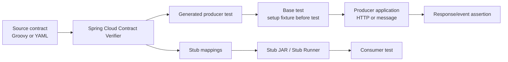
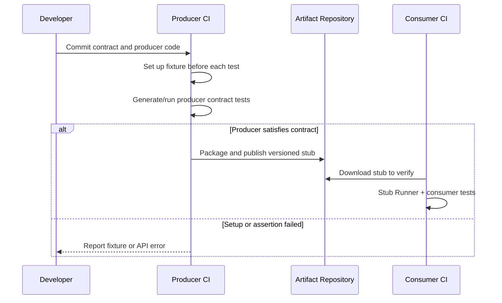

# Setting Up Producer State Before Each Interaction

## 1. What Is Producer State and Why Prepare It?

In **Spring Cloud Contract**, a contract defines the behavior that a **producer** commits to for a **consumer**: when receiving a specific HTTP request or message, how the producer must respond or emit a message. Contracts can be written in **Groovy DSL** or **YAML DSL**; from them, Spring Cloud Contract Verifier generates **producer-side tests** and **stubs**. The consumer uses **Stub Runner** for independent testing, while CI runs checks to detect breaking API changes.

Suppose the producer exposes an orders API:

```http
GET /api/orders/42
```

An expected response is:

```http
HTTP/1.1 200 OK
Content-Type: application/json

{"id":42,"state":"PAID","totalAmount":120000}
```

The producer can only return that result if, **before handling the request**, the test system has order ID `42` in the `PAID` state, or a dependency has been mocked to provide equivalent data. If the data does not exist, the test might receive `404`; if the order was modified by another test, the test might return `PENDING`. This is a **state preparation** error, not necessarily a contract or API logic bug.

In this lesson, **producer state** refers to the internal conditions of the producer and its dependencies before an interaction: database records, business state, mocked services, security principal, time, message queues, and required configuration. It is **distinct from HTTP status** such as `200`, `404`, or `409`: the HTTP status is the **observed result** after executing the interaction.

> Principle: **Every contract scenario must run from a deterministic input state that can be reset and does not depend on test execution order.**

## 2. Setting State Before Each Interaction: The Big Picture



There are two things that **must not be confused**:

1. **Describing the required state** in a scenario, such as "order 42 is paid, order 9999 does not exist."
2. **Actually creating that state** before the generated producer test runs: seeding the database, replacing a bean with a mock, building data in the base test, or triggering a controlled behavior.

The contract does not automatically generate database records from `response.body` content. If the DSL says `state: PAID`, the verifier knows it needs to **assert** the `PAID` value; it does not know which records your system must insert, which repository to use, or which dependency to mock to create that state.

In particular, **do not confuse this with Pact's provider state concept**. In the standard Spring Cloud Contract Verifier workflow, HTTP data setup is done through **the base test and the application's testing mechanisms**. Do not assume that simply adding an arbitrary `given: paid_order_exists` field to an HTTP contract will cause the verifier to automatically invoke a data setup function.

## 3. State and Response Matrix to Build First

An API often has multiple business states, leading to different error statuses. Build a matrix before writing the DSL:

| Scenario | State required **before request** | Request | Committed response |
|---|---|---|---|
| Paid order found | Order `42` exists, `state=PAID` | `GET /api/orders/42` | `200`, body has `id=42`, `state=PAID` |
| Not found | Order `9999` **does not exist** | `GET /api/orders/9999` | `404`, error code `ORDER_NOT_FOUND` |
| Invalid request data | No specific order needed; validation enabled | `POST /api/orders` with `quantity=0` | `400`, error code `INVALID_QUANTITY` |
| State conflict | Order `42` is already paid, cannot be paid again | `POST /api/orders/42/pay` | `409`, error code `ALREADY_PAID` |
| Forbidden | Principal lacks permission to read the requested order | `GET /api/orders/42` | `403` per application policy |
| Downstream system unavailable | Dependency simulated to fail in a controlled way | `GET /api/orders/42` | Error code/message per published policy |

This matrix matters:

- **`404`** does not prove the API handles "not found" properly if the test accidentally lacks data due to failed setup.
- **`409`** is only meaningful when the pre-request state genuinely creates a **business conflict**, not when the endpoint fails because a dependency is missing.
- **`400`** should arise from committed validation rules, not from an accidentally malformed body type if the scenario is testing `quantity=0`.
- **`401` and `403`** are not interchangeable: typically `401` relates to authentication and `403` relates to insufficient authorization. Security filters, principals, and authorization data must be prepared accordingly.

You do not need to put every scenario into a single contract. **One contract per observable behavior** is usually easier to understand and diagnose.

## 4. Defining HTTP Contracts with Success and Error States

### 4.1. Groovy DSL: Order Exists

Example file: `src/test/resources/contracts/orders/get-paid-order.groovy`.

```groovy
import org.springframework.cloud.contract.spec.Contract

Contract.make {
    description 'Order 42 has been paid'

    request {
        method GET()
        url '/api/orders/42'
        headers {
            header 'Accept', 'application/json'
        }
    }

    response {
        status OK()
        headers {
            contentType(applicationJson())
        }
        body(
            id: 42,
            state: 'PAID',
            totalAmount: 120000
        )
    }
}
```

For this generated test to pass, the producer must return matching data when ID `42` is called. The DSL does **not** specify how an order is stored; the data is set up in the test infrastructure as described in sections 5 and 6.

### 4.2. YAML DSL: Order Does Not Exist

Example file: `src/test/resources/contracts/orders/get-order-not-found.yml`.

```yaml
description: Non-existent order must return a stable error
request:
  method: GET
  url: /api/orders/9999
  headers:
    Accept: application/json
response:
  status: 404
  headers:
    Content-Type: application/json
  body:
    code: ORDER_NOT_FOUND
    message: Order does not exist
```

The input state for this scenario is **no record with ID `9999`**. If another test's fixture accidentally creates that record, the producer could return `200` and the test fails due to leaked test data. If the API returns `404` without `code`, the test must catch that as well, because the consumer might rely on the error code to display a message.

### 4.3. Groovy DSL: Business Conflict

For example, the API disallows paying an order that is already paid:

```groovy
import org.springframework.cloud.contract.spec.Contract

Contract.make {
    description 'Cannot pay an order that is already PAID again'

    request {
        method POST()
        url '/api/orders/42/pay'
    }

    response {
        status CONFLICT()
        headers {
            contentType(applicationJson())
        }
        body(
            code: 'ALREADY_PAID',
            message: 'Order has already been paid'
        )
    }
}
```

This is a scenario that **requires a specific input state**: order `42` must exist and already be `PAID`. If the order does not exist, the producer might return `404` according to another rule, which is **the wrong scenario** for the `409` test. Do not change the expected `409` to `404` just to make the test green; check the fixture first.

## 5. Base Test: Where State Is Prepared Before Each Generated Test

### 5.1. Test Inheritance Mechanism

With proper Spring Cloud Contract Verifier configuration, the generated test classes can **extend a base class** written by the development team. In a project using **JUnit 5**, a base class method annotated with `@BeforeEach` runs before **every inherited test method**, helping refresh state.

Layout:

```text
src/test/
├── java/com/example/orders/contract/
│   └── ContractVerifierBase.java     <-- code written by the team
└── resources/contracts/orders/
    ├── get-paid-order.groovy          <-- source contract
    ├── get-order-not-found.yml
    └── pay-already-paid.groovy

target/generated-test-sources/contracts/
└── ...                                <-- generated tests, do not edit manually
```

Depending on Maven/Gradle and the plugin version, the build output location may vary. What matters is that **the base class is configured correctly using its fully qualified name** and **the generated tests actually extend it**.

### 5.2. Base Class Example with Spring MVC and Mockito

Suppose the controller calls an `OrderQueryService` bean to read orders, and the application has `OrderView` along with `OrderNotFoundException`. We can replace this bean with a mock in the Spring test context:

```java
package com.example.orders.contract;

import com.example.orders.api.OrderView;
import com.example.orders.service.OrderNotFoundException;
import com.example.orders.service.OrderQueryService;
import io.restassured.module.mockmvc.RestAssuredMockMvc;
import org.junit.jupiter.api.BeforeEach;
import org.springframework.beans.factory.annotation.Autowired;
import org.springframework.boot.test.autoconfigure.web.servlet.AutoConfigureMockMvc;
import org.springframework.boot.test.context.SpringBootTest;
import org.springframework.test.context.bean.override.mockito.MockitoBean;
import org.springframework.web.context.WebApplicationContext;

import static org.mockito.Mockito.reset;
import static org.mockito.Mockito.when;

@SpringBootTest(webEnvironment = SpringBootTest.WebEnvironment.MOCK)
@AutoConfigureMockMvc
public abstract class ContractVerifierBase {

    @Autowired
    private WebApplicationContext context;

    @MockitoBean
    private OrderQueryService orderQueryService;

    @BeforeEach
    void beforeEachContract() {
        // Each generated test receives a known set of mock state.
        reset(orderQueryService);

        when(orderQueryService.findById(42L))
            .thenReturn(new OrderView(42L, "PAID", 120000L));

        when(orderQueryService.findById(9999L))
            .thenThrow(new OrderNotFoundException(9999L));

        RestAssuredMockMvc.webAppContextSetup(context);
    }
}
```

**Conditions for this example**:

1. This is a template for **Spring MVC + Rest Assured MockMvc + JUnit 5**. The Spring Cloud Contract plugin needs to use the corresponding test mode, such as `MOCKMVC`, and point to `com.example.orders.contract.ContractVerifierBase`.
2. `@MockitoBean` is an annotation from **Spring Framework 6.2+**. On older Spring Boot/Spring Framework stacks, the project can use Spring Boot's `@MockBean` according to the supported version. Do not mix examples with incompatible dependencies.
3. `OrderQueryService`, `OrderView`, and `OrderNotFoundException` are **illustrative application types**, not built-in Spring Cloud Contract classes; replace them with your project's actual method/type names.
4. The application must have a controller calling `findById` and an exception handler mapping `OrderNotFoundException` to **`404` with the committed body**. A mock throwing an exception does not define the error format on its own.
5. `reset(orderQueryService)` clears mock behavior before re-establishing it. In applications with multiple mocks, you must control the state of each mock/dependency; resetting a single bean does not isolate a database or message broker.

When running the generated test for `GET /api/orders/42`, the mock returns the `PAID` order. When the generated test calls `GET /api/orders/9999`, the mock throws the exception so the controller and exception handler produce the `404` response. The test verifies **the real API at the HTTP layer**, not just a Java method directly.

### 5.3. Do Different States Require Separate Base Classes?

**Not necessarily.** A single `@BeforeEach` can initialize **a consistent set of fixtures**: order `42` exists in `PAID` state, order `9999` does not exist, and the test user has read permission. The same dataset can serve multiple contracts as long as they do not conflict.

If scenario A requires order `42` to be `PAID` while scenario B requires **the same order `42` to be `PENDING`**, two more reasonable ways to organize this are:

- Use **different IDs** (for example `42` is `PAID`, `43` is `PENDING`) within the same fixture, if that does not distort business semantics.
- Split the contracts into **groups with separate base tests/fixtures**, using the plugin version's mechanism for mapping base classes by package or contract rule.

Do not make one contract depend on **a previous contract having run and modified the order**. JUnit does not guarantee an execution order for generated tests based on your business logic.

## 6. Using Database Fixtures When Multiple Real Layers Need Testing

Mocking services helps test HTTP mapping, serialization, and exception handlers within a controlled scope. However, if the goal also includes JPA queries, repositories, or transactions, a **real test database** may be needed instead of mocking the service layer.

### 6.1. Data Seeding Strategy per Test

Example SQL data:

```sql
-- Use only in a dedicated test database.
DELETE FROM order_items;
DELETE FROM orders;

INSERT INTO orders (id, state, total_amount)
VALUES (42, 'PAID', 120000);
```

In the test base class, Spring Test's `@Sql` can be used:

```java
import org.junit.jupiter.api.BeforeEach;
import org.springframework.beans.factory.annotation.Autowired;
import org.springframework.boot.test.autoconfigure.web.servlet.AutoConfigureMockMvc;
import org.springframework.boot.test.context.SpringBootTest;
import org.springframework.test.context.jdbc.Sql;
import org.springframework.web.context.WebApplicationContext;
import io.restassured.module.mockmvc.RestAssuredMockMvc;

@SpringBootTest(webEnvironment = SpringBootTest.WebEnvironment.MOCK)
@AutoConfigureMockMvc
@Sql(
    scripts = {
        "/contract-fixtures/clear-orders.sql",
        "/contract-fixtures/paid-order.sql"
    },
    executionPhase = Sql.ExecutionPhase.BEFORE_TEST_METHOD
)
public abstract class DbContractVerifierBase {

    @Autowired
    WebApplicationContext context;

    @BeforeEach
    void setupHttp() {
        RestAssuredMockMvc.webAppContextSetup(context);
    }
}
```

In this example, the two SQL files under `src/test/resources/contract-fixtures/` are **resources the project must create itself**, not files generated by Spring Cloud Contract. They must match the application's schema, foreign keys, and transaction policy.

### 6.2. Requirements for Stable Database Fixtures

- **Controlled cleanup:** delete in foreign-key dependency order, or use transaction rollback when it genuinely fits the test execution mode.
- **Deterministic primary keys:** use reproducible sample IDs like `42`; for auto-generated ID columns, configure sequences/identities according to the test database or use an appropriate fixture strategy.
- **No shared databases:** never run cleanup scripts against a production database or shared environment.
- **No execution-order reliance:** a `404` test must intentionally lack the data, even when run in isolation.
- **Check transaction boundaries:** HTTP calls through MockMvc and HTTP calls over a real port may have different transaction scopes; do not assume `@Transactional` on a test rolls back all side effects of a request executing on a different thread/connection.
- **Intentional parallel execution:** tests that `DELETE`/`INSERT` on the same tables can step on each other; use separate databases/schemas, fixture namespaces, or disable parallelism for that group.

If the data layer is within the scope being verified, do not mock the entire service just to make tests easier to run. Conversely, if you only want to protect the HTTP contract, a controlled mock typically reduces setup cost and fragility caused by database state.

## 7. Negative and Error States: Must Verify the Right Cause

Error responses often depend more heavily on input state than the happy path.

### 7.1. Not Found vs. Insufficient Permissions

For the same `GET /api/orders/42`, a producer might return:

- `200` if the order exists and the principal is allowed to view it.
- `403` if the principal is authenticated but lacks permission.
- `404` if the ID does not exist; or intentionally return `404` instead of `403` to avoid information disclosure, **if that is the published policy**.
- `401` if the request lacks valid authentication details according to the application's security mechanism.

The test must prepare **the principal, ownership, and data** together. If testing `403` without setting up a token/authorization, the response may be `401`, which does not accurately reflect the "authenticated but forbidden" scenario.

### 7.2. A `409` Error State Can Have Side Effects

For instance, `POST /api/orders/42/pay` must return `409` if the order is already `PAID`. However, the request might pass through a transaction or emit a message. When the `PAID` fixture is reused, also verify that the rejected request **does not create a new payment transaction**, if that is an important part of the commitment.

An HTTP contract usually only asserts the described request/response. To verify **no side effects**, you may need a separate integration test, repository/broker checks, or an appropriate assertion method in the base test. Do not assume a `409` status proves the entire system remained unchanged.

### 7.3. Dependency Failures Must Not Rely on Real Networks

If you want a contract to guard how the producer returns errors when the payment system is unavailable, make the dependency fail **in a controlled way**: mock exceptions, test containers with fault injection, or upstream HTTP stubbing according to project policy. Avoid disconnecting real networks or waiting for an external service to "happen" to fail, because tests will become flaky and hard to reproduce in CI.

## 8. Reproducibility per Interaction

### 8.1. Resetting State Is Not Just Clearing the Database

A producer can hold state in many places:

| State source | Example | Appropriate isolation |
|---|---|---|
| Database | Order `42`, ledger, session | Seed/cleanup, transaction, or dedicated test database |
| Bean/mock | Service returns `PAID`, exception thrown | Reset and re-stub before each test |
| Cache | Stale order lookup result | Clear cache or use an isolated cache instance |
| Clock | Token expiration time, payment timestamp | Inject a purposefully fixed `Clock` |
| Message broker | Event waiting in queue | Drain consumer records, use dedicated destination/group |
| Security context | Authenticated user/role | Set and clear principal between tests |
| Feature flag | API enables new error mode | Set explicitly, revert after test |
| Remote dependency | Upstream payment/tax | Stable stub/mock instead of external network |

Singleton resources, static caches, queued data, or shared mutable objects are common reasons why tests pass individually but fail when running the full suite.

### 8.2. Time and Dynamic Data

If an order can only be paid before a certain deadline, using the real wall clock can cause results to change by the minute or time zone. Inject `java.time.Clock` to set a fixed test time, then prepare data consistent with that clock.

For responses that generate a dynamic `requestId`, UUID, or timestamp, **do not force the response value to be static** if the consumer only cares about format. Use appropriate matchers in the DSL while keeping **concrete request fixtures** so the generated producer test can execute.

### 8.3. Test Ordering and Parallel Execution

Do not write "test creates order first, test reads order second" as two separate contracts and expect the tests to run in order automatically. That is a **stateful** business flow, not two independent tests. If you need to verify a sequence of interactions, write an integration test that executes all steps and manages state/cleanup; individual contracts should still have their own preconditions.

When running tests in parallel, prove that fixtures do not conflict. Be especially careful with scenarios sharing ID `42` and scripts that wipe entire tables.

## 9. Producer State in Messaging Tests

With messaging, an "interaction" does not necessarily start from an HTTP request. Spring Cloud Contract supports `input` and `outputMessage`, where `triggeredBy(...)` can instruct the generated test to **invoke a method** to trigger the producer to emit an event.

Example:

```groovy
import org.springframework.cloud.contract.spec.Contract

Contract.make {
    name 'shouldPublishOrderPaid'
    label 'order_paid'

    input {
        triggeredBy('publishOrderPaidForContract()')
    }

    outputMessage {
        sentTo('orders.paid')
        headers {
            header('eventType', 'OrderPaid')
        }
        body(
            orderId: 42,
            state: 'PAID'
        )
    }
}
```

`publishOrderPaidForContract()` is a **project-implemented method in the base test or a class callable by the generated test**, not a helper that Spring Cloud Contract generates to create orders. The method must perform the setup/command invocation so the producer emits the actual message.

Conceptual example in the base test:

```java
// Custom method that the generated test can call.
protected void publishOrderPaidForContract() {
    orderFixture.ensurePaidOrder(42L);
    orderEventPublisher.publishPaidEvent(42L);
}
```

For the generated test to capture and compare messages, you must also configure the **test binder/message verifier, destination, and application context** corresponding to your messaging technology. The calls `orderFixture` and `orderEventPublisher` are **illustrative application APIs** and do not exist out of the box in Spring Cloud Contract.

**Make a clear distinction:**

- `@BeforeEach` can create shared state before the test begins.
- `triggeredBy(...)` is the action that initiates the message flow inside the **test**, which may leverage the prepared state.
- Message stubs do not mean the producer backend must exist or a database is automatically built in the consumer test.

For asynchronous systems, control queue state and use conditional waiting mechanisms. Avoid relying on fixed `Thread.sleep(...)` calls to "wait long enough," which easily causes random failures in CI.

## 10. Does Stub Runner Set Up Producer State Automatically?

**No.** Stub Runner runs generated/published stubs so the consumer can test without calling the real producer. For HTTP contracts, WireMock typically matches requests against mappings and returns sample responses; it **does not call producer repositories** and **does not use the producer database**.

For example, when the consumer sends:

```http
GET /api/orders/42
```

The stub returns the sample body `{"id":42,"state":"PAID"}` according to the contract. There is no need to create order `42` in a real database. The "order is PAID" state on the **producer test** side must still be prepared to **verify the real code**, whereas on the **consumer stub test** side it is represented by a **stub mapping**.

### 10.1. Avoid Assuming Stubs Are a Real Stateful API

If the consumer sends sequentially:

```text
POST /api/orders           -> creates order 42
GET /api/orders/42         -> returns the newly created order
POST /api/orders/42/pay    -> changes PENDING to PAID
GET /api/orders/42         -> returns PAID
```

Standalone stubs **do not automatically record state transitions** after each request. To test stateful flows, you need WireMock scenarios/appropriate configuration or an integration test against the real producer; do not infer a state machine from four static contracts.

For typical consumer contract tests, scenarios can be split per endpoint to verify the branches the consumer relies on: success, not found, conflict, and validation error. Sample responses must stay consistent with the matched request; if a matcher allows multiple IDs while the body always returns ID `42`, the consumer may form incorrect expectations.

## 11. CI Workflow: State Must Be Reproducible on Every Machine



A useful pipeline should distinguish between **setup failures** and **compatibility failures**:

1. **Preflight test infrastructure:** test database/mocks/message destinations are available, migrations have completed, and clocks/feature flags are set.
2. **Producer verification:** generated tests are produced, executed, and verify status, headers, body, or messages against the contract.
3. **Stub packaging:** publish the artifact only when producer verification passes; assign a traceable version.
4. **Consumer verification:** Stub Runner downloads that artifact and consumer tests call the real client, checking error branches as well.
5. **Change review:** when changing `404` to `200`, removing `code`, or changing `409` to `422`, check whether existing consumers can handle it before accepting the contract update.

If you only update the contract to match the producer's new behavior without running consumer tests, CI might stay "green" even though existing consumers are broken. Conversely, if you only run the consumer against an old stub, the real producer may have changed without tests catching it.

## 12. Diagnosing Failed Generated Contract Tests

| Symptom | Possible Cause | Resolution |
|---|---|---|
| `200` scenario returns `404` | Order fixture not seeded, mock not stubbed for the right ID | Check `@BeforeEach`/`@Sql` and request ID |
| `404` scenario returns `200` | ID expected to be absent already has data | Isolate database, use dedicated IDs, and reset state |
| `409` scenario returns `404` | Order required to be in `PAID` state does not exist | Set up the proper precondition before the request |
| `403` scenario returns `401` | Principal unauthenticated, wrong security setup | Set up valid auth context/token lacking permission |
| `400` scenario returns `500` | Validation/exception handler not handling properly | Inspect code/handler and input data scenario |
| Passes alone, fails in full suite | Shared fixtures/mocks/cache, test ordering interference | Clean up before each test and check parallelism |
| Generated test misses setup | Wrong base class FQN, wrong test mode, or `@BeforeEach` not inherited | Verify verifier config and generated test |
| Messaging test misses event | Trigger method fails to emit message, broker/binder unconfigured | Check `triggeredBy`, destination, and test binder |
| Producer passes but consumer fails | New stub not run yet or consumer has unguarded expectations | Check artifact version and consumer assertions |
| Stub returns `PAID` on every request | Matcher too broad; static stub has no state machine | Split mappings per scenario, consider scenarios if needed |
| CI flaky by time of day | Real clock, timeouts, async messages, expired data | Fix clock, use conditional await, avoid fixed sleeps |

### 12.1. Effective Investigation Order

When a contract test fails, inspect in this order:

1. **What request/message did the test send?** Are the method, URL, query, body, headers, and identity correct?
2. **What was the actual state right before the interaction?** Did the order/DB/mock/principal match the matrix?
3. **What did the real producer return?** Status code, body, and exception logs.
4. **What does the contract commit to?** Only consider updating the contract if producer behavior matches the agreed API and the contract is wrong; if the API is broken, fix the code.
5. **Does the consumer depend on the old behavior?** If the change is breaking, do not "turn the build green" by unilaterally editing the contract while ignoring the consumer.

## 13. Hands-On Exercise: Preparing State for `200`, `404`, and `409`

**Context:** The producer `order-service` exposes order lookup and payment APIs; the consumer `checkout-service` needs to display success, not-found, and payment conflict states.

**Tasks:**

1. Create three source contracts: `get-paid-order.groovy`, `get-order-not-found.yml`, and `pay-already-paid.groovy` following the examples in section 4.
2. Choose a setup strategy: **mock `OrderQueryService`** if only guarding HTTP behavior, or **a dedicated test database** if repositories must be included.
3. Before **each** generated test, ensure order `42` is `PAID` and order `9999` does not exist. For the payment scenario, prepare the `pay` mock/logic to return `ALREADY_PAID`.
4. Run each generated test individually, then run the full suite. Change execution order or enable parallelism in a safe environment to test isolation if your project allows it.
5. Intentionally remove the order `42` fixture and run the `200` contract: confirm the failure is caused by **setup**, and do not edit the contract.
6. Restore the fixture, then intentionally change the producer from `state=PAID` to `PENDING`: confirm the test catches the **incompatible behavior**.
7. Generate/publish a versioned stub; use Stub Runner in consumer tests to verify the three corresponding display branches.
8. Try making the producer return `404` without `code=ORDER_NOT_FOUND`: the producer test should catch it if the contract includes that assertion.

**Self-Assessment Questions:**

- *Why is `response { status OK() }` not enough to create the order before the test?* — Because the DSL describes the **expected outcome**, not the logic to build databases/mocks.
- *Must every contract have its own base class?* — No. A shared fixture can be used if states do not conflict; split setup when scenarios require mutually exclusive conditions.
- *If a `404` contract passes because the test database is empty, does that prove the application returns the right business error?* — Not necessarily. You must ensure the request hits the right endpoint and the response has the committed error status and body.
- *Does Stub Runner alter state inside the real producer?* — No. Stubs simulate responses independently of the producer, unless you configure custom stateful scenarios in the stub.
- *Why shouldn't a `POST` test that creates data be required to run before `GET`?* — Because two independent generated tests should not rely on execution order and state left by one another.

## 14. Checklist Before Finishing Contract Testing

- [ ] Every scenario clearly describes its **input state**, matching the committed response.
- [ ] The base test is properly configured and setup actually runs before generated tests.
- [ ] Fixtures are reproducible locally and in CI; tests do not depend on order or shared environment data.
- [ ] Existence/non-existence, access permissions, and business conflicts are separated into meaningful scenarios.
- [ ] Error responses have status, content type, and error codes matching consumer needs.
- [ ] Mocks/databases/caches/clocks/brokers are reset or isolated as needed.
- [ ] No real credentials, real personal data, or production URLs are placed in fixtures.
- [ ] For message contracts, the trigger method and test binder/destination are properly configured.
- [ ] Understand that Stub Runner uses **stub responses** and does not set up producer state/databases automatically.
- [ ] Generated producer tests execute, versioned stub artifacts are produced, and consumer tests run in CI.
- [ ] When changing an API, consumer impact is evaluated instead of merely editing expected responses to make the build green.

**Key takeaway:** Spring Cloud Contract helps answer **"Does the producer fulfill its committed behavior?"**; for that answer to be reliable, generated tests must start from **accurate, explicit, and isolated state**. Preparing producer state before every interaction is the foundation for distinguishing data setup issues from API compatibility issues, especially in `404`, `409`, and messaging scenarios.
