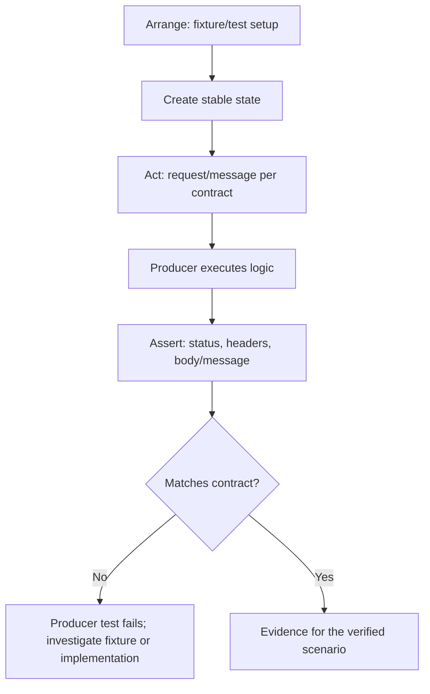
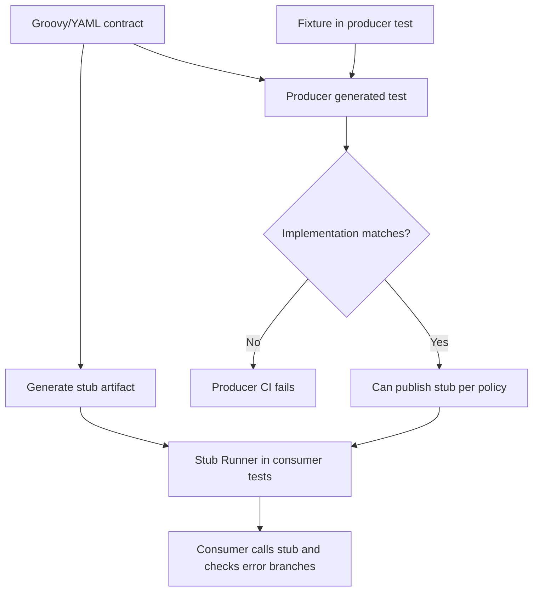

# Separating Data Preparation from Behavior Under Verification

## 1. Goal of Separating State and Expectations

In a multi-service system, the **producer** implements an API or emits messages; the **consumer** calls the API or receives messages. With **Spring Cloud Contract (SCC)**, both sides agree on HTTP/messaging behavior using **Groovy/YAML DSL**, generate producer-side tests, create stubs for the consumer via **Stub Runner**, and integrate into CI to detect incompatible API changes.

A `GET /api/orders/42` request only returns `200 OK` if the system state matches: order `42` exists and has the required data. A `GET /api/orders/9999` request may need to return `404 Not Found` if the order does not exist. A request confirming a `LOCKED` order may be designed to return `409 Conflict`. **The contract describes the observable outcome; the test fixture establishes the condition that makes that outcome meaningful.**

If the test environment does not yet have order `42`, the producer test may fail due to missing data even when the API logic is correct. Conversely, if the controller under test always returns `404` for every ID, the error-branch test may pass even though the producer does not actually check resource existence.

**After this lesson, learners can:**

- Distinguish **Arrange** (preparing data), **Act** (sending requests/triggering interactions), and **Assert** (verifying responses/messages).
- Design fixtures for success, not-found, and conflict branches without stuffing database details into the contract.
- Know how to use a base class/setup for generated producer tests in Spring Cloud Contract.
- Keep test data independent, reproducible, and free from test execution order dependencies.
- Distinguish producer test data from simulated stub behavior, then set up appropriate CI gates.

> **Principle:** The contract answers "what the consumer calls and what the producer must return"; the fixture answers "what state must exist before calling." The two answers are related but cannot replace each other.

## 2. Distinguishing Three Types of State

The word "state" is easily confused when talking about API errors:

| Concept | Example | Role |
|---|---|---|
| **Business state** | Order `PAID`, `LOCKED`, `CANCELLED` | Condition inside producer logic |
| **HTTP status** | `200`, `404`, `409` | Communication commitment observed by the consumer |
| **Test state** | Record `42` exists; `9999` does not; clock or permissions configured | Condition for generated tests to follow the right branch |

The `response.status: 409` field in YAML is an **HTTP code**. If the response has `body.status: LOCKED`, that is a **business field**; they are not synonymous. Similarly, there is no standard key named `given: orderExists` that you can arbitrarily add to YAML and expect SCC to automatically insert data into the database.

### Arrange – Act – Assert Workflow



In an SCC HTTP contract, `request` describes **Act** and `response` describes **Assert**. **Arrange** usually lives in the **base class (test base)** of generated tests, fixtures/test configuration, the test database, or dependency mocks.

Details such as the `orders` table name, SQL seed statements, repository classes, or how caches are reset should not leak into communication expectations unless they themselves are part of the API the consumer requires.

## 3. Running Example: Three Order Scenarios

Suppose `order-web` (consumer) uses `order-service` (producer). Both teams **propose** the following rules; they are not default Spring Cloud Contract behaviors:

| Scenario | State to build before test | Request | Result consumer needs |
|---|---|---|---|
| Paid order | Order `42` exists; `PAID`; `125000 VND` | `GET /api/orders/42` | `200`, order details |
| Order not found | Order `9999` **does not exist** | `GET /api/orders/9999` | `404`, `ORDER_NOT_FOUND` |
| Order locked | Order `43` exists; `LOCKED` | `POST /api/orders/43/confirm` | `409`, `ORDER_LOCKED` |

This matrix shows that a contract can only verify behavior when the corresponding fixture has been prepared. Do not pick ID `9999` as a "non-existent order" if another test might insert that ID into a shared database.

A consumer may also depend on `400`, `401`, `403`, `422`, or `503`. When needed, add dedicated scenarios and suitable test conditions; do not assume the three contracts in this lesson automatically cover all errors.

## 4. YAML Contracts: Describing Behavior Without Embedding Data Setup

### 4.1. Success Case: `200 OK`

Illustrative file `order-found.yml`:

```yaml
name: order_found
description: "Order 42 exists and is paid"
request:
  method: GET
  url: /api/orders/42
  headers:
    Accept: application/json
response:
  status: 200
  headers:
    Content-Type: application/json
  body:
    id: 42
    status: PAID
    totalAmount: 125000
    currency: VND
```

This contract **does not create** order `42`. The test base/fixture must put the producer into a state containing the corresponding order. `status: PAID` in the body carries business meaning, distinct from `status: 200` at the response level.

### 4.2. Not-Found Case: `404 Not Found`

Illustrative file `order-not-found.yml`:

```yaml
name: order_not_found
description: "Order 9999 does not exist in the test environment"
request:
  method: GET
  url: /api/orders/9999
response:
  status: 404
  headers:
    Content-Type: application/json
  body:
    code: ORDER_NOT_FOUND
    message: Order not found
```

This is a conditional expectation: **ID `9999` is absent** before the request. If the producer returns `200` because a record remained from another test, investigate **setup/cleanup** before editing the contract. If the fixture is right yet the producer still returns `200`, it may be a real implementation bug.

If the consumer only depends on `code`, consider whether `message` needs an exact match (message text may be localized). The contract should constrain strictly what the consumer needs and the team has committed to.

### 4.3. Conflict Case: `409 Conflict`

Illustrative file `order-locked.yml`:

```yaml
name: order_locked_cannot_confirm
description: "Order 43 is LOCKED so it cannot be confirmed"
request:
  method: POST
  url: /api/orders/43/confirm
response:
  status: 409
  headers:
    Content-Type: application/json
  body:
    code: ORDER_LOCKED
```

Before running the test, the fixture must ensure order `43` is **truly in the `LOCKED` state**. A mock that always returns `409` for every request can make this test pass while hiding logic bugs. If the consumer also needs the successful confirmation branch, the team must have a separate contract/test for that scenario.

**Important:** `409` and `ORDER_LOCKED` are design choices in the illustrative API. SCC does not automatically infer HTTP codes from domain state names.

### 4.4. Contracts Should Not Assume Stubs Know Database State

The contracts above use **requests distinguished by ID and path**. If two contracts have **overlapping request matchers but different responses**, the HTTP stub may not know which scenario to return. When simulating different states for the same request, design distinct requests or use an appropriate scenario/stateful stub mechanism. Never assume Stub Runner will query the producer's fixture database.

## 5. Placing Arrange in the Spring Cloud Contract Test Base

Spring Cloud Contract can generate producer tests extending a **base class** configured by the team. The base class is the right place to initialize the application, build fixtures, configure mocks, or set up the test mode. Spring Cloud Contract documentation describes the base test class as the place holding the information required for generated tests to run.

### 5.1. JUnit 5, Spring Boot, MockMvc Example

The following snippet is an **illustrative skeleton**. `OrderScenarioFixtures` is a component **implemented by the project itself**, not a built-in Spring Cloud Contract API; adjust package names, dependencies, repositories, and setup to match your project.

```java
package com.example.orders.contract;

import org.junit.jupiter.api.BeforeEach;
import org.springframework.beans.factory.annotation.Autowired;
import org.springframework.boot.test.context.SpringBootTest;
import org.springframework.web.context.WebApplicationContext;
import static io.restassured.module.mockmvc.RestAssuredMockMvc.webAppContextSetup;

@SpringBootTest
public abstract class ContractTestBase {
    @Autowired
    private WebApplicationContext applicationContext;

    @Autowired
    private OrderScenarioFixtures fixture;

    @BeforeEach
    void prepare() {
        fixture.resetOrdersForContracts();
        fixture.saveOrder(42L, "PAID", 125000L, "VND");
        fixture.saveOrder(43L, "LOCKED", 0L, "VND");
        fixture.ensureOrderAbsent(9999L);

        webAppContextSetup(applicationContext);
    }
}
```

With an appropriate **JUnit 5 and MockMvc test mode** setup, `@BeforeEach` runs before generated tests extending the base class. Data is rebuilt so the request takes the right branch. If the project uses JUnit 4/Spock, Rest Assured with a real server, WebTestClient, or messaging, the lifecycle and setup mechanisms must change according to the framework/version.

Do not call `deleteAll()` directly on a shared database. `resetOrdersForContracts()` must only be implemented in an **isolated test environment**, such as a dedicated test database/schema or container.

### 5.2. Linking the Base Class to the Maven Plugin

Core configuration snippet in `pom.xml`:

```xml
<build>
    <plugins>
        <plugin>
            <groupId>org.springframework.cloud</groupId>
            <artifactId>spring-cloud-contract-maven-plugin</artifactId>
            <version>YOUR_COMPATIBLE_SCC_VERSION</version>
            <extensions>true</extensions>
            <configuration>
                <baseClassForTests>
                    com.example.orders.contract.ContractTestBase
                </baseClassForTests>
            </configuration>
        </plugin>
    </plugins>
</build>
```

This is **not a complete POM**; the producer still needs plugin configuration, test mode, verifier dependencies, and versions compatible with Spring Boot/Spring Cloud. If using Gradle, the SCC plugin has equivalent base class configuration in Gradle DSL syntax. Verify that generated tests **actually extend this class** by inspecting the generated sources/test report.

### 5.3. Separating Fixture API from Assertions

An illustrative test fixture interface:

```java
interface OrderScenarioFixtures {
    void resetOrdersForContracts();
    void paidOrderExists(long id, long amount, String currency);
    void lockedOrderExists(long id);
    void orderDoesNotExist(long id);
}
```

These methods express **conditions**; they should not return `HttpResponse` or assert statuses themselves. Conversely, a `request/response` contract does not need to know which SQL the repository uses to store orders. Keeping the two responsibilities separate helps maintainers tell whether a failing test is due to **setup**, **implementation**, or **interface agreement**.

As the number of scenarios grows, fixtures can be split by group using the base-class mapping mechanisms supported by your plugin version. There is no need to put every fixture in the entire system into one giant `@BeforeEach` method.

## 6. Good Fixtures Must Be Reproducible and Order-Independent

A meaningful contract test relies not only on valid YAML syntax, but also on well-designed initial state.

| Property | How to achieve | Consequence if missing |
|---|---|---|
| **Deterministic** | Same setup always produces same scenario | Flaky pass/fail tests |
| **Isolated** | No sharing data that other tests may mutate | Results depend on execution order |
| **Minimal** | Only prepare essential data | Hard to pinpoint root cause of failure |
| **Explicit** | Fixture names convey business conditions | Unclear why `404` or `409` occurred |
| **Scoped** | Writes only to the test environment | Risk of deleting shared data by mistake |
| **Traceable** | Log ID/scenario and constructed state | Difficult to locate failures in CI |

### 6.1. Must Work Both Individually and as a Full Suite

Do not design test A to insert order `42` for test B to reuse. Generated tests may run in a different order, individually, or in parallel in CI.

Depending on your architecture, choose one of the following options:

- **Isolated test database:** build or clean up data before each test.
- **Transaction/rollback:** suitable when the test and request share the same transaction scope; actual behavior must be verified.
- **Testcontainers or dedicated schema:** useful when a real database is needed without interfering with other data.
- **Input-based dependency mocks:** suitable when only isolating the HTTP boundary while still verifying mapping logic.
- **Fixed fixture IDs:** easier to debug; scope strictly to tests to avoid ID collisions.

**Never** clean tables in production or in a shared database without isolation. The word "reset" in examples is a **test fixture responsibility**, not an instruction to delete data arbitrarily.

### 6.2. State Outside the Database Also Needs Preparation

An error test may depend on:

- **Clock:** order expires on a fixed date; avoid uncontrolled `Instant.now()`.
- **Principal and roles:** distinguish authentication `401` from authorization `403`.
- **Feature flags/config:** API has behavior branches driven by configuration.
- **Cache:** must stay synchronized or be cleared when fixtures modify records.
- **Downstream services:** simulate `503` responses or timeouts reliably without taking down the environment.
- **Rate limiter:** reset counters within the right scope to test `429`.

All of these conditions belong to **Arrange**. If response data such as `correlationId`, `ETag`, or error codes is part of the communication commitment, declare **what the consumer sees** in the contract, while keeping how that initial condition is created in fixtures/test setup.

## 7. Preparing Error Scenarios Without Breaking Contract Meaning

An API has many error types, each requiring different fixtures:

| Error consumer must distinguish | Suitable Arrange | Act/Assert in contract | Pitfall |
|---|---|---|---|
| `400 Bad Request` | Send invalid input per API rules | Status `400` and error schema | Trying to corrupt the database to trigger validation errors |
| `401 Unauthorized` | Missing/invalid credentials | Required status/challenge | Confusing with `403` |
| `403 Forbidden` | Authenticated user lacking permission | Status and error envelope | Fixture accidentally grants admin role |
| `404 Not Found` | Resource definitely does not exist | `404`, `ORDER_NOT_FOUND` | Leftover record from another test |
| `409 Conflict` | Resource/version in conflicting state | `409`, `ORDER_LOCKED` | Mock always returns `409` regardless of state |
| `422 Unprocessable Content` | Syntactically valid body violating agreed rules | `422` if API uses it | Lumping everything into `400` |
| `429 Too Many Requests` | Rate limiter at predefined threshold | `429` and `Retry-After` if needed | Counter affected by other tests |
| `503 Service Unavailable` | Downstream or service in controlled failure mode | `503` and committed details | Causing unstable failures over real networks |

The codes in the table are **common design examples**, not automatic SCC defaults chosen from input. For each API, producer and consumer must agree on codes, error bodies, required headers, and which branches deserve protection.

### 7.1. Anti-Pattern: Forcing the Controller to Throw Errors to Pass Tests

```java
// DO NOT DO THIS: illustration of a wrong approach.
// A test profile making every request fail.
if (contractTestProfile) {
    throw new OrderNotFoundException();
}
```

A generated test for `404` might pass, yet whether the producer distinguishes resource existence **remains unverified**. Let the controller flow through real handling branches with the corresponding conditional fixture. If a repository must be mocked, the mock should depend on the ID/condition under protection rather than failing unconditionally.

### 7.2. An Empty List Is Not Necessarily `404`

`GET /api/orders?status=PAID` may return `200` with `items: []` when the filter finds no items; `GET /api/orders/9999` may return `404` when a specific resource does not exist. Both mean "no orders" in data terms, yet **the request semantics differ**. Fixtures reproduce state; contracts protect the response the consumer genuinely expects.

### 7.3. Error Bodies Carry Different Meanings

If the consumer relies on `code: ORDER_LOCKED` to choose a message, include the code in the contract. The `message` field may vary by locale or presentation strategy, so enforcing an exact text match should be weighed carefully. Do not use a `.*` matcher for all error codes just to reduce test failures; doing so can hide changes that prevent the consumer from recognizing errors.

## 8. Transactions, Concurrency, and Test State Stability

### 8.1. `@Transactional` Does Not Solve Every Case

A generated test might invoke a controller via MockMvc, or send requests to a server running on another thread, while the service runs its own transaction. Therefore, `@Transactional` and test rollback **do not automatically guarantee** that all side effects, async events, or caches are restored.

Confirm the active test mode and how requests access the database; if needed, implement explicit cleanup or spin up a fresh database/container for tests. Avoid relying on rollback by default when a message broker, background jobs, or a real HTTP server are involved.

### 8.2. Parallel Execution Can Corrupt Shared Fixtures

Suppose test A deletes all orders and inserts `42`, while test B is checking locked order `43`. If both tests share a database and run concurrently, test B's data can be wiped mid-flight.

Suitable options depending on the project include:

- Dedicated database/schema/container per test group.
- Namespaced/isolated fixture IDs, avoiding whole-table cleanups on shared tables.
- Controlling parallelism when state cannot be isolated.
- Cleaning and recreating data per test scope rather than by execution order.

### 8.3. Random Data and Current Time

If fixtures generate arbitrary IDs while the contract hardcodes `GET /api/orders/42`, the test will not be reproducible. If the API returns the current timestamp, do not force a static timestamp string unless the clock is fixed; use appropriate matchers for dynamic fields when that reflects the real commitment.

**Fixed test values and dynamic production data do not conflict:** a fixture uses `42` to steer the request down a defined branch, which does not mean the producer only ever serves ID `42` in every environment.

## 9. Interpreting Producer Verification Results by Responsibility

Generated producer tests typically execute the request described by the DSL and match the declared status/headers/body. Conceptually, a not-found branch test looks like:

```java
// Pseudocode to explain responsibilities,
// NOT exact SCC generated code.
prepareFixtureWhereOrder9999DoesNotExist();
HttpResponse result = callGet("/api/orders/9999");
assert result.statusCode() == 404;
assert result.json("code").equals("ORDER_NOT_FOUND");
```

In practice, `prepareFixtureWhereOrder9999DoesNotExist()` lives in the **base class/lifecycle setup**, not inferred automatically by SCC from `response.status: 404`.

| Symptom | Potential Cause | Diagnostic Step |
|---|---|---|
| Test fails to start | Wrong base class/test mode, missing bean | Inspect generated source and test context |
| `GET /42` returns `404` | Order not seeded or producer bug | Check fixture and handling path |
| `GET /9999` returns `200` | ID still exists or wrong error branch | Check pre-request state |
| `POST /43/confirm` returns `200` | Order not LOCKED or wrong conflict logic | Check fixture, then implementation |
| HTTP right, error code wrong | Producer changed error schema | Check body and consumer requirements |
| Passes alone, fails together | Tests share data/cache | Check cleanup, ordering, parallelism |
| Passes locally, fails in CI | Different profile, DB seed, timezone/config | Ensure reproducible test environment |
| Contract tests not running | Skipped or plugin/lifecycle missing | Check build log and test report |

When a test fails, **do not edit the contract to turn it green before finding the root cause**. If the fixture is wrong, fix the fixture. If the producer violates the agreed interface, fix the implementation. If the team **intentionally changes the API**, review it with the consumer, update the contract, and plan compatibility/versioning.

## 10. Consumer Tests with Stub Runner Do Not Use Producer Fixtures

Here is a boundary to remember:

- **Producer verification** runs tests against the **real producer in a test environment**, so databases, mocks, clocks, permissions, and relevant conditions must be prepared.
- **Consumer tests** run against **stubs** simulating APIs/messages generated from contracts. Stub Runner typically loads pre-built mappings and does not access the producer's fixture database.



For example, a stub can respond to `GET /api/orders/9999` with `404` even if a newer producer build accidentally returns `200`. **A passing consumer test does not prove the real producer is behaving properly.** You must run producer tests on the exact commit/artifact intended for release and manage stub versions to avoid drawing conclusions from stale simulations.

If two contracts exist for **the exact same request** yet require different responses due to different underlying states, redesign the mapping/stub scenario. A stub cannot inspect the producer database to choose a response. In basic usage, distinct IDs/paths per scenario help avoid overlapping mappings.

### Messaging Also Needs Separated State

With message contracts, preconditions such as "the order was paid before emitting the event" belong in the producer test's setup/trigger; the payload fields, headers, destination, and conditions the consumer requires belong in the contract. Broker configuration, retries, delivery ordering, duplicate delivery, and transaction/outbox semantics require additional test layers. Do not treat message stubs as proof that the production broker always delivers reliably.

## 11. Integrating CI Without Masking Interface Drift

A useful workflow:

1. **Review contracts:** consumer and producer agree on request/response for each success and error state.
2. **Create an isolated test environment:** database or mocks are reset, seeding the exact listed fixtures.
3. **Generate producer tests:** Maven/Gradle plugin reads Groovy/YAML DSL.
4. **Run generated tests:** the test base sets up conditions, tests send requests and verify HTTP/messages. Failures must fail the CI job.
5. **Investigate failures at the right layer:** separate bad fixtures from contract-violating implementations; never ignore failing tests.
6. **Publish versioned stubs:** tied to verified contracts and producer builds per project policy.
7. **Run consumer tests with Stub Runner:** load the right stub version, invoke requests, and verify handling of `200`, `404`, and `409`.
8. **Keep supplementary test layers:** integration/database, business, security, and resilience tests to cover things beyond contracts.

A pipeline that only **generates** tests or stubs without **executing** tests, or releases a different artifact from the one verified, provides no reliable compatibility evidence.

## 12. Common Mistakes When Mixing Data and Expectations

| Mistake | Consequence | Fix |
|---|---|---|
| Adding arbitrary `given: orderExists` in YAML | Tool does not seed data automatically | Put setup in fixture/test base |
| One test depends on a record created by another | Order-dependent flaky tests | Prepare independently before each test |
| Mock always returns `404` regardless of ID | Fails to verify non-existence condition | Mock by input or use test DB |
| Wiping a shared database before each test | Causes race conditions and data loss | Isolate database/schema/fixtures |
| Assuming `@Transactional` rolls back every request/event | Side effects persist, hard to reproduce | Check transaction boundaries, cleanup |
| Confusing `body.status: LOCKED` with `response.status: 409` | Fails to guard the right HTTP status | Read at the right data level |
| Asserting only `404`, ignoring error `code` | Consumer may branch incorrectly | Assert stable error codes too |
| Assuming empty list must return `404` | Wrong collection API semantics | Distinguish collection vs. resource ID requests |
| Two stub mappings share request with different responses | Stub struggles to pick right branch | Separate requests or define clear scenarios |
| Consumer tests use old stub and claim new producer is fine | Misses implementation regressions | Run producer verification on the right build |
| Editing YAML for green CI while setup is broken | Legalizes broken interfaces | Fix fixtures first, review API when needed |

## 13. Exercise: Separating Fixtures and Error Contracts for Payments

**Context:** `invoice-service` calls `payment-service` via `POST /api/payments/{paymentId}/capture`. Both sides propose these scenarios:

- `PAY-101` in `AUTHORIZED` state: capture succeeds, HTTP `200`, body `state: CAPTURED`.
- `PAY-999` does not exist: HTTP `404`, `code: PAYMENT_NOT_FOUND`.
- `PAY-202` is already `CAPTURED`: duplicate capture is rejected, HTTP `409`, `code: ALREADY_CAPTURED`.

**Practice tasks:**

1. Build an Arrange – Act – Assert table for the three scenarios.
2. Write three separate YAML contracts for `200`, `404`, and `409`.
3. Propose fixture APIs `authorizedPaymentExists`, `capturedPaymentExists`, and `paymentDoesNotExist`; explain why these methods should not assert HTTP.
4. Describe how to reset the test database/mocks so tests run independently.
5. Identify what evidence producer verification and consumer tests with Stub Runner provide.
6. Design an additional integration/business test to confirm **a transaction is never captured twice**, since a single status contract does not prove absence of side effects.

**Conflict contract hint:**

```yaml
name: payment_already_captured
description: "PAY-202 is already CAPTURED; re-capture is rejected"
request:
  method: POST
  url: /api/payments/PAY-202/capture
response:
  status: 409
  headers:
    Content-Type: application/json
  body:
    code: ALREADY_CAPTURED
```

**Comparison table hint:**

| Contract | Arrange | Act | Assert |
|---|---|---|---|
| `payment_capture_success` | `PAY-101` exists, `AUTHORIZED` | `POST /api/payments/PAY-101/capture` | `200`, `state: CAPTURED` |
| `payment_not_found` | `PAY-999` absent | `POST /api/payments/PAY-999/capture` | `404`, `PAYMENT_NOT_FOUND` |
| `payment_already_captured` | `PAY-202` exists, `CAPTURED` | `POST /api/payments/PAY-202/capture` | `409`, `ALREADY_CAPTURED` |

A test that returns `409` properly yet still calls downstream capture a second time shows **separate side-effect testing is required**; correct business behavior cannot be inferred from the response alone.

## 14. Checklist Before Review and Release

- [ ] Every contract has clear assumptions about its **initial state**.
- [ ] The DSL describes the **request/response/message** the consumer actually needs; fixtures live in test setup.
- [ ] The base class for generated tests runs properly with the configured JUnit/Spock/test mode.
- [ ] Data is reset or isolated between tests without depending on order.
- [ ] Test DB/mocks/caches/clocks/roles/feature flags are controlled within a safe scope.
- [ ] Status, headers, and error codes are asserted according to consumer commitments.
- [ ] No hardcoded controller bypasses logic just to make contract tests pass.
- [ ] Generated producer tests are **generated and executed**, and failures fail CI.
- [ ] Stubs have no unresolved overlapping mappings.
- [ ] Consumer tests via Stub Runner verify client behavior against the right stub version.
- [ ] Intentional API changes are reviewed and tested against supported consumer versions.
- [ ] Supplementary integration/security/business tests exist for side effects and out-of-contract risks.

## 15. Takeaways and References

**Separating data preparation from behavior under verification** makes contracts easy to review, producer tests reproducible, and CI reports trustworthy. Spring Cloud Contract describes the HTTP/message interface via Groovy/YAML DSL; **test bases and fixtures** create the conditions for the producer to take the right branch; **generated tests** verify the implementation; **stubs and Stub Runner** let consumers test simulated behavior. The two testing branches complement each other rather than replacing one another.

A PASS result is only meaningful for the request, fixture, assertions, and version that were executed. It does not by itself prove the entire business logic, database transactions, brokers, every consumer, or production are correct. Build CI in a traceable chain and use supplementary tests for what contracts do not cover.

Official documentation to reference by Spring Cloud Contract version:

- [Spring Cloud Contract — First Application: base test class configuration](https://docs.spring.io/spring-cloud-contract/reference/getting-started/first-application.html).
- [Spring Cloud Contract — HTTP Contracts: request and response](https://docs.spring.io/spring-cloud-contract/reference/project-features-contract/http.html).
- [Spring Cloud Contract — Dynamic Properties](https://docs.spring.io/spring-cloud-contract/reference/project-features-contract/dsl-dynamic-properties.html).
- [Spring Cloud Contract — Stub Runner Core](https://docs.spring.io/spring-cloud-contract/reference/project-features-stubrunner/stub-runner-core.html).


