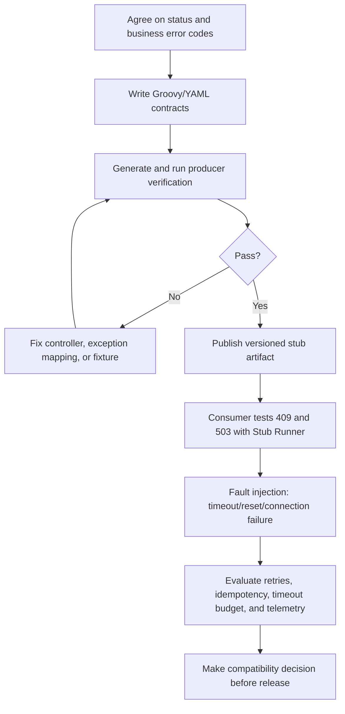

# Distinguishing Business Errors from Connection or Infrastructure Errors

## 1. Why Categorize Errors When Designing Contracts?

In a microservices system, `checkout-service` (consumer) calls `payment-service` (producer) to capture payment for an order. When the operation does not succeed, the consumer needs to know **the cause and the next action**. A capture command rejected because the payment is in a disallowed state is completely different from a command failing due to lost connectivity to Payment. Both scenarios might cause the UI to display "Unable to complete payment," yet their handling, retries, logging, and reconciliation must not be the same.

**Spring Cloud Contract** lets you define HTTP or messaging behavior using **Groovy/YAML DSL**, generate producer verification tests, and publish stubs. The consumer uses **Stub Runner** to test the client without starting the real producer; CI runs producer verification and consumer tests to detect incompatible API changes. However, an HTTP contract only describes interactions **with a defined request and response**. It does not automatically verify all cases of network drops, broker outages, or requests that were processed while the response was lost.

This lesson focuses on three outcomes that must be kept separate:

1. **Business error / intentional rejection:** the producer receives and processes the request, yet a business rule prevents completion. Typically has an HTTP response and a stable error code for the consumer.
2. **Server or infrastructure error represented via HTTP:** the producer, gateway, or proxy still returns **an HTTP response**, such as `503 Service Unavailable` or `504 Gateway Timeout`.
3. **Connection / transport failure with no HTTP response:** the consumer receives no valid status and body, such as DNS resolution failure, connection refused, TLS handshake failure, or read timeout.

**Learning outcomes:** after this lesson, you will be able to design contracts for business errors and infrastructure HTTP errors, test consumer branching on status and error code, distinguish safe retries from dangerous retries, and place fault injection in a dedicated test layer instead of pretending every timeout produces status `504`.

## 2. Same Word "Error," Different Meanings

| Aspect | Business Error | Server/Infrastructure HTTP Error | Transport Failure Without Response |
| --- | --- | --- | --- |
| What happened? | Request reached producer; application rules rejected or could not fulfill it. | An HTTP component returned an error status because it could not carry out the request. | Client did not receive a complete HTTP response. |
| Example | Payment is `REJECTED`, so it cannot be captured. | Payment temporarily stops accepting requests, returning `503`. | TCP connection refused, TLS error, read timeout. |
| HTTP status? | **Yes**, per agreed API, e.g., `409`/`422`. | **Yes**, e.g., `500`, `502`, `503`, `504`. | **No status received**; an exception or timeout occurs on the client. |
| JSON error body? | Usually includes an error code and enough info for the consumer to act. | May include stable error JSON; gateways do not always follow the same schema. | **Cannot** expect a JSON body from that request. |
| Retry immediately? | Typically **no**, unless business state changes or policy states otherwise. | Only when safe and per retry/budget policy; do not assume every `5xx` should retry. | Requires great care: the request may have executed before the connection dropped. |
| Handling approach | Report corrective action; update order state; do not treat as a network outage. | Monitor availability, backoff, circuit breaker, reconcile state when needed. | Classify timeout/connect errors, log telemetry, reconcile before replaying operations with side effects. |
| Suitable tests | Spring Cloud Contract HTTP contract + consumer test with stub. | HTTP contract for the **committed response**; add tests for error-triggering logic. | Fault injection/network tests at client/integration layer, beyond a normal request/response contract pair. |

**Do not infer "all `4xx` are business errors, all `5xx` are infrastructure errors."** `400` can be malformed request syntax; `401/403` relate to authentication/authorization; `429` reflects rate limiting; `500` can be a coding bug in the producer rather than a network issue. Categorize by **API semantics and failure origin** first, then pick the appropriate status.

## 3. Choosing HTTP Statuses on Sound Grounds

The codes below have standard meanings in HTTP, yet **they are not a mandatory mapping table for every business domain**:

| Status | HTTP Meaning | When It May Appear in a Payment API |
| --- | --- | --- |
| `400 Bad Request` | Request invalid as interpreted by the server. | Malformed JSON or format violations the API treats as bad request. |
| `401 Unauthorized` | Missing or invalid authentication credentials. | Missing/expired token, per the API's authentication mechanism. |
| `403 Forbidden` | Server understands request but refuses authorization. | Account lacks permission to capture that payment. |
| `404 Not Found` | Target resource not found/disclosed. | Payment ID does not exist, or policy hides the resource. |
| `409 Conflict` | Request conflicts with **current state of the resource**. | Payment is `REJECTED` and cannot transition to `CAPTURED`. |
| `422 Unprocessable Content` | Content has valid syntax and media type, but instructions inside cannot be processed. | Amount violates business rules; `422` chosen when that is the API convention. |
| `429 Too Many Requests` | Request is rate limited. | Consumer exceeded API quota. |
| `500 Internal Server Error` | Server encountered an unexpected failure. | Bug or unmapped exception. |
| `502 Bad Gateway` | Gateway/proxy received an invalid response from upstream. | API gateway received a bad response from Payment service. |
| `503 Service Unavailable` | Server temporarily unable to process, often due to overload/maintenance. | Payment returns `503` when unavailable per service policy. |
| `504 Gateway Timeout` | Gateway/proxy did not receive a timely upstream response. | API gateway waited on Payment beyond allowed timeout. |

**Main example in this lesson:** the Payment team agrees to return `409` when capturing a transaction in the `REJECTED` state. This is a **specific rule of the hypothetical API**, not a requirement that every declined payment must use `409`. Another system might return `200` with business status `DECLINED` or use another convention, provided both sides agree and test the exact commitment.

For `503`, RFC 9110 allows the server to send `Retry-After` to suggest a wait interval. It **does not guarantee** that repeating the request will be safe or successful. `504` carries the semantics of a gateway/proxy timing out while waiting on upstream; a timeout detected directly by the consumer when calling the producer **does not automatically synthesize a `504` HTTP response**. <https://www.rfc-editor.org/rfc/rfc9110.html>

## 4. Designing a Stable Business Error Code

Suppose Checkout sends a capture command:

```http
POST /api/payments/PAY-2002/capture HTTP/1.1
Content-Type: application/json
Idempotency-Key: CAP-ORD-2002-01

{"amount":250000,"currency":"VND"}
```

In the fixture, transaction `PAY-2002` is in the `REJECTED` state, so it is ineligible for capture. The producer received the request and **actively responded**:

```http
HTTP/1.1 409 Conflict
Content-Type: application/json

{
  "error": {
    "code": "PAYMENT_NOT_CAPTURABLE",
    "message": "Payment is not eligible for capture",
    "paymentId": "PAY-2002",
    "retryable": false
  }
}
```

Each field has a distinct role:

- **HTTP `409`:** indicates the request conflicts with current state.
- **`error.code`:** machine-readable code, more durable than prose wording. Consumers can branch on this code.
- **`error.message`:** description for human readers or logs; should not drive logic because it may change or be localized.
- **`error.paymentId`:** helps confirm the error belongs to the requested transaction.
- **`error.retryable = false`:** hint per **API policy**, not a property defined by HTTP; consumers should not automatically retry just because the status is non-`2xx`.

In this case, the consumer should display or record why capture could not proceed, stop automatically retrying the exact same request, and only allow another action if the business workflow provides a path. Do not turn `PAYMENT_NOT_CAPTURABLE` into "Gateway did not respond."

### Rules for a Useful Error Schema

1. Include a **stable error code** named after the business cause, such as `PAYMENT_NOT_CAPTURABLE`.
2. Never require the consumer to parse free-form `message` text for branching.
3. Keep fields and data types consistent across responses in the same error family; distinguish required vs. optional fields.
4. Avoid leaking SQL, stack traces, tokens, internal endpoints, or sensitive customer IDs in public payloads.
5. If the API uses **Problem Details** (`application/problem+json` per RFC 9457), follow that format consistently. Do not mix the custom structure in this example with Problem Details without an explicit design decision.
6. Only promise `retryable` if teams agree on its meaning and the safety preconditions for retrying.

## 5. Groovy DSL: Contract for a Business Error

Example `payment-service` contract for the `REJECTED` transaction case:

```groovy
import org.springframework.cloud.contract.spec.Contract

Contract.make {
    name 'capture_payment_rejected_by_state'
    description 'Cannot capture a payment in REJECTED state'

    request {
        method 'POST'
        urlPath '/api/payments/PAY-2002/capture'
        headers {
            contentType(applicationJson())
            header('Idempotency-Key', 'CAP-ORD-2002-01')
        }
        body([
            amount: 250000,
            currency: 'VND'
        ])
    }

    response {
        status 409
        headers {
            contentType(applicationJson())
        }
        body([
            error: [
                code: 'PAYMENT_NOT_CAPTURABLE',
                message: 'Payment is not eligible for capture',
                paymentId: 'PAY-2002',
                retryable: false
            ]
        ])
    }
}
```

Generated **producer verification** sends the sample request to the producer and verifies the described status, headers, and JSON response. For this test to be meaningful, the fixture must ensure `PAY-2002` is genuinely in the `REJECTED` state; the contract **does not automatically create** that transaction in the database.

The **stub** generated from the contract simulates that exact `409` response for matching requests. Checkout can verify that its client code **does not treat a business error as a connectivity failure** and does not confirm the order when receiving `PAYMENT_NOT_CAPTURABLE`.

### Equivalent YAML DSL

```yaml
description: Cannot capture a payment in REJECTED state
name: capture_payment_rejected_by_state
request:
  method: POST
  urlPath: /api/payments/PAY-2002/capture
  headers:
    Content-Type: application/json
    Idempotency-Key: CAP-ORD-2002-01
  body:
    amount: 250000
    currency: VND
response:
  status: 409
  headers:
    Content-Type: application/json
  body:
    error:
      code: PAYMENT_NOT_CAPTURABLE
      message: Payment is not eligible for capture
      paymentId: PAY-2002
      retryable: false
```

Both snippets describe **the same interaction**; do not keep both as duplicate contracts in the repository. Choosing Groovy or YAML does not change the error semantics or how the consumer must handle it.

## 6. How Does an Infrastructure Error **with an HTTP Response** Differ?

Another scenario: Payment receives a capture command yet is temporarily unavailable to process it due to insufficient internal resources or maintenance mode. The design team **explicitly specifies** mapping this case to HTTP `503`:

```http
POST /api/payments/PAY-9003/capture HTTP/1.1
Content-Type: application/json
Idempotency-Key: CAP-ORD-9003-01

{"amount":250000,"currency":"VND"}
```

Response:

```http
HTTP/1.1 503 Service Unavailable
Content-Type: application/json
Retry-After: 3

{
  "error": {
    "code": "PAYMENT_SERVICE_UNAVAILABLE",
    "message": "Payment processing is temporarily unavailable",
    "paymentId": "PAY-9003",
    "retryable": true
  }
}
```

The response above is still a **complete HTTP response**: the consumer receives status `503`, headers, and a JSON body. It is not like a `RestTemplate` call throwing `ResourceAccessException` because a socket could not be opened.

**Distinguish what both sides can commit to:** if `503` and the error schema are stable behaviors **generated by the producer itself** under defined conditions, an HTTP contract can verify them. If an API gateway produces `502`/`504`, contract tests for the Payment controller alone do not necessarily cover responses produced by the gateway; test at the responsible component.

### Groovy DSL for a Committed `503` Response

```groovy
import org.springframework.cloud.contract.spec.Contract

Contract.make {
    name 'capture_payment_temporarily_unavailable'
    description 'Service temporarily rejects capture commands'

    request {
        method 'POST'
        urlPath '/api/payments/PAY-9003/capture'
        headers {
            contentType(applicationJson())
            header('Idempotency-Key', 'CAP-ORD-9003-01')
        }
        body([
            amount: 250000,
            currency: 'VND'
        ])
    }

    response {
        status 503
        headers {
            contentType(applicationJson())
            header('Retry-After', '3')
        }
        body([
            error: [
                code: 'PAYMENT_SERVICE_UNAVAILABLE',
                message: 'Payment processing is temporarily unavailable',
                paymentId: 'PAY-9003',
                retryable: true
            ]
        ])
    }
}
```

Here `Retry-After: 3` is a **fixed fixture value** for repeatable tests, not a rule that production must retry after exactly 3 seconds. On a live system, the header may be a delay in seconds or an HTTP date per standard. If the producer provides a dynamic value, an appropriate matcher can be used, though not relaxed so far as to accept malformed headers.

### Equivalent YAML DSL

```yaml
description: Service temporarily rejects capture commands
name: capture_payment_temporarily_unavailable
request:
  method: POST
  urlPath: /api/payments/PAY-9003/capture
  headers:
    Content-Type: application/json
    Idempotency-Key: CAP-ORD-9003-01
  body:
    amount: 250000
    currency: VND
response:
  status: 503
  headers:
    Content-Type: application/json
    Retry-After: "3"
  body:
    error:
      code: PAYMENT_SERVICE_UNAVAILABLE
      message: Payment processing is temporarily unavailable
      paymentId: PAY-9003
      retryable: true
```

For producer verification to pass on this contract, the test must **actively put the application into a temporarily unavailable condition**, such as a fake `PaymentAvailability` returning `UNAVAILABLE`. Without setting up that state, the producer could complete the capture and return `200`, rightly failing the `503` contract. When publishing the stub, consumers must understand this is **a conditional error scenario**, not a random response for every request.

**Do not use a `503` contract as a substitute for testing process crashes, DNS failures, or network timeouts.** Those cases must be reproduced at the appropriate transport layer.

## 7. Connection Failures or Timeouts: No Status to Match

Put three outcomes side by side:

```text
A. Producer receives POST, returns HTTP 409 + JSON PAYMENT_NOT_CAPTURABLE
   -> Client gets an HTTP response; this is a business rejection.

B. Producer receives POST, returns HTTP 503 + JSON SERVICE_UNAVAILABLE
   -> Client gets a server error HTTP response, possibly with Retry-After.

C. Client sends POST, but TCP is refused / socket drops / read timeout
   -> Client receives no complete HTTP response.
   -> Must NOT conclude that HTTP status = 503 or 504.
```

Common failures in case C:

| Failure | Example | What the Consumer Knows for Certain |
| --- | --- | --- |
| **DNS resolution failure** | Unable to resolve `payment-service`. | Connection to intended destination could not be established. |
| **Connection refused** | No process listening on host:port. | Could not connect to target process. |
| **Connect timeout** | Connection not established within deadline. | No HTTP response from that connection attempt. |
| **TLS handshake failure** | Untrusted certificate or TLS negotiation error. | Secure channel was not fully established. |
| **Read timeout** | Request may have been sent, but response did not arrive in time. | **Uncertain** whether producer finished processing. |
| **Connection reset / closed early** | Socket closed mid-send/receive. | Business outcome may be unknown if request reached producer. |

This is especially critical for payment creation/capture operations: on a **read timeout**, the producer may have already captured funds while the response was lost in transit. If Checkout immediately replays the POST as a new request, the system risks double-charging. Therefore, **a timeout is not proof that the transaction failed**.

### Why Not Simulate Timeouts with an HTTP `504` Contract?

A contract with `response { status 504 }` describes **a server/gateway that returned HTTP 504**. It does **not** reproduce a call that received no status, no headers, and no body. If the consumer only tests with a `504` stub, you have still not tested the Java code path handling `SocketTimeoutException` or `ResourceAccessException`.

Connection/timeout errors should be tested using controlled **fault injection**: an HTTP test server actively resetting connections, intentionally responding slower than the read timeout, or simulating errors in a client transport adapter. Depending on the library, you can use WireMock faults/delays, a local test server, or a fake transport throwing exceptions. Run these tests in a dedicated integration/client-reliability layer alongside Spring Cloud Contract tests for committed HTTP responses.

## 8. How Does a Spring Client Branch on Errors?

With `RestTemplate` and its default error handler, HTTP `4xx/5xx` responses are typically represented by exceptions in the `HttpStatusCodeException` family, while many I/O failures when sending requests are wrapped in `ResourceAccessException`. With `WebClient`, corresponding types include `WebClientResponseException` (an error status was received) and `WebClientRequestException` (failure while executing the request). If custom handlers are configured, behavior may differ; verify your actual client.

The following Java pseudocode illustrates **classification only**, not a complete runnable class:

```java
try {
    PaymentResult result = paymentClient.capture(
        "PAY-2002", "CAP-ORD-2002-01", 250000L, "VND"
    );
    return handleSuccess(result);

} catch (HttpStatusCodeException ex) {
    int status = ex.getStatusCode().value();

    if (status == 409) {
        // Parse error.code per API schema and take business branch.
        return handleBusinessConflict(ex.getResponseBodyAsString());
    }

    if (status == 503) {
        // Server responded; inspect Retry-After, idempotency, and policy.
        return handleTemporaryUnavailability(ex);
    }

    // Do not collapse every HTTP error into the exact same message.
    return handleOtherHttpError(status);

} catch (ResourceAccessException ex) {
    // No reliable HTTP response; POST outcome may be unknown.
    return markPaymentOutcomeUnknownAndReconcile(ex);
}
```

This illustration assumes `paymentClient` is built with `RestTemplate` and has application-provided `handle...` methods. **Never** catch all exceptions and blindly return `false` as if the bank certainly declined. With any HTTP library, preserve the distinction:

1. HTTP response received with a stable business error code.
2. HTTP response received, yet producer/gateway reports unavailability.
3. No HTTP response received; transaction outcome may be **undetermined**.

The consumer can use explicit result enums/types such as `BUSINESS_REJECTED`, `TEMPORARILY_UNAVAILABLE`, and `UNKNOWN_OUTCOME` instead of a generic `success=false` boolean for every case.

## 9. Retries, Idempotency, and "Unknown" State

**Retries** can help with transient failures, yet can also cause duplicate side effects. Decide based on **HTTP method, idempotency, error type, and actual state**, never simply "retry on any `5xx`."

### 9.1. Three Principles

**Principle 1 — Business errors do not disappear when sending the exact same request again.** When `PAY-2002` is `REJECTED`, resending the capture command with the same body does not make it `AUTHORIZED`. Fix the state or choose an allowed workflow rather than retrying endlessly.

**Principle 2 — Receiving `503` or `Retry-After` does not mean POST can be replayed arbitrarily.** `Retry-After` suggests a delay; the consumer must have a retry policy, attempt limits, a timeout budget, and a mechanism to prevent duplicate side effects. APIs supporting safe retries typically use an **idempotency key** and persist the result per key, though actual implementation must be verified.

**Principle 3 — No response means an unknown outcome.** For payment capture, reconcile via a reliable status-lookup API or reuse the exact same idempotency key per API convention to avoid creating a new transaction. If no deterministic mechanism exists, mark `UNKNOWN_OUTCOME` and follow business resolution procedures rather than claiming "it failed."

### 9.2. Simple Decision Matrix

| Call Outcome | Should Retry? | Preferred Action |
| --- | --- | --- |
| `409 PAYMENT_NOT_CAPTURABLE` | Not under the same conditions. | Adjust workflow or report inability to capture. |
| `422` business validation | Not without changing the request. | Correct invalid input data. |
| `429` rate limited | Only per policy/quota; respect `Retry-After`. | Reduce rate, bounded backoff. |
| `503` with HTTP response | Possibly **if safe** and service conditions permit. | Retry per policy with backoff/jitter, idempotency, and deadline. |
| `504` from gateway | Worth evaluating, though upstream outcome is uncertain. | Reconcile and ensure replay safety. |
| Read timeout on POST | **Do not retry blindly**. | Check status, reuse the same idempotency key if supported. |
| Connection refused before sending request | Connection retry possible per policy. | Still bound retries and verify client error reporting. |

A **circuit breaker** stops sending continuous requests when a dependency is unstable, yet does not replace an error contract. **Bulkheads**, **timeouts**, and **exponential backoff with jitter** are operational safeguards; configure them in the reliability layer and test them separately. Business errors should not be counted together with infrastructure outages to trip a circuit breaker if the system classifies them accurately.

## 10. Setting Up Producer Verification for Both HTTP Error Groups

A contract does not automatically create database state or infrastructure conditions. To test both `409` and `503` responses with Spring Cloud Contract Verifier, the producer can configure **distinct fixtures/test doubles by ID**:

```text
POST /api/payments/PAY-2002/capture
  fixture: PAY-2002 is REJECTED
  expected: 409 + error.code=PAYMENT_NOT_CAPTURABLE

POST /api/payments/PAY-9003/capture
  fixture: availability adapter reports TEMPORARILY_UNAVAILABLE
  expected: 503 + error.code=PAYMENT_SERVICE_UNAVAILABLE
```

Outline of a Java JUnit 5 base test for HTTP via `RestAssuredMockMvc`:

```java
// Structural example; omits real project imports/models/beans.
public abstract class ContractBase {

    @BeforeEach
    void setup() {
        PaymentCaptureService service =
            Mockito.mock(PaymentCaptureService.class);

        Mockito.when(service.capture(
                Mockito.eq("PAY-2002"), Mockito.any()))
            .thenThrow(new PaymentNotCapturableException("PAY-2002"));

        Mockito.when(service.capture(
                Mockito.eq("PAY-9003"), Mockito.any()))
            .thenThrow(new PaymentServiceUnavailableException());

        RestAssuredMockMvc.standaloneSetup(
            new PaymentCaptureController(service),
            new PaymentExceptionHandler()
        );
    }
}
```

This snippet merely illustrates **controlling two inputs**; the `PaymentCaptureService.capture` signature, controller, exception handler, and how `RestAssuredMockMvc` accepts objects must match your actual application and versions. If the real handler lives in a Spring context, configure the base test with `webAppContextSetup` or an appropriate test mode to verify real routing, serialization, and exception handling. The `503` test must be triggered via **the exact mechanism** the producer intends to use, rather than throwing an unrelated fake exception and concluding the mapping is verified.

When generated tests run, verify:

1. `PAY-2002` returns `409`; error includes `PAYMENT_NOT_CAPTURABLE` and `retryable=false`.
2. `PAY-9003` returns `503`; error includes `PAYMENT_SERVICE_UNAVAILABLE`, `Retry-After` header, and valid payload.
3. Fixtures are recreated for each test and never touch a bank or staging/production database.
4. Mistakenly changing `409` to `503`, renaming `error.code`, or dropping required fields causes producer verification to fail.

**Test scope:** if a test mocks the outbound gateway, it does not prove real TCP/gateway connectivity works. Keep separate integration tests for outbound clients, timeout settings, and gateway routing. Conversely, simply serving a WireMock `409` response and asserting the stub returned `409` **does not prove real producer code** handles the `REJECTED` state; producer verification must run against the implementation.

## 11. Consumer Tests with Stub Runner: Two Different HTTP Responses

After producer verification passes, the producer publishes a versioned stub. The consumer can use Stub Runner to launch this artifact:

```java
// Illustrative example; requires actual imports, dependencies, and configuration.
@SpringBootTest(properties = {
    "payment.base-url=http://localhost:6565"
})
@AutoConfigureStubRunner(
    ids = "com.example:payment-service:1.4.2:stubs:6565",
    stubsMode = StubRunnerProperties.StubsMode.LOCAL
)
class CheckoutCaptureContractTest {

    @Autowired
    CheckoutCaptureService checkout;

    @Test
    void doesNotRetryBusinessRejectionAsInfrastructureFailure() {
        CaptureResult result = checkout.capture(
            "PAY-2002", "CAP-ORD-2002-01", 250000L, "VND"
        );
        assertThat(result.kind()).isEqualTo(BUSINESS_REJECTED);
    }

    @Test
    void identifiesHttp503AsTemporaryUnavailability() {
        CaptureResult result = checkout.capture(
            "PAY-9003", "CAP-ORD-9003-01", 250000L, "VND"
        );
        assertThat(result.kind()).isEqualTo(TEMPORARILY_UNAVAILABLE);
    }
}
```

This is an **illustrative test**, not a standalone compilable class: it requires `CheckoutCaptureService`, the `CaptureResult` enum, and matching imports. These tests are only meaningful if the consumer service calls a **real HTTP client** against the stub; never mock `PaymentClient` and claim Stub Runner was tested.

`LOCAL` pulls stub artifacts already present in the local Maven repository. In CI, `REMOTE` can be configured with an accessible artifact repository. Pinning version `1.4.2` makes results reproducible; avoid implicit "latest" in pipelines requiring stability.

### What Stub Runner Helps Verify and What It Cannot Prove

- **Can:** return contract-compliant HTTP `409`/`503` responses to test client parsing, error codes, business-branch handling, and controlled retry behavior.
- **Does not automatically:** accurately simulate connection refused, DNS failure, TLS handshake errors, read timeouts, or requests processed while the response was lost.
- **Does not replace:** generated producer tests. A passing stub test does not guarantee the real producer returns the right response.

When the consumer needs to test receiving `503` from an API gateway, use stubs/fault tests configured at the exact boundary the client calls. A Payment producer contract is not a promise that every intermediate proxy returns the same JSON when overloaded.

## 12. Testing Transport Failures with Intentional Fault Injection

To complete the test matrix, write dedicated client tests that do **not** rely on Spring Cloud Contract returning a `5xx` code. Typical scenarios:

| Supplementary Test | Illustrative Technique | What to Assert |
| --- | --- | --- |
| Connection refused | Point HTTP client to a test endpoint guaranteed not to listen, or use a fake connector throwing connection errors. | Consumer records `TRANSPORT_FAILURE`, does not try parsing JSON or assigning `409`. |
| Read timeout | Local HTTP test server accepts request yet intentionally delays longer than read timeout. | Consumer transitions to `UNKNOWN_OUTCOME` for capture, never assuming funds were not captured. |
| Connection reset | Test server closes connection before returning a complete HTTP response. | Consumer handles I/O error; retry policy does not create unintended duplicate requests. |
| HTTP `504` from gateway | Local gateway stub **returns a real HTTP 504**. | Consumer takes the "HTTP gateway error received" branch, not confusing it with a statusless exception. |
| `503` with `Retry-After` | HTTP stub returns header per contract. | Consumer applies backoff/retry limits per policy; does not loop infinitely. |

For connection refused scenarios, guessing an "unused" port can collide with another process, making tests flaky. In reliable CI, use transport-layer fault injection or a test server with an explicitly managed lifecycle. For read timeouts, use controlled delays, short timeouts, and isolated resources; no long waits or internet access required.

**Do not lump `ResourceAccessException`, `SocketTimeoutException`, and `HttpServerErrorException` into a single category.** They carry different information about whether a response arrived; safe POST retry behavior depends on that distinction.

## 13. With Messaging, Business Errors and Infrastructure Errors Still Differ

Spring Cloud Contract also supports message contracts. In messaging, the distinction may look like:

- **Business event:** the producer emits `PaymentCaptureDeclined` with `reasonCode=PAYMENT_NOT_CAPTURABLE`. This is a *business outcome*, not a Kafka/RabbitMQ error.
- **Broker or event transport failure:** the producer fails to publish/ack the message, the broker connection drops, or the consumer has not received the event. This is a delivery issue and must not be inferred as the customer's payment being declined.

Example business event payload:

```json
{
  "eventId": "EVT-DECLINED-2002",
  "eventType": "PaymentCaptureDeclined",
  "paymentId": "PAY-2002",
  "orderId": "ORD-2002",
  "reasonCode": "PAYMENT_NOT_CAPTURABLE",
  "occurredAt": "2026-01-15T09:00:00Z"
}
```

A messaging contract can verify event triggers, destinations, headers, and payloads if a supported Spring Cloud Contract/messaging verifier configuration is present. **Broker unavailable** requires testing publisher/consumer retries, acknowledgments, dead-letter queues, or outbox patterns in a separate integration/reliability layer. A successfully delivered `PaymentCaptureDeclined` event does not mean an infrastructure failure happened; conversely, a down broker does not mean a payment rejection event should be emitted.

## 14. Putting Both Error Groups into CI/CD

The pipeline should separate responsibilities:



Verification checklist:

1. **Error schema reviewed:** stable error codes, appropriate messages, no sensitive data leaked, clear conventions across teams.
2. **Contracts exist for key business errors:** `409 PAYMENT_NOT_CAPTURABLE` or other agreed codes.
3. **Contracts exist for HTTP `5xx` only when it is a response the producer actually commits to:** do not write a fake `503` standing in for all network failures.
4. **Producer tests actually run:** CI detects generated tests, sets up error fixtures, and fails when status/payload drifts.
5. **Stub Runner uses versioned artifacts:** consumer classifies outcomes by status **and** error code; never collapses everything into "payment declined."
6. **Transport fault tests run separately:** at least one read timeout and one connection error, without relying on a JSON body.
7. **Safe retries:** budget, limits, backoff/jitter when needed, and idempotency/reconciliation for operations with side effects.
8. **Categorized telemetry:** record correlation ID, error code, status (if any), transport exception type, and attempt count; never log payment tokens/cards.

### An Easy-to-Miss Breaking API Change

Old version returns:

```json
{"error":{"code":"PAYMENT_NOT_CAPTURABLE","retryable":false}}
```

New version accidentally returns:

```json
{"error":{"code":"INTERNAL_ERROR","retryable":true}}
```

for the same `REJECTED` transaction state. Even though the HTTP status remains `409`, changing the error code can cause consumers to skip the business branch, perform unnecessary retries, or show the wrong message. Therefore, contracts should protect **both status and meaningful fields**, not merely assert `status >= 400`.

Similarly, changing a `503` into returning no response at all is a **communication behavior** change whose compatibility cannot be proven merely by editing a contract response. You need client connection-handling tests and operational policies.

## 15. Hands-On Exercise: Classifying Errors

The Checkout team integrates with Payment via `POST /api/payments/{paymentId}/capture`. Assigned scenarios:

| Scenario | Condition | Expected Outcome |
| --- | --- | --- |
| A | `PAY-2002` is `REJECTED` | HTTP `409`, `PAYMENT_NOT_CAPTURABLE`, `retryable=false`. |
| B | `PAY-9003` and Payment temporarily unavailable | HTTP `503`, `PAYMENT_SERVICE_UNAVAILABLE`, with `Retry-After`. |
| C | POST request sent, yet reading response times out | Client timeout, **no status received**, transaction state uncertain. |
| D | Gateway returns HTTP `504` waiting too long on Payment | Client gets HTTP `504`, yet upstream state remains uncertain. |

**Tasks:**

1. Write a Groovy contract for scenario A using `status 409` and `body` with the business error code. Explain why this is not treated as a lost connection.
2. Write the equivalent YAML version for A. Do not replace `code` with an overly generic string like `ERROR`.
3. Write a Groovy or YAML contract for B with `status 503`, `Retry-After`, and a stable error code.
4. Explain why a `response { status 504 }` contract cannot substitute for scenario C. Propose a transport test that reproduces read timeout.
5. Design an enum or sealed result type for the consumer distinguishing `BUSINESS_REJECTED`, `TEMPORARILY_UNAVAILABLE`, and `UNKNOWN_OUTCOME`.
6. Explain how reusing the same `Idempotency-Key` and a status-lookup API prevents duplicate capture after a timeout. Only retry when the API provides proper idempotency guarantees.
7. Describe how producer verification builds fixtures for A/B, how Stub Runner tests A/B on Checkout, and how fault injection tests supplement C/D.
8. Try changing `PAYMENT_NOT_CAPTURABLE` to `INTERNAL_ERROR` in the producer. Which test must fail? If tests still pass, what constraint is the contract missing?

**Self-assessment:** a correct answer clearly states which cases **have an HTTP response** and which **do not**, why `409` differs from `503`, which fields must be protected in the error schema, and how to prevent retries from creating duplicate side effects.

## 16. Takeaways

- **Business error:** the producer actively rejects per rules; usually has an HTTP status and a **stable business error code**. Do not retry identically if conditions have not changed.
- **Infrastructure error with HTTP response:** the client still receives a status such as `503` or `504`. `Retry-After` is only a hint; it does not replace a safe retry policy.
- **Transport failure without response:** the client has no status/body to parse; especially for POSTs with side effects, **you cannot know for sure whether the request executed** on a read timeout.
- **Spring Cloud Contract** verifies HTTP responses described in Groovy/YAML, generating producer verification and stubs for Stub Runner. It **does not automatically simulate** TCP, DNS, TLS, broker, or timeout faults.
- **Consumer tests + fault injection + producer verification** complement one another: one branch checks HTTP semantics, the other checks when no response arrives; CI needs both.
- **Idempotency, reconciliation, and observability** are essential for handling infrastructure errors in payment flows or any operation with side effects.

### References

- [Spring Cloud Contract — HTTP Contracts](https://docs.spring.io/spring-cloud-contract/reference/project-features-contract/http.html): request/response syntax, status, headers, body.
- [Spring Cloud Contract — Developing Your First Application](https://docs.spring.io/spring-cloud-contract/reference/getting-started/first-application.html): generating producer verification tests and stubs.
- [Spring Cloud Contract — Stub Runner](https://docs.spring.io/spring-cloud-contract/reference/project-features-stubrunner.html): running stub artifacts in consumer tests.
- [RFC 9110 — HTTP Semantics](https://www.rfc-editor.org/rfc/rfc9110.html): semantics of `409`, `422`, `503`, `504`, and the `Retry-After` header.
- [RFC 9457 — Problem Details for HTTP APIs](https://www.rfc-editor.org/rfc/rfc9457.html): standardized error response format if an API chooses to adopt it.
