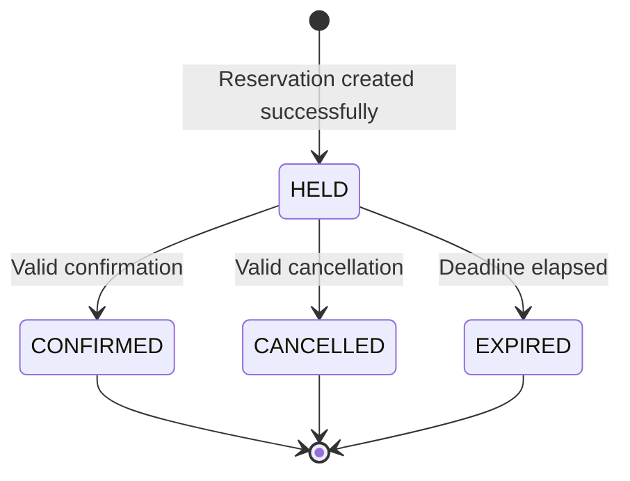
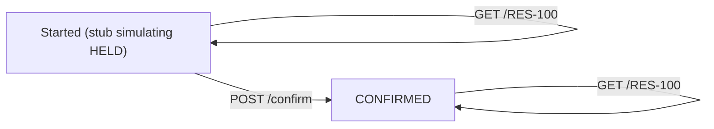
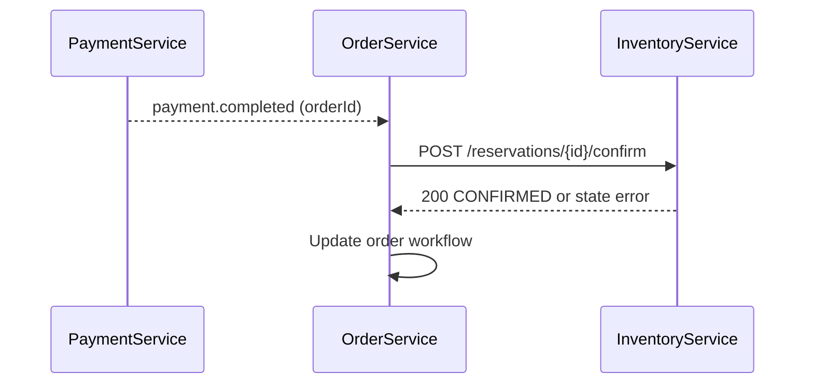
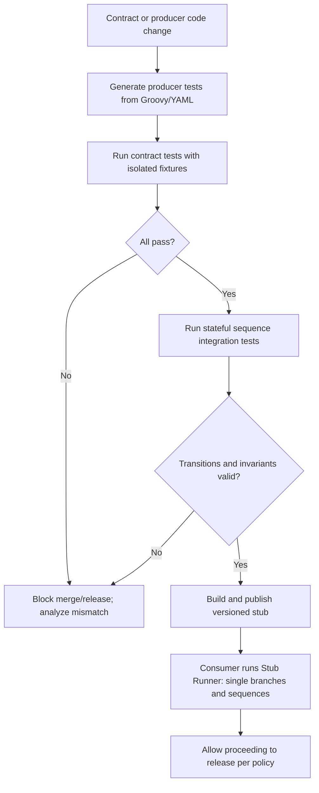

# Stateful Interaction Sequences and Preconditions

An API can return valid JSON for each individual request yet still break business flows when requests are executed **in the wrong order**. For example, a reservation confirmation API should only succeed when an active reservation already exists; calling confirm on an expired reservation must lead to a different outcome. A contract showing `POST /reservations/{id}/confirm` returning `200` does not by itself verify all of those preconditions.

In the **Statuses and Errors** chapter of **Spring Cloud Contract**, this lesson explains how to identify **preconditions**, **stateful interaction sequences**, and **state transitions**. We will distinguish what can be described with HTTP or message contracts written in Groovy/YAML DSL, what requires fixtures and integration tests on the producer side, and when stateful stubs are needed for the consumer to test flows with **Stub Runner**. The ultimate goal is to catch incompatible API changes in CI without mistaking a stub returning a sample response for proof that the business workflow itself is sound.

After this lesson, you will be able to:

- Distinguish standalone requests from requests whose outcome depends on prior state.
- Draw a state diagram, list preconditions for each operation, and identify outcomes of valid/invalid state transitions.
- Write Spring Cloud Contract contracts for success, expired, not-found, and conflict states.
- Prepare producer fixtures so generated tests run independently and reproducibly.
- Explain why multiple static contracts **do not automatically compose** into a stateful flow.
- Understand how state is modeled in WireMock stubs, the limits of Stub Runner, and what multi-step tests must be added.
- Design CI gates checking both interface compatibility and critical business invariants.

## 1. From a Single HTTP Request to a Business Action Sequence

Suppose there are two services:

- **Consumer – `OrderService`:** creates orders and must place an inventory reservation before payment.
- **Producer – `InventoryService`:** creates, confirms, and cancels inventory reservations.

The happy path consists of these steps:

1. `OrderService` calls `POST /api/v1/reservations` to hold 2 units of stock.
2. `InventoryService` returns `201 Created`, a `reservationId`, and `status = HELD`.
3. After payment succeeds, the consumer calls `POST /api/v1/reservations/{reservationId}/confirm`.
4. The producer transitions the reservation from `HELD` to `CONFIRMED` and returns `200 OK`.

If step 3 is called before a reservation exists, or after the reservation expires, the producer must not pretend confirmation succeeded. The outcome depends on **the state created by previous requests**, not solely on the current method, URL, and JSON body.

### Difference Between Testing One Request and Testing a Sequence

| Test Level | Question to Answer | Example |
| --- | --- | --- |
| Single-interaction contract | Given the request and prepared precondition, does the producer return the committed response? | Reservation is `HELD` → confirm returns `200`, `CONFIRMED` |
| Multi-step integration test | Did the prior request actually create state for the next request to proceed properly? | Create → confirm → get must return `CONFIRMED` |
| Failure-handling test | Are invalid transitions rejected and does the system keep valid state? | Reservation `EXPIRED` → confirm returns `409`, not changed to `CONFIRMED` |
| Concurrency and retry test | Are business invariants preserved under repeated/concurrent calls? | Two parallel confirm requests do not deduct inventory twice |

Spring Cloud Contract is very useful at the **committed communication** level; however, a contract file itself is not a workflow orchestrator, state database, or proof of atomic transactions.

## 2. Modeling State Before Writing Contracts

Start with a **state machine** so both producer and consumer clearly understand the outcomes.



In this illustrative model, `HELD` is the initial state after successful creation; `CONFIRMED`, `CANCELLED`, and `EXPIRED` are terminal states. A real system may also have `PENDING`, `RELEASED`, or intermediate states. **State names and transition rules are business decisions**, not default states provided by Spring Cloud Contract.

From the diagram, build a precondition table:

| Operation | Precondition | Post-State | Example Response |
| --- | --- | --- | --- |
| Create reservation | SKU exists, enough stock, valid input | `HELD` | `201` + `reservationId` |
| Confirm | Reservation exists, belongs to valid order, is `HELD` and not expired | `CONFIRMED` | `200` + `status: CONFIRMED` |
| Cancel | Reservation exists, is `HELD` | `CANCELLED` | `200` + `status: CANCELLED` |
| Confirm expired | Reservation is `EXPIRED` | Unchanged | `409` + `RESERVATION_EXPIRED` |
| Confirm non-existent ID | Reservation not found | Unchanged | `404` + `RESERVATION_NOT_FOUND` |
| Confirm cancelled | Reservation is `CANCELLED` | Unchanged | `409` + `INVALID_RESERVATION_STATE` |

The codes `200`, `201`, `404`, `409` and error names are **conventions of the example API**. In another system, the team may choose a different representation; what matters is that consumer and producer agree on semantics, retryability, and state impact.

### A Precondition Is Not Just a Single Status Field

A confirm operation may simultaneously require:

- The reservation exists and has not been cancelled.
- Its current state is `HELD`.
- The current time is before `expiresAt`.
- The caller is authorized to operate on the associated order.
- The system has not already confirmed it under an agreed idempotency policy.

Receiving `status = HELD` from a read API in a test **does not automatically guarantee** all of those conditions hold at confirmation time. Decide the right verification level for each condition.

## 3. Reading Interaction Sequences as Given–When–Then Scenarios

Before choosing Groovy/YAML, describe scenarios in business terms.

**Scenario A – successful confirmation**

- **Given:** reservation `RES-HELD-100` exists, is `HELD`, has not expired, and the caller is permitted to confirm.
- **When:** consumer sends `POST /api/v1/reservations/RES-HELD-100/confirm`.
- **Then:** producer returns `200` with `reservationId = RES-HELD-100` and `status = CONFIRMED`; state is persisted as `CONFIRMED`.

**Scenario B – not found**

- **Given:** no reservation `RES-MISSING-999` exists.
- **When:** consumer sends a confirm request for that ID.
- **Then:** producer returns `404` and error code `RESERVATION_NOT_FOUND`; no new reservation is created.

**Scenario C – expired**

- **Given:** reservation `RES-EXPIRED-200` exists, yet its state is already `EXPIRED`.
- **When:** consumer requests confirmation.
- **Then:** producer returns `409` and code `RESERVATION_EXPIRED`; the expired reservation is neither restored nor confirmed.

**Scenario D – retry after timeout**

- **Given:** a previous confirmation attempt may have succeeded, yet the consumer never received the response.
- **When:** consumer resends the request per agreed retry/idempotency policy.
- **Then:** clear rules must govern returning the prior result, returning a conflict, or confirming it was already processed. Verify both **the response** and **side effects** to ensure no duplicate business execution.

The statements in **Given** determine fixture state during test runs; you cannot merely write them inside `description` and assume they are automatically executed.

## 4. Why Doesn't a Contract Put the System into the Required State Automatically?

An HTTP contract can describe:

```groovy
import org.springframework.cloud.contract.spec.Contract

Contract.make {
    name 'confirm_held_reservation_success'
    description 'OrderService can confirm when reservation is HELD'

    request {
        method 'POST'
        url '/api/v1/reservations/RES-HELD-100/confirm'
    }

    response {
        status 200
        headers {
            contentType(applicationJson())
        }
        body([
            reservationId: 'RES-HELD-100',
            status       : 'CONFIRMED'
        ])
    }
}
```

The verifier can generate a test that sends the request and checks the response against the contract. However, the DSL above **contains no command to automatically create a reservation in the database**. If the test runs against an empty database, the controller might return `404` and fail the test even when producer code follows all rules.

For the test to be meaningful, the team must prepare **the precondition in the producer test environment**: reservation `RES-HELD-100` exists in `HELD` state and is unexpired. You can use a database fixture, test repository, stateful fake service, or another method fitting your test scope.

Remember: **describing preconditions in `description` helps humans understand the scenario, but state creation must be executed by real fixtures or test setup.**

## 5. Splitting States into Separate Contracts

For the same confirm endpoint, outcomes vary by state. A simple way to organize static contracts is to use **different fixture IDs per case**.

### Expired Case

```groovy
import org.springframework.cloud.contract.spec.Contract

Contract.make {
    name 'confirm_expired_reservation_conflict'
    description '''
        Consumer must not proceed to payment with an expired reservation.
        Fixture: RES-EXPIRED-200 is in EXPIRED state.
    '''

    request {
        method 'POST'
        url '/api/v1/reservations/RES-EXPIRED-200/confirm'
    }

    response {
        status 409
        headers {
            contentType(applicationJson())
        }
        body([
            code: 'RESERVATION_EXPIRED'
        ])
    }
}
```

### Not-Found Case

```groovy
import org.springframework.cloud.contract.spec.Contract

Contract.make {
    name 'confirm_missing_reservation_not_found'
    description 'Consumer receives 404 when confirming a non-existent ID'

    request {
        method 'POST'
        url '/api/v1/reservations/RES-MISSING-999/confirm'
    }

    response {
        status 404
        headers {
            contentType(applicationJson())
        }
        body([
            code: 'RESERVATION_NOT_FOUND'
        ])
    }
}
```

Placed alongside the success contract, the three form an example suite guarding the **observable behavior** of the confirm endpoint under three prebuilt conditions.

| Contract Name | Sample Request | Fixture Precondition | Response |
| --- | --- | --- | --- |
| `confirm_held_reservation_success` | `.../RES-HELD-100/confirm` | ID in `HELD` | `200`, `CONFIRMED` |
| `confirm_expired_reservation_conflict` | `.../RES-EXPIRED-200/confirm` | ID in `EXPIRED` | `409`, `RESERVATION_EXPIRED` |
| `confirm_missing_reservation_not_found` | `.../RES-MISSING-999/confirm` | ID absent | `404`, `RESERVATION_NOT_FOUND` |

Using **different paths** also keeps static stub mappings from conflicting. If three contracts used the exact same method and URL while expecting three different responses, a stateless stub could not inspect the producer's database condition to pick the right response.

### Do Not Confuse Fixed Paths with Guarantees for All IDs

The three contracts above only generate tests for **three meaningful examples**. They do not prove the producer handles every reservation code, every expiration clock, and every error case properly. That is why risk-based supplementary tests are required: time boundaries, access control, other states, and concurrent calls.

## 6. Preparing Fixtures and Cleaning State in Producer Tests

For generated tests to produce stable results, each test must be able to run from a known state **without depending on prior test execution order**.

An illustrative data table:

| Reservation ID | Pre-Test State | Expiration | Expected |
| --- | --- | --- | --- |
| `RES-HELD-100` | `HELD` | Not expired | Confirm succeeds |
| `RES-EXPIRED-200` | `EXPIRED` | Expired | Confirm returns conflict |
| `RES-CANCELLED-300` | `CANCELLED` | No longer active | Confirm rejected |
| `RES-MISSING-999` | Does not exist | Not applicable | Confirm returns not found |

Preparation approaches may vary:

1. **Test database with seed data:** insert reservations before the test, roll back or reset after the test. Ensure test statements never touch production data.
2. **In-memory test-profile repository fixture:** initialize in-memory state before each scenario; suited for testing controllers, validation, and response mapping.
3. **Test doubles for external dependencies:** simulate responses of out-of-scope services without mocking away the producer behavior the contract needs to verify.
4. **Controllable clock:** inject a fake `Clock` or deliberate timestamps to test just before and just after expiration.

Conceptual **sketch** of a Java fixture setup method; repository names, methods, and entities must be adapted to your application:

```java
// Illustrative concept; not a standalone compilable snippet.
@BeforeEach
void prepareContractFixtures() {
    reservationRepository.deleteAllTestReservations();

    reservationRepository.save(
        reservation("RES-HELD-100", "HELD", clock.instant().plusSeconds(600))
    );
    reservationRepository.save(
        reservation("RES-EXPIRED-200", "EXPIRED", clock.instant().minusSeconds(60))
    );
}
```

The helpers `deleteAllTestReservations()` and `reservation(...)` here are **hypothetical fixture APIs**, not built-in Spring Cloud Contract APIs. A real base test class must configure the right test mode (such as MockMvc/RestAssured if the producer uses Spring MVC) so generated tests can invoke the controller.

Especially for tests **that mutate state** such as confirm, reset data before every test. If a successful confirm turns `RES-HELD-100` into `CONFIRMED`, running a subsequent test on the same data without resetting will no longer actually test the `HELD` branch.

## 7. Testing One Interaction Is Not Testing the Whole Sequence

Suppose the following contracts all pass independently:

- Creating a reservation returns `201` and `status = HELD`.
- Confirming a `HELD` reservation returns `200` and `status = CONFIRMED`.
- Reading a `CONFIRMED` reservation returns `200` and `status = CONFIRMED`.

That still does not prove **a reservation created by step 1** can immediately be used by step 2; nor that confirm persisted state to the exact same data store that the subsequent GET reads.

A multi-step integration test can verify this directly:

```text
Given: Sufficient stock for SKU-001; no related reservation exists yet
When:
  1. POST /reservations
  2. Extract reservationId from 201 response
  3. POST /reservations/{reservationId}/confirm
  4. GET /reservations/{reservationId}
Then:
  - Step 1 returns HELD status and a valid ID
  - Step 2 confirms successfully
  - Step 3 reads the same ID with CONFIRMED status
  - Stock and related data satisfy business invariants
```

Java sketch using Spring MockMvc, omitting fixture initialization and imports:

```java
// Illustrative integration test code; adjust paths, DTOs, and setup per project.
MvcResult created = mockMvc.perform(post("/api/v1/reservations")
        .contentType(MediaType.APPLICATION_JSON)
        .content("{\"sku\":\"SKU-001\",\"quantity\":2}"))
    .andExpect(status().isCreated())
    .andExpect(jsonPath("$.status").value("HELD"))
    .andReturn();

String body = created.getResponse().getContentAsString();
String reservationId = objectMapper.readTree(body)
    .path("reservationId").asText();

mockMvc.perform(post("/api/v1/reservations/{id}/confirm", reservationId))
    .andExpect(status().isOk())
    .andExpect(jsonPath("$.status").value("CONFIRMED"));

mockMvc.perform(get("/api/v1/reservations/{id}", reservationId))
    .andExpect(status().isOk())
    .andExpect(jsonPath("$.reservationId").value(reservationId))
    .andExpect(jsonPath("$.status").value("CONFIRMED"));
```

Here, the integration test itself **passes the real ID** from the creation step to confirmation and lookup; this is the link between interactions that three independent contract files do not execute on their own. To verify inventory and atomicity, add assertions against the repository or real system under test.

## 8. Static Stubs Simulate Responses, Not Business State

Standard stubs generated by Spring Cloud Contract simulate interactions by **request matcher → response**. Given a mapping:

```text
POST /api/v1/reservations/RES-HELD-100/confirm
    -> 200 {"status":"CONFIRMED"}
```

The consumer can test its `200` handling branch, yet that does not prove the stub updated a real reservation. When the consumer calls `GET /api/v1/reservations/RES-HELD-100`, the outcome depends on whatever GET mapping was defined, not automatically inferred from the preceding POST.

This matters especially when testing:

- Calling GET before and after confirm, expecting two different statuses.
- Cancelling after confirmation, expecting rejection.
- Resending confirm and expecting a response per idempotency policy.
- Reading state through another API or after an asynchronous event.

If these behaviors must be tested **on the consumer side**, a set of static mappings may not suffice. You can configure stateful stubs using mechanisms like **WireMock Scenarios**, or use a stateful fake service. Understand that this is **additional stub-tool configuration**, not something that happens automatically by placing multiple Groovy contracts side by side.

## 9. Modeling State Sequences in WireMock Scenarios

Spring Cloud Contract Stub Runner typically runs HTTP stubs on top of WireMock. WireMock supports **scenarios** so a mapping only matches when the scenario is in a specific state and a request can transition the scenario to a new state.

A simple model for reservation `RES-100`:



In WireMock terms, the following JSON mappings illustrate the idea. These are **WireMock stub mappings**, **not Spring Cloud Contract Groovy/YAML DSL syntax**, and do not mean the verifier automatically converts normal contracts into scenarios.

### Mapping A – GET While Held

```json
{
  "scenarioName": "reservation-RES-100",
  "requiredScenarioState": "Started",
  "request": {
    "method": "GET",
    "url": "/api/v1/reservations/RES-100"
  },
  "response": {
    "status": 200,
    "headers": { "Content-Type": "application/json" },
    "jsonBody": {
      "reservationId": "RES-100",
      "status": "HELD"
    }
  }
}
```

### Mapping B – Confirm Transitions from HELD to CONFIRMED

```json
{
  "scenarioName": "reservation-RES-100",
  "requiredScenarioState": "Started",
  "newScenarioState": "CONFIRMED",
  "request": {
    "method": "POST",
    "url": "/api/v1/reservations/RES-100/confirm"
  },
  "response": {
    "status": 200,
    "headers": { "Content-Type": "application/json" },
    "jsonBody": {
      "reservationId": "RES-100",
      "status": "CONFIRMED"
    }
  }
}
```

### Mapping C – GET After Confirmation

```json
{
  "scenarioName": "reservation-RES-100",
  "requiredScenarioState": "CONFIRMED",
  "request": {
    "method": "GET",
    "url": "/api/v1/reservations/RES-100"
  },
  "response": {
    "status": 200,
    "headers": { "Content-Type": "application/json" },
    "jsonBody": {
      "reservationId": "RES-100",
      "status": "CONFIRMED"
    }
  }
}
```

With these three mappings, the consumer can verify:

1. GET before confirm → `HELD`.
2. POST confirm → `CONFIRMED`, scenario transitions state.
3. GET after confirm → `CONFIRMED`.

**Important limitation:** this is still a stub simulation and does not prove the real producer persists transactions properly. It also does not automatically cover all cancellation, expiration, permission, or retry branches. Add appropriate mappings or fakes whenever consumer flows depend on them.

### Does Using WireMock Scenarios with Stub Runner Require Configuration?

Yes. The example above shows **WireMock's mapping format**, not a guarantee that three JSON files will automatically be packaged by Spring Cloud Contract if placed in an arbitrary directory. For the consumer to use them in Stub Runner, ensure your **project version's** stub artifact build places the mappings where WireMock reads them; then inspect the published artifact and run the real scenario test.

Do not overuse stateful mappings for flows that only need a fixed response: every extra state adds setup, reset overhead, and potential cross-test interference.

### Initializing and Resetting Scenarios

WireMock uses `Started` as its initial state. Once one test calls confirm, the scenario can remain in `CONFIRMED` for the next test if they share an instance without resetting.

Therefore, before each independent consumer test:

- Reset the scenario to its initial state using the appropriate WireMock API or utility.
- If necessary, clear the request journal/interaction history so assertions do not inspect stale requests.
- Avoid letting parallel tests mutate a shared scenario; use separate instances or distinct scenario names if needed.
- Verify exact reset behavior with your version of WireMock/Stub Runner.

**Passing once does not mean a test is reproducible**: stateful stubs are especially prone to ordering and parallelism failures if state lifecycles are not managed.

## 10. Stateful Stubs and Producer Tests Have Different Jobs

| Aspect | Producer Contract Verification | Stateful Stub / Consumer Test |
| --- | --- | --- |
| Subject under test | Producer controller, service, and responses with prepared fixtures | Consumer code handling a simulated request/response sequence |
| Source of state | Real data in test DB/repository or fixture | Stub scenario/fake state |
| How state transitions | Producer business logic | Mapping `newScenarioState` or fake logic |
| Proof value | Producer satisfies each observable commitment | Consumer handles the simulated flow properly |
| What it does not prove | Cross-request linked state if tests are isolated | Whether real producer handles transactions, timers, concurrency, and persistence properly |

Both sides **complement** each other. A reliable test suite should have contracts for the responses consumers require, plus end-to-end integration tests against the real producer for critical state sequences.

## 11. Preconditions Before Using a Stub Must Be Expressed Clearly

You do not always need a stateful stub. An API may require **request-level preconditions**, such as an auth header, an idempotency key, or a specifically formatted token.

Distinguish two kinds of preconditions:

| Precondition Type | Example | Verification Tool |
| --- | --- | --- |
| Observable in request | `Idempotency-Key` header present; JSON has `orderId` | Request matcher in contract/stub |
| Dependent on prior hidden state | ID was already created, unexpired, owned by caller | Producer fixture, integration test, and stateful stub if needed |

Example contract requiring an idempotency header:

```groovy
import org.springframework.cloud.contract.spec.Contract

Contract.make {
    name 'create_reservation_with_idempotency_key'
    description 'OrderService sends retry key so producer can prevent duplicates'

    request {
        method 'POST'
        url '/api/v1/reservations'
        headers {
            contentType(applicationJson())
            header('Idempotency-Key', 'order-1001-create-reservation')
        }
        body([
            orderId : 'ORD-1001',
            sku     : 'SKU-001',
            quantity: 2
        ])
    }

    response {
        status 201
        headers {
            contentType(applicationJson())
        }
        body([
            reservationId: 'RES-100',
            status       : 'HELD'
        ])
    }
}
```

The contract verifies **the header and response of a single request**. Even if the contract passes, it does not prove that calling twice with the same key creates only one reservation. Idempotency behavior requires calling the request twice and verifying **the count of created records** or equivalent side effects.

### Retry After Timeout Is a Multi-State Sequence

Consider:

1. Consumer sends create; producer creates reservation, yet the response is lost on the network.
2. Consumer times out and does not know whether the reservation was created.
3. Consumer retries with the same `Idempotency-Key`.

Producer behavior can follow different agreed policies: returning the original result, returning a response indicating the request was already processed, or rejecting when the key is reused with a different payload. **There is no single HTTP code enforced by Spring Cloud Contract by default.** The convention must be clear to the consumer, expressed in corresponding contracts, and integration-tested for side effects.

## 12. Time and Expiration Transitions

`expiresAt` complicates stateful flows because **time** becomes a hidden input:

- When `now < expiresAt`, confirm may be valid.
- When `now >= expiresAt`, confirm must be rejected per agreed rules.
- A background job might transition state from `HELD` to `EXPIRED` asynchronously from requests.

Do not write producer contract tests assuming hardcoded past/future timestamps without controlling the clock; weeks later, tests may flip results on their own.

Test design suggestions:

1. Inject a `Clock` into business logic and fix the test instant.
2. Prepare clear fixtures for *before, exactly at, and after* expiration.
3. Verify error responses and confirm the producer **does not perform invalid state transitions**.
4. If a background job or expiration event exists, add dedicated scheduler/event tests.
5. For the consumer, simulate expired state with a static stub or suitable scenario and test the handling branch.

A regex for timestamp formatting does not prove the timestamp is still valid. Likewise, a stub returning `EXPIRED` does not prove the producer's expiration job works properly.

## 13. Transition Ordering and Access Permissions

In multi-user or multi-tenant systems, business state and authorization can both affect the outcome:

- Reservation is `HELD`, yet the caller lacks permission to confirm.
- ID does not exist; the system may choose to return `404`.
- ID exists yet belongs to another tenant; security policy may require `404` instead of disclosing existence.
- Token expired; producer may return `401` before checking business state.

Therefore, do not encode an arbitrary validation order in contracts that leaks user information. Choices among `401`, `403`, `404`, and `409` must reflect security policy and consumer UX, not decisions made by Spring Cloud Contract.

If you need a contract for a security error, describe **the concrete request and observable response**. Describing a single error response does not replace security tests covering the full permission/state matrix.

## 14. Sequences with Asynchronous Messages

Not every state transition is triggered by HTTP. In an event-driven architecture, `PaymentService` may emit a `payment.completed` event; `OrderService` consumes the event and calls `InventoryService` to confirm the reservation.



Here:

- A message contract can verify headers/payloads of the producer event and what the consumer expects.
- An HTTP contract can verify confirm returns `200`, `404`, `409`, or an agreed error code.
- Integration tests must verify **ordering, retries, duplicates, redelivery, and eventual consistency** when those determine business correctness.

In particular, message brokers can deliver events at-least-once or without cross-channel ordering guarantees. Consumers should not rely on a stub emitting one event in exact order and conclude production will never receive duplicate or late events.

## 15. Preventing Conflicts When Multiple Contracts Target the Same URL

This is the most common pitfall when moving from a standalone request to multiple states. Suppose there are two contracts:

```text
POST /api/v1/reservations/RES-100/confirm
  -> 200 {"status":"CONFIRMED"}

POST /api/v1/reservations/RES-100/confirm
  -> 409 {"code":"RESERVATION_EXPIRED"}
```

If both become static mappings for **the exact same method/URL/headers/body**, the stub cannot determine whether "the reservation is HELD or EXPIRED" from the request alone. The outcome may depend on mapping priority or matching mechanics and fail to simulate real business state.

Solutions:

| Approach | When Suitable | What to Check |
| --- | --- | --- |
| Use different fixture IDs | Consumer only needs to test each return branch | Each contract's request is distinguishable |
| Use different request conditions | Real API uses path/header/body to distinguish scenarios | Matching conditions are no broader than reality |
| Use WireMock Scenarios | Consumer must test the same ID before/after an action | State is reset, steps run in order |
| Use a stateful fake service | Flow is too complex for simple mappings | Fake is versioned and backed by tests |
| Test against real producer | Must prove real transactions and state | Database, concurrency, timers, and dependencies are controlled |

Do not try to solve this by renaming files or moving files into different consumer folders and expecting Stub Runner to infer state automatically. Folders and `name` are organizational tools, not state-transition conditions.

## 16. Which Layers Should CI Verify?

A reliable CI workflow can split verification into layers:



For a Maven project already configured with Spring Cloud Contract Verifier, a common verification command is:

```bash
mvn -B -ntp clean verify
```

That is an example command for a **producer project with plugins and tests configured**; this Markdown lesson itself is not a buildable Spring Boot application. Multi-step integration tests must be wired into the appropriate test lifecycle in your project configuration.

A CI checklist should include:

1. **Contract discovery:** all relevant contracts are picked up by the generator; no green build with 0 generated tests.
2. **Fixtures:** tests do not depend on shared environment data or execution order.
3. **Producer verification:** status codes, headers, bodies, and matchers reflect agreed interface terms.
4. **Stateful integration:** critical sequences like create → confirm → get and confirm-when-expired are tested against the real producer at the appropriate level.
5. **Stub artifacts:** mappings are packaged with the right version without accidental conflicts.
6. **Consumer tests:** Stub Runner uses a pinned artifact version, resets scenarios when needed, and verifies both success and error branches.
7. **Release:** never publish stubs representing a producer that failed mandatory verification gates.

## 17. Common Failure Diagnosis

| Symptom | Common Cause | Resolution |
| --- | --- | --- |
| Confirm contract expects `200` yet producer returns `404` | Fixture did not create reservation before test | Prepare `HELD` state before each test |
| First run passes, second run fails | Previous test mutated state without resetting | Recreate fixtures or roll back cleanly |
| Individual contracts pass yet create → confirm flow fails | Tests do not share a real reservation | Add integration test passing ID from create step |
| Stub returns `200` for an expired reservation | Success matcher too broad or lacks state | Differentiate mappings and add stateful stub |
| Consumer tests fail depending on order | WireMock scenario not reset between tests | Reset scenario / isolate tests |
| Parallel tests flaky | Tests share state or database | Isolate data/test instances, manage concurrency |
| `expiresAt` passes today, fails tomorrow | Clock relies on real wall time | Controllable clock and boundary tests |
| Producer returns right error code yet still creates side effect | Contract checks response only, not DB | Add state-invariant tests |
| Resending same idempotency key creates two records | Multi-request retry not tested | Write integration test calling repeatedly and counting side effects |
| State wrong after late message | Missing event ordering/retry tests | Test async workflows and idempotency policy |
| Build has 0 contract tests yet passes | Wrong plugin/path/config | Check generated and executed test counts |
| Multiple contracts share method/URL with different responses | Stub cannot choose by hidden state | Configure scenarios or distinguish request conditions |

## 18. Checklist Before Designing Stateful Sequences

- [ ] A state diagram or at least a clear state-transition table exists.
- [ ] Every key request specifies **preconditions** and success/error responses.
- [ ] The consumer knows when to retry, stop, cancel, or switch branches.
- [ ] HTTP status and error codes follow business conventions rather than imagined defaults.
- [ ] Contracts cover `200/201` scenarios as well as `404/409` or relevant error branches.
- [ ] Producer fixtures genuinely create the state expected by contracts.
- [ ] Generated tests are independent, repeatable, and runnable in CI without fixed ordering.
- [ ] Terminal states like `CONFIRMED`, `CANCELLED`, and `EXPIRED` are handled per rules.
- [ ] Integration tests exist for multi-request sequences when side effects must be proven.
- [ ] ID values returned in earlier steps are passed properly to subsequent steps in sequence tests.
- [ ] Expiration, timeout, and retry cases are verified if the consumer relies on them.
- [ ] If using WireMock Scenarios, the stub artifact contains proper mappings and every test resets state.
- [ ] No static mappings share identical method/URL/conditions while expecting conflicting responses.
- [ ] Message contracts and async tests cover critical event flows.
- [ ] Stub Runner uses explicit versions; CI blocks release when contract or state tests fail.

### Practice Exercise

You are developing `OrderService` (consumer) integrating with `InventoryService` (producer). Agreed rules:

- Creating reservation succeeds → `201` with `status = HELD` and a `reservationId`.
- Confirming reservation in `HELD`, unexpired → `200` with `status = CONFIRMED`.
- Confirming `EXPIRED` reservation → `409` and `code = RESERVATION_EXPIRED`.
- Confirming non-existent reservation → `404` and `code = RESERVATION_NOT_FOUND`.
- Confirming after `CANCELLED` → `409` and `code = INVALID_RESERVATION_STATE`.

Complete the following:

1. Draw a state diagram with transitions `HELD → CONFIRMED`, `HELD → CANCELLED`, and `HELD → EXPIRED`.
2. Build a *Given–When–Then* table for the five behaviors above; for each contract, state the producer fixture state required.
3. Write three Groovy contracts for successful confirm, expired, and not-found. Use **different** fixed IDs so static stubs distinguish requests.
4. Write an integration test calling create → confirm → get, capturing the real ID created in step 1, then asserting `CONFIRMED` and persisted state.
5. Describe a test with a fake clock: confirm before `expiresAt` and confirm at/after `expiresAt`; explain expected outcomes.
6. Use three WireMock Scenario mappings similar to section 9 for one reservation, then write a consumer test calling GET before confirm, POST confirm, and GET after confirm.
7. Intentionally skip resetting the scenario between two tests and observe the order dependency; add a reset or separate instances to fix it.
8. Design a retry test for confirm/create per the agreed idempotency policy; verify both responses and the number of state mutations.
9. Wire producer contract verification, integration tests, and consumer tests with Stub Runner into CI, publishing stubs only after mandatory checks pass.

**Completion criteria:** you can distinguish **contracts verifying single-interaction responses**, **multi-step tests against the real producer**, and **stateful stubs for testing consumer logic**. For each state transition, you know which preconditions must hold, how to set up fixtures, and the evidential limits of each test type.

## References

- [Spring Cloud Contract — Reference](https://docs.spring.io/spring-cloud-contract/reference/): contract principles, generated producer tests, and stubs.
- [Spring Cloud Contract — HTTP Contracts](https://docs.spring.io/spring-cloud-contract/reference/project-features-contract/http.html): describing requests/responses and error scenarios.
- [WireMock — Stateful Behaviour](https://wiremock.org/docs/stateful-behaviour/): scenario model, required/new state, and resetting stub state.
