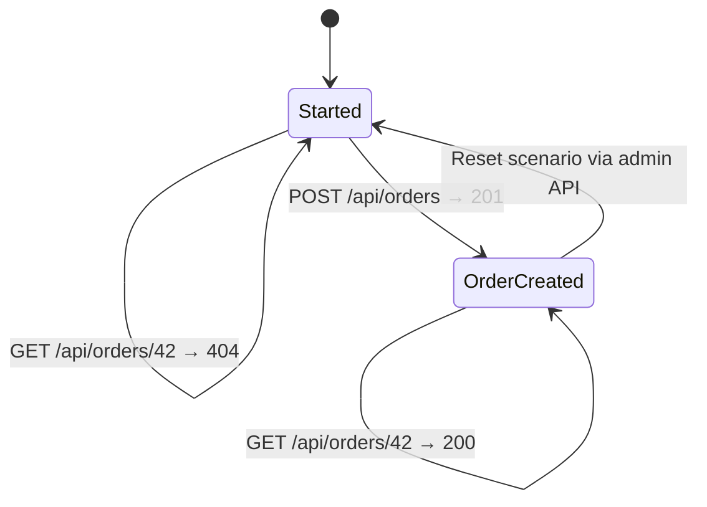
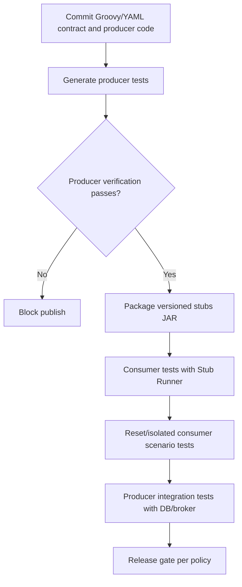

# Stub Scenarios and Their Limits Compared to Real System State

## 1. Stubs Can Simulate a Behavior Sequence, Not a Real System

In **Spring Cloud Contract**, a contract describes the behavior a **producer** commits to for a **consumer** over HTTP or messaging. From Groovy/YAML DSL, the tool can generate **producer-side tests** and **stubs** so the consumer can test integration via **Stub Runner** without starting the real producer. CI uses these tests to catch incompatible API changes early.

A typical HTTP stub returns a response based on request conditions: `GET /api/orders/42` returns JSON with an order ID, `GET /api/orders/999` returns `404`. However, some consumer flows need to test **multiple sequential calls**:

1. Order not yet created: `GET /api/orders/42` returns `404 ORDER_NOT_FOUND`.
2. Call `POST /api/orders`: receives `201 Created` with order ID `42`.
3. Call `GET /api/orders/42` again: receives `200` and state `CREATED`.

To simulate this flow, the stub must remember that a request in step 2 occurred. **WireMock scenarios** provide a lightweight state mechanism for such cases. However, **WireMock scenario state is not real business state in a database, message broker, or distributed system**. It is only a piece of data controlling which stub mappings become active on a mock server.

Lesson objectives:

- Distinguish **static stubs**, **stateful scenarios**, and **real producer state**.
- Know how to read and write simple states and state transitions in WireMock.
- Understand the relationship among Groovy/YAML contracts, generated producer tests, stubs, Stub Runner, and CI.
- Identify which bugs scenarios can detect and which properties only integration/E2E tests against the real system can verify.

## 2. Three Different State Layers

| Layer | Who Manages It? | Example | What Is Actually Verified |
| --- | --- | --- | --- |
| **HTTP status** | Response for each request | `201`, `200`, `404`, `409` | Whether a single call's response matches protocol and contract |
| **Stub scenario state** | Running WireMock server | `Started` → `OrderCreated` | In a simulated scenario, which request triggers which mapping |
| **Business/system state** | Real producer, DB, cache, broker, and other services | `NEW` → `PAID` → `SHIPPED` | Business rules, persistence, contention, transactions, events, and real consistency |

For example, HTTP `200` is **not** a workflow state like `PAID`. Similarly, the value `OrderCreated` in a WireMock scenario is a **mock control label**, not necessarily equal to a `state: CREATED` field in the API's JSON.

A simulated sequence:



This diagram describes only **stub activation rules**. It does not simulate committing to a DB before returning `201`, event ordering on Kafka, order creation authorization, timeouts calling the payment service, or contention when two users create the same order.

## 3. Static Stubs and Their Limits When Multiple Requests Share Matching Conditions

With a standard HTTP contract:

```groovy
import org.springframework.cloud.contract.spec.Contract

Contract.make {
    description 'Query a created order'
    request {
        method GET()
        url '/api/orders/42'
        headers {
            accept(applicationJson())
        }
    }
    response {
        status OK()
        headers {
            contentType(applicationJson())
        }
        body([
            orderId: 42,
            state: 'CREATED'
        ])
    }
}
```

A stub generated from this contract conceptually receives `GET /api/orders/42` and returns a fixed sample response. If called ten times in a row under the same conditions, it **does not automatically know** that the real producer might have paid, cancelled, or transitioned the order to a new state.

Do not simply create two mappings without distinguishing conditions for **the same method + URL**—one returning `404` and one returning `200`—and expect WireMock to "know when to return which." Overlapping mappings can lead to server priority/matching-rule selection rather than forming a real workflow.

There are two valid approaches depending on your goal:

1. **Independent scenarios:** use two contracts with **distinguishable requests** (for example `/api/orders/42` exists and `/api/orders/999` does not). Suitable for static contract testing with no state required.
2. **Stateful call sequences:** configure a WireMock scenario or a fake service with its own state model. Suitable for testing **consumer behavior across multiple requests**, without replacing producer testing.

The design rule is to **simulate only the slice of state the consumer actually observes and must handle**. Do not build a complex fake database just to test that a screen can handle `404` and `200`.

## 4. WireMock Scenario Mechanism: Labels and State Transitions

In WireMock, stub mappings participating in the same scenario can declare:

- `scenarioName`: name of the state group, e.g., `Order creation flow`.
- `requiredScenarioState`: the scenario state required **before** the mapping is allowed to match.
- `newScenarioState`: the state to transition to **after** the matching mapping is served.

The default initial state of a scenario is `Started` (exact casing used by WireMock). If a request matches a mapping in `Started` and the mapping defines `newScenarioState`, subsequent requests are evaluated against the new state.

State belongs to **a scenario within a single WireMock server instance**, not automatically scoped to a `sessionId`, `customerId`, or requesting user. Two users calling the same mock server concurrently affect the same scenario state.

### Matching Rules Must Hold Simultaneously

A mapping with `requiredScenarioState: OrderCreated` is only used when **both** the request conditions (method, URL, headers, body matchers if any) **and** the scenario state match. If the state does not match, this mapping will not serve the request. If no other mapping matches, WireMock may return its default `404` because no stub matched; that default response is **not equivalent** to the business response `ORDER_NOT_FOUND` described by a contract.

> **Technical source distinction:** WireMock scenarios are a **WireMock** feature. Do not assume that placing multiple standard Groovy/YAML contracts in Spring Cloud Contract will cause the plugin to automatically generate `scenarioName`/`requiredScenarioState`/`newScenarioState` or a full transition chain. To use scenarios, configure them intentionally and inspect the actual loaded mappings according to your tool version and stub packaging pipeline.

## 5. Example of Three Mappings for a Simple Lifecycle

Suppose the consumer is testing the **create order then look up** flow. We use a WireMock scenario named `Order creation flow` consisting of three standalone JSON mappings. Each block below is **the content of a separate mapping file**, not a single JSON array to paste into one file.

### 5.1. Not Yet Created: GET Returns Business Error 404

Example file `mappings/order-before-create.json`:

```json
{
  "name": "Order before creation",
  "scenarioName": "Order creation flow",
  "requiredScenarioState": "Started",
  "request": {
    "method": "GET",
    "url": "/api/orders/42"
  },
  "response": {
    "status": 404,
    "headers": {
      "Content-Type": "application/json"
    },
    "jsonBody": {
      "code": "ORDER_NOT_FOUND",
      "message": "Order does not exist yet"
    }
  }
}
```

This mapping **omits** `newScenarioState`, because a failed lookup does not create an order. The scenario stays in `Started`.

### 5.2. Create: POST Returns 201 and Transitions State

Example file `mappings/create-order.json`:

```json
{
  "name": "Create order",
  "scenarioName": "Order creation flow",
  "requiredScenarioState": "Started",
  "newScenarioState": "OrderCreated",
  "request": {
    "method": "POST",
    "url": "/api/orders",
    "headers": {
      "Content-Type": {
        "contains": "application/json"
      }
    },
    "bodyPatterns": [
      {
        "equalToJson": "{ \"customerId\": \"cust-123\", \"quantity\": 2 }"
      }
    ]
  },
  "response": {
    "status": 201,
    "headers": {
      "Content-Type": "application/json",
      "Location": "/api/orders/42"
    },
    "jsonBody": {
      "orderId": 42,
      "state": "CREATED"
    }
  }
}
```

Restricting the request body to `customerId` and `quantity` shows this scenario only simulates **one example payload**. A real API can accept many customers and generate different order IDs. If the consumer needs to test additional cases, add suitable samples or a fake service; do not open regexes so wide that the mock accepts any input regardless of business rules.

### 5.3. Created: GET Returns 200

Example file `mappings/order-after-create.json`:

```json
{
  "name": "Order after creation",
  "scenarioName": "Order creation flow",
  "requiredScenarioState": "OrderCreated",
  "request": {
    "method": "GET",
    "url": "/api/orders/42"
  },
  "response": {
    "status": 200,
    "headers": {
      "Content-Type": "application/json"
    },
    "jsonBody": {
      "orderId": 42,
      "state": "CREATED"
    }
  }
}
```

This mapping has no `newScenarioState`; after creation, subsequent `GET` calls continue receiving the created data. This is a simple model with **two state labels**. To simulate `CREATED → PAID → CANCELLED`, define corresponding requests and transitions; the number of mappings grows quickly with multiple branches.

**Important:** The three examples above are **WireMock mapping JSON to illustrate scenarios**, not Groovy/YAML Contract DSL files and not proof that Spring Cloud Contract automatically generated those three stateful mappings. If the test suite uses Stub Runner, only mappings **actually inside the artifact or loaded into the test's WireMock instance** take effect. Verify how your plugin and version package/load mappings, and avoid maintaining contracts and handwritten mocks that drift apart.

## 6. Running the Scenario and Verifying State Transitions

Suppose a **WireMock standalone server** is started on port `8089` and has loaded the three mapping files from section 5. This is a dedicated lab for the scenario mechanism; do not claim `8089` is a default port or the port Stub Runner will choose.

### Step 1. Reset Before Each Test

WireMock exposes an admin API to reset scenarios back to their initial state:

```bash
curl -X POST http://localhost:8089/__admin/scenarios/reset
```

Resetting scenarios is **not** deleting real producer data; it only changes scenario control state on the WireMock server. To isolate an entire test, also consider the request journal, additional mappings, and other test settings.

### Step 2. GET Before Creation

```bash
curl -i http://localhost:8089/api/orders/42
```

Expected:

```http
HTTP/1.1 404 Not Found
Content-Type: application/json

{"code":"ORDER_NOT_FOUND","message":"Order does not exist yet"}
```

**Verify the `ORDER_NOT_FOUND` body too**, not just the `404` status. If a request matches no mapping at all, WireMock also returns a default `404`; that does not prove the business error case was simulated properly.

### Step 3. POST to Transition State

```bash
curl -i -X POST http://localhost:8089/api/orders \
  -H 'Content-Type: application/json' \
  -d '{"customerId":"cust-123","quantity":2}'
```

Expected HTTP `201`, header `Location: /api/orders/42`, body containing `orderId = 42` and `state = CREATED`. Once the mapping is served, the scenario transitions from `Started` to `OrderCreated`.

### Step 4. GET Again

```bash
curl -i http://localhost:8089/api/orders/42
```

Expected HTTP `200` with body:

```json
{
  "orderId": 42,
  "state": "CREATED"
}
```

That proves **WireMock selected the new mapping by scenario label**. It does not prove the order was written to a database, survives restarts, rolls back transactions properly, or emits an `OrderCreated` event.

### Step 5. Observe Admin State

You can inspect scenario states on WireMock through the corresponding admin API:

```bash
curl http://localhost:8089/__admin/scenarios
```

Admin info helps debug when tests return unexpected responses. Never expose these mock server admin APIs publicly in real environments or let tests depend on them as part of the producer's API contract.

### On Windows

The `curl` commands here are examples for shells supporting that syntax; in Windows PowerShell, `curl` may be an alias for `Invoke-WebRequest` depending on the environment. You can use `curl.exe` or switch to the corresponding PowerShell command to avoid body/header handling mistakes. The scenario itself is OS-independent.

## 7. Stub Runner and Contracts: Who Verifies What?

In a standard Spring Cloud Contract workflow, a Groovy/YAML file describes **a single request-response scenario**; the plugin processes the contract to generate **producer verification tests** and **HTTP stubs**. For example, two independent HTTP scenarios might be:

| Source Contract | Request | Expected Response | Producer Test Must Prove |
| --- | --- | --- | --- |
| `get-existing-order.groovy` | `GET /api/orders/42` on test data containing order 42 | `200`, JSON with `orderId/state` | Controller/service returns the right response |
| `get-missing-order.groovy` | `GET /api/orders/999` on test data lacking order 999 | `404`, JSON with `ORDER_NOT_FOUND` | Handler and test data reflect the error properly |

Example Groovy contract for the "not found" branch:

```groovy
import org.springframework.cloud.contract.spec.Contract

Contract.make {
    description 'Order 999 does not exist yet'
    request {
        method GET()
        url '/api/orders/999'
    }
    response {
        status NOT_FOUND()
        headers {
            contentType(applicationJson())
        }
        body([
            code: 'ORDER_NOT_FOUND',
            message: 'Order not found'
        ])
    }
}
```

The same scenario in YAML DSL:

```yaml
description: Order 999 does not exist yet
request:
  method: GET
  url: /api/orders/999
response:
  status: 404
  headers:
    Content-Type: application/json
  body:
    code: "ORDER_NOT_FOUND"
    message: "Order not found"
```

These are **two alternative formats**, not two contracts to load simultaneously. Both YAML and Groovy versions must be paired with the right producer test data source to ensure the "non-existent" state is genuinely verified.

### Generated Producer Tests Do Not Automatically Build a Lifecycle

For the `GET /api/orders/999` contract, the generated test can issue that request and check `404`, yet it does not prove that a prior `POST` command causes data to appear and persist across multiple requests. To test a real lifecycle, write a **multi-step producer integration test** with intentionally managed data:

1. Seed suitable initial state, ensuring order `42` does not exist yet.
2. Call the create-order API, assert `201` and the returned ID.
3. Call the lookup API for that ID, assert `200` and corresponding data.
4. Verify persistence, transactions, or event emission if required by business rules.

This part is **testing beyond what a stub scenario can prove on its own**. Contract tests and producer integration tests complement each other rather than replacing one another.

### When the Consumer Uses Stub Runner

A consumer test can load the stubs JAR published by the producer:

```java
import org.springframework.cloud.contract.stubrunner.StubRunnerProperties;
import org.springframework.cloud.contract.stubrunner.spring.AutoConfigureStubRunner;

@AutoConfigureStubRunner(
    ids = "com.example:order-service:1.2.0:stubs:9090",
    stubsMode = StubRunnerProperties.StubsMode.LOCAL
)
class OrderClientContractTest {
    // Consumer HTTP client calls the stub on localhost:9090.
    // Add tests verifying 404, 201, and 200 branches per loaded mappings.
}
```

The snippet above only illustrates configuration; tests need real dependencies and assertions, plus consumer client base URL configuration. `LOCAL` requires the artifact in local Maven; in CI, use an appropriate repository/mode if fetching remotely.

**Key distinction:** Stub Runner loads **mappings actually present in the stubs JAR and runs them**; it does not automatically turn multiple static contracts into a state machine. To test a **WireMock scenario**, ensure the artifact or test config loads mappings with matching `scenarioName`/`requiredScenarioState`/`newScenarioState`, or use a dedicated WireMock server explicitly configured for that test.

In real projects, keep contracts as the source of truth for API commitments, and manage scenario mocks as **reviewed, purposeful test fixtures** rather than letting two descriptions drift apart independently. For every critical producer behavior, real tests must verify the implementation, not just mock fixtures.

## 8. Why "Stub Scenario Passes" Still Does Not Prove the System Is Correct

Consider the same `GET 404 → POST 201 → GET 200` sequence. A mock can return those exact three responses even when the real producer:

- Fails to write the order to the database because a transaction rolled back.
- Returns `201` while downstream services still fail when queried immediately.
- Creates two orders when the client retries `POST` after a timeout.
- Fails to check user permissions before creating the order.
- Emits duplicate `OrderCreated` events or emits none at all.
- Has a stale cache causing `GET` to return `404` for a while after `POST`.

None of these bugs are detected by checking **only WireMock scenario internal state**, because a scenario flips labels when a request matches a mapping, not when a real DB transaction commits.

| Capability to Prove | Can Stub Scenarios Help? | What Extra Tests Are Needed? |
| --- | --- | --- |
| Consumer handles `404`, `201`, `200` in simulated order | **Yes** | Multi-step consumer test with reset stubs |
| Consumer request paths, headers, and bodies match format | **Yes**, if mappings are strict enough | Contract tests and client tests |
| Producer actually returns committed status/body | **No** | Generated producer verification tests |
| Real POST persists data and subsequent GET reads it | **No** | Producer integration tests with DB |
| No duplicates on retry; idempotency handled | **Not proven on its own** | Timeout/retry and idempotency-key integration tests |
| Authorization and data ownership rules enforced | **No** | Security/integration tests with identity |
| Events reach broker with right ordering and delay handling | **No** | Messaging integration tests with broker |
| Multi-service consistency under network faults | **No** | E2E, fault-injection, resiliency tests |
| Performance, throughput, lock contention | **No** | Load/concurrency tests |

If a system is designed to be **eventually consistent**, `GET` not seeing data immediately after `POST` may be valid behavior for a short window. A stub scenario returning `200` immediately represents only an **intended happy path**, not real latency or retry behavior. The consumer may need a temporary `404` or `202 Accepted` scenario (if committed by the API), designed from the real protocol rather than imagined behavior.

## 9. Resetting, Test Isolation, and Parallel Execution

These are common reasons why a consumer test using scenarios **passes alone yet fails randomly in the full suite**.

### 9.1. State Is Held Inside the Mock Server

Suppose test A runs `POST /api/orders` and moves `Order creation flow` to `OrderCreated`. If test B runs next on the **same WireMock server** without resetting and expects `GET /api/orders/42` to return `404` in its initial state, test B will see `200`. The bug is in the fixture, not necessarily in the consumer.

Use one of these approaches:

- Reset scenarios back to `Started` before every state-dependent test (if the test server permits admin API calls).
- Spin up a dedicated WireMock instance/port per independent test or test group.
- Avoid sharing a stateful server across parallel tests, or configure explicit isolation.

Command:

```bash
curl -X POST http://localhost:8089/__admin/scenarios/reset
```

This is an example for the WireMock instance managed in the section 6 lab. With Stub Runner, how you access the server, port, and lifecycle depends on test configuration; do not assume every suite can hit an admin endpoint on the same port or is allowed to reset a shared server.

### 9.2. Resetting Does Not Replace Application State Setup

Resetting a WireMock scenario clears **simulated state labels**; it does not delete real producer data, clean the application's database, or retract emitted events. Conversely, wiping a test DB does not reset state held by a WireMock server.

For a real producer or E2E test:

1. Seed deterministic input data, or prepare an isolated database transaction.
2. Reset related mock servers if used as dependencies.
3. Run the test, verify outcomes and side effects.
4. Clean up/isolate so subsequent tests do not depend on order.

### 9.3. Scenarios Do Not Automatically Scope Per User

In the example, `Order creation flow` belongs to a single server. If customer A calls `POST` and advances the scenario state, customer B calling `GET` may see "created" even though they never created an order. WireMock does not manage an `orderId -> owner/state` table like a database.

To test multiple users or multiple orders:

- Use independent fixtures and clearly distinguishable request matchers when case counts are small.
- Use separate mock server instances for tests needing isolation.
- When dynamic per-ID state or complex rules are needed, consider a **fake service** with explicit in-memory data structures and its own tests.
- Run tests against the real producer to verify permissions, uniqueness, and data isolation.

### 9.4. Request Concurrency Races

Two concurrent requests can evaluate against the same current state label. WireMock scenarios are **not locks, transactions, or business concurrency control**. Do not use scenario results to conclude the producer handles race conditions, optimistic locking, or deduplication properly.

## 10. Designing Scenarios for Errors and Abnormal States

A useful scenario does not only simulate the **happy path**. Consumers often must handle error responses occurring at specific points in a workflow.

| Scenario | Simulated Behavior Sequence | Consumer Logic to Verify | Mock Limitation |
| --- | --- | --- | --- |
| Create then lookup | `404 → POST 201 → GET 200` | Screen transitions once data appears | Does not prove DB commit |
| Duplicate payment | `POST /pay 200 → POST /pay 409` | Does not resend endlessly, displays "already paid" | Does not prove real locking/idempotency |
| Auth expiration | `GET 401 → refresh token → GET 200` | Refresh flow and error handling | Does not prove security server checks real tokens |
| Temporary overload | `GET 429 → wait → GET 200` | Backoff and retry cap | Does not prove distributed rate limiting |
| Async processing | `POST 202 → GET PENDING → GET COMPLETED` | UI polling and timeout handling | Does not reflect real broker/eventual consistency |
| System outage | `GET 503 → retry → GET 200` | Safe retry and user messaging | Does not prove real recovery |

**HTTP statuses do not transition scenario state automatically.** If you want the second `POST /pay` to return `409`, declare a mapping for the request in the new state or use a fake service. You cannot simply write a `409` contract and assume the stub remembers prior requests.

### A Retry Scenario Must Not Mask Client Bugs

For `429` or `503`, consumer tests must verify **attempt counts**, wait intervals, and stop deadlines per policy. A stub that immediately returns `200` on the second try only tests the "retry succeeded" branch; it does not prove the client stops after the retry limit, applies exponential backoff, or avoids retrying non-idempotent requests.

If a contract requires a `Retry-After` header, the stub must return a protocol-compliant value and the producer must have corresponding tests. Do not use a fake delay value to claim performance or load capacity of the real system.

### Business Error Codes Must Still Be Part of Assertions

In the order-not-yet-created case, consumer tests must verify the response contains:

```json
{
  "code": "ORDER_NOT_FOUND",
  "message": "Order does not exist yet"
}
```

If WireMock returns its default `404` because **no mapping matched**, the response typically lacks `ORDER_NOT_FOUND`. Asserting only HTTP `404` can create **false positives**; assert `Content-Type`, `code`, and the fields the consumer genuinely relies on.

## 11. Picking the Right Test Layer for Each Question

A sound strategy uses multiple test layers, each with a clear responsibility:

| Layer | Subject Under Test | Strengths | What It Does Not Prove |
| --- | --- | --- | --- |
| **Generated contract test** | Real producer with deterministic test data | Status, headers, body, and matchers per contract | Full state-transition sequences unless explicitly tested |
| **Consumer + static stub** | Real consumer connected to WireMock/Stub Runner | Parsing, mapping, handling logic per response | Producer side effects |
| **Consumer + stateful stub scenario** | Consumer running request sequences against state-labeled mock | Multi-step flows, UI, retries, error branches under simulated state | Real DB, transactions, authorization, concurrency |
| **Producer integration test** | Producer + DB/suitable dependencies | Data reads/writes, business rules, transactions, state transitions | Full multi-service effects if dependencies remain mocked |
| **End-to-end/resilience test** | Real or near-real services and infrastructure | Multi-service integration, latency, network faults, event ordering | Does not replace small, fast, stable contracts |

The usual priority order is: **contract tests protect the API**, **consumer stub tests protect the client**, **producer integration tests protect business logic**, and **E2E/resilience tests protect cross-service flows**. You do not need to verify everything with a single test type.

### A Contract Can Pass While Business State Is Still Broken

Suppose a contract ensures `POST /api/orders` returns `201` with `orderId` in the body, while the generated test uses a fake service to generate the ID. The test still passes because the controller returns the expected response shape, yet production code might fail to persist due to a DB configuration bug. That is a limit of **producer test environment coverage**, not a sign that contracts are useless.

To catch that, add tests exercising the real persistence layer with deterministic data, calling create and reading the order back. If the project guarantees event emission, separately test publishing behavior through an appropriate broker.

## 12. Integrating into CI Without Equating Confidence Levels



A practical pipeline split:

1. **Producer contract stage:** generate and run tests from Groovy/YAML DSL, ensuring tests actually execute; if they fail, do not publish stubs as a verified promise.
2. **Stub artifact stage:** package/version contract-generated mappings; record coordinates and commit of the stubs JAR. If extra scenario mappings exist, verify their exact source and loading mechanism to avoid shadowing/overriding another contract mapping.
3. **Consumer stage:** run the client against stubs, verifying both success and error responses; for stateful scenarios, reset/isolate the server so tests are order-independent.
4. **Integration stage:** test the producer with real/test databases, auth, or brokers to verify business states mocks cannot prove.
5. **Release review:** evaluate compatibility with consumers still on older versions and changes to business state, retries, idempotency, or event ordering.

**A green pipeline is only meaningful within the scope of tests that actually ran.** Running consumer scenario tests without producer verification only proves the consumer is compatible with a simulation. Running producer tests without persistence integration tests cannot confirm order state is properly maintained in the real system.

### Indicators to Capture in Logs

- Versions of Spring Cloud Contract, WireMock, build tool, and JDK.
- Stubs JAR coordinates, contract source commit, and resolved version.
- List of verified scenarios and count of producer tests actually executed.
- Initial scenario state, transition paths, and mock reset/isolation results.
- Test layers skipped in the current job (e.g., DB integration or E2E) so scope is never misunderstood.

## 13. Hands-On Exercise: Second Payment Must Receive 409

A consumer calls `POST /api/orders/42/pay` to pay for an order. Per business requirements, the first successful payment returns `200` with `paymentState = PAID`. If called again in the same flow when the order is already paid, the real producer is expected to return `409 ORDER_ALREADY_PAID`.

### Part A. Design the Simulated Scenario

Build a WireMock scenario with two labels, `Started` and `Paid`:

1. In `Started`, `POST /api/orders/42/pay` returns HTTP `200`, body with `paymentState: "PAID"`, then transitions to `Paid`.
2. In `Paid`, the same request returns HTTP `409` with `code: "ORDER_ALREADY_PAID"` and a valid `message`. The failed call does not change the scenario label.
3. Reset the scenario to `Started` before each independent test.
4. Send a request with the wrong method or path to ensure it does not accidentally trigger a state transition.

### Part B. Two Minimal Mappings

First mapping, content of `pay-first-time.json`:

```json
{
  "scenarioName": "Payment flow",
  "requiredScenarioState": "Started",
  "newScenarioState": "Paid",
  "request": {
    "method": "POST",
    "url": "/api/orders/42/pay"
  },
  "response": {
    "status": 200,
    "headers": {
      "Content-Type": "application/json"
    },
    "jsonBody": {
      "paymentState": "PAID"
    }
  }
}
```

Second mapping, content of `pay-already-paid.json`:

```json
{
  "scenarioName": "Payment flow",
  "requiredScenarioState": "Paid",
  "request": {
    "method": "POST",
    "url": "/api/orders/42/pay"
  },
  "response": {
    "status": 409,
    "headers": {
      "Content-Type": "application/json"
    },
    "jsonBody": {
      "code": "ORDER_ALREADY_PAID",
      "message": "Order has already been paid"
    }
  }
}
```

These are **WireMock mappings for the scenario test**, not automatically Groovy/YAML contracts used by Spring Cloud Contract to generate producer tests. The producer test suite must still have contracts or equivalent assertions for both success and conflict responses under appropriate data conditions.

### Part C. Verification Matrix

| Step | Request | Expected Result | Scenario Label After Step |
| --- | --- | --- | --- |
| 1 | Reset scenario | Back to initial state | `Started` |
| 2 | `POST /api/orders/42/pay` | `200`, `paymentState = PAID` | `Paid` |
| 3 | `POST /api/orders/42/pay` | `409`, `code = ORDER_ALREADY_PAID` | `Paid` |
| 4 | Reset scenario | Back to initial state | `Started` |
| 5 | `POST /api/orders/42/pay` | `200` again in an independent test | `Paid` |

**Question:** If the test above passes, can we conclude the real producer will never double-charge? **No.** That is only evidence the consumer handled two simulated responses. Add producer/integration tests for idempotency, payment transactions, retry handling, and persisted state. When requests traverse a network and time out after payment was recorded, the real design must specify an idempotency-key policy or equivalent deduplication mechanism.

### Part D. Breakage Experiments

1. Change `409` to `200` in the mapping without changing consumer logic: verify whether the consumer test detects the wrong branch.
2. Keep `409` yet remove `code = ORDER_ALREADY_PAID`: verify whether the test distinguishes a **business error** from a plain HTTP `409`.
3. Skip the pre-test reset step: explain why the second test may fail depending on execution order.
4. Run two consumer tests in parallel against the same mock server: observe the risk of concurrently mutating one scenario state.
5. Call a producer integrated with a real DB: check whether two `POST` calls charge twice, whether transactions/idempotency work properly, and whether duplicate payment events are emitted.

### Guided Answers

- With the mappings in Part B, the first `POST` triggers `newScenarioState = Paid`; the next call is served by the mapping that only matches when `requiredScenarioState = Paid`.
- `409` alone is insufficient if the client must distinguish `ORDER_ALREADY_PAID` from other conflicts. Consumer tests should assert both status and error code.
- Resetting restores **the mock**, not real database state or real transactions.
- Because the scenario has a single `Paid` label shared across the server, it does not represent independent orders or customers.
- Producer contracts and integration tests must prove the real API returns appropriate states and business logic does not perform duplicate payments.

## 14. Common Mistakes When Using Scenarios

| Symptom | Possible Cause | How to Check |
| --- | --- | --- |
| GET expecting `404` receives `200` right at test start | State from prior test remained | Reset scenario, inspect `/__admin/scenarios` |
| Right POST request does not transition state | Method/path/headers/body mismatch or mapping not loaded | Check request journal and active mappings |
| GET returns `404` without error code in body | WireMock found no matching mapping rather than mocked business error | Check `code`, `Content-Type`, and stub mappings |
| Producer contract test passes yet consumer scenario fails | Wrong simulated sequence, missing mapping, or test not reset | Compare consumer flow with state machine and fixtures |
| Consumer scenario passes yet producer fails with DB | Mock does not simulate persistence/transactions | Run producer integration tests and inspect data |
| Tests only fail when run in parallel | Shared scenario state or shared WireMock port | Isolate server/port; do not rely on execution order |
| Contract changed yet scenario stub still returns old response | Handwritten mappings diverged from contract sources | Review/update fixtures, verify final artifact |
| Stub Runner does not run scenario as expected | Stubs JAR lacks stateful mappings or loaded wrong | Inspect JAR contents, startup logs, and loaded mappings |
| Scenarios become overly complex | Many IDs, users, error branches, or dynamic data | Prefer a fake service or real integration tests |
| All tests pass despite broken security | Stubs do not run real authentication/authorization | Add security tests on the producer |

## 15. Checklist Before Using Stateful Stubs in a Project

- [ ] Test needs genuinely involve a **state-dependent call sequence**; static stubs are insufficient.
- [ ] HTTP status, WireMock scenario labels, and producer business state are clearly distinguished.
- [ ] Each mapping has concrete request matchers, `scenarioName`, and matching `requiredScenarioState`.
- [ ] `newScenarioState` is declared on requests that advance the flow; read-only requests do not mutate state unless required.
- [ ] Simulated error responses include status **and business error code**, never confused with an unmatched `404`.
- [ ] Tests have explicit reset/isolation; no implicit state shared across parallel tests.
- [ ] Stub mappings are genuinely loaded and versioned/traced to source; never assume SCC auto-generates scenarios from independent contracts.
- [ ] Generated producer tests verify the corresponding HTTP commitments; stub tests never substitute for producer verification.
- [ ] DB invariants, idempotency, access control, concurrency, and messaging have real tests at the appropriate layers.
- [ ] Consumers verify the success, error, retry/timeout, and state-change branches they actually use.
- [ ] CI records the executed test scope and publishes stubs only after producer verification passes.

**Key takeaway:** WireMock scenarios help simulate **a sequence of responses dependent on earlier requests**, which is very useful for testing consumer logic in multi-step flows. However, a scenario is only a **mock server state machine**, not proof of real producer data, transactions, or reliability. In Spring Cloud Contract, use contracts and generated producer tests to protect HTTP commitments, use stubs/Stub Runner to test consumers, and use integration/E2E tests to verify business states that simulation cannot guarantee.
