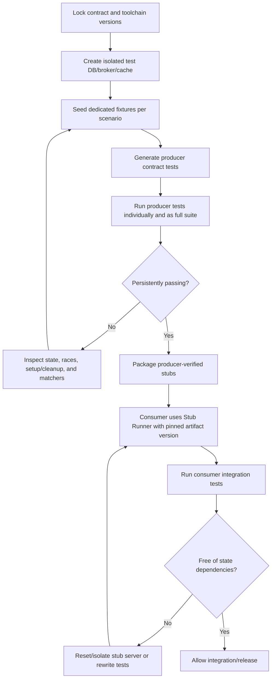

# Avoiding Order-Dependent Tests or Shared State

In microservices systems, the same API can return different status codes depending on current data: a new order can be cancelled and return `200 OK`, a shipped order is rejected with `409 Conflict`, and a non-existent order ID returns `404 Not Found`. That makes complete business sense. The problem arises when **a test's outcome depends on another test having run before it**, or when multiple tests share a database, cache, stub server, or message broker without controlling state.

With **Spring Cloud Contract**, teams use **Groovy/YAML DSL** to describe expectations between **producer** and **consumer**, generate producer contract tests, publish stubs, and use **Stub Runner** for consumer testing. If input data is not independent, even valid contracts can make CI fail randomly; conversely, a shared stub with leftover state can make consumer tests pass falsely.

This lesson belongs to the **Statuses and Errors** chapter of **SPRING_CLOUD_CONTRACT**. Its goal is to design contract tests that are **independent, repeatable, and faithful to state semantics**, especially for HTTP `200`, `404`, `409`, state-mutating interactions, and asynchronous messages.

## 1. Distinguishing Business State from Test Environment State

Two types of "state" are often confused:

- **Business state**: `NEW`, `CANCELLED`, `SHIPPED`, stock quantity, whether a resource exists or not. The producer **must** use this state to determine API behavior.
- **Test environment state**: data left over from an earlier test, an uncleaned queue, an unrefreshed cache, WireMock sitting in an already-triggered scenario, an expired token, or a singleton holding values across tests. This must **never implicitly affect** the outcome of an independent test.

Example:

```text
Test A: Create ORDER-42       -> 201 Created
Test B: Cancel ORDER-42       -> 200 OK
Test C: Cancel ORDER-42 again -> 409 Conflict
```

The sequence above describes a **valid workflow** if written as **one flow test** that prepares and verifies each step. However, if A, B, and C are three **independent contract tests** and B only passes when A runs first, the suite will fail when:

- running B individually in an IDE;
- the test runner changes execution order;
- CI runs multiple tests in parallel;
- A is excluded by a test filter;
- the database still holds data from an older build.

**Rule:** each contract test must know what initial state it requires on its own. If you genuinely want to test **a state sequence**, manage that sequence explicitly inside **one integration/workflow test**, rather than implicitly relying on the execution order of generated contract tests.

## 2. Why Are Order-Dependent Bugs Dangerous?

| Scenario | When Run Alone | When Run in Full Suite | Risk |
|---|---|---|---|
| `cancel` test requires `create` test to run first | `404` | Might be `200` | Contract test is not independent |
| `404` test uses an ID created by another test | `404` | Might be `200` | Verifies the wrong error case |
| `409` test relies on prior test transitioning state | `200` | Might be `409` | Cannot reproduce the error reliably |
| Two tests reset the same database concurrently | Might pass | Fails randomly | Race condition |
| Stub Runner reuses a WireMock scenario | Passes on fresh start | Later test gets a different response | Consumer test depends on history |
| Message broker still holds events from older tests | Might pass | May consume the wrong event | False conclusions about producer/consumer |

A "re-run once and it passes" result is usually a sign of a **flaky test**, not proof that an API change was fixed. Every passing run must have reproducible input conditions.

## 3. Designing HTTP Scenarios with Separated Data

Suppose producer **Order Service** exposes a cancellation API to consumer **Checkout**:

```http
POST /api/orders/{id}/cancel
Accept: application/json
```

Both teams agree on:

| Fixture Data | Pre-Request State | Request | Outcome |
|---|---|---|---|
| `ORDER-CANCELLABLE` | `NEW` | `POST /api/orders/ORDER-CANCELLABLE/cancel` | `200`, `status=CANCELLED` |
| `ORDER-SHIPPED` | `SHIPPED` | `POST /api/orders/ORDER-SHIPPED/cancel` | `409`, `code=ORDER_CANNOT_CANCEL` |
| `ORDER-MISSING` | Does not exist | `GET /api/orders/ORDER-MISSING` | `404`, `code=ORDER_NOT_FOUND` |

These are three distinct scenarios. Each runs against a **deterministic pre-request state**, rather than calling another endpoint to create state implicitly.

When preparing data for each producer test:

- Create/reset `ORDER-CANCELLABLE` to `NEW`.
- Create/reset `ORDER-SHIPPED` to `SHIPPED`.
- Ensure `ORDER-MISSING` **does not exist**.
- Clean up test-scoped side effects such as status tables, caches, and outbox events when needed.
- Separate databases or namespaces so parallel tests do not mutate the same IDs concurrently.

If the `200` test runs first and transitions `ORDER-CANCELLABLE` to `CANCELLED`, running the `200` test again must still start from `NEW`. That is the fixture's responsibility.

### 3.1. Groovy DSL: Successful Cancellation

A contract for the cancellable scenario:

```groovy
import org.springframework.cloud.contract.spec.Contract

Contract.make {
    name 'checkout_cancel_new_order_200'
    description 'A NEW order can be cancelled successfully'

    request {
        method POST()
        url '/api/orders/ORDER-CANCELLABLE/cancel'
        headers {
            header 'Accept', 'application/json'
        }
    }

    response {
        status OK()
        headers {
            contentType(applicationJson())
        }
        body(
            id: 'ORDER-CANCELLABLE',
            status: 'CANCELLED'
        )
    }
}
```

The generated producer test from this contract sends `POST` and verifies the response per DSL. It **does not infer** creating a `NEW` order from `description`. The project's producer test base or setup mechanism must put the data into the right state before every test.

### 3.2. YAML DSL: Rejecting Cancellation of a Shipped Order

A **separate** contract for the conflict scenario:

```yaml
name: checkout_cancel_shipped_order_409
description: Shipped order cannot be cancelled
request:
  method: POST
  url: /api/orders/ORDER-SHIPPED/cancel
  headers:
    Accept: application/json
response:
  status: 409
  headers:
    Content-Type: application/json
  body:
    code: ORDER_CANNOT_CANCEL
    message: Order has already shipped
```

When running the `409` contract, the producer must **already have** `ORDER-SHIPPED` in the `SHIPPED` state. Truncating the whole table without re-seeding data will cause the producer to return `404`, which does not test the intended scenario.

`409 Conflict` expresses a conflict with the resource's current state per API design; it is not a mandatory status code for every business error. Always use the error code and schema agreed between producer and consumer.

### 3.3. YAML DSL: Non-Existent Resource

```yaml
name: checkout_get_missing_order_404
description: Non-existent order returns 404
request:
  method: GET
  url: /api/orders/ORDER-MISSING
response:
  status: 404
  headers:
    Content-Type: application/json
  body:
    code: ORDER_NOT_FOUND
    message: Order not found
```

A `404` test also needs fixture preparation: **ensure the ID is genuinely absent**, rather than picking an ID assumed to be "probably never used."

The Groovy and YAML examples above represent **three different scenarios**, so they can coexist in Order Service's contract set. In a real project, verify how the plugin scans directories, generates tests, and creates mappings for your chosen Spring Cloud Contract version.

## 4. Do Not Let Generated Contract Tests Create Implicit Ordering

Spring Cloud Contract generates test code from DSL according to build configuration. For each independent request/response, the reliable pattern is that every test can run **by itself** on suitable fixtures.

Assumptions to avoid:

- "File `create_order.groovy` is read before `cancel_order.groovy`, so data will already exist."
- "Test names start with `001_`, `002_`, so JUnit will run them in order."
- "Maven/Gradle preserves test order in CI."
- "Test B just needs to read the data Test A wrote."
- "CI automatically cleans the database between tests."

**Never rely on file names, method names, plugin scan order, or JUnit execution order** to pass business state between contract tests.

If an endpoint only returns its expected response after a data-preparation step, put that state into **the pre-test fixture**. If the requirement is to verify state transitions across multiple APIs, write an explicit **workflow integration test** outside the scope of individual standalone contracts.

### 4.1. When Should an Entire Business Sequence Be Tested?

For example, Checkout has a flow:

```text
POST /api/orders        -> 201, receive orderId
POST /api/orders/{id}/cancel -> 200
GET /api/orders/{id}    -> 200, status=CANCELLED
```

This is a **business-meaningful ordered interaction test**. It makes sense when packaged inside **a single workflow test** that creates its own data, invokes all three steps, keeps `orderId` scoped to the test, and cleans up at the end.

Do not split the flow into three contract tests and expect test generation to guarantee they run in sequence. Contract testing protects each step's **HTTP interface**; integration testing adds proof that **the overall workflow** coordinates properly against real state.

## 5. Building Independent Producer Fixtures

A test base can manage data uniformly for producer tests. The Java example below illustrates test setup responsibilities when using Spring MVC/MockMvc.

```java
import io.restassured.module.mockmvc.RestAssuredMockMvc;
import org.junit.jupiter.api.BeforeEach;
import org.springframework.beans.factory.annotation.Autowired;
import org.springframework.boot.test.autoconfigure.web.servlet.AutoConfigureMockMvc;
import org.springframework.boot.test.context.SpringBootTest;
import org.springframework.test.web.servlet.MockMvc;

@SpringBootTest
@AutoConfigureMockMvc
public abstract class OrderContractTestBase {

    @Autowired
    MockMvc mockMvc;

    @Autowired
    OrderTestFixture fixture; // Helper defined by the project itself.

    @BeforeEach
    void prepareContractState() {
        // Must run against an isolated test database/schema.
        fixture.resetContractOrders();
        fixture.insertOrder("ORDER-CANCELLABLE", "NEW");
        fixture.insertOrder("ORDER-SHIPPED", "SHIPPED");
        fixture.ensureOrderAbsent("ORDER-MISSING");

        RestAssuredMockMvc.mockMvc(mockMvc);
    }
}
```

**This is a structural example**, not a class runnable as-is:

- `OrderTestFixture` must be implemented by the project, covering database/repositories, transactions, and related cache/outbox handling.
- The Spring Cloud Contract plugin must be configured so **generated tests extend the right base class** and use a test mode compatible with MockMvc.
- The project must include version-compatible Spring Boot Test, JUnit, RestAssured MockMvc, and Contract Verifier dependencies.
- If the producer uses WebFlux or a test mode that starts a real server, adapt the test base accordingly.
- All reset/seed operations must **only affect the test environment**.

This setup ensures each test has **conceptually accurate** data, yet **it is not yet safe for parallel execution against the same database**: two `@BeforeEach` methods could wipe each other's data. An isolation strategy is still required (section 6).

### 5.1. Illustrative SQL Seed Example

For a test database with a matching schema:

```sql
DELETE FROM orders
WHERE id IN (
    'ORDER-CANCELLABLE',
    'ORDER-SHIPPED',
    'ORDER-MISSING'
);

INSERT INTO orders (id, status) VALUES
    ('ORDER-CANCELLABLE', 'NEW'),
    ('ORDER-SHIPPED', 'SHIPPED');
```

Never run these delete statements on a production database or a database shared with another team. If foreign keys, outbox tables, history tables, or caches exist, data resets must cover **all components involved in the scenario**, not just the `orders` table.

### 5.2. Seed Before or Rollback After?

The two techniques serve different purposes:

- **Seed/reset before test:** establishes a known input state; useful for `200`, `404`, and `409` scenarios.
- **Rollback/cleanup after test:** prevents side effects from leaking into other tests; useful when requests mutate the database.

Do not assume `@Transactional` on a JUnit test rolls back all data touched by a controller. If HTTP tests hit a real server/port on another thread and transaction, test-method rollback may not cover the request's transaction. Always verify **actual transaction boundaries**.

With `@Sql`, test fixtures/helpers, or Testcontainers, document clearly **when data is created, when it is deleted, and which test owns each resource**.

## 6. Parallel Execution: Resetting the Same Data Is Still Not Enough

Suppose test A sends `POST /api/orders/ORDER-CANCELLABLE/cancel` right as test B starts and executes `fixture.resetContractOrders()`. Test A may receive `404` instead of `200` because the record was just deleted. Both tests have `@BeforeEach`, yet the suite remains non-repeatable.

Strategies to reduce contention:

| Strategy | Pros | Limitations |
|---|---|---|
| Separate database/schema per worker | Isolates data, easy to reproduce | Overhead to provision environments |
| Dedicated namespace/tenant and IDs per test | Can run in parallel on the same DB | Contracts and fixtures must support explicit ID mapping |
| Dedicated test container per suite/worker | Reduces host and CI dependencies | Testcontainers still must avoid wrong scope sharing |
| Disable parallelism for tests touching shared state | Quickly eliminates races | Slower suite, does not fix dirty data between runs |
| Per-test resource locking | Protects specific shared resources | Easy to become a bottleneck or miss side effects |
| Mock dependencies at the HTTP boundary | Fast tests with minimal DB reliance | Does not replace integration tests with real persistence |

If tests must use a fixed request like `ORDER-CANCELLABLE`, you cannot simply append a random UUID to the path on each run without updating the DSL/fixtures consistently. **Design isolation to fit the contracts**, rather than silently changing the meaning of generated requests.

You can **temporarily disable JUnit parallel execution** for producer contract tests sharing a DB as an immediate safeguard. Long term, however, reduce shared state and guarantee cleanups.

### 6.1. `@DirtiesContext` Is Not a Cure-All for Dirty Data

`@DirtiesContext` tells Spring TestContext the context needs refreshing, which helps when a test mutated **bean/application context state**. However, it does not automatically clear **external databases, Redis, brokers, filesystems, or WireMock servers outside the context**.

Restarting the Spring context can add significant runtime overhead. Do not slap `@DirtiesContext` onto every test to mask missing fixtures/cleanup. Identify **which state is actually shared**, then choose a reset mechanism at the right layer.

## 7. Modeling Error States in Contracts Without Ambiguous Stubs

A key characteristic of **Stub Runner** is that HTTP stubs typically serve responses based on **request matching conditions**. They do not know what state an order has inside the producer's database.

If you write two contracts:

```text
POST /api/orders/ORDER-42/cancel -> 200 CANCELLED
POST /api/orders/ORDER-42/cancel -> 409 ORDER_CANNOT_CANCEL
```

with **the exact same method, path, and request conditions**, both mappings can match the same request. The stub cannot infer which test just ran before it to pick the right response. Renaming the contract files will not solve this.

The contract set in section 3 uses **different input IDs**, letting the consumer request the exact scenario:

```text
POST /api/orders/ORDER-CANCELLABLE/cancel -> 200
POST /api/orders/ORDER-SHIPPED/cancel     -> 409
GET  /api/orders/ORDER-MISSING            -> 404
```

This split works nicely for **testing client handling of states and errors**. If the consumer must verify state **actually transitioning from NEW to CANCELLED**, use a producer workflow test or an explicitly designed stateful simulation.

### 7.1. Stateful Stubs and WireMock Scenarios

WireMock supports **stateful scenarios** so a mapping can change behavior according to scenario state when properly configured. This is an **optional mock server feature**, not the default behavior of every Groovy/YAML contract in Spring Cloud Contract.

If a project uses stateful stubs:

1. Identify the exact scenario configuration API supported by **your version of Spring Cloud Contract/WireMock**.
2. Use scenarios only when consumer tests **genuinely need multi-step verification**.
3. Initialize scenarios back to their starting state before **every test needing independence**.
4. Do not share scenario state across parallel consumer tests.
5. Check that unrelated mappings/contracts do not accidentally share the same scenario name.
6. Never mistake a passing stub scenario for proof that the real producer transitions state properly.

**Caution when resetting:** a full WireMock reset can wipe out mappings loaded by Stub Runner as well. If you only need to reset scenario state, use the corresponding API supported by your server version, or spin up a fresh stub server instance; never call reset-all and assume mappings stay intact.

### 7.2. Consumer Tests Should Be Independent of Stub Server History

A consumer test using Stub Runner should:

- Point Checkout's real client to the running stub server.
- Send the request for **one clearly defined scenario**.
- Verify how the client parses the body and handles `200`, `404`, and `409`.
- Never depend on a previous consumer test having called `create` or "unlocked" a scenario.
- Perform explicit setup/reset if the test intentionally uses stateful mappings.

Stub Runner may reuse the server or Spring context depending on integration and configuration; **never assume every test method automatically gets a completely fresh WireMock server**.

## 8. Status Codes and Errors Must Be Verified Meaningfully

Splitting tests helps verify the exact semantics of errors:

| Case | Illustrative HTTP Code | What to Assert |
|---|---|---|
| Cancel new order | `200 OK` | `CANCELLED` state and matching ID |
| Cancel shipped order | `409 Conflict` | Body contains stable error code `ORDER_CANNOT_CANCEL` |
| Read non-existent order | `404 Not Found` | Published error body, not mistaken for unmatched stub `404` |
| Send invalid request body | `400 Bad Request` | Error schema consumer needs to fix the request |
| Missing authentication | `401 Unauthorized` | Authentication flow per contract |
| Authenticated but unauthorized | `403 Forbidden` | Authorization flow per contract |
| Dependent system temporarily down | `503 Service Unavailable` (if API uses it) | Consumer retry/backoff mechanism per policy |

Do not "make every error scenario return `400`" just to reduce the number of fixtures. Consumers need to distinguish retryable errors from errors requiring request fixes or permissions.

For `404`, pay special attention to distinguishing:

- **`404` from the producer described in the contract**: the request matched and the backend returned a business error.
- **Default `404` from WireMock/Stub Runner when no mapping matched**: the stub found no matching scenario.

Both responses share the same status code yet **do not share the same meaning**; verify expected body/headers and request mappings.

## 9. Caches, Sessions, Tokens, and Singletons: Overlooked Shared Sources

Even after resetting the database, producer tests may still depend on non-database state:

| State | Symptom | Prevention |
|---|---|---|
| In-memory/Redis cache | Test returns stale data despite updated DB | Clear cache by test namespace or use isolated caches |
| HTTP session/cookie | Test passes without token because session remained authenticated | Fresh client/session per test, clear valid sessions |
| Spring singleton holding mutable fields | Results depend on previous test method | Design statelessly or reset state explicitly |
| Expired token | `200` today, `401` next week | Use controllable test tokens/Clock; never use real credentials |
| Rate limiter | Subsequent test receives `429` | Reset limiter or isolate per namespace/client identity |
| Idempotency cache | Subsequent POST returns old response | Use fixed idempotency keys per scenario, isolated across tests |
| Outbox/queue | Test receives events from earlier runs | Clean up and filter events by correlation key |
| Feature flag | One test toggles a flag affecting later tests | Pin feature config and reset |

If you only reset the `orders` table while the cache still holds `ORDER-42=CANCELLED`, the `NEW` scenario test may fail. Document **every component affecting observable behavior** of the producer.

### 9.1. Idempotency and Repeated Requests

An API may use an `Idempotency-Key` header so identical requests can be resent without creating duplicate side effects. If the consumer relies on this behavior, specify retry request/response expectations clearly in contracts.

However, testing **first call and repeat call with the same key** is a **stateful workflow**. Do not split it into two independent contracts and assume the server preserves the previous test's key. Use a workflow test or seed test data representing pre-existing idempotency state; verify corresponding stub mappings if the consumer must simulate repeat calls.

## 10. Message Contracts: Shared State Is Even Harder to Spot

Message contracts in Spring Cloud Contract can verify that a producer emits events with committed destinations, headers, and bodies. Consumers use stubs/message triggers to test event-handling logic. However, brokers and consumer groups are resources that can retain state across multiple runs.

Example event:

```json
{
  "eventId": "EVENT-42",
  "type": "ORDER_CANCELLED",
  "orderId": "ORDER-CANCELLABLE"
}
```

If the broker still holds `EVENT-42` from a previous test, a new consumer test might "receive the right event" before the current producer even emits it. If multiple tests share one consumer group, events may be distributed across consumers so tests pass individually yet time out in parallel.

Mitigations:

1. **Dedicated event IDs/correlation IDs** per scenario or test instance, with assertions checking the exact correlation.
2. **Isolated topics/queues/consumer groups** in the test environment if your tools and broker support it.
3. **Clean up leftover messages** or spin up a clean test broker per policy.
4. **Await observable conditions** rather than hardcoding `Thread.sleep(500)` and hoping the event arrived.
5. **Do not rely on event ordering** unless the broker/API guarantees ordering; when guaranteed, test within the proper partition/key scope.
6. **Reset shared mock message verifiers/stub trigger state** between tests.
7. **Test idempotency/duplicate events** in a dedicated integration test layer when the consumer must tolerate broker redelivery.

Message contract labels used to trigger scenarios should be stable, such as `checkout_order_cancelled_v1`, without embedding random timestamps that force consumer tests to know prior test outcomes.

## 11. Designing CI to Catch Order Dependencies

CI's goal is not merely "run all tests until green," but to prove **tests are repeatable and do not hide API regressions**.

Suggested workflow:



Technical checklist:

- **JDK/Wrapper and plugin versions** are pinned and compatible.
- **Generated producer contract tests actually execute**, never skipped.
- **Fixtures are initialized before each test** with proper cleanup or isolation.
- **Tests run independently**: at minimum, critical state/error scenarios pass when run alone.
- **Tests run together/in parallel**: no contention over DBs, ports, stub scenarios, caches, or brokers.
- **Pinned stub version**, traceable back to the verified producer build.
- **Request/response logs record error codes, fixture IDs, and correlation**, without real tokens or PII.
- **Pipeline release gate** blocks whenever producer contract tests or consumer tests fail.

### 11.1. Illustrative Commands

If the producer uses a Maven Wrapper configured with Spring Cloud Contract:

```bash
./mvnw clean test
./mvnw verify
```

If using a Gradle Wrapper:

```bash
./gradlew clean test
./gradlew build
```

These commands are only meaningful when plugins, source directories, and test bases are properly configured. `clean` reduces the risk of stale generated artifacts, yet **does not automatically wipe databases, queues, Redis, or stub server state**.

To run a single test, use your project version's JUnit/Maven/Gradle test filtering. If a contract only passes in the full suite yet fails when run alone, look for missing setup. If it only fails in parallel, look for shared resources and race conditions.

## 12. Systematic Failure Analysis

Suppose scenario `checkout_cancel_shipped_order_409` sometimes returns `409` and sometimes `200`. Investigation order:

1. **Read the contract name** and producer/plugin/stub version details.
2. **Capture the actual request** sent by the generated test: method, path, headers, body.
3. **Inspect the pre-request fixture**: was `ORDER-SHIPPED` actually in `SHIPPED` state?
4. **Check concurrent tests** to see if any reset or changed `ORDER-SHIPPED`'s state.
5. **Inspect caches, transactions, and sessions** if the DB was right yet the response was wrong.
6. **Verify test mode**: is the request running via MockMvc, a real server, or a WireMock stub?
7. **Compare the error body**: did `409` include `ORDER_CANNOT_CANCEL`?
8. **Re-run in isolation** on a freshly initialized environment to pinpoint the root cause.
9. **Fix at the right layer**: fixture/isolation, producer logic, or contract (only when approved by both teams).
10. **Re-run producer/consumer tests** before publishing stubs.

| Symptom | Possible Cause | Action |
|---|---|---|
| `409` occasionally becomes `200` | Order was reset to `NEW` | Isolate fixtures, check for races |
| `200` becomes `404` | Order was deleted by another test | Seed per test, avoid global resets |
| `404` becomes `200` | Another test created the ID expected to be absent | Manage negative fixtures |
| Consumer gets wrong stub response | Overlapping mappings or stale scenario | Inspect mappings, reset scenario/isolate server |
| Fails only in CI | Shared DB/cache across jobs | Isolate job/namespace |
| Fails only when run individually | Setup lived in an earlier test | Move setup into the test's own fixture |
| Message test gets wrong event | Leftover messages in broker or missing correlation | Clean broker and filter by exact ID |
| Build passes with zero generated tests | Plugin didn't pick up contracts or tests skipped | Check generation output and test counts |
| Passes on retry | Unresolved race/timeout/dirty state | Collect evidence, fix root cause |

Never fix failures by automatically retrying until green. Retrying can help **diagnose flakiness**, yet does not replace ensuring tests are independent.

## 13. Misconceptions to Avoid

**"JUnit always runs methods in alphabetical order."** Do not rely on this. Certain ordering mechanisms exist, yet they do not make tests independent; plugins, runners, and CI can change execution behavior.

**"Having `@BeforeEach` automatically makes parallel runs safe."** No. If every test resets the same database or uses the same ID, setup operations can still race against each other.

**"`@Transactional` rolls back every HTTP request."** Not automatically. HTTP requests against a real server can execute in a different transaction than the test method.

**"`@DirtiesContext` resets databases and brokers too."** No. It primarily manages the Spring context lifecycle; out-of-context resources need their own mechanisms.

**"Stub Runner reads producer database state."** No. HTTP stubs simulate request–response pairs from mappings and never access the producer's DB.

**"Two contracts with identical requests but different responses are fine because their filenames differ."** No. If request matchers overlap, the stub can pick an unexpected response.

**"`404` tests need no data setup."** Wrong. You must ensure the resource **does not exist**; if the ID is created randomly or by another test, the scenario breaks.

**"One green CI run proves tests aren't flaky."** Insufficient. Running individually, running the full suite, and testing in parallel reveal hidden dependencies; more importantly, design fixtures and isolation right from the start.

## 14. Exercise: Eliminating Order Dependencies in Order Service

Context: producer **Order Service** and consumer **Checkout** use Spring Cloud Contract. A legacy suite had three steps:

```text
A. Create ORDER-42 (201)
B. Cancel ORDER-42 (200)
C. Cancel ORDER-42 again (409)
```

When run alone, B reports `404`, while C sometimes returns `200`. Consumer tests with Stub Runner also occasionally see the `200` mapping intercept `409` requests.

### Phase 1 — Reproduce and Analyze

1. Run B and C individually in a clean test environment and record the failures.
2. Identify which tables, caches, or states A wrote that B and C implicitly depended on.
3. Inspect the generated producer tests: do they contain any setup creating `ORDER-42`?
4. Inspect Stub Runner mappings for the cancel request; locate overlapping conditions.

### Phase 2 — Split Contracts by Fixture

1. Create `ORDER-CANCELLABLE` in `NEW` state for `200`.
2. Create `ORDER-SHIPPED` in `SHIPPED` state for `409`.
3. Ensure `ORDER-MISSING` does not exist for `404`.
4. Write the three contracts from section 3 or equivalents, ensuring method/path/request conditions are clearly distinct.
5. Build a matching seed/reset test base and verify each generated test passes **when run alone**.

### Phase 3 — Isolate Data and Stubs

1. Run tests in an isolated DB/schema; if running in parallel, prevent setups from deleting each other's data.
2. If the full A→B→C sequence must be verified, write **a dedicated workflow integration test** with setup/cleanup.
3. Ensure Stub Runner HTTP mappings select the right `200`/`409`/`404` regardless of test order.
4. If using stateful WireMock scenarios, explicitly reset state between tests.
5. For `ORDER_CANCELLED` messages, use correlation IDs and isolated test brokers.

### Phase 4 — CI and Intentional Breakage Testing

1. Generate and execute producer contract tests against the implementation.
2. Package stubs only when producer verification passes.
3. Have the consumer run Stub Runner with a pinned artifact version.
4. Run a single test, the full suite, and a parallel run under suitable isolation.
5. Temporarily modify the implementation to allow cancelling `SHIPPED` orders. The `409` contract must fail, proving tests guard the business rule.

**Completion criteria:** the three state/error scenarios do not need each other to run first, have no data contention, and have unambiguous mappings; producer tests catch regressions, consumer tests use the right stubs, and CI reproduces results reliably.

## 15. Self-Check Knowledge Quiz

1. **Why shouldn't a cancel-order test depend on a create-order test running first?** Because each contract test must supply its own fixtures to run alone and in any order.
2. **If two tests both use `@BeforeEach` to reset the same DB, are they parallel-safe?** No. Reset operations can delete data another concurrent test is actively using.
3. **What input state does a `404` test need?** It must guarantee the queried ID genuinely does not exist.
4. **How should a create → cancel → read-status sequence be tested?** Use a workflow integration test managing its own sequence/IDs, complementing independent contracts for each interface.
5. **Does `@DirtiesContext` automatically clear Redis/brokers outside the context?** No; external resources require separate cleanup/isolation.
6. **Why are two stubs with identical requests returning `200` and `409` dangerous?** Stub servers do not know backend state; both mappings can match.
7. **Can stateful WireMock scenarios be used?** Yes, if supported by your version/config, provided scenarios are explicitly reset and isolated.
8. **Why might `409` occasionally turning into `404` not mean the API changed?** Fixtures might have been wiped or not seeded properly.
9. **Does a passing Stub Runner consumer test prove the producer database was reset properly?** No. Stubs do not use the producer's real database.
10. **What is the easiest symptom of order dependency to spot?** A test passes in the full suite yet fails when run alone, or fails only when order changes or parallelism is enabled.
11. **Should flaky tests be auto-retried until green to open the release gate?** No. Fix the state/race root cause and keep tests reliable.
12. **What must CI guarantee before publishing stubs?** Producer contract tests ran against stable fixtures without order dependencies, the artifact is properly versioned, and corresponding consumer tests pass.

## Conclusion

**Avoiding order dependencies and shared state** is essential for Spring Cloud Contract to accurately detect breaking API changes. Separate `200`, `404`, and `409` scenarios using **independent fixtures**, reset or isolate producer data, control caches/brokers/sessions, avoid overlapping HTTP mappings, and use **stateful stubs** only with an explicit sequence-testing design. Combining **generated producer contract tests**, **Stub Runner consumer tests**, and **CI release gates** on reproducible environments turns your contract suite into a trustworthy signal instead of flaky tests.
