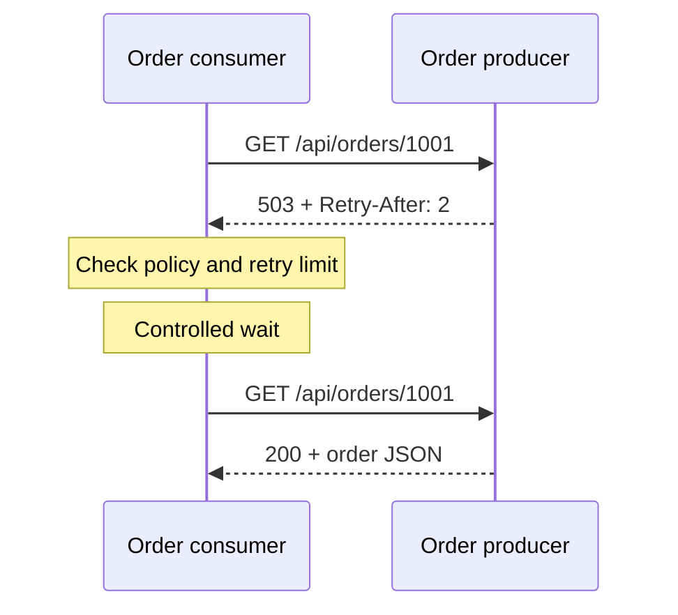
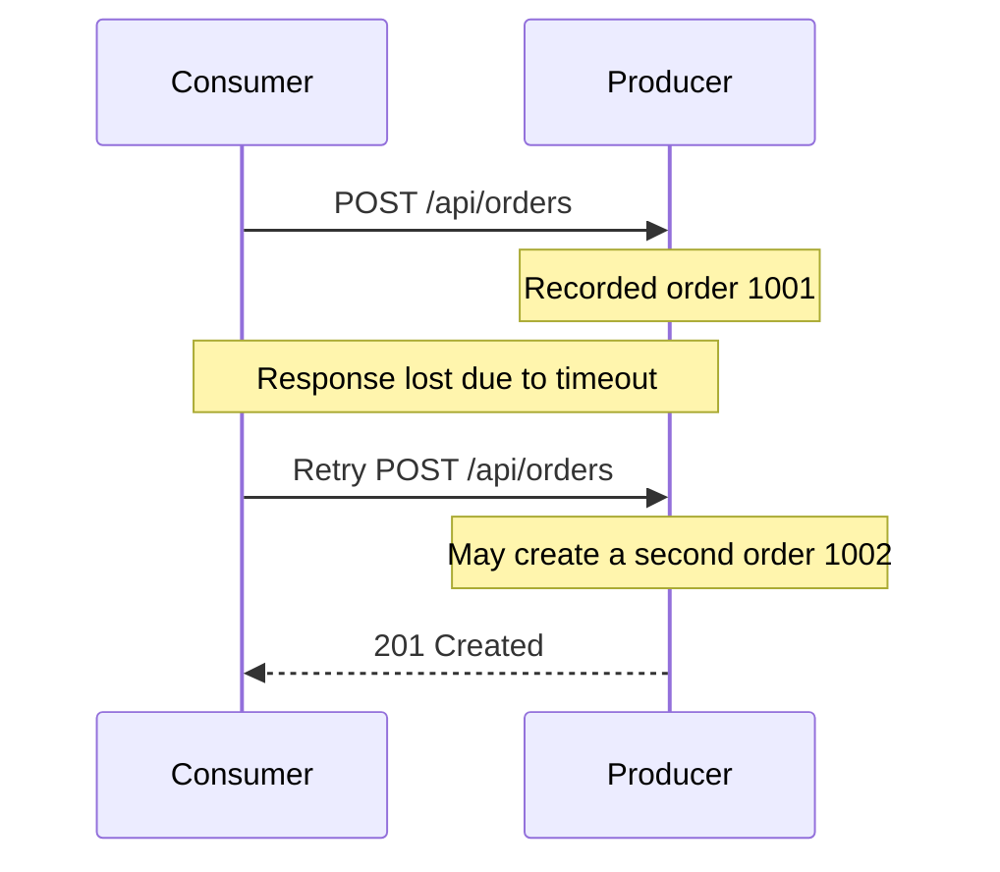
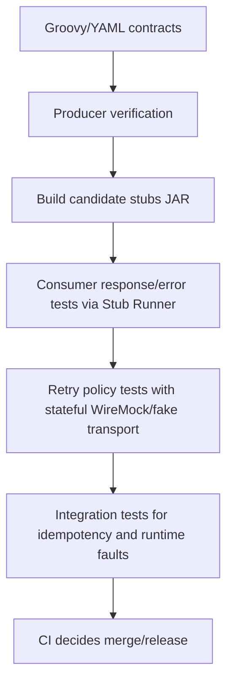

# Retry Behavior and Contract Verification Limits in Spring Cloud Contract

In distributed systems, an error does not always mean an operation failed permanently. A producer may be temporarily overloaded, a dependency may go down for a few seconds, or a client may miss a response due to a network glitch. **Retries** help consumers recover from transient failures, yet uncontrolled retries can create duplicate orders, amplify load on a struggling system, or stretch response times past limits.

**Spring Cloud Contract (SCC)** helps capture **observable behavior at the communication boundary** using Groovy/YAML DSL: HTTP statuses, response headers, error bodies, request headers, or message payloads. From contracts, the tool generates **provider verification tests** and **stubs** for consumers to use with **Stub Runner**. However, **a static response contract does not prove on its own that a client retries the right number of times, waits the right duration, stops under the right conditions, or avoids duplicate side effects**.

This lesson in the **Statuses and Errors** chapter analyzes that boundary while building a complete testing strategy for an `order-producer` service exposing an orders API and an `order-consumer` calling it.

## 1. Objectives and Retry Model

After this lesson, you should be able to:

1. Classify retryable errors, non-retryable errors, and errors governed by business semantics.
2. Write contracts for HTTP 503/429 with `Retry-After` and error structures in Groovy or YAML.
3. State clearly what producer verification checks and what it **does not** check regarding retries.
4. Structure consumer tests to observe request counts, backoff, deadlines, and stop conditions.
5. Prevent retries from causing duplicate side effects using idempotency or idempotency-key mechanisms.
6. Separate HTTP retry rules from message broker retry/redelivery and wire test layers into CI.

Simple business flow:



The diagram depicts **two interactions across a sequence**. Meanwhile, a standard SCC HTTP contract describes **one request and one expected response**. You must use the right tools to verify the full timeline.

## 2. Retrying Is a Consumer Decision, Not a Default Property of Status Codes

An HTTP status helps the consumer reason about a failure, yet it does not automatically trigger retries. For example, a standard `RestTemplate` **does not automatically** execute a full retry policy just because the server returns 503. The consumer needs an HTTP client, retry library, or orchestration layer with explicit configuration.

| Signal | Retryability | Required Question Before Retrying |
| --- | --- | --- |
| `503 Service Unavailable` | Often transient | Is `Retry-After` present? Is the system overloaded? |
| `429 Too Many Requests` | Retryable once limit window resets | Are quota and server-requested wait time respected? |
| `502 Bad Gateway` | Possibly a transient gateway error | Was the prior request forwarded to the backend? |
| `504 Gateway Timeout` | Safely retryable only under conditions | Might the backend have executed the operation despite gateway timeout? |
| `408 Request Timeout` | Retryable in some scenarios | Did the prior request have side effects? |
| `500 Internal Server Error` | Do not assume all 500s are retryable | Is the cause transient and is the request safe to repeat? |
| `409 Conflict` | Depends on business semantics | Can the conflict resolve on its own or must data change? |
| `404 Not Found` | Typically not retryable | Is there a clearly specified eventual-consistency scenario? |
| `400 Bad Request`, `422 Unprocessable Content` | Usually not retryable with identical input | What input data needs fixing? |
| `401 Unauthorized`, `403 Forbidden` | Do not keep retrying identical request | Is there a valid, bounded credential-refresh flow? |
| Connection or response-read error | Possibly retryable | Did the server already receive and execute the first request? |

For example, `POST /api/orders` times out **after the server already created the order**. The consumer does not know whether the response was lost or the operation never ran. Resending POST can create a second order unless the producer has deduplication measures.

**Do not write a rule like "retry any 5xx three times" across every endpoint.** Retry decisions must simultaneously consider error type, HTTP method/operation, idempotency, time budget, and business requirements.

### 2.1. Retry vs. Fallback and Circuit Breaker

- **Retry:** resending a request after a failure, typically with backoff.
- **Timeout:** bounding time per attempt or for the entire operation.
- **Circuit breaker:** temporarily halting calls to a dependency once error rates exceed a threshold, avoiding extra load.
- **Fallback:** returning a substitute value or degraded behavior when a dependency does not respond.
- **Bulkhead/rate limiter:** capping concurrency or request rate to protect resources.

An SCC contract can verify **the response at a specific state**, yet does not verify circuit-breaker algorithms, fallback choices, or how these limits interact. Those behaviors require supplementary consumer/resilience tests.

## 3. HTTP Retry-After: A Signal in the Contract

The `Retry-After` header indicates a timestamp or wait duration suggested by the server before the next request. For rate-limited or temporarily unavailable APIs, this is a helpful signal.

Example transient error:

```http
HTTP/1.1 503 Service Unavailable
Content-Type: application/problem+json
Retry-After: 2

{
  "type": "https://example.org/problems/order-source-unavailable",
  "title": "Order source temporarily unavailable",
  "status": 503,
  "code": "ORDER_SOURCE_UNAVAILABLE"
}
```

Meaning of the response:

- `503`: the service currently cannot fulfill the request under the tested condition.
- `Retry-After: 2`: delay-seconds value, meaning wait roughly two seconds before retrying per server guidance.
- `Content-Type: application/problem+json`: error response uses Problem Details JSON representation.
- `code`: application error code belonging to the contract; the consumer can act on it if agreed.

`Retry-After` can be expressed as **delay-seconds** or an **HTTP-date**:

```http
Retry-After: 2
```

```http
Retry-After: Wed, 21 Oct 2015 07:28:00 GMT
```

The second line illustrates **HTTP-date syntax**, not a date to use in 2026 exercises. With HTTP-date, the client computes wait time from current time; clock skew or cached responses can affect it. Clients should have clear policies when the header is missing, malformed, in the past, too far out, or exceeds total allowed time.

**A response containing `Retry-After` does not mean the client must retry indefinitely.** If the suggested wait exceeds the business deadline, the consumer can stop and report an error or enqueue for later processing instead of violating its deadline.

### 3.1. Retry-After Does Not Replace Compatibility Guidance

Both `429` and `503` may carry `Retry-After`, yet their meanings differ:

| Response | Common Context | What the Consumer Should Consider |
| --- | --- | --- |
| `429 + Retry-After` | Request rate limited | Respect quota; avoid all clients firing together again |
| `503 + Retry-After` | Producer/dependency temporarily unavailable | Avoid adding load to a struggling system |
| `503` without `Retry-After` | Producer temporarily failing without specifying wait | Bounded default backoff policy |
| `200` after failure | Service recovered | Stop retrying immediately; send no extra requests |

Do not assume every 503 response from every producer includes `Retry-After`. If the consumer relies on this header as part of the interface, declare it in the corresponding scenario's contract.

## 4. Groovy DSL: Contract for 503 Error and Retry-After

Suppose the producer has a reproducible test case for a temporary dependency failure on order `9001`. Choosing this ID is a **practice fixture**, not a production rule for that ID.

File `src/test/resources/contracts/http/get-order-service-unavailable.groovy`:

```groovy
import org.springframework.cloud.contract.spec.Contract

Contract.make {
    description 'When order source is temporarily unavailable, return 503 and Retry-After'

    request {
        method GET()
        url '/api/orders/9001'
        headers {
            header('Accept', 'application/json')
        }
    }

    response {
        status 503
        headers {
            header('Content-Type', 'application/problem+json')
            header('Retry-After', '2')
        }
        body(
            type: 'https://example.org/problems/order-source-unavailable',
            title: 'Order source temporarily unavailable',
            status: 503,
            code: 'ORDER_SOURCE_UNAVAILABLE'
        )
    }
}
```

Contract breakdown:

| Declaration | What Producer Must Satisfy |
| --- | --- |
| `request.method GET()` | Accept HTTP GET properly |
| `request.url` | Test scenario targeting `/api/orders/9001` |
| `response.status 503` | Return HTTP 503 accurately |
| `Content-Type` | Error payload advertised as Problem Details JSON |
| `Retry-After: 2` | Server supplies retry wait header in this scenario |
| `response.body.code` | Preserve error code committed to consumer |

SCC generates a **producer test** that sends the sample request and checks one response against the contract. If the implementation swaps 503 for 500, drops `Retry-After`, or renames `code`, the generated test alerts you when run with proper test setup.

This contract file does **not** state that the next call will succeed; nor does it prove the consumer slept two seconds, enforced an attempt cap, or retried at all.

### 4.1. Making Producer Tests Reproducible

Do not rely on an external service **happening** to fail to produce a 503 response. Configure tests so the producer takes a controlled error branch:

```text
Provider verification setup
  -> test data contains orderId = 9001
  -> fake/mock dependency returns "temporarily unavailable"
  -> call GET /api/orders/9001 via HTTP test mode
  -> controller/exception handler produces 503 response
  -> generated test compares status, headers, body
```

In a Spring application, the test base can use MockMvc or an appropriate HTTP test mode and replace the dependency with a test double. Error handling should execute the producer's real path (such as its exception handler), rather than writing an external stub and mistaking it for provider verification.

If a test fluctuates because a real dependency keeps recovering and failing, CI results stop being reproducible. **Failure-behavior testing should use controlled fixtures**, isolated from external systems.

## 5. YAML DSL: The Same 503 Error Behavior

If the team prefers YAML over Groovy, write the same commitment at `src/test/resources/contracts/http/get-order-service-unavailable.yml`:

```yaml
description: "When order source is temporarily unavailable, return 503 and Retry-After"
request:
  method: GET
  url: /api/orders/9001
  headers:
    Accept: application/json
response:
  status: 503
  headers:
    Content-Type: application/problem+json
    Retry-After: "2"
  body:
    type: "https://example.org/problems/order-source-unavailable"
    title: Order source temporarily unavailable
    status: 503
    code: ORDER_SOURCE_UNAVAILABLE
```

`Retry-After: "2"` is quoted to represent a **header string**, not a JSON number. HTTP headers travel as text even when their meaning is a count of seconds. `body.status: 503` remains a JSON numeric value, in a different position from `response.status: 503`.

The Groovy and YAML examples are **two ways to represent the same scenario**. Include only one file in the build's scanned contract directory to avoid generating duplicate tests/stub mappings.

### 5.1. Another Contract for 429

For example, the producer has a rate-limiting test case triggered by a test fixture; the response might be:

```http
HTTP/1.1 429 Too Many Requests
Content-Type: application/problem+json
Retry-After: 5

{"type":"https://example.org/problems/rate-limited","status":429,"code":"RATE_LIMITED"}
```

A contract can verify `429`, `Retry-After: 5`, and the error body. However, **rate limiting triggering only after N requests in window T** is stateful, time-based behavior; a single request/response contract does not verify the quota algorithm on its own. You need dedicated stateful/integration tests to verify counters and reset windows.

## 6. Do Not Place Two Conflicting Responses Unconditionally on the Same Request

A common mistake when modeling retries is creating two contracts like this:

```text
Contract A: GET /api/orders/1001 -> 503
Contract B: GET /api/orders/1001 -> 200
```

If both contracts match the request **with no distinguishing condition**, the stub set becomes ambiguous: there is no deterministic rule for when to return 503 versus 200. Contract Verifier also needs producer test setup ensuring each scenario produces its corresponding response.

Three resolutions:

1. **Clear input distinction:** use separate IDs, headers, query parameters, or fixture data for the two cases when API semantics permit.
2. **State-controlling test setup:** for producer verification, set the dependency to fail for the 503 case and succeed for the 200 case.
3. **Stateful/sequenced stub:** if the goal is testing consumer retries on the exact same request, use WireMock stateful scenarios or a sequenced test double rather than overlapping static mappings.

Example of two independent cases:

| Contract | Request | Response |
| --- | --- | --- |
| Read order succeeds | `GET /api/orders/1001` | `200` + order JSON |
| Data source temporarily failing | `GET /api/orders/9001` | `503` + `Retry-After: 2` |

Both cases verify each producer response. They do **not** automatically create a `503 → 200` sequence for **the same** `GET /api/orders/1001`. To truly test retries, add another test layer.

## 7. Designing a Bounded Retry Policy in the Consumer

A retry policy should make explicit decisions:

| Rule | Illustrative Example | Why Needed |
| --- | --- | --- |
| Retryable errors | `429`, `503`, and specifically classified connection errors | Avoid pointless loops on permanent errors |
| Attempt limit | Max **3 attempts** (1 initial + up to 2 retries) | Prevent infinite loops |
| Initial backoff | 200 ms | Relieve load immediately after failure |
| Increasing backoff | Exponential backoff | Avoid hammering an unrecovered dependency |
| Max backoff | 2 seconds | Prevent single wait intervals from growing too large |
| Jitter | Add controlled random variance | Reduce synchronized retry storms across clients |
| `Retry-After` | Honor when applicable and within deadline | Avoid overloading the producer |
| Per-attempt timeout | e.g., 1 second | Prevent individual calls from hanging indefinitely |
| Overall deadline | e.g., 5 seconds | Keep total operation time within budget |
| Idempotency policy | GET safe; POST requires deduplication safeguards | Prevent duplicate side effects |

The numbers only illustrate a **concrete testable policy**, not Spring Cloud Contract defaults or mandatory production recommendations. Choose limits fitting your system's SLA, call volume, and latency.

### 7.1. Exponential Backoff and Jitter

For the `n`-th retry (excluding the initial call), the basic formula is:

```text
delay_n = min(baseDelay * 2^(n-1), maxDelay)
```

With `baseDelay = 200ms`, `maxDelay = 2s`:

| Send | Action | Base Backoff Before Send |
| --- | --- | --- |
| Attempt 1 | Initial send | 0 ms |
| Attempt 2 | Retry 1 | 200 ms |
| Attempt 3 | Retry 2 | 400 ms |

Jitter turns the delay into a random value within policy bounds. Never assert a random delay by exact value in tests; instead, **inject a fixed-seed random generator** or assert the delay falls within the allowed range.

`maxAttempts = 3` means **at most three total sends**, not one initial call plus three retries. Clarify counting across code, docs, and assertions to avoid off-by-one bugs.

### 7.2. Combining Retry-After with Overall Deadline

Suppose attempt 1 receives:

```http
HTTP/1.1 503 Service Unavailable
Retry-After: 10
```

Yet the consumer's remaining processing budget is only 3 seconds. The consumer cannot both wait 10 seconds and honor a 3-second deadline. The sensible rule is to **stop or schedule asynchronous handling** per policy, rather than retrying early after 3 seconds and ignoring the server's signal.

When `Retry-After` is absent, the client can fall back to default exponential backoff; when the header is unparseable, use a bounded fallback and log diagnostics properly. Never let the server dictate an unbounded wait or violate the consumer's SLA.

## 8. Safe Retries: Idempotency and Side Effects

### 8.1. GET vs. POST

Reading `GET /api/orders/1001` normally creates no business side effects, so it can be retried after transient errors per policy. Conversely, `POST /api/orders` can create a new order.

Dangerous scenario:



The consumer only receives the second response, so it may not realize two orders were created. Just knowing the HTTP method is POST is **not enough to conclude retries are safe**.

### 8.2. Idempotency-Key

An order-creation API may support an `Idempotency-Key` header so the producer recognizes repeated sends of **the same logical request**:

```http
POST /api/orders HTTP/1.1
Content-Type: application/json
Idempotency-Key: order-request-a1b2c3

{"customerId":"CUS-42","sku":"BOOK-01","quantity":2}
```

Suppose the API commits that resending **the same key and same payload** within the key retention window will not create another resource. Clarify these points in real design:

- What scope identifies the key: tenant, account, endpoint, or system-wide?
- What error code rejects the same key with a **different payload**?
- How long does the producer retain keys/results? After expiration, is replay still safe?
- How are two **concurrent** requests with the same key synchronized?
- When a request succeeded yet the response was lost, how does the producer return the original result?

A static contract can verify that the producer **accepts the header** and returns the response for **a single call**. It **does not prove on its own** that the server prevents duplicates when the same request arrives twice, across multiple nodes, or near expiration. You need integration tests sending repeats and verifying the count of created resources.

### 8.3. Groovy Contract for a Request with an Idempotency Key

Example order-creation scenario using a sample key:

```groovy
import org.springframework.cloud.contract.spec.Contract

Contract.make {
    description 'Create order from request with valid Idempotency-Key'

    request {
        method POST()
        url '/api/orders'
        headers {
            contentType(applicationJson())
            header('Idempotency-Key', 'order-request-a1b2c3')
        }
        body(
            customerId: 'CUS-42',
            sku: 'BOOK-01',
            quantity: 2
        )
    }

    response {
        status CREATED()
        headers {
            contentType(applicationJson())
            header('Location', '/api/orders/1001')
        }
        body(
            id: 1001,
            status: 'CREATED'
        )
    }
}
```

This contract protects the **request and response shape** of one scenario. Deduplication tests must add:

```text
1. Send POST with key K and payload P.
2. Simulate lost response or resend POST with the same K, P.
3. Verify the count of created logical orders remains 1.
4. Verify the replay response obeys published policy.
5. Send the same K with payload P2 and verify conflict behavior.
6. Test two concurrent requests if the system runs multiple workers/nodes.
```

Outcomes in steps 4–5 depend on API design; do not assume every framework returns the exact same status or body on replay.

## 9. Fundamental Limits of a Static SCC HTTP Contract

A typical contract:

```text
request X -> response Y
```

What can be verified?

| What Can Be Described and Verified via Contract | What a Static Contract Does Not Prove |
| --- | --- |
| `GET /api/orders/9001` returns `503` | Second identical request transitions to `200` |
| `Retry-After: 2` appears in response | Client actually waits two seconds |
| Error body has the right `code` | Client only retries permitted error codes |
| `POST` carries `Idempotency-Key` header | Server prevents duplicate records after two POSTs |
| `200` response matches JSON schema | Total retry time stays under deadline |
| Event has right destination/payload | Broker redelivers after backoff and routes to DLQ per policy |

This is not a flaw specific to Groovy or YAML; it is the difference between **an interaction-level behavioral contract** and **stateful behavior over time**. When you need to test sequences, use explicit test fixtures/stateful mocks and assertions; never interpret a static stub response as proof that retry algorithms executed.

### 9.1. What a Provider Verification Test Actually Does

In the 503 scenario, the generated test typically:

1. Builds/sends the request from the contract.
2. Observes the producer response status.
3. Compares headers and body against the contract.
4. Passes if the producer returns the committed error state.

Provider verification **does not automatically execute** retries per consumer policy. Nor does it measure "how long the producer takes to recover" unless you write custom tests and fixtures.

### 9.2. What an HTTP Stub in Stub Runner Actually Does

With a static 503 contract, the stub returns `503` when a request matches the mapping. If the consumer resends **the exact same request** three times, a static stub usually **keeps returning the same 503** rather than switching to 200 on the second try. That is still useful for testing:

- Does the consumer stop after `maxAttempts`?
- Does the consumer return an aggregate error or appropriate fallback?
- Does the consumer avoid retrying non-retryable responses?

To test **fail then succeed**, however, you need a stateful stub or a transport returning sequenced responses.

## 10. Testing Retries in the Consumer with Stateful Test Doubles

A strong strategy combines two test groups:

1. **Contract-driven consumer tests** using Stub Runner to verify the consumer handles 503, 429, and bodies/headers per contract.
2. **Retry policy tests** using WireMock scenarios, fake transports, or mock HTTP clients to verify **response sequences and invocation counts**.

If using **WireMock scenarios** for one endpoint, you can build a `503 → 200` sequence as follows. The illustrative Java snippet focuses on stub setup; it assumes the test already has a running `WireMockServer wireMock` and WireMock static imports:

```java
import static com.github.tomakehurst.wiremock.client.WireMock.*;
import com.github.tomakehurst.wiremock.stubbing.Scenario;

// First call: 503, then advance scenario state.
wireMock.stubFor(get(urlEqualTo("/api/orders/1001"))
    .inScenario("recovering-order-service")
    .whenScenarioStateIs(Scenario.STARTED)
    .willReturn(aResponse()
        .withStatus(503)
        .withHeader("Retry-After", "0"))
    .willSetStateTo("AVAILABLE"));

// Second call onward: 200.
wireMock.stubFor(get(urlEqualTo("/api/orders/1001"))
    .inScenario("recovering-order-service")
    .whenScenarioStateIs("AVAILABLE")
    .willReturn(okJson(
        "{\"id\":1001,\"status\":\"CREATED\"}")));
```

After setup, **call the consumer's real HTTP client** pointed at `wireMock.baseUrl()` and execute the order-read operation:

```java
// Pseudocode: RetryingOrderClient is the application client under test.
OrderDto order = retryingOrderClient.getOrder(1001L);

assertEquals("CREATED", order.status());

wireMock.verify(2, getRequestedFor(
    urlEqualTo("/api/orders/1001")));
```

The example requires a project-defined `RetryingOrderClient`; SCC does not ship that class. The `verify(2, ...)` assertion confirms the client issued two HTTP GETs: one receiving 503, the next receiving 200. It **does not check wait intervals on its own**, so to verify backoff, observe a sleeper/scheduler or elapsed time via a fake clock.

This is a **supplementary WireMock stateful test**, not a claim that static Groovy/YAML DSL generates this scenario automatically. In real projects, use WireMock APIs matching your dependency version.

### 10.1. Testing Time Without Slow and Flaky Tests

Avoid writing:

```java
Thread.sleep(2000);
assertEquals(2, requestCount);
```

Problem: tests actually wait, run slowly, and flake easily due to schedulers, CI load, or network jitter. Instead:

- Abstract `Sleeper` or a scheduler as a dependency of the retry policy.
- Use a fake clock, fake sleeper, or virtual time from reactive libraries when available.
- Capture the list of **requested** delays rather than measuring real wall-clock time.
- If using jitter, supply a fixed-seed random source or assert delays fall inside the specified bounds.
- Keep a few real-time integration tests only when genuinely needed, without turning every contract test into a timing benchmark.

Example conditions for a policy with `maxAttempts = 3` and `200ms, 400ms` backoff:

```text
Simulated transport: 503, 503, 200
Expected send count: 3
Expected requested delays: [200ms, 400ms]
Expected final result: success

Simulated transport: 503, 503, 503, 200
Expected send count: 3
Expected final result: exhausted / fallback
Expected fourth response: never consumed
```

For these assertions to work, the policy must allow injecting the HTTP transport, clock/scheduler, and (if used) jitter source; with Spring Retry/Resilience4j, use the hooks/test facilities matching your library version.

### 10.2. Testing That Invalid Retries Do Not Happen

Equally valuable tests:

| First Response | Expected | Assertion |
| --- | --- | --- |
| `400` due to invalid body | Do not retry same data | Single send |
| `401` with no valid refresh flow | Do not loop indefinitely | Single send |
| `404` for non-existent resource | Do not retry under normal policy | Single send |
| `503`, then `200` | Bounded retry succeeds | Two sends |
| Continuous `503` | Stop when attempts/deadline exhausted | Does not exceed limit |
| `429 + Retry-After: 2` | Apply matching wait policy | Capture delay/stop condition |
| Timeout after executed POST | No duplicate created | Check idempotency in integration test |

Do not test only the `503 → 200` happy path. A sound retry policy must also **not retry** permanent failures and must **stop on time** when failures persist.

## 11. Combining Stub Runner with Retry Tests

Stub Runner uses the stubs JAR generated from producer contracts. A consumer test can launch a pinned artifact:

```java
import org.springframework.boot.test.context.SpringBootTest;
import org.springframework.cloud.contract.stubrunner.spring.AutoConfigureStubRunner;
import org.springframework.cloud.contract.stubrunner.spring.StubRunnerProperties;

@SpringBootTest
@AutoConfigureStubRunner(
    ids = "com.example:order-producer:1.0.0:stubs:8085",
    stubsMode = StubRunnerProperties.StubsMode.LOCAL
)
class OrderConsumerContractTest {
    // Application client points to HTTP stub on port 8085.
    // Verify consumer reads Retry-After and agreed error code.
}
```

Coordinates follow `groupId:artifactId:version:classifier:port`. `LOCAL` mode requires the stubs artifact in the local Maven repository; CI can use `REMOTE` and the right repository. Never use an old stubs version to claim the consumer is compatible with a new producer candidate.

### 11.1. What Should Contract Tests Assert?

For the `GET /api/orders/9001 → 503` contract, consumer tests should verify:

1. The HTTP client reads `503` properly and does not parse the error body as a success response.
2. `Retry-After` is parsed into a wait duration per convention, handling malformed values safely.
3. Error code `ORDER_SOURCE_UNAVAILABLE` maps to the appropriate error category.
4. If retries are enabled, the client **stays within limits** and terminates cleanly; because the static stub always returns 503, this is a useful **exhaustion** scenario.
5. Critical error details are propagated to callers per application interface.

If a consumer test simply calls the stub once with `RestTemplate` and asserts 503, it proves **response recognition**, not that the retry policy works. To prove the policy, execute through the **real client with its retry interceptor/decorator** and assert attempt counts, delays, and stop conditions.

### 11.2. Producer and Consumer Tests Must Be Linked by Version



Do not treat lower test groups as replacements for upper ones. Each group answers a distinct question and all may be required together for high-risk APIs.

## 12. Retries in Messaging: Contracts Do Not Verify Redelivery Schedules

With message brokers, retries usually mean **redelivery** when a consumer fails to acknowledge or throws an error. The broker, listener container, and application can jointly govern redelivery counts, delays, dead-letter queues (DLQ), and drop policies.

Suppose the producer emits a message:

```json
{
  "eventType": "ORDER_CREATED",
  "eventId": "evt-1001",
  "orderId": 1001,
  "status": "CREATED"
}
```

A message contract can describe **destination, headers, and payload**, for example:

```groovy
import org.springframework.cloud.contract.spec.Contract

Contract.make {
    description 'Emit order created event'
    label 'order_created_v1'

    input {
        triggeredBy('publishOrderCreated()')
    }

    outputMessage {
        sentTo('orders.created')
        headers {
            messagingContentType(applicationJson())
        }
        body(
            eventType: 'ORDER_CREATED',
            eventId: 'evt-1001',
            orderId: 1001,
            status: 'CREATED'
        )
    }
}
```

Provider verification needs a `publishOrderCreated()` hook and suitable message verifier/binder; on the consumer side, Stub Runner can emit the sample message by label. However, **triggering a message stub once does not prove**:

- The broker will redeliver after a specific interval when the consumer fails.
- Maximum redelivery attempts match configuration.
- Messages move to the DLQ after exceeding retry attempts.
- The consumer handles the same `eventId` multiple times without duplicate side effects.
- Event ordering is preserved under concurrency, partitions, and retries.
- Messages persist and replay properly across retention/restarts.

These properties require listener/integration tests against a broker or suitable test binder simulating ack/nack, retries, and consumer state. A consumer **idempotent by eventId** may store a processed-event table/marker; the contract only checks that `eventId` appears rather than verifying deduplication logic.

### 12.1. Why Are HTTP Retries and Message Retries Different?

| Aspect | HTTP | Messaging |
| --- | --- | --- |
| Who decides to resend? | Typically HTTP consumer/client | Broker, listener container, or app |
| Failure signal | Status, header, exception, timeout | Ack/nack, exception, retry topic, DLQ |
| Unit of work | One request/response | One message/event |
| Deduplication approach | Idempotent methods, `Idempotency-Key`, dedupe | Dedupe by `eventId`, business locks |
| Easy for contracts to protect | Status, headers, body of a single call | Schema, destination, headers, payload |
| Needs separate testing | Attempts, backoff, deadline, retry success | Redelivery, ordering, DLQ, retention, duplicate handling |

Never use HTTP `Retry-After` as evidence that a broker will redeliver on time; they are independent mechanisms.

## 13. Designing CI to Catch Retry Bugs and Contract Limits

A pipeline should include multiple test layers:

| Test Layer | Example | Detects |
| --- | --- | --- |
| **Contract parse/generation** | SCC reads Groovy/YAML | DSL errors, undiscovered contracts |
| **Provider verification** | Error-fixture GET returns 503 + Retry-After | Producer breaks status/headers/body |
| **Consumer tests with stubs** | Client receives 503 or 429 from Stub Runner | Broken consumer mapping, wrong header parsing |
| **Retry policy unit tests** | Fake transport returns 503, 503, 200 | Wrong attempts, delays, stop conditions |
| **Stateful HTTP tests** | WireMock scenario 503 → 200 | Real client fails to retry or sends too many repeats |
| **Idempotency integration** | Repeated POST with same key | Duplicate records created after timeout |
| **Messaging integration** | Ack/nack, DLQ, redelivery | Wrong redelivery counts or duplicate processing |
| **End-to-end/observability** | Real gateway, network, broker | Configuration or deployment environment mismatches |

High-level pipeline:

```text
Pull request
  -> parse Groovy/YAML contracts
  -> generate and run provider verification tests
  -> package candidate stubs artifact
  -> run consumer contract tests using candidate stubs
  -> run retry/backoff/deadline unit tests
  -> run selected WireMock scenario + idempotency tests
  -> run messaging retry/DLQ tests where applicable
  -> approve merge/release only if required gates pass
```

With Maven and suitable Contract Verifier configuration:

```bash
mvn clean verify
```

This command **does not automatically run all tests listed above** unless the project has configured them. Verify that generated tests actually run and that resilience/integration groups are wired into the CI lifecycle.

### 13.1. Intentional Fault Table to Test the Pipeline

| Intentional Change | Gate That Should Fail |
| --- | --- |
| Producer returns `500` instead of committed `503` | Provider contract test |
| Producer drops `Retry-After` | Provider contract test |
| Producer changes error `code` | Provider contract test and consumer mapping if needed |
| Consumer retries `400` as well | Retry policy unit test |
| Consumer exceeds `maxAttempts` | Unit/stateful test asserting call counts |
| Consumer ignores deadline | Policy test with fake clock |
| Consumer gets `Retry-After: 10` yet retries immediately | Policy test checking wait schedule |
| POST timeout creates two orders | Idempotency integration test |
| Failing message never enters DLQ | Messaging integration test |

A CI pipeline running only Groovy/YAML contract tests without multi-attempt testing will **not** prove the retry policy works. Conversely, a consumer retry test using handwritten WireMock alone does not prove the real producer returns the right error payload. Both kinds of tests must coexist.

## 14. Common Mistakes

**"If the producer returns 503, Spring Cloud Contract retries automatically."** False: SCC is a contract verification tool, not an application retry engine. Retries belong in the HTTP client or resilience layer and must be tested separately.

**"Having `Retry-After` in the contract tests the wait interval."** The contract only checks that the header is returned; it does not prove the consumer parses or waits properly.

**"Creating two GET stubs, one 503 and one 200, suffices to simulate retries."** If matching conditions are identical, results are ambiguous. Use WireMock state or a sequenced test transport.

**"Retrying every 5xx infinitely increases reliability."** Retries can amplify load on an overloaded producer. Always configure attempts, timeouts, backoff, and deadlines.

**"GET is safe, so retrying endlessly is harmless."** GET usually has no business side effects, yet still consumes resources; excessive retries can cause cascading failures, rate limits, and system overload.

**"A timed-out POST definitely did not execute."** The server may have already committed the transaction. Retries require idempotency/deduplication policies and repeat-send tests.

**"`Thread.sleep` is the only way to test backoff."** Fake clocks/sleepers and virtual time make tests faster and far more stable.

**"If `Retry-After` is shorter than backoff, just pick the shorter one."** There is no universal rule across APIs; policies must weigh producer signals, load caps, and deadlines. Do not arbitrarily shorten wait times requested by the server.

**"Error response contracts automatically protect circuit breakers, fallbacks, and DLQs."** Those behaviors span multiple calls or middleware/brokers and require separate tests.

**"Stub Runner test passes, so the real producer handles errors properly."** Stubs are generated from contracts; provider verification is required to prove the real implementation complies.

## 15. Hands-On Exercise and Completion Criteria

Suppose `order-producer` exists with `GET /api/orders/{id}` and `POST /api/orders`, alongside `order-consumer` calling those APIs. Proceed in order:

1. **Classify errors:** Build a handling table for `400`, `401`, `404`, `429`, `500`, `503`, `504`, and timeouts. Explain which ones retry and under what conditions.
2. **Groovy/YAML contract:** Write `GET /api/orders/9001` returning `503`, `Retry-After: 2`, `application/problem+json`, and `code: ORDER_SOURCE_UNAVAILABLE`. Include only one DSL in the build.
3. **Producer setup:** Mock the dependency so the generated contract test deterministically reproduces 503. Intentionally change the response to 500 or drop `Retry-After`; prove the test fails.
4. **Consumer error handling:** Use Stub Runner to test the client reading status, header, and error code properly. Confirm it does not parse Problem Details as a success body.
5. **Retry policy:** Configure at most three attempts (including initial), `200ms` and `400ms` backoff for two retries, and an explicit overall deadline. Write tests using a fake sleeper.
6. **Stateful response:** Use a WireMock scenario on the same GET to return `503` then `200`. Confirm the consumer sends exactly two requests and stops on success.
7. **Exhaustion:** Have a stub or fake transport always return 503; confirm total attempts never exceed the cap and the consumer returns the right error/fallback.
8. **No bad retries:** Return 400 and 401; confirm the policy does not repeatedly resend the request.
9. **Idempotency:** Send POST with the same `Idempotency-Key` twice, simulating a lost response; confirm the server creates only one logical order.
10. **Messaging extension:** Have a listener process duplicate `eventId` events or fail then redeliver; verify deduplication, attempt count, and DLQ per designed policy.
11. **CI:** Wire provider verification, candidate stubs, retry policy tests, and stateful/integration tests into the pipeline. Verify every fault change is caught at the right layer.

Evaluation rubric:

| Competency | Evidence |
| --- | --- |
| Understands contract boundaries | Distinguishes a single static response from a retry sequence |
| Writes error contracts | Groovy/YAML describes 503, `Retry-After`, and error body accurately |
| Producer verification | Generated tests run against deterministic error state |
| Consumer error handling | Stub Runner tests parse error status and headers properly |
| Bounded retries | Assertions cover attempts, backoff, deadline, and stop conditions |
| No error amplification | 400/401 are not retried blindly |
| Idempotency | Repeated POST does not create two logical resources |
| Messaging | Dedicated tests for redelivery/DLQ/deduplication |
| CI | Breaking status, headers, or policies caught at the right layer |

**Conclusion:** Spring Cloud Contract keeps **the signals a consumer uses to decide on retries** stable—status, headers, and error payloads—but does not by itself verify the full **retry mechanism across multiple calls**. Combine provider verification, Stub Runner, stateful retry tests, idempotency checks, and appropriate CI gates. That is how you catch breaking API changes while ensuring retries remain bounded, observable, and free of unintended side effects.
