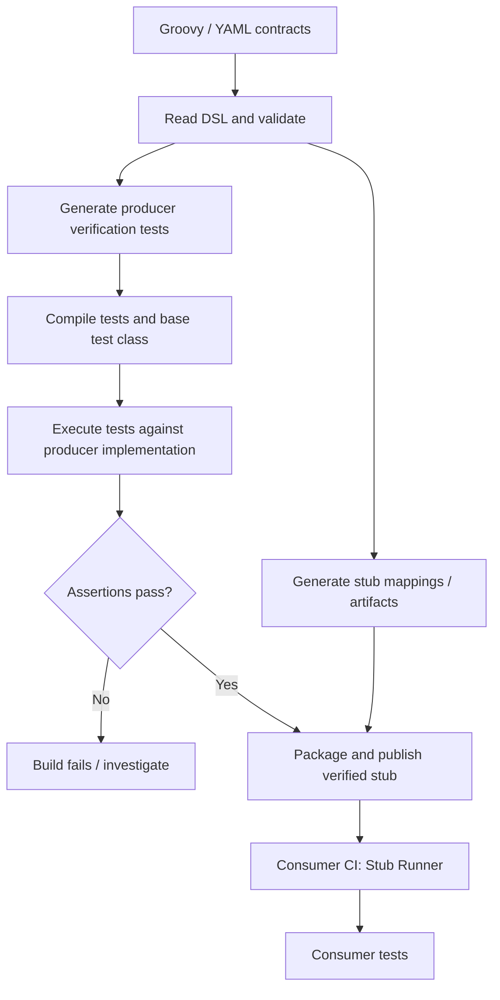
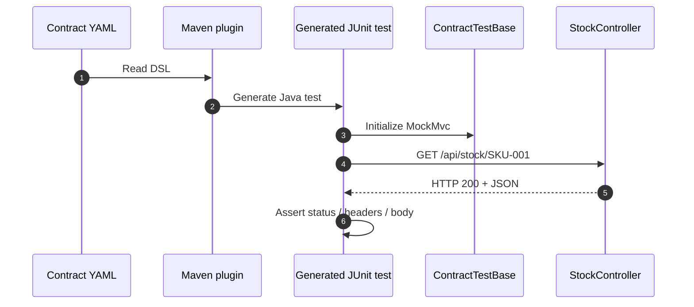
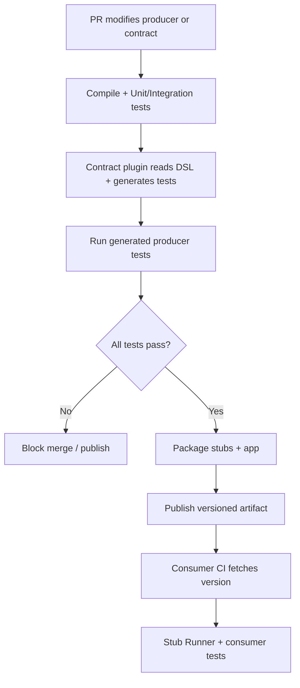

# Contract Reading, Test Generation, and Execution Pipeline

> **Chapter:** Contract Verifier  
> **Module:** Spring Cloud Contract (`SPRING_CLOUD_CONTRACT`) — consumer-driven contract testing between producer and consumer using Groovy/YAML DSL, generating producer tests, publishing stubs, using Stub Runner, and integrating with CI to detect breaking API changes.

## Learning Objectives

After completing this lesson, you will be able to:

1. Accurately describe the **Spring Cloud Contract Verifier pipeline** from contract files to producer verification tests and execution results.
2. Distinguish between **DSL reading/validation**, **test code generation**, **test compilation**, **test execution**, **stub packaging**, and **artifact publishing**; understand why these steps do not substitute for one another.
3. Organize Groovy/YAML contracts in a producer project, configure the Maven plugin, and set up a **base test** class for generated tests.
4. Read generated test output and explain the mechanisms for sending requests and asserting HTTP status, headers, body, and matchers.
5. Diagnose pipeline failures caused by invalid contracts, missing base classes, unexecuted tests, or non-compliant producer implementations.
6. Connect producer verification with the **stub JAR**, **Stub Runner**, and version-controlled CI pipelines to protect consumers.

## 1. Where Does Contract Verifier Fit in the Workflow?

Suppose `checkout-service` (consumer) calls `inventory-service` (producer) to check stock availability:

```http
GET /api/stock/SKU-001 HTTP/1.1
Accept: application/json
```

The producer promises to return:

```http
HTTP/1.1 200 OK
Content-Type: application/json

{
  "sku": "SKU-001",
  "available": true,
  "quantity": 4
}
```

The consumer depends on the following characteristics:

- The path and HTTP method must be correct.
- The response must be JSON, and the status must be `200`.
- `available` must be the boolean `true` in this scenario.
- `quantity` must be the integer `4` in the sample data, not the string `"4"`.
- When the API changes, the consumer should not find out only after the application has been deployed.

**Spring Cloud Contract Verifier** is the producer-side verification component: it reads contracts, **generates verification tests**, and runs those tests against the producer implementation. Tests can run via MockMvc, a real HTTP server, or another mechanism depending on configuration.

In addition, Spring Cloud Contract can generate **HTTP stubs** from the same contract source. The consumer uses Stub Runner to run the stubs without having to start the real producer. Thus, there are two distinct pieces of evidence:

| Evidence | Question Answered |
| --- | --- |
| **Producer verification tests ran and PASSED** | Does the producer implementation within the test scope satisfy the contract? |
| **Consumer tests using verified stubs PASSED** | Does the consumer's HTTP client send the expected request and understand the promised response? |

**The mere existence of a stub JAR does not automatically prove the producer passed verification.** If a build skips tests or publishes artifacts out of order, the pipeline can still produce mock data while losing the API compatibility signal.

## 2. Full Pipeline Diagram



The pipeline can be wired into the Maven/Gradle **lifecycle**. The exact order and task names depend on the plugin and version, but logically it must ensure:

1. **Contracts are valid** before generating artifacts.
2. **Generated tests are compiled** with required dependencies.
3. **Tests are actually executed**, not merely left sitting in the `target` directory.
4. **Verification succeeds** before publishing stubs used as compatibility evidence.
5. The consumer fetches the **exact right version** of the artifact and runs client tests.

This lesson uses **Maven + JUnit 5 + MockMvc** to explain the end-to-end HTTP path. Spring Cloud Contract also supports Groovy/YAML DSL for **message contracts**, a Gradle plugin, and other test modes; the core stages of reading contracts → generating tests → executing tests remain the same.

## 3. Input: Where Is a Contract Placed?

The default directory layout commonly used in a Maven producer:

```text
inventory-producer/
├── pom.xml
└── src/
    ├── main/java/com/example/inventory/
    │   ├── InventoryApplication.java
    │   └── StockController.java
    └── test/
        ├── java/com/example/inventory/
        │   └── ContractTestBase.java
        └── resources/contracts/
            └── stock_available.yml
```

A contract file is placed in `src/test/resources/contracts` (or a directory configured for the plugin). When the build runs, the plugin reads the contracts from that configured source.

### 3.1. YAML DSL Example

Create `src/test/resources/contracts/stock_available.yml`:

```yaml
name: stock_available
description: "Checkout checks inventory of a product"

request:
  method: GET
  url: /api/stock/SKU-001
  headers:
    Accept: application/json

response:
  status: 200
  headers:
    Content-Type: application/json
  body:
    sku: SKU-001
    available: true
    quantity: 4
```

Read the contract as a **conditional statement**:

> Given `GET /api/stock/SKU-001` with `Accept: application/json`, the producer must return `200`, `Content-Type: application/json`, and JSON matching the promised structure and values.

During **producer verification**, the plugin uses `request` to make a call to the implementation and uses `response` to generate assertions.

In a **stub**, `request` becomes the matching condition for the mock server to accept incoming calls, while `response` is the content the stub returns.

### 3.2. Same Behavior in Groovy DSL

The exact same interaction can be expressed in `stock_available.groovy`:

```groovy
org.springframework.cloud.contract.spec.Contract.make {
    name 'stock_available'

    request {
        method 'GET'
        url '/api/stock/SKU-001'
        headers {
            header 'Accept': 'application/json'
        }
    }

    response {
        status 200
        headers {
            contentType(applicationJson())
        }
        body(
            sku: 'SKU-001',
            available: true,
            quantity: 4
        )
    }
}
```

**Keep only one version (either YAML or Groovy) for the same interaction when running the lab.** If both are placed in the scanned directory, the plugin may generate two equivalent tests/stubs, making test counts and logs confusing.

### 3.3. What Needs to Be Checked When Reading Contracts

| Input | Example | Risk If Wrong |
| --- | --- | --- |
| Method | `GET` | Generated test calls the wrong HTTP method |
| URL/path/query | `/api/stock/SKU-001` | Test sends requests to a non-existent endpoint |
| Request headers | `Accept: application/json` | Stub fails to match the consumer's request |
| Request body | JSON with correct types | Test generates a request payload the producer does not support |
| Response status | `200` | Test expects the wrong HTTP status code |
| Response headers | `Content-Type: application/json` | Promised response format is incorrect |
| Response body | `quantity: 4` | Numeric type or value is described incorrectly |
| Matchers | Regex/type/format | Constraints are too strict or too loose |

**Successful YAML parsing does not mean the contract is semantically correct for the business logic.** For instance, `quantity: "4"` is valid YAML syntax, but it is a string; if the consumer expects a number, it is still a wrong contract. Similarly, omitting a field that the consumer relies on will prevent verification from checking that field.

## 4. Preparing the Producer Implementation

A simple producer can use a Spring MVC controller:

```java
package com.example.inventory;

import org.springframework.http.HttpStatus;
import org.springframework.http.MediaType;
import org.springframework.web.bind.annotation.GetMapping;
import org.springframework.web.bind.annotation.PathVariable;
import org.springframework.web.bind.annotation.RequestMapping;
import org.springframework.web.bind.annotation.RestController;
import org.springframework.web.server.ResponseStatusException;

@RestController
@RequestMapping("/api/stock")
public class StockController {

    @GetMapping(
        value = "/{sku}",
        produces = MediaType.APPLICATION_JSON_VALUE
    )
    public StockResponse getStock(@PathVariable String sku) {
        if (!"SKU-001".equals(sku)) {
            throw new ResponseStatusException(
                HttpStatus.NOT_FOUND, "SKU not found"
            );
        }
        return new StockResponse(sku, true, 4);
    }

    public record StockResponse(
        String sku, boolean available, int quantity
    ) {}
}
```

For `SKU-001`, the method returns a record; Spring MVC serializes it to JSON according to application configuration. This API does not need a database to demonstrate how tests are generated.

**Key distinction:** contracts live in `src/test/resources`, while the controller lives in `src/main/java`. The contract describes the promised behavior; the controller is the **real code** that the generated test must verify. You should not hardcode the controller to return exact contract values just to make a red test pass if that data should be generated dynamically; instead, use matchers for dynamic fields.

This small example fixes the quantity so learners can see the test fail when the implementation is wrong. In production, data may come from another repository/service, and the base test needs to prepare appropriate test data.

## 5. Configuring Contract Verifier for Maven

Assume the producer already has a Spring Boot `pom.xml` and uses a **compatible Spring Boot – Spring Cloud – Spring Cloud Contract version set**. Plugin configuration depends on the specific version; learners should select versions according to the Spring Cloud compatibility matrix before running.

Key parts in the POM:

```xml
<!-- Inside producer's <dependencies> -->
<dependency>
    <groupId>org.springframework.cloud</groupId>
    <artifactId>spring-cloud-starter-contract-verifier</artifactId>
    <scope>test</scope>
</dependency>

<!-- Inside <build><plugins> -->
<plugin>
    <groupId>org.springframework.cloud</groupId>
    <artifactId>spring-cloud-contract-maven-plugin</artifactId>
    <version>${spring-cloud-contract.version}</version>
    <extensions>true</extensions>
    <configuration>
        <testFramework>JUNIT5</testFramework>
        <baseClassForTests>com.example.inventory.ContractTestBase</baseClassForTests>
    </configuration>
</plugin>
```

Notes when integrating this snippet:

- These are **POM fragments**, not a complete POM. A compatible Spring Boot–Spring Cloud parent/BOM, the `spring-cloud-contract.version` property, Spring MVC dependencies, and the test framework are required.
- `spring-cloud-starter-contract-verifier` provides the components needed to run generated tests on the producer side.
- `spring-cloud-contract-maven-plugin` reads contracts, generates test code, and produces stubs according to the plugin lifecycle and configuration.
- `testFramework` requests generating JUnit 5 tests so they are compatible with `@BeforeEach` in the base class.
- `baseClassForTests` is the fully qualified Java class name. If the package or class name is wrong, generated tests cannot use the proper test setup.
- `<extensions>true</extensions>` is how the plugin is configured to participate in the Maven lifecycle in this example. You should inspect the build output to confirm the required goals actually ran.

**Do not assume the verifier dependency alone is enough.** Having a dependency in the POM does not guarantee that the plugin has read contracts, generated code, and triggered tests in the lifecycle.

### 5.1. Relevant Maven Lifecycles

The following table explains the roles of phases commonly involved:

| Phase / Activity | Role |
| --- | --- |
| `generate-test-sources` | Generates Java tests from DSL (when the plugin binds the appropriate goal to the lifecycle) |
| `test-compile` | Compiles generated test code and regular test code |
| `test` | Runs tests through the appropriate test engine/provider |
| `package` | Packages artifacts and stubs if the plugin/configuration applies |
| `verify` | Runs through the verify phase, checking results within the build cycle |
| `install` | Installs artifacts into the local Maven repository for consumer projects to use |
| `deploy` | Publishes artifacts to a configured Maven repository, suitable for CI |

Do not memorize generated directory names or goals tied to a single version. Check the **plugin logs and actual generated artifacts** to determine which steps Maven executed.

### 5.2. Why Use `mvn clean verify`?

```bash
mvn clean verify
```

This command:

1. Starts from a clean build, avoiding reuse of stale generated tests/stubs in `target`.
2. Passes through the necessary phases, including generating/compiling/executing tests if the plugin is properly bound.
3. Returns a **non-zero exit code** if tests fail, allowing CI to block incompatible changes.

However, **command success is not enough if no contract tests were discovered or if tests were skipped**. You must check the test count, logs, and generated files (see section 9). This is a very dangerous silent failure when teams first adopt contract testing.

## 6. Base Test: The Bridge Between Generated Tests and the Real Producer

Verifier can generate HTTP calls and assertions, but to execute them, the test must know how to stand up the application or controller that will receive the requests.

Example class `src/test/java/com/example/inventory/ContractTestBase.java`:

```java
package com.example.inventory;

import io.restassured.module.mockmvc.RestAssuredMockMvc;
import org.junit.jupiter.api.BeforeEach;

public abstract class ContractTestBase {

    @BeforeEach
    public void setUp() {
        RestAssuredMockMvc.standaloneSetup(new StockController());
    }
}
```

This class is declared in `baseClassForTests`. Each generated test extends it and relies on `RestAssuredMockMvc` to simulate HTTP requests through Spring MVC directly to `StockController`.

Because the example controller has no dependencies, `standaloneSetup` keeps tests fast with minimal infrastructure. When a controller depends on beans, configuration, filters, security, or persistence, the setup may need a **Spring context** or a real HTTP server.

### 6.1. Choosing the Right Test Execution Mode

| Environment Setup | When Appropriate | What Remains Unproven |
| --- | --- | --- |
| **MockMvc standalone** | Simple controllers with few dependencies | Full Spring configuration, filters, Security, real DB |
| **MockMvc with Spring context** | Need to test wiring, serialization, validation, or enabled middleware | Does not test real network calls out of process |
| **Real HTTP server in tests** | Need to verify endpoints over an HTTP port | Still covers only the test environment and test scenarios |
| **Message test infrastructure** | Message/event contracts with triggers and adapters | Does not automatically prove production broker stability |

Choose the setup based on the **behavior you need to protect**. If the consumer relies on security headers or error mappings caused by Jackson configuration, an overly simplified standalone controller setup might miss real issues. If you only need to explain the pipeline in an introductory lesson, standalone is sufficient.

**The base test is not a new contract.** It is shared infrastructure code used across multiple generated tests and may contain test data preparation, mocked dependencies, MockMvc setup, or assertion helpers.

## 7. Code Generation Step: Generated Producer Verification Test

Assuming `stock_available.yml` is valid and readable by the plugin, the plugin creates one or more corresponding Java tests, usually under a directory in `target/generated-test-sources`. Exact file/class names and paths may vary depending on the plugin, contract folder structure, and configuration.

Behaviorally, the generated test resembles the following illustration:

```java
// Pseudocode illustrating intent, not verbatim Java output from the plugin.
@Test
void stock_available() {
    // 1. Send GET /api/stock/SKU-001
    // 2. Include header Accept: application/json
    // 3. Assert HTTP status = 200
    // 4. Assert response Content-Type
    // 5. Assert sku = SKU-001, available = true, quantity = 4
}
```

The actual generated code may use Rest Assured MockMvc, Hamcrest, JsonPath, Spring MockMvc, or equivalent tools depending on `testMode` and version. The goal remains the same: **an executable Java test containing requests and assertions generated from the DSL**.

### 7.1. Reading Generated Tests to Understand What Is Being Verified

When inspecting a generated test file, check in order:

1. Whether the class extends `ContractTestBase` or uses the proper setup mechanism.
2. Whether the invoked method and URI match the contract.
3. Whether sample request headers and body are sent accurately.
4. Whether the HTTP status assertion checks `200` accurately.
5. Whether the `Content-Type` response header is asserted.
6. Whether every field the consumer genuinely needs has an assertion or matcher.
7. Whether the test has the right annotations/framework imports so Maven Surefire/JUnit recognizes it.

If the generated test only checks `statusCode(200)` without checking `quantity`, investigate why: missing field in the contract, matcher in the wrong place, non-JSON data, or the test generation step not executing properly.

### 7.2. Dynamic Data and Matchers

A response may contain a new ID or timestamp on each call. In such cases, avoid locking down a specific literal value in the producer test while **still protecting its format**.

Alternative YAML response example:

```yaml
response:
  status: 200
  headers:
    Content-Type: application/json
  body:
    sku: SKU-001
    available: true
    quantity: 4
    traceId: 6f1341e7-3e74-4596-88d7-ae0040838ccf
  matchers:
    body:
      - path: $.traceId
        type: by_regex
        predefined: uuid
```

This is an **illustrative variant**, to be used only after the real producer actually returns `traceId`. The producer test will validate a valid UUID instead of requiring the producer to return the exact sample UUID; the stub can return the fixed sample UUID to the consumer.

Do not change `quantity` to `by_type` if the consumer specifically needs `4` in this scenario: `-100` would also pass a type-only assertion. Preserve **business invariants** such as status, quantity, currency, event type, or error structure.

## 8. Executing Producer Tests: What Makes the Build Red?

After compilation, the test framework executes generated tests just like other unit/integration tests. In the sample pipeline:



To verify that the pipeline genuinely protects the contract, temporarily modify the controller in a test branch:

```java
return new StockResponse(sku, true, 0);
```

Keep `quantity: 4` in YAML. Run:

```bash
mvn clean verify
```

Expected result: the generated contract test **FAILS** because the actual response has `quantity = 0`, contradicting the promised `quantity = 4`. Restore quantity to `4` and rerun.

**Note:** if you modify the implementation to break the contract and the build stays green, tests may not have been generated, may not have run, assertions may be missing, or tests may have been skipped. Do not conclude the API change is compatible.

### 8.1. Distinguishing Failure Types

| Stage | Typical Error | Interpretation |
| --- | --- | --- |
| **DSL Reading** | Wrong YAML indentation, invalid matcher | The contract could not be parsed into a specification |
| **Test Generation** | No output or goal not triggered | The pipeline has not created verification tests |
| **Compilation** | Missing `ContractTestBase`, wrong imports/dependencies | Generated tests may not have reached execution yet |
| **Test Initialization** | Failed to start Spring context, base setup error | Test environment is not ready |
| **Request Execution** | 404, 405, 415, 406, or exception | Incorrect HTTP method/path/header/body or route |
| **Assertion** | `expected 200 but was 500`, JSONPath mismatch | Producer implementation violates contract or test data is unsuitable |
| **Stub Packaging** | Missing `stubs` classifier | Artifact was not attached/packaged properly |
| **Consumer Test** | Stub not found or mapping mismatch | Version, artifact repository, port, or consumer request needs checking |

Only **assertion failures on real behavior** directly indicate that the producer implementation violates the contract. DSL parsing, dependency, or infrastructure errors must also fail CI, but they require fixing the **pipeline** rather than changing API expectations.

## 9. How to Confirm Generated Tests Actually Ran

A technically sound pipeline requires **evidence** at all three levels:

### 9.1. Valid Contracts Exist

Check the `src/test/resources/contracts` path and plugin logs recording the discovered contracts. If files are misplaced or the contract directory configuration is wrong, the plugin may pick up zero tests.

### 9.2. Test Code Was Generated and Compiled

After `mvn clean verify`, inspect outputs similar to:

```text
target/
├── generated-test-sources/
│   └── contracts/        # example location for generated Java tests
├── test-classes/         # compiled test classes
└── surefire-reports/     # Maven test reports when Surefire is used
```

Intermediate directory names may vary by version/plugin. **Do not assume tests ran just because the `generated-test-sources` directory exists.**

### 9.3. Execution Results Appear in Test Reports

Maven Surefire normally writes reports to `target/surefire-reports` for tests executed by Surefire. You should see the generated tests listed in the report or in the build's total test count with a `PASS`/`FAIL` outcome.

If a project alters naming conventions or uses a different test runner plugin, locate the corresponding report. Situations that require investigation include:

- The build generates no tests yet still exits with code 0.
- Tests are generated, but none match the test discovery naming rules.
- The test framework uses JUnit 5, but the runtime/provider is incompatible.
- `-DskipTests` or an equivalent configuration skipped test execution.
- CI only runs `generateTests` without running the `test` or `verify` phase.
- The test report shows `Tests run: 0` for a module expected to have contract tests.

**Try introducing an intentional contract-breaking change** in a test environment. Seeing tests flip from green to red and back to green upon reverting provides stronger evidence that the pipeline is testing real behavior.

## 10. Stub Generation: A Different Artifact from Producer Verification Tests

Spring Cloud Contract also creates stubs (typically WireMock mappings for HTTP) from the same contracts. Logically:

- **Generated producer tests** use the request to call the real producer in tests and **verify** the response.
- **Stub mappings** use the request to **match** calls from the consumer and return the response defined in the contract.

With `stock_available.yml`, the stub can return:

```json
{
  "sku": "SKU-001",
  "available": true,
  "quantity": 4
}
```

When the consumer calls with the matching method/path/headers, the stub returns the sample response. The real producer does not need to be running during consumer tests.

### 10.1. How Is the Stub JAR Packaged?

In a Maven producer:

```bash
mvn clean install
```

After a successful build, you may see artifacts such as:

```text
target/
  inventory-producer-1.0.0.jar
  inventory-producer-1.0.0-stubs.jar
```

The local Maven repository typically stores:

```text
~/.m2/repository/com/example/inventory-producer/1.0.0/
  inventory-producer-1.0.0.pom
  inventory-producer-1.0.0.jar
  inventory-producer-1.0.0-stubs.jar
```

The name `inventory-producer` and version `1.0.0` are illustrative only; they must match the actual producer's `groupId`, `artifactId`, and `version`. Stub JAR contents and mapping structure depend on the version/plugin.

**Release rule:** consider a stub a verified artifact only when the producer contract tests of that exact build/version have PASSED. Running `install` with skipped tests provides no such guarantee.

### 10.2. Why Must Stub Generation and Verification Be Coupled?

If the producer accidentally changes the `available` response field to the string `"yes"` while the contract still specifies `available: true`, producer verification must turn red when actually executed. If the team publishes the stub anyway despite test failures or skipped tests, the consumer will keep testing against a stub returning a boolean while production returns a string.

This is the core difference between **handcrafted mock stubs** and **producer-verified contract stubs**. A stub does not protect API compatibility by itself; it requires a verification process and artifact governance.

## 11. Consumer Using Stub Runner After Producer Verification PASSES

Example consumer test configuration, assuming `InventoryClient` and property `inventory.base-url` already exist in the application:

```java
@SpringBootTest(
    properties = "inventory.base-url=http://localhost:8090",
    webEnvironment = SpringBootTest.WebEnvironment.NONE
)
@AutoConfigureStubRunner(
    ids = "com.example:inventory-producer:1.0.0:stubs:8090",
    stubsMode = StubRunnerProperties.StubsMode.LOCAL
)
class CheckoutInventoryContractTest {

    @Autowired
    InventoryClient inventoryClient;

    @Test
    void docDuocTonKhoTuProducerStub() {
        boolean enough = inventoryClient.hasEnoughStock("SKU-001", 2);
        assertTrue(enough);
    }
}
```

This snippet is **illustrative**: corresponding imports, dependencies, and the `InventoryClient` implementation are needed. `LOCAL` works only when the `stubs` artifact has already been installed in the local Maven repository on the machine running the consumer test.

In the test:

1. Stub Runner fetches `com.example:inventory-producer:1.0.0:stubs`.
2. WireMock starts on port `8090`.
3. The consumer HTTP client sends a request to `http://localhost:8090`.
4. The stub returns the response defined in the contract.
5. The consumer test verifies response deserialization and handling code.

When CI runs on **separate machines**, stubs must be published to an artifact repository (Nexus, Artifactory, or equivalent Maven repository), or artifacts must be transferred between jobs. For remote repositories, use the `REMOTE` configuration and the appropriate repository URL.

Stub Runner **does not re-run producer verification**. If a newer producer breaks the contract while the consumer still points to an older stub version, consumer tests can remain green. That is why producer CI must gate publishing and consumer CI must select versions explicitly.

## 12. Connecting the Pipeline to CI

A basic producer pipeline:



In practice, tests are usually executed by Maven through integrated lifecycle phases rather than CI invoking each box of the diagram separately. The diagram expresses a **quality gate**: publishing is permitted only when all required tests, especially generated contract tests, pass.

Reference CI step structure:

```bash
# Run in the producer project with the plugin properly configured:
mvn --batch-mode clean verify

# Proceed to the next step only if verify succeeds:
mvn --batch-mode deploy
```

`deploy` may re-run necessary phases depending on the lifecycle; how to avoid rebuilding and how to pass artifacts depend on the CI tool. What matters is **never publishing artifacts from another build that has not passed verification**, and never setting test-skipping flags on the release path.

### 12.1. Explicit Blocking Conditions

| Condition | Recommended CI Action |
| --- | --- |
| Contract DSL fails to parse | Fail build |
| No contract tests generated even though the repository requires contracts | Fail via existence check / expected test count check |
| Generated tests fail to compile | Fail build |
| Producer returns wrong status/header/body/matcher | Fail build |
| Tests skipped outside policy | Fail or raise release-blocking warning |
| Producer verification PASSES | Allow packaging/publishing the exact version |
| Consumer tests with new stub FAIL | Block consumer release or coordinate contract/API fix |

If a project has multiple consumers, you must know **which consumer depends on which version**. A contract change passing only the new producer's tests is not necessarily compatible with all older consumers. Reviews, API versioning, or checking active contracts in use will be needed.

### 12.2. Stub Versioning Strategy

Use a deterministic artifact coordinate such as:

```text
com.example:inventory-producer:1.0.0:stubs
```

on the verification path for a specific release. A dynamic version like `+` may cause consumer tests to download different stubs over time; if used to test compatibility against the latest build, document the strategy clearly and record the exact version executed.

Also, with multiple producer branches, avoid publishing the same artifact version from multiple incompatible commits unless the pipeline has a mechanism to distinguish them. Release or snapshot versions can be used according to repository policy, provided the source and test reproducibility remain clear.

## 13. Common Misconceptions When Reading the Pipeline

| Claim | Why It Is Incorrect | What Else to Check |
| --- | --- | --- |
| "We have YAML, so we already have contract testing." | YAML is only the input specification | Has the plugin generated and executed the tests? |
| "Tests were generated, so they definitely pass." | Code generation does not execute assertions | Test reports and exit codes |
| "`mvn verify` is green, meaning the producer satisfies the contract." | Zero tests might have run, or tests might have been skipped | Test count, reports, breaking-change test |
| "Stub Runner runs green, proving the new producer works." | Stub Runner runs the **stub artifact**, not the real producer | Producer verification for that exact version |
| "Checking status `200` is enough." | Consumers may depend on headers/body/data types | Assertions for critical fields |
| "We can update the contract to match the new code so tests pass." | Existing consumers may still rely on the old contract | Review backward compatibility |
| "All contract tests must run against a real HTTP server." | MockMvc can suffice for simple HTTP contracts | Choose test mode based on scope |
| "If contract tests pass, the entire system works." | Contracts do not test DB/network/orchestration outside their scope | Integration/E2E and smoke tests |

## 14. Distinguishing HTTP and Messaging Pipelines

Spring Cloud Contract also supports messaging contracts. When a producer emits a `StockReserved` event, the contract can describe an input trigger and an output message.

Illustrative Groovy example:

```groovy
org.springframework.cloud.contract.spec.Contract.make {
    name 'stock_reserved_message'
    label 'stock_reserved'

    input {
        triggeredBy('reservationTriggered()')
    }

    outputMessage {
        sentTo('inventory.events')
        body(
            eventType: 'StockReserved',
            sku: 'SKU-001',
            reservedQuantity: 2
        )
        headers {
            messagingContentType(applicationJson())
        }
    }
}
```

**Stages shared with HTTP:** read contract → generate producer-side test → set up test infrastructure → trigger producer → assert output message → package stub to support consumers.

**Differences:** the test does not send an HTTP request to a controller. Instead, it may **invoke a trigger**, inspect messages sent to a channel/destination, or simulate receiving an input message depending on the contract type.

Running this requires configuring Spring Cloud Contract messaging, a binder/test adapter, or appropriate infrastructure. The DSL itself does not spin up a production broker. A passing message producer test does not prove production Kafka/RabbitMQ works, nor does it prove ordering, retries, or network operations; integration tests are needed for those concerns.

## 15. Hands-On Lab: Seeing the Pipeline Work and Fail

### Exercise 1 — Inspecting Test Output

Create the controller and `stock_available.yml` contract from sections 3–4, and configure the plugin and base test from sections 5–6. Run:

```bash
mvn clean verify
```

Record the path to generated tests, the number of tests executed, and the report location. Locate the assertions for `quantity` and HTTP status.

**Completion criteria:** do not stop at seeing `BUILD SUCCESS`; prove that a corresponding generated test actually executed and PASSED.

### Exercise 2 — Checking the Breaking Change Signal

Change the controller to return `quantity = 0` while keeping `quantity: 4` in the contract. Re-run `mvn clean verify`.

**Expected:** the generated test FAILS because the body differs from the contract. Revert the code and re-run to confirm it PASSES. If it does not FAIL, inspect the plugin, lifecycle, and test reports.

### Exercise 3 — Invalid Contract Semantics

On a test branch, change the YAML to:

```yaml
request:
  method: GET
  url: /api/stock/SKU-001

response:
  status: 200
  body:
    quantity: "4"
```

This payload **is syntactically parseable** but changed the type of `quantity` from number to string. Try running producer verification and explain why this is a **contract semantic error**, distinct from a YAML syntax error.

### Exercise 4 — Comparing Groovy and YAML

Convert `stock_available.yml` into the equivalent Groovy DSL and run the pipeline on a separate branch. Compare the request, response, generated assertions, and stub mapping.

**Constraint:** do not keep both identical contracts in the same scanned source directory if your goal is a single test.

### Exercise 5 — Dynamic Values

Add a `traceId` field to the producer response, generating a new UUID on every call. Use the `predefined: uuid` matcher in `response.matchers.body`; prove that the generated producer test PASSES even though the UUID changes. Explain why the consumer stub can return a fixed sample UUID.

### Exercise 6 — CI Design

Diagram a pipeline covering producer verification, stub publishing, consumer Stub Runner tests, and critical integration tests. Pinpoint exactly where the release must be blocked if generated producer tests fail and how to detect builds that skip contract tests.

### Self-Check Questions

1. Is `stock_available.yml` **test code** or **input to generate test code**? — It is a DSL specification that the plugin uses to generate tests and stubs.
2. What is the role of `ContractTestBase`? — It sets up the environment that generated tests use to call the producer implementation.
3. When is a published stub considered verified? — When generated producer tests have **executed and PASSED** against the implementation of that exact version.
4. Why can consumer tests pass with an old stub even when the new API is broken? — They interact only with the selected stub artifact, not with the new implementation.
5. Why should `mvn clean verify` be paired with checking test reports? — A successful build can still skip executing contract tests due to configuration issues or skip flags.

## 16. Summary

The **Contract Verifier pipeline** starts with **Groovy/YAML contracts** describing communication promises. The plugin reads the DSL, generates **producer verification tests**, compiles/runs tests against an implementation prepared via a **base test**, and only allows **packaging and publishing stubs** once verification genuinely succeeds. Consumers use **Stub Runner** to test their clients against those verified stubs.

The key takeaway is that **reading contracts**, **generating tests**, and **running tests** are three distinct steps. Valid YAML or an existing stub JAR alone is not proof of API compatibility; generated tests must actually run, critical assertions must remain intact, and CI must block releases when the producer breaks the contract. Integration/E2E tests continue to protect aspects outside the contract's scope.

## References

- [Spring Cloud Contract — Getting Started: First Application](https://docs.spring.io/spring-cloud-contract/reference/getting-started/first-application.html): producer verification and consumer stub workflow.
- [Spring Cloud Contract — Maven Project](https://docs.spring.io/spring-cloud-contract/reference/maven-project.html): Maven plugin and test generation.
- [Spring Cloud Contract — Contract DSL](https://docs.spring.io/spring-cloud-contract/reference/project-features-contract.html): Groovy/YAML contracts and promised behavior.
- [Spring Cloud Contract — Dynamic Properties](https://docs.spring.io/spring-cloud-contract/reference/project-features-contract/dsl-dynamic-properties.html): matchers and dynamic values.
- [Spring Cloud Contract — Stub Runner Core](https://docs.spring.io/spring-cloud-contract/reference/project-features-stubrunner/stub-runner-core.html): downloading and running stubs in consumer tests.
- [Spring Cloud Contract — Messaging](https://docs.spring.io/spring-cloud-contract/reference/project-features-messaging.html): contract variants for messaging.
- [Spring Cloud — Release Trains](https://spring.io/projects/spring-cloud): selecting compatible version sets.
