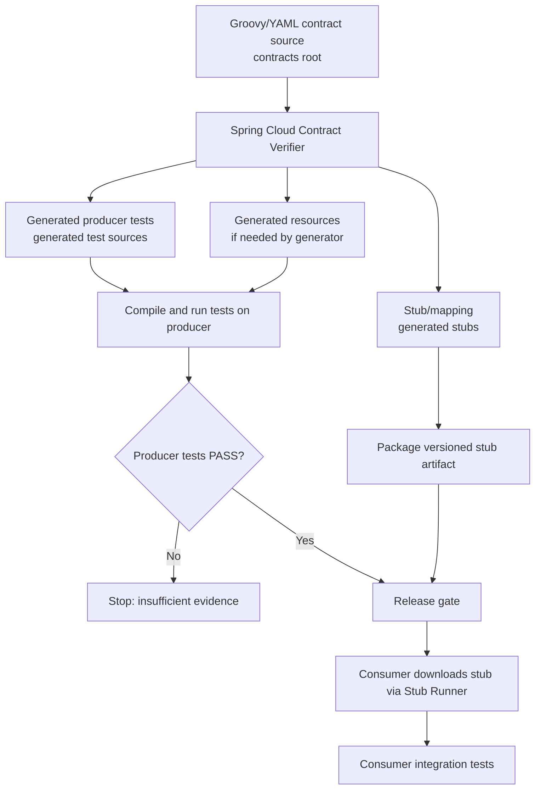
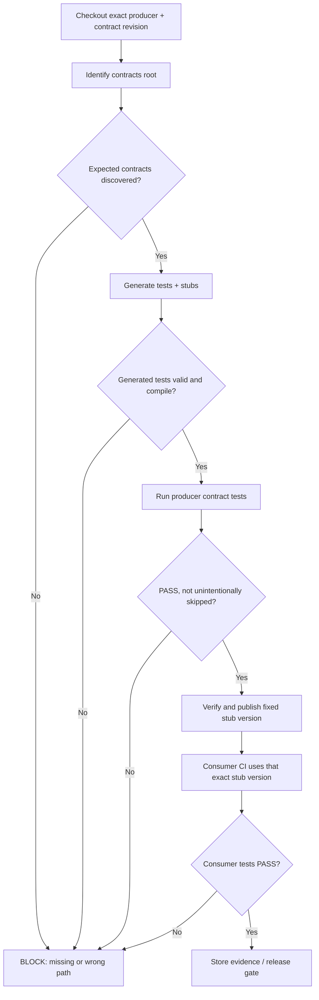

# Configuring Contract Directories and Generated Outputs

## Lesson Objectives

**Spring Cloud Contract Verifier** turns **Groovy DSL** or **YAML DSL** contracts into executable tests on the **producer** side. The same contract source can also be used to generate **stubs** so that **consumers** can test via **Stub Runner**. In CI, this chain catches HTTP or messaging changes that no longer match the agreed behavior.

However, Verifier cannot verify a contract it **cannot find**; nor is the producer verified if generated tests **are not compiled and executed**. Therefore, configuring source directories and output directories is a critical part of the testing pipeline, not merely a file-organization preference.

After this lesson, you will be able to:

- Distinguish between the **contracts directory**, **generated test sources directory**, **generated test resources**, and **stub artifacts**.
- Configure or identify Groovy/YAML DSL directories in Maven and Gradle projects.
- Explain how the **base test class**, relative directory structure, and test generation configuration relate to one another.
- Verify that generated tests, mappings, and stubs are produced from the right set of contracts.
- Handle cases using an independent contract repository or relocating contract sources.
- Design CI checks that prevent a green build caused by **zero contracts being verified**.

## 1. Four Path Groups That Must Not Be Confused

Look at the overall workflow:



A project typically has the following path groups:

| Group | Purpose | Common Examples |
| --- | --- | --- |
| **Contracts source** | Holds `.groovy`, `.yml`, or `.yaml` files read by the tool | `src/test/resources/contracts` |
| **Generated test sources** | Holds producer-side test source code created by Verifier | `target/generated-test-sources/contracts` or `build/generated-test-sources/contracts` |
| **Generated test resources** | Auxiliary resources used by the generator or tests if any | A directory under `target` / `build` |
| **Generated stubs/artifact** | Mappings/responses packaged for consumer usage | Files in the build area and the `stubs` classifier artifact |

The names in the table are **examples of common layouts**, not a guarantee that every Maven/Gradle plugin version produces the exact same folder names. The effective paths are determined by the **plugin version, build configuration, and build tool**. Cross-check your project's logs and actual output.

In particular, the file path `contracts/orders/get_order.yml` is **not** the HTTP endpoint. The endpoint is defined **inside the contract content**, such as `GET /api/orders/ORD-1001`.

## 2. A Clear Producer Project Layout

For an Order Service project with HTTP and messaging contracts, a reference layout looks like:

```text
order-service/
├── pom.xml                     # Or build.gradle
├── src/
│   ├── main/
│   │   └── java/
│   └── test/
│       ├── java/
│       │   └── com/example/orders/contract/
│       │       ├── OrderHttpContractBase.java
│       │       └── OrderMessageContractBase.java
│       └── resources/
│           └── contracts/
│               └── orders/
│                   ├── http/
│                   │   ├── get_paid_order.yml
│                   │   └── get_missing_order.groovy
│                   └── messaging/
│                       └── order_paid.groovy
└── target/ or build/           # Generated during build
```

Here:

1. `src/test/resources/contracts` is the commonly used **contract source root**.
2. `orders/http` and `orders/messaging` are **project organization choices**, not two mandatory folder names dictated by Verifier.
3. DSL files describe public behavior; base classes in `src/test/java` prepare HTTP clients, fixtures, or message triggers.
4. Files under `target` or `build` are **generated outputs**, typically neither manually edited nor committed like main source code.

Keep directory, file, and scenario names stable, readable, and free of characters that make generated package/class names awkward. Depending on configuration, the relative directory structure can also participate in **base test class selection rules** or generated test naming.

## 3. A Sample YAML Contract Used Throughout

File `src/test/resources/contracts/orders/http/get_paid_order.yml`:

```yaml
description: "Get status of paid order"
name: get_paid_order
request:
  method: GET
  url: /api/orders/ORD-1001
  headers:
    Accept: application/json
response:
  status: 200
  headers:
    Content-Type: application/json
  body:
    id: ORD-1001
    status: PAID
```

The contract describes:

- **Input:** GET on the agreed path with an `Accept` header.
- **Output:** status 200, JSON body containing `id` and `status`.
- **Scenario:** in the test environment, the producer must have or mock an order `ORD-1001` in `PAID` status.

Spring Cloud Contract can use this contract to generate a **producer test** calling the endpoint and asserting the response. The tool can also generate a **stub** allowing the consumer to test GET calls with sample data.

The mere existence and valid syntax of the YAML file **do not prove**:

- The plugin actually read that file;
- Generated tests were created and discovered by the test runner;
- Producer tests PASSED on that exact build;
- The new stub artifact contains the matching mapping;
- The consumer tested against the right stub version.

All of these steps must be verified through build output and CI results.

## 4. Configuring the Contracts Directory with Maven

With Maven, Spring Cloud Contract is typically configured via `spring-cloud-contract-maven-plugin`. An illustrative `pom.xml` snippet:

```xml
<build>
    <plugins>
        <plugin>
            <groupId>org.springframework.cloud</groupId>
            <artifactId>spring-cloud-contract-maven-plugin</artifactId>
            <version>APPROPRIATE_VERSION</version>
            <extensions>true</extensions>
            <configuration>
                <contractsDirectory>
                    src/test/resources/contracts
                </contractsDirectory>
                <baseClassForTests>
                    com.example.orders.contract.OrderHttpContractBase
                </baseClassForTests>
            </configuration>
        </plugin>
    </plugins>
</build>
```

This is an **illustrative configuration snippet**, not a complete POM file. `APPROPRIATE_VERSION` must be replaced with a version compatible with your Spring Boot, Spring Cloud BOM, and project build. A real application also needs dependencies, a test engine, and suitable test configuration.

Role of each element:

| Element | Role |
| --- | --- |
| `spring-cloud-contract-maven-plugin` | Executes test/stub generation steps per Maven configuration |
| `contractsDirectory` | Selects the directory containing local DSL files |
| `baseClassForTests` | Specifies the base class that generated producer tests can extend |
| `extensions` | Allows Maven to integrate the plugin's extensions/lifecycle according to the configuration in use |

`src/test/resources/contracts` is written explicitly here so readers know the input source. When moving the root elsewhere, update the configuration accordingly rather than merely moving files.

### Output Paths in Maven

Plugin versions support customizing test/resource output directories via corresponding options, such as `generatedTestSourcesDir` and `generatedTestResourcesDir`. An **illustrative** configuration:

```xml
<configuration>
    <contractsDirectory>src/test/resources/contracts</contractsDirectory>
    <generatedTestSourcesDir>
        target/generated-test-sources/contracts
    </generatedTestSourcesDir>
    <generatedTestResourcesDir>
        target/generated-test-resources/contracts
    </generatedTestResourcesDir>
</configuration>
```

Verify the **exact option names and paths supported by your current plugin version**. Do not assume every project needs to declare output paths explicitly: using the plugin defaults is usually simpler and less error-prone.

**Do not** place generated output inside `src/main/java` or a manually maintained source folder managed by developers. Generated tests should stay separate from production code so they can be cleanly deleted and regenerated completely from contracts.

## 5. Configuring the Contracts Directory with Gradle

With Gradle, the Spring Cloud Contract plugin usually exposes a `contracts` configuration block. The Groovy DSL snippet for Gradle below illustrates how to specify the source and base class:

```groovy
plugins {
    id 'org.springframework.cloud.contract' version 'APPROPRIATE_VERSION'
}

contracts {
    contractsDslDir = file('src/test/resources/contracts')
    baseClassForTests = 'com.example.orders.contract.OrderHttpContractBase'
}
```

This is a **Groovy DSL `build.gradle` example**, not syntax you can paste verbatim into `build.gradle.kts` (Kotlin DSL). The plugin version, plugin management integration, dependencies, and test runtime must match your real setup.

In supported versions, output directories can be configured with properties such as:

```groovy
contracts {
    contractsDslDir = file('src/test/resources/contracts')
    generatedTestSourcesDir = file('build/generated-test-sources/contracts')
    generatedTestResourcesDir = file('build/generated-test-resources/contracts')
}
```

The key point is that **verifier inputs** and **generator outputs** are distinct paths. Changing `contractsDslDir` does not require changing `generatedTestSourcesDir`. Conversely, changing where generated tests are written without configuring them to be compiled and executed can prevent those tests from counting toward the build result.

For either Maven or Gradle, exact options and folders may vary across Spring Cloud Contract versions. When applying them, check the documentation accompanying your plugin and **inspect the actual generated output**, instead of copying configuration from another project on a different version.

## 6. What Verifier Generates and What It Does Not

From the contract in section 3, the build can produce the following outputs:

| Output | Primary Consumer | What Must Be Checked? |
| --- | --- | --- |
| **Producer test source** | Producer's test runner | Tests contain the expected request/response checks, compile, and run |
| **Supporting test resources** | Generated tests or test runner | Resources are found on the right classpath during test execution |
| **Stubs/mappings** | Stub Runner / stub server mechanism | Request matchers and responses accurately reflect the contract |
| **Stub artifact** | Consumer CI | Artifact has stable coordinates and version, and the exact version is downloaded |
| **Build/test reports** | CI and release reviewers | Evidence that tests ran and PASSED on the exact producer build |

### Visualizing a Generated Producer Test

The **Java pseudocode** below describes functionality rather than verbatim output from any specific generator version:

```java
// Pseudocode: actual Verifier may use a different client/test framework.
class GeneratedGetPaidOrderTest extends OrderHttpContractBase {

    void shouldGetPaidOrder() {
        // GET /api/orders/ORD-1001
        // Accept: application/json
        // Assert HTTP 200
        // Assert JSON id == "ORD-1001"
        // Assert JSON status == "PAID"
    }
}
```

Package names, class names, method names, assertion libraries, and HTTP client syntax **are not fixed**. They may be influenced by contract names, folder structure, test framework, test mode, and generator version. What you need to verify is **the behavior of the generated test**, not guessing exact filenames beforehand.

### Visualizing a Generated Stub

An HTTP stub can match `GET /api/orders/ORD-1001` and return status `200` with JSON matching the contract. The stub mapping itself can be JSON whose structure and directory depend on WireMock or the corresponding integration mechanism.

```json
{
  "request": {
    "method": "GET",
    "url": "/api/orders/ORD-1001"
  },
  "response": {
    "status": 200,
    "headers": {
      "Content-Type": "application/json"
    },
    "body": "{\"id\":\"ORD-1001\",\"status\":\"PAID\"}"
  }
}
```

**This is a simplified mapping for illustration**, not a snapshot of an artifact generated by Spring Cloud Contract. For instance, it does not yet show a matcher for the `Accept` header. In a real build, inspect the mappings actually produced and check request conditions such as headers, query parameters, and bodies when declared in the contract.

## 7. Base Test Class: Configuring the Right Anchor for Generated Tests to Run

Generated producer tests need an execution environment. For HTTP, that may be a Spring application context, controllers, an HTTP client, and sample data; for messaging, it may be event trigger methods and a message verifier.

An example **HTTP base class** in a project using Spring Boot, MockMvc, and Rest Assured Mock MVC:

```java
package com.example.orders.contract;

import io.restassured.module.mockmvc.RestAssuredMockMvc;
import org.junit.jupiter.api.BeforeEach;
import org.springframework.beans.factory.annotation.Autowired;
import org.springframework.boot.test.autoconfigure.web.servlet.AutoConfigureMockMvc;
import org.springframework.boot.test.context.SpringBootTest;
import org.springframework.test.web.servlet.MockMvc;

@SpringBootTest
@AutoConfigureMockMvc
public abstract class OrderHttpContractBase {

    @Autowired
    MockMvc mockMvc;

    @BeforeEach
    void setUp() {
        RestAssuredMockMvc.mockMvc(mockMvc);
        // Prepare ORD-1001 as a PAID order in the test fixture,
        // in a manner suitable for the application under test.
    }
}
```

This snippet **depends** on test mode, generated test framework, and dependencies. It is not a universal setup that runs in every project. For example, if using WebTestClient, JAX-RS, or another HTTP test execution strategy, the base class must change accordingly.

Two key points:

1. `baseClassForTests` or an equivalent mapping configuration must point to a **real base class** compatible with generated tests.
2. Producer tests must verify **producer behavior** in the configured environment, rather than calling a mock stub to self-validate expectations.

If different groups of contracts need different setups, you can use package/path-based base class mapping or naming conventions supported by the plugin. For example, `orders/http` needs an HTTP base class, while `orders/messaging` needs a base class with message trigger methods. The exact matching rules and properties (such as `baseClassMappings`) must be verified against your plugin version.

## 8. Relative Paths Can Affect Generated Tests

Consider two files:

```text
src/test/resources/contracts/
├── orders/http/get_paid_order.yml
└── payments/http/get_payment.yml
```

Relative paths are commonly used to **organize contracts**, and depending on configuration can also participate in generating package/class names or selecting base test classes. If you move:

```text
orders/http/get_paid_order.yml
```

to:

```text
checkout/http/get_paid_order.yml
```

then:

- The `request.url` content inside the file **does not change automatically**.
- The scanner must still be able to discover the contract at the new location.
- Base class selection rules may no longer match.
- Package/names of generated tests may change depending on the generator mechanism.
- Package/name-based test filters in CI may cause generated tests **not to run**.
- The new stub must be re-verified; consumers should not keep using only an outdated stub.

This is why moving source files can silently drop test evidence **even when the actual API has not changed**.

## 9. Contract Sources Outside the Producer Project

Not every project keeps DSL files in `src/test/resources/contracts`. Some teams use a standalone contracts repository or an artifact holding contracts for multiple producers/consumers.

```text
contracts-repository/
├── order-service/
│   └── orders/http/get_paid_order.yml
└── payment-service/
    └── payments/http/get_payment.yml
```

In this case, configuration must answer:

1. **Where is the source?** Which repository, artifact, or dependency supplies the contracts?
2. **Which version?** Which revision/commit or artifact version is used for the build?
3. **Which subdirectory to pick?** The Order Service producer should not accidentally generate tests from Payment Service contracts.
4. **Which working directory to unpack into?** The plugin must be able to read DSL files at the right path after downloading or extracting the source.
5. **Which set to package stubs from?** Consumers must receive stubs corresponding to the exact contracts verified against the producer.

Spring Cloud Contract provides options for configuring external contract sources, such as a dependency containing contracts, a relative path inside the source, and a contract retrieval mode. Exact property names and semantics depend on the **Maven/Gradle plugin and version**; do not automatically assume local `contractsDirectory` behaves identically to an internal path inside an artifact.

**Avoid dynamic versions when verifying releases.** If producer tests use revision A while the stub downloaded by the consumer was built from revision B, a PASS result does not prove both sides agree on the same contract.

## 10. A Stub Artifact Is Not the Same as the Generated Tests Directory

After producer tests are generated and pass, stubs can be **packaged into a separate artifact**. A common convention in the Spring Cloud Contract ecosystem is an artifact with the `stubs` classifier:

```text
groupId:    com.example
artifactId: order-service
version:    2.4.0
classifier: stubs
```

These are **illustrative artifact coordinates**. Package/file names inside the JAR depend on the plugin and packaging configuration. Do not assume a client can access a path on the producer's build filesystem.

Distinguish clearly:

| Object | Where Can It Live? | What Does the Consumer Need to Know? |
| --- | --- | --- |
| Generated producer tests | Producer's `target`/`build` folder | Consumers generally do not use these directly |
| Unpackaged stub mappings | Generated stub folder in producer build | Not necessarily published yet |
| Published stub JAR/artifact | Artifact repository | Explicit coordinates, version, and provenance |
| Stub Runner instance | Consumer-side test runtime | Which artifact it uses and which endpoint it listens on |

**Stub Runner** helps consumers download and run stubs, but it does not independently prove the real producer matches the stub. **Producer generated tests** are one essential link in that proof; in addition, consumer tests need assertions on application behavior.

## 11. Which Outputs Belong Under Source Control?

A practical rule:

- **Commit** source DSL files, build configuration, base test classes, and team-maintained fixtures.
- **Do not manually edit** generated producer tests or stub mappings with the intent of treating them as the source of truth.
- **Do not commit** `target` / `build` directories when they hold reproducible generated outputs, barring special exceptions with explicit policy.
- **Store test results** and packaged artifacts in CI/artifact repositories for build traceability, rather than copying generated sources into version control.

If a current generated Java test is wrong, fix the **contract**, test generation configuration, or base class. Editing generated files directly is only temporary and will vanish on the next generation run.

For builds using custom output directories, avoid overwriting developer-maintained code or writing into locations shared with other builds. Isolated workspaces per pipeline reduce the risk of mixing generated outputs across commits.

## 12. How Should a Path Change Be Verified?

Suppose a project initially reads contracts from:

```text
src/test/resources/contracts/orders/
```

After a refactor, the team moves them to:

```text
src/contract-spec/orders/
```

Without updating configuration, Verifier may **fail to discover any DSL files**. The build might still stay green because other tests pass, while the new contract tests are never generated at all.

Proper verification workflow:

1. **Update source:** configure `contractsDirectory` or `contractsDslDir` to match the new location.
2. **Clean old outputs:** in local dev/CI, use a clean build to avoid mistaking files generated from an earlier commit.
3. **Verify contracts read:** compare the expected contract list with the list/scenarios processed by the generator.
4. **Verify generated tests:** confirm new tests exist, with the right classpath and base class.
5. **Run producer tests:** confirm generated tests actually compile, execute, and PASS—not skipped by test filters.
6. **Verify stubs:** confirm the new artifact includes mappings for the relocated contracts.
7. **Run consumer tests:** fetch the right stub version via Stub Runner and verify consumer logic.

For traceability, record metadata such as:

```yaml
# Sample build record designed by the team,
# not a default Spring Cloud Contract format.
producer_revision: "order-service@abc123"
contracts_revision: "contracts@def456"
contracts_root: "src/contract-spec/orders"
expected_contracts:
  - "http/get_paid_order.yml"
  - "http/get_missing_order.groovy"
generated_test_sources_verified: true
generated_producer_tests: PASS
stub_artifact: "com.example:order-service:2.4.0:stubs"
consumer_stub_tests: PASS
```

If the expected contract count drops after moving files, do not blindly update the expectation down to 0 just to make CI green. Investigate whether removing contracts was an approved interface change or a misconfiguration.

## 13. What Should CI Verify About Directories and Outputs?

A contract testing pipeline can enforce quality gates:



### Checks That Must Not Be Skipped

| Condition | Why Is It Necessary? |
| --- | --- |
| Contracts root exists and contains expected DSL files | Prevents builds with zero contracts from passing silently |
| No files accidentally filtered out | Avoids missing scenarios due to wrong filenames or folders |
| Generated tests belong to test source set/compilation | Prevents generating code that the test runner never executes |
| Generated tests actually execute | A green build status alone does not prove Verifier ran |
| Base class matches the contract type | Prevents HTTP tests from using messaging setup or vice versa |
| Stub mappings generated from the same contract revision | Prevents stubs diverging from producer test behavior |
| Stub artifact has an immutable, traceable version | Ensures consumer tests are reproducible |
| Consumer CI runs with the exact stub artifact | Prevents passing against stale stubs |

In Maven projects, commands like `./mvnw verify` can run lifecycle-bound steps if the plugin is configured properly. In Gradle, you generally must ensure test generation, test compilation, and test execution tasks are wired into the build lifecycle; commands like `./gradlew check` are meaningful only when that wiring actually exists.

Do not rely solely on the command exit status: **verify in logs/reports that generated contract tests actually executed**. Depending on your system, add a check that fails the build if the number of processed contracts unexpectedly equals 0 or required scenarios are missing.

## 14. Common Errors and How to Fix Them

| Symptom | Possible Cause | Diagnostic Step |
| --- | --- | --- |
| No generated tests found | DSL sits outside root or plugin not activated | Check contracts root, plugin config, and test generation logs |
| Only some contracts generated | Wrong structure/path, filters, or invalid files | Compare expected contracts against discovered inputs |
| Generated tests fail to compile | Base test class in wrong package, wrong framework, or missing dependencies | Inspect generated source, compiler errors, and base class |
| Generated tests compile but do not run | Test task/source set or filter ignores them | Check test reports and classpath |
| Producer tests fail even though stub looks right | Producer violates contract or fixture is unsuitable | Inspect actual request/response and base class setup |
| Stub artifact lacks new mappings | Packaged from old contracts or another job | Check generation source, version, and artifact contents |
| Consumer Stub Runner cannot download stub | Wrong coordinates, repository, or version | Check repository configuration and artifact existence |
| CI stays green after moving contract directory | Tests were skipped or stale generated files were used | Run a clean build, re-check discovery and executed tests |
| Generated tests inherit wrong base class after folder rename | Mapping rules rely on package/path | Adjust mapping config and inspect generated tests |
| Local and CI results differ | Environment differences, case-sensitive paths, or plugin config | Standardize filenames, versions, and paths |

**Do not manually edit generated tests as a long-term fix.** If the issue stems from the wrong source, fix the contract or configuration; if from data, fix test fixtures; if from API incompatibility, fix the producer or negotiate a contract change with the consumer.

## 15. Scenario-Based Practice

### Exercise A — Wrong Source Root

The team configured `src/test/resources/contracts`, but someone added a file at:

```text
src/test/resources/contract/orders/get_paid_order.yml
```

The build stays green, with no new generated tests.

**Task:** identify the bug, how to verify the generator actually finds contracts, and why a green build is not compatibility proof.

**Hint:** `contract` and `contracts` are two different directory names. Move the source to the right folder or update configuration intentionally; then verify generated tests are created **and executed**.

### Exercise B — Generated Tests Excluded from Test Task

The plugin generates Java tests into a custom directory, yet test compilation does not include that folder in the test source set.

**Task:** distinguish the code generation step from the test execution step, and list the outputs to inspect to ensure Verifier is effective in CI.

**Hint:** inspect the generated source directory, test compile logs, executed test list, and test reports. Do not treat the existence of a Java file as proof that tests PASSED.

### Exercise C — Moving Directories Changes the Base Class

An HTTP contract located in `orders/http` is moved to `orders/messaging`, while configuration selects base classes by folder group.

**Task:** predict the likely impact and propose verification steps.

**Hint:** the generated test may inherit an unsuitable messaging base class. Inspect the actual generated test source, mapping rules, fixtures, and producer test execution results; do not alter the endpoint to work around a config mistake.

### Exercise D — Using an Old Stub to Claim Compatibility

Producer P2 runs generated tests and PASSES. Consumer Checkout C1 also PASSES with Stub Runner, but CI fetches `order-service:2.3.0:stubs` while P2 is slated to release `2.4.0`.

**Task:** explain why the evidence is insufficient and describe the steps required to test the right version pair.

**Hint:** generate and publish stub 2.4.0 from the verified P2 contracts/build, pin the artifact coordinate, re-run consumer tests, and record revisions and results.

### Exercise E — Designing a CI Quality Gate

Propose a release gate that blocks builds when **zero contracts are discovered** and when **generated tests are skipped**.

**Hint:** cross-check against a list of mandatory contracts, verify generated/executed test counts, and fail when minimum thresholds are unmet. Combine with stub artifact checks and consumer tests pinned to a fixed version.

## 16. Directory and Output Configuration Checklist

- [ ] Groovy/YAML contract source is clearly defined and discovered by the plugin.
- [ ] Local paths or external contract sources are pinned by revision/version.
- [ ] Folder/file names are consistent and free of unintended case-sensitive path issues.
- [ ] Maven `contractsDirectory` or Gradle `contractsDslDir` matches the actual DSL location.
- [ ] Generated tests, resources, and stubs reside in clearly managed build output areas.
- [ ] Generated Java tests are compiled, discovered, and executed by the test runner.
- [ ] Base classes match HTTP or messaging needs with controllable fixtures.
- [ ] Count and list of processed contracts match expectations.
- [ ] Stale generated tests are never used to verify a new revision.
- [ ] Stub artifacts are generated from the exact contracts and a passing producer build.
- [ ] Consumers run Stub Runner with the right artifact/version, not relying on stale versions.
- [ ] CI fails when contracts are missing, mandatory generated tests are absent, or tests are skipped unintentionally.
- [ ] Build/test reports and metadata suffice to trace contract source, producer version, and stub.
- [ ] Path changes are reviewed as **test infrastructure changes**, even when the HTTP API has not changed.

**Remember:** Spring Cloud Contract Verifier delivers compatibility evidence only when contracts **are discovered**, tests **are generated and executed**, stubs **are produced from the same source**, and consumers **test against the right artifact**. Configuring contract directories and generated outputs must be treated as part of CI design, not merely a naming or file-organization detail.
