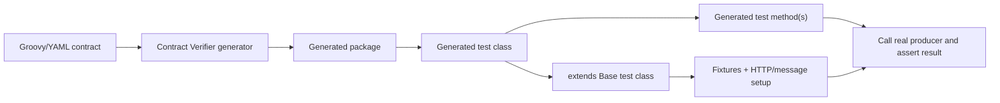
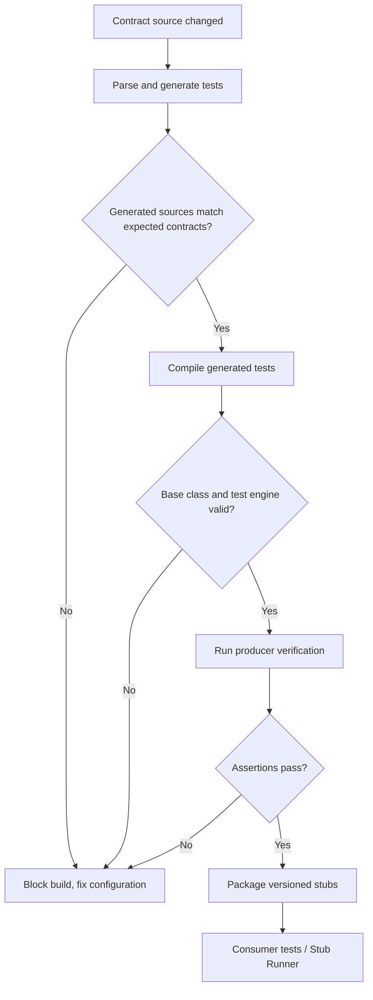

# Package, Test Class, and Test Method Names

## 1. Why Do Generated Test Names Matter?

In **Spring Cloud Contract** (`SPRING_CLOUD_CONTRACT` module), the producer and consumer agree on HTTP or messaging behavior using **Groovy DSL** or **YAML DSL**. From the contract, **Contract Verifier** generates tests to confirm the real producer obeys its published promises. The same contract source can also be used to generate stubs, publish artifacts, run consumer tests via **Stub Runner**, and integrate with CI to catch incompatible API changes.

Once a project has dozens or hundreds of contracts, simply knowing "the plugin generated tests" is not enough. Developers need to identify:

- What Java/Groovy **package** the generated test code belongs to and why it has that name.
- Which **test class** contains the contract verification methods.
- Which **test method** corresponds to each contract file or definition.
- Which **base class** the generated test inherits from to prepare the producer, request client, fixtures, or message verifier.
- When a test fails in CI, how to **trace back** from the method name to the corresponding contract and API branch.

These names are often related, yet **not synonymous**. In particular, **one contract file does not necessarily correspond to one separate test class**, and the manually written base class is **not** a test class created by the generator.

## 2. Four Elements in the Test Generation Process

| Element | Illustrative Example | Role |
| --- | --- | --- |
| **Source contract** | `get_order_success.groovy` | Describes request and response in DSL |
| **Generated test package** | `com.example.orders.contract` | Test code namespace; governs imports and class organization |
| **Generated test class** | `ContractVerifierTest` | Class holding test methods generated by Contract Verifier |
| **Generated test method** | `validate_get_order_success()` | Runs one specific contract scenario and asserts the result |
| **Base test class** | `com.example.orders.contract.ContractVerifierBase` | Written by the team; configures test infrastructure and fixtures used by generated tests |

**Note:** package, class, and method names in the table are **illustrative examples**, not fixed defaults across every Spring Cloud Contract version. Actual names depend on contract structure, metadata, plugin, test framework, and code-generation options. The reliable verification step is **reading the actual generated test code**.

### 2.1. Responsibility Diagram



The generator reads contract behavior and emits test code; the base class supplied by the development team provides the conditions for that test to **execute against the producer**. If the plugin generates valid tests but the base class fails to set up required data, the test can still fail.

## 3. Running Example: Reading an Order Contract

Suppose the `orders-producer` service publishes an API:

- `GET /api/orders/ord-1001` returns `200 OK`.
- The response is JSON with `id = ord-1001` and `status = CREATED`.
- `ord-1001` is a fixture already created for producer tests.

A Groovy contract `get_order_success.groovy`:

```groovy
import org.springframework.cloud.contract.spec.Contract

Contract.make {
    name 'get_order_success'
    description 'Returns details of an existing order'

    request {
        method GET()
        url '/api/orders/ord-1001'
    }

    response {
        status 200
        headers {
            contentType(applicationJson())
        }
        body([
            id    : 'ord-1001',
            status: 'CREATED'
        ])
    }
}
```

In this contract, `name 'get_order_success'` defines a scenario identifier. It **helps tools and readers recognize the test**, but you should not mechanically assume the Java class or method name will have the exact same character-for-character string. Depending on the version, the generator may add prefixes, sanitize characters, and handle collisions.

If the team chooses YAML DSL, the equivalent content is:

```yaml
name: get_order_success
description: Returns details of an existing order
request:
  method: GET
  url: /api/orders/ord-1001
response:
  status: 200
  headers:
    Content-Type: application/json
  body:
    id: ord-1001
    status: CREATED
```

Both versions express **the same behavior**. A project should register only **one** representation for this scenario to avoid generating duplicate tests and stubs.

## 4. How Is the Generated Test Package Determined?

A **package** is a namespace in Java/Groovy code, for example:

```java
package com.example.orders.contract;
```

It differs from the **HTTP path** `/api/orders`, the **Maven coordinates** `com.example:orders-producer`, and the **contracts folder**. While developers may name these concepts similarly in meaning, they are not necessarily derived automatically from one another.

In practice, the generated package can be influenced by:

1. **The producer project's default package/configuration** and how the plugin inspects the project.
2. **The contract directory structure** under the contracts root.
3. **Organization and base class options** of the Maven/Gradle plugin.
4. **The Contract Verifier version and test language** (Java/JUnit or Groovy/Spock, depending on configuration).

Because rules can vary by configuration, **do not guess the package solely from directory names**, such as assuming `contracts/http/orders/` will certainly produce package `http.orders`. Inspect the actual generated test file after the generator runs.

### 4.1. Distinguishing Source Directory and Package

An illustrative layout:

```text
orders-producer/
  src/test/resources/contracts/
    http/orders/
      get_order_success.groovy
      get_order_not_found.groovy

  src/test/java/com/example/orders/contract/
    ContractVerifierBase.java

  target/generated-test-sources/contracts/
    ... generated test sources ...
```

This is an **illustrative layout for Maven**. `target/generated-test-sources/contracts` is a common location for generated test code when applying the corresponding Maven configuration. Check the **actual output** for the underlying package structure and filenames instead of copying this example as an immutable path.

If the generated test declares:

```java
package com.example.orders.contract;
```

then the corresponding source file usually lives under a directory matching the package:

```text
.../com/example/orders/contract/...
```

A file stored in a different directory could still declare this package, but build tools and IDEs typically align folders with package structure so imports and class lookup stay clean.

### 4.2. Why Does the Package Affect the Test Base?

Suppose the plugin is configured with:

```xml
<baseClassForTests>
  com.example.orders.contract.ContractVerifierBase
</baseClassForTests>
```

This is a **fully qualified class name** (*FQCN*), combining the package and class name. Generated tests must resolve and extend that class. If you change the package of `ContractVerifierBase` without updating the configuration, generated tests may fail to compile because they cannot resolve the base class.

Changing a package is purely a code-organization refactor, yet it can break the build if:

- The base class is no longer at the expected fully qualified name.
- Imports or test dependencies become invalid.
- Directory-based base class mapping configuration was not updated.
- The IDE still displays stale generated sources while the build changed output paths.

Therefore, checking the **package declaration inside the generated source** is more reliable than only glancing at folder names on disk.

## 5. Generated Test Class vs. Base Test Class

These two classes have distinct responsibilities:

| Criterion | Generated Test Class | Base Test Class |
| --- | --- | --- |
| Who creates it? | Contract Verifier | Producer development team |
| Source of changes | Contracts and generator configuration | Producer preparation code and fixtures |
| What does it contain? | Generated test methods and assertions | HTTP test config, app context, test data, message triggers |
| Should it be edited directly? | No; it will be regenerated | Yes; this code is maintained in the repository |
| Common errors | Wrong package/imports, duplicate method names, unexpected assertions | Missing beans, wrong fixtures, unconfigured request client, missing triggers |

### 5.1. Maven Plugin Configuration

An abbreviated `pom.xml` snippet:

```xml
<build>
  <plugins>
    <plugin>
      <groupId>org.springframework.cloud</groupId>
      <artifactId>spring-cloud-contract-maven-plugin</artifactId>
      <extensions>true</extensions>
      <configuration>
        <baseClassForTests>
          com.example.orders.contract.ContractVerifierBase
        </baseClassForTests>
        <testFramework>JUNIT5</testFramework>
        <testMode>MOCKMVC</testMode>
      </configuration>
    </plugin>
  </plugins>
</build>
```

This snippet is **not a complete `pom.xml`**. The project must declare a plugin version compatible with Spring Boot/Spring Cloud Contract, test dependencies, and required build setup. Verify option names and enum values against the **plugin version in use**, especially when upgrading.

Meaning:

- `baseClassForTests` specifies the base class that generated tests extend.
- `testFramework` selects a test framework supported by the generator, such as JUnit 5.
- `testMode` chooses the HTTP invocation strategy, such as MockMvc for testing the web layer.

Setting `MOCKMVC` makes sense only if the base class actually provisions a MockMvc environment. If the project runs a real server or uses WebTestClient, both the test mode and base class must be configured accordingly.

### 5.2. Illustrative Java Base Class

With MockMvc, a base class may look like:

```java
package com.example.orders.contract;

import io.restassured.module.mockmvc.RestAssuredMockMvc;
import org.junit.jupiter.api.BeforeEach;
import org.springframework.beans.factory.annotation.Autowired;
import org.springframework.boot.test.autoconfigure.web.servlet.AutoConfigureMockMvc;
import org.springframework.boot.test.context.SpringBootTest;
import org.springframework.test.web.servlet.MockMvc;

@SpringBootTest
@AutoConfigureMockMvc
public abstract class ContractVerifierBase {

    @Autowired
    private MockMvc mockMvc;

    @BeforeEach
    void setUp() {
        // In a real project: prepare the ord-1001 fixture before each test.
        RestAssuredMockMvc.mockMvc(mockMvc);
    }
}
```

This class only illustrates supplying `MockMvc` to generated tests. For `get_order_success` to pass, the project also needs:

- The controller and required beans initialized.
- The `ord-1001` fixture present in the test data store or the service stubbed at an appropriate level.
- Security filters, context paths, and request encoding matching the contract.
- Isolated state so tests do not depend on execution order.

If the fixture is missing, the producer may return `404` instead of `200` even though the generated test compiles cleanly.

### 5.3. The Base Class Does Not Create Contracts

The name `ContractVerifierBase` is a team-chosen convention, not mandatory `Contract.make` syntax. Conversely, renaming the base class **does not change the contract's content**. Constraints on method, URL, status, headers, and JSON body still come from the DSL.

For **messaging contracts**, the base class may also contain event trigger methods like `publishOrderCreated()` and a mechanism to observe outbound messages. A plain MockMvc setup cannot verify full interactions over a message broker.

## 6. Test Methods Generated from Contracts

A generated test method represents **one declared scenario**. Below is a simulated Java structure:

```java
// STRUCTURAL ILLUSTRATION, NOT VERBATIM GENERATOR OUTPUT.
package com.example.orders.contract;

import org.junit.jupiter.api.Test;

public class ContractVerifierTest extends ContractVerifierBase {

    @Test
    public void validate_get_order_success() throws Exception {
        // Send GET /api/orders/ord-1001 to the real producer.
        // Assert HTTP 200, Content-Type, and JSON fields per contract.
    }

    @Test
    public void validate_get_order_not_found() throws Exception {
        // Send GET /api/orders/ord-missing.
        // Assert HTTP 404 and error code ORDER_NOT_FOUND.
    }
}
```

In a real version/configuration, the class name might **not be `ContractVerifierTest`**, method names may carry different prefixes/normalization, and generated assertions will be much more detailed. This example is intentionally condensed to illustrate **the relationship among class, method, and contract**, not to assert line-by-line framework output.

### 6.1. What Effect Does `name` in the Contract Have?

In Groovy:

```groovy
Contract.make {
    name 'get_order_not_found'

    request {
        method GET()
        url '/api/orders/ord-missing'
    }

    response {
        status 404
    }
}
```

`name` assigns an explicit identifier to the test scenario, usually influencing how the generator names the test method. If `name` is omitted, the tool may derive an identifier from the filename or other metadata; details depend on the version and DSL format.

A good convention is **naming after the observable behavior**: `get_order_not_found` is far clearer than `test_02`. Avoid spaces, special punctuation, Unicode characters awkward in Java identifiers, or duplicate names within the same generated class scope.

### 6.2. Are Filename and `name` Always Identical?

Not syntactically required, but keeping them consistent is recommended:

| File | `name` in DSL | Assessment |
| --- | --- | --- |
| `get_order_success.groovy` | `get_order_success` | Clear, easy to trace |
| `get_order_not_found.groovy` | `get_order_not_found` | Clear, easy to trace |
| `get_order_success.groovy` | `create_product_success` | Confusing and prone to misdiagnosis |
| `case1.groovy` | `get_order_not_found` | Meaningful via `name`, but filename is uninformative |

**Multi-contract case:** some Groovy DSL layouts allow multiple contract definitions inside a single file. Hence, **file count does not always equal test method count**. If using this pattern, each definition must remain individually traceable, avoid name collisions, and be checked in generated output after building.

### 6.3. One Class Can Hold Multiple Test Methods

Suppose a project has three scenarios:

```text
get_order_success
get_order_not_found
create_order_invalid_quantity
```

Depending on configuration, folders, and version, the generator may group multiple test methods into one class or split them across classes. **Do not assume three contracts will produce exactly three classes.** What must be confirmed is that **all three scenarios appear and are executed**.

When CI reports:

```text
ContractVerifierTest > validate_get_order_not_found FAILED
Expected HTTP status: 404
Actual HTTP status: 200
```

that is an **illustrative log**. Investigation steps:

1. Locate the generated method `validate_get_order_not_found`.
2. Inspect the generated request and assertions.
3. Trace back to the `get_order_not_found` contract / source file.
4. Verify that fixture `ord-missing` truly does not exist.
5. Compare the real producer response against the agreed behavior; fix the root cause in the right layer.

Do not change `404` to `200` in the contract just to make the test green if the producer implementation is the side at fault.

## 7. Why Can Renaming Break the Build?

### 7.1. Method Name Collisions

Suppose two different contracts both set:

```groovy
name 'get_order_success'
```

If both end up in the same generated class and the generator uses `name` for the method name, duplicate names **can cause a collision** or unexpected output. Keep identifiers unique within each contract group and **inspect the generated source** to confirm reality.

Pairs of names can also collide after character normalization—for instance `get-order-success` and `get_order_success`, depending on the naming algorithm. Even if the framework deduplicates names, hard-to-distinguish names make CI logs unclear.

### 7.2. Wrong Package or Base Class

Suppose the plugin points to:

```text
com.example.orders.contract.ContractVerifierBase
```

while the source class was moved to:

```text
com.example.orders.tests.ContractVerifierBase
```

Generated tests will fail to locate the base class to extend. This is a **test compilation configuration error**, not a wrong HTTP contract. Update the FQCN in the plugin configuration and verify the base class package and imports.

### 7.3. Base Class Mapping Pointing to the Wrong Class

Across multiple API domains, a single base class may become too broad:

- `orders/*` contracts need order fixtures and MockMvc.
- `payments/*` contracts need payment fixtures.
- `messaging/*` contracts need message triggers or a message verifier.

Spring Cloud Contract provides **base class mappings** in plugin configuration to pick the appropriate base class per contract group instead of forcing all tests onto one base class. Syntax and regex/path mapping evaluation depend on the Maven/Gradle plugin and version; verify against your project version's documentation and generated classes when applying.

Do not manually rename generated packages or classes and commit them. On the next generator run, manual edits will be lost; fix the **DSL, plugin configuration, or base classes** that produce the output.

## 8. Generated Test Names Under Maven and Gradle

### 8.1. Maven Projects

Once the plugin is configured, you can invoke Spring Cloud Contract's test-generation goal:

```bash
./mvnw -B spring-cloud-contract:generateTests
```

This command is an example for projects **already equipped with Maven Wrapper, compatible dependencies/plugins, and versions**. If Maven reports a missing plugin prefix or goal, inspect `pom.xml` and the plugin version before blaming the contracts.

Java test output is typically written under `target/generated-test-sources/contracts` per the corresponding Maven configuration. Inspect the **actual files** to verify packages, classes, methods, imports, and base classes. A successful test-generation step does not mean tests were **compiled or executed**.

To run full producer verification in a properly configured Maven pipeline:

```bash
./mvnw -B clean verify
```

Confirm that the build actually discovers contracts, generates tests, includes the sources in test compilation, and executes them with the test runner. A green build when zero contracts were scanned does not protect the API.

### 8.2. Gradle Projects

With the corresponding Gradle plugin, common tasks are `generateContractTests` and `contractTest`. Example:

```bash
./gradlew generateContractTests
./gradlew contractTest
```

Exact task names and lifecycle wiring depend on the plugin version and project configuration. Generated sources generally appear under `build/`, with the exact directory shown in task output. Do not assume Gradle creates the exact same package/class/file layout as Maven or uses the same test runner.

### 8.3. Inspect Output Instead of Guessing Names

A quick verification checklist:

1. Run the **test-generation goal/task**.
2. Open the generated sources folder reported by the build.
3. Open a generated class file and read its `package ...;` line.
4. Read `class ... extends ...` or the equivalent test framework declaration.
5. List methods annotated with `@Test` (JUnit) or corresponding test blocks (Spock).
6. Match the count and intent of methods against the source contracts scanned by the plugin.
7. Compile and execute the tests; check the build report to see which scenarios passed/failed.

Use file/contract names only as **initial search hints**. The generated source is the direct proof of the active configuration.

## 9. How Do JUnit 5, JUnit 4, and Spock Affect Test Names?

Spring Cloud Contract can generate code for multiple test frameworks supported by the version/plugin. For example:

| Framework | Generated Test Shape | Things to Note |
| --- | --- | --- |
| **JUnit 5** | Java class, methods with `org.junit.jupiter.api.Test` | Requires proper test engine and dependencies |
| **JUnit 4** | Java class, methods with `org.junit.Test` | Requires compatible runner/dependencies |
| **Spock** | Groovy Specification with feature methods | Feature names can use descriptive text per Groovy syntax |

Differences in annotations/languages may change how the test runner **displays names**, yet every variant must still verify the exact behavior defined in the contract.

Do not write a CI script that searches only for `@Test` and concludes there are no tests if the project uses Spock. Similarly, the presence of a Java test file does not guarantee the JUnit 5 engine executed it. Check test runner results at the build level.

### 9.1. Does the Package Determine Method Visibility Access?

In Java, `package-private` members are accessible only within the same package. When a generated class resides in a different package from the base class, `package-private` helpers/fixtures cannot be accessed directly. Helpers meant for generated subclasses should have appropriate visibility (such as `protected`/`public` when needed) and be designed for stable test invocation.

Do not edit a generated test to call a `package-private` helper. Fix the base test API or package/configuration layout, then regenerate.

## 10. Tests Generated from Messaging Contracts

For messaging, a contract can still specify `name`:

```groovy
import org.springframework.cloud.contract.spec.Contract

Contract.make {
    name 'order_created_event'
    label 'order_created'

    input {
        triggeredBy('publishOrderCreated()')
    }

    outputMessage {
        sentTo('orders.events')
        body([
            eventType: 'ORDER_CREATED',
            orderId  : 'ord-1001'
        ])
    }
}
```

The generated producer test needs to call a **trigger mechanism** and assert the emitted message. In this example, `publishOrderCreated()` is a method **implemented by the team in the test base**, not generated by Spring Cloud Contract. Therefore:

- The package/class/method of the **generated test** are still created by the plugin and governed by configuration.
- The **trigger method** `publishOrderCreated()` is a helper in the base class/configuration; it is not the same as the test method name.
- `label 'order_created'` matters when the consumer needs to trigger a message stub within Stub Runner's capabilities; it is not a Java package name.
- `sentTo('orders.events')` is the business destination, not a Java package determinant.

Confusing these names can lead learners to search for a generated Java method named `publishOrderCreated` or expect changing `label` to alter the package. Distinguish **test technical names** from **message transport component names**.

## 11. Naming for Traceability from Contract to CI Results

A practical convention you can adopt:

| Component | Suggested Naming Pattern | Rationale |
| --- | --- | --- |
| Contract file | `get_order_success.groovy` | Captures action, resource, and outcome |
| `name` | `get_order_success` | Consistent with filename, easy to search in logs |
| Error contract | `get_order_not_found.groovy` | Separates the `404` branch from the `200` branch |
| Messaging contract | `order_created_event.groovy` | Distinguishes events from HTTP endpoints |
| Base class | `OrdersContractTestBase` | Clarifies business domain and role |
| Base class package | `com.example.orders.contract` | Groups the module's test infrastructure |

These are **recommended conventions**, not mandatory framework syntax rules. Names may vary per project standards, as long as consistency is maintained and collisions after generator normalization are avoided.

### 11.1. Traceability Between Source and Generated Tests

An illustrative tracking table:

| Source Contract | Behavior | What to Verify in Generated Tests |
| --- | --- | --- |
| `get_order_success.groovy` | `GET /api/orders/ord-1001 -> 200` | A method verifying the success branch exists |
| `get_order_not_found.groovy` | `GET /api/orders/ord-missing -> 404` | A method verifying the not-found branch exists |
| `create_order_invalid_quantity.yml` | `POST /api/orders -> 400` when quantity = 0 | A method verifying invalid input exists |
| `order_created_event.groovy` | Emits `ORDER_CREATED` event | A test triggers the producer and observes the message |

Do not count only `.java` files in generated sources: a single file can hold multiple test methods. Nor should you count only `@Test` lines if the test framework does not use JUnit annotations. What must be verified is that **every selected behavior is covered by an executable test**.

### 11.2. When Adding a New Contract

Suggested review workflow:

1. Identify the consumer behavior to protect and add the corresponding contract file.
2. Pick a meaningful `name` that does not collide with others in the same scope.
3. Generate tests and inspect the new package/class/method.
4. Ensure the right base class is selected for HTTP or messaging.
5. Run tests to verify the producer; then package the verified stub.
6. Have the consumer run the exact stub version and record CI results.

If a new contract **does not appear** in generated output, do not assume the test runner is broken. Check **contracts root, file extensions, scan filters, DSL parsing, and plugin configuration** first.

## 12. Common Errors and How to Diagnose Them

| Symptom | Possible Cause | First Action |
| --- | --- | --- |
| No generated test method seen for a new contract | File not scanned or conversion failed | Check contracts directory, filename, plugin logs, and generated source |
| Confusing test method name | Ambiguous `name` or filename; generator normalized characters | Rename source meaningfully and regenerate |
| Compile error `cannot find symbol ContractVerifierBase` | Wrong package/FQCN or base class missing from test classpath | Check `baseClassForTests` and base class `package` |
| Two tests share the same name or ambiguous mapping | Duplicate contract identifier or normalized collision | Check `name`, filenames, and generated methods |
| HTTP test fails before reaching assertions | Base class did not configure MockMvc/REST Assured or fixture is missing | Check setup, controller, and test state |
| Messaging test reports missing trigger | `triggeredBy` points to an unimplemented method | Add helper and configure message verifier |
| Generated test code looks right, yet tests do not run | Test engine/lifecycle did not pick up generated sources | Inspect dependencies, plugin test config, and runner output |
| Build passes green, but zero tests ran | Plugin scanned no contracts or runner skipped generated tests | Check contract list and executed test count report |
| Changing package broke imports | Base class/helpers live outside the package or lack visibility | Fix package/imports/visibility in team-managed code |
| Manual edits to generated source vanished after `clean` | Generated sources are not meant for permanent edits | Fix DSL, test base, or plugin configuration |

### 12.1. Distinguishing Naming Errors from Behavioral Errors

A test with a long or unexpected name can still verify the API accurately. Conversely, a clean name on a test that hits the wrong URL or asserts the wrong response **does not protect the contract**.

When failures occur, trace in order:

```text
Source contract scanned by plugin?
  -> Generated package / class / method exists?
     -> Base class resolved and set up properly?
        -> Generated test sends the right request/message?
           -> Assertions match the contract?
              -> Real producer returns the expected behavior?
```

Each layer addresses a distinct root cause. Do not change an HTTP status in the DSL merely to work around a `ClassNotFoundException` caused by a wrong package.

## 13. Integrating Test Name and Execution Checks into CI

Producer CI should prove **traceability and execution**, not merely that files were generated:



Useful information to capture in pipeline logs/artifacts:

- List of source contracts read.
- Generated test class names and count of generated test cases.
- Packages and base classes used, especially when base class mappings are configured.
- Number of tests actually executed by the runner, plus pass/fail/skip counts.
- Published stub artifact coordinates, e.g. `com.example:orders-producer:1.4.2:stubs`.
- Producer commit/tag corresponding to the artifact and test results.

If the producer replaces `404` with `200`, **the test named for the not-found branch** should fail on its assertion, pointing log readers straight to the contract to inspect. Consumers can then use Stub Runner to verify their error-handling code against the exact stub version.

## 14. Hands-On Lab: Naming and Locating Generated Tests

### 14.1. Assignment

A producer has three behaviors:

| Behavior | Suggested Contract Source |
| --- | --- |
| `GET /api/products/SKU-001 -> 200`, JSON with `id`, `available` | `get_product_success.groovy` |
| `GET /api/products/SKU-MISSING -> 404`, JSON with `code = PRODUCT_NOT_FOUND` | `get_product_not_found.groovy` |
| `POST /api/products/reservations -> 409` when out of stock | `reserve_product_out_of_stock.groovy` |

Your tasks:

1. Write three contract files with `name` matching the semantic meaning of each filename.
2. Configure a base class `com.example.products.contract.ProductsContractTestBase` for producer tests.
3. Set up fixtures so `SKU-001` exists, `SKU-MISSING` does not exist, and the out-of-stock case returns `409`.
4. Run the **generate tests** step using your active Maven or Gradle plugin.
5. Record the actual **package, class name, and method name** of the generated tests from the output files.
6. Confirm all three behaviors have executable tests that are not skipped.
7. Intentionally change the base class package without updating plugin config; observe the compile error, then fix the **source configuration** for consistency.

### 14.2. Result Recording Sheet

| Item | Fill in from Actual Project |
| --- | --- |
| Test framework | JUnit 5 / JUnit 4 / Spock |
| Plugin/version | Configured name and version |
| Contracts root | Actual directory scanned by plugin |
| Generated sources directory | Path created by build |
| Generated package | `package ...` line in source |
| Generated class(es) | Actual class/specification name(s) |
| Generated method(s) | Method/feature name per contract |
| Base class FQCN | Base class used by generated tests |
| Total tests executed | Count from test runner report |
| Producer verification result | Pass/fail and cause if failed |

### 14.3. Self-Check Questions

**Question 1.** Do three contract files always generate exactly three Java classes?

**Answer:** No. One class can contain multiple test methods; grouping depends on the generator and configuration. Inspect the actual output.

**Question 2.** Does changing `name 'get_product_success'` automatically change the Java package?

**Answer:** No. `name` identifies the scenario, whereas the package is determined by organization rules and generator configuration.

**Question 3.** If a generated test reports `ProductsContractTestBase` is missing, what should you fix?

**Answer:** Check the FQCN in the plugin configuration, the base class package declaration, and the test classpath. Do not edit generated tests manually.

**Question 4.** If a generated method exists but CI reports 0 tests executed, is the producer verified?

**Answer:** No. The test runner must discover and execute that method, and its assertions must genuinely pass.

**Question 5.** A messaging contract has `triggeredBy('publishEvent()')`. Is this the generated test method name?

**Answer:** No. That is the name of the trigger method defined in the base class/configuration, distinct from the test method name created by the generator.

### Checklist Before Concluding Generated Tests Are Ready

- [ ] Source contracts were scanned and have clear `name`/filenames.
- [ ] Generated sources have the package, class, and methods produced by the actual project.
- [ ] No duplicate names or omitted test branches exist.
- [ ] Generated tests extend the right base class FQCN.
- [ ] The base class initializes the HTTP client or messaging verifier and fixtures.
- [ ] Generated tests were **compiled and executed**, not merely emitted as files.
- [ ] Assertions protect the agreed method, URL, status, body, headers, or message output.
- [ ] Build reports clearly record pass/fail/skip counts and allow tracing back to failing contracts.
- [ ] Stubs were packaged/published with the proper version after producer verification passed.

**Remember:** the package organizes test code, the generated class groups tests, the generated method executes a contract scenario, and the base class supplies runtime preconditions. Exact names are determined by the generator and configuration; to know for sure, read the generated source and test runner reports. Understanding these relationships speeds up diagnosing Contract Verifier errors and ensures CI genuinely verifies the promise between producer and consumer.
