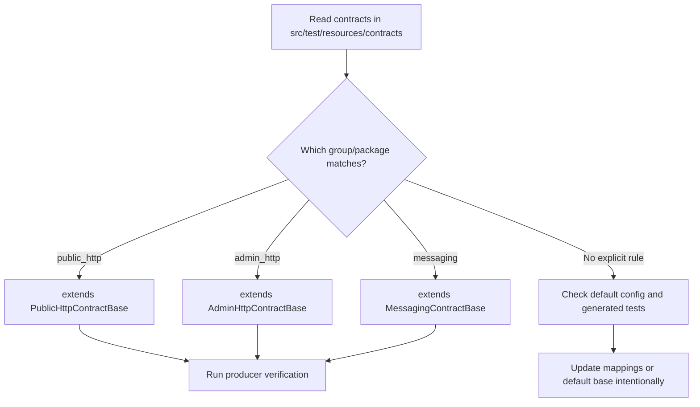
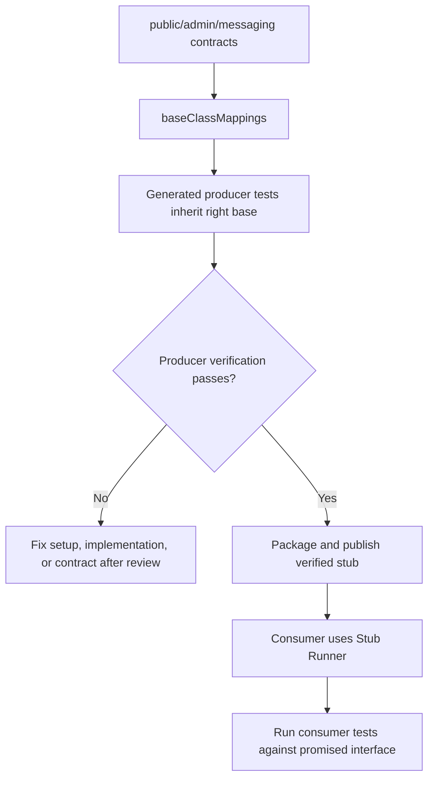

# Mapping Contract Groups to the Right Base Class

## 1. Why Does a Producer Need Multiple Test Base Classes?

In a multi-service system, **Spring Cloud Contract Verifier** reads HTTP or messaging contracts (Groovy/YAML DSL), generates tests on the **producer** side, verifies the application meets its promised interface, and supports packaging stubs for **consumers** to test via Stub Runner. These tests need an execution environment: a Spring context, HTTP client, sample data, authentication, or messaging infrastructure. Environment preparation typically lives in a **test base class**.

For a producer with only a few HTTP contracts sharing the same setup, a single base class may suffice. However, real-world projects often have multiple groups:

- **Public HTTP:** `/api/orders` endpoints using MockMvc and sample order fixtures.
- **Admin HTTP:** `/internal/orders` endpoints with distinct authentication/authorization rules and fixtures.
- **Messaging:** workflows emitting an `OrderCreated` event requiring a trigger and a message-observation mechanism.

If every test inherits the same base class packing all beans, mocks, triggers, and configurations together, that class turns into a bottleneck that is hard to maintain, hard to run independently, and prone to cross-test interference. Conversely, assigning the wrong base class can prevent generated tests from compiling, booting the test context, or sending requests/messages according to the contract.

**Lesson goal:** use `baseClassForTests` for simple cases and `baseClassMappings` to map **contract group → fully qualified base class**. Then inspect generated test output, resolve missing or mismatched groups, and integrate producer verification with stub publishing in CI.

## 2. What Is a Base Class in Spring Cloud Contract Verifier?

A base class is a **Java/Kotlin/Groovy class written and maintained by the producer team**; generated tests inherit from it to share a test environment. Spring Cloud Contract **does not automatically write all business logic or Spring contexts** simply because we declare a base class name in the plugin.

A generated test conceptually takes this shape:

```java
// Structural illustration: actual class/method depends on SCC version and configuration.
public class Validate_create_order extends PublicHttpContractBase {
    @Test
    public void validate_create_order() throws Exception {
        // Generated code: sends request to producer and compares response.
    }
}
```

The base class's role depends on the group:

| Test Need | What the Base Class Prepares | Example |
| --- | --- | --- |
| Sending HTTP requests via MockMvc | Spring test context, MockMvc, and RestAssuredMockMvc setup | `PublicHttpContractBase` |
| Testing admin endpoints | Context with security filters, test accounts/roles, suitable fixtures | `AdminHttpContractBase` |
| Emitting/receiving messages | Message verifier, binder/test transport, `triggeredBy` methods | `MessagingContractBase` |
| Reproducible data | Fixture seeding/cleanup and state isolation | All groups, per data needs |

The base class is not part of the interface visible to the consumer. It is **producer-side test infrastructure** enabling execution of the behavior specified by contracts.

### 2.1. Where Should Base Classes Live?

With Maven or Gradle using a standard Java source set:

```text
src/
  test/
    java/
      com/example/contract/
        PublicHttpContractBase.java
        AdminHttpContractBase.java
        MessagingContractBase.java
    resources/
      contracts/
        public_http/
          create_order.groovy
          order_not_found.yml
        admin_http/
          get_internal_order.groovy
        messaging/
          order_created.groovy
```

This is an **illustrative layout**. Default/custom contract paths and generated test packages depend on the plugin, but the principle always holds: keep group paths clear and ensure base classes reside on the **test compile classpath**.

`PublicHttpContractBase.java` must declare `package com.example.contract;` to match the fully qualified name `com.example.contract.PublicHttpContractBase` in the plugin.

## 3. A Single Base Class with `baseClassForTests`

If all contracts share the same test context, you can declare a single default:

```xml
<plugin>
    <groupId>org.springframework.cloud</groupId>
    <artifactId>spring-cloud-contract-maven-plugin</artifactId>
    <version>${spring-cloud-contract.version}</version>
    <extensions>true</extensions>
    <configuration>
        <testFramework>JUNIT5</testFramework>
        <testMode>MOCKMVC</testMode>
        <baseClassForTests>com.example.contract.HttpContractBase</baseClassForTests>
    </configuration>
</plugin>
```

`baseClassForTests` specifies **one default superclass** for generated tests within that configuration scope. `testMode=MOCKMVC` illustrates a Spring MVC producer tested with MockMvc. The `${spring-cloud-contract.version}` property must exist in your actual Maven configuration and match the Spring Cloud Contract libraries managed by your BOM.

This approach's strength is simplicity with few rules. Its limitation appears when public HTTP, admin HTTP, and messaging require different setups. That is when you should adopt **group-based mappings** instead of piling conditional `if` branches inside a single base class.

In Gradle Groovy DSL, the conceptually equivalent configuration is:

```groovy
contracts {
    baseClassForTests = 'com.example.contract.HttpContractBase'
}
```

This assumes the project applies the **Spring Cloud Contract Gradle plugin** and declares compatible versions. For projects using Kotlin DSL or other plugin versions, property syntax may need adjustment per the corresponding DSL.

## 4. Mapping Multiple Groups with `baseClassMappings`

Spring Cloud Contract supports a **mapping** mechanism to assign different base classes based on contract location/package. Instead of forcing one class on every contract, we define rules:

| Contract Group | Illustrative Matching Rule | Test Base Class |
| --- | --- | --- |
| `public_http` | `.*public_http.*` | `com.example.contract.PublicHttpContractBase` |
| `admin_http` | `.*admin_http.*` | `com.example.contract.AdminHttpContractBase` |
| `messaging` | `.*messaging.*` | `com.example.contract.MessagingContractBase` |

Each rule consists of:

- **`contractPackageRegex`**: a regular expression matching the contract group against the path/package evaluated by the test generator. Verify how your plugin version represents the actual package/path rather than assuming identical formatting across all operating systems.
- **`baseClassFQN`**: the fully qualified class name, including package and class name, which must exist on the test classpath.

An illustrative Maven configuration:

```xml
<plugin>
    <groupId>org.springframework.cloud</groupId>
    <artifactId>spring-cloud-contract-maven-plugin</artifactId>
    <version>${spring-cloud-contract.version}</version>
    <extensions>true</extensions>
    <configuration>
        <testFramework>JUNIT5</testFramework>
        <testMode>MOCKMVC</testMode>
        <baseClassMappings>
            <baseClassMapping>
                <contractPackageRegex>.*public_http.*</contractPackageRegex>
                <baseClassFQN>com.example.contract.PublicHttpContractBase</baseClassFQN>
            </baseClassMapping>
            <baseClassMapping>
                <contractPackageRegex>.*admin_http.*</contractPackageRegex>
                <baseClassFQN>com.example.contract.AdminHttpContractBase</baseClassFQN>
            </baseClassMapping>
            <baseClassMapping>
                <contractPackageRegex>.*messaging.*</contractPackageRegex>
                <baseClassFQN>com.example.contract.MessagingContractBase</baseClassFQN>
            </baseClassMapping>
        </baseClassMappings>
    </configuration>
</plugin>
```

**How to read this:** a contract in the group matched as `public_http` will generate tests extending `PublicHttpContractBase`, not `AdminHttpContractBase`. For messaging, tests can invoke trigger methods on `MessagingContractBase` instead of using MockMvc setup.

### 4.1. Equivalent Configuration in Gradle

With Groovy DSL and the Spring Cloud Contract Gradle plugin:

```groovy
contracts {
    baseClassMappings {
        baseClassMapping('.*public_http.*',
                         'com.example.contract.PublicHttpContractBase')
        baseClassMapping('.*admin_http.*',
                         'com.example.contract.AdminHttpContractBase')
        baseClassMapping('.*messaging.*',
                         'com.example.contract.MessagingContractBase')
    }
}
```

This configures only the **`contracts` block**, not a full `build.gradle`. The producer still needs the Spring Boot plugin, Spring Cloud Contract plugin, test dependencies, and compatible BOM. Gradle Kotlin DSL (`build.gradle.kts`) uses different syntax; consult documentation for your version instead of copying Groovy DSL verbatim.

### 4.2. A Decision Diagram During Test Generation



The diagram depicts the desired policy; **which rule the generator evaluates first** or how fallback behaves must be confirmed against **generated test code** for your project's Spring Cloud Contract version. Do not write overlapping regexes and rely implicitly on order without explicit verification.

## 5. Writing a Well-Scoped HTTP Base Class

Suppose `PublicHttpContractBase` targets REST API contracts running with MockMvc. An illustrative implementation:

```java
package com.example.contract;

import io.restassured.module.mockmvc.RestAssuredMockMvc;
import org.junit.jupiter.api.BeforeEach;
import org.springframework.beans.factory.annotation.Autowired;
import org.springframework.boot.test.autoconfigure.web.servlet.AutoConfigureMockMvc;
import org.springframework.boot.test.context.SpringBootTest;
import org.springframework.test.web.servlet.MockMvc;

@SpringBootTest(webEnvironment = SpringBootTest.WebEnvironment.MOCK)
@AutoConfigureMockMvc
public abstract class PublicHttpContractBase {

    @Autowired
    protected MockMvc mockMvc;

    @BeforeEach
    protected void configureContractClient() {
        RestAssuredMockMvc.mockMvc(mockMvc);
    }
}
```

This is a **template for the matching test mode**, requiring `spring-cloud-starter-contract-verifier`, Spring Boot Test, and dependencies supplied by the plugin/build. `@BeforeEach` is inherited by the JUnit 5 test class and configures the client so generated test code sends requests to the real controller in the Spring test context.

A public HTTP contract:

```groovy
import org.springframework.cloud.contract.spec.Contract

Contract.make {
    description 'Retrieves a public order by ID'
    request {
        method GET()
        url '/api/orders/42'
    }
    response {
        status OK()
        headers {
            contentType(applicationJson())
        }
        body(
            orderId: 42,
            status: 'CREATED'
        )
    }
}
```

For this test to pass, the producer must actually expose `GET /api/orders/42` with suitable test data. The base class **does not** generate controllers, fabricate JSON responses, or replace fixtures designed for the scenario.

### 5.1. When Should You Have a Separate Admin Base Class?

Admin contracts may need:

- An active **security filter chain** to verify `401`, `403`, or `200` behavior depending on credentials.
- Test data and roles different from public resources.
- Headers such as `Authorization`, `X-Tenant-Id`, or an appropriate user context.
- A distinct profile/config serving admin data without accidentally disabling security checks.

For example, a simple admin class can extend the shared MockMvc support and add the group's test configuration:

```java
package com.example.contract;

import org.springframework.test.context.ActiveProfiles;

@ActiveProfiles("contract-admin")
public abstract class AdminHttpContractBase extends PublicHttpContractBase {
    // Admin fixtures can be added in @BeforeEach,
    // and ensure authentication is enforced via MockMvc.
}
```

This snippet **does not grant admin privileges on its own**: the `contract-admin` profile must exist if used, and supplying principals/tokens must match Spring Security and the request contract. If the admin test base bypasses authorization completely, tests may turn green without reflecting the HTTP behavior consumers actually depend on.

In larger projects, you can extract shared MockMvc setup into a support class while both HTTP bases inherit the common part and add specialized configuration. The goal is avoiding duplication while **separating public and admin responsibilities**.

## 6. Test Base Class for Messaging Contracts

Messaging contracts do not necessarily involve HTTP requests. For example, when an order is confirmed, the producer emits an `OrderCreated` event to destination `orders.created`.

An illustrative Groovy contract:

```groovy
import org.springframework.cloud.contract.spec.Contract

Contract.make {
    description 'Emits a message when an order is created'
    label 'order_created'

    input {
        triggeredBy('createOrderAndPublishEvent()')
    }

    outputMessage {
        sentTo('orders.created')
        body(
            eventType: 'OrderCreated',
            orderId: 42
        )
        headers {
            header('eventType', 'OrderCreated')
        }
    }
}
```

In this contract, `triggeredBy` requires a method called by the generator to **trigger real business logic**. The messaging base class must provide that method along with the Spring context and appropriate message verifier/binder configuration.

```java
package com.example.contract;

import org.springframework.beans.factory.annotation.Autowired;
import org.springframework.boot.test.context.SpringBootTest;
import org.springframework.cloud.contract.verifier.messaging.boot.AutoConfigureMessageVerifier;

@SpringBootTest
@AutoConfigureMessageVerifier
public abstract class MessagingContractBase {

    @Autowired
    protected OrderApplicationService orderApplicationService;

    public void createOrderAndPublishEvent() {
        orderApplicationService.createOrderAndPublishEvent(42L);
    }
}
```

`OrderApplicationService` and `createOrderAndPublishEvent` are **assumed application APIs** that the project must implement. The sample illustrates the path from generated tests to real business logic; it will not compile in an empty project lacking the classes, beans, and message transport configuration.

**Important point:** `@AutoConfigureMessageVerifier` and the verifier library enable observing messages in the corresponding configuration, but they do not replace configuring actual topics/queues/binders or listeners. Depending on your Spring Cloud Contract version and messaging transport, verify how Spring Cloud Contract Verifier hooks into the messaging infrastructure. If a contract uses `input.messageFrom(...)`, the test base and message transport must support delivering messages to the right destination.

Do not let `MessagingContractBase` inherit unrelated MockMvc setup by default just to reuse a class. If there is shared logic like data seeding, extract it into a fixture helper/service and reuse it without introducing improper coupling between HTTP and messaging.

## 7. Mapping Regexes: Match Exactly One Group Without Overlap

A good mapping configuration lets reviewers answer: **for each contract path, which superclass will be selected?**

Suppose the layout is:

```text
contracts/
  public_http/get_order.groovy
  admin_http/get_internal_order.groovy
  messaging/order_created.groovy
```

Expected matrix:

| Contract File | Intended Matching Rule | Intended Superclass |
| --- | --- | --- |
| `public_http/get_order.groovy` | `.*public_http.*` | `PublicHttpContractBase` |
| `admin_http/get_internal_order.groovy` | `.*admin_http.*` | `AdminHttpContractBase` |
| `messaging/order_created.groovy` | `.*messaging.*` | `MessagingContractBase` |

Common mistakes:

**Regex too broad.** `.*http.*` matches both public and admin groups, forcing all HTTP tests onto one base class despite needing different setups.

**Separator-dependent regex.** A regex matching only `/public_http/` may fail if the plugin version matches **dot-separated package names** or normalizes paths differently. Verify rules against actual generated tests.

**Regex too narrow.** `public_http` may fail to match a full package like `com.example.contracts.public_http` if the matcher requires a full-string match; `.*public_http.*` is usually easier to follow, though it still needs verification.

**Multiple rules matching one test.** When patterns overlap, do not rely on mapping order as an implicit part of your design. Better to restructure directories or rules so each contract matches **only one** rule.

**Contracts without a matching rule.** A new folder like `partner_http` might fall outside all regexes. Do not blindly assume tests will pick the right superclass; check fallback behavior for your config/version and update mappings as needed.

## 8. Combining `baseClassForTests`, `baseClassMappings`, and Naming Conventions

| Mechanism | Suitable When | Caveats |
| --- | --- | --- |
| `baseClassForTests` | Project has one unified test environment or needs a simple default base | Easily grows into a "god base class" as special cases accumulate |
| `baseClassMappings` | Multiple contract groups need distinct base classes | Requires verifiable regexes and FQCNs present on test classpath |
| Package/base-class convention | Project wants to infer base classes from package structure per plugin convention | Use only when you understand version conventions and verify output |

Some plugin versions offer options like `packageWithBaseClasses` to infer base classes from package structure. This is a **convention-based** option and should not be treated as a 1-to-1 equivalent of explicit mapping. If a project configures multiple base-class selection mechanisms simultaneously, verify the exact precedence/resolution order of your plugin version.

For systems starting out with a few distinct groups, **explicit mapping** is usually easier to review. As group count grows, switching to convention can work, provided you ensure no tests are silently generated with the wrong superclass while CI remains "green."

## 9. Inspect Generated Test Code Instead of Guessing

After configuring mappings, **verify the actual output**, rather than stopping once `pom.xml` or `build.gradle` parses cleanly.

A Maven workflow using the wrapper:

```bash
./mvnw clean verify
./mvnw help:effective-pom
```

A Gradle workflow:

```bash
./gradlew clean test
./gradlew tasks --all
```

These commands are **suggestions to run inside an already configured project**, not commands executed while writing this guide. Exact test-generation goal/task names and generated source paths may vary by plugin and configuration.

### 9.1. What to Check in Generated Tests

1. All contracts in expected groups were read and have corresponding tests.
2. Tests under `public_http` extend `PublicHttpContractBase`.
3. Tests under `admin_http` extend `AdminHttpContractBase`.
4. Tests under `messaging` extend `MessagingContractBase` and invoke the right triggers.
5. All base classes exist on the test compile classpath and invoked methods are accessible from subclasses.
6. Tests actually execute, not skipped by filters or misconfigured tasks.

An **illustrative** review report example, not official plugin output:

```text
Contract: public_http/create_order.groovy
Generated test extends: com.example.contract.PublicHttpContractBase
Expected base:          com.example.contract.PublicHttpContractBase
Mapping: PASS

Contract: admin_http/get_internal_order.groovy
Generated test extends: com.example.contract.AdminHttpContractBase
Expected base:          com.example.contract.AdminHttpContractBase
Mapping: PASS

Contract: messaging/order_created.groovy
Generated test extends: com.example.contract.MessagingContractBase
Expected base:          com.example.contract.MessagingContractBase
Mapping: PASS
```

If tests are generated but fail to compile because the base class cannot be found, check the package/FQCN, `src/test/java` location, class name, and module containing the tests. If tests compile but fail in `@BeforeEach`, inspect the test context, fixtures, and setup for that specific group instead of editing the contract to dodge an environment error.

### 9.2. Why Must You Also Check Test Counts?

A `SUCCESS` build does not prove contract tests ran: the plugin may have found zero contract files, tasks may have been skipped, or test classes may have been excluded by runner filters. CI should record both the number of generated contract tests and executed tests, and fail if a mandatory group unexpectedly runs zero tests.

## 10. Designing Fixtures and Test Lifecycles per Group

When mapping multiple base classes, the challenge is not only creating superclasses but also **isolating state**:

| Issue | Handling Approach to Consider |
| --- | --- |
| Data `orderId=42` does not exist | Seed fixtures before tests or use reproducible test repositories/services |
| Public/admin HTTP share a database | Separate fixtures and cleanup per group; avoid execution-order dependencies |
| Admin tests need different permissions | Configure principals/tokens per contract; do not disable security wholesale |
| Messaging involves async processing | Use proper wait/observation mechanisms to avoid premature assertions |
| Base class holds static state | Minimize global state or reset deterministically, especially under parallel execution |
| Multiple contexts/profiles | Balance context startup cost against isolation needs; avoid forcing everything into one wrong context |

A `@BeforeEach` method is handy for lightweight cleanup and client setup, but avoid embedding complex business logic or hidden fixtures that make individual tests obscure. For contracts covering many scenarios, extract fixture helpers or dedicated test services so base classes stay readable.

If a project enables parallel test execution, inspect the impact of static setups (such as shared test clients or singleton test fixtures) and ensure contracts do not concurrently mutate shared unsynchronized data.

## 11. Relating to Consumer Tests and Stubs

**Base class mapping primarily affects producer verification**, not how consumers use HTTP stubs. Overall flow:



For instance, an `Order Service` with three base class groups can still publish shared HTTP stubs under the producer artifact. When `Checkout Service` uses Stub Runner, it does not need to know whether the producer configured `PublicHttpContractBase` or `AdminHttpContractBase`; it cares only about the API and interactions defined in the stub.

**Do not confuse fixing a base class with fixing a contract:** if an admin test gets `403` because a principal is missing from the test context, check authentication configuration and business rules; do not change the contract expectation from `200` to `403` if real consumers are authorized. Conversely, if the producer returns data violating the agreed API, never mock the expected result inside the base class just to turn tests green.

## 12. Common Mistakes

### Mistake 1: Using One Base Class for Every Contract

**Symptom:** HTTP tests need MockMvc, messaging tests need triggers; the shared class accumulates dependencies and `if` branches by test name. **Fix:** separate groups clearly and use `baseClassMappings` where environments genuinely differ.

### Mistake 2: Regex Sound in Concept, Wrong for Actual Path/Package

**Symptom:** `admin_http` tests extend `PublicHttpContractBase` or the default class. **Fix:** inspect generated test source, compare packages, adjust `contractPackageRegex`, and re-test.

### Mistake 3: `baseClassFQN` Does Not Match Class Name

**Symptom:** `cannot find symbol`, `package ... does not exist`, or generated test compile errors. **Fix:** check `package` declaration, source set/module location, and FQCN in plugin config.

### Mistake 4: Incompatible Test Mode Selected

**Symptom:** generated HTTP tests use Rest Assured/MockMvc APIs while the base class sets up a different client. **Fix:** align `testMode`, test dependencies, base class, and setup APIs for the chosen version.

### Mistake 5: Messaging Trigger Missing or Emits No Message

**Symptom:** generated tests fail to compile because `createOrderAndPublishEvent()` does not exist, or the test waits and observes no message. **Fix:** declare an accessible method that triggers real logic, and check destination, binder, and Message Verifier config.

### Mistake 6: Overlapping Regexes or Unmapped Groups

**Symptom:** tests inherit the wrong class or silently fall back to an unintended default. **Fix:** name group folders unambiguously, keep rules non-overlapping, and add checks verifying generated tests per group.

### Mistake 7: Green Tests That Do Not Protect the API

**Symptom:** all contract tests were skipped or the base class mocks entire responses. **Fix:** check test counts, generator logs, and how much of the real controller/serializer/listener is actually exercised.

## 13. Practical Workflow for Multi-Group Projects

1. **Inventory contract groups:** public HTTP, admin HTTP, messaging, and any group needing special setup.
2. **Design folder structure:** name groups clearly and stably so regexes distinguish them cleanly.
3. **Write dedicated base classes:** each base class prepares the exact Spring context, client, fixtures, security, or triggers needed.
4. **Choose mapping strategy:** use `baseClassForTests` for a single simple group; use `baseClassMappings` with non-overlapping rules for multiple groups.
5. **Generate tests and inspect inheritance:** read the generated source of at least one representative contract from **each** group.
6. **Run producer verification:** verify tests send real HTTP requests or emit/receive expected messages.
7. **Induce a deliberate failure:** break a required response field or destination to confirm the corresponding group's test fails.
8. **Package stubs and run consumer tests:** publish stubs only after producer verification passes, then run consumer tests with Stub Runner pinned to the artifact version.
9. **Enforce in CI:** verify plugin config, test counts, group coverage, and verification status prior to publishing.

## 14. Self-Check Practice Exercise

A producer has contracts:

```text
contracts/
  checkout_http/payment_created.groovy
  finance_http/refund_approved.groovy
  messaging/payment_event.groovy
```

The project team has three classes:

- `com.example.contract.CheckoutHttpBase`: prepares MockMvc and payment fixtures.
- `com.example.contract.FinanceHttpBase`: prepares MockMvc, finance staff authorization context, and refund fixtures.
- `com.example.contract.PaymentMessageBase`: provides triggers and messaging observation infrastructure.

**Tasks:**

1. Write three `baseClassMapping` entries in Maven, each with `contractPackageRegex` and `baseClassFQN`.
2. Explain why `.*http.*` is insufficient when checkout and finance groups need different setups.
3. If generated tests for `finance_http` extend `CheckoutHttpBase`, what will you inspect?
4. For a messaging contract with `triggeredBy('approvePayment()')`, what must the base class provide?
5. Why does a correct base class mapping still not prove producer compatibility if CI skips contract tests?

**Configuration hint:**

```xml
<baseClassMappings>
    <baseClassMapping>
        <contractPackageRegex>.*checkout_http.*</contractPackageRegex>
        <baseClassFQN>com.example.contract.CheckoutHttpBase</baseClassFQN>
    </baseClassMapping>
    <baseClassMapping>
        <contractPackageRegex>.*finance_http.*</contractPackageRegex>
        <baseClassFQN>com.example.contract.FinanceHttpBase</baseClassFQN>
    </baseClassMapping>
    <baseClassMapping>
        <contractPackageRegex>.*messaging.*</contractPackageRegex>
        <baseClassFQN>com.example.contract.PaymentMessageBase</baseClassFQN>
    </baseClassMapping>
</baseClassMappings>
```

**Explanation answers:** (2) Pattern `.*http.*` lumps two distinct environments together and cannot guarantee selecting the right base; (3) inspect the path/package structure used by the generator, overlapping regexes, effective plugin config, and actual generated tests; (4) the base class must provide an accessible method that genuinely triggers the business flow, along with proper messaging test infrastructure; (5) mapping only picks the superclass, whereas interface verification has value only when generated tests execute and compare real producer behavior.

## 15. Pre-Merge Checklist

- Are contract groups defined by **real differences in test environment**, not just naming style?
- Is each `contractPackageRegex` unambiguous and non-overlapping?
- Is every `baseClassFQN` the full name of a class existing on the test classpath?
- Do base classes configure the right `@SpringBootTest`, MockMvc, fixtures, authorization, or message verifier per group?
- Do `testMode`, `testFramework`, and plugin version match the mechanisms inside the base classes?
- Was generated source from each group inspected to confirm it `extends` the right class?
- Does CI check generated/executed test counts, preventing a "green" build when contract tests are skipped?
- Are stubs packaged/published and tested via Stub Runner only after producer verification passes?

**References:** Spring Cloud Contract Reference — [Contract Verifier / Gradle plugin](https://docs.spring.io/spring-cloud-contract/reference/gradle-project.html), [Maven plugin](https://docs.spring.io/spring-cloud-contract/reference/maven-project.html), [Messaging contracts](https://docs.spring.io/spring-cloud-contract/reference/project-features-messaging.html). Cross-check mapping properties, test modes, packages, and APIs against **the version pinned in your project** before applying.

**Remember:** `baseClassForTests` fits a single uniform test environment; `baseClassMappings` maps each **contract group/package** to a **fully qualified base class** using regexes. This lets Spring Cloud Contract Verifier generate producer tests with the right MockMvc setup, security context, data, or message triggers. Mappings matter only when tests are generated, inherit the right class, **actually execute**, and verify the implementation before stubs are published to consumers.
