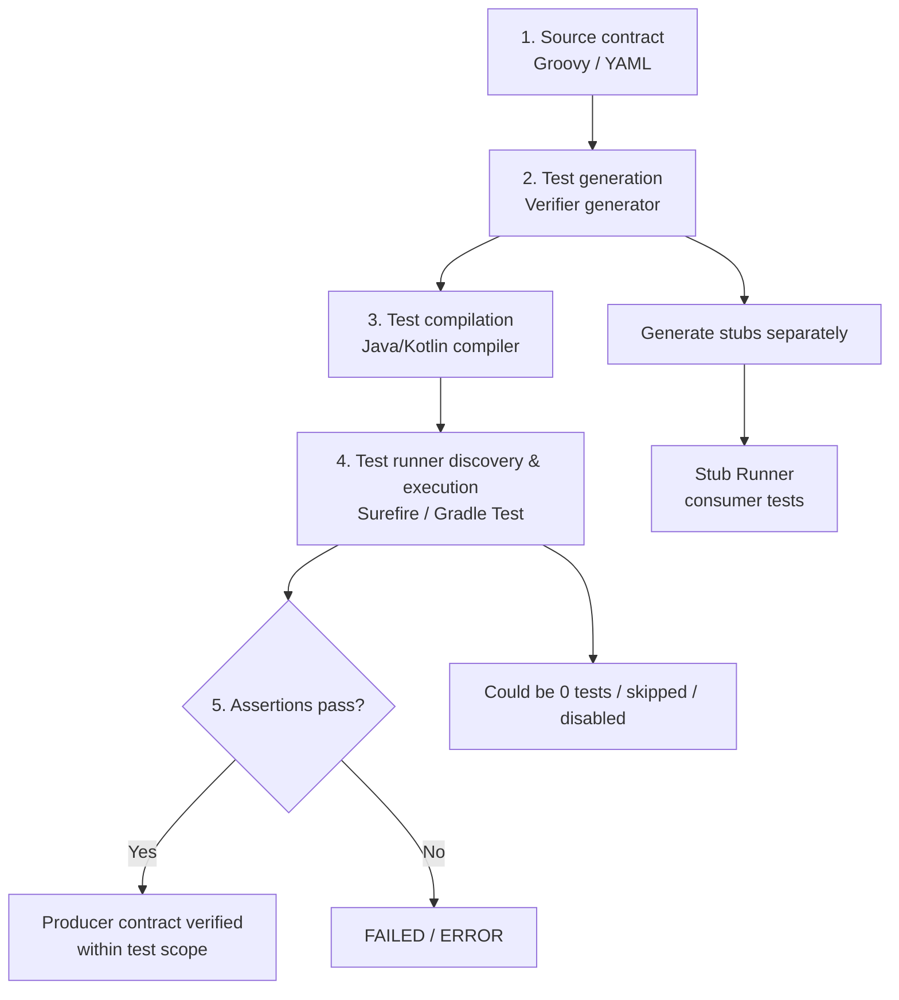
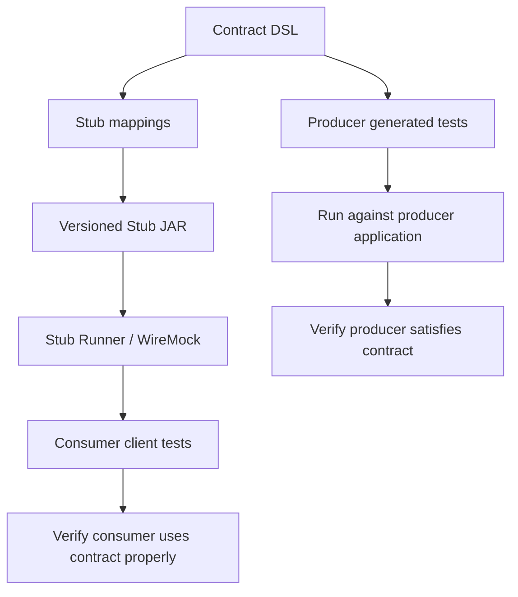

# Distinguishing Successful Test Generation from Tests That Actually Run and Pass

## 1. Goal: Do Not Confuse "Tests Exist" with "Producer Is Verified"

In **Spring Cloud Contract**, teams describe HTTP or messaging behavior using **Groovy DSL** or **YAML DSL**. **Spring Cloud Contract Verifier** converts contracts into test code to verify the **producer**; the same contracts can also generate stubs so **Stub Runner** can power **consumer**-side tests. When integrating CI, many teams see a "BUILD SUCCESS" line or a folder full of generated tests and conclude the API is compatible.

That conclusion can be wrong. A test can be **successfully generated** yet:

- Never **compiled** because the build stopped early.
- Compiled, yet **not discovered by the test runner** due to JUnit configuration, class naming, or filters.
- Discovered, yet **skipped/disabled**.
- Executed, yet **failed** on setup, assertions, or infrastructure.
- Executed and passed, yet with matchers too loose or mocks scoped improperly, leaving **real consumer-relied behavior unprotected**.

Therefore, do not ask only "Did the plugin generate tests?" Ask: **"Which generated tests actually ran, what did they assert, and where are the results recorded?"**

**After this lesson, learners will be able to** distinguish generation, compilation, discovery, execution, and assertion verification; read Maven/Gradle reports; diagnose zero-test or skipped-test builds; configure CI quality gates; and verify producer–consumer compatibility across both generated tests and stubs.

## 2. Five Distinct Verification Milestones



| Milestone | Appropriate Evidence | What Remains **Unproven** |
|---|---|---|
| **Contracts parsed** | No parse errors; expected source contract count seen | Does not prove test code was generated |
| **Test generation succeeded** | New Java/Kotlin test classes exist in build output | Does not prove compilation, discovery, or execution |
| **Compilation succeeded** | Test compilation finished cleanly | Does not prove classes are recognized by JUnit/TestNG |
| **Tests executed** | Report lists **generated test names**, executed count > 0, not skipped | Does not prove all assertions passed |
| **Tests passed** | For the exact generated tests: `failures = 0`, `errors = 0`, `skipped = 0`, required assertions present | Does not prove all consumers, datasets, or environments |
| **Stub generation succeeded** | Mappings or `-stubs.jar` present | Does **not** prove the real producer honors the contract |
| **Consumer tests passed** | Client tests ran with Stub Runner and asserted consumer behavior | Does not substitute for generated producer verification |

**Definition of success in this lesson:** a contract counts as having **producer verification** only when its corresponding generated test was **properly generated, compiled, executed, and passed** against the real producer within the configured base test scope. Never rely solely on the pipeline's overall exit code.

## 3. Sample Contract and Generated Test to Verify

Suppose `order-service` exposes an endpoint:

```http
GET /api/orders/42
Accept: application/json
```

The consumer expects status `200` and JSON fields `id`, `state`, and `currency`. A Groovy contract:

```groovy
import org.springframework.cloud.contract.spec.Contract

Contract.make {
    description 'Retrieves a paid order'
    name 'shouldReturnPaidOrder'

    request {
        method GET()
        url '/api/orders/42'
        headers {
            header 'Accept', 'application/json'
        }
    }

    response {
        status OK()
        headers {
            contentType(applicationJson())
        }
        body(
            id: 42,
            state: 'PAID',
            currency: 'VND'
        )
    }
}
```

Place it inside the source contracts folder scanned by the plugin, such as `src/test/resources/contracts/orders/get-paid-order.groovy`. When the generator runs properly, it creates the corresponding test code. **Logic illustration** of a generated test (not verbatim code emitted by every plugin version):

```java
// Pseudocode illustrating the assertion structure of a generated test.
class ShouldReturnPaidOrderTest extends ContractVerifierBase {
    @Test
    void shouldReturnPaidOrder() {
        given()
            .header("Accept", "application/json")
        .when()
            .get("/api/orders/42")
        .then()
            .statusCode(200)
            .body("id", equalTo(42))
            .body("state", equalTo("PAID"))
            .body("currency", equalTo("VND"));
    }
}
```

Actual generated code may use Rest Assured MockMvc, plain Rest Assured, WebTestClient, or another framework/mode, and generated class names may differ. **Do not edit generated tests to make a build green**; fix the contract, producer, or base test/fixture based on root cause.

### 3.1. An Equivalent Example in YAML

```yaml
description: Retrieves a paid order
request:
  method: GET
  url: /api/orders/42
  headers:
    Accept: application/json
response:
  status: 200
  headers:
    Content-Type: application/json
  body:
    id: 42
    state: PAID
    currency: VND
```

Both Groovy and YAML are **inputs for test generation**, not a test runner. Identical DSL content in a pipeline missing the execution step still produces zero proof that the producer honors the contract.

## 4. Milestone 1: Did the Plugin Find the Source Contracts?

Before worrying about whether tests ran, ensure the **right source files** were discovered:

- Files sit inside the contract directory the plugin is configured to scan; in typical Maven producer layouts, `src/test/resources/contracts/`.
- Groovy/YAML format is valid, with sensible filenames and packages.
- Contracts are not excluded by profiles, include/exclude rules, or building the wrong module.
- In multi-module repositories, the build command runs the **right producer module** containing the contracts.
- Generator logs do not merely report generic success, but show corresponding tests/sources were created.

A `get-paid-order.groovy` file accidentally placed under `src/main/resources/` or in another module may never participate in test generation. The build can still turn green because **zero contract tests ever entered the next stage**.

### 4.1. Do Not Just Look at a Non-Empty Build Folder

The build output folder can retain **code generated from a previous run**. Therefore, run a clean build when verifying for the first time or when suspecting cache/stale outputs:

```bash
# Maven: example run inside the producer module.
mvn clean verify

# Gradle (Linux/macOS or Git Bash):
./gradlew clean test
```

On Windows, the Gradle wrapper is typically invoked with `gradlew.bat`. These commands represent a **reference workflow**, not evidence that they were executed during this lesson. Check logs to confirm the test-generation plugin/Gradle task genuinely participated in the chosen lifecycle.

## 5. Milestone 2: "Generate Success" Does Not Mean "Compile Success"

The plugin may emit a Java class while the compiler still fails because:

- The generated class extends `ContractVerifierBase`, but the base class does not exist or sits in the wrong package.
- Missing dependencies for Rest Assured, Spring Boot Test, or the appropriate test engine.
- Generated tests target JUnit 5, while the project only has JUnit 4 dependencies/config or vice versa.
- Java, compiler, Spring Boot, and Spring Cloud Contract versions are incompatible.
- A helper method signature referenced in the contract via `execute(...)` or `byCommand(...)` is missing from the base class.

A "Generated tests successfully" message only means the generator finished its job. If `testCompile` or `test-compile` fails, **tests were never executed**.

### 5.1. Base Test Configuration Must Match Test Mode

Maven plugin example (illustrative config snippet assuming the project already manages compatible versions):

```xml
<plugin>
    <groupId>org.springframework.cloud</groupId>
    <artifactId>spring-cloud-contract-maven-plugin</artifactId>
    <version>REPLACE_WITH_COMPATIBLE_VERSION</version>
    <extensions>true</extensions>
    <configuration>
        <baseClassForTests>
            com.example.orders.contract.ContractVerifierBase
        </baseClassForTests>
        <testFramework>JUNIT5</testFramework>
        <testMode>MOCKMVC</testMode>
    </configuration>
</plugin>
```

Example base test suited for Spring MVC and MockMvc:

```java
package com.example.orders.contract;

import io.restassured.module.mockmvc.RestAssuredMockMvc;
import org.junit.jupiter.api.BeforeEach;
import org.springframework.beans.factory.annotation.Autowired;
import org.springframework.boot.test.autoconfigure.web.servlet.AutoConfigureMockMvc;
import org.springframework.boot.test.context.SpringBootTest;
import org.springframework.web.context.WebApplicationContext;

@SpringBootTest(webEnvironment = SpringBootTest.WebEnvironment.MOCK)
@AutoConfigureMockMvc
public abstract class ContractVerifierBase {

    @Autowired
    WebApplicationContext context;

    @BeforeEach
    void setup() {
        RestAssuredMockMvc.webAppContextSetup(context);
    }
}
```

In a real system, add fixtures/mocks or a test database so `GET /api/orders/42` returns an order in `PAID` state. The example only shows HTTP test initialization; without preparing data, generated tests can **run and fail**.

**Note:** `REPLACE_WITH_COMPATIBLE_VERSION` must be replaced with the actual plugin version compatible with your project's Spring Cloud/Spring Boot versions before building. This snippet is not a complete POM.

## 6. Milestone 3: Did the Test Runner Actually Discover Generated Tests?

This is the single biggest source of confusion. Generated Java tests can compile cleanly yet **never be discovered** by the runner. A build running `mvn test` or `gradlew test` can report success even with **0 contract tests executed**.

### 6.1. Checking Framework/Engine

With **JUnit 5**:

- Tests use the `org.junit.jupiter.api.Test` annotation.
- The runtime must include a compatible **JUnit Jupiter test engine**.
- Maven Surefire/Failsafe must be configured cleanly for JUnit Platform; many projects use Surefire 3.x.
- With Gradle, the `test` task must enable **JUnit Platform** when running Jupiter tests, e.g., `useJUnitPlatform()`.

Gradle Java/Groovy DSL example for the test task:

```groovy
tasks.named('test', Test) {
    useJUnitPlatform()
}
```

This is only a **single configuration fragment** for Gradle; the project still needs the Spring Cloud Contract plugin and required test dependencies. When using JUnit 4, TestNG, or another framework, runner configuration must match accordingly.

### 6.2. Class Name Filters and Source Sets

Test runners may restrict classes based on naming conventions, includes/excludes, or profiles. If the generated class name falls outside the patterns used by Surefire/Gradle Test, tests can **compile without executing**.

Cross-check:

1. The **actual** generated class name and test output location.
2. Surefire/Gradle include/exclude rules.
3. Whether that class sits on the **test classpath/source set** run by the runner.
4. Whether the engine and test annotations are compatible.
5. Whether the report lists **the generated class name** or only handwritten unit tests.

Do not rely on an aggregate project count like "Tests run: 200"; those could be 200 unit tests **without a single generated contract test**.

### 6.3. Exit Code 0 with Zero Tests: Establish a Clear Policy

A pipeline can succeed when no tests are found, depending on plugin/runner, configuration, and version. Therefore:

- Configure **fail when no tests run** on modules that must be protected; for Maven Surefire, check the `failIfNoTests` option for your version.
- With Gradle, do not rely solely on the `test` task showing `SUCCESS`, `UP-TO-DATE`, or `NO-SOURCE`; require reports or proof that tests ran or came from a valid verified cache.
- In multi-module repositories, do not blindly enable "every module must have tests" if some modules hold only resources; enforce the gate on **producer modules** and on **contract test suites**.

## 7. Milestone 4: Did Tests Run or Were They Skipped/Disabled?

### 7.1. Three Very Different States

| State | Example | Conclusion |
|---|---|---|
| **Not discovered** | Report lacks the generated test class | Unknown whether tests ran; requires investigation |
| **Discovered but skipped** | `Tests run: 1 ... Skipped: 1` | Test **has not verified** the producer |
| **Executed and passed** | `Tests run: 1 ... Skipped: 0, Failures: 0, Errors: 0` | Evidence exists that the test executed and passed |

In JUnit, `@Disabled` annotations or runtime conditions can cause tests to be skipped. In addition, builds can intentionally skip tests via flags or task configuration.

### 7.2. Common Maven Cases That Are Easy to Miss

| Flag/Configuration | Typical Effect |
|---|---|
| `-DskipTests` | Skips executing tests in plugins honoring this flag; test compilation may still occur |
| `-Dmaven.test.skip=true` | Can skip both test compilation and execution, depending on the Maven plugins involved |
| `-Dtest=...` | Runs only tests matching the specified filter |
| `<skipTests>true</skipTests>` in Surefire config | Tests within that plugin scope are skipped |
| Maven profile disables plugin or alters include/exclude | Contract test suite may not run |

Never conclude a pipeline passed just because `mvn package -DskipTests` returned exit code 0. That command may still produce JARs and stubs, but **provides zero proof that producer contract tests ran and passed**.

With Gradle, `-x test` excludes the `test` task from execution. If the build uses a separate task for generated tests, verify exactly which tasks were excluded. Enabling `--continue` or caching does not replace reading **test results**.

## 8. Milestone 5: Did Tests Execute and Did Assertions Pass?

Assuming generated tests ran, distinguish clearly:

- **Failure:** an assertion violated the contract, e.g., producer returned `state = PENDING` instead of `PAID`, or `HTTP 404` instead of `200`.
- **Error:** the test failed to complete due to runtime/setup issues, e.g., Spring context failed to start, test database connection failed, or base class lacked a bean.
- **Skipped/disabled:** assertions never ran.
- **Passed:** the test executed every assertion it contains without reporting failures or errors.

**Passed does not mean tests cover everything.** A contract asserting only `status OK()` can pass even if the JSON response drops the `currency` field. A `byRegex('.*')` matcher on `state` can also pass with an invalid business value. Hence, after confirming **tests executed and passed**, verify that assertions actually matter to consumers. This depth/coverage review is distinct from verifying technical execution status.

### 8.1. Real Contract Violation Example

The contract promises:

```json
{"id":42,"state":"PAID","currency":"VND"}
```

Yet the producer returns:

```json
{"id":42,"state":"PENDING","currency":"VND"}
```

If the generated test enforces `state == "PAID"`, the result must be **FAILED**. This is a case where **producer behavior fails to meet the contract**, not a reason to immediately rewrite YAML/Groovy to `PENDING`. Before altering a contract, check whether consumers rely on `PAID` and whether the API change is valid.

Conversely, if the producer returns `404` because the test database lacks order ID `42`, inspect fixture setup. Never loosen matchers or delete assertions to mask state-preparation mistakes.

## 9. Reading Maven Evidence: Surefire and Failsafe

Maven typically runs unit/contract tests via **Surefire** during the `test` phase. Some projects classify integration tests under **Failsafe** during `integration-test`/`verify` phases. Report locations depend on project setup.

Common paths:

```text
order-service/
└── target/
    ├── generated-test-sources/
    │   └── ...                    # generated test code
    ├── test-classes/
    │   └── ...                    # compiled test bytecode
    ├── surefire-reports/
    │   ├── TEST-...xml            # machine-readable report
    │   └── ...txt                 # summary
    └── failsafe-reports/
        └── ...                    # if project uses Failsafe
```

**Note:** not every project has both report directories, and generated source output may live at a different path. Rely on your active plugin configuration.

Example of an **illustrative result line** from the runner:

```text
Running com.example.orders.contract.ShouldReturnPaidOrderTest
Tests run: 1, Failures: 0, Errors: 0, Skipped: 0
```

Meaning:

1. The class name is indeed the **generated contract test** to prove.
2. The number of **executed tests is non-zero**.
3. For this test, **failures/errors/skipped are all zero**.

This is an **example log**, not an actual build result run inside this lesson. In CI, **archive reports** and match class/method names against recently modified contracts.

### 9.1. Why Is Checking the Exit Code Alone Insufficient?

A `mvn clean verify` command can return `BUILD SUCCESS` because:

- The generator plugin ran but found no contracts.
- Surefire was configured to skip tests.
- Generated tests landed outside the test classpath or were excluded.
- Only regular unit tests ran and passed.
- The producer module was not included in a multi-module build command.

Likewise, if the report states `Tests run: 1` yet `Skipped: 1`, that is **not producer verification** either.

### 9.2. Do Not Substitute Total Repo Test Counts for Contract Tests

Example summary:

```text
Tests run: 125, Failures: 0, Errors: 0, Skipped: 0
```

The number `125` does not prove a generated test for `get-paid-order.groovy` executed. The pipeline must verify **at least one test class/method belonging to the specific contract**, or include a step confirming all expected generated contract tests appear in the report.

## 10. Reading Gradle Evidence

With Gradle, test-generation and test-execution tasks must be tracked separately. Task/plugin names vary by version and source set layout; in common setups, the plugin may create a contract test generation task like `generateContractTests`, followed by `test` or a dedicated test task executing them.

Illustrative command:

```bash
./gradlew clean test
```

Gradle typically writes reports to:

```text
build/
├── generated-test-sources/     # exact location depends on plugin
├── test-results/
│   └── test/
│       └── TEST-...xml
└── reports/
    └── tests/
        └── test/
            └── index.html
```

On Windows, use the appropriate wrapper. Do not infer that `generateContractTests` reporting `SUCCESS` means `test` ran; those are two separate steps. If the `test` task hits the cache and reports `UP-TO-DATE`, decide via CI policy whether verified cached results are acceptable or a clean run is required; either way, **never equate generated test source code with executed test results**.

### 10.1. Inspecting a Specific Class

When suspecting a generated test class is not being discovered, filter and run that exact class with the project's test tool, for example Gradle:

```bash
./gradlew test --tests 'com.example.orders.contract.ShouldReturnPaidOrderTest'
```

The class name in the command is **illustrative only**; replace it with the actual generated class name. If the filter matches nothing, Gradle generally reports no tests found for the filter rather than silently claiming a pass; still, verify exit codes and reports per task version.

## 11. Role of Base Tests and Fixtures in Execution Results

A generated test can execute yet fail because **producer state was not prepared**, rather than because the API changed.

For example, contract `GET /api/orders/42` expects `state=PAID`. The test may need fixtures:

```text
Before test:
  order 42 -> PAID, currency VND
  order 9999 -> does not exist

During test:
  GET /api/orders/42

Expected:
  HTTP 200
  id = 42
  state = PAID
  currency = VND

After test:
  no state leakage into the next scenario
```

The base class typically configures the Spring context, MockMvc/Rest Assured, or WebTestClient; it may use `@BeforeEach`, Mockito, a test database, `@Sql`, or fixture helpers to seed data.

**Distinctions to make when reading failures:**

- `NoSuchBeanDefinitionException` or Spring context failure: setup/DI wiring error; tests may never reach contract assertions.
- `404` instead of `200`: missing fixture for ID `42`, wrong route, or real producer behavior changed.
- `200` yet `state=PENDING`: wrong fixture or producer failed to return the promised state.
- Passes alone, fails in full suite: state/transaction/cache leakage or parallel test interference.
- All tests skipped: fix discovery/configuration, not business logic.

A reliable setup must be **reproducible locally and in CI**, independent of production databases, uncontrolled wall-clock time, or previous test execution order.

## 12. Successful Stub Generation Differs from Passing Producer Tests

These are two separate branches originating from the same contract:



For example:

- The contract specifies `GET /api/orders/42` returns `state=PAID`.
- The plugin generates a WireMock mapping returning `PAID`.
- Stub Runner runs this mapping and consumer tests pass.
- **Yet the real producer was changed to return `PENDING`.**

Without running generated producer tests, neither "stub packaged successfully" nor "consumer tests with stub passed" **detects the bug in the real producer**. Conversely, passing producer tests do not prove consumers handle error bodies or new schema versions properly; consumer tests against matching stubs are still needed.

For messaging, Verifier can generate tests that trigger the producer via `triggeredBy(...)` or `input`/`outputMessage` models. **Generating messaging tests** likewise does not mean tests triggered and verified messages; binder/transport setup and evidence that tests actually ran are required.

## 13. Building a CI "Quality Gate" Against False Verification

A minimal producer gate should require:

1. **Contract source present and targeted:** verify the set of contracts the producer module must support.
2. **Code generation succeeds:** generator reports no errors and outputs tests for expected contracts.
3. **Compilation succeeds:** generated tests are present on the test classpath.
4. **Test discovery succeeds:** corresponding generated test classes/methods appear in reports.
5. **Real execution:** **executed > 0** tests, not all skipped or disabled.
6. **Passing results:** zero failures/errors for protected generated tests.
7. **No silent skips:** disallow `skipTests` or excluding test tasks in the verification pipeline.
8. **Artifacts/consumer:** publish stubs only after producer verification passes; consumer tests fetch the exact stub version and assert client behavior.

### 13.1. Example of Separating Steps in the Pipeline

```text
Producer CI
  1. Checkout code + contracts
  2. Resolve dependencies + build producer
  3. Generate/compile/execute contract tests
  4. Inspect test reports:
       - Expected generated contract tests present?
       - Any skipped or zero executed?
       - Any failure/error?
  5. If all checks pass: package/publish stubs

Consumer CI
  6. Resolve the exact -stubs.jar artifact
  7. Stub Runner starts the stub
  8. Consumer tests invoke real client and assert response/behavior
  9. Gate results when upgrading contract versions
```

**Do not use a fixed generated test file count** as a gate if the generator can emit multiple methods from one contract file or alter naming across versions. Map **contract ID/scenario → generated test class/method or test report** appropriately for your project, and alert if the executed set shrinks unexpectedly.

### 13.2. "Non-Zero Exit Code" Only, or Report Inspection Too?

Both:

- **Non-zero exit code** shows the build/test command failed and must block publishing.
- **Generated test reports** rule out builds that succeed simply because zero tests ran.

If a CI aggregator merges reports across multiple modules, inspect the producer module and generated classes specifically; never let unit test counts from another module mask skipped contract tests in this module.

## 14. Diagnostic Matrix: Build Succeeded Yet Untrustworthy

| Symptom | Accurate Inference | Required Action |
|---|---|---|
| `generateTests` succeeded, no test report found | Only proof of test generation exists | Run the right test phase/task, check discovery |
| Generated test code exists, `testCompile` failed | Tests never ran | Fix base class, dependencies, framework |
| Maven reports `BUILD SUCCESS` with `-DskipTests` | Build did not verify producer | Re-run without skipping, inspect report |
| Surefire `Tests run: 0` | No tests executed in this scope | Check engine, naming, includes, module |
| Project totals 100 passing tests, missing generated class | Contract verification unproven | Filter reports by contract class/method name |
| Generated class shows `Skipped: 1` | Assertions were not checked | Remove cause of skip/disable |
| Generated test shows `Errors: 1` | Runtime/setup or execution error | Inspect stack trace and preconditions |
| Generated test shows `Failures: 1` | Assertion failed | Compare expected/actual and fixtures |
| Generated test has `Failures: 0` without body assertions | Passes only for what was described | Add critical consumer promises to contract |
| Stub JAR published despite skipped tests | Artifact lacks proof producer conforms | Add gate before publishing |
| Consumer uses old stub version | New changes remain untested | Pin/update the target version to test |
| Gradle task `NO-SOURCE` | Task found no matching test sources | Check source sets, task dependencies, plugin |

## 15. Hands-On Lab: Proving Both "Generated" and "Executed + Passed"

**Context:** `order-service` has contract `get-paid-order.groovy`, and consumer `checkout-service` uses the published stub. The goal is collecting test evidence rather than merely looking at `BUILD SUCCESS`.

### 15.1. Steps on the Producer

1. Write contract `GET /api/orders/42`, expecting `200` and body with `id=42`, `state=PAID`, `currency=VND`.
2. Set up `ContractVerifierBase` and fixtures so real test requests return order `42`.
3. Run a clean build, e.g., `mvn clean verify` or the equivalent Gradle task; do not enable skip-tests flags.
4. Locate the **generated test source** matching the contract and confirm the code asserts `state=PAID`.
5. Confirm the test compiles cleanly and **that exact class** appears in the Surefire/Gradle Test report.
6. Verify `executed > 0` and `failures=errors=skipped=0` for the generated test.
7. Intentionally change the producer to return `state=PENDING` **only in the test environment** and re-run. A working generated test must **FAIL**; if it still passes, tests may not be running or assertions are insufficient.
8. Restore the producer to `PAID`; re-run to confirm **PASSED** in the corresponding report.
9. Only after producer verification passes, package and publish the versioned stub artifact.

### 15.2. Steps on the Consumer

1. Configure Stub Runner to use the exact `order-service-<version>-stubs.jar` just published.
2. Run consumer tests calling the **application's HTTP client** against the stub URL.
3. Assert the consumer parses `state=PAID` and handles `currency=VND` per business requirements.
4. Intentionally alter the client request to hit the wrong endpoint or expect the wrong schema; confirm consumer tests catch the mismatch.
5. Record two separate pieces of evidence: the **producer generated test report** and the **consumer test report**.

### 15.3. Self-Check Table

| Question | Answer |
|---|---|
| Java files were generated, but no test report exists—is the producer verified? | **No**; only code generation is known |
| Generated class compiles, yet Surefire logs 0 tests—did it pass? | **No**; it never executed |
| 20 unit tests passed, 1 generated test skipped—is that enough? | **No**; the corresponding contract remains unverified |
| Generated test runs and passes, asserting only status `200`—is JSON `state` protected? | **No**; an assertion on `state` is required |
| Stub Runner returns the sample body—does that prove the real producer returns it? | **No**; producer verification must run |
| Producer verification passes—does that prove the consumer handles it right? | **No**; consumer tests must run with the stub |
| What does a test failure prove when changing `PAID` to `PENDING`? | The relevant assertion executed and can detect that mismatch |

## 16. Technical Acceptance Checklist

- [ ] The right module and contract directory are scanned by the plugin.
- [ ] Test sources are generated for **every contract/scenario requiring protection**.
- [ ] Test sources compile cleanly; base test, dependencies, and test mode align.
- [ ] JUnit/TestNG runner is properly configured and discovers generated classes.
- [ ] No `skipTests`, `maven.test.skip`, `-x test`, or include/exclude rule accidentally omits generated tests.
- [ ] Reports explicitly list generated test names with **executed > 0**; none skipped/disabled.
- [ ] Failures and errors equal 0, with assertions covering fields critical to consumers.
- [ ] Producer fixtures/mocks/state are explicitly managed, isolated, and reproducible.
- [ ] Assertion failures are distinguished from setup errors or missing test discovery.
- [ ] Stubs are packaged/published **after** producer contract verification passes.
- [ ] Consumer tests run with Stub Runner and the matching stub version, not merely verifying WireMock boots.
- [ ] CI archives reports and blocks the pipeline if contract tests vanish, get skipped, or fail.

**Conclusion:** "Test generation succeeded" is a **test preparation step**, not a test result. Only when generated tests are **compiled, discovered, executed, and pass meaningful assertions** do we have proof the producer satisfies the contract **within the tested scope**. Combining that proof with consumer tests using Stub Runner enables CI to detect incompatible API changes without creating a false sense of security.
