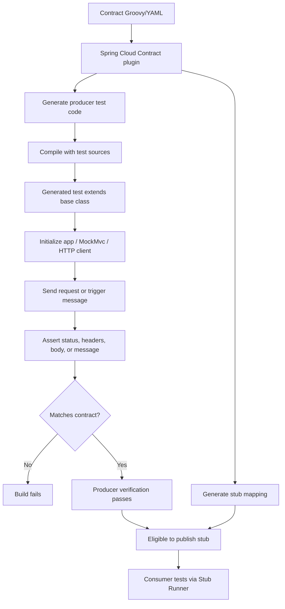

# Reading Generated Test Code to Understand Invocations and Assertions

## 1. Why Read Generated Tests Instead of Looking Only at Green or Red Builds?

When using **Spring Cloud Contract**, teams typically write contracts in Groovy or YAML DSL and let **Contract Verifier** generate test code on the **producer** side. These tests call the producer's HTTP endpoints or trigger message-sending behavior and verify that the outcome complies with promises made to the **consumer**.

For example, a consumer calls `GET /api/orders/ORD-123` and expects JSON:

```json
{
  "orderId": "ORD-123",
  "status": "CONFIRMED",
  "totalAmount": 120000
}
```

A refactor might cause the producer to rename `orderId` to `id` or return `"totalAmount": "120000"` instead of a number. The Java code still compiles and business unit tests may stay green, yet the consumer risks breaking. Generated contract tests catch this change before release.

To **understand why a test passes or fails**, you need to know how to read generated test code:

- **Invocation / request:** Which method, path, headers, query parameters, and body does the test send to the producer?
- **Assertions:** Which HTTP status, headers, JSON fields, or data types does the test require?
- **Value sources:** Which values come from the contract, and which are supplied by the base class or fixtures?
- **Protection scope:** Does the test genuinely verify what the consumer relies on, or only check an overly narrow example?
- **Action on failure:** Should you fix the producer, test setup, contract, or coordinate a change with the consumer?

This lesson belongs to the **Contract Verifier** chapter of the `SPRING_CLOUD_CONTRACT` module. The goal is not memorizing Java syntax emitted by a single plugin version, but **reading the behavioral meaning of generated tests** to support HTTP/messaging contract testing, stub publishing, Stub Runner usage, and CI integration.

### Learning Outcomes

After this lesson, you will be able to:

1. Trace from a Groovy/YAML DSL file to its corresponding generated test class.
2. Recognize the `given → when → then` structure and the meaning of HTTP invocations.
3. Understand assertions for status, headers, JSONPath, fixed values, and dynamic matchers.
4. Distinguish generated tests, base classes, fixtures, and handwritten tests.
5. Read failure logs to determine whether the problem lies in the request, environment, or response.
6. Understand how generating and running producer tests connects to consumer-facing stubs.

> **Version note:** Illustrative Java snippets in this lesson are **condensed representations of common structure**. Class names, assertion libraries, imports, JSONPath helpers, and method layouts generated by the plugin may vary across Spring Cloud Contract versions, HTTP test modes, and JUnit choices. In practice, always read the actual generated test files and build output of your project.

## 2. Flow from DSL to Runnable Test Code



Four artifacts or components must be kept separate:

| Component | Origin | Role |
| --- | --- | --- |
| **Contract DSL** | Team / agreement between producer and consumer | Describes requests, responses, matchers, and public expectations |
| **Generated producer test** | Spring Cloud Contract plugin | Turns the contract into executable invocations and assertions |
| **Base test class** | Producer developers | Configures application context, MockMvc, dependencies, fixtures, or messaging |
| **Generated stub** | Stub generator from contract | Simulates the producer so consumers can test via Stub Runner |

A generated test is **not a stub**. A generated test runs against real producer code; a stub is a canned/templated response derived from the contract for consumers to call in an isolated test environment.

## 3. Running Example: HTTP Contract for Order Lookup

Suppose `Order Service` exposes an API:

```http
GET /api/orders/ORD-123 HTTP/1.1
Accept: application/json
```

Promised response:

```http
HTTP/1.1 200 OK
Content-Type: application/json

{
  "orderId": "ORD-123",
  "status": "CONFIRMED",
  "totalAmount": 120000,
  "paid": true
}
```

File `src/test/resources/contracts/orders/get_confirmed_order.groovy`:

```groovy
import org.springframework.cloud.contract.spec.Contract

Contract.make {
    name('get_confirmed_order')
    description('Consumer looks up a confirmed order')

    request {
        method GET()
        urlPath('/api/orders/ORD-123')
        headers {
            accept(applicationJson())
        }
    }

    response {
        status OK()
        headers {
            contentType(applicationJson())
        }
        body(
            orderId: 'ORD-123',
            status: 'CONFIRMED',
            totalAmount: 120000,
            paid: true
        )
    }
}
```

Read the contract before opening the generated test:

- `request.method` is `GET`.
- `request.urlPath` is `/api/orders/ORD-123`.
- `request.headers.Accept` is `application/json`.
- `response.status` is `200`.
- `response.headers.Content-Type` must indicate JSON.
- `response.body` carries the fields and values the consumer uses.

**Every one of these key conditions must leave a trace in the generated test**: either as part of the constructed request or as an assertion on the actual response received. If after generating tests you do not see a branch you expected verified, inspect the DSL and plugin configuration before trusting the build result.

## 4. Finding the Right Generated Test in Your Project

In a Maven project using Spring Cloud Contract Verifier, a common output path is:

```text
target/generated-test-sources/contracts/
```

In a Gradle project, generated test sources usually reside under a path like:

```text
build/generated-test-sources/contracts/
```

**Exact paths depend on plugin version and configuration.** Prioritize what appears in build logs, `generate-contract-tests` settings, test source sets, and the actual directory structure produced by your project. Do not assume both build tools always emit identical directory names.

Illustrative file tree:

```text
order-service/
├── src/test/resources/contracts/orders/
│   └── get_confirmed_order.groovy
├── src/test/java/com/example/orders/
│   └── ContractVerifierBase.java
└── target/generated-test-sources/contracts/
    └── com/example/orders/
        └── OrdersTest.java
```

The name `OrdersTest.java` is just an example. The plugin may pick another name based on contract file, `name`, package, and configuration. The most reliable confirmation is to **open the generated source and find the method testing `/api/orders/ORD-123` or contract name `get_confirmed_order`**.

### 4.1. What to Read First in the Test File

1. **Package and class name:** Tells you which contract group the test belongs to.
2. **`extends ContractVerifierBase`:** Shows where the test environment is set up.
3. **Imports and annotations:** Indicate JUnit, RestAssured MockMvc/HTTP, JSONPath, and assertion libraries.
4. **`@Test` methods:** One or more verified interactions.
5. **Request construction:** Actual method, path, headers, body, and query parameters.
6. **Response verification:** Status, headers, body assertions, and matchers.

Do not use line count or file length of a generated test as a quality metric. A contract might yield a very short test that omits fields the consumer truly relies on; conversely, a test with many assertions might over-constrain irrelevant data.

## 5. Reading Generated Test Structure: Class, Method, and Base Class

The condensed snippet below illustrates the **shape** of a generated test using Spring MVC/MockMvc; **it is not mandatory verbatim plugin output**:

```java
// JAVA PSEUDOCODE: aids logic reading; API/assertion names vary by version
class OrdersContractTest extends ContractVerifierBase {

    @Test
    void validate_get_confirmed_order() {
        // given: prepare HTTP request
        request.header("Accept", "application/json");

        // when: call producer endpoint
        response = request.get("/api/orders/ORD-123");

        // then: verify HTTP response
        assertStatus(response, 200);
        assertHeaderContains(response, "Content-Type", "application/json");
        assertJsonEquals(response, "$.orderId", "ORD-123");
        assertJsonEquals(response, "$.status", "CONFIRMED");
        assertJsonEquals(response, "$.totalAmount", 120000);
        assertJsonEquals(response, "$.paid", true);
    }
}
```

Functions like `assertStatus`, `assertJsonEquals`, and variable `request` above are **illustrative symbols only**, not Spring Cloud Contract APIs you can copy and compile.

In many Spring Cloud Contract configurations with RestAssured MockMvc, actual code looks closer to fragments like:

```java
// Common identifying patterns, not a complete generated source
MockMvcRequestSpecification request = given()
    .header("Accept", "application/json");

ResponseOptions response = given()
    .spec(request)
    .get("/api/orders/ORD-123");

assertThat(response.statusCode()).isEqualTo(200);
```

Some versions emit `DocumentContext parsedJson = JsonPath.parse(...)` or `assertThatJson(parsedJson)`; others emit equivalent assertion expressions. When reading generated source, **translate specific APIs back to the same four questions**:

- What request was sent?
- Which producer received that request?
- What response was received?
- Which assertions determine pass/fail?

### 5.1. What Does `extends` Do?

A generated test can inherit from a base class:

```java
public class OrdersContractTest extends ContractVerifierBase {
    // generated tests
}
```

`ContractVerifierBase` can supply:

- `MockMvc` or HTTP client configuration.
- Spring application context.
- Service/repository mocks or a test database connection.
- Sample fixtures such as order `ORD-123`.
- Authentication, principals, default headers, or messaging infrastructure.
- `@BeforeEach` hooks or required setup methods.

**If a generated test has no controller setup inside the `@Test` method itself, that does not mean it runs "out of thin air."** Setup may reside in the inherited base class or test framework configuration.

## 6. Reading `given`: How Is the Request Built from the Contract?

For the `GET /api/orders/ORD-123` contract, the generated test must prepare enough information to send the right call. In RestAssured, `given` means **initializing request preconditions**.

Example logic to look for in generated code:

```java
// Illustrating a typical pattern with RestAssured-style API
MockMvcRequestSpecification request = given()
    .header("Accept", "application/json");
```

In the test request, the following conditions come from the DSL:

| DSL | Output to Recognize in Test |
| --- | --- |
| `method GET()` | GET invocation, not POST |
| `urlPath('/api/orders/ORD-123')` | Path `/api/orders/ORD-123` |
| `accept(applicationJson())` | Header `Accept: application/json` |
| `body(customerId: 'CUS-7')` | A request body containing field `customerId` |
| `queryParameters { parameter 'page': 0 }` | Query parameter `page=0` |
| `header('X-Trace-ID','TRACE-1')` | Header with the declared name and value |

**Distinguish request data from response data.** `request.body` in the generated test is used to **send into the producer**, whereas `response.body` in the contract serves as the **expectation for assertions**.

### 6.1. POST Request with JSON Body

Suppose the contract is:

```groovy
request {
    method POST()
    urlPath('/api/orders')
    headers {
        contentType(applicationJson())
    }
    body(
        customerId: 'CUS-7',
        items: [
            [sku: 'BK-1', quantity: 2]
        ]
    )
}
```

In the generated test, look for corresponding signs:

```text
HTTP method: POST
Request target: /api/orders
Content-Type: application/json
Body:
{
  "customerId": "CUS-7",
  "items": [{"sku": "BK-1", "quantity": 2}]
}
```

If the producer test sends `GET`, omits the body, or sends `quantity` as a String, re-check the DSL, value/matchers, and test mode. In a valid build, the generated test must reflect the **producer-side** data of the request.

### 6.2. `when`: Where Does the Real Action Happen?

In a RestAssured-style structure:

```java
ResponseOptions response = given()
    .spec(request)
    .get("/api/orders/ORD-123");
```

the `.get(...)` call is **the action invoking the endpoint**. This is the boundary between constructing the request and receiving the response.

Do not mistake the lines after `then` for the producer's "return logic": those are **test assertions**. The producer genuinely constructs the response through its controller/handler and dependencies wired by the base class.

## 7. Reading `then`: HTTP Status Assertions

Contract:

```groovy
response {
    status OK()
}
```

means the producer must return HTTP status `200`. The generated test normally has an assertion logically equivalent to:

```java
assertThat(response.statusCode()).isEqualTo(200);
```

If the producer returns `201`, `204`, `404`, or `500`, this check fails.

Several important statuses:

| Status in Contract | HTTP Code | Typical Scenario |
| --- | --- | --- |
| `OK()` | `200` | Resource read succeeded |
| `CREATED()` | `201` | New resource created |
| `NO_CONTENT()` | `204` | Succeeded with no response body |
| `BAD_REQUEST()` | `400` | Invalid request per API rules |
| `NOT_FOUND()` | `404` | Resource not found |
| `CONFLICT()` | `409` | Conflict with current state |

**Status is an assertion independent of the JSON body.** A response with body `{"code":"ORDER_NOT_FOUND"}` and status `200` does not satisfy a contract requiring `404`.

### 7.1. What Does `expected 200 but was 404` Tell You?

Do not immediately conclude the producer changed its API. Possible causes include:

1. The request path in the DSL does not match the controller mapping.
2. The controller exists, but fixtures did not create resource `ORD-123`.
3. The base class mocked the wrong dependency, causing the producer to return not found.
4. Security or routing changed.
5. The producer genuinely removed the endpoint or altered its behavior.

Trace **the actual request sent**, **test setup**, and **actual response received** to separate environment errors from breaking changes.

## 8. Reading Header Assertions: Media Type, Correlation, and Versioning

Contract:

```groovy
response {
    status OK()
    headers {
        contentType(applicationJson())
        header('X-Api-Version', '1')
    }
    body(orderId: 'ORD-123')
}
```

The generated test will include checks corresponding to:

- `Content-Type` being a JSON media type per the generated matcher.
- `X-Api-Version` having value `1` if required by the contract.

Depending on plugin version, checks may use Hamcrest, AssertJ, or dedicated helpers. You do not need to memorize every assertion method name; look for the **header name** and **expected value**.

### 8.1. `Content-Type` Often Includes Charset or Parameters

A producer might return:

```http
Content-Type: application/json;charset=UTF-8
```

when the contract states:

```http
Content-Type: application/json
```

Depending on the matcher/header assertion generated from the DSL, the check may accept or reject the `charset` parameter. Never assume two headers always match by exact string equality or are always treated identically across every test. On failure, open the generated assertion to see whether it uses **equality, regex, contains, or media-type matching**.

If the consumer depends on a specific charset or content format, express that promise explicitly.

### 8.2. Do Not Assert Headers the API Does Not Promise

A proxy or server may automatically add `Date`, `Server`, or `Transfer-Encoding`. If the consumer does not rely on those headers, do not pin them rigidly in contracts merely because they appeared in a sample response. Doing so makes tests brittle against unrelated infrastructure changes.

## 9. Reading JSON Body Assertions and JSONPath

For response:

```json
{
  "orderId": "ORD-123",
  "status": "CONFIRMED",
  "totalAmount": 120000,
  "paid": true
}
```

Generated tests can use **JSONPath**, RestAssured body matchers, or Spring Cloud Contract assertion helpers to inspect fields:

| JSONPath | Expected Value | JSON Type |
| --- | --- | --- |
| `$.orderId` | `ORD-123` | String |
| `$.status` | `CONFIRMED` | String |
| `$.totalAmount` | `120000` | Number |
| `$.paid` | `true` | Boolean |

Conceptual condensed code:

```java
// PSEUDOCODE ASSERTIONS: not fixed plugin API names
assertJsonEquals(body, "$.orderId", "ORD-123");
assertJsonEquals(body, "$.status", "CONFIRMED");
assertJsonEquals(body, "$.totalAmount", 120000);
assertJsonEquals(body, "$.paid", true);
```

In versions using Jayway JSONPath, you may see lines like:

```java
DocumentContext parsedJson =
    JsonPath.parse(response.getBody().asString());

// Plugin will generate corresponding field/value checks.
```

If you open generated code and see `parsedJson` or `jsonPath`, look for **the JSON field path being checked**. This is especially important for nested JSON, for example:

```json
{
  "customer": {
    "id": "CUS-7"
  },
  "items": [
    {"sku": "BK-1", "quantity": 2}
  ]
}
```

JSONPath:

```text
$.customer.id
$.items[0].sku
$.items[0].quantity
```

### 9.1. JSON Type Is Part of the Contract

These two JSON payloads differ:

```json
{"totalAmount": 120000, "paid": true}
```

```json
{"totalAmount": "120000", "paid": "true"}
```

If the consumer deserializes `totalAmount` as a number and `paid` as a boolean, the second response can break the contract.

When reading generated tests, check whether **assertions enforce the intended types**, or whether an overly permissive matcher lets the producer return a String while the test still passes. A green test does not guarantee the schema is thoroughly checked if the DSL describes it too loosely.

### 9.2. JSON Arrays and Element Ordering

With:

```groovy
body(
    items: [
        [sku: 'BK-1', quantity: 2],
        [sku: 'PEN-9', quantity: 1]
    ]
)
```

Generated assertions may check array positions, element counts, or per-element fields per the generator's rules. Inspect the actual test to learn:

- Does it check all fields of both elements, or only selected fields?
- Does it depend on index order `items[0]`/`items[1]`?
- Does it allow the array to contain extra elements?
- Does it verify the type of `quantity` or only string representation?

If the consumer does not require a fixed order, a rigid index-based assertion can make tests overly brittle. Conversely, if the consumer treats the first element as highest priority, ordering is a crucial promise and deserves test protection.

## 10. Reading Dynamic Matchers: Literal, Regex, Type, and Timestamp

Not every producer value is static. Newly generated IDs or order creation timestamps can vary across runs.

Groovy DSL:

```groovy
response {
    status CREATED()
    headers {
        contentType(applicationJson())
    }
    body(
        orderId: 'ORD-123',
        status: 'CREATED',
        totalAmount: 120000,
        createdAt: '2026-11-24T08:00:00Z'
    )
    bodyMatchers {
        jsonPath('$.orderId', byRegex('ORD-[0-9]+'))
        jsonPath('$.totalAmount', byType())
        jsonPath('$.createdAt', byTimestamp())
    }
}
```

When reading generated tests, recognize that **the sample value in `body` and the matcher serve different purposes**:

| Field | Sample Value | What Producer Assertion Checks |
| --- | --- | --- |
| `orderId` | `ORD-123` | Matches regex `ORD-[0-9]+`, not necessarily equal to `ORD-123` |
| `status` | `CREATED` | Equals business value `CREATED` if no overriding matcher exists |
| `totalAmount` | `120000` | Matches number type via `byType()`; insufficient to prove accurate calculation |
| `createdAt` | Sample timestamp string | Value matches the timestamp format accepted by the matcher |

Actual assertions may be `matches(...)`, `instanceOf(...)`, or JSON assertion helpers; you must **read the logic**, not search solely for `equalTo`.

### 10.1. `byType()` Does Not Verify All Business Logic

If `totalAmount` must equal the exact total computed from a shopping cart, using only `byType()` would let `999999` pass since it is still a number. Keep value assertions, add suitable matchers, or rely on unit/domain tests to protect formulas.

### 10.2. Request Matchers and Response Matchers Play Opposite Roles

For a request:

```groovy
body(
    customerId: $(consumer(regex('CUS-[0-9]+')),
                  producer('CUS-7'))
)
```

The generated producer test **sends `CUS-7`** into the system. On the stub side, the matcher accepts any valid `customerId`.

For a response:

```groovy
body(
    orderId: $(consumer('ORD-123'),
               producer(regex('ORD-[0-9]+')))
)
```

The generated producer test validates the ID against the regex, while the stub can return the sample value `ORD-123`.

Never invert these two directions when investigating discrepancies. `consumer(...)` and `producer(...)` are read according to **which side supplies or consumes the value at that specific request/response position**.

## 11. Distinguishing Generated Tests from Base Classes

A generated test may contain only a few HTTP calls and assertions, while the test environment is usually configured in `ContractVerifierBase`.

Illustrative skeleton with Spring MVC/MockMvc and JUnit 5:

```java
// Project-specific base class example, requires matching package/imports
@WebMvcTest(OrderController.class)
abstract class ContractVerifierBase {

    @Autowired
    MockMvc mockMvc;

    @MockitoBean
    OrderQuery orderQuery;

    @BeforeEach
    void setUp() {
        given(orderQuery.findById("ORD-123"))
            .willReturn(new OrderView(
                "ORD-123", "CONFIRMED", 120000L, true
            ));

        RestAssuredMockMvc.mockMvc(mockMvc);
    }
}
```

This is an **illustrative skeleton**, not complete Java code you can copy into every project. It assumes the application has `OrderQuery`, `OrderView`, and `OrderController` with matching signatures. `@MockitoBean` fits Spring Framework 6.2+ and corresponding Spring Boot versions; older projects may use `@MockBean`. Choose dependencies and annotations per your project version.

Roles of the base class:

1. Load the controller and Spring MVC configuration.
2. Supply test data to dependencies so the endpoint can produce responses.
3. Wire RestAssured MockMvc to `MockMvc`.
4. Configure security/test context when needed.
5. Ensure each generated test gets a reproducible environment.

If a test fails with `404` when the contract expects `200`, inspect **data fixtures**. If a test fails due to missing beans, mocks, or application context startup errors, inspect the base class before assuming an API breaking change.

### 11.1. The Base Class Should Not "Fake" the Entire Contract

If the base class mocks out the HTTP JSON response itself, tests can stay green **without exercising the producer code that needs verification**. With `@WebMvcTest`, you test the web/controller boundary and serialization, yet may exclude service-layer logic from verification.

That scope is not necessarily wrong. What matters is **knowing what was mocked** and adding integration/domain tests when consumers truly depend on logic beyond the web layer.

## 12. Reading Generated Tests Across Different HTTP Modes

Spring Cloud Contract supports several HTTP testing modes depending on version and application stack. Request syntax in generated source may differ, yet the semantic structure remains similar.

| Mode / Approach | Signs in Generated Test | Meaning |
| --- | --- | --- |
| **MockMvc** | `RestAssuredMockMvc`, `MockMvc`, `MockMvcRequestSpecification` | Calls Spring MVC without starting a real HTTP server on a port |
| **HTTP client / real server** | `RestAssured` with configured port/base URI | Sends HTTP requests to the application running in the test environment |
| **Reactive / web client** | `WebTestClient` components or matching test mode | Verifies reactive stack per supported config and version |
| **Messaging** | Trigger methods, receive/send/message assertions | Verifies message payload/headers/destination rather than an HTTP response |

Never switch modes just to make a test green when the producer uses a different stack. For example, `MockMvc` fits Spring MVC; a pure WebFlux application needs the matching reactive mode or setup.

### 12.1. Base URI and Port in HTTP Tests

If generated tests target `http://localhost:<port>`, check whether that port is actually open in the test context. Tests can fail due to **inability to connect to the server** before running any JSON assertion. That is an environment/startup error, not a mismatch with the contract body.

### 12.2. Do Not Confuse Application Context Errors with Assertion Failures

| Symptom | Where to Look First |
| --- | --- |
| `ApplicationContext failed to load` | Base class, bean config, profiles, dependency versions |
| `Connection refused` | Did the server start? Are port/base URI correct? |
| `expected status 200, was 404` | Request path, fixtures, controller routing |
| `expected status 200, was 500` | Producer exceptions/logs, data setup |
| `expected JSON field $.orderId` | Serialization, field naming, DTO/response mapper |
| `expected number, got string` | JSON type, matchers in DSL |
| `No tests found` | Plugin generation, test source sets, JUnit engine, test filters |

Read **the first meaningful error line**, not just the phrase "BUILD FAILURE".

## 13. Reading Generated Tests for Error Responses

A resource-not-found contract:

```groovy
import org.springframework.cloud.contract.spec.Contract

Contract.make {
    name('get_order_not_found')

    request {
        method GET()
        urlPath('/api/orders/ORD-404')
    }

    response {
        status NOT_FOUND()
        headers {
            contentType(applicationJson())
        }
        body(
            code: 'ORDER_NOT_FOUND'
        )
    }
}
```

The generated test calls `GET /api/orders/ORD-404` and asserts:

- HTTP status must be `404`.
- Content-Type must follow the contract.
- JSON field `code` must equal `ORDER_NOT_FOUND`.

**A 404 from a missing route differs from a 404 for a missing resource.** If the base class boots a controller that does not even map `/api/orders/{id}`, the test may receive a routing `404`. Once the body is asserted, it catches that the response lacks the business error `ORDER_NOT_FOUND`. This is why contracts should constrain both **status and error body** actually read by consumers, avoiding accidental passes from status-only checks.

Similarly, for a request failing validation:

```groovy
request {
    method POST()
    urlPath('/api/orders')
    headers {
        contentType(applicationJson())
    }
    body(
        customerId: '',
        items: [[sku: 'BK-1', quantity: 1]]
    )
}

response {
    status BAD_REQUEST()
    headers {
        contentType(applicationJson())
    }
    body(
        code: 'VALIDATION_FAILED',
        errors: [
            [field: 'customerId', code: 'REQUIRED']
        ]
    )
}
```

The generated test must send the **specific invalid request** and assert `400` with the corresponding error schema. If the test fails, confirm the producer actually enables Bean Validation/exception handling and formats the error body as published.

## 14. How Do Generated Messaging Tests Differ from HTTP Tests?

Spring Cloud Contract verifies more than HTTP. With messaging, a producer may emit an event when a business operation occurs.

Example contract:

```groovy
import org.springframework.cloud.contract.spec.Contract

Contract.make {
    name('payment_authorized_event')
    description('Producer emits an event when payment is authorized')
    label 'paymentAuthorized'

    input {
        triggeredBy('publishAuthorizedPayment()')
    }

    outputMessage {
        sentTo('payments.authorized')
        headers {
            header('contentType', 'application/json')
        }
        body(
            eventType: 'PaymentAuthorized',
            paymentId: 'PAY-123',
            amount: 120000
        )
    }
}
```

In a generated messaging test, the core structure is typically:

1. **Trigger:** Invoke `publishAuthorizedPayment()` or activate the input per DSL.
2. **Observe message:** Use a message verifier/binder/test infrastructure to read output from the declared destination.
3. **Assert destination, headers, payload:** Compare the actual message against the contract.
4. **Pass/fail:** Fail if the producer emits nothing or emits mismatched data.

Pseudocode illustrating the idea:

```java
// PSEUDOCODE: not an official API for compilation
trigger("publishAuthorizedPayment()");
Message message = receiveFrom("payments.authorized");

assertMessageHeader(message, "contentType", "application/json");
assertJsonEquals(message.payload(), "$.eventType", "PaymentAuthorized");
assertJsonEquals(message.payload(), "$.paymentId", "PAY-123");
assertJsonEquals(message.payload(), "$.amount", 120000);
```

`trigger` and `receiveFrom` are purely conceptual notation for comprehension. Actual generated code and the base class depend on the message verifier/binder configured in the project.

### 14.1. What Generated Messaging Tests Do Not Automatically Prove

- That the broker always delivers messages under all network conditions.
- That messages never duplicate or always arrive in strict order.
- That the consumer handles retries and idempotency properly.
- That events are properly secured across a real broker.

These qualities require appropriate integration, resilience, or security tests. Never look at a generated payload contract test and conclude the entire messaging system has been verified.

## 15. Are Generated Tests the Same as Consumer Tests Using Stubs?

No. The same contract typically produces two distinct usages.

| Criterion | Generated Producer Test | Consumer Test with Stub Runner |
| --- | --- | --- |
| Subject under test | Real producer code or producer test context | Consumer code calling a stub simulating the producer |
| Request source | **Producer-side** values from contract | Requests built by consumer code |
| Response source | Real response returned by producer | Sample/templated response from stub |
| Verification method | Assertions generated from contract | Assertions written by the consumer team |
| Bug detected | Producer fails to honor its promise | Consumer calls wrongly or mis-handles the promised response |
| Limitation | Covers only generated and executed contracts | Covers only stubbed scenarios and exercised consumer tests |

Example contract request with a `customerId` matcher:

```groovy
request {
    method POST()
    url '/api/echo'
    headers {
        contentType(applicationJson())
    }
    body(
        customerId: $(consumer(regex('CUS-[0-9]+')),
                      producer('CUS-7'))
    )
}

response {
    status OK()
    body(
        customerId: fromRequest().body('$.customerId')
    )
}
```

The generated producer test can send `CUS-7` and verify the producer returns `CUS-7`. A stub with response templating enabled can match codes like `CUS-8` or `CUS-9` and echo back data from the runtime request.

Thus, **a green generated producer test with `CUS-7` does not prove the producer echoes every customer ID properly**. Additional scenarios are needed if the API promises this general behavior.

## 16. End-to-End Workflow for Reading a Generated Test Failure

Suppose CI reports:

```text
Expected JSON path $.totalAmount to satisfy matcher
Actual value: "120000"
Contract test: get_confirmed_order
```

This is an illustrative message, not mandatory verbatim framework output. Investigation steps:

### Step 1 — Identify the Source Contract

Locate the DSL file containing `name('get_confirmed_order')` or requesting `/api/orders/ORD-123`. Check how `totalAmount` is declared:

```groovy
body(
    totalAmount: 120000
)
```

If this is a number, the producer must not unilaterally change it into a String while consumers still expect a numeric type.

### Step 2 — Open the Generated Test

Identify:

- Request method/path and input body.
- Which assertion inspects `totalAmount`.
- Whether `byType()`, `byEquality()`, or regex matchers are used.
- Which base class the test extends.

### Step 3 — Inspect the Actual Response

For example, the producer returns:

```json
{
  "orderId": "ORD-123",
  "status": "CONFIRMED",
  "totalAmount": "120000"
}
```

The `totalAmount` field has become a String. If the DSL requires a Number, this is likely a breaking change.

### Step 4 — Inspect Producer Code and Fixtures

Possible causes include:

- A DTO changed `long totalAmount` to `String totalAmount`.
- The serialization layer wrapped numbers in quotes.
- A mock in the base class returned an object with the wrong type.
- The contract itself was written incorrectly compared to the actual agreement.

### Step 5 — Choose an Intentional Fix

- If the API promised a number: **fix the producer** so it keeps returning a Number.
- If the contract was wrong from the start: coordinate with consumers and **update the contract deliberately**.
- If the producer must change schemas: design a migration/new API version and maintain compatibility during the transition period.

**Never edit the generated Java test directly** because it will be overwritten on regeneration. Never weaken a matcher to "any string" just to turn the test green if doing so hides a breaking change.

### Step 6 — Re-Run Producer Verification and Consumer Tests

After fixing, run the build that generates and executes generated tests; once green, test the consumer with the exact stub version to verify the contract's consumer still works.

## 17. Common Failure Patterns and Their Meanings

| Symptom | What to Inspect First | Risk If Fixed Incorrectly |
| --- | --- | --- |
| Generated test not found | DSL path, plugin, tasks, class name, JUnit engine | Green build that verifies zero contracts |
| Test fails to compile due to base class | Package, `baseClassForTests`, dependencies, imports | Blaming the API when test config is broken |
| Tests do not run; `No tests found` | Test runner, task includes/excludes | Releasing without producer verification |
| Connection refused | HTTP test mode, server port, startup | Mistaking a network error for a JSON mismatch |
| `200` but missing field | Response DTO/serializer and contract | Consumer deserialization crashes |
| Number vs. String mismatch | JSON type and matchers in DSL | Hiding a breaking change by loosening matchers recklessly |
| `404` instead of `200` | Path or fixture data | Falsely concluding producer broke the API |
| Unexpected `403` or `401` | Security setup and auth requirements | Disabling security filters for fake green tests |
| Wrong header | Filters/interceptors/content negotiation | Dropping a media type required by consumers |
| Timestamp differs from literal | Dynamic value matcher | Flaky false failures as valid timestamps change |
| Array order changed | Does the contract promise ordering? | Over-specifying responses or missing display bugs |
| Message not observed | Trigger, destination, binder, and message verifier | Confusing messaging setup with payload violations |
| Stub runs yet consumer fails | Request matchers, stub version, response templates | Blaming producer when client sends wrong calls |

When multiple assertions fail together in one error, start from **the invocation** and **status** first before digging into individual fields. For instance, if a request hits the wrong path and gets an HTML 404, many JSONPath assertions fail simultaneously because the body is not JSON; editing JSONPath will not fix the root cause.

## 18. Check Generated Test Counts Before Trusting CI

One of the most dangerous mistakes is assuming `BUILD SUCCESS` means every contract was verified.

Distinguish these scenarios:

1. **No source contracts:** Plugin may generate zero tests.
2. **Contracts exist in wrong directory:** Plugin fails to read input.
3. **Tests generated but not compiled:** Test source sets are misconfigured.
4. **Tests compiled but skipped/filtered:** Build can still turn green.
5. **Tests ran with overly loose matchers:** Critical mismatches go undetected.
6. **Producer tests pass, yet matching stub version not published:** Consumer CI may keep running an outdated artifact.

### 18.1. Information Worth Collecting in a Pull Request

- Which Groovy/YAML contract files were added or modified.
- Whether generated tests exist for those interactions.
- How many tests the runner executed and how many failed.
- Whether changes to method/path/status/headers/body are covered by assertions.
- If a contract changed, the rationale and which consumers are impacted.
- Which stub artifact version will be published and tested by consumers.

Do not commit generated Java tests in place of source contract files unless your project explicitly requires it. Normally **DSL is the source of truth**, and generated code is a build artifact.

### 18.2. Example Build Commands

With Maven configured for Spring Cloud Contract Verifier:

```bash
./mvnw -B clean verify
```

With Gradle configured with the appropriate plugin and test tasks:

```bash
./gradlew clean build
```

This lesson presents illustrative commands only; **no build needs to be run to read these concepts**. In a real project, verify the plugin, dependencies, base class, and contract paths are configured before relying on results.

## 19. Hands-On Lab: Reading Generated Tests and Detecting Incompatible Changes

Suppose `Catalog Service` exposes:

```http
GET /api/products/P-100 HTTP/1.1
Accept: application/json
```

Response:

```json
{
  "productId": "P-100",
  "name": "Wireless Mouse",
  "price": 350000,
  "available": true,
  "tags": ["wireless", "mouse"]
}
```

### 19.1. Groovy Source Contract

```groovy
import org.springframework.cloud.contract.spec.Contract

Contract.make {
    name('get_product_detail')

    request {
        method GET()
        urlPath('/api/products/P-100')
        headers {
            accept(applicationJson())
        }
    }

    response {
        status OK()
        headers {
            contentType(applicationJson())
        }
        body(
            productId: 'P-100',
            name: 'Wireless Mouse',
            price: 350000,
            available: true,
            tags: ['wireless', 'mouse']
        )
        bodyMatchers {
            jsonPath('$.productId', byRegex('P-[0-9]+'))
            jsonPath('$.price', byType())
        }
    }
}
```

### 19.2. Task A — Reading the Request Part

After configuring the plugin and generating tests in a **practice project**:

1. Open the generated test corresponding to `get_product_detail`.
2. Point to the line showing HTTP method is `GET`.
3. Point to the line targeting `/api/products/P-100`.
4. Identify where header `Accept: application/json` is attached to the request.
5. Identify which base class the test extends and where the `P-100` product fixture lives.

### 19.3. Task B — Reading Assertions

Locate and explain:

- The HTTP `200` assertion.
- The `Content-Type` assertion.
- The `name: Wireless Mouse` assertion.
- The matcher for `productId`; why does it differ from exact equality `P-100`?
- The matcher for `price`; why is checking number type alone insufficient to guarantee the exact price `350000`?
- How are `available` and `tags` asserted in the actual generated test?

### 19.4. Task C — Intentionally Breaking the Test

Try each producer change one by one:

| Change | Expected Outcome |
| --- | --- |
| Change HTTP status from `200` to `201` | Status assertion fails |
| Change `name` to `Computer Mouse` | Literal equality fails if properly constrained |
| Change `price` from number to String | Type matcher fails |
| Change `productId` to `P-ABC` | Regex `P-[0-9]+` does not match |
| Change `price` from `350000` to `999999` | `byType()` alone may not catch it since it remains a number |
| Remove the `available` field | Contract catches missing field if an assertion was generated for it |
| Reverse `tags` order | Result depends on the array/ordering assertion generated |

**The goal of this exercise is not merely seeing a red test.** Note **which exact assertion line** fails and whether a genuine business/compatibility issue exists.

### 19.5. Task D — Reading the Equivalent YAML Contract

```yaml
name: get_product_detail
request:
  method: GET
  urlPath: /api/products/P-100
  headers:
    Accept: application/json
response:
  status: 200
  headers:
    Content-Type: application/json
  body:
    productId: P-100
    name: Wireless Mouse
    price: 350000
    available: true
    tags:
      - wireless
      - mouse
  matchers:
    body:
      - path: $.productId
        type: by_regex
        value: 'P-[0-9]+'
      - path: $.price
        type: by_type
```

Explain why Groovy and YAML differ in syntax yet produce **invocations and assertions with identical meaning** when converted by the plugin. During practice, activate **only one contract file for the same interaction** to avoid generating unwanted duplicate definitions.

### 19.6. Task E — Distinguishing a Setup Error from a Breaking Change

Two hypothetical scenarios:

- **Scenario 1:** The test returns `404` because the base class fails to mock or seed product `P-100`.
- **Scenario 2:** The test returns `200` yet `price` is String `"350000"` due to a DTO/serializer change.

For Scenario 1, inspect fixtures/test setup and producer routing first. For Scenario 2, cross-check consumer schemas, then fix the producer or negotiate the contract. Do not edit generated tests directly in either case.

## 20. Checklist for Reading a Generated Producer Contract Test

- [ ] Located the source DSL file and corresponding generated test.
- [ ] Identified which JUnit/test framework and HTTP/messaging mode the test uses.
- [ ] Understood which base class the generated test extends and what that base class sets up.
- [ ] Identified HTTP method, path, headers, query parameters, and body from the request DSL.
- [ ] Pinpointed the exact call sending the request to the producer.
- [ ] Separated status assertions, header assertions, and body assertions.
- [ ] Understood which fields or nested levels each JSONPath targets.
- [ ] Distinguished equality, regex, type, and timestamp matchers.
- [ ] Recognized which values are producer-side test inputs and which are intended for consumer stubs.
- [ ] Checked that requests/responses have the right JSON types and media types.
- [ ] Avoided confusing wrong setup data with a producer breaking change.
- [ ] Avoided editing generated test code directly; fixed DSL, setup, or producer per root cause.
- [ ] Confirmed CI actually generates **and executes** generated tests, never reporting green on 0 tests.
- [ ] Confirmed that after producer verification passes, consumers still use the matching stub version via Stub Runner.
- [ ] Covered business rules, security, broker delivery, and integration outside contract tests with supplementary tests.

## 21. References

- [Spring Cloud Contract — Reference Documentation](https://docs.spring.io/spring-cloud-contract/reference/): introduction to Verifier, contract DSL, plugins, and stubs.
- [Spring Cloud Contract — HTTP Contracts](https://docs.spring.io/spring-cloud-contract/reference/project-features-contract/http.html): request and response components mapped into verification.
- [Spring Cloud Contract — Dynamic Properties](https://docs.spring.io/spring-cloud-contract/reference/project-features-contract/dsl-dynamic-properties.html): consumer/producer values, `bodyMatchers`, and JSONPath.
- [Spring Cloud Contract — Developing Your First Application](https://docs.spring.io/spring-cloud-contract/reference/getting-started/first-application.html): example of building a producer, generating, and running generated tests.

**Remember:** Test code generated by **Contract Verifier** is an **executable translation** of a Groovy/YAML contract: the request section builds the **invocation**, the response section builds **assertions**, and the base class stands up the producer environment. Being able to read all three parts lets you diagnose setup errors, matcher mistakes, and breaking API changes—ensuring stubs are published only after the producer honors its required contracts.
