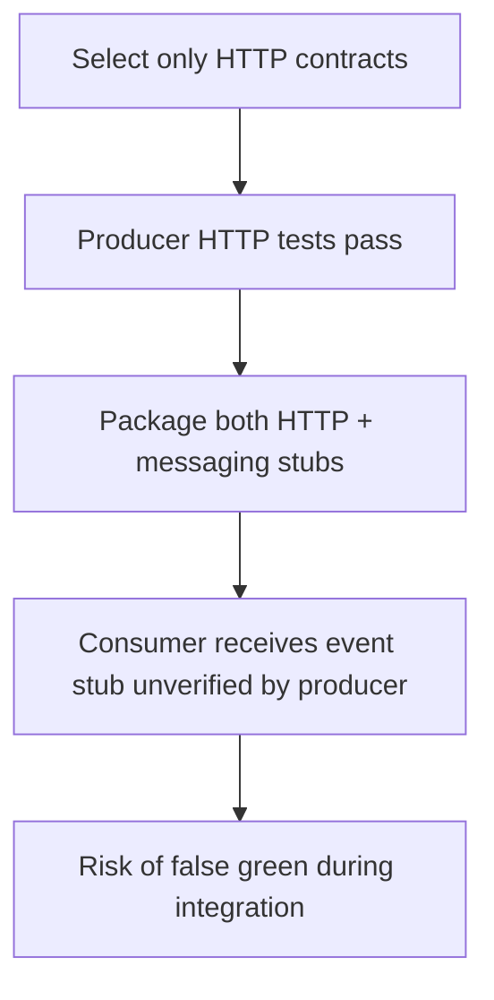
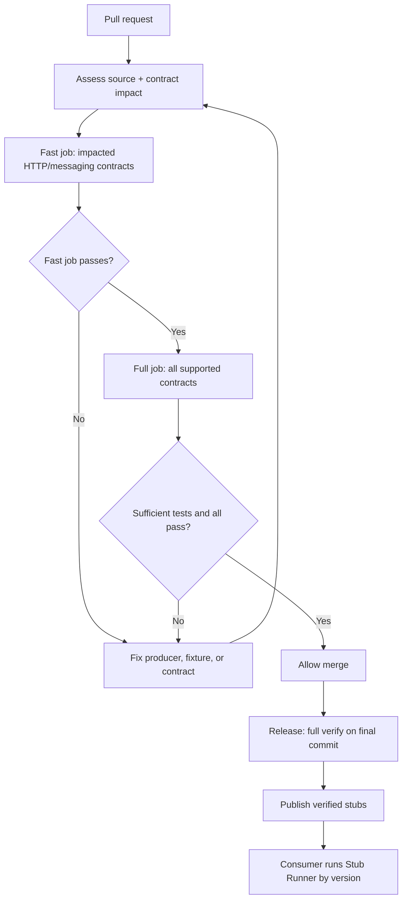

# Selecting Which Contracts to Verify in Each Build

## 1. Why Must You Actively Select the Contract Set?

A producer may serve multiple consumers via HTTP APIs while simultaneously emitting events to other systems. As contract count grows from a handful of files to hundreds, generating and executing every producer verification test on every developer edit can become slow. However, skipping contracts merely to speed up builds risks letting a breaking API change slip past unnoticed.

**Spring Cloud Contract** lets you describe HTTP or messaging behavior using Groovy/YAML DSL, generate producer tests via **Contract Verifier**, create stubs for consumers via **Stub Runner**, and integrate both sides into CI/CD. Across this chain, the question **"which contracts is this build verifying?"** must have a clear, verifiable answer.

For example, `payment-service` has contracts for:

- HTTP lookup, creation, and refund of payments.
- Legacy HTTP APIs still used by a partner.
- `PaymentCaptured` and `PaymentRefunded` events.
- Proposed contracts whose implementation does not exist yet.

A pull request touching only `PaymentController` may benefit from a fast HTTP check loop, whereas a build prior to releasing a new producer version must protect **every actively supported promise**. Thus, distinguish **filtering for fast feedback** from **guaranteeing required coverage before release**.

After this lesson, you will be able to:

1. Identify the set of contracts to process from a repository or external artifact.
2. Understand `contractsDirectory`, `contractsDslDir`, `includedFiles`, `excludedFiles`, `ignoredFiles`, and `contractsPath` in Maven/Gradle contexts.
3. Design fast builds, full builds, and release builds with criteria ensuring no contracts are missed.
4. Trace **selected contracts → generated tests → executed tests → published stubs**.
5. Avoid pitfalls like "green build with zero tests generated," publishing unverified stubs, or checking only new consumer contracts.

## 2. Four Distinct Sets Within a Single Build

Do not lump everything together as "the contracts that ran." Separate them:

| Set | Interpretation | Verification Question |
| --- | --- | --- |
| **Contract source** | All Groovy/YAML definitions present in the source folder or fetched artifact. | Where does the build read contracts from, and which version? |
| **Selected contracts** | Definitions passing path/include/exclude rules and processing status. | Which files did Verifier actually consider? |
| **Generated producer tests** | Test code created by Verifier from test-generating contracts. | How many tests/classes were created, and which base classes do they use? |
| **Executed producer tests** | Tests actually run by Maven/Gradle and the test engine. | Were any tests skipped, undiscovered, or excluded by filters? |
| **Published stubs** | Mappings/artifacts packaged for consumers. | Which stubs match **verified** contracts, and at what version? |

A contract may be **selected** yet generate no producer test if marked *in progress*; or tests may be generated yet never discovered by the test engine. Conversely, a job running only one test group via JUnit/Surefire filters **does not mean the generator selected only that contract group**.

Illustrative inventory example:

```text
Source:      16 definitions
Selected:    8 HTTP definitions
Generated:   8 corresponding verification cases (example)
Executed:    8 tests passed, 0 skipped
Published:   NOT YET — this is only a scoped PR check
```

**Never assume file count equals test count:** one DSL file can hold multiple definitions, and the generator may group multiple test methods into one test class. Inspect actual output and test runner results instead of inferring test count from file count.

## 3. Organizing Contracts for Easy Scope Selection

A **hypothetical** source layout for `payment-service`:

```text
payment-service/
└── src/test/resources/contracts/
    └── payment-service/
        ├── http/
        │   ├── get-payment.groovy
        │   ├── create-payment.yml
        │   ├── refund-payment.groovy
        │   └── legacy/
        │       └── get-payment-v1.yml
        ├── messaging/
        │   ├── payment-captured.groovy
        │   └── payment-refunded.yml
        └── draft/
            └── payment-authorization-v2.groovy
```

Folders `http/` and `messaging/` clarify scopes and separate base test configuration. A `legacy/` folder **does not mean tests may be skipped**: if consumers still depend on API v1, v1 contracts must remain in compatibility verification builds.

The `draft/` folder is only an example of workflow organization; **naming a folder does not automatically mark contracts as in-progress**. The team needs review rules and configuration for handling unfinished contracts. Preferably keep unimplemented contracts out of the release branch's mandatory set, while avoiding arbitrary filters that hide committed promises.

### Which Source Is the "Source of Truth"?

- **Contracts in the same producer repository:** the source is the commit being built; straightforward to link code and test changes.
- **Contracts in a shared repository:** the producer must fetch the exact commit or artifact version, verify internal paths inside the package, and respect contract ownership.
- **Contracts from an artifact repository:** pin explicit versions or digests if reproducible builds are a goal.

Avoid relying solely on "always latest" for a release gate, since two builds of the exact same producer commit could pull two different contract sets.

## 4. Designing Build Strategies by Risk Level

A sound strategy balances not only "running as little as possible," but also blast radius:

| Build Type | Recommended Contract Set | Goal | Sufficient to Officially Release Producer/Stub? |
| --- | --- | --- | --- |
| **Fast local check** | One domain or one HTTP/messaging group being edited. | Short feedback loop while coding. | **No**, unless release policy enforces another full gate. |
| **PR: impacted contracts** | Groups tied to modified modules, APIs, or topics; plus dependent consumer contracts. | Catch primary regressions early. | **Insufficient** if based solely on selective filtering. |
| **PR: full compatibility gate** | All actively supported producer contracts. | Block breaking API changes across untouched groups. | Can serve as a mandatory gate. |
| **Nightly / periodic** | All contracts + deep integration tests per design. | Catch integration, dependency, data, and timing issues. | Helpful, but cannot replace pre-release gates if code changes afterward. |
| **Release or stub publish** | **All contracts declared as supported** in that exact release version. | Ensure stub artifacts represent a verified producer. | **Mandatory under recommended policy.** |

When a PR changes a DTO shared by both HTTP and events, selecting only the HTTP folder easily misses a messaging consumer. When a PR edits shared serialization config or an exception handler, the impact can ripple across many endpoints. Therefore, **impact analysis from source filenames alone cannot prove which consumers are affected**; a full contract gate must run before accepting incompatible changes.

Governance principle: **a small job can turn green early, yet must never be labeled "release-safe" until the full-coverage gate passes.**

## 5. Maven: Selecting Contracts with `includedFiles` and `excludedFiles`

In the Spring Cloud Contract Maven plugin, key options include:

| Plugin Property | Function | Notes |
| --- | --- | --- |
| `contractsDirectory` | Directory holding local contract sources, typically `src/test/resources/contracts` unless configured otherwise. | Picks the source folder, **not** the generated test list. |
| `includedFiles` | File patterns to include for processing. | Useful when contracts share a large directory tree. |
| `excludedFiles` | File patterns excluded from processing. | Never use to hide contracts still under support. |
| `ignoredFiles` | In Maven plugin docs, marks generated tests for matching contracts as ignored. | **Different** from excluding contracts from processing; check version behavior. |
| `failOnNoContracts` | When enabled, missing contracts/stubs fail the build instead of passing silently. | Essential to guard against misconfigured filters producing an empty set. |
| `failOnInProgress` | Fails the build when encountering *in-progress* contracts. | Keeps release gates strict. |
| `baseClassForTests`, `baseClassMappings` | Specifies setup for generated producer tests. | Different base classes may be required for HTTP and messaging. |

### 5.1. Maven: Example Selecting Only the HTTP Group

The XML snippet below is a **`configuration` section inside the Spring Cloud Contract Maven plugin**, not a complete `pom.xml`:

```xml
<configuration>
    <contractsDirectory>
        ${project.basedir}/src/test/resources/contracts
    </contractsDirectory>
    <includedFiles>
        <includedFile>**/http/**</includedFile>
    </includedFiles>
    <failOnNoContracts>true</failOnNoContracts>
    <failOnInProgress>true</failOnInProgress>
    <testFramework>JUNIT5</testFramework>
    <baseClassForTests>
        com.example.payment.contract.HttpContractBase
    </baseClassForTests>
</configuration>
```

The goal of `**/http/**` is to select contracts under the HTTP branch of the sample tree. Patterns must be verified against the **real directory structure** and how your plugin version resolves paths. Once configured, inspect the generated test list to confirm both `get-payment.groovy` and `create-payment.yml` are processed; never guess results from glob syntax alone.

To exclude files the team agreed **fall outside this special build's scope**, the Maven plugin also provides `excludedFiles`. Illustrative snippet:

```xml
<excludedFiles>
    <excludedFile>**/draft/**</excludedFile>
</excludedFiles>
```

When combining includes and excludes, inspect the actual resulting set. Never use `excludedFiles` to ignore `legacy/get-payment-v1.yml` if API v1 remains supported. Nor assume a JSON file referenced via `body(file(...))` can be deleted from the workspace just because the filter selects only Groovy files: **selected contracts must still be able to access all dependent payload files**.

### 5.2. Configuring Profiles for Multiple Build Types

One approach is defining Maven profiles such as `contract-http` and `contract-all`, each holding the appropriate plugin/contract source configuration. Do not activate two profiles with overlapping configuration simultaneously and assume Maven merges them as intended.

Illustration of two distinct configurations:

```text
Profile contract-http:
  contractsDirectory = src/test/resources/contracts
  includedFiles      = **/http/**
  failOnNoContracts  = true
  purpose            = fast feedback, DO NOT publish stubs

Profile contract-all:
  contractsDirectory = src/test/resources/contracts
  includedFiles      = no restriction on actively supported contracts
  failOnNoContracts  = true
  failOnInProgress   = true
  purpose            = full compatibility gate, allow publishing when green
```

With the corresponding setup, commands may look like:

```bash
./mvnw -B clean verify -Pcontract-http
./mvnw -B clean verify -Pcontract-all
```

These are **example commands for projects with Maven Wrapper and those two profiles defined**. Do not blindly copy profiles into another project without inspecting existing build setup. Using `clean` reduces the risk of stale generated tests lingering when filters change; non-clean builds must explicitly manage caching and incremental generation.

### 5.3. Maven Sources Do Not Have to Reside Inside the Producer

If contracts are fetched from a shared artifact, you may need `contractsMode`, `contractDependency`, `contractsRepositoryUrl`, `contractsPath`, and `includedFiles` for the right topic:

```xml
<configuration>
    <contractsMode>REMOTE</contractsMode>
    <contractsRepositoryUrl>https://repo.example.test/maven</contractsRepositoryUrl>
    <contractDependency>
        <groupId>com.example.contracts</groupId>
        <artifactId>platform-contracts</artifactId>
        <version>1.4.2</version>
    </contractDependency>
    <contractsPath>/</contractsPath>
    <includedFiles>
        <includedFile>**/payment-service/**</includedFile>
        <includedFile>**/payment-captured/**</includedFile>
    </includedFiles>
    <failOnNoContracts>true</failOnNoContracts>
</configuration>
```

**All names, URLs, and versions above are hypothetical.** Use real artifacts and valid repository credentials for your project. `contractsPath` selects the branch inside the downloaded contract package, while `includedFiles` filters files within that scope. If `contractsPath` is wrong, zero contracts are selected; this must fail CI rather than become an excuse to disable `failOnNoContracts`.

In environments where multiple producers publish events to a shared topic, Spring Cloud Contract docs also describe using `includedFiles` to select contracts by topic from a common repository. The key is **selecting only contracts relevant to this producer**, rather than running every other producer's contracts and having to mock behaviors you do not own.

## 6. Gradle: Selecting the Source Directory with `contractsDslDir`

In the Gradle plugin, `contractsDslDir` sets the directory containing contracts. The default layout in many Gradle plugin versions is `src/contractTest/resources/contracts`, **not necessarily identical to Maven's default path**. Thus, do not copy Maven config over to Gradle and assume the generator will find everything automatically.

Example `build.gradle` snippets using **Gradle Groovy DSL**:

```groovy
plugins {
    id 'java'
    id 'org.springframework.cloud.contract' version 'REPLACE_WITH_COMPATIBLE_VERSION'
}

contracts {
    contractsDslDir = file('src/contractTest/resources/contracts')
    testFramework = 'JUNIT5'
    baseClassForTests = 'com.example.payment.contract.ContractBase'
}
```

This configuration fragment must be paired with test dependencies, compatible Spring Boot/Contract versions, repositories, and project source sets. It sets the **full source** read by the plugin, not a filter for running individual tests.

If your repo layout isolates an `http/` branch and you want a **fast verification build**, you can use a standalone configuration:

```groovy
contracts {
    contractsDslDir =
        file('src/contractTest/resources/contracts/http')
    testFramework = 'JUNIT5'
    baseClassForTests =
        'com.example.payment.contract.HttpContractBase'
}
```

Pointing to a subdirectory may alter relative paths/packages of generated tests, so verify base class mappings, referenced resources, and stub packaging. Never reuse this scoped config to publish the full API if messaging or legacy branches remain committed promises.

### `ignoredFiles` Is Not "Skip Whatever Makes It Faster"

The Gradle plugin documentation includes `ignoredFiles` using Ant-style patterns to mark files that should not be processed within the plugin scope. Illustrative snippet:

```groovy
contracts {
    contractsDslDir = file('src/contractTest/resources/contracts')
    ignoredFiles = ['**/experimental/**']
}
```

Use such patterns only for sources classified as **outside the required verification scope** under an approved policy. Exact behavior of `ignoredFiles` and contract-level `ignored()` can vary between Maven/Gradle or plugin versions; verify via generator output and test reports. **Never equate "ignored" with "verified by producer."**

Maven's `includedFiles/excludedFiles` and Gradle's `contractsDslDir/ignoredFiles` are not strictly symmetrical parameter pairs. If your plugin version does not support an include filter in the exact way desired, do not invent a Gradle property name. Structure source directories cleanly or stage selected files into an **isolated temporary build directory** before invoking the generator; never delete or modify source contracts.

### Running Gradle and Verifying the Test Engine

Depending on plugin version, `generateContractTests` generates tests and `check` usually runs related verification steps. Example:

```bash
./gradlew clean generateContractTests
./gradlew clean check
```

**Generating tests is not running tests.** Running only the generation task confirms test source code is emitted; `check` or configured test tasks perform actual verification. Inspect test reports; if the test task reports `SKIPPED` or `NO-SOURCE`, you cannot claim contracts were verified.

## 7. HTTP and Messaging Contracts May Require Different Setups

Example of a producer handling both REST and events:

| Group | Behavior | Required Test Configuration |
| --- | --- | --- |
| `http/` | `GET /api/payments/PAY-1001` returns `200` with JSON status `PAID`. | Spring MVC/MockMvc or WebTestClient, transaction fixtures. |
| `http/` | `POST /api/payments/PAY-2002/capture` returns `409` when rejected. | `REJECTED` status fixture, exception mapping. |
| `messaging/` | Emits `PaymentCaptured` to the agreed destination. | Trigger, messaging verifier, and suitable test binder/adapter. |
| `messaging/` | Emits `PaymentRefunded` after refund. | Refund fixture, test-controlled message receiver. |

Sample HTTP contract:

```yaml
description: Look up a paid payment transaction
name: get_paid_payment
request:
  method: GET
  urlPath: /api/payments/PAY-1001
response:
  status: 200
  headers:
    Content-Type: application/json
  body:
    paymentId: PAY-1001
    status: PAID
```

Illustrative Groovy messaging contract:

```groovy
import org.springframework.cloud.contract.spec.Contract

Contract.make {
    name 'payment_captured_event'
    input {
        triggeredBy('emitPaymentCaptured()')
    }
    outputMessage {
        sentTo('payments.captured')
        body([
            eventType: 'PaymentCaptured',
            paymentId: 'PAY-1001',
            orderId: 'ORD-2001'
        ])
    }
}
```

For messaging contracts to actually run, the base class must provide the `emitPaymentCaptured()` trigger and required wiring/verifier. Do not enable the entire messaging group only to accept all of them being skipped for missing setup. If one build combines HTTP and messaging, configure `baseClassMappings` (Maven/Gradle per version) to map each group to its right base class; if split into two jobs, each job must verify its own portion and an aggregate gate must confirm both pass before release.

## 8. `includedFiles` Differs from `baseClassMappings` and Test Filtering

Three mechanisms often confused:

**A. Filtering contracts at the source**

```text
includedFiles = **/http/**
=> Only contracts matching the pattern enter processing.
```

**B. Selecting base classes for generated tests**

```text
baseClassMappings:
  .*http.*      => HttpContractBase
  .*messaging.* => MessagingContractBase
=> Tests can still be generated from BOTH groups; each group gets its own setup.
```

**C. Filtering tests at execution time**

```text
Running a test subset by JUnit/Surefire/Gradle name/class/tag:
=> Contracts may have generated tests, yet part of those tests DID NOT RUN.
```

Therefore, when reporting coverage for a release gate, track both **the selected contract list** and **whether the tests generated from them actually executed**. Passing Surefire's `-Dtest=...` or Gradle's `--tests ...` only filters the test runner; **it does not alter Verifier's contract input set**.

## 9. Be Careful with `ignored` and `inProgress`

Spring Cloud Contract supports special contract statuses. For instance:

```groovy
import org.springframework.cloud.contract.spec.Contract

Contract.make {
    inProgress()
    // Request/response sections of the contract are under development...
}
```

Or YAML may use `inProgress: true` where supported by the DSL version. **An in-progress contract can generate a stub without generating a producer test**, so the consumer can receive a stub simulating unimplemented producer behavior. This is a temporary collaboration tool, not proof of verified compatibility.

Similarly, contract-level `ignored()` or `ignored: true` makes sense only when the team intentionally skips a contract and understands its impact. Never flip a failing contract to `ignored` to "fix" CI green.

For release builds:

- No **actively supported contract** may be silently dropped by filters, includes, excludes, or ignores.
- Enforce failure when encountering unverified contracts, e.g., `failOnInProgress=true` in supported plugins.
- Maintain an explicit inventory of how many contracts are in-progress/ignored and why; if policy forbids them, **block the release**.
- If a product publishes stubs for unimplemented behavior, clearly label them as draft stubs rather than implemented promises.

## 10. Incremental Generation Is Not Risk-Based Contract Selection

Some Maven plugin versions offer `incrementalContractTests`: when enabled, the generator only regenerates tests when contracts changed since the previous build. This is a **code-generation optimization**, not a policy saying "only run contracts for modified files."

Distinguish clearly:

| Scenario | Consequence |
| --- | --- |
| Contract unchanged, yet producer response logic changed | **Generated tests must still run** to catch contract breakage. |
| Build uses stale cache/generated sources | May execute tests misaligned with current contracts if caching is flawed. |
| Filter changes from HTTP to all in the same build directory | Leftover generated sources or missing tests can distort results. |
| Clean build from commit + version-pinned contract artifact | Far easier to trace contract sources, generated tests, and run results. |

Do not equate "generate tasks UP-TO-DATE" with "all producer promises verified." Every release gate must report **executed tests** against the matching producer code. When changing scope, clean generated outputs or isolate build directories so old and new tests never mix.

## 11. Publishing Stubs: Test Set and Mapping Set Must Align

A producer might verify only HTTP contracts on a PR, while stub artifacts are packaged under a different configuration. The danger is:



This is a **scenario to avoid**, not a valid release workflow. Before publishing, confirm the contract set used to generate stubs matches the contract set that passed producer verification. Never assume the same filter applies automatically to **every Maven goal** (`generateTests`, `convert`, `generateStubs`) or every Gradle task: docs show goals/tasks accept separate parameters depending on version.

Recommended workflow:

1. Pin the producer commit and contract source version.
2. Generate and run producer verification for **all contracts declared as supported**.
3. Confirm tests were discovered and no critical contract was ignored, in-progress, or skipped.
4. Generate/package stubs from **that exact verified contract set**.
5. Inspect stub artifact contents and metadata/version; publish to the artifact repository.
6. Have consumers fetch the **specific stub version** via Stub Runner and run tests through real client code.

If an organization deliberately publishes **only one subset** of stubs (such as HTTP v1) as a separate artifact, treat it as an explicitly scoped artifact with full producer verification **for that exact scope** and explicit consumer acceptance.

## 12. CI: Fast on PRs, Complete Before Merge/Release

Example flow:



A **simulated** CI configuration (syntax must be adapted to your real CI platform):

```yaml
jobs:
  contract-fast:
    on: pull_request
    command: "./mvnw -B clean verify -Pcontract-http"
    required_for_early_feedback: true
    publishes_stubs: false

  contract-full:
    on: [pull_request, release]
    command: "./mvnw -B clean verify -Pcontract-all"
    required_for_merge_or_release: true
    publishes_stubs_after_success: true
```

This is **policy pseudocode**, not a runnable GitHub Actions/Jenkins/GitLab CI workflow. Both profiles and artifact publishing steps must actually be defined. If CI runs jobs concurrently, isolate workspaces or output directories so generated test caches never cross-contaminate.

### Metrics to Publish in CI Logs

| Metric | Purpose |
| --- | --- |
| Producer commit and contract version/source | Ensures build reproducibility. |
| Selected contract path and patterns | Proves the scope under verification. |
| List of selected contracts/folders | Detects broken globs, missing groups, or uncommitted files. |
| Generated test class/method count | Confirms the generator actually produced code. |
| Executed/passed/failed/skipped test counts | Distinguishes "green build" from "zero tests executed." |
| Ignored / in-progress contracts | Surfaces draft stubs or bypassed promises. |
| List of published stub mappings/artifacts | Cross-checks against the verified contract set. |

If the plugin does not directly print the selected contract list in the format CI expects, add a **controlled inventory check** based on known sources/paths and reconcile it against generated tests. Use this as a QA safeguard—never treat a matching inventory alone as proof that producer tests ran.

## 13. How to Test a Filter Before Trusting It

Suppose `payment-service` has eight HTTP contracts and three supported messaging contracts:

**Experiment 1 — Select HTTP only.** Configure include `**/http/**`. Verify generated tests cover `GET /api/payments/...` and `POST /api/payments/...` with **zero** messaging tests. Confirm executed HTTP test count is non-zero.

**Experiment 2 — Select all.** Remove the filter in the full profile. Verify both HTTP **and** messaging tests generate and run, each with the proper base test; confirm no `NO-SOURCE` or unexplained skips.

**Experiment 3 — Misconfigured filter.** Intentionally set a non-matching pattern in a test environment. The build must catch zero contracts/tests. If the pipeline still reports "passed" with zero tests executed, add guards and minimum test count policies.

**Experiment 4 — Producer breaks response.** Rename `status` to `state` in the producer's response while keeping the old contract. The full gate must fail; running only messaging tests misses it, demonstrating why an overall gate is essential.

**Experiment 5 — Unfinished behavior.** Add a new in-progress contract. Fast builds may use it as a draft stub per experimental policy, while the release gate must detect and handle its unverified state instead of treating it as passing producer verification.

**Experiment 6 — Inspect artifact.** After the full gate passes, list mappings and confirm HTTP/messaging stubs match the verified set. Consumers must pin a specific version rather than defaulting to latest.

### Diagnosing Common Failures

| Symptom | Likely Cause | Resolution |
| --- | --- | --- |
| Maven reports no contracts | Wrong `contractsDirectory`, include pattern, or `contractsPath`. | Check source/artifact and actual paths; keep `failOnNoContracts`. |
| Only a few contracts generated | Unintended `includedFiles/excludedFiles` or uncommitted files. | Compare contract tree with generated output. |
| Build green with 0 tests | Generated sources missed by compiler/test engine, tests skipped, overly narrow filter. | Inspect Maven Surefire/Gradle Test reports; fail CI on invalid test counts. |
| HTTP passes, messaging missing from report | Only HTTP selected or messaging base class unconfigured. | Full gate covers messaging with matching base mappings. |
| Old tests linger after changing filter | Stale generated sources/cache not cleaned. | Run clean builds or isolate output directories when changing scope. |
| Stub holds unimplemented behavior | In-progress contract generates stub without producer test. | Do not publish as verified; enable in-progress gate and audit mappings. |
| Consumer sees stale stub | Using old artifact version or "latest" not updating as expected. | Pin explicit versions and verify artifact coordinates. |
| Flaky CI errors fetching contract repo | Dynamic artifact resolution, flaky credentials/network. | Pin versions, manage caches cleanly, check auth and bounded retries. |

## 14. Hands-On Exercise

A `payment-service` has contracts:

```text
contracts/payment-service/
├── http/
│   ├── get-payment.yml
│   ├── create-payment.groovy
│   ├── capture-payment.yml
│   ├── refund-payment.groovy
│   └── legacy/get-payment-v1.yml
├── messaging/
│   ├── payment-captured.groovy
│   └── payment-refunded.yml
└── draft/
    └── payment-authorization-v2.groovy
```

API v1 is still used by a partner consumer. The draft contract is not yet implemented in the producer. All remaining contracts have been reviewed and promised for support.

**Tasks:**

1. Define which contract set should run in the fast HTTP check build and which is mandatory in the release gate. Explain why `legacy/get-payment-v1.yml` must not be dropped from the full gate.
2. Write the Maven plugin `configuration` block to select `**/http/**` under profile `contract-http`, enable `failOnNoContracts`, and configure the HTTP base class.
3. Write Gradle configuration using `contractsDslDir` for the full source set; if running only a subfolder, explain how to isolate output while preserving the full gate.
4. Explain why `baseClassMappings` does not replace `includedFiles`; what does an HTTP/messaging mapping accomplish?
5. Build a three-job matrix: fast PR, full compatibility gate, and release. Which job is allowed to publish stub artifacts? What precondition is mandatory before publishing?
6. Suppose `includedFiles` is misconfigured so zero tests are generated yet Maven reports success. Propose technical guards and CI criteria to catch it.
7. Handle unimplemented `payment-authorization-v2.groovy`: should you use `inProgress()` and publish its stub to the official channel? Detail the false-green risk.
8. Describe a scenario where the producer edits a shared serializer affecting both HTTP responses and event payloads. Why is running only HTTP based on source diffs insufficient to guarantee compatibility?
9. After full verification, reconcile generated tests, test reports, and stub mappings. Explain how to prove the consumer uses the exact contract version verified by the producer.

**Self-assessment:** strong answers separate **source scope**, **selected set**, **generated tests**, **executed tests**, and **published stubs**. They never use filters to hide failing contracts, never declare release safety after running only a subset, and always catch zero-test runs.

## 15. Key Takeaways

- **Selecting contracts is a coverage decision**, not merely a speed optimization.
- Maven provides `contractsDirectory`, `includedFiles`, `excludedFiles`, and zero-contract guards; Gradle provides `contractsDslDir`, `ignoredFiles`, and source selection options. Check exact plugin APIs for your project version.
- **Contract filtering differs from test runner filtering.** Generated tests that never execute do not protect the producer.
- **Fast builds may test a subset**, yet before merge/release run full producer verification across **every committed contract**, including legacy and messaging.
- **Incremental generation, caching, ignored, and in-progress flags** must never become shortcuts hiding unverified contracts.
- Before publishing stubs for Stub Runner, reconcile **contract source → generated tests → executed tests → artifact** on the same version, including error branches.

### References

- [Spring Cloud Contract — Maven Project](https://docs.spring.io/spring-cloud-contract/reference/maven-project.html): plugin configuration and producer verification tests.
- [Spring Cloud Contract — Maven generateTests Goal](https://docs.spring.io/spring-cloud-contract/docs/current/spring-cloud-contract-maven-plugin/generateTests-mojo.html): `includedFiles`, `excludedFiles`, `ignoredFiles`, `failOnNoContracts`, `failOnInProgress`, and incremental generation.
- [Spring Cloud Contract — Gradle Project](https://docs.spring.io/spring-cloud-contract/reference/gradle-project.html): `contractsDslDir`, `ignoredFiles`, `generateContractTests`, and test source sets.
- [Spring Cloud Contract — Common Contract Repository](https://docs.spring.io/spring-cloud-contract/reference/howto/how-to-common-repo-with-contracts.html): filtering contracts by producer/topic in a shared repository.
- [Spring Cloud Contract — Contract DSL, Ignoring Contracts and In Progress](https://docs.spring.io/spring-cloud-contract/reference/project-features-contract/common-top-elements.html): semantics of `ignored` and `inProgress`.
- [Spring Cloud Contract — Stub Runner](https://docs.spring.io/spring-cloud-contract/reference/project-features-stubrunner.html): using published stub artifacts in consumer tests.
