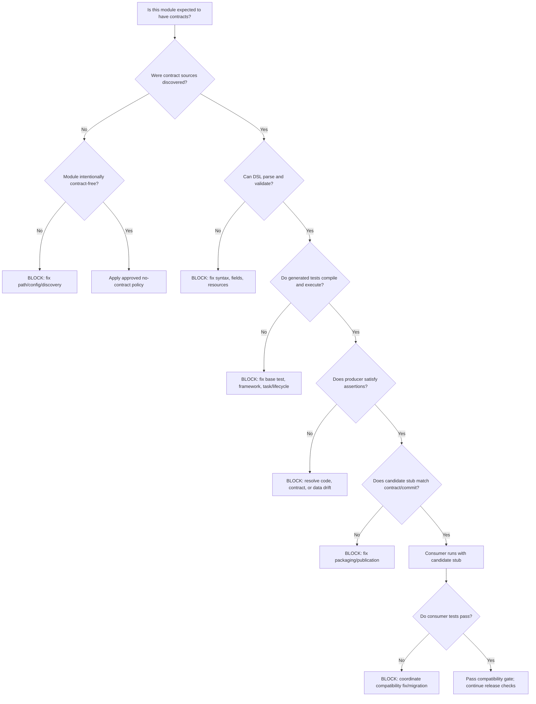

# Handling Invalid Contracts and Zero-Contract Cases

## 1. Why Is a "Green Build" Not Enough to Trust Contract Verifier?

**Spring Cloud Contract (SCC)** lets producers and consumers describe HTTP or messaging interactions via **Groovy DSL** or **YAML DSL**. In producer-side verification, **Contract Verifier** reads contracts, generates tests with the promised requests/responses, and executes them against producer code. From those same contracts, the tool can also generate **stubs** for consumers to test via **Stub Runner**. In CI, this chain catches incompatible API changes.

However, several situations produce misleading build results:

- A contract has **syntax errors**, causing parsing/generation to fail.
- A contract parses cleanly yet **misses required fields** or uses invalid DSL.
- A contract is valid, yet **generated tests fail to compile** due to wrong test base config.
- Generated tests run and turn red because **the producer violates the contract**.
- **Zero contracts are discovered**, or the plugin/task never runs: depending on version and config, the build may still stay green while verifying zero communication behavior.
- Stubs are packaged yet **lack the new contracts**, causing consumer tests to run against stale versions or empty mappings.

This lesson focuses on two easily overlooked failure classes: **invalid contracts** and **no contracts**. The goal is diagnosing root causes, restoring verification, and enforcing proper **fail-fast / fail-closed** gates in the pipeline.

### Learning Outcomes

After this lesson, you will be able to:

1. Distinguish **parse errors**, **DSL/schema errors**, **generation/compile errors**, **verification failures**, and **zero-contract** situations.
2. Inspect a minimal HTTP Groovy/YAML contract, recognize common mistakes, and know which layer to fix.
3. Determine when a project **intentionally has no contracts** versus when **finding no contracts** is a configuration bug.
4. Design CI gates confirming **contracts discovered → tests generated → tests executed → stubs at the right version**.
5. Separate producer verification errors from consumer Stub Runner errors, avoiding misdirected fixes or fake "green builds" via skipped tests.
6. Record sufficient evidence for the team to catch incompatible API changes prior to release.

## 2. Diagnostic Mindset Across Verification Gates



Never treat every failure as "Contract Verifier is broken." Each branch has **distinct symptoms, owners, and recovery steps**.

| Error Layer | Typical Occurrence Stage | What to Inspect |
|---|---|---|
| **Discovery** | Plugin scans contract paths | Directories, file extensions, config, contract count logs |
| **Parsing** | Reading Groovy/YAML | Syntax errors, line/column numbers |
| **Validation/DSL** | Building contract model from DSL | Valid fields, request/response, matchers, fixtures |
| **Generation/compilation** | Generating/compiling tests | Generated Java, base class, imports, test mode |
| **Execution/verification** | Running tests against producer | Actual HTTP response/message vs. expectations |
| **Stub packaging** | Packaging artifacts | Are mappings and body files inside the stub JAR? |
| **Consumer** | Stub Runner and client tests | Exact artifact, mappings, real client behavior |

## 3. Minimal Valid HTTP Contract for Reference

Example: **Inventory Service** exposes an endpoint returning stock availability:

```http
GET /api/inventory/SKU-123 HTTP/1.1
Accept: application/json
```

Promised response:

```json
{
  "sku": "SKU-123",
  "available": true,
  "quantity": 12
}
```

In a producer project integrated with SCC, the contract can be placed at a conventional location, such as:

```text
src/test/resources/contracts/inventory/get-stock.groovy
```

Groovy DSL content:

```groovy
import org.springframework.cloud.contract.spec.Contract

Contract.make {
    description 'Returns stock for Checkout Service'

    request {
        method GET()
        url '/api/inventory/SKU-123'
    }

    response {
        status OK()
        headers {
            contentType(applicationJson())
        }
        body(
            sku: 'SKU-123',
            available: true,
            quantity: 12
        )
    }
}
```

If choosing YAML DSL, create **one** equivalent contract instead of the Groovy file, e.g., `get-stock.yml`:

```yaml
description: Returns stock for Checkout Service
name: get_stock

request:
  method: GET
  url: /api/inventory/SKU-123

response:
  status: 200
  headers:
    Content-Type: application/json
  body:
    sku: SKU-123
    available: true
    quantity: 12
```

**Note:** These two snippets are **two alternatives**; do not create duplicate contracts for the same scenario in one project. The plugin must be configured to read the exact folder and format in use. In a project lacking the SCC plugin, merely placing a file here is **insufficient** to generate tests.

A valid contract at this stage means the specification can be processed and carries concrete expectations. It **does not prove** the producer controller exists or returns accurate data; generated tests are needed to verify that.

## 4. Error Class A — Unparseable Groovy DSL

Broken example:

```groovy
import org.springframework.cloud.contract.spec.Contract

Contract.make {
    request {
        method GET()
        url '/api/inventory/SKU-123'
    }
    response {
        status OK()
        body(
            sku: 'SKU-123',
            available: true
        )
    // Missing closing braces for response and Contract.make
```

When the Groovy parser fails, Contract Verifier cannot construct the complete contract model. Logs typically show line/column details regarding braces or syntax.

Common mistakes:

- Missing `}` or `)`; placing body/matchers outside the intended closure.
- Misspelling DSL method names, e.g., non-existent methods or wrong syntax.
- Using YAML conventions inside Groovy without converting to proper DSL syntax.
- Adding Groovy code referencing libraries or variables absent from the contract evaluation classpath.
- Embedding complex processing inside the contract, obscuring the communication promise.

Resolution: read **the first error message pointing to a source line**, check braces and DSL APIs, and re-run generation on that exact file. Never edit the controller or loosen assertions when the pipeline **has not even generated tests yet**.

## 5. Error Class B — YAML Fails to Parse or Parses with Invalid Schema

YAML is especially sensitive to **indentation** and implicit type inference.

### 5.1. Wrong Indentation Structure

```yaml
# WRONG: method is not nested under request as expected
request:
method: GET
  url: /api/inventory/SKU-123
response:
  status: 200
```

Fix by aligning all fields belonging to the same block at the right level:

```yaml
request:
  method: GET
  url: /api/inventory/SKU-123
response:
  status: 200
```

### 5.2. Valid YAML That Is Not a Valid SCC Contract

```yaml
# YAML parser can read this, but the key names are misspelled:
request:
  method: GET
  endpoint: /api/inventory/SKU-123
response:
  code: 200
```

`endpoint` and `code` cannot arbitrarily substitute for `url` and `status` in the expected HTTP contract schema. Depending on version/parser path, the tool may reject them, silently ignore unknown keys, or build an unintended model. Therefore:

- **Successful YAML parsing ≠ valid contract.**
- **Schema-valid contract ≠ compliant producer behavior.**
- **Build exit 0 ≠ generated tests executed.**

Other common errors include placing `request`/`response` at the wrong nesting level, placing `matchers` outside the target block, pointing `bodyFromFile` to a missing file, or saving YAML with a file extension not scanned by the plugin.

### 5.3. Wrong Data Types from YAML Implicit Typing

```yaml
response:
  status: "200"   # String, not an integer as expected in schema
  body:
    available: "true"  # String, not JSON boolean true
    quantity: "12"     # String, not JSON number 12
```

A contract can establish **wrong type expectations** if not caught early. For a response promising `available` as boolean and `quantity` as number, write:

```yaml
response:
  status: 200
  body:
    available: true
    quantity: 12
```

Values that are genuinely **strings** yet look like numbers or booleans should be quoted; conversely, never quote JSON numbers or booleans.

## 6. Error Class C — Missing Fields, Matchers, or Body Resources

An HTTP contract needs complete information for the described scenario. Common risks:

| Symptom | Potential Cause | Resolution |
|---|---|---|
| Cannot build a concrete request | Missing method or required URL/path | Supply `request.method` and `url`/`urlPath` |
| Test fails to verify expected status | `response.status` omitted or misplaced | Declare status using supported DSL syntax |
| Critical body field goes unchecked | Overly broad body/matcher or wrong JSONPath | Add required fields and inspect generated assertions |
| Fixture file not found | `bodyFromFile`/`file(...)` points to wrong path | Place file near contract and verify actual relative path |
| Test generation fails on matcher | Wrong matcher side/type name or `path` targets non-existent field | Use exact Groovy/YAML syntax and inspect generated test |
| Stub serves stale body | Fixture changed but wasn't reloaded/repackaged | Rebuild artifact and inspect mapping and body files |
| Two scenarios match the same request | Body/header/query matchers too loose | Narrow matching conditions and add negative stub tests |

Example YAML referencing a file missing from resources:

```yaml
request:
  method: GET
  url: /api/inventory/SKU-123
response:
  status: 200
  headers:
    Content-Type: application/json
  bodyFromFile: payloads/missing-stock.json
```

Even when YAML syntax is valid, generation or packaging can fail because **the body resource cannot be found**. The fix is not creating an empty dummy file with the same name, but restoring **the exact contract payload under test** and re-running verification.

## 7. Error Class D — Valid Contract, Yet Generated Tests Fail to Compile

A contract can parse and generate cleanly while **generated test source fails to compile**. Typical causes:

- `baseClassForTests` points to the wrong package or a non-existent class.
- Test base declares a matcher method like `assertBusinessRule($it)` whose Java name or signature mismatches.
- Project lacks test dependencies required by the mode SCC generated.
- Plugin, Spring Boot, Spring Cloud Release Train, JUnit, or Java toolchain versions are incompatible.
- Generated tests target MockMvc/WebTestClient/HTTP while the test base sets up a different tool.
- Package or class name changed without updating plugin configuration.

Maven plugin example:

```xml
<plugin>
    <groupId>org.springframework.cloud</groupId>
    <artifactId>spring-cloud-contract-maven-plugin</artifactId>
    <version>4.x.y</version>
    <extensions>true</extensions>
    <configuration>
        <baseClassForTests>com.example.inventory.ContractTestBase</baseClassForTests>
    </configuration>
</plugin>
```

`4.x.y` is an **illustrative placeholder** and must be replaced with a real plugin version compatible with your chosen Spring Cloud BOM. Check the class declared in test sources:

```java
package com.example.inventory;

import org.springframework.boot.test.context.SpringBootTest;

@SpringBootTest
public abstract class ContractTestBase {
    // Configure MockMvc, WebTestClient, or HTTP per the actual test mode.
}
```

The Java snippet above illustrates **class location/name**, not a base class ready for every test mode. On compilation errors, read **the generated source + compiler error** to check whether method calls, imports, and `extends` match.

Never label a contract "invalid" simply because a test base is missing; that is a **test-generation environment integration error** and must be fixed at the proper layer.

## 8. Error Class E — Generated Tests Run, Yet Producer Fails to Comply

For example, the contract requires:

```json
{
  "sku": "SKU-123",
  "available": true
}
```

Yet the new implementation returns:

```json
{
  "sku": "SKU-123",
  "inStock": true
}
```

The generated producer test **must fail** on the relevant assertion if `available` was declared. That signals Contract Verifier is doing its job, not a syntax bug.

Separate three questions:

1. **Does the contract accurately describe the agreed promise?** If yes, producer code must be fixed to comply.
2. **Did the team intentionally change the promise?** If so, update the contract, while also verifying existing consumers.
3. **Does the test rely on unstable dummy data?** If the body contains dynamic timestamps/IDs, use suitable matchers rather than deleting vital assertions.

Never solve red producer tests using `skipTests`, deleting contracts, or unconditionally relaxing matchers. Those shortcuts destroy the compatibility evidence the pipeline needs.

## 9. The No-Contract Case: Four Different Situations

**Zero contracts** is not always an error. Determine why the contract count is 0.

| Situation | Example | Decision Policy |
|---|---|---|
| **Intentionally contract-free** | Pure library module providing no APIs/messages | Permissible with explicit configuration/policy |
| **Contracts not yet added** | New service exposes APIs, but team hasn't written contracts yet | Cannot count as verified; require completion before enabling compatibility gate |
| **Files exist, plugin misses them** | Wrong directory, wrong extension, task/plugin not enabled | Must fix discovery; block in modules expected to hold contracts |
| **Files exist, excluded from build** | CI profile disables plugin, skip tests, wrong source set, pipeline condition skips step | Must restore pipeline and verify executed test count |

A **consumer-only** module may hold no producer contracts at the same location; its job is testing against published stubs. Conversely, for a **producer mandated to use Contract Verifier**, zero contracts is usually a process error that must be caught early.

Policy should be scoped by **module role**, rather than enforcing one rigid rule across every module in a monorepo.

## 10. Why Can "Zero Contracts" Produce a False Green?

A pipeline can exit with success when:

- The plugin scans zero files.
- Zero generated tests exist, yet the test runner exits cleanly.
- All tests are disabled by profiles, flags, or CI conditions.
- A stub artifact gets packaged without useful mappings.
- Consumer tests keep running against an **older stub version** because no new candidate artifact appeared.

In those cases, a `BUILD SUCCESS` line merely says **the build command finished under the active settings**, not that any contract was protected.

**Minimum evidence to collect:** contracts discovered, generated tests emitted and executed, assertion results, stub mappings present, and consumer tested against the candidate commit/version's stub.

Never conclude "Contract Verifier has a bug" or "it always fails by default on 0 contracts": **zero-contract behavior depends on plugin/version and configuration**. The safe path is building CI gates independent of assumptions about those defaults.

## 11. Checking Zero-Contract Causes in Order

When a module ought to have contracts yet logs show nothing generated, check:

1. **Directory:** standard convention is `src/test/resources/contracts/` on the producer; if `contractsDslDir` or an equivalent option was customized, inspect its effective value.
2. **Extensions:** Groovy/YAML files are matched by plugin rules and version; do not put YAML inside a `.txt` file expecting it to be scanned.
3. **Plugin applied:** did Maven/Gradle actually declare the SCC plugin in the right producer module?
4. **Lifecycle/tasks:** did the CI command invoke both test generation and test execution, or only package/compile on another branch?
5. **Profiles and skip flags:** is a condition enabling the plugin locally while disabling it in CI, or are `skipTests`/`maven.test.skip` active?
6. **Source sets and test runner:** are generated tests added to test sources with matching JUnit names/annotations and executed?
7. **Stub outputs:** are mappings and the `stubs` classifier artifact generated from that exact candidate version?

In multi-module projects, check the **exact producer submodule**. Running at the root and getting a passing report for a contract-free module does not prove the producer module was tested.

## 12. Maven: Inspecting Generation, Tests, and Artifacts

In a Maven project configured with the Spring Cloud Contract plugin:

```bash
# Check the Maven and Java versions actually in use.
./mvnw --version

# Inspect effective plugin and lifecycle configuration.
./mvnw help:effective-pom

# Generate, compile, and run tests in the configured build cycle.
./mvnw clean verify
```

With Maven, generated contract tests usually land under the plugin output area in `target/generated-test-sources/contracts/`, though exact paths vary by version/configuration. Do not look solely for one fixed directory name and assume the plugin failed if it is absent.

Verify at minimum:

- Logs confirm the plugin read the **right contracts directory** and found inputs.
- Generated source/tests exist for specific contracts, e.g., the GET stock case.
- The test runner (Surefire/Failsafe per config) **executed those generated tests** and reported a non-zero count.
- If stub generation is configured, the `stubs` classifier artifact contains matching mappings.
- In multi-module Maven runs, inspected output belongs to the producer's `artifactId`.

**Crucially:** Maven accepts `skipTests` to skip test execution; `maven.test.skip` also skips test compilation. Never use these flags in compatibility verification gates; if needed elsewhere, pipelines must clearly mark which stages **do not verify contracts**.

## 13. Gradle: Determining Which Tasks Actually Run

In a Gradle project with the Spring Cloud Contract plugin:

```bash
# Check Gradle/JVM.
./gradlew --version

# List contract-related tasks in the current plugin version.
./gradlew tasks --all

# Run tests per project lifecycle.
./gradlew clean test
```

Task names for generating tests, creating stubs, or wiring into `test` vary by plugin version and configuration. Inspect task lists and logs to see what the pipeline actually ran instead of relying on task names from outdated guides.

In multi-subproject builds, target the exact producer subproject. Example syntax for invoking a module task:

```bash
./gradlew :inventory-service:test
```

That syntax illustrates a subproject named `inventory-service`; actual names may differ. Inspect generated sources, test reports, and artifacts for that exact subproject.

## 14. Fail-Fast Strategies When No Contracts Are Found

A proper **fail-fast** policy catches zero-contract states at the start of the pipeline rather than discovering empty mappings after publishing artifacts.

### Option A — Use Plugin-Supported Configuration

Some Contract Verifier versions/configurations offer options controlling behavior when **no contracts are found**. Check exact option names and defaults against **documentation for your exact plugin version**. Never copy a flag from an old blog post or guess property names; if the plugin ignores it, the gate has zero effect.

If your project enables an option like **fail on no contracts**, prove it with a negative test: **temporarily move contracts out of the source directory on a test branch**, run the pipeline, and confirm the relevant stage **actually fails**. Then restore the contracts. Never trust config on sight alone.

### Option B — Per-Module Custom Gate

For producer modules required to carry contracts, CI can verify:

- Discovered contract file count **greater than 0**.
- Generated test cases **executed by the runner greater than 0**, not just source file count.
- Expected critical contracts named in the test report.
- Candidate stub artifact mapping count **greater than 0**.

Example **preliminary check** in a POSIX environment using directory conventions:

```bash
# Only checks that DSL source files exist by convention; DOES NOT replace generation checks.
test -n "$(find src/test/resources/contracts \
  -type f \( -name '*.groovy' -o -name '*.yml' -o -name '*.yaml' \) \
  -print -quit)"
```

This command checks only whether files with matching extensions exist. It **does not prove** the plugin recognized them, DSL is valid, or tests executed. A complete gate still checks build outputs, logs, test reports, and stubs. On Windows, use an equivalent mechanism for your build environment rather than pasting POSIX commands verbatim into PowerShell.

### Option C — Intentional Exception for Modules Not Using Contract Verifier

If a module **genuinely owns no contracts**, exempt that **specific module** from the no-contract gate after documenting its role. Never configure a repo-wide `skip`, as it hides when a producer accidentally drops its contracts during a refactor.

## 15. Verifying Policies with Negative Test Cases

A pipeline has a genuine anti-"false green" gate only after testing deliberate failure scenarios on a test branch:

| Test Action | Expected Outcome for Mandatory-Contract Producer |
|---|---|
| Delete/move all contracts outside scan path | **FAIL** at no-contract/discovery gate |
| Introduce Groovy or YAML syntax error | **FAIL** at parse/generation |
| Point matcher to a non-existent body field | **FAIL** at generation/compile/test, or caught by inspecting generated source |
| Keep contract, delete matching controller/method | **FAIL** when producer tests run |
| Rename `available` to `inStock` only in producer code | **FAIL** at producer verification if old field is asserted |
| Change both code + contract to `inStock` | Producer may PASS; **existing consumer must test with new stub** |
| Run consumer tests with previous stub version | Gate must warn/fail due to wrong candidate artifact; never mark PR verified |

On the test branch, revert test mutations after confirming the pipeline turns red. Never merge artificial failures into the main branch. Re-testing failure modes **periodically** when upgrading plugins, tweaking profiles, or modifying pipelines keeps the gate trustworthy.

## 16. Zero Generated Tests Differs from Zero Contract Sources

Four counts can diverge:

1. **Contract source count:** Groovy/YAML files in the input area.
2. **Contract parsed count:** contracts actually accepted and evaluated by SCC.
3. **Generated test count:** test sources/test cases emitted.
4. **Executed test count:** test cases run by the test runner.

For example: 5 `.yml` files exist, yet only 3 are scanned because 2 sit in the wrong folder; 1 of the 3 is invalid; when parse/generation fails, zero tests may run. Or all tests are generated, yet runner config leads to **0 tests executed**.

Hence **counting files** is only the first checkpoint. The strongest evidence for producer-side verification is:

> "Contract X generated test Y, test Y executed against producer commit Z, and assertions passed."

If both messaging and HTTP contracts exist, confirm both types are wired to the right test base/adapter. Failing to generate tests for either type leaves a verification gap.

## 17. Body Matcher, Payload, and Test Base Errors Must Not Be "Fixed" by Skipping

Suppose a YAML contract defines:

```yaml
request:
  method: GET
  url: /api/inventory/SKU-123
response:
  status: 200
  body:
    sku: SKU-123
    quantity: 12
  matchers:
    body:
      - path: $.missingField
        type: by_type
```

`$.missingField` is absent from the sample body. During test generation, this matcher may error out or become meaningless. The right fix is identifying **which field the consumer actually depends on**, then aligning path and body—not deleting the matcher to turn the pipeline green.

Similarly, with a custom command:

```groovy
bodyMatchers {
    jsonPath('$.quantity', byCommand('assertQuantityAllowed($it)'))
}
```

The generated test needs access to `assertQuantityAllowed` from the base class or test support utilities. If the method does not exist or is inaccessible, that is a compile/test-integration error requiring fixes to **method name, visibility, package, or base test config**.

When tests fail because the producer returns quantity 101 instead of max 100, distinguish implementation bugs from business rule changes. Never relax the Java helper's rule just to pass CI if consumers have not agreed to the new range.

## 18. Messaging Contracts: Similar Failure Classes, Different Symptoms

For messaging contracts, you can describe inputs/triggers and output messages. Illustrative Groovy DSL example:

```groovy
import org.springframework.cloud.contract.spec.Contract

Contract.make {
    label 'inventoryChanged'

    input {
        triggeredBy('triggerInventoryChanged()')
    }

    outputMessage {
        sentTo('inventory.events')
        headers {
            header('contentType', 'application/json')
        }
        body(
            eventType: 'InventoryChanged',
            sku: 'SKU-123',
            available: true
        )
    }
}
```

For tests to generate and run meaningfully, the project must provide a **trigger mechanism** such as `triggerInventoryChanged()` in the test base, along with messaging test infrastructure matching the stack.

Common failures:

- Messaging contract parses, yet **trigger method does not exist**.
- Missing destination/topic, headers, or serialization matching the consumer.
- Test base fails to configure messaging adapter/test binder; generated test observes no message.
- Pipeline checks only HTTP contracts, omitting messaging contracts.
- Zero messaging contracts discovered while the rest of the job still runs.

Never infer from a valid JSON body that a message was delivered to the broker or handled by consumers. Confirm **generated messaging tests actually run** and consumer handlers are tested with matching stubs/messages.

## 19. Stub Packaging: Valid Contracts Do Not Guarantee Proper Artifact Distribution

A reliable path looks like:

```text
Contract source of producer commit ABC
   -> generation succeeds
   -> generated producer tests pass
   -> stub mapping/body packaged
   -> artifact with classifier "stubs" + candidate version
   -> consumer Stub Runner downloads exact artifact
   -> consumer's real client tests pass
```

Checkpoints on the stub artifact:

| What to Check | Risk If Omitted |
|---|---|
| Mapping exists for modified contract | New stub lacks the scenario and consumer tests miss API changes |
| Response body/headers/status reflect new DSL | Consumer receives mock contradicting candidate producer |
| All referenced body resources included | Stub fails at runtime or returns wrong body |
| Explicit version/commit pinned | Stub Runner loads stale artifact from local cache |
| Client tests target the right endpoint/stub port | Tests pass by calling a different mock or old service |
| Consumer tests use real HTTP client/handler | Test checks only that WireMock returns JSON, not consumer integration |

Illustrative coordinate:

```text
com.example:inventory-service:1.3.0-rc1:stubs
```

Version `1.3.0-rc1` is just a candidate example. In CI, pin the artifact to the exact commit under test. Green consumer tests against a stub from the **pre-change** version do not confirm compatibility for the **proposed** API.

## 20. Step-by-Step Troubleshooting Workflow

When CI reports a contract error or zero tests, follow this order:

**Step 1 — Pinpoint the stage:** is it failing at parsing, generation, compilation, execution, stub packaging, or consumer? Never lump everything together as "contract test red."

**Step 2 — Verify sources:** is the contract in the folder the plugin reads? Are extension and encoding valid? Do Groovy/YAML have valid `request` and `response` structures?

**Step 3 — Verify auxiliary inputs:** do fixtures exist, do matchers have right paths/types, and are base classes and custom commands ready?

**Step 4 — Verify generated tests:** do new sources exist for that contract, and did they compile and execute? Do test reports show the expected case count?

**Step 5 — Read assertion failures:** what request did the producer receive; where does the actual response differ in status/headers/body/message? Is it a code bug or a coordinated contract change?

**Step 6 — Evaluate stubs:** were mappings packaged for the right commit, version, and classifier? What did Stub Runner actually download?

**Step 7 — Run consumer verification:** test the real client against the candidate stub; if compatibility breaks, keep the old API, run a migration, or version the API.

**Step 8 — Document root cause:** do not fix only the symptom; add guards or negative tests so similar failures do not recur.

## 21. Hands-On Lab: Creating Deliberate Failures and Fixing the Right Layer

Prepare two sample applications:

- **Inventory Service** (producer) exposing `GET /api/inventory/SKU-123`.
- **Checkout Service** (consumer) reading `available` from the response, running with Stub Runner.

### Round A — Valid Baseline

1. Select compatible Spring Boot–Spring Cloud–Contract versions.
2. Create one Groovy or YAML contract from section 3.
3. Configure the producer test base and plugin.
4. Run generation/tests and confirm the generated test actually exists and executes.
5. Produce a candidate stub; confirm consumer tests read `available: true`.

**Evidence:** contract name, generated test, test report, and stub coordinate.

### Round B — Invalid Contract

1. Temporarily remove a `}` in Groovy or break YAML indentation.
2. Re-run generation and record the parse error.
3. Fix the syntax error, restoring a valid contract.
4. Point `bodyFromFile` to a non-existent file and observe the resource loading error.
5. Fix the path and confirm generated tests regenerate cleanly.

**Evidence:** concrete errors at parse/resource layers; avoid mistaking them for controller bugs.

### Round C — Zero Contracts

1. On a **test branch**, temporarily move all producer contracts out of the scanned directory.
2. Run the build and record contract count, generated test count, and executed test count.
3. Observe the plugin's actual behavior when zero contracts exist.
4. Enforce a CI gate per producer policy: require contract count and executed tests **greater than 0**.
5. Re-run and confirm the pipeline **fails** as expected.
6. Restore contract files before continuing.

**Evidence:** CI gate explicitly reports "no contracts found" instead of producing a false-green build.

### Round D — New Contract That Could Break Old Consumers

1. Change the producer to return `inStock` instead of `available`, **keeping the old contract**: producer tests must turn red.
2. Update the contract to match the new field: producer tests may turn green.
3. Package a new candidate stub from that commit.
4. Run the old consumer against the new stub; if it still depends on `available`, tests must catch the failure.
5. Propose an expand–migrate–contract plan or appropriate API versioning.

**Evidence:** producer/consumer results across both phases, pinpointing where incompatibility is caught.

## 22. Pre-Merge or Pre-Release Checklist

- [ ] Producer module is explicitly marked as **requiring contracts or not**.
- [ ] Groovy/YAML files sit in the exact directory the plugin actually scans.
- [ ] Contracts parse/validate; `request` and `response` express the behaviors needing protection.
- [ ] Body fixtures, JSONPaths, and custom matchers resolve cleanly.
- [ ] Generated tests compile with the right base class and test mode.
- [ ] **Executed contract tests > 0** for producers required to have contracts.
- [ ] No `skipTests` or profile disables verification gates.
- [ ] Evidence confirms generated tests executed and asserted status/headers/body/messages.
- [ ] Exact failure layer is logged/diagnosed cleanly, never "fixed green" by deleting tests.
- [ ] Stub artifact holds mappings/bodies from **the exact candidate commit**.
- [ ] Consumer tests run with **Stub Runner and real client/handler code**.
- [ ] Exact stub version used; never rely on `+` or dynamic latest to verify a specific PR.
- [ ] Pipeline tested against intentional zero-contract and invalid-DSL cases.
- [ ] Potentially breaking API/message changes have a consumer transition plan.

## 23. Self-Check Questions

**1. Does successful YAML parsing prove a valid contract and producer compliance?**

No. A YAML parser checks only data syntax. SCC must still validate the schema and generate tests. Only when generated tests actually run against the producer and assertions pass do we have evidence the producer honors the contract.

**2. Why should build success not be treated as proof that contracts exist?**

Because the plugin might have found no contracts or the test runner might not have executed generated tests; zero-contract behavior depends on config/version. Verify contract counts, generated tests, and executed tests.

**3. When is a contract count of 0 considered valid?**

When a module truly has no responsibility to provide contracts (such as a library or consumer-only module) and policy explicitly documents the exception. For a mandatory-contract producer, it is an error to block.

**4. If generated producer tests fail because `available` was renamed to `inStock`, does that mean the contract is wrong?**

Not necessarily. If consumers still need `available`, the red test signals the producer broke its promise. Update the contract only after agreeing on the behavior change and testing impacted consumers.

**5. Why inspect stub mappings after a new contract generates cleanly?**

Because mappings can be missing, overlapping, or mispackaged. A passing contract test does not guarantee Stub Runner serves the right behavior to consumers; inspect the artifact and run real consumer tests.

**6. How can you verify a no-contract guard works?**

On a test branch, temporarily move all contracts out of the plugin's scan directory and run CI. Producer CI must turn red at the designed gate; then restore contracts and confirm it returns to green.

## 24. References and Version Notes

- [Spring Cloud Contract Reference](https://docs.spring.io/spring-cloud-contract/reference/): Contract Verifier workflow, generated producer tests, and Stub Runner.
- [Spring Cloud Contract – Contract DSL](https://docs.spring.io/spring-cloud-contract/reference/project-features-contract.html): Groovy/YAML DSL, organizing requests/responses, and matchers.
- [Spring Cloud Contract – HTTP Contracts](https://docs.spring.io/spring-cloud-contract/reference/project-features-contract/http.html): HTTP contract specification.
- [Spring Cloud Contract – Maven Project Features](https://docs.spring.io/spring-cloud-contract/reference/project-features-maven.html): plugin integration and build lifecycle guide; doc structure may vary across versions.
- [Spring Cloud Contract – Gradle Project Features](https://docs.spring.io/spring-cloud-contract/reference/project-features-gradle.html): configuring the Gradle plugin and tasks.
- [Spring Cloud Contract – Stub Runner](https://docs.spring.io/spring-cloud-contract/reference/project-features-stubrunner.html): running stubs in consumer tests.

**Note:** Options governing **zero-contract** behavior, task/goal names, generated source paths, and plugin defaults can change across versions. Pick the Spring Cloud Contract documentation matching the **Spring Boot + Spring Cloud Release Train** pinned by your project, and verify via actual build output. Avoid relying on flags unsupported by your current plugin.

---

**Key takeaway:** Invalid contracts must be caught at the right layer; **zero contracts** in a producer requiring verification is a dangerous state if the pipeline stays green. A trustworthy gate connects **contracts discovered → DSL processed → generated tests executed → producer complies → candidate stub has mappings → consumer tests pass**. Only then does Spring Cloud Contract help CI catch incompatible API or message changes early.
