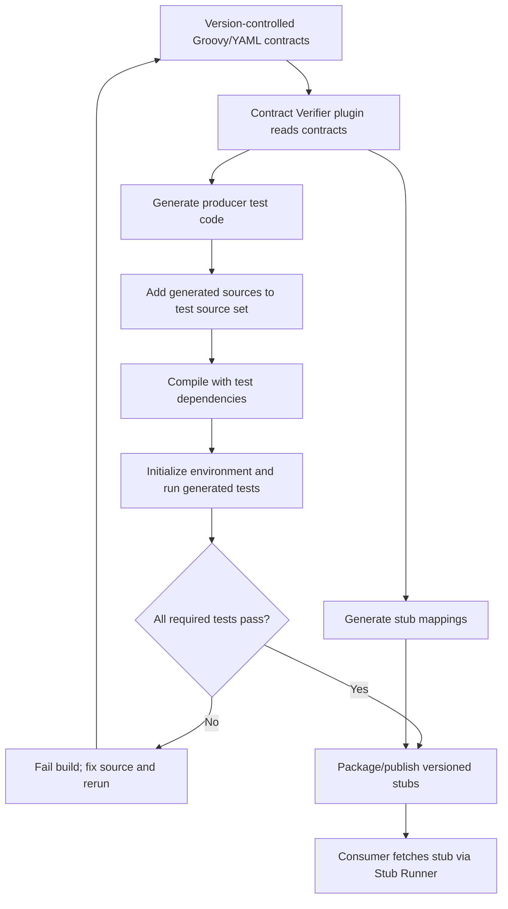
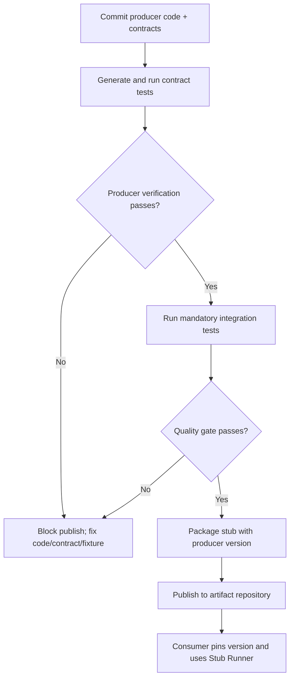

# Managing Generated Code in the Build System

In **Spring Cloud Contract**, Groovy/YAML contracts are more than API documentation. **Contract Verifier** reads contracts and **generates producer-side test code**, allowing the build system to compile and execute those tests against the real application. The same contract source can also produce stubs for consumers to test with **Stub Runner**. If generated code is mismanaged, a pipeline can report success even though zero contract tests ran, or publish stubs describing behavior the producer fails to implement.

This lesson belongs to the **Contract Verifier** chapter of the **SPRING_CLOUD_CONTRACT** module. We focus on how the build system manages inputs, generated code, test results, and stub artifacts; Maven/Gradle integration; troubleshooting failing generated code; and ensuring CI catches breaking API changes. Examples use Spring Boot, HTTP contracts, and Groovy DSL; the same build-management principles apply to YAML DSL or messaging contracts with corresponding setups.

After this lesson, you will be able to:

- Distinguish **source contracts**, **generated tests**, **producer code**, **stub mappings**, and **published artifacts**.
- Explain the order of test-source generation, compilation, test execution, and stub packaging within a build.
- Configure baseline principles for Maven and understand the equivalent setup in Gradle.
- Manage generated source directory locations, Git policies, cleaning, caching, and tool versions.
- Detect situations where a build is green yet generated contract tests never executed.
- Investigate a failing generated test without editing plugin-generated code directly.
- Build a CI gate that allows publishing stubs only when the producer actually complies with contracts.

## 1. Where Does Generated Code Sit in the Contract Testing Picture?

Suppose `OrderService` is the **consumer**, calling `InventoryService` as the **producer** to reserve stock. Both teams agree that `POST /api/v1/reservations` with valid input must return `201` and a `reservationId`.

In Spring Cloud Contract, we manage several classes of assets:

| Asset | Origin | Who Uses It? | Should You Edit Directly? |
| --- | --- | --- | --- |
| Groovy/YAML Contract | Agreed and versioned by development teams | Contract Verifier, reviewers, CI workflow | **Yes**, via review per consumer needs |
| Producer controller/service | Application code implementing the API | Running application, producer contract tests | **Yes**, when updating implementation to meet contracts |
| Generated contract test | Emitted by plugin from contract | Test compiler, JUnit/test runner | **No**; fix the contract, fixtures, or generator config |
| Stub mapping | Generated from contract or packaged per stub config | Stub Runner, WireMock, and consumer tests | Never edit generated files as a source of truth |
| Versioned stub artifact | Packaged and published by build system | Consumer CI, artifact repository | Rebuild from a verified commit; never hand-edit post-release |
| Test reports | Emitted by Maven/Gradle and test runner on execution | Developers, CI, reviewers | Read and archive as evidence; never treat as contract source |

**The source of truth for integration behavior is the mutually agreed contract**, not a Java class generated once in `target` or `build`. The build system must be able to regenerate the exact same test suite deterministically from the same inputs.

## 2. Flow from Source Contracts to Build Results



Distinguish **two paths** in the diagram:

1. **Producer verification path:** contract → generated Java/Groovy tests → compilation → execution against producer → pass/fail results.
2. **Stub path:** contract → stub mappings → artifact packaging → consumer test runs. These are simulations, **not** independent proof that producer code honors the contract.

Never equate "the plugin generated test files" with "tests ran." Generating files, compiling files, and executing files are **three distinct steps**, each capable of failing or being skipped independently.

## 3. Input Example: An HTTP Contract

Suppose the producer project uses a standard Maven layout:

```text
inventory-service/
├── pom.xml
├── src/
│   ├── main/java/...
│   └── test/
│       ├── java/com/example/inventory/ContractVerifierBase.java
│       └── resources/
│           └── contracts/
│               ├── reserve-stock-success.groovy
│               └── reserve-stock-insufficient.groovy
└── target/                          # Build output, generated by the tool
```

Example content at `src/test/resources/contracts/reserve-stock-success.groovy`:

```groovy
import org.springframework.cloud.contract.spec.Contract

Contract.make {
    name 'reserve_stock_success'
    description 'OrderService reserves 2 units before checkout payment'

    request {
        method 'POST'
        url '/api/v1/reservations'
        headers {
            contentType(applicationJson())
        }
        body([
            sku     : 'SKU-001',
            quantity: 2
        ])
    }

    response {
        status 201
        headers {
            contentType(applicationJson())
        }
        body([
            reservationId: 'RES-100',
            status       : 'HELD'
        ])
    }
}
```

This is a hypothetical API for learning; `201`, path names, schemas, and ID formats must be agreed upon by both teams in a real project. In the example, the response ID is hardcoded to illustrate the testing mechanism. When a producer generates dynamic IDs, use suitable matchers or fixtures rather than forcing every run to return `RES-100`.

### What Will the Generated Code Do?

After reading the contract, Verifier generates a test with **equivalent semantics**:

```text
Given: Producer environment has SKU-001 with 2 units available
When:  Send POST /api/v1/reservations
       Body: {"sku":"SKU-001","quantity":2}
Then:  HTTP status = 201
       Content-Type = application/json
       JSON body has reservationId = RES-100 and status = HELD
```

**This is not a verbatim copy of Java code emitted by the plugin.** Class names, imports, helpers, assertion libraries, bootstrapping, and output paths depend on your Spring Cloud Contract version and build configuration.

## 4. Maven: Wiring the Generator into the Build Lifecycle

In a Maven-based producer, `spring-cloud-contract-maven-plugin` usually handles reading contracts and generating tests, while `spring-cloud-starter-contract-verifier` supplies testing libraries. Example configuration snippet to integrate into an existing `pom.xml`:

```xml
<dependencies>
    <dependency>
        <groupId>org.springframework.boot</groupId>
        <artifactId>spring-boot-starter-test</artifactId>
        <scope>test</scope>
    </dependency>
    <dependency>
        <groupId>org.springframework.cloud</groupId>
        <artifactId>spring-cloud-starter-contract-verifier</artifactId>
        <scope>test</scope>
    </dependency>
</dependencies>

<build>
    <plugins>
        <plugin>
            <groupId>org.springframework.cloud</groupId>
            <artifactId>spring-cloud-contract-maven-plugin</artifactId>
            <version>${spring-cloud-contract.version}</version>
            <extensions>true</extensions>
            <configuration>
                <testFramework>JUNIT5</testFramework>
                <testMode>MOCKMVC</testMode>
                <baseClassForTests>
                    com.example.inventory.ContractVerifierBase
                </baseClassForTests>
            </configuration>
        </plugin>
    </plugins>
</build>
```

The XML above is **not a standalone POM**; it must be combined with your project's version management and dependencies. The Spring Cloud Contract version property must be defined in the build and match the Spring Boot/Spring Cloud line in use. Do not pick a version solely because it is "latest" and assume plugin, JUnit, and Java are compatible.

| Setting | Role |
| --- | --- |
| `spring-cloud-contract-maven-plugin` | Runs test/stub generation steps per plugin configuration |
| `spring-cloud-starter-contract-verifier` | Test dependency supplying required producer-side components |
| `testFramework = JUNIT5` | Requests generated tests targeting JUnit 5 |
| `testMode = MOCKMVC` | Tests HTTP through Spring MVC test support without opening a real port |
| `baseClassForTests` | Points to the class preparing Spring context and data for generated tests |
| `extensions = true` | Enables Maven lifecycle integration as supported by the plugin |

With contract sources in the standard `src/test/resources/contracts` location, Maven typically generates test code into an area like `target/generated-test-sources/contracts`. That is an **output directory**, not where contracts are hand-written. Exact location depends on `generatedTestSourcesDir` or plugin version; inspect build logs and project config instead of hardcoding one path across all workflows.

### Relevant Maven Phases

Maven defines lifecycle phases such as `generate-test-sources`, `test-compile`, `test`, `package`, and `verify`. The test-generation plugin must be bound properly to the lifecycle; both the test compiler and runner must see the generated code.

```text
src/test/resources/contracts/*.groovy
              │
              ▼
       generate-test-sources
              │  Generate Java/Groovy tests
              ▼
           test-compile
              │  Compile tests with dependencies
              ▼
              test
              │  Surefire/JUnit executes
              ▼
             verify
              │  Verify build results
              ▼
   (release/publish: separately configured step)
```

A common verification command once **the project is configured**:

```bash
mvn -B -ntp clean verify
```

`clean` removes stale outputs, while `verify` runs through the required phases of the default lifecycle. However, **this command does not guarantee contract tests ran if the plugin is unbound, tests were skipped, or the runner missed generated test classes**. Always inspect logs and test reports afterward.

## 5. Base Class for Generated Tests: Who Prepares the Environment?

Generated tests do not know how to connect to controllers or seed business data unless configured. For a Spring MVC producer using `MOCKMVC` mode, a common pattern is a base class:

```java
package com.example.inventory;

import io.restassured.module.mockmvc.RestAssuredMockMvc;
import org.junit.jupiter.api.BeforeEach;
import org.springframework.beans.factory.annotation.Autowired;
import org.springframework.boot.test.context.SpringBootTest;
import org.springframework.test.context.ActiveProfiles;
import org.springframework.web.context.WebApplicationContext;

@SpringBootTest(webEnvironment = SpringBootTest.WebEnvironment.MOCK)
@ActiveProfiles("contract")
public abstract class ContractVerifierBase {

    @Autowired
    private WebApplicationContext context;

    @BeforeEach
    void setUp() {
        RestAssuredMockMvc.webAppContextSetup(context);
    }
}
```

The base class sits in **`src/test/java` under team maintenance**. It is **handwritten code** and belongs in version control, unlike test files created by the generator in `target`. The sample assumes dependencies supporting RestAssured MockMvc; for WebFlux, messaging contracts, or other test modes, bootstrapping must adapt accordingly.

To test the stock reservation scenario, the base class or related test setup must also supply fixtures:

- `SKU-001` exists with sufficient stock.
- Data before each test is independent of previous tests.
- If the handler calls external services, test doubles are deliberately prepared without mocking away the producer behavior under test.
- If ID `RES-100` is fixed in the sample response, the producer test must produce/return that value deterministically; otherwise, use a response matcher for dynamic IDs.

A very common mistake: tests generate cleanly, yet a missing or mispackaged base class makes **`test-compile` fail**. Another mistake: the base class boots cleanly yet fails to bind RestAssured to the right context, preventing tests from reaching the controller. Never edit generated Java files to patch these issues; fix the **base class or build configuration**.

## 6. Gradle: Same Principles, Different Tasks and Directories

In Gradle projects, Spring Cloud Contract supplies a corresponding plugin to generate contract tests and stubs. Task graph wiring differs from Maven: Gradle uses **task dependencies** and **source sets** rather than Maven phases directly.

An outline of Gradle Groovy DSL configuration:

```groovy
plugins {
    id 'java'
    id 'org.springframework.cloud.contract' version '<compatible-version>'
}

dependencies {
    testImplementation 'org.springframework.boot:spring-boot-starter-test'
    testImplementation 'org.springframework.cloud:spring-cloud-starter-contract-verifier'
}

contracts {
    baseClassForTests = 'com.example.inventory.ContractVerifierBase'
    testFramework = 'JUNIT5'
    testMode = 'MOCKMVC'
}
```

This is a **directional example**; exact plugin option syntax, generated task names, version declarations, and dependency management must be checked against your actual Spring Cloud Contract/Gradle versions. Never copy this template into a Kotlin DSL or Spring WebFlux build and assume it works out of the box.

With Gradle, you can inspect the task list and run the verification chain wired into `check`:

```bash
./gradlew tasks --all
./gradlew clean check
```

On Windows, use `gradlew.bat`. Gradle projects typically emit generated code under a subdirectory of `build`, such as `build/generated-test-sources/contracts`, yet **never assume paths or task names stay immutable** across versions. What must be verified:

1. The test-generation task actually runs when invoking `check` or the corresponding CI task.
2. The task's output is added to the test source set so the compiler sees it.
3. JUnit/test runner executes the generated tests.
4. Test failures fail both the task and the pipeline.
5. Stub generation and artifact publishing tasks are allowed to finish only per agreed release policy.

**Comparing Maven and Gradle:** both must generate tests from source contracts, compile them, run them, and store results; the difference lies in task orchestration mechanisms and naming of tasks/output directories.

## 7. Source and Generated Output Locations in the Repository

A clear policy:

```text
Repository (should commit):
  src/main/...                        # Producer code
  src/test/java/...                   # Base class and handwritten tests
  src/test/resources/contracts/...    # Groovy/YAML source contracts
  pom.xml or build.gradle             # Plugin, dependency, and version config

Build output (usually DO NOT commit):
  target/generated-test-sources/...   # Maven generated tests
  target/...-stubs.jar                # Artifact generated during build
  target/surefire-reports/...         # Maven test reports
  build/generated-test-sources/...    # Gradle generated tests
  build/reports/tests/...             # Gradle test reports
```

Reasons not to commit generated tests routinely:

- **Avoid two sources of truth:** changing a contract without updating committed generated tests leaves two conflicting versions in the repo.
- **Reduce noisy diffs:** a small DSL tweak can produce large Java code diffs with little review value.
- **Reproducibility:** teammates and CI regenerate code using the pinned plugin version instead of relying on files generated on a personal laptop.
- **Avoid drift against newer plugins:** stale generated code may no longer reflect how the current generator compiles or checks contracts.

A standard Git rule ignores build output folders like `target/` and `build/`. This is a **recommended policy**, not a mandatory Spring Cloud Contract rule: some organizations store generated code snapshots for auditing or generator-less environments. If doing so, enforce an automated check proving the snapshot matches fresh regeneration from source contracts and the pinned tool version.

### What Should Still Be Reviewed in Pull Requests

Reviewers need visibility into:

1. Which requests, responses, or matchers changed in **source contracts**.
2. Whether **producer code** implements the promise accurately.
3. Whether **base classes/fixtures** ensure tests run through the right execution path.
4. Whether **build configuration** ensures tests generate, execute, and fail accurately.
5. **Consumer impact:** which changes could break consumers still running older versions.

Generated Java can be read for diagnostics, but that file is not where permanent edits belong.

## 8. How Do You Make Builds Reproducible?

A trustworthy build must be able to take **the same source code and contracts**, regenerate tests, and produce equivalent results—barring explicitly controlled environmental variance.

| Input to Manage | Problem If Unpinned | Mitigation |
| --- | --- | --- |
| Spring Cloud Contract version | Generator emits different code/matchers | Use a compatible, centrally managed version |
| Spring Boot, JDK, JUnit versions | Compilation errors or differing test runner behavior | Align build toolchains locally and in CI |
| Contract revision | Producer and consumer verify different agreements | Pin explicit revisions or artifact versions |
| Fixture data | Test passes on one machine and fails on another | Use deterministic, resettable test data |
| Locale / timezone / clock | Flaky date/time regexes or expiration logic | Fix timezone and clock inside tests |
| External dependencies | External services slow, offline, or returning new data | Isolate dependencies outside contract scope |
| Build cache | Reusing stale output even after contract changes | Declare inputs/outputs properly with sound cache invalidation |

When contracts are pulled from an external repository or artifact, using dynamic versions like `latest` means two builds of the exact same commit can generate tests from **two different contract sets**. For compatibility verification in CI, pin input revisions/versions and bump them through controlled reviews.

### Clean Builds vs. Incremental Builds

When editing contracts, incremental builds run fast via caching. Yet if you suspect the generator missed a new file, run a **clean build** to purge stale output. In release CI or when debugging local-vs-CI discrepancies, a clean build is often an essential diagnostic step.

That does not mean every CI job must disable caching. The requirement is that **caches must track contracts and generator config as inputs**. Never cache a generated-sources folder and copy it blindly back into a build without checking contract inputs.

## 9. Do Not Let "BUILD SUCCESS" Mask Zero Contract Tests

A Maven/Gradle pipeline can succeed without checking any contract, for example:

- Contract files placed in the wrong folder, or plugin `contractsDslDir` points elsewhere.
- Plugin not applied/activated in the producer module.
- Test-generation step not wired into the lifecycle/task graph.
- Test runner filters out generated class names, fails to recognize JUnit 5, or lacks engine dependencies.
- Tests skipped via `skipTests`, `maven.test.skip`, exclude patterns, or a CI task building artifacts without running tests.
- Contracts changed while the generator reused stale cached output.

Therefore, after running a build, **count both generated tests and executed tests**. Inspect both:

| State | Interpretation | Action |
| --- | --- | --- |
| No generated sources despite contracts existing | Generator never ran or missed contracts | Check contract source, plugin, and logs |
| Generated sources exist, yet fail to compile | Source set/compiler missed output or dependency error | Inspect `test-compile` phase/task and dependencies |
| Compiled cleanly, yet 0 tests ran | Misconfigured test discovery or runner | Inspect JUnit/Surefire/Gradle test task and filters |
| Tests ran yet always pass because base class mocks fixed responses | Does not verify producer implementation | Ensure calls pass through real controller/message path |
| Tests ran and fail when implementation diverges | Expected verification signal | Fix producer or negotiate contract change |

### Adding a Generated-File Check Step in CI

In a Maven project using default output paths and generating Java tests, you can add an **illustrative check**:

```bash
mvn -B -ntp clean verify

# Apply only when the project actually generates Java at this path.
test -d target/generated-test-sources/contracts
find target/generated-test-sources/contracts -type f -name '*.java' | grep -q .
```

This command catches an empty folder, yet **does not prove JUnit executed the tests**. Combine it with test reports (typically `target/surefire-reports` for Maven Surefire) and confirm the corresponding generated classes actually ran. When projects customize output paths, generate another language, or use another test runner, adjust check conditions to match reality.

## 10. When a Generated Test Fails, Where Do You Fix It?

Trace a contract test failure along the chain **source contract → generated code → fixture/base class → producer implementation**.

For example, the contract requires `201 Created` while the implementation returns:

```java
return ResponseEntity.ok(reservationResponse);
```

The producer test fails on HTTP status `200` even though the body contains `reservationId`. If both sides agreed on `201`, the right fix is updating the implementation:

```java
return ResponseEntity.status(201).body(reservationResponse);
```

**Do not edit** the `201` assertion to `200` inside the generated test file. The generator will overwrite the file on the next build; more importantly, doing so bypasses a promise the consumer depends on.

Other common cases:

| Failure Symptom | Where to Inspect | Proper Fix |
| --- | --- | --- |
| Generated test not created | Contract path, plugin/task config | Place contract in right source or fix build config |
| Generated test missing imports or fails to compile | Plugin version, JDK, test framework, dependencies | Align versions and dependencies; avoid editing generated code |
| `ClassNotFound` for base class | `baseClassForTests` and Java package | Fix config or handwritten base class |
| Test fails to start Spring context | Test profile, beans, datasource, external dependencies | Fix test fixtures/config |
| Test gets `404` because sample SKU is missing | Business fixtures | Seed SKU stock or update contract if scenario changed |
| Test fails on dynamic ID/timestamp | Contract uses overly strict literal | Use matchers matching consumer guarantees |
| Test fails after changing `409` to `200` | Implementation or business agreement | Review consumer impact; do not tweak contract just for green |
| Test passes yet real app breaks | Contract missing scenarios/assertions or test hits mocks | Expand contracts, inspect execution path, add integration tests |

### Generated Code Is Diagnostic Evidence

Reading generated files helps determine:

- Which requests the test sends and in what order.
- How `consumer/producer` values turned into matchers or literals.
- Which base class the test inherits from.
- Which assertions were emitted from `bodyMatchers`.
- Whether the generator created tests for an unexpected contract.

However, edits belong in **source contracts, plugin config, base tests, fixtures, or producer code**. After fixing, delete stale output or rerun generation and verify the new results.

## 11. Do Not Let Auto-Generated Tests Create Execution-Order Dependencies

Generated tests are typically **independent scenarios**. If one test creates a new reservation and another test assumes that reservation already exists, the pipeline might pass on one machine and fail under parallel or reordered execution.

To prevent this:

1. Create required data in per-test or per-class setup/fixtures with controlled scope.
2. Reset databases, transactions, or test doubles whenever tests mutate state.
3. Use a controlled clock for expiration scenarios.
4. Never share ports, databases, or temp folders when multiple CI jobs run concurrently.
5. When needing to verify a `create → confirm → get` chain, write a **multi-step integration test** passing the ID from one step to the next.

Contract tests verify observable interfaces; they do not substitute for concurrency, transaction, security, persistence durability, or idempotency testing. Build pipelines should schedule those test layers according to risk.

## 12. Stubs Are Also Build Outputs and Must Be Versioned

Spring Cloud Contract can generate stub mappings and package them into an artifact with the `stubs` classifier. Example:

```text
com.example:inventory-service:1.4.0:stubs
artifact: inventory-service-1.4.0-stubs.jar
```

Artifact names here are examples. Exact coordinates and repositories are configured per project, and not every plugin setup uploads artifacts automatically during `verify`.

### Why Bind Stub Artifacts to Verified Builds?

Stubs simulate behaviors described in contracts. If a build produces stubs while **producer tests never ran**, consumers might receive a mock returning `201` while the real producer returns `200`. Consumer tests pass, yet real integration breaks.

The workflow should be:



Never reuse an immutable version tag to overwrite artifact contents repeatedly without a proper snapshot workflow: consumers must be able to trace back **the exact stub tested**. For stable releases, artifact versions and provenance must trace back to the tested commit and verification pipeline.

## 13. Example CI Gate for a Maven Producer

Assuming a project whose `pom.xml` already integrates Verifier and JUnit 5, a basic GitHub Actions job:

```yaml
name: Verify producer contracts

on:
  pull_request:
  push:
    branches: [main]

jobs:
  verify:
    runs-on: ubuntu-latest
    steps:
      - uses: actions/checkout@v4
      - uses: actions/setup-java@v4
        with:
          distribution: temurin
          java-version: '21'
          cache: maven

      - name: Generate, compile and execute tests
        run: mvn -B -ntp clean verify

      - name: Check expected generated test directory
        shell: bash
        run: |
          # Adjust path and format according to actual configuration.
          test -d target/generated-test-sources/contracts
          find target/generated-test-sources/contracts -type f -name '*.java' | grep -q .
```

The job above illustrates **the entry point of a verification gate**, not a complete release pipeline. Checking generated files helps only once you confirm your project's plugin emits Java at that exact path. Also archive and parse JUnit/Surefire reports to ensure generated tests **actually ran**, not merely existed.

In production workflows, you can add:

- A branch protection rule requiring the contract verification job to pass before merge.
- Checks comparing generated test count and names against the expected contract list.
- Supplementary integration/security/concurrency tests beyond contracts when required by business logic.
- Archiving CI test reports and logs for failure traceability.
- A separate artifact/stub publishing job triggered only from commits/versions that passed all required gates.
- Consumer CI fetching **the exact published stub version**, never blindly grabbing a floating `latest`.

**Never embed artifact repository credentials or tokens inside contracts or generated test files.** Publishing credentials belong in CI secrets with least-privilege permissions.

## 14. Tool Upgrade Scenarios Requiring Verification

When upgrading Java, Spring Boot, Spring Cloud Contract, Maven/Gradle, or JUnit, verify both **code generation** and **generated code execution**:

| Change | Risk | What to Do |
| --- | --- | --- |
| Upgrading Spring Cloud Contract plugin | Generated code or matchers may change | Clean build; inspect generated tests and stub mappings |
| Migrating JUnit 4 to JUnit 5 | Test runner may miss tests; base class uses wrong annotations | Align `testFramework`, dependencies, and test runner |
| Upgrading JDK or language level | Compiler/runtime errors in generated classes | Align local and CI toolchains |
| Switching test mode (`MockMvc`/`WebTestClient`/`EXPLICIT`) | Old base class no longer fits | Update bootstrapping and confirm requests hit the right layer |
| Moving contract paths | Generator may miss new files | Check contract source and generated test count |
| Renaming base class or package | Generated tests fail to compile or initialize | Update base class config |
| Changing stub release/version branches | Consumers pull wrong mappings | Pin artifact versions and inspect JAR contents |
| Enabling parallel tests or new caches | Shared-data race conditions, stale outputs | Isolate fixtures and verify task inputs/outputs |

A single green run is insufficient if generated test counts drop unexpectedly after an upgrade. Compare **contract counts**, **generated test counts**, **executed test counts**, and **stub scenarios** before and after upgrading. Never assume test count always equals file count: one file may hold multiple contracts, or class/method generation layout may evolve across versions.

## 15. Debugging Workflow When Builds Are Green Yet Consumers Fail

Suppose `OrderService` calls a stub and receives `reservationId` as expected, yet connecting to real `InventoryService` fails because the producer renamed the field to `holdId`.

Ask in sequence:

1. **Did the source contract actually require `reservationId`?** If not, that is a contract design gap.
2. **Did the generator read that contract?** Inspect logs, output directory, and generated test list.
3. **Did the generated test execute?** Check Surefire/Gradle reports for filters or skips.
4. **Did the test pass through the real producer at the right layer?** Ensure the base class does not fabricate a perpetually matching mock response.
5. **Which stub version did the consumer use?** They may be testing against an older artifact that does not reflect the producer's recent release.
6. **Did the API change break behavior outside contract scope?** Add scenarios and appropriate tests if needed.

These questions distinguish two very different root causes: **the pipeline failed to enforce an existing promise**, or **the promise failed to cover what the consumer truly needed**. Both must be fixed at the source, never by editing generated tests by hand.

## 16. Common Pitfalls and How to Prevent Them

| Pitfall | Consequence | Mitigation |
| --- | --- | --- |
| Committing generated tests as a second source of truth | Generated tests and contracts can drift apart | Commit DSL and base/fixture code; generate tests during builds |
| Editing generated Java when tests fail | Edits vanish on next generation | Fix contract, fixtures, or implementation |
| Running only generation and declaring pass | Tests were neither compiled nor executed | Run full test tasks/phases and inspect reports |
| Plugin skipped while build stays green | Zero contract protection | Check generated test count and executed test count |
| Test classes missed by test runner | Zero contract tests despite sources existing | Check JUnit, Surefire/Gradle includes/excludes |
| Caching generated code without contract inputs | Stale tests run after DSL edits | Declare inputs/outputs properly; run clean builds to verify |
| Base class mocks entire responses | Tests bypass producer implementation | Mock only out-of-scope dependencies; keep tested flow intact |
| Fixtures rely on shared environment data | Flaky CI failures | Use isolated, resettable test data |
| Upgrading plugin without checking test counts | Tests silently vanish or matchers shift | Compare sources, outputs, reports, and stubs |
| Publishing stubs despite failed/skipped producer tests | Consumers test against an unverified promise | Block publishing if verification fails |
| Consumers always pulling `latest` stubs | CI failures hard to reproduce | Pin versions and manage upgrade schedules |
| Loosening matchers excessively "to make tests green" | Regressions slip through unnoticed | Assert exact properties consumers rely on |

## 17. Checklist for Managing Generated Sources in Builds

- [ ] Groovy/YAML source contracts live in the repository or a versioned source with an explicit revision.
- [ ] Spring Cloud Contract Verifier plugin version matches Spring Boot, JDK, and build tool.
- [ ] Generation step is bound into the lifecycle/task graph executed by CI.
- [ ] Generated tests enter the right test source set and compile cleanly.
- [ ] JUnit/test runner executes generated tests; CI never skips them.
- [ ] Checks catch **0 generated tests** or unexpected drops in test count.
- [ ] Base classes and fixtures reside in version-controlled test code, never in generated output.
- [ ] Tests invoke real producer controllers or messaging paths instead of faking contract-matching responses.
- [ ] Generated outputs and test reports are managed as build artifacts, never treated as source of truth.
- [ ] Caches invalidate cleanly whenever contracts, plugins, or configuration change.
- [ ] Local and CI runs use consistent tools, dependencies, timezones, and test data.
- [ ] On test failure, fix DSL/fixtures/implementation/config and regenerate rather than editing generated files.
- [ ] Stub artifacts are packaged from verified builds with traceable version coordinates.
- [ ] Consumer tests fetch the exact stub version via Stub Runner.
- [ ] Business tests beyond contract scope still run when required by the system.

### Hands-On Exercise

You maintain the `InventoryService` producer exposing a stock-reservation endpoint for `OrderService`. The team already has `reserve-stock-success.groovy` in `src/test/resources/contracts`, and the controller returns `201` with `reservationId`.

Complete the following steps:

1. Diagram the flow from source contract → generated tests → test compilation → test execution → stub artifact.
2. In a Spring Boot Maven project, integrate the Contract Verifier plugin, test dependencies, and a `ContractVerifierBase` running the controller via MockMvc.
3. Prepare fixtures for `SKU-001`. Run `mvn -B -ntp clean verify` and verify how many test classes were generated and which tests executed.
4. Locate **your project's** generated output directory. Explain why generated tests inside that directory should not be edited or committed.
5. Intentionally change the controller to return `200` instead of `201`. Observe the generated test fail, then fix the **implementation** without changing assertions in the generated test.
6. Delete or rename the contract path in build config to trigger a 0-generated-tests scenario. Design a CI gate that catches this even when the rest of the build succeeds.
7. Rename the response field from `reservationId` to `holdId`. Determine whether this is a compatible change based on `OrderService`'s needs and apply the fix at the right place once both teams agree.
8. Re-run a clean build after updating matchers/fixtures; inspect newly generated tests and matching reports.
9. Package stubs from the verified build; use Stub Runner in consumer tests with explicit versioned artifact coordinates.
10. Compare the Maven workflow with a Gradle project: identify corresponding tasks/source sets and how to confirm generated tests actually execute.

**Completion criteria:** you can distinguish **which files the team writes, which files the plugin generates, what the test runner executes, and which step is permitted to publish stubs**, and prove the pipeline goes beyond "generating code" to genuinely verifying the producer against consumer-approved contracts.

## References

- [Spring Cloud Contract — Reference](https://docs.spring.io/spring-cloud-contract/reference/): guide to Contract Verifier, build plugins, producer tests, and stub artifacts.
- [Spring Cloud Contract — Maven Project](https://docs.spring.io/spring-cloud-contract/reference/using.html): reference for setting up producer projects and plugins; select documentation matching your running version.
- [Maven — Introduction to the Build Lifecycle](https://maven.apache.org/guides/introduction/introduction-to-the-lifecycle.html): relationship among `generate-test-sources`, `test-compile`, `test`, and `verify` phases.
- [Gradle — Java Plugin](https://docs.gradle.org/current/userguide/java_plugin.html): test source sets, build/test tasks, and task wiring.
