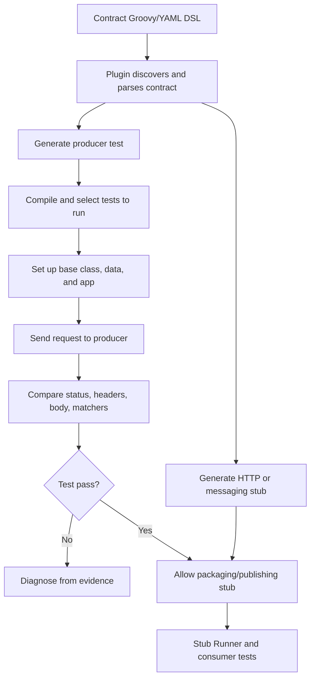
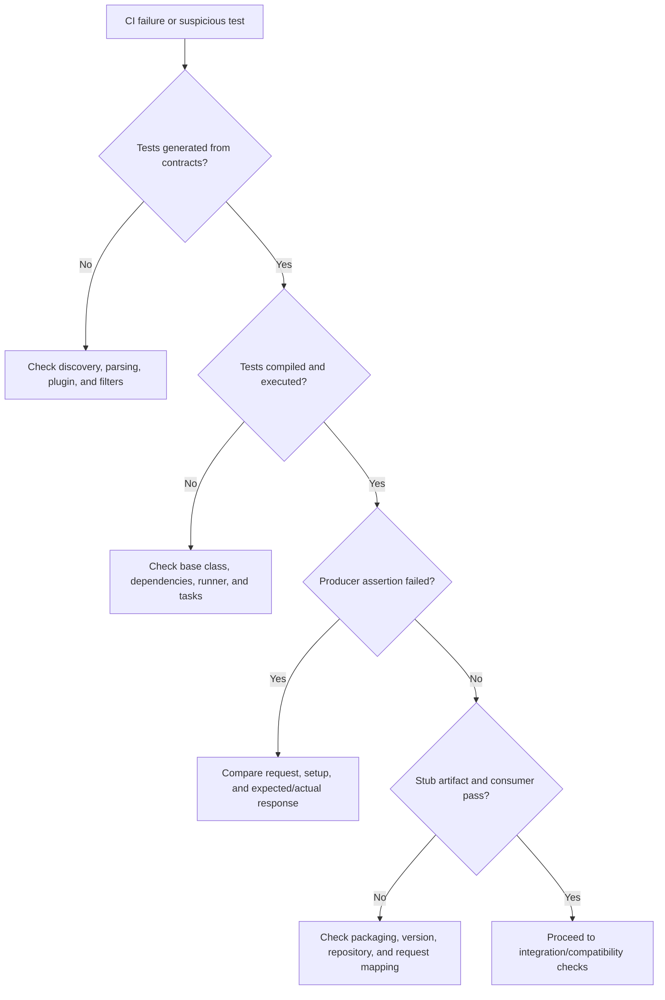

# Tracing Failures from Source Contract to Test Results

## 1. Where Does a Contract Verifier Failure Actually Occur?

In **Spring Cloud Contract**, the producer and consumer agree on HTTP or messaging behavior using **Groovy/YAML DSL**. From the contract, **Contract Verifier** generates **producer**-side tests to check the promise against the real implementation. The same contract source can also produce stubs for consumers to use with **Stub Runner**; CI ties these steps together to catch incompatible API changes early.

A `BUILD FAILURE` message alone is not enough to conclude the producer broke the contract. Failures can happen before a single request is ever sent:

- Contract files were not discovered due to paths or filters.
- Groovy/YAML DSL failed to parse or is structurally invalid.
- Test generation encountered an unsupported matcher or value.
- Generated tests failed to compile or run due to missing base classes, dependencies, or JUnit/test framework issues.
- Tests ran, yet test data, security, controller routing, HTTP status, or JSON response failed to match the contract.
- Producer tests passed, yet stub packaging, artifact distribution, or consumer tests failed.

To investigate properly, trace **from source contract to generated artifacts, then to execution results**. Modifying a producer response before knowing whether generated tests even ran can break the API just to mask a configuration mistake.

**Lesson goal:** trace a scenario from DSL to generated tests and test reports; distinguish contract errors, test infrastructure errors, implementation bugs, and stub issues; collect evidence to fix root causes accurately; and establish reliable CI quality gates.

## 2. Investigation Map: Every Step Has Its Evidence



| Observation Point | Evidence to Look For | If Missing, Suspect |
| --- | --- | --- |
| **Contract source** | Exact `.groovy`/`.yml` file, request/response/matchers | Wrong file, wrong semantics, or file outside build scope |
| **Discover/parse** | Plugin logs showing contract was read | Wrong directory, include/exclude, extension, syntax |
| **Generate** | Generated tests and mappings/stubs appear | Invalid DSL or plugin/task never executed |
| **Compile** | Generated tests compile; class/base class resolve | Missing dependency, wrong package, version, Java/JUnit |
| **Execute** | Report lists **executed test count** and test names | Test task not invoked, skipped, wrong filter |
| **Assertion** | Expected/actual, request, response, stack trace with failure line | Wrong implementation, setup, data, matchers, or test mode |
| **Artifact** | Stubs JAR holds mappings for the exact contract/version | Packaging/publishing diverged from producer verification |
| **Consumer** | Stub Runner downloads right artifact and client calls right port | Wrong version, coordinates, repository, request match |

**A green build with 0 contract tests does not mean the API satisfies the contract.** Conversely, green consumer tests against an old stub do not prove the current producer still honors the contract. Each column above must be verified independently during an incident.

## 3. Running Example: One Contract and One Breaking Change

Suppose `order-service` exposes an order-lookup endpoint. Consumer `checkout-service` depends on `orderId` and `status`. Source file at:

```text
src/test/resources/contracts/orders/get-confirmed-order.groovy
```

Content:

```groovy
import org.springframework.cloud.contract.spec.Contract

Contract.make {
    description 'Look up a confirmed order'

    request {
        method GET()
        url '/api/orders/42'
        headers {
            accept(applicationJson())
        }
    }

    response {
        status OK()
        headers {
            contentType(applicationJson())
        }
        body([
            orderId: 42,
            status : 'CONFIRMED'
        ])
    }
}
```

The **observable promises** of this scenario are:

| Aspect | Contract Expectation |
| --- | --- |
| Method + path | `GET /api/orders/42` |
| Request header | `Accept: application/json` |
| HTTP response | `200 OK` |
| Response header | `Content-Type: application/json` |
| JSON field | Numeric `orderId`, e.g. `42` |
| JSON field | String `status` equal to `CONFIRMED` |

Suppose a commit modified a DTO/serializer so the producer now returns:

```http
HTTP/1.1 200 OK
Content-Type: application/json

{"orderId":42,"state":"CONFIRMED"}
```

The producer still returns HTTP `200` yet **renamed `status` to `state`**. This is likely a breaking change because existing consumers still read `status`. If Contract Verifier executes the original scenario cleanly, the generated test must detect the body mismatch. If the test still passes, investigate whether the test was generated/executed or whether assertions check `status` as expected—do not rush to conclude "SCC missed a bug."

### Tracing Back from a Failure

```text
Source:
  contracts/orders/get-confirmed-order.groovy
          ↓
Contract Verifier generates test:
  test for GET /api/orders/42
          ↓
Setup:
  base class runs controller/HTTP and seeds order 42
          ↓
Actual request:
  GET /api/orders/42, Accept: application/json
          ↓
Actual:
  {"orderId":42,"state":"CONFIRMED"}
          ↓
Expected:
  body has orderId=42 and status="CONFIRMED"
          ↓
Conclusion:
  producer response differs from promised contract
```

Generated source paths, class names, and assertion syntax depend on the plugin/build tool. The diagram shows an **evidence chain**, not a guarantee of verbatim generated filenames.

## 4. Classifying Errors Before Editing Code

| Error Group | Common Symptoms | First Investigation Step |
| --- | --- | --- |
| **Contract discovery** | No generated tests for new file | Check source root, include/exclude, plugin config, and logs |
| **DSL syntax/parse** | Groovy/YAML parser reports line, indentation, or property error | Read the exact source file; check syntax against active DSL version |
| **Generation** | Plugin fails to generate test/stub or unsupported matcher | Identify offending construct/field; check plugin version |
| **Compilation** | `cannot find symbol`, missing base class, imports, or dependencies | Check generated sources, packages, JDK, test framework |
| **Test setup** | Failed to load Spring context, DB, beans, or port | Check base class, test mode, fixtures, and environment |
| **Request mismatch** | Producer gets `404`/`405`/`415` instead of expected status | Compare method/path/query/headers/body actually sent by test |
| **Response mismatch** | Fails on `statusCode`, `Content-Type`, JSONPath, or matcher | Compare expected/actual and real response logs |
| **Flaky** | Passes locally, fails in CI; passes individually, fails in suite | Check shared state, clock, data, ports, execution order |
| **Stub/consumer** | Producer tests pass, yet Stub Runner serves wrong response | Check artifact version, mappings, request matching, and repo |

Never fix stub distribution errors by altering the producer contract, and never use `@Disabled` or skip tests to turn CI green without understanding the cause. Every error belongs to a specific layer and requires matching evidence.

## 5. First Step: Create a Reproducible Run

Before reading hundreds of log lines, record the context:

1. **Commit/branch** containing the contract and producer code under test.
2. **Versions** of JDK, Spring Boot, Spring Cloud, Spring Cloud Contract, and build plugins.
3. **Contract path** and format (Groovy or YAML).
4. **Build command** used and which task actually executes generated tests.
5. **Failing test name** and the shortest message showing expected vs. actual difference.
6. **Test data and environment:** mocked controller or real HTTP server, in-memory DB/test container, security filters, port, and active profile.

With Maven in a project configured with `spring-cloud-contract-maven-plugin`, rerun the exact lifecycle used by CI:

```bash
# Linux/macOS: prefer the Maven Wrapper committed with the project
./mvnw -B clean verify

# When more detail is needed on plugin/dependency path errors:
./mvnw -B -e clean verify
```

On Windows, use `mvnw.cmd`. `-e` prints stack traces when Maven errors occur; enable broader debug logging only when needed because it produces huge output and may expose sensitive data.

With Gradle, check the tasks registered by your Contract Verifier plugin version:

```bash
./gradlew tasks --all
./gradlew clean check --stacktrace
```

Test/stub generation tasks and whether they hook into `check` or `build` depend on plugin version and project config. **Do not treat `check` as proof contract tests ran** without checking the task graph and reports. In multi-project builds, target the exact producer module rather than a consumer or aggregate module.

### Do Not Overlook Test Counts

After the build, record:

```text
Discovered contracts: <number verified from logs/output>
Generated contract tests: <number of classes/methods or scenarios>
Executed contract tests: <number actually executed>
Failures: <count>
Skipped: <count>
```

This is a fill-in template for investigation, not a mandatory plugin log format. If a producer has ten committed contracts yet executed contract tests equal 0, treat that as a **loss of test coverage**, even if the build succeeded. Conversely, DSL file count need not equal test method count because one file can define multiple scenarios.

## 6. Tracing Source DSL Files: Path, Request, Response, and Matchers

Open the exact contract cited in the failure or matched by the failing request. For `get-confirmed-order.groovy` in section 3, write a short table:

| Source Condition | Required Value or Matcher | Side Checked |
| --- | --- | --- |
| Request `method` | `GET` | Input sent by generated producer test |
| Request `url` | `/api/orders/42` | Input sent by generated producer test |
| Request `Accept` | `application/json` | Input sent by generated producer test |
| Response `status` | `200` | Real producer response must satisfy |
| Response `Content-Type` | `application/json` | Real producer response must satisfy |
| Response `$.orderId` | `42` per sample contract | Generated assertion |
| Response `$.status` | `CONFIRMED` | Generated assertion |

If the developer who changed the code insists `state` is now right, inspect the **API versioning agreement**: the contract may deliberately protect existing consumers. Do not rewrite the DSL to match the new DTO merely to make tests pass. If the contract is genuinely obsolete after a consumer-approved migration, update the contract under review, update consumers and stubs, and test both sides.

### When Source Uses YAML DSL

An equivalent YAML:

```yaml
description: Look up a confirmed order
request:
  method: GET
  url: /api/orders/42
  headers:
    Accept: application/json
response:
  status: 200
  headers:
    Content-Type: application/json
  body:
    orderId: 42
    status: "CONFIRMED"
```

When diagnosing YAML, watch **indentation, quotes, null, and scalar types**. `orderId: 42` differs from `orderId: "42"`; if changed to a string, a producer could return the digits "42" while still breaking JSON schema expectations. Likewise, `status: "CONFIRMED"` inside `body` differs from `response.status: 200` at the HTTP level. Keep each property at its proper nesting level.

### Matchers and Dynamic Values

In Groovy DSL, a dynamic response can use:

```groovy
response {
    status OK()
    headers {
        contentType(applicationJson())
    }
    body([
        orderId: 42,
        status : 'CONFIRMED',
        requestId: $(consumer('req-demo-123'),
                     producer(regex('req-[A-Za-z0-9-]+')))
    ])
}
```

In a **response**, `consumer('req-demo-123')` is the sample value stubs can return, while `producer(regex(...))` is the condition generated producer tests enforce against the real response. If the test demands `requestId` literally equal `req-demo-123`, check whether the matcher was generated and applied properly or accidentally turned into exact equality during a DSL edit.

In a **request**, roles flip according to testing mechanics: the `producer` side supplies sample data for generated tests to send, while the `consumer` side typically supplies the matcher stubs use to accept requests. Thus matcher mistakes can either cause **wrong requests to be sent** or **valid responses to be rejected by tests**. Never invert `consumer(...)` and `producer(...)` while debugging.

## 7. Inspecting Contract Discovery and Test Generation

If source contracts exist yet zero tests appear:

1. Confirm files sit in the exact **source root** used by the plugin, typically `src/test/resources/contracts` unless configured otherwise.
2. Check file extensions (`.groovy`, `.yml`/`.yaml` per config and supported version).
3. Inspect **include/exclude filters**; a wrong pattern can wipe contracts out of the input set.
4. Confirm the plugin is declared in the right **producer module** and test-generation goals/tasks actually ran.
5. Read parser or generation messages, distinguishing "no files discovered" from "discovered yet failed to convert DSL."

For example, a contract tree has an `orders/` folder while includes select only `payments/**`. The result can be 0 order tests with zero parser errors. Editing JSON responses in the application will never fix that omission.

### Valid Syntax Does Not Guarantee Right Semantics

Typical cases:

| Case | Error Type | Resolution |
| --- | --- | --- |
| YAML `response` indented beneath `request` | Structural / parse or validate | Fix indentation, inspect error line |
| Groovy uses a helper absent in current version | DSL compilation/evaluation | Check DSL API and plugin version |
| Sample JSON body puts numbers in quotes | Wrong contract type yet parseable | Clarify schema used by consumers |
| `response.matchers` declared under `request` | Wrong matcher side | Compare generated assertions and stub mappings |
| Regex escaped wrongly between Groovy/YAML | Matcher differs from intent | Compare pattern in generated test and mapping |
| Duplicate Groovy and YAML files for one request | Duplicate/conflicting scenario | Maintain one canonical source per scenario |

**Rule:** if generation fails, fix the contract or plugin configuration. If generation succeeds yet assertions fail to protect key behavior, fix the DSL intent and re-verify. Generated code is **temporary output**, not a place for lasting fixes.

## 8. Opening Generated Tests to Find Discrepancies

Once tests are generated, open **the exact class/method corresponding to the contract**. With Maven, generated sources usually reside in `target/`; with Gradle, in `build/`. **Exact directory names, packages, methods, and test frameworks vary by plugin version and test mode**; rely on build logs rather than guessing a hardcoded path.

The generated test for section 3's example carries **semantics equivalent** to the pseudocode below:

```java
// PSEUDOCODE: not guaranteed verbatim Verifier output.
given()
    .header("Accept", "application/json")
.when()
    .get("/api/orders/42")
.then()
    .statusCode(200)
    .body("orderId", equalTo(42))
    .body("status", equalTo("CONFIRMED"));
```

Read generated test code to answer:

- Does it send **the contract's exact method, URL, query, headers, and body**?
- Does it extend the declared **test base class**?
- Do assertions check HTTP status, `Content-Type`, and **required JSONPaths**?
- Is a dynamic field matched by regex/type, or compared against a literal sample?
- Does the test genuinely hit the producer's controller/HTTP layer, or is the environment over-mocked?

When an assertion fails, read **the exact JSONPath** and expected/actual values. For instance, an error saying `$.status` does not exist differs from `$.status` having value `PENDING` instead of `CONFIRMED`. The first suggests a renamed or missing field; the second suggests wrong data state or business logic.

### Never Edit Auto-Generated Files

If you edit a generated test directly, the next build run will overwrite your changes. The proper place to fix is typically:

- Contract DSL, if agreed requirements changed.
- Plugin/DSL parser config, if tests were generated with the wrong scope.
- Test base class/setup, if requests miss the producer or fixtures are wrong.
- Producer code, if the implementation violates the contract.

When complex assertions beyond DSL are needed, add dedicated producer tests to check business invariants instead of editing generated code in `target/` or `build/`.

## 9. Checking the Base Class and Producer Test Environment

Generated tests can verify the producer only if they **execute in an environment that serves requests properly**. A valid contract can fail because no app booted, the port was wrong, or test data was missing.

### 9.1. What Does the Base Class Do?

In a Spring Boot project, a test base class typically handles:

- Booting the application context/controllers under test.
- Configuring MockMvc/Rest Assured MockMvc or real HTTP per test mode.
- Setting up authentication/headers when contracts require security flows.
- Preparing test databases or deterministic dependency mocks.
- Cleaning state between scenarios so tests remain isolated and reproducible.

A **skeleton model** example, not a class you can paste into every project:

```java
// Illustrates base class responsibilities, not a complete template.
@SpringBootTest
class ContractTestBase {

    @BeforeEach
    void prepareOrder42() {
        // Seed order 42 with status CONFIRMED in test database
        // or configure mock service per contract.
    }
}
```

In real code, add the right imports/annotations, inject data/services, and wire MockMvc/Rest Assured the way plugin-generated tests expect. Selecting MockMvc test mode with only `@SpringBootTest` may still omit request specification wiring; selecting HTTP mode needs a running server and matching base URI/port. **Do not treat the skeleton above as a complete base class.**

### 9.2. Setup Symptoms and How to Distinguish Them

| Symptom | High Probability Cause | Evidence to Inspect |
| --- | --- | --- |
| `ClassNotFoundException` / base class not found | Wrong `baseClassForTests` or package | Class name and path in generated test |
| `ApplicationContext` fails to start | Missing bean, wrong test config, DB unreachable | Root cause in Spring stack trace |
| `Connection refused` | HTTP server not running / wrong port | Base URI, port, server lifecycle |
| `404 Not Found` when contract expects `200` | Wrong route, controller unloaded, or data 42 missing | Actual request, handler mappings, DB seed |
| `401/403` instead of `200` | Security filter / invalid credentials | Auth headers, security profiles, filter chain |
| `500` | Exception in controller/service, dependency, DB | Server stack trace and request ID |
| Passes locally yet fails in CI | Different DB/locale/timezone/profile, order-dependent test | Compare environments and input data |

For example: `GET /api/orders/42` returning `404` does not automatically mean the producer changed its API to an error status. If the **test fixture** failed to seed order 42, `404` may be completely valid business behavior for **missing data**, yet wrong for the contract scenario's preconditions. Make test data reproducible before concluding the API code is broken.

### 9.3. Do Not Mock Away the Behavior Under Verification

If testing a contract for `POST /api/payments` while the base class mocks the controller itself to always return a canned response, tests can pass even when the real controller and validation logic are broken. Mocking internal dependencies can be reasonable for web-layer contract tests, provided you understand **the verification boundary**: real responses from the controller must still run, while DB/payment-gateway invariants need separate integration tests.

## 10. Investigating Assertion Failures by Protocol Layer

Once generated tests **actually ran**, read the failure message and identify the first failing assertion. Never rely on the final summary line "There are test failures" to guess the cause.

### 10.1. HTTP Status

Suppose the contract expects `200` yet actual is `404`:

```text
Expected: HTTP 200
Actual:   HTTP 404
Request:  GET /api/orders/42
```

Check in order: is the endpoint registered; are request path/query right; does record 42 exist; did security intercept the call; did an exception mapper turn an internal error into `404`? **Never change the contract to `404`** just to pass if consumers were promised `200` for seeded data.

### 10.2. Headers and Content-Type

If the body is JSON yet the response header is `text/plain`, HTTP clients may fail to deserialize. Check:

- Does the controller declare `produces = application/json` or equivalent serialization?
- Which `Accept` header did the generated test send?
- Did a gateway/filter or error handler return HTML/JSON outside the expected flow?
- Does the `Content-Type` matcher account for charset parameters as expected by the API?

Avoid over-constraining unrelated headers (such as per-request trace IDs) merely to mirror a snapshot. Constrain headers consumers depend on, and match dynamic values with appropriate rules.

### 10.3. JSON Body and JSONPath

In the `status`-to-`state` example, here is the body expected by the contract:

```json
{"orderId":42,"status":"CONFIRMED"}
```

```json
{"orderId":42,"state":"CONFIRMED"}
```

The discrepancy to look for is **the missing `status` key** in the response, not a JSON parser error since both are valid JSON. Check data types too: `orderId: 42` (number) differs from `orderId: "42"` (string), even if both look similar in unformatted logs.

If a response contains an `items` array, distinguish matchers counting **elements** from matchers checking only **an array node**. A generated assertion checking `$.items[0].status` does not prove every element is valid. Assertion failures can expose an overly loose or overly tight contract, not just producer code.

### 10.4. Dynamic Values and Two-Sided Matchers

Fields like `requestId`, `createdAt`, or newly generated IDs can vary. In a **response**:

- Stubs can return the `consumer`-side sample value.
- Generated producer tests use the `producer`-side matcher to accept any valid value.

If a test fails because a timestamp differs from a literal sample, check whether the DSL used **unintended exact equality**. If a test passes with a malformed `requestId`, check whether the matcher is too loose or placed on the wrong path/side.

In a **request**, the `producer` side normally supplies sample data for generated tests to send, while the `consumer` matcher applies when stubs match incoming client requests. If those sides are inverted, generated requests may no longer represent valid inputs.

### 10.5. Language, Encoding, and Time

A test failing only in CI can stem from:

- Date/time formats depending on the JVM timezone.
- Commas, periods, or month names depending on locale.
- Non-ASCII strings read under a different character encoding.
- Clock/time-dependent values causing exact equality assertions to drift over time.

Typical solutions include fixed timestamps in fixtures, explicit timezone normalization when promised by the contract, or format/type matchers instead of comparing against the current wall-clock time. **Never turn every assertion into regex `.*`**, as that hides real business discrepancies.

## 11. Tracing Failures from Real Requests: Look Beyond the Response

Contract Verifier builds requests from the DSL's `request` block. If the request is wrong, a failing response is a **downstream symptom**. Cross-check three sources:

1. **Source contract:** method, path, query, headers, body, and example values.
2. **Generated test:** the request specification the test code actually builds.
3. **Producer logs/traces:** the request the application actually received and which handler processed it.

A diagnostic table often helps:

| Failure Source | Expected Request | Actual Request | Consequence |
| --- | --- | --- | --- |
| Wrong path | `/api/orders/42` | `/orders/42` | `404` before reaching controller |
| Wrong method | `GET` | `POST` | `404/405` depending on routing |
| Wrong query | `?status=CONFIRMED` | `?status=PENDING` | Producer returns data differing from contract |
| Missing `Content-Type` | `application/json` | Absent or `text/plain` | `415`/binding error |
| Missing `Accept` | `application/json` | `text/html` | Different response media type |
| Wrong test data | `orderId=42` seeded | Empty DB | `404` |
| Missing auth | Valid test credentials | No token/cookie | `401/403` |

Note: not every mismatch yields the same HTTP status. `404`, `405`, or `415` depend on routing, content negotiation, handlers, and app configuration. Read logs and actual responses instead of guessing from status code alone.

### Do Not Log Sensitive Data While Debugging

When capturing requests/responses, **redact tokens, cookies, passwords, and personal data**. Keep paths, status codes, header names, JSON schemas, test names, anonymized request IDs, or safe correlation IDs. Never upload production logs containing secrets to public CI artifacts.

## 12. Producer Tests Green, Consumer Still Fails: Follow the Stub Branch

If producer contract tests pass yet the consumer calling Stub Runner gets `404` or a wrong response, **do not immediately blame Contract Verifier**. Trace the stub distribution chain:

```text
Contract DSL on producer
    ├── Generated producer tests -> verifies implementation
    └── Generated mappings/response files
             -> versioned stubs JAR
             -> Maven local or artifact repository
             -> Stub Runner downloads exact coordinates
             -> WireMock receives consumer request
             -> consumer assertions
```

### Evidence to Cross-Check

| Step | Question |
| --- | --- |
| Stub generation | Does a mapping match `GET /api/orders/42`? |
| Packaging | Are mappings and body files inside `*-stubs.jar`? |
| Version | Was the stubs JAR built from the exact verified commit/contract? |
| Repository | Can the artifact be fetched under configured `LOCAL`/`REMOTE` mode? |
| Stub Runner | Does `ids` specify the right group, artifact, version, classifier, and port? |
| WireMock | Does the client's request match the mapping's method/path/query/headers/body? |
| Consumer | Does the client target the right base URL/port and deserialize the response properly? |

Example consumer configuration using Stub Runner:

```java
import org.springframework.cloud.contract.stubrunner.StubRunnerProperties;
import org.springframework.cloud.contract.stubrunner.spring.AutoConfigureStubRunner;

@AutoConfigureStubRunner(
    ids = "com.example:order-service:1.2.0:stubs:9090",
    stubsMode = StubRunnerProperties.StubsMode.LOCAL
)
class OrderClientContractTest {
    // The application client must actually point to stub port 9090.
    // Add consumer tests and assertions.
}
```

This is only a **configuration skeleton**, not a full test class. `LOCAL` requires the artifact in local Maven; running on separate CI machines may require `REMOTE` with the right repository. If fixed port `9090` is occupied, pick another port or use dynamic port allocation and pass the actual port to the client.

You can use JDK tools to inspect downloaded or locally built artifacts:

```bash
jar tf order-service-1.2.0-stubs.jar
```

Never guess mapping filenames inside the JAR: layout depends on plugin/version and packaging. Inspect **loaded request matchers and responses**, not merely whether some file exists.

### Distinguishing Two Kinds of HTTP 404

- **Contract-defined 404:** WireMock matched a mapping and returned HTTP `404` with a business error code like `ORDER_NOT_FOUND`.
- **Unmatched-mapping 404:** WireMock found no matching stub; the client may still get HTTP `404`, yet bodies/headers differ from the contract.

If a consumer test asserts only `status = 404`, it can **pass falsely** due to an unmatched mapping. Check `Content-Type`, `code`, or promised payload fields as well to tell them apart.

### Stub Failures Do Not Mean Producer Tests Never Passed

Producer tests and consumer tests have different **scopes**. A producer may conform to one contract while consumer CI is still fetching an older stub version. Or the producer is right, yet the consumer sends headers failing to match the mapping. Tracing by artifact/version pinpoints the exact diverging step.

## 13. Messaging Contract Failures: Check Triggers, Destinations, and Payloads

Spring Cloud Contract also supports **messaging contract testing**. An HTTP-only diagnostic checklist cannot explain all messaging errors. Contracts can describe input/output messages, headers, destinations, and triggers; generated producer tests use checks tailored to the configured messaging technology.

If a messaging producer test fails, trace:

1. **Contract DSL:** do input/output, triggers, destinations, headers, and body match consumer needs?
2. **Generated test:** which trigger method does it call, and where does it listen for messages?
3. **Test infrastructure:** are binders, mock/real brokers, topics/queues, serialization, and consumer groups wired properly?
4. **Actual event:** was an event emitted, sent to the right destination, with expected headers/content type/schema?
5. **Assertions:** did it fail from no message, wrong metadata, or payload mismatching matchers?

For example, the consumer expects `OrderConfirmed` on destination `orders.confirmed` while the real producer publishes to `orders.created`. The JSON body might match the contract byte for byte, yet the messaging flow remains **incompatible**. Conversely, a "no message received" timeout might stem from an unready broker, unregistered listener, or missing trigger—not necessarily a domain event schema change.

| Symptom | Possibilities to Check |
| --- | --- |
| No message received | Trigger not invoked, wrong destination, listener/binder unready |
| Message arrived, matcher failed | Wrong header, event type, schema, value, or type |
| Test flakes with execution order | Leftover data on queue/topic, shared consumer group, retries/delays |
| Consumer stub test passes, producer emits no real event | Stub events are simulations; producer tests/broker integration still required |

Never treat a WireMock HTTP mapping as proof that a messaging contract ran. Verifying messages, brokers, and eventual consistency requires the test modes and infrastructure appropriate for your project.

## 14. Investigating CI Failures: Collect Full Evidence, Not Just the Tail Log

A solid pipeline lets you trace from a **failed test** back to the **source contract**, then determine whether the change is in producer code or build config. Every CI failure should retain:

- **Commit hashes** of producer, contract, and stub artifacts if stored in separate repositories.
- Contract name, generated test/method name, test reports, and executed/skipped counts.
- Versions of Spring Boot, Spring Cloud Contract, JDK, build wrapper, and relevant dependencies.
- **Redacted** request and response: status, critical headers, JSON schema/fields, expected/actual.
- **Root-cause** stack trace; Spring context, DB, or broker setup logs if failure occurred before assertions.
- Published/downloaded artifacts: `group:artifact:version:stubs` and source repository.

### Two Quality Gates That Must Never Be Bypassed

**Producer gate:** generated contract tests must **actually run** and pass before a stubs JAR for that revision counts as verified. If tests fail, never publish that stub as a reliable release version.

**Consumer gate:** consumer tests must use the exact agreed stubs artifact/version and send requests through the real client. If consumer tests fail, determine whether the stub failed to load, requests failed to match, or the consumer mishandled responses.

A decision flowchart:



### When a Test Is Flaky

Failures occurring only in CI or when running the full suite usually involve shared state:

- Test DB records not cleaned up, sample IDs lingering from earlier tests.
- Fixed ports colliding when multiple jobs or tests run concurrently.
- Shared WireMock scenario state or request journals left unreset.
- Timestamps generated from current wall-clock time and compared by exact equality.
- Message brokers retaining old events; asynchronous timing/ordering shifting.
- Different locale/timezone, JDK, or dependencies altering serialization.

Diagnose by rerunning **the exact failing test** with the same fixtures, then running the whole group to isolate order dependencies. Never mark a test flaky and ignore it indefinitely. For each contract test, initial state must be deterministic and independent of previous runs.

## 15. Hands-On Troubleshooting Lab from Source to Test Report

**Scenario:** The checkout team reports a PR broke the order status screen into displaying blank. Producer CI summarizes "1 test failed," while the developer sees the API still returning HTTP `200`.

Details:

```text
Contract source:
  src/test/resources/contracts/orders/get-confirmed-order.groovy
Expected request:
  GET /api/orders/42
  Accept: application/json
Expected response:
  200, Content-Type: application/json
  {"orderId":42,"status":"CONFIRMED"}

Actual producer response:
  200, Content-Type: application/json
  {"orderId":42,"state":"CONFIRMED"}
```

### Task A. Identify Root Cause and Fix

1. List every expected and actual condition; identify which assertion is likely to fail first.
2. Distinguish "HTTP status is right" from "entire response satisfies the contract."
3. If existing consumers still read `status`, choose whether to fix the producer or the contract? Explain.
4. After fixing, re-run producer tests and confirm consumer stubs reflect the same contract.

**Hint:** The `status` field vanished; `state` is not a backward-compatible replacement for all consumers. While the contract remains active, the safer path is **restoring `status`** or running an agreed transition period providing both fields. Never unilaterally alter the contract to turn CI green without confirming with consumers.

### Task B. Diagnosing a Green Build When a Bug Slipped Through

Suppose the same PR reports:

```text
BUILD SUCCESS
Executed contract tests: 0
```

Inspect source root, include/exclude filters, plugin, code-generation tasks, JUnit runner, and actual executed test counts in order. Propose how to make CI **fail if mandatory tests are missing**. This is a loss of test protection, not proof of producer compatibility.

### Task C. Diagnosing When Producer Passes Yet Consumer Fails

Producer tests pass after restoring `status`, yet the consumer calls Stub Runner and receives HTTP `404` without an `ORDER_NOT_FOUND` body.

Verify:

1. Did the consumer download the right stubs JAR/version built from the new commit?
2. Does the artifact contain a mapping for `GET /api/orders/42`?
3. Did the client send the right path, query, and `Accept` header?
4. Is Stub Runner listening on the exact port used by the HTTP client?
5. Did HTTP `404` come from a business-error contract or simply WireMock **having no matching mapping**?

**Hint:** A `404` response lacking a business error body when the `GET /api/orders/42` contract returns `200` usually points to an unmatched request or wrong stub artifact—insufficient reason to modify the producer. Check the artifact and actual request first.

### Task D. Converting to YAML While Preserving Meaning

Convert section 3's contract into YAML DSL, then verify generated assertions still protect numeric `orderId`, string `status` equal to `CONFIRMED`, and HTTP `200`. Intentionally edit the YAML to:

```yaml
body:
  orderId: "42"
  state: "CONFIRMED"
```

Explain why these two changes are **not equivalent** to the original contract, even though both JSON bodies appear to contain order information.

## 16. Contract Verifier Troubleshooting Checklist

- [ ] Identified the exact source Groovy/YAML contract, commit, and active plugin version.
- [ ] Confirmed whether the contract was discovered and parsed cleanly.
- [ ] Confirmed generated tests exist, compile, and **actually execute**; verified reasonable test counts.
- [ ] Confirmed test base class, test mode, Spring context, security, and test data are set up properly.
- [ ] Compared request in DSL with generated request and actual request received by producer.
- [ ] Classified status/header/body/JSONPath/matcher errors by expected vs. actual.
- [ ] Confirmed dynamic values match on the proper consumer/producer sides without over-constraining sample literals.
- [ ] For messaging, reconciled triggers, destinations, headers, payloads, and broker/test binders.
- [ ] Avoided editing generated tests directly, skipping unexplained failures, or altering contracts solely for green builds.
- [ ] When producer tests pass yet consumers fail, checked stubs JAR, version, repository, port, and WireMock request matching.
- [ ] Distinguished business `404` from `404` caused by a missing stub mapping.
- [ ] Verified CI records test reports, executed counts, artifact versions, and redacted debug evidence.
- [ ] Re-ran after fixing and verified both producer verification and affected consumer flows.

**Remember:** Troubleshooting Spring Cloud Contract is a process of **tracing back from source contracts to generated tests, actual requests/responses, and test reports**. When tests haven't generated or executed, fix the build flow; when requests/setup fail, fix the environment; when producer responses break promises, fix the implementation or coordinate a contract change; when Stub Runner fails, inspect artifacts and mappings. This layered discipline enables CI to catch real API bugs without degrading contracts just to force a green test.
