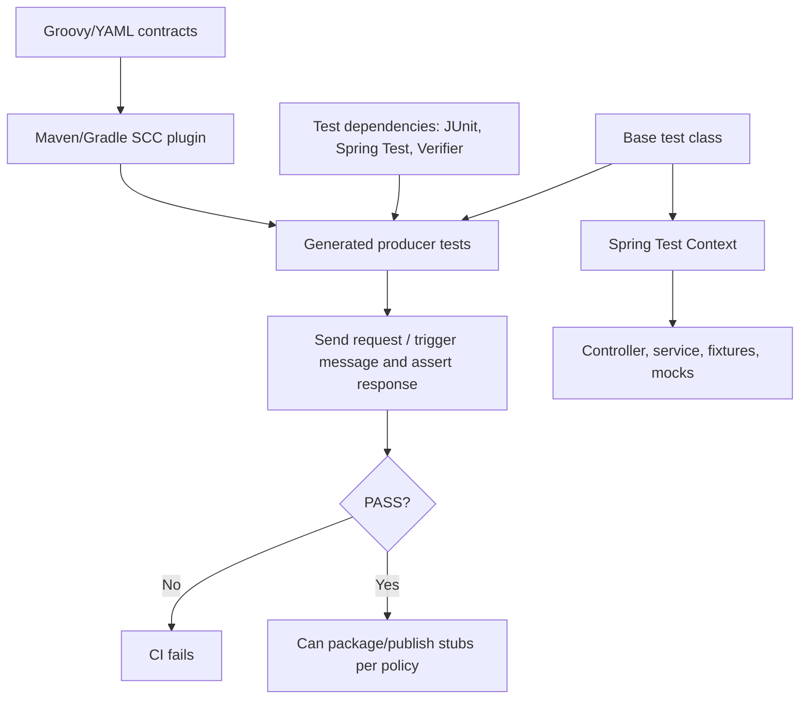

# Configuring the Test Context and Required Dependencies

## 1. What problem does the base test solve?

In **Spring Cloud Contract (SCC)**, the consumer and producer agree on an HTTP or messaging interface using the **Groovy/YAML DSL**. From there, the Maven/Gradle plugin can **generate producer verification tests** and **stubs**. The consumer uses **Stub Runner** to run tests against stubs, while CI helps catch breaking API changes early.

However, generated tests **do not know on their own** how to start your Spring Boot application. They do not automatically choose a test profile, create a database, initialize security filters, connect an HTTP test client, or mock a broker. Without a **test context** and **test dependencies**, tests may fail to compile, fail to find endpoints, or return unexpected results even when the contract file is valid.

The **base test** (the base class for generated tests) bridges the test generator with the producer's real test environment. This article in the **Base test** chapter focuses on two questions:

1. **How do you configure the test context** so generated tests call the right controller or service with the right beans and data state?
2. **Which dependencies are actually needed** in production, build, and test classpaths to generate and execute tests?

After this article, you will be able to set up a sample producer configuration with **JUnit 5 + Spring Boot + MockMvc**, understand when to choose **EXPLICIT** for real HTTP, identify the different requirements for messaging, inspect generated sources/test reports, and structure CI. The snippets are **illustrative skeletons**; you must choose an SCC version compatible with Spring Boot/Spring Cloud and adapt packages, source sets, and data fixtures to your real project.

## 2. Distinguishing production runtime, build time, and test runtime

A common misconception is that adding `spring-cloud-starter-contract-verifier` to the application will automatically generate and run tests. In practice, three phases must be distinguished:

| Component | Responsibility | Common configuration location | Needed in production app? |
|---|---|---|---|
| `spring-boot-starter-web` or WebFlux/messaging starter | Actually serves the API or emits/receives messages | `implementation` / application dependency | **Yes**, if the app uses it |
| SCC Maven plugin / Gradle plugin | Reads contracts, generates tests and stubs during the build | `<build><plugins>` / `plugins {}` | **No** |
| `spring-cloud-starter-contract-verifier` | Supports **running producer verification tests** | `<scope>test</scope>` / `testImplementation` | **No** if used only in tests |
| `spring-boot-starter-test` | JUnit, Spring Test, assertion/mocking, and test utilities | Test dependency | **No** |
| Test base + fixtures | Sets up Spring context, HTTP test setup, database/mocks before tests | `src/test/java` or matching test source set | **No** |
| Generated producer tests | Sends/triggers interactions and verifies the producer against contracts | Generated test sources | **No** |
| Stub artifact | Contains simulated behavior from contracts | Versioned published artifact | **Not** producer runtime |
| `spring-cloud-starter-contract-stub-runner` | Runs stubs in **consumer tests** | Consumer test dependency | **Usually no** |
| CI workflow | Runs build/tests, gates failures, and publishes artifacts | Pipeline, not a JVM library | Not applicable |

**Key takeaway:** the code-generation plugin runs at **build time**; Verifier is a library for **test runtime**. Both are distinct from production libraries like Spring MVC or HTTP clients.

## 3. Three configuration layers that must align



For a generated test to work, all three must be in place:

1. **Valid Contract DSL:** method, input URL/payload, output status/headers/body or message.
2. **Generation configuration:** the plugin finds the right contracts, generates tests with the right framework and test mode, and knows which base class to extend.
3. **Execution configuration:** the test classpath has JUnit/Spring Test/Verifier, the base class builds the environment, the application returns real responses, and the test runner actually runs the generated tests.

Therefore, **successfully generating tests** is different from **successfully running tests**. And **tests running without going through the real producer processing path** still do not prove the communication contract.

## 4. Sample HTTP contract to verify the end-to-end wiring

Suppose producer `order-service` exposes an order lookup endpoint. The YAML contract below describes the **existing-order scenario**; the values are for learning purposes only.

```yaml
name: order_found
description: "Consumer looks up a paid order"
request:
  method: GET
  url: /api/orders/42
  headers:
    Accept: application/json
response:
  status: 200
  headers:
    Content-Type: application/json
  body:
    id: 42
    status: PAID
    currency: VND
    totalAmount: 125000
```

The producer test must call `GET /api/orders/42` and verify the agreed status/headers/body. If the producer returns `404` because the test database does not yet contain order `42`, the fault may lie in the **fixture**. If the fixture exists but the controller returns the wrong status or JSON, that may be a **contract violation**.

Do not change `response.status: 200` to `404` just to turn CI green before distinguishing between those two causes.

## 5. Maven: test dependencies and build plugins are two separate configurations

The snippets below are **core parts of `pom.xml`**, not a complete POM. A project needs a Spring Boot parent or dependency management, a compatible Spring Cloud BOM, repositories, and an appropriate Maven plugin version.

### 5.1. Application and test dependencies

```xml
<dependencies>
    <!-- Example: HTTP producer using Spring MVC -->
    <dependency>
        <groupId>org.springframework.boot</groupId>
        <artifactId>spring-boot-starter-web</artifactId>
    </dependency>

    <!-- JUnit 5, Spring Test, and Boot test utilities -->
    <dependency>
        <groupId>org.springframework.boot</groupId>
        <artifactId>spring-boot-starter-test</artifactId>
        <scope>test</scope>
    </dependency>

    <!-- Supports running generated producer contract tests -->
    <dependency>
        <groupId>org.springframework.cloud</groupId>
        <artifactId>spring-cloud-starter-contract-verifier</artifactId>
        <scope>test</scope>
    </dependency>
</dependencies>
```

In this example, `spring-boot-starter-web` serves the controller when the application runs. The two `test`-scoped starters serve **test execution** and should not enter the application runtime artifact. If the producer uses WebFlux or messaging, choose the corresponding production starter instead of adding the Web starter just for tests.

### 5.2. Test generation plugin and base class mapping

```xml
<build>
    <plugins>
        <plugin>
            <groupId>org.springframework.cloud</groupId>
            <artifactId>spring-cloud-contract-maven-plugin</artifactId>
            <version>REPLACE_WITH_COMPATIBLE_SCC_VERSION</version>
            <extensions>true</extensions>
            <configuration>
                <baseClassForTests>
                    com.example.orders.contract.ContractTestBase
                </baseClassForTests>
                <testFramework>JUNIT5</testFramework>
                <testMode>MOCKMVC</testMode>
            </configuration>
        </plugin>
    </plugins>
</build>
```

Meaning of the options:

- `baseClassForTests`: **fully qualified class name** of the base class that generated tests will extend.
- `testFramework = JUNIT5`: chooses test generation for JUnit 5; a compatible test engine/framework must be present.
- `testMode = MOCKMVC`: generates tests that interact with the HTTP boundary via MockMvc, **without opening a real HTTP port**.
- `extensions=true`: sample Maven plugin configuration as described in SCC docs; verify lifecycle/plugin behavior with the version in use.

**Version note:** some older SCC documentation cites JUnit 4 as the default; current Maven plugin documentation for `generateTests` lists `JUNIT5` and `MOCKMVC`. Therefore, **setting them explicitly and inspecting generated sources** is more reliable than guessing from examples for other versions. The Maven plugin version must be chosen compatibly; do not assume the dependency BOM automatically sets the build plugin version.

### 5.3. Do not put Verifier in `compile` just because it runs at "runtime"

Verifier is loaded **when tests run**, which is **test runtime**. When used only for producer verification, set `scope=test`. At the same time, **do not** place the SCC Maven plugin under `dependencies` expecting Maven to invoke the generate task automatically: the plugin must live under **build plugins** according to the build tool's lifecycle.

## 6. Gradle: separating `plugins`, `implementation`, and `testImplementation`

For Gradle Groovy DSL, conceptual configuration:

```groovy
plugins {
    id 'java'
    id 'org.springframework.boot' version 'REPLACE_WITH_BOOT_VERSION'
    id 'org.springframework.cloud.contract' version 'REPLACE_WITH_SCC_VERSION'
}

repositories {
    mavenCentral()
}

dependencies {
    implementation 'org.springframework.boot:spring-boot-starter-web'
    testImplementation 'org.springframework.boot:spring-boot-starter-test'
    testImplementation 'org.springframework.cloud:spring-cloud-starter-contract-verifier'
}

contracts {
    baseClassForTests = 'com.example.orders.contract.ContractTestBase'
    testFramework = 'JUNIT5'
    testMode = 'MockMvc'
    // If choosing this location, configure the contract path explicitly:
    contractsDslDir = file('src/test/resources/contracts')
}

tasks.withType(Test).configureEach {
    useJUnitPlatform()
}
```

This is an **example to distinguish roles**; it does not include full Spring Cloud dependency management or version-specific source set/task settings. The Gradle plugin may organize generated tests in a separate **`contractTest` source set/task**, so you must check which task actually runs JUnit Platform and which classpath holds the dependencies required by generated tests. Do not assume running `test` also runs `contractTest`.

Default contract paths **can differ between Maven and Gradle**. For example, `src/test/resources/contracts` is common with Maven, whereas Gradle SCC often defaults to `src/contractTest/resources/contracts`. If you choose a different layout, declare `contractsDslDir` according to your plugin version so the generator does not scan an empty directory.

With `build.gradle.kts`, Kotlin DSL syntax differs; do not paste Groovy DSL verbatim into a Kotlin build script.

## 7. Complete base class example for JUnit 5 + Spring Boot + MockMvc

Suppose the application has `@SpringBootApplication` in an appropriate parent package and the real controller is registered as a Spring bean. File layout:

```text
order-service/
  src/
    main/java/com/example/orders/...
    test/java/com/example/orders/contract/ContractTestBase.java
    test/resources/contracts/order-found.yml
```

Depending on Gradle configuration, the contract/test source set folder may differ; the layout above only works when the generator is configured to read from that location.

### 7.1. Base class integrating the Spring context

```java
package com.example.orders.contract;

import io.restassured.module.mockmvc.RestAssuredMockMvc;
import org.junit.jupiter.api.BeforeEach;
import org.springframework.beans.factory.annotation.Autowired;
import org.springframework.boot.test.context.SpringBootTest;
import org.springframework.test.context.ActiveProfiles;
import org.springframework.web.context.WebApplicationContext;

@SpringBootTest(webEnvironment = SpringBootTest.WebEnvironment.MOCK)
@ActiveProfiles("contract")
public abstract class ContractTestBase {

    @Autowired
    private WebApplicationContext webApplicationContext;

    @BeforeEach
    void setUpMockMvc() {
        RestAssuredMockMvc.webAppContextSetup(webApplicationContext);
    }
}
```

Part-by-part explanation:

- `@SpringBootTest` instructs **Spring Test** to initialize the application context so application beans are available in tests. `webEnvironment = MOCK` matches MockMvc test mode, not a real HTTP server.
- `@ActiveProfiles("contract")` activates a **project-defined test profile**. If there is no corresponding profile or it is unneeded, omit the annotation; it does not automatically create safe configuration.
- `WebApplicationContext` is the context holding the relevant web/controller configuration.
- `@BeforeEach` (JUnit 5) executes before each generated test when the generated class extends the base class and the test runner supports the matching lifecycle.
- `RestAssuredMockMvc.webAppContextSetup(...)` binds Rest Assured MockMvc to the web context so requests from generated tests are handled per configuration.
- `abstract` indicates the base class is only a **superclass**, not a test suite to run directly.

This example **does not yet** prepare the order record. If the controller depends on a database, you must add fixtures/test configuration. If the context is missing a bean, the main Spring Boot application cannot be found, or generated tests do not extend the right base class, adding annotations alone will not make tests pass.

### 7.2. Wiring fixtures before requests without mixing them into the DSL

An extended version can add a fixture bean **implemented by the team**:

```java
@Autowired
private OrderContractFixture fixture;

@BeforeEach
void setUp() {
    fixture.resetTestOrders();                 // Only on an isolated test DB
    fixture.savePaidOrder(42L, 125000L, "VND");
    RestAssuredMockMvc.webAppContextSetup(webApplicationContext);
}
```

This is an **illustrative snippet** to insert into the class above, not a standalone Java class. `OrderContractFixture`, `resetTestOrders`, and `savePaidOrder` are **not SCC APIs**; you must write them, register them as a Spring bean via test configuration or another appropriate mechanism, and ensure they only affect the test database/test schema.

In contracts, keep `request` and `response` focused on observable behavior; do not embed database insert/update statements into Groovy/YAML just to get `200`. `404`/`409` scenarios must prepare matching fixtures and have distinct requests or separate setups.

### 7.3. The test context is reused, but fixtures must be independent

Spring Test typically **caches the ApplicationContext** across tests to save time. That does not mean database rows or singleton bean state are automatically reset. If a test mutates data, caches, or mocks, you must clean up or isolate state before each test.

When contracts have conflicting fixtures or high setup cost, you can use **separate base classes per contract group**, with `packageWithBaseClasses` or `baseClassMappings` if supported by your plugin version. Check the **precedence order** of mapping options relative to `baseClassForTests`; do not assume every generated test inherits one class once mappings are enabled.

## 8. Choosing `standaloneSetup` vs. `webAppContextSetup`?

The two ways to initialize Rest Assured MockMvc differ in coverage:

| Approach | Goal | Pros | Limitations to know |
|---|---|---|---|
| `standaloneSetup(controller)` | Builds MockMvc around a specific controller | Fast, easy to isolate | May bypass real app config: filters, exception handlers, security, converters |
| `webAppContextSetup(context)` | Uses the test's Spring WebApplicationContext | Closer to real MVC configuration | Context startup overhead; still does not run over a real socket |
| `EXPLICIT` + real HTTP | Sends requests over the test app's network port | Tests the HTTP layer and server config in the test environment | Requires managing ports, startup, cleanup, and external dependencies |

Minimal conceptual **standalone** example:

```java
@BeforeEach
void setUp() {
    // Mocked controller/service is prepared by the team.
    RestAssuredMockMvc.standaloneSetup(orderController);
}
```

This approach works if tests focus on a controller's contract with team-controlled mock dependencies. However, it **does not automatically prove** the behavior of security filters, validation, `@ControllerAdvice`, or real-app serialization settings unless they are explicitly added to the setup.

With `webAppContextSetup`, you should still check that the filter chain/security, converters, and related components are properly wired. If consumers depend on security behavior, design appropriate tests instead of assuming every HTTP filter runs just because the context started.

## 9. When should you switch to `EXPLICIT` test mode?

`MOCKMVC` does not open a TCP listener; generated tests dispatch via MockMvc. If the application needs **context path**, reverse-proxy behavior, server filters, cookies/redirects, or properties that only manifest over real HTTP, consider `EXPLICIT`. In this mode, the test must **start an HTTP server** on a port and configure Rest Assured to target that port.

Maven plugin (showing the changed section):

```xml
<configuration>
    <baseClassForTests>
        com.example.orders.contract.RealHttpContractTestBase
    </baseClassForTests>
    <testFramework>JUNIT5</testFramework>
    <testMode>EXPLICIT</testMode>
</configuration>
```

Illustrative base class with a real Spring Boot server in tests:

```java
package com.example.orders.contract;

import io.restassured.RestAssured;
import org.junit.jupiter.api.BeforeEach;
import org.springframework.boot.test.context.SpringBootTest;
import org.springframework.boot.test.web.server.LocalServerPort;

@SpringBootTest(
    webEnvironment = SpringBootTest.WebEnvironment.RANDOM_PORT
)
public abstract class RealHttpContractTestBase {

    @LocalServerPort
    private int port;

    @BeforeEach
    void setUpRealHttp() {
        RestAssured.baseURI = "http://localhost";
        RestAssured.port = port;
    }
}
```

Notes:

- `@LocalServerPort` in the package above applies to modern Spring Boot versions; older projects may differ.
- Generated tests must be generated with `EXPLICIT`; if they still use MockMvc, setting Rest Assured HTTP ports has no effect.
- `RestAssured.baseURI` and `RestAssured.port` are **global static state**; running multiple tests concurrently on different ports can cause race conditions. Isolate configuration or coordinate parallelism accordingly.
- Prepare fixtures before requests and clean up side effects. Real HTTP may use a different thread/transaction; do not assume `@Transactional` on the test rolls back server-side changes.
- `RANDOM_PORT` reduces port collisions, though tests still depend on the Spring context and external dependencies being wired properly.

**Do not pick `EXPLICIT` just because it sounds "closer to production."** Choose the mode based on the contract properties you genuinely need to protect and acceptable test cost/stability.

## 10. Producers using WebFlux or messaging need different test contexts

### 10.1. WebFlux

Reactive applications can use **`WEBTESTCLIENT`** test mode instead of MockMvc. Appropriate Spring WebFlux/WebTestClient dependencies are required, and the base test configures the reactive application/test client per your plugin version's documentation.

Do not copy `RestAssuredMockMvc.webAppContextSetup` from a Spring MVC example into a WebFlux-only project and expect generated tests to work. The test request mechanism, application context, and test mode must **align**.

### 10.2. Messaging contracts

For message contracts, `input`/`outputMessage` in the DSL describe how emission is triggered and the emitted message content. The base test may need to:

- Initialize the Spring messaging context and producer/broker beans or test binder.
- Configure `@AutoConfigureMessageVerifier` on the base class per SCC documentation.
- Declare methods invoked by `triggeredBy`, while preparing data/conditions so the producer emits the right message.
- Include messaging dependencies matching your system: Spring Integration, Cloud Stream, JMS, or Camel; sometimes a dedicated test binder/test broker is needed.

Conceptual example:

```java
// Pseudocode: illustrative structure, incomplete imports/beans.
@SpringBootTest
@AutoConfigureMessageVerifier
public abstract class MessagingContractTestBase {

    @Autowired
    private OrderPublisher publisher;

    public void emitOrderPaid() {
        publisher.publishPaidOrderForTest(42L);
    }
}
```

Here `OrderPublisher` and `publishPaidOrderForTest` are **project-built APIs**, not provided by SCC. Do not copy this snippet into a project lacking messaging configuration and expect tests to run. Check which method the generated test actually calls and target the right broker/channel destination.

Messaging verification does not automatically guarantee delivery order, retries, exactly-once semantics, transactional outbox, or production broker health; those require separate integration/resilience tests.

## 11. Designing the test context and data for stable CI

### 11.1. Choosing the right profile, properties, and beans

`@ActiveProfiles("contract")` helps isolate test configuration if the project defines that profile. In a real application, the team may need to swap database URLs, message brokers, token providers, clocks, or downstream clients. However:

- Never use production credentials or connect to a production database.
- Never let tests depend on live networks/services that can drop.
- Never accidentally disable security/validation if they are part of the interface consumers rely on.
- Never arbitrarily replace the entire producer with a mock HTTP server; such a test may only prove the mock conforms to the contract.

### 11.2. Fixture data: independent of order and randomness

A good fixture must be **deterministic**, **isolated**, **repeatable**, and small enough to read. Test case `GET /api/orders/42` must ensure order `42` exists in the expected state; case `GET /api/orders/9999` must ensure `9999` does not exist. If sharing one database without proper cleanup, parallel execution can produce flaky failures.

Depending on the project, you can use a dedicated test container/schema, `@Sql`, a fixture service, mock repositories, in-memory DB resets, or another suitable mechanism. With `@Transactional`, examine transaction boundaries and HTTP test mode; rollback does not automatically cover messages, caches, HTTP server threads, or external services.

### 11.3. A booting test context is not enough

A Spring context may load cleanly while the controller returns `404` due to wrong mapping, `401` due to missing test auth, or `500` due to a repository error. In that situation, diagnose layer by layer:

1. **Build/generation:** did the plugin read the right contracts and generate tests?
2. **Test discovery:** did the JUnit engine/task find and run the generated tests?
3. **Context:** are Spring beans, profiles, controllers, and security filters configured properly?
4. **Fixture:** is the pre-request data/mock state correct?
5. **Implementation:** does the producer return the status/headers/body specified by the contract?

**Do not edit the contract just to "make tests green" before identifying the failing layer.**

## 12. Inspecting generated tests and dependency classpaths

### 12.1. Checking with Maven

Reference commands when working on **a fully configured producer project**:

```bash
./mvnw clean test
./mvnw dependency:tree -Dincludes=org.springframework.cloud
```

When you want to run the full integration/stub packaging cycle per Maven SCC configuration, you can run:

```bash
./mvnw clean verify
```

Not every project includes the Maven wrapper `mvnw`, and test/contract goals may bind to different lifecycle phases depending on plugin version/configuration. Read the build log to verify that **generateTests**, test compilation, and **generated test execution** actually occurred. `dependency:tree` mainly lists project dependencies, not build plugins; inspect `<build><plugins>` as well.

### 12.2. Checking with Gradle

Reference commands:

```bash
./gradlew generateContractTests
./gradlew contractTest
./gradlew check
./gradlew dependencies --configuration testRuntimeClasspath
```

The `contractTest` task, source set, and classpath may vary depending on plugin/build version. `testRuntimeClasspath` is not necessarily the classpath of the **contractTest source set** if the plugin uses a separate source set. Check the actual tasks, dependency graph, and test reports. In CI, make sure to run the **generated tests**, not just the file-generation task.

### 12.3. Quick output verification checklist

- Generated test sources are found and you know which base class the test class **extends**.
- Generated tests use **MockMvc**, **WebTestClient**, or **Rest Assured real HTTP** matching the configured mode.
- JUnit 5 tests are discovered by the test engine/task; do not report `0 tests` as a pass.
- The base class is compiled and present on the generated tests' classpath.
- Fixtures and the Spring application context are initialized before requests run.
- Test reports cover at least one real scenario, including status/header/body assertions.
- CI turns red when the producer intentionally returns the wrong output (tested safely without touching production).
- Stub artifacts are only marked "verified" per policy when producer tests from that exact build pass.

## 13. Common configuration pitfalls

| Symptom | Possible cause | How to verify and fix |
|---|---|---|
| No generated tests appear | Plugin did not run, wrong contract directory | Check plugin/task and `contractsDslDir`/actual path |
| Generated tests fail to compile | Missing Verifier/test dependency or wrong JUnit framework | Check test classpath, imports, `testFramework` |
| Generated tests do not extend base | Wrong `baseClassForTests`, higher-priority mapping exists | Open generated source and compare FQN |
| `NoSuchBeanDefinitionException` | Spring context missing bean or wrong test config | Check package scan, `@Import`, profile |
| `No tests found` | JUnit runner/task/source set mismatch | Check Gradle `contractTest` or Maven Surefire config |
| `GET` returns `404` even though controller exists | Wrong mapping/context path, MockMvc not set up | Check controller mapping and `webAppContextSetup` |
| Unexpected `401`/`403` | Security context/filters differ from expectations | Build auth fixtures, test the real filter chain |
| `500` due to missing data | Fixtures or mocks not initialized | Check seed/reset and dependent services |
| Green locally, red in CI | Different profile, DB, clock, port, or task | Pin environment and log context/fixtures |
| Green with standalone but fails in production | Bypassed real security/formatter/advice | Use web app context/real HTTP or add integration tests |
| Red when running in parallel | Shared context/Rest Assured static state/DB | Isolate data and coordinate parallelism |
| Consumer tests green but new producer breaks | Consumer is still using an old stub | Run producer verification and manage stub versions |

## 14. Exercise: building a base test for three contracts

**Context:** producer `payment-service` provides:

- `GET /api/payments/PAY-101` → `200`, body has `state: AUTHORIZED` when the transaction exists.
- `GET /api/payments/PAY-999` → `404`, body has `code: PAYMENT_NOT_FOUND` when the transaction is absent.
- `POST /api/payments/PAY-202/capture` → `409`, body has `code: ALREADY_CAPTURED` when the transaction is already captured.

### Requirements

1. Choose **JUnit 5 + MockMvc**, and list production and test dependencies in Maven/Gradle.
2. Configure the SCC plugin with `baseClassForTests` and `testMode = MOCKMVC`.
3. Write `PaymentContractTestBase` using `@SpringBootTest`, `WebApplicationContext`, and `RestAssuredMockMvc.webAppContextSetup(...)`.
4. Propose fixtures providing `authorizedPaymentExists`, `paymentDoesNotExist`, and `capturedPaymentExists`, ensuring they only run in the test environment.
5. Explain how to verify that generated tests call the real controller and assert the agreed status/body.
6. Point out what consumer tests with Stub Runner prove and what they **do not** prove about the current producer.

### Solution guide

Classification table:

| Component | Appropriate configuration |
|---|---|
| Production API of `payment-service` | `spring-boot-starter-web` |
| JUnit + Spring Test | `spring-boot-starter-test` with test scope |
| Contract verification runtime | `spring-cloud-starter-contract-verifier` with test scope |
| Test/stub generation | SCC Maven/Gradle build plugin |
| Test context | `@SpringBootTest(webEnvironment = MOCK)` |
| HTTP test wiring | `RestAssuredMockMvc.webAppContextSetup(context)` |
| State preparation | Team-written fixture/helper running before each test |
| Consumer using stubs | `spring-cloud-starter-contract-stub-runner` with test scope on consumer |

To turn this exercise into a runnable project, select compatible Boot/Cloud/SCC versions, ensure contracts sit in the right directory, the fixture service exists, test configuration is isolated, and generated sources are picked up by the test runner.

A `GET /PAY-999` returning `404` is **not sufficient** if the controller under test always returns `404` for every transaction. You need at least one success scenario to protect the other branch, plus integration/business tests if you need to verify side effects of the capture command.

## 15. Pre-merge checklist

- [ ] Build plugin and Verifier/test dependencies are declared in their **proper roles**.
- [ ] Spring Boot, Spring Cloud, Spring Cloud Contract, and test framework versions are compatible.
- [ ] Contracts sit where the plugin reads them; generated tests appear.
- [ ] `baseClassForTests` has the exact fully qualified class name; generated tests actually extend that class.
- [ ] `testFramework`, `testMode`, Spring context, and HTTP client match one another.
- [ ] The JUnit test runner/task executes generated tests; they are not skipped or reporting `0 tests`.
- [ ] The application context includes required controllers/beans; security/validation are verified when consumers depend on them.
- [ ] Databases, mocks, clock/roles/brokers are configured to be **isolated and repeatable**.
- [ ] Fixtures are set up before each test without depending on order or parallelism.
- [ ] Error and success branches have appropriate status, headers/body, or message assertions.
- [ ] Published stubs are versioned and consumer tests run Stub Runner against the matching artifact.
- [ ] CI fails when the producer diverges from the contract; unit/integration/security tests cover remaining gaps.

## 16. Takeaways and references

**The base test is the bridge between the contract and the producer application in the test environment.** Groovy/YAML DSL files define expected behavior; the build plugin generates tests/stubs; **Verifier and Spring Test/JUnit** provide the test execution libraries; the test base sets up the context, test client, and fixtures; and generated producer tests verify the implementation. **Stub Runner** on the consumer side is a separate testing leg and does not replace producer verification.

A correctly named `@SpringBootTest` or `baseClassForTests` is not enough: generated tests must use the right mode, have the right dependencies/classpath, pass through the real processing path, and perform real assertions. In CI, trace the exact contract, producer build, test report, and stub artifact before declaring compatibility.

**Official sources** (cross-check against your project's SCC version):

- [Spring Cloud Contract — Developing Your First Application: base test class](https://docs.spring.io/spring-cloud-contract/reference/getting-started/first-application.html).
- [Spring Cloud Contract — Maven Project: testMode, baseClassForTests, baseClassMappings](https://docs.spring.io/spring-cloud-contract/reference/maven-project.html).
- [Spring Cloud Contract — Gradle Project: contracts, test tasks, and base class](https://docs.spring.io/spring-cloud-contract/reference/gradle-project.html).
- [Spring Cloud Contract — Messaging: AutoConfigureMessageVerifier](https://docs.spring.io/spring-cloud-contract/reference/project-features-messaging.html).
- [Spring Cloud Contract — Maven Plugin generateTests parameters](https://docs.spring.io/spring-cloud-contract/docs/current/spring-cloud-contract-maven-plugin/generateTests-mojo.html).
