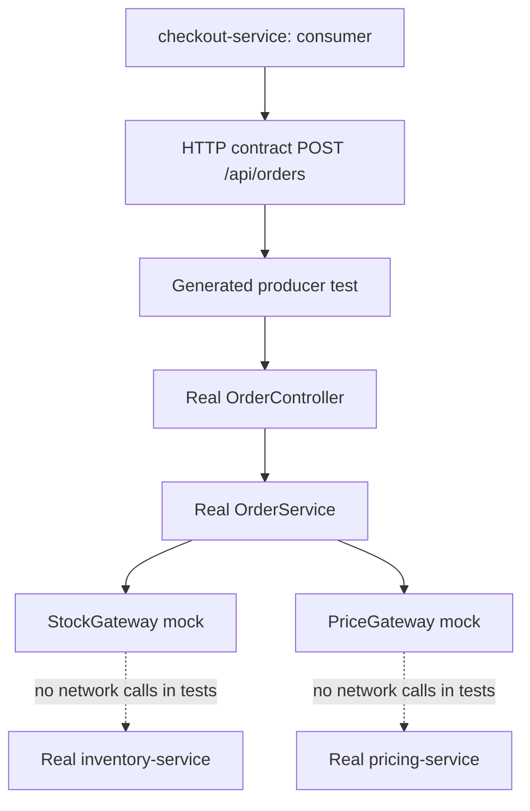
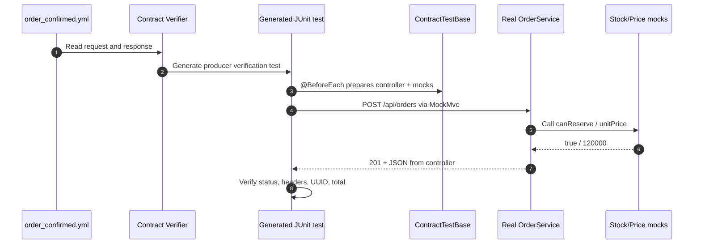
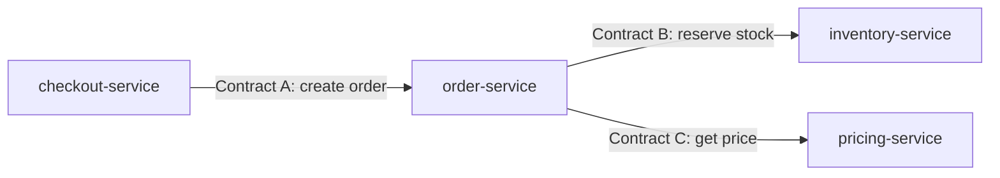
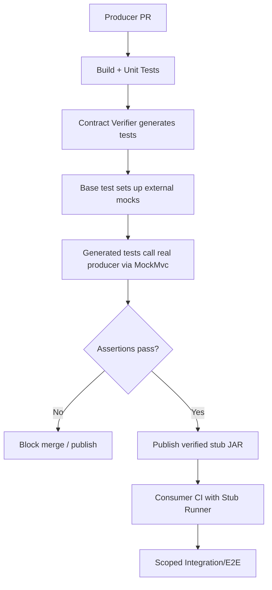

# Mocking Collaborators Outside the Contract Boundary

> **Chapter:** Base test  
> **Module:** Spring Cloud Contract (`SPRING_CLOUD_CONTRACT`) — producer–consumer contract testing with Groovy/YAML DSL, generating producer tests, publishing stubs, using Stub Runner, and checking API compatibility in CI.

## Learning objectives

After this article, you will be able to:

1. Identify the **contract boundary** of an HTTP API and distinguish components that must run for real from **out-of-boundary collaborators** that can be mocked.
2. Write a **base test** for Spring Cloud Contract Verifier using **Mockito** to replace clients calling external systems while still executing the relevant producer controller and logic.
3. Configure `RestAssuredMockMvc.standaloneSetup(...)` in `@BeforeEach` so generated tests have a stable execution environment.
4. Know when **standalone MockMvc** is sufficient and when to use a **Spring application context** with mock beans.
5. Avoid anti-patterns such as mocking the HTTP endpoint under test, letting mocks return unintended defaults, or making tests depend on real networks.
6. Analyze why a **PASS** on producer contract tests does not guarantee all interactions outside the API are correct, and how to combine Stub Runner, integration tests, and CI to control breaking changes.

## 1. The problem: testing a producer without depending on the entire system

Suppose the ordering architecture has four components:

- `checkout-service`: the **consumer** calling the order-creation API.
- `order-service`: the **producer** exposing `POST /api/orders`.
- `inventory-service`: an external service checking stock availability.
- `pricing-service`: an external service returning product unit prices.

`order-service` must query the last two services before building a response for the consumer. Sample HTTP request:

```http
POST /api/orders HTTP/1.1
Content-Type: application/json
Accept: application/json

{
  "sku": "SKU-001",
  "quantity": 2
}
```

Committed response:

```http
HTTP/1.1 201 Created
Content-Type: application/json

{
  "orderId": "aa37ba22-4b69-4d20-89e4-7dd3748f1420",
  "status": "CONFIRMED",
  "sku": "SKU-001",
  "quantity": 2,
  "total": 240000
}
```

`orderId` is a dynamic UUID; `status`, `sku`, `quantity`, and `total` must match the test scenario. If producer tests actually called `inventory-service` and `pricing-service` over the network, tests would easily suffer from timeouts, expired tokens, shifting staging data, or another service being down.

**Base test solution:** keep the HTTP endpoint and the `order-service` logic you want to protect, while replacing **outbound integration ports** with mocks that have deterministic behavior.



In the diagram, dashed arrows emphasize that **mocks replace the integration points**, making no real network calls during producer contract tests. The production application must still have real adapters for both gateways.

## 2. What is the contract boundary?

The **contract boundary** is the interface agreed upon by the producer and consumer, for example:

- HTTP method, path/query, request headers/body.
- HTTP status, response headers/body, and data types.
- Data values or patterns the producer must return for a request.
- For messaging: destination, headers, payload, and emission conditions.

For `order-service`, the contract under verification is **the HTTP API exposed to `checkout-service`**, not the availability of `inventory-service` or `pricing-service`.

### 2.1. Distinguishing components

| Component | Role in this example | Handling in producer contract tests |
| --- | --- | --- |
| `OrderController` | Receives requests, HTTP mapping, serializes response | **Runs for real** via MockMvc |
| `OrderService` | Validates conditions and calculates total from dependent data | **Runs for real** in this scenario |
| `StockGateway` | Port used by `order-service` to query external inventory | **Mockito mock** |
| `PriceGateway` | Port used by `order-service` to query external pricing | **Mockito mock** |
| Real `inventory-service` / `pricing-service` | External systems outside the boundary under test | **Not started, no real HTTP calls** |
| Contract Verifier | Generates producer verification tests from DSL | **Runs for real** |
| Stub Runner in `checkout-service` | Lets the consumer test against verified stubs | **Runs in a separate consumer suite** |

Which boundary to mock also depends on the test goal. If you **only** want to test HTTP mapping in the controller and all business logic already has unit tests, stubbing an internal service is sometimes acceptable. Here, however, `total` is an important part of the response, so keeping `OrderService` real avoids tests merely checking a pre-mocked response.

**Do not mock the exact HTTP handler you need to verify.** If Mockito returns the entire response directly, the test has little value for detecting broken routing, serialization, headers, HTTP statuses, or implementation mapping bugs.

## 3. Separating dependencies via ports/interfaces

To mock an external dependency cleanly, let business code depend on **interfaces** rather than making raw HTTP calls inside a long method.

Example structure:

```text
src/
├── main/java/com/example/orders/
│   ├── OrdersApplication.java
│   ├── OrderController.java
│   ├── OrderService.java
│   ├── StockGateway.java
│   └── PriceGateway.java
└── test/
    ├── java/com/example/orders/
    │   └── ContractTestBase.java
    └── resources/contracts/
        └── order_confirmed.yml
```

In a real runtime environment, adapters will call the external services and implement both gateways; that part lies **outside the scope of this contract test example**, though it must be added to run the production application.

### 3.1. Stock check port

File `StockGateway.java`:

```java
package com.example.orders;

public interface StockGateway {
    boolean canReserve(String sku, int quantity);
}
```

### 3.2. Unit price lookup port

File `PriceGateway.java`:

```java
package com.example.orders;

public interface PriceGateway {
    long unitPrice(String sku);
}
```

Naming it `Gateway` or `Port` matters less than the principle: **producer logic only knows the interface**; real adapters can call REST, gRPC, a database, or a message broker, while the base test can inject mocks.

### 3.3. Keeping business logic real

File `OrderService.java`:

```java
package com.example.orders;

import java.util.UUID;
import org.springframework.stereotype.Service;

@Service
public class OrderService {

    private final StockGateway stockGateway;
    private final PriceGateway priceGateway;

    public OrderService(
            StockGateway stockGateway,
            PriceGateway priceGateway) {
        this.stockGateway = stockGateway;
        this.priceGateway = priceGateway;
    }

    public CreatedOrder create(String sku, int quantity) {
        if (quantity <= 0) {
            throw new IllegalArgumentException("quantity must be positive");
        }
        if (!stockGateway.canReserve(sku, quantity)) {
            throw new IllegalStateException("insufficient stock");
        }

        long price = priceGateway.unitPrice(sku);
        long total = Math.multiplyExact(price, (long) quantity);

        return new CreatedOrder(
            UUID.randomUUID().toString(),
            "CONFIRMED",
            sku,
            quantity,
            total
        );
    }

    public record CreatedOrder(
        String orderId,
        String status,
        String sku,
        int quantity,
        long total
    ) {}
}
```

In the happy path, `StockGateway` returns `true` and `PriceGateway` returns `120000`; the service **computes** `total = 120000 × 2 = 240000`. Thus, contract tests can also catch a producer bug that returns the wrong total amount.

To keep the example concise, `IllegalArgumentException` and `IllegalStateException` are not mapped to HTTP `400` or `409`; Spring may return a server error by default if unhandled. To commit to error responses, add `@ControllerAdvice` or explicit exception mappings and **contracts for each branch**.

### 3.4. Passing the real controller into MockMvc

File `OrderController.java`:

```java
package com.example.orders;

import org.springframework.http.HttpStatus;
import org.springframework.http.MediaType;
import org.springframework.web.bind.annotation.PostMapping;
import org.springframework.web.bind.annotation.RequestBody;
import org.springframework.web.bind.annotation.ResponseStatus;
import org.springframework.web.bind.annotation.RestController;

@RestController
public class OrderController {

    private final OrderService orderService;

    public OrderController(OrderService orderService) {
        this.orderService = orderService;
    }

    @PostMapping(
        path = "/api/orders",
        consumes = MediaType.APPLICATION_JSON_VALUE,
        produces = MediaType.APPLICATION_JSON_VALUE
    )
    @ResponseStatus(HttpStatus.CREATED)
    public OrderService.CreatedOrder create(
            @RequestBody CreateOrderRequest request) {
        return orderService.create(request.sku(), request.quantity());
    }

    public record CreateOrderRequest(String sku, int quantity) {}
}
```

The endpoint accepts JSON, calls the real service, and lets Spring MVC serialize the record to JSON. The test can therefore verify method/path, `201`, `Content-Type`, and body.

**There is no real database or transaction** in this example. This producer contract test protects an HTTP interaction given fixed fixtures; it does not prove the order was persisted.

## 4. Defining the contract so you know what you are testing

Create `src/test/resources/contracts/order_confirmed.yml` in the producer project:

```yaml
name: order_confirmed
description: "Checkout creates an order when stock and price are valid"

request:
  method: POST
  url: /api/orders
  headers:
    Content-Type: application/json
    Accept: application/json
  body:
    sku: SKU-001
    quantity: 2

response:
  status: 201
  headers:
    Content-Type: application/json
  body:
    orderId: aa37ba22-4b69-4d20-89e4-7dd3748f1420
    status: CONFIRMED
    sku: SKU-001
    quantity: 2
    total: 240000
  matchers:
    body:
      - path: $.orderId
        type: by_regex
        predefined: uuid
```

The contract describes **a scenario with sufficient stock and a fixed unit price**. `orderId` is a freshly generated UUID so it uses a matcher, while `status`, `sku`, `quantity`, and `total` retain the exact values verified in this scenario.

Two aspects must be kept distinct:

1. **Producer verification:** the generated test sends `POST /api/orders` and verifies that the controller/service implementation returns the expected response, including `total: 240000`.
2. **Consumer stub:** the stub server accepts requests matching the contract and returns the **sample** UUID along with the fixed fields. The producer does not need to return that exact sample UUID.

If the producer arbitrarily changes `total` to `2` or `status` to `PENDING`, the generated test must fail. If someone only edits the stock quantity in the mock so the service enters an error branch, the test will also fail, though that may be because **the fixture no longer matches**, not an API incompatibility.

### 4.1. Equivalent Groovy DSL

The same interaction can be written in `order_confirmed.groovy`:

```groovy
org.springframework.cloud.contract.spec.Contract.make {
    name 'order_confirmed'

    request {
        method 'POST'
        url '/api/orders'
        headers {
            contentType(applicationJson())
            header 'Accept': 'application/json'
        }
        body(sku: 'SKU-001', quantity: 2)
    }

    response {
        status 201
        headers {
            contentType(applicationJson())
        }
        body(
            orderId: 'aa37ba22-4b69-4d20-89e4-7dd3748f1420',
            status: 'CONFIRMED',
            sku: 'SKU-001',
            quantity: 2,
            total: 240000
        )
        bodyMatchers {
            jsonPath('$.orderId', byRegex(
                '[0-9a-fA-F]{8}-[0-9a-fA-F]{4}-[0-9a-fA-F]{4}-[0-9a-fA-F]{4}-[0-9a-fA-F]{12}'
            ))
        }
    }
}
```

These YAML/Groovy examples **represent the same contract**. In a real project, store only **one** version in the `contracts` directory to avoid generating duplicate tests/stubs.

## 5. Base test: mock gateways, keep endpoint and service real

The Spring Cloud Contract Maven/Gradle plugin can generate tests from contracts, but generated tests need a base class to know **what environment to stand up** and **which dependencies to prepare**.

Create `src/test/java/com/example/orders/ContractTestBase.java`:

```java
package com.example.orders;

import io.restassured.module.mockmvc.RestAssuredMockMvc;
import org.junit.jupiter.api.BeforeEach;

import static org.mockito.Mockito.mock;
import static org.mockito.Mockito.when;

public abstract class ContractTestBase {

    @BeforeEach
    public void setUp() {
        // Only mock ports leaving order-service.
        StockGateway stockGateway = mock(StockGateway.class);
        PriceGateway priceGateway = mock(PriceGateway.class);

        // Fixtures matching the request in the contract.
        when(stockGateway.canReserve("SKU-001", 2))
            .thenReturn(true);
        when(priceGateway.unitPrice("SKU-001"))
            .thenReturn(120_000L);

        // Both producer processing classes remain real instances.
        OrderService orderService =
            new OrderService(stockGateway, priceGateway);
        OrderController controller =
            new OrderController(orderService);

        RestAssuredMockMvc.standaloneSetup(controller);
    }
}
```

Part-by-part explanation:

- `@BeforeEach` runs before every generated test (when tests inherit from the base class under JUnit 5), so each test starts from deterministic fixtures.
- `mock(StockGateway.class)` and `mock(PriceGateway.class)` create fake collaborators **without network calls**.
- `when(...).thenReturn(...)` defines behavior for the **exact arguments** the producer will pass.
- `new OrderService(...)` keeps the total calculation and status decision in real code.
- `new OrderController(...)` keeps HTTP mapping and JSON serialization running through MockMvc.
- `RestAssuredMockMvc.standaloneSetup(controller)` creates the controller invocation environment without binding a real HTTP port.

Because the base class is `abstract`, it is not a standalone test suite. Generated tests **extend** it per verifier configuration.

### 5.1. Why create fresh mocks in each test?

Mockito mocks hold stubbing state and invocation history. If multiple tests share a singleton mock that gets reconfigured unpredictably, one test can affect another. Creating fresh mocks in `@BeforeEach` for every run ensures:

- No leftover invocations from previous tests.
- No dependency on test execution order.
- Easy alignment of fixtures with the contract under verification.
- Reduced impact from parallel tests (though you still must watch static RestAssuredMockMvc settings).

With multiple scenarios, a single shared `SKU-001` fixture may **not suffice**. When adding an `SKU-002` contract or an out-of-stock response, organize base classes, group-level setups, or per-contract test data; avoid making every gateway return the same default value, as that easily produces false results.

### 5.2. What does Mockito return by default when unstubbed?

For a mock without a matching `when(...)`, Mockito typically returns:

- `false` for boolean.
- `0` for numeric primitives.
- `null` for objects (depending on type and default Answer).

For example, if a generated test calls `canReserve("SKU-002", 2)` while the base test only stubs `canReserve("SKU-001", 2)`, the mock may return `false` and push the service into an error branch. That is a **fixture issue**, not necessarily incorrect producer behavior.

Avoid patching around it with:

```java
when(stockGateway.canReserve(anyString(), anyInt()))
    .thenReturn(true);
```

when your contracts need to distinguish sufficient stock from out-of-stock by SKU. Overly broad Mockito matchers can mask bugs where the wrong SKU or quantity is passed to a gateway. For known scenarios, stubbing by **specific arguments** indirectly catches those mismatches.

If a project uses many datasets, create **clearly named fixture builders** or back mocks with a small lookup table. Prioritize clarity and reproducibility over minimum line count.

## 6. Wiring the base class to Spring Cloud Contract Verifier

The Maven plugin must know which class generated tests should extend. In a producer already configured with Spring Boot, a **compatible** Spring Cloud BOM, and HTTP/MVC dependencies, illustrative configuration:

```xml
<!-- Inside <dependencies> -->
<dependency>
    <groupId>org.springframework.cloud</groupId>
    <artifactId>spring-cloud-starter-contract-verifier</artifactId>
    <scope>test</scope>
</dependency>

<!-- Inside <build><plugins> -->
<plugin>
    <groupId>org.springframework.cloud</groupId>
    <artifactId>spring-cloud-contract-maven-plugin</artifactId>
    <version>${spring-cloud-contract.version}</version>
    <extensions>true</extensions>
    <configuration>
        <testFramework>JUNIT5</testFramework>
        <testMode>MOCKMVC</testMode>
        <baseClassForTests>com.example.orders.ContractTestBase</baseClassForTests>
    </configuration>
</plugin>
```

Note that this is a **POM fragment**, not a standalone runnable Maven project. You must declare the `spring-cloud-contract.version` property, the Spring MVC starter, Spring Boot test dependencies, and Mockito/Rest Assured MockMvc components matching your Spring Boot/Spring Cloud versions.

| Configuration | Role |
| --- | --- |
| `spring-cloud-starter-contract-verifier` | Verifier test dependencies |
| `spring-cloud-contract-maven-plugin` | Generates tests/stubs from contracts |
| `<testFramework>JUNIT5</testFramework>` | Generates JUnit 5-compatible tests |
| `<testMode>MOCKMVC</testMode>` | Uses MockMvc test mode |
| `<baseClassForTests>...` | Generated tests extend the right setup class |
| `<extensions>true</extensions>` | Hooks the plugin into the Maven lifecycle per config |

With Gradle, the principle is the same: configure the Contract Verifier plugin, declare the base class, and add matching test dependencies. Do not assume merely importing Mockito makes the plugin read contracts and execute tests.

### 6.1. Pipeline in a single build



Here **tests run inside the producer**, without calling any real consumer application. Mocks only supply external data so the producer implementation can build its response.

## 7. What does a generated test verify?

From `order_confirmed.yml`, the generated test essentially:

1. Sends `POST /api/orders`.
2. Includes `Content-Type: application/json`, `Accept: application/json`, and the contract request body.
3. Uses `ContractTestBase` to initialize the controller and mock gateways.
4. Receives the response produced by the controller/service.
5. Asserts HTTP `201` and response header `Content-Type: application/json`.
6. Asserts `orderId` matches UUID format.
7. Asserts `status: CONFIRMED`, `sku: SKU-001`, `quantity: 2`, and `total: 240000`.

In practice, generated test code may use Rest Assured MockMvc, JSONPath, Hamcrest, or other APIs depending on plugin/version. **Do not hand-write a mock test in place of generated tests and claim the verifier ran.**

### 7.1. Bugs that must be caught

Suppose a developer changes the logic:

```java
long total = price;  // Bug: forgot to multiply by quantity
```

With mock `unitPrice("SKU-001") = 120000` and request `quantity = 2`, the service returns `total = 120000` instead of `240000`. The generated producer test must **FAIL** because `total` no longer matches the contract.

Or the producer changes:

```java
return new CreatedOrder(
    UUID.randomUUID().toString(),
    "PENDING",             // Wrong compared to CONFIRMED
    sku, quantity, total
);
```

The generated test must **FAIL** due to the wrong business status. This is precisely why you should not mock `OrderService` itself when protecting response-building logic.

### 7.2. Bugs the test does not prove against

The sample producer contract test **does not prove**:

- That the real adapter calls `inventory-service` with the right URL/token or handles timeouts.
- That prices returned by the real `pricing-service` are accurate for all products.
- That the system actually reserved stock or persisted the order durably in a DB.
- That two calls generate two **distinct** UUIDs.
- That all out-of-stock, pricing error, or flaky network cases return appropriate statuses.
- That authentication, filters, interceptors, or production gateways work if the test uses standalone MockMvc.

Those belong to complementary **integration tests**, **service-component tests**, or **end-to-end tests**. Contract tests focus on the **communication promise** described in the DSL.

## 8. Why not mock the class under verification directly?

A common anti-pattern:

```java
OrderService orderService = mock(OrderService.class);

when(orderService.create("SKU-001", 2))
    .thenReturn(new OrderService.CreatedOrder(
        "aa37ba22-4b69-4d20-89e4-7dd3748f1420",
        "CONFIRMED",
        "SKU-001",
        2,
        240000L
    ));

RestAssuredMockMvc.standaloneSetup(
    new OrderController(orderService)
);
```

This test **can still have value** when the goal is solely to verify controller HTTP mapping/serialization and the service is tested independently. However, in a problem requiring `order-service` to return the right total and status based on gateway outputs, mocking `OrderService` turns most of the response into **test-defined data**. If the calculation inside `OrderService` is broken, this kind of contract test will not notice.

Therefore, mocking decisions must align with **the test objective**:

| Objective | Safe to mock? | Notes |
| --- | --- | --- |
| Controller HTTP mapping, headers, serialization | Can mock the service below the controller | Proves only the controller layer |
| Producer HTTP behavior **and** total calculation logic | Keep the service real | Mock external adapters/gateways |
| Producer connection to a real DB | Do not mock the repository in that test | Use integration tests/Testcontainers |
| API compatibility with an external service | Use separate stubs/contracts or run integration tests | Hand-written Mockito mocks do not prove external API compatibility |

Setting the right boundary is a test-design decision, not an absolute rule of "every service must be real" or "every dependency must be mocked."

## 9. When to mock collaborators inside a Spring context?

`RestAssuredMockMvc.standaloneSetup(...)` is fast, but does not boot the full Spring application context. If the contract depends on components such as:

- Spring Security filter chain.
- Bean-declared `@ControllerAdvice` / exception handlers.
- Validation, Jackson configuration, or custom serializers.
- Interceptors, controller advice, or message converters.
- Bean configurations that directly affect HTTP behavior.

then tests should run **with a real Spring context**, while still mocking external ports to avoid network calls.

An **alternative** to the base class in section 5 using Spring Framework's `@MockitoBean` (e.g., Spring Framework 6.2+):

```java
package com.example.orders;

import io.restassured.module.mockmvc.RestAssuredMockMvc;
import org.junit.jupiter.api.BeforeEach;
import org.springframework.beans.factory.annotation.Autowired;
import org.springframework.boot.test.context.SpringBootTest;
import org.springframework.test.context.bean.override.mockito.MockitoBean;
import org.springframework.web.context.WebApplicationContext;

import static org.mockito.Mockito.when;

@SpringBootTest
public abstract class ContractTestBase {

    @Autowired
    WebApplicationContext context;

    @MockitoBean
    StockGateway stockGateway;

    @MockitoBean
    PriceGateway priceGateway;

    @BeforeEach
    public void setUp() {
        when(stockGateway.canReserve("SKU-001", 2))
            .thenReturn(true);
        when(priceGateway.unitPrice("SKU-001"))
            .thenReturn(120_000L);

        RestAssuredMockMvc.webAppContextSetup(context);
    }
}
```

Differences compared to `standaloneSetup`:

- The Spring context creates real `OrderController` and `OrderService` beans.
- `@MockitoBean` supplies mock beans for the two gateway interfaces instead of calling real external adapters.
- `webAppContextSetup(context)` builds MockMvc from the web configuration in the context.
- `@SpringBootTest` only works if the project has a `@SpringBootApplication` class, matching dependencies, and valid context configuration.

**Version note:** `@MockitoBean` is available in newer Spring Test lines (Spring Framework 6.2 and up). Older projects may use Spring Boot's `@MockBean`, though that annotation is deprecated in newer Boot releases; choose what matches your actual stack. Do not mix two base class variants in one project unintentionally.

Even when using a context, applying the **Spring Security filter chain** to MockMvc may require extra configuration (such as `springSecurity()` or matching test auto-config). Verify that generated tests actually pass through the filters/advice/serialization you want to protect; seeing `@SpringBootTest` alone is not enough.

### 9.1. Choosing between standalone and context

| Criterion | MockMvc standalone | Spring context + mock beans |
| --- | --- | --- |
| Startup | Fast, instantiates controller manually | Slower, creates Spring context |
| Constructor wiring | Handled by test code | Spring dependency injection |
| HTTP mapping | Yes | Yes |
| Custom Jackson, filters, Security | Only what the test wires manually | Can verify real configuration per test setup |
| Mocking external gateways | Standard Mockito instances | `@MockitoBean` / compatible annotation |
| Best suited for | Simple API contracts with minimal config | Contracts depending on real Spring infrastructure |

You do not have to open a real database or make real network calls just because you chose a Spring context. If a component lies outside the contract scope and needs isolation, use intentional mocks/test doubles.

## 10. Fixtures: mock data is part of test design

A mock doesn't just make tests fast; it defines the **preconditions** of an interaction. For the `order_confirmed` contract, the fixture is:

```text
Input HTTP:  sku=SKU-001, quantity=2
Stock:       canReserve(SKU-001, 2) -> true
Price:       unitPrice(SKU-001) -> 120000
Expected:    HTTP 201, status=CONFIRMED, total=240000
```

If you add a second contract for `SKU-002` with a different unit price, set up distinct fixtures:

```java
when(stockGateway.canReserve("SKU-002", 1))
    .thenReturn(true);
when(priceGateway.unitPrice("SKU-002"))
    .thenReturn(75_000L);
```

When the generated test sends the second request, the producer returns total `75000`; the scenarios remain independent.

**Do not make fixtures overly "clever":** the base class should not compute the expected response and feed it straight into a mocked controller, because then you are only verifying test-generated data rather than producer logic. Fixtures should **supply inputs**; the implementation must **produce outputs**.

### 10.1. Organizing fixtures by contract group

As contracts grow across many scenarios:

- A shared base class can prepare commonly used data.
- Contracts in subdirectories can use convention-based or plugin-mapped base classes depending on configuration.
- With a Spring context, a test configuration can supply shared fakes/test doubles.
- With databases, use transaction rollbacks, cleanup, or deterministic seed data; never let tests depend on leftover rows from previous runs.
- Fixture helper names should reveal business intent like `withEnoughStock("SKU-001", 2)` rather than an opaque `setupEverything()`.

Adding more Mockito `when` calls is not always better. When fixtures grow heavy with branching/logic, a **small in-memory fake** can be simpler and less error-prone.

### 10.2. Should you verify mock invocations in the base test?

Normally generated contract tests focus on **HTTP outcomes**, not internal call counts. You can write separate integration/unit tests to verify that `StockGateway.canReserve(...)` is called with exact arguments when required by business rules.

Putting too many `Mockito.verify(...)` checks in the base test causes issues:

- Contracts become tightly coupled to internal implementation details.
- Refactoring two gateway calls into one batch call breaks tests even though the consumer API did not change.
- The base test becomes hard to reuse across contracts taking different paths.

Prefer assertions on **observable behavior**. Only verify internal interactions when they represent a business invariant or are the explicit goal of another test.

## 11. Practice breaking the API to verify the base test

To ensure mocks do not create "false greens," run intentional mutations on a test branch.

### Experiment A: wrong total amount

Keep the `120000` fixture and `quantity: 2` request. Change the calculation in `OrderService`:

```java
long total = price; // Forgot quantity
```

**Expected:** producer verification FAILS on `total`. If it still PASSES, check whether the test actually uses real `OrderService`, whether the contract asserts `total`, and whether generated tests actually executed.

### Experiment B: wrong HTTP status

Change `@ResponseStatus(HttpStatus.CREATED)` to `@ResponseStatus(HttpStatus.OK)`.

**Expected:** the generated test FAILS because the contract requires `201`.

### Experiment C: external mock throws an error

In a dedicated test/fixture:

```java
when(priceGateway.unitPrice("SKU-001"))
    .thenThrow(new RuntimeException("pricing unavailable"));
```

**Expected:** the producer enters the corresponding error branch. Do not assume `503 Service Unavailable`: the sample controller has no exception handler, so the response may be `500` or an unhandled exception. Only add an **error contract** once the implementation defines how errors and response bodies are mapped.

### Experiment D: request differs from fixture

Send `SKU-999` in a generated test while only setting up `SKU-001`. Mockito may return defaults, causing the request to fail.

**Conclusion:** the root cause is a missing fixture or misaligned contract/test setup, not necessarily an API compatibility bug. Do not edit YAML or expected responses just to turn tests green before understanding the cause.

## 12. When should you NOT mock a dependent system?

Mocking external collaborators keeps tests independent and reproducible, but has a downside: **mocked behavior can drift from the real service**.

For example, `PriceGateway.unitPrice("SKU-001")` returns a `long` in tests, while the real pricing API changed from a number to a string or changed endpoints; producer contract tests will not notice because they never call HTTP against `pricing-service`.

Additional tests needed:

| Risk | Appropriate test |
| --- | --- |
| Order HTTP API diverges from checkout expectations | `order-service` **producer contract verification** |
| `PriceGateway` adapter sends wrong URL/headers to pricing | Adapter integration test with verified stubs |
| `pricing-service` changed responses breaking `order-service`'s contract | **Contract test** between `order-service` (consumer of pricing) and `pricing-service` (producer) |
| Order database ORM/queries are wrong | Repository integration test with a test database |
| Services fail to connect in staging | Integration/E2E smoke tests |
| Order creation succeeds but overall payment flow breaks | End-to-end tests for critical business journeys |

**A service can be both a producer and a consumer.** Here `order-service` is a **producer** for `checkout-service`, while acting as a **consumer** of `inventory-service` and `pricing-service`. Each boundary can have its own contract.



Contract A is verified by the base test being built; contracts B/C require their own test suites. Mockito does not replace the guarantees of B/C.

## 13. Stub lifecycle and Stub Runner on the consumer

After producer verification passes, Maven/Gradle can generate a **stub JAR** from HTTP contracts. Example producer build:

```bash
mvn clean verify
mvn clean install
```

Suppose the producer has coordinates:

```text
com.example:order-service:1.0.0
```

The stub artifact is typically packaged with classifier `stubs`:

```text
com.example:order-service:1.0.0:stubs
```

Consumer tests can use Stub Runner:

```java
@SpringBootTest(properties = {
    "orders.base-url=http://localhost:8090"
})
@AutoConfigureStubRunner(
    ids = "com.example:order-service:1.0.0:stubs:8090",
    stubsMode = StubRunnerProperties.StubsMode.LOCAL
)
class CheckoutOrderContractTest {

    @Autowired
    CheckoutClient checkoutClient;

    @Test
    void docDuocResponseTaoDon() {
        OrderResult result =
            checkoutClient.createOrder("SKU-001", 2);

        UUID.fromString(result.orderId());
        assertEquals("CONFIRMED", result.status());
        assertEquals(240000L, result.total());
    }
}
```

This snippet is illustrative: `CheckoutClient`, `OrderResult`, dependencies/imports, and the `orders.base-url` property must be implemented in the consumer project. `LOCAL` mode assumes the stub artifact has been installed into the local Maven repository.

**Relationship across the three test levels:**

- **Producer base test:** mocks inventory/pricing to test real `OrderController` and `OrderService` against contract A.
- **Consumer test with Stub Runner:** starts the `order-service` stub to test `checkout-service` without the real order-service.
- **Integration/E2E:** verifies real adapters, databases, brokers, infrastructure, and production flows as needed.

Consumer-side Stub Runner **does not re-run the producer implementation**. It uses the selected stub artifact. Therefore, verify the producer before publishing stubs and pin the right version in consumer CI.

## 14. A sound CI workflow with out-of-boundary mocks



Key checks:

1. **Producer CI:** run `mvn clean verify` or the matching lifecycle without skipping contract tests; verify the test report shows generated tests actually executed.
2. **Mock scope:** document which gateways are external; never replace the whole producer implementation with mocks just to turn tests green.
3. **Fixtures:** keep mock outputs reproducible and aligned with contract requests.
4. **Stub release:** publish versioned artifacts only after producer verification and mandatory tests PASS.
5. **Consumer CI:** run Stub Runner with explicit stub versions; do not assume runners share `~/.m2`.
6. **Other boundary tests:** maintain contract/integration tests between order and inventory/pricing, plus necessary infrastructure tests.

In distributed CI, use a Maven-compatible artifact repository or pass stub artifacts between jobs; use `StubsMode.REMOTE` when fetching stubs from a remote repository. Never treat newly generated stubs that have not passed producer verification as API guarantees.

### 14.1. Distinguishing contract errors from fixture errors

| Symptom | Possible cause | How to resolve |
| --- | --- | --- |
| Test gets `500` instead of `201` | Gateway mock not stubbed for input, service throws exception | Compare generated request with `when(...)` |
| Test gets `201` but `total` is wrong | Calculation bug or wrong unit price in mock fixture | Check invariant and price in fixture |
| Generated test does not call controller | Wrong `baseClassForTests`, wrong test mode, or setup didn't run | Check plugin, classpath, and test output |
| Build stays green even after breaking implementation | Tests not generated, skipped, or controller/service mocked | Read test reports; run intentional-fail experiment |
| Standalone test passes but staging returns 401 | Security filters absent in standalone setup | Use context/integration tests with real Security |
| Old tests pass, production pricing adapter breaks | Mock does not call real pricing | Add contract/integration tests for boundary B/C |
| Consumer calls stub and gets 404 | Request does not match WireMock mapping | Compare method/path/headers/body against contract |
| Stub not found in CI | Not installed/published or wrong version selected | Check artifact coordinates and repository |

## 15. Rules for choosing mocks and anti-patterns

### Rules to follow

- **Start from the test objective, then pick the mock boundary**; do not mock just because "faster is always better."
- **Keep producer code real** for HTTP behavior consumers depend on.
- **Mock at out-of-boundary interfaces/ports**, rather than forcing tests to spin up a real HTTP client only to monkey-patch internals.
- **Only supply precondition inputs through mocks**, letting producer logic build the response.
- **Stub specifically per request** when inputs matter; avoid overly broad `any()` matchers if they hide argument-passing bugs.
- **Use contract matchers for dynamic fields** like UUIDs instead of altering business code to return fixed IDs.
- **Do not treat PASS as sufficient** if generated tests did not actually run or lack key assertions.
- **Add out-of-boundary tests** for adapters, security, brokers, DBs, and workflows.

### Anti-patterns to avoid

| Anti-pattern | Problem |
| --- | --- |
| Mocking `OrderController` and returning canned JSON | Does not verify real mapping/serialization |
| Mocking `OrderService` when testing total calculation | Pricing/total bugs can be masked |
| Mocking both external clients and serializer, then comparing test-created responses | Test essentially checks only the fixture |
| Returning `true` for every `canReserve` call | Fails to distinguish SKUs/quantities, loses out-of-stock signals |
| Fixtures depending on staging network | Brittle, hard-to-reproduce tests |
| Treating the base test as production wiring | Standalone does not prove production beans/filters/transactions |
| Publishing stubs while producer tests are skipped | Consumers rely on unverified mock data |
| Editing contracts to match broken output just to turn CI green | Existing consumers can break |

## 16. Practice exercises

**Exercise 1 — Identify boundaries.** In the diagram in section 1, list which components must execute for real when testing the contract between checkout and order, and which can be mocked. If the objective shifts to verifying that the `PriceGateway` adapter calls the right HTTP API, does the mock decision change?

**Exercise 2 — Build a base test.** Using `OrderService` and `OrderController` from section 3, create `ContractTestBase` with `@BeforeEach`. Mock `StockGateway` so `canReserve("SKU-001", 2)` returns `true`, mock `PriceGateway` to return `120000`, and configure `RestAssuredMockMvc.standaloneSetup(...)`.

**Exercise 3 — Test a breaking change.** Change `total = price * quantity` to `total = price`. Run the generated producer test. What outcome do you expect? If it PASSES, which components might have been mocked or which assertions might be missing?

**Exercise 4 — Add an out-of-stock scenario.** Create a new contract for a SKU with insufficient stock. Design meaningful response status/body (such as `409 Conflict`) and add the matching exception handler before expecting the generated test to PASS. Do not just make `StockGateway` return `false` and assume Spring returns `409`.

**Exercise 5 — Use a Spring context.** Migrate the base test from standalone MockMvc to `@SpringBootTest` + `@MockitoBean`. Verify that the Spring context instantiates real `OrderController`/`OrderService`, the two gateways are mock beans, and critical security/serialization settings are included in the test setup.

**Exercise 6 — Producer is also a consumer.** Describe how to build a second contract test for the `order-service → pricing-service` relationship. Why isn't mocking `PriceGateway` in contract A enough to catch `pricing-service` changing `unitPrice` from a number to a string?

**Exercise 7 — Design CI.** Outline a pipeline with producer verification, stub publishing, consumer Stub Runner tests, and adapter integration tests. Indicate which stage must fail when `OrderService` returns the wrong `total`, and which stage catches the adapter calling pricing at the wrong URL.

### Answer hints

- Exercise 1: Contract A needs the real order endpoint; the two out-of-boundary gateways can be mocked. For the pricing adapter, test real adapter code alongside matching pricing stubs/producer tests.
- Exercise 2: The generated test should receive `201`, `CONFIRMED`, `quantity: 2`, and `total: 240000`, with `orderId` matching a UUID.
- Exercise 3: The producer contract test must FAIL; if not, inspect setup, fixtures, generated tests, and test reports.
- Exercise 4: Explicit error mapping is required; do not guess default exception status codes.
- Exercise 5: Apply `@MockitoBean` per supported version; context tests must actually exercise the Spring components you intend to protect.
- Exercise 6: `order-service` acts as pricing's consumer, so compatibility must be verified at that separate boundary.
- Exercise 7: Producer verification protects `total`; adapter integration/contract tests protect communication with pricing.

## 17. Summary

**Mocking collaborators outside the contract boundary** keeps producer contract tests fast, stable, and reproducible. In this example, `order-service` is the producer of the order-creation API; tests execute real `OrderController` and `OrderService`, while `StockGateway` and `PriceGateway` are mocked to avoid calling external services.

Spring Cloud Contract Verifier generates tests from the Groovy/YAML DSL; the **base test** prepares the MockMvc environment and fixtures so generated tests can verify real HTTP behavior against the contract. Once producer verification PASSES, stub JARs are published for consumers to verify via **Stub Runner**. In CI, additional tests at other boundaries remain essential for catching broken adapters, misconfigured security, or real integration bugs.

The key principle is neither "mock everything" nor "mock nothing," but rather: **keep the behavior committed to the consumer real, mock dependencies outside the test objective, and maintain separate test evidence for those mocked dependencies**.

## References

- [Spring Cloud Contract — Getting Started: First Application](https://docs.spring.io/spring-cloud-contract/reference/getting-started/first-application.html) — how to configure a base test, generate producer tests, and build stubs.
- [Spring Cloud Contract — Maven Project](https://docs.spring.io/spring-cloud-contract/reference/maven-project.html) — Maven plugin and test generation.
- [Spring Cloud Contract — Contract DSL](https://docs.spring.io/spring-cloud-contract/reference/project-features-contract.html) — Groovy/YAML contracts and contract structure.
- [Spring Cloud Contract — Dynamic Properties](https://docs.spring.io/spring-cloud-contract/reference/project-features-contract/dsl-dynamic-properties.html) — matchers for UUIDs and dynamic fields.
- [Spring Cloud Contract — Stub Runner Core](https://docs.spring.io/spring-cloud-contract/reference/project-features-stubrunner/stub-runner-core.html) — consumer testing with stub artifacts.
- [Spring Framework — MockitoBean](https://docs.spring.io/spring-framework/reference/testing/annotations/integration-spring/annotation-mockitobean.html) — replacing beans in the Spring test context.
