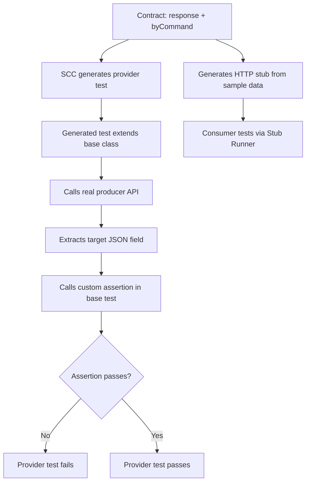
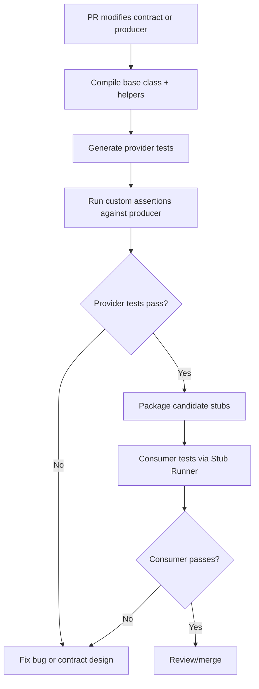

# Writing Helper Methods for Custom Assertions in Spring Cloud Contract Base Tests

In **Spring Cloud Contract (SCC)**, Groovy/YAML contracts express the behavior a **producer** must deliver to a **consumer**. The tool can generate **provider verification tests** from contracts and package **stubs** for consumer testing with **Stub Runner**. For many APIs, asserting HTTP status, headers, exact JSON values, or regexes is sufficient. Sometimes, however, a field requires a **verification rule that is hard to express with standard matchers**: an ID must match a format with a checksum, a timestamp must parse as a real point in time, an amount must use the right minor unit and be non-negative, or a business code must pass a dedicated validator.

That is where **custom assertions** shine. Rather than stuffing all logic into the contract file, you keep the contract concise and have the generated test call a **helper method in the base test**. This article in the **Base test** chapter focuses on organizing, implementing, and testing those helper methods with **Groovy DSL**, expressing the equivalent in **YAML DSL** when supported by your SCC version, and understanding limitations with HTTP stubs, messaging, and CI.

Running example: `order-producer` returns orders with a dynamic `orderId`, a UTC `createdAt`, and `totalMinor` as an integer amount in the smallest currency unit. `order-consumer` consumes that API.

## 1. Base test and custom assertions solve two different problems

The **base test** is the superclass configured for Spring Cloud Contract-generated tests to extend. It typically prepares the HTTP test mode, application context, mock dependencies, or fixtures. A **custom assertion** is a method in that superclass (or reachable from it) that validates a specific rule and **fails the test** when data is invalid.

Examples of what each component does:

| Component | Responsibility | Example |
| --- | --- | --- |
| Groovy/YAML contract | Declares request, response, and matchers to verify | `GET /api/orders/1001` returns 200, JSON contains `orderId` |
| Base test | Provides setup inherited by generated tests | Initializes MockMvc, prepares test clock or fake dependencies |
| Custom assertion method | Validates a value against application rules | `assertValidOrderId(value)` |
| Generated provider test | Sends request to producer and calls the assertion | Reads `$.orderId` and checks it via the helper method |
| Stubs JAR | Contains sample responses/mappings for consumer interaction tests | Returns sample JSON with `orderId: "ORD-123456"` |
| Consumer test | Verifies the client uses the stub properly | Deserializes JSON and handles the `orderId` field |

**The base test is not code that runs inside the consumer service.** An `assertValidOrderId` method in the producer's test sources is not automatically packaged into Stub Runner execution logic.



In the diagram, the **custom assertion sits on the producer verification path**. Stubs still need meaningful sample data, and consumer tests need their own assertions on the consumer side.

## 2. When do you need a custom assertion instead of exact, regex, or byType?

Not every field needs its own Java method. Start with the simplest matcher that accurately expresses the commitment.

| Verification need | Preferred approach | When is a custom assertion needed? |
| --- | --- | --- |
| Status must be `CREATED` | Exact `"CREATED"` | Almost never |
| HTTP status must be 201 | Exact status in contract | Not needed |
| ID formatted as `ORD-` + 6 digits | `byRegex` | When the ID also has a checksum/business rule hard to express in regex |
| Field must have numeric type | `byType` | When requiring an integer, non-negative, within business bounds |
| Timestamp follows fixed shape | Regex or appropriate time matcher | When needing real date/time parsing, UTC check, or range bounds |
| Code with checksum | Custom assertion | When needing an algorithm to verify check digits |
| One field depends on another | Business test or contextual assertion | When a single JSONPath matcher cannot see the full relationship |
| Order total calculation | Exact if inputs are fixed, unit tests | When needing a specialized rule; never relax exact checks unnecessarily |

**Tool selection rule:** use `byRegex` for string shape, type matchers for types, exact values for known outcomes, and Java methods when you need **validation logic that cannot be clearly expressed in the DSL matchers**. Do not write a custom assertion just to check something a short regex expresses cleanly.

### 2.1. Example difference between "syntactically well-formed" and "semantically valid"

Regex:

```regex
^[0-9]{4}-[0-9]{2}-[0-9]{2}T[0-9]{2}:[0-9]{2}:[0-9]{2}[.][0-9]{3}Z$
```

This checks the shape of a UTC timestamp with three millisecond digits, yet it accepts `2026-99-99T99:99:99.123Z`. A method using `Instant.parse` can additionally verify that the timestamp represents a real point in time.

Conversely, if an API **must return an exact deterministic timestamp** for fixed test data, a "parseable" matcher is still too loose. In that case, use `Clock.fixed` or deterministic fixtures and assert the exact value.

## 3. The byCommand mechanism in Groovy DSL

A common mechanism in the **Spring Cloud Contract Groovy DSL** is `byCommand(...)` inside `bodyMatchers`. It instructs the generated test to invoke a custom validation method.

Example contract `src/test/resources/contracts/http/get-order.groovy`:

```groovy
import org.springframework.cloud.contract.spec.Contract

Contract.make {
    description 'Order returns valid ID, UTC timestamp, and non-negative amount'

    request {
        method GET()
        url '/api/orders/1001'
        headers {
            header('Accept', 'application/json')
        }
    }

    response {
        status OK()
        headers {
            contentType(applicationJson())
        }
        body(
            orderId: 'ORD-123456',
            status: 'CREATED',
            createdAt: '2026-11-24T03:15:30.123Z',
            totalMinor: 125000,
            currency: 'VND'
        )
        bodyMatchers {
            jsonPath('$.orderId',
                byCommand('assertValidOrderId($it)'))
            jsonPath('$.createdAt',
                byCommand('assertValidUtcTimestamp($it)'))
            jsonPath('$.totalMinor',
                byCommand('assertValidMinorUnits($it)'))
        }
    }
}
```

Key details:

- `body` holds the **sample response** so stubs are generated with predictable data.
- `bodyMatchers` declares the rules the producer side must check against the real response.
- `jsonPath('$.orderId', ...)` selects the field to extract.
- `byCommand('assertValidOrderId($it)')` instructs the generated test to call the matching verification method.
- `$it` is a placeholder for **the value extracted by matching**; it is not a Groovy variable you declare in the contract.
- `status` and `currency` have no custom matchers in this example, so they remain checked as fixed expected values.
- The method name `assertValidOrderId` must match a method callable by the generated test from the base class.

**Important distinction:** `byCommand` does not make Spring Cloud Contract magically know how to validate the method's body. It requires **the developer** to write Java/Groovy assertion logic accessible when generated tests execute.

### 3.1. Choosing the scope of data passed into the method

In the example above, each command receives **one JSONPath field**:

| JSONPath | Sample value | Method |
| --- | --- | --- |
| `$.orderId` | `ORD-123456` | `assertValidOrderId` |
| `$.createdAt` | `2026-11-24T03:15:30.123Z` | `assertValidUtcTimestamp` |
| `$.totalMinor` | `125000` | `assertValidMinorUnits` |

A method receiving only `$.totalMinor` **does not automatically know** `$.currency` or item sums. If you need cross-field checks, design tests with full context (such as full-response assertions in a separate test), or use a mechanism supported by your plugin version and test mode. Do not assume a `byCommand` on one field can automatically inspect the entire response.

## 4. Creating a base class for generated tests to extend

Suppose the producer is a Spring Boot application using HTTP test mode based on **MockMvc**. Example structure:

```text
order-producer/
├── pom.xml
└── src/
    ├── main/java/com/example/order/...
    └── test/
        ├── java/com/example/order/contract/
        │   └── OrderContractBase.java
        └── resources/contracts/http/
            └── get-order.groovy
```

In Maven, `spring-cloud-contract-maven-plugin` can be configured so generated tests inherit from a base class:

```xml
<plugin>
    <groupId>org.springframework.cloud</groupId>
    <artifactId>spring-cloud-contract-maven-plugin</artifactId>
    <extensions>true</extensions>
    <configuration>
        <baseClassForTests>com.example.order.contract.OrderContractBase</baseClassForTests>
    </configuration>
</plugin>
```

This is the **core configuration fragment**, not a complete `pom.xml`. The project needs a Spring Cloud Contract version compatible with Spring Boot, test dependencies such as `spring-cloud-starter-contract-verifier`, and appropriate test framework configuration.

If a team has multiple contract types (HTTP, messaging, or different fixture groups), review the base-class mapping strategy supported by your plugin version. Do not assume every generated test extends this class if the build uses a different grouping mechanism.

### 4.1. Minimal base class with MockMvc

File `src/test/java/com/example/order/contract/OrderContractBase.java`:

```java
package com.example.order.contract;

import io.restassured.module.mockmvc.RestAssuredMockMvc;
import org.junit.jupiter.api.BeforeEach;
import org.springframework.beans.factory.annotation.Autowired;
import org.springframework.boot.test.autoconfigure.web.servlet.AutoConfigureMockMvc;
import org.springframework.boot.test.context.SpringBootTest;
import org.springframework.test.web.servlet.MockMvc;

@SpringBootTest
@AutoConfigureMockMvc
public abstract class OrderContractBase {

    @Autowired
    private MockMvc mockMvc;

    @BeforeEach
    public void setUpContractHttp() {
        RestAssuredMockMvc.mockMvc(mockMvc);
    }

    // Custom assertions will be added in later sections.
}
```

Explanation:

1. `@SpringBootTest` boots the producer application context for tests.
2. `@AutoConfigureMockMvc` provides MockMvc to dispatch requests to the web layer.
3. `RestAssuredMockMvc.mockMvc(mockMvc)` configures HTTP test mode when generated tests use RestAssuredMockMvc.
4. `@BeforeEach` ensures setup runs before each test under JUnit Jupiter.
5. The class is `abstract` because it supports generated tests rather than acting as a standalone test class.

**Version note:** HTTP test mode APIs, JUnit versions, and code generation depend on the Spring Cloud Contract/Spring Boot versions in use. If generated tests use a different HTTP test client, adjust base setup accordingly. Do not copy both MockMvc and WebTestClient/RestAssured setups simultaneously without checking which one generated tests actually invoke.

### 4.2. Verifying the link from plugin to base class

After generating tests, verify that the generated test class relates to `OrderContractBase` or is configured to call the expected helper methods. If the generated test does not extend the expected class, "cannot find symbol" errors or missing setup can occur.

Never add helpers to `src/main/java` just to resolve missing symbols if the logic is test-only. Keep validation methods in `src/test/java` so JUnit/assertion dependencies do not leak into the producer's runtime.

## 5. Writing a custom assertion method to validate an ID

Start with the requirement that `orderId` is a **string** formatted as `ORD-` followed by exactly six digits. Inside the base class:

```java
import static org.junit.jupiter.api.Assertions.assertTrue;

public void assertValidOrderId(Object value) {
    assertTrue(
        value instanceof String,
        "orderId must be a JSON string, actual=" + value
    );

    String orderId = (String) value;
    assertTrue(
        orderId.matches("^ORD-[0-9]{6}$"),
        "orderId does not match ORD-###### pattern: " + orderId
    );
}
```

The snippet above is a **method placed inside `OrderContractBase`**, not a standalone Java class. Add the `assertTrue` import at the top of the file if missing.

Why take `Object` instead of always `String`? Generated tests may pass the JSONPath result using whatever type the HTTP test framework returns. Taking `Object` and checking the type up front gives clearer failure messages when the value is not a string. Once you confirm your generated tests pass `String` in your version, you may use a stricter signature.

**A custom assertion must fail the test when data is invalid.** A function that merely returns `false` without the generated test asserting the return value can silently pass invalid responses. Use JUnit assertions or throw `AssertionError` upon violations.

### 5.1. Is regex enough?

When a rule is simply a prefix plus six digits, pure DSL works:

```groovy
bodyMatchers {
    jsonPath('$.orderId',
        byRegex('^ORD-[0-9]{6}$'))
}
```

That can be **simpler** than a Java helper. Custom assertions make more sense when verifying a **checksum**, conditional character rules, or business-level validation that regex cannot express clearly.

Example advanced requirement: the final digit must be a checksum computed from the first five digits. A Java method can parse the digits, compute the checksum, and report the exact mismatch. Never present `^ORD-[0-9]{6}$` as proof that a checksum was verified.

## 6. Writing a custom assertion method for a valid UTC timestamp

Regex checks timestamp shape but can let invalid months or days slip through. A custom assertion can use `java.time` to parse it.

Inside `OrderContractBase`:

```java
import static org.junit.jupiter.api.Assertions.assertTrue;
import static org.junit.jupiter.api.Assertions.fail;
import java.time.Instant;
import java.time.format.DateTimeParseException;

public void assertValidUtcTimestamp(Object value) {
    assertTrue(
        value instanceof String,
        "createdAt must be a JSON string, actual=" + value
    );

    String timestamp = (String) value;
    assertTrue(
        timestamp.endsWith("Z"),
        "createdAt must have Z suffix to indicate UTC: " + timestamp
    );

    try {
        Instant.parse(timestamp);
    } catch (DateTimeParseException ex) {
        fail("createdAt could not be parsed as Instant: " + timestamp, ex);
    }
}
```

This method verifies:

- The JSON value is genuinely a **string**.
- The string carries the `Z` suffix per API convention.
- `Instant.parse(...)` accepts it as a valid point in time.

It **does not** enforce exactly three millisecond digits. If that is also promised, add a length check on fractional seconds (e.g., a strict pattern) or use an explicitly configured `DateTimeFormatter`. If the API allows multiple offsets representing the same instant, do not mandate `endsWith("Z")`; adapt the assertion to real policy.

### 6.1. Do not use a real clock to create flaky tests

An assertion like "timestamp must equal `Instant.now()`" is usually unsuitable because time advances between when the server generates the value and when the test checks it.

If the contract requires an **exact** timestamp for fixtures:

```java
import java.time.Clock;
import java.time.Instant;
import java.time.ZoneOffset;

Clock clock = Clock.fixed(
    Instant.parse("2026-11-24T03:15:30.123Z"),
    ZoneOffset.UTC
);
```

Inject this clock into the producer during tests, then compare against the fixed instant. If you only need a **valid** timestamp, parsing with `Instant` may suffice. If you need "within the last 5 minutes," compare against the **injected clock** instead of implicitly relying on the CI machine's timezone or wall clock.

## 7. Writing a custom assertion method for minor-unit amounts

Suppose the contract states `totalMinor` is a non-negative integer in the published currency's smallest unit. A helper can check numeric type and mathematical integrality.

Inside `OrderContractBase`:

```java
import static org.junit.jupiter.api.Assertions.assertTrue;
import java.math.BigDecimal;

public void assertValidMinorUnits(Object value) {
    assertTrue(
        value instanceof Number,
        "totalMinor must be a JSON number, actual=" + value
    );

    BigDecimal amount;
    try {
        amount = new BigDecimal(value.toString());
        amount.toBigIntegerExact();
    } catch (NumberFormatException | ArithmeticException ex) {
        throw new AssertionError(
            "totalMinor must be a finite integer: " + value, ex
        );
    }

    assertTrue(
        amount.signum() >= 0,
        "totalMinor must not be negative: " + amount
    );
}
```

Explanation:

- `value instanceof Number` rejects a JSON string `"125000"` masquerading as a number.
- `new BigDecimal(value.toString())` evaluates the decimal value accurately rather than using `double` arithmetic.
- `toBigIntegerExact()` rejects values with a **fractional part**.
- `amount.signum() >= 0` rejects negative numbers.
- A type-and-range check like this **does not verify the total calculation formula**. If fixed inputs must total `125000`, use an exact assertion or dedicated calculation tests.

Note: a JSON parser may deserialize `125000` as `Integer`, `Long`, or another numeric class. The method above accepts any `Number`; if the API must distinguish a **JSON integer token** from `125000.0`, add tests at the appropriate data/serializer layer. Mathematical integrality checks alone do not guarantee the literal JSON token representation.

### 7.1. Avoid checking the wrong unit

`totalMinor: 125000` does not convey its full meaning without `currency` or a unit definition. For instance, if a system defines `totalMinor` as the smallest currency unit and the producer accidentally sends `1250.00` under the old field name, a "non-negative number" matcher might still accept it.

For a deterministic pricing scenario, keep exact result checks or add business calculation tests. Custom assertions should **increase verification precision**, never dilute existing commitments.

## 8. Combining the methods into a complete base class

Below is a more self-contained example showing all helpers coexisting in one class. The HTTP test setup assumes generated tests use RestAssuredMockMvc and JUnit Jupiter.

```java
package com.example.order.contract;

import static org.junit.jupiter.api.Assertions.assertTrue;
import static org.junit.jupiter.api.Assertions.fail;

import io.restassured.module.mockmvc.RestAssuredMockMvc;
import java.math.BigDecimal;
import java.time.Instant;
import java.time.format.DateTimeParseException;
import org.junit.jupiter.api.BeforeEach;
import org.springframework.beans.factory.annotation.Autowired;
import org.springframework.boot.test.autoconfigure.web.servlet.AutoConfigureMockMvc;
import org.springframework.boot.test.context.SpringBootTest;
import org.springframework.test.web.servlet.MockMvc;

@SpringBootTest
@AutoConfigureMockMvc
public abstract class OrderContractBase {

    @Autowired
    private MockMvc mockMvc;

    @BeforeEach
    public void setUpContractHttp() {
        RestAssuredMockMvc.mockMvc(mockMvc);
    }

    public void assertValidOrderId(Object value) {
        assertTrue(value instanceof String,
            "orderId must be a string: " + value);
        String id = (String) value;
        assertTrue(id.matches("^ORD-[0-9]{6}$"),
            "orderId invalid format: " + id);
    }

    public void assertValidUtcTimestamp(Object value) {
        assertTrue(value instanceof String,
            "createdAt must be a string: " + value);
        String text = (String) value;
        assertTrue(text.endsWith("Z"),
            "createdAt must use UTC suffix Z: " + text);
        try {
            Instant.parse(text);
        } catch (DateTimeParseException ex) {
            fail("createdAt is invalid: " + text, ex);
        }
    }

    public void assertValidMinorUnits(Object value) {
        assertTrue(value instanceof Number,
            "totalMinor must be a JSON number: " + value);

        BigDecimal amount;
        try {
            amount = new BigDecimal(value.toString());
            amount.toBigIntegerExact();
        } catch (NumberFormatException | ArithmeticException ex) {
            throw new AssertionError(
                "totalMinor must be a finite integer: " + value, ex);
        }
        assertTrue(amount.signum() >= 0,
            "totalMinor must not be negative: " + amount);
    }
}
```

This layout works well for learning, though in larger systems you can extract **pure validation logic** into a separate test helper class and keep thin delegating methods on the base class for generated tests to invoke. That makes validation logic independently unit-testable while keeping the base class short and maintainable.

**Inspect the actual generated test code** after running the plugin. Parameter types, invocation syntax, and HTTP test setup can differ across SCC versions and test modes. The example above shows a common setup, not a guaranteed default for every project.

## 9. YAML DSL: declaring equivalent custom commands

In Spring Cloud Contract YAML DSL versions supporting `by_command`, the corresponding intent can be expressed under `response.matchers.body`.

```yaml
description: "Order returns valid ID, UTC timestamp, and non-negative amount"
request:
  method: GET
  url: /api/orders/1001
  headers:
    Accept: application/json
response:
  status: 200
  headers:
    Content-Type: application/json
  body:
    orderId: ORD-123456
    status: CREATED
    createdAt: "2026-11-24T03:15:30.123Z"
    totalMinor: 125000
    currency: VND
  matchers:
    body:
      - path: $.orderId
        type: by_command
        value: 'assertValidOrderId($it)'
      - path: $.createdAt
        type: by_command
        value: 'assertValidUtcTimestamp($it)'
      - path: $.totalMinor
        type: by_command
        value: 'assertValidMinorUnits($it)'
```

Correspondence:

| Groovy DSL | YAML DSL | Meaning |
| --- | --- | --- |
| `bodyMatchers { ... }` | `response.matchers.body` | Matchers for the response body |
| `jsonPath('$.orderId', ...)` | `path: $.orderId` | Select field by JSONPath |
| `byCommand('assertValidOrderId($it)')` | `type: by_command` and `value: 'assertValidOrderId($it)'` | Request invoking helper |
| `body(orderId: 'ORD-123456')` | `body: orderId: ORD-123456` | Sample value |

Different SCC versions can vary in **YAML matcher schemas and command code generation**. Therefore, treat the example as verified for your project only after the plugin parses the YAML, generates tests with the right helper calls, and passes/fails as expected. Never conclude correctness merely because the YAML file parses without errors.

**Do not place both Groovy and YAML equivalents on the same discovery path** in a build, as doing so can generate duplicate contract tests/stubs for the same scenario.

## 10. Custom assertions do not change the HTTP stub

This is the easiest difference to overlook.

Given a response matcher:

```groovy
body(
    orderId: 'ORD-123456',
    status: 'CREATED'
)
bodyMatchers {
    jsonPath('$.orderId',
        byCommand('assertValidOrderId($it)'))
}
```

The two execution directions are:

1. **Producer verification:** generated tests send requests to the producer, extract `$.orderId` from the real response, and call `assertValidOrderId(...)` in the base class.
2. **Consumer stub:** Stub Runner/WireMock returns the **sample response** with `orderId: "ORD-123456"` from the contract. It does not execute the Java method `assertValidOrderId` when the consumer receives the response.

If you want the HTTP stub to match **varying request values**, use a request matcher that SCC translates into stub mappings (such as regex for request body/headers) or appropriate stub configuration. Adding a Java method to the base class does not teach WireMock how to match requests.

If you want the consumer to validate IDs in responses, the consumer test must have its own assertions or use matching client/model validation. **Methods in the producer's base class are not automatically distributed to consumers.**

### 10.1. When should you NOT choose byCommand?

- When a short regex like `^ORD-[0-9]{6}$` already expresses the rule.
- When you need to match consumer requests at WireMock runtime rather than in generated provider assertions.
- When verifying behavior spanning multiple requests, such as retrying 503 then getting 200.
- When checking relationships across multiple fields where a single JSONPath lacks context.
- When validation logic must be shared across multiple services at runtime, not just in producer test sources.

In those cases, choose DSL matchers, integration tests, or appropriate business validators.

## 11. Designing clear, maintainable helper methods

A good custom assertion has four traits: **clear inputs, no side effects, meaningful failures, and independent testability**.

### 11.1. Name methods after the rule being protected

Prefer:

```text
assertValidOrderId(value)
assertValidUtcTimestamp(value)
assertValidMinorUnits(value)
assertValidCountryCode(value)
```

Avoid:

```text
check(value)
doTest(value)
validateAll(value)
assertSomething(value)
```

Names should tell reviewers **which value** and **which rule** are checked. If a method only checks that a timestamp parses, name it `assertParseableUtcTimestamp` or `assertValidUtcTimestamp`—not `assertExactCreatedAt`, which misleads readers about how strict the check is.

### 11.2. Avoid side effects and external dependencies

**Never** let a custom assertion:

- Write to a database.
- Call uncontrolled external APIs.
- Rely on `Thread.sleep` to wait for values to "settle."
- Read the host's default timezone and interpret timestamps differently across environments.
- Mutate the response or overwrite actual values before checking.

If a rule needs reference data, provide deterministic fixtures/test data. If querying a real repository is required, consider placing that check in a dedicated integration test or injecting a controlled test double.

### 11.3. Failure messages must explain why

Compare:

```text
Assertion failed: expected true but was false
```

with:

```text
orderId invalid format: ORD-A23456; expected ^ORD-[0-9]{6}$
```

The second message slashes debugging time. When failure messages include response data, avoid leaking tokens, emails, customer PII, or sensitive payloads into CI logs. For sensitive fields, report only **the field name and violated rule**.

### 11.4. Keep assertion scope narrow

An `assertValidOrderId` method should not silently check order status, currency, and authorization too. Rules with multiple facets should be separated clearly or verified in descriptively named business tests.

A "one field, one rule" style works well for basic assertions. When cross-field invariants matter, write tests with complete input/output context instead of pretending a single JSONPath suffices.

## 12. Unit testing the custom assertion methods themselves

Generated provider tests only exercise helpers with whatever data the producer returns in current scenarios. To be sure your validators are not overly permissive, write **unit tests for the helpers**, covering valid, invalid, and boundary inputs.

Example with JUnit Jupiter, assuming `OrderContractBase` has no expensive constructor setup and helpers do not depend on the context:

```java
import static org.junit.jupiter.api.Assertions.assertDoesNotThrow;
import static org.junit.jupiter.api.Assertions.assertThrows;

import org.junit.jupiter.api.Test;

class OrderAssertionTest {

    private final OrderAssertions assertions = new OrderAssertions();

    @Test
    void acceptsValidOrderId() {
        assertDoesNotThrow(
            () -> assertions.assertValidOrderId("ORD-123456"));
    }

    @Test
    void rejectsMalformedOrderId() {
        assertThrows(AssertionError.class,
            () -> assertions.assertValidOrderId("ORD-12A456"));
        assertThrows(AssertionError.class,
            () -> assertions.assertValidOrderId("ORD-12345"));
    }

    @Test
    void rejectsInvalidTimestamp() {
        assertThrows(AssertionError.class,
            () -> assertions.assertValidUtcTimestamp(
                "2026-99-99T99:99:99.123Z"));
    }

    @Test
    void rejectsNegativeAmount() {
        assertThrows(AssertionError.class,
            () -> assertions.assertValidMinorUnits(-1));
    }
}
```

In the snippet above, `OrderAssertions` is a **pure helper class created by the team** to hold the three methods, not a built-in SCC class. You can move the three method bodies from the base class into this helper and delegate from `OrderContractBase`:

```java
private final OrderAssertions assertions = new OrderAssertions();

public void assertValidOrderId(Object value) {
    assertions.assertValidOrderId(value);
}
```

That way helper unit tests do not need to boot the Spring application context or MockMvc. **A base test class loaded with Spring annotations is rarely ideal for pure unit tests.**

Suggested test matrix:

| Helper | Cases that should pass | Cases that must fail |
| --- | --- | --- |
| `assertValidOrderId` | `ORD-123456` | `ORD-12345`, `ORD-A23456`, null, number |
| `assertValidUtcTimestamp` | `2026-11-24T03:15:30.123Z` | Month 99, string without `Z` per convention, null |
| `assertValidMinorUnits` | `125000`, `0` | `-1`, `12.5`, string `"125000"` |
| Business amount assertion (if any) | Exact total from fixture | Total off by one minor unit |

If a helper accepts data the consumer cannot process, generated tests can emit a false green. Testing helpers directly mitigates that risk.

## 13. Debugging generated test errors related to byCommand

Common symptoms:

| Symptom | Possible cause | How to resolve |
| --- | --- | --- |
| `cannot find symbol: assertValidOrderId` | Generated test cannot see method in base class | Check `baseClassForTests`, package, method name, visibility |
| `method cannot be applied to given types` | Method signature mismatches generated argument type | Open generated test, inspect argument type, adjust accordingly |
| `MissingMethodException` in Groovy context | Command calls wrong name/signature | Check `byCommand` expression and accessible methods |
| `NullPointerException` inside helper | Missing null handling | Check null/type before casting or parsing |
| Test fails assertion on valid ID | Regex/rule too strict, whitespace or new ID format | Check real commitment before relaxing matcher |
| Custom assertion never appears to run | Contract did not generate test or matcher misplaced | Check plugin config, generated tests, and logs |
| Stub Runner returns response even when helper is broken | Helpers only run during provider verification | Run provider tests separately; never expect WireMock to run Java helpers |
| Test fails only on CI | Different timezone, locale, clock, fixture, or test mode | Configure deterministic environment and avoid implicit dependencies |

Useful debugging sequence:

1. Verify the contract sits on the path the plugin actually scans.
2. Locate the generated test with the matching name.
3. Confirm the generated test extends the expected base class.
4. Locate the `assertValidOrderId(...)` / `assertValidUtcTimestamp(...)` invocation.
5. Inspect the runtime type of the argument passed in.
6. Re-run the test with deterministic fixtures.
7. Cross-check stub mappings to ensure sample payloads stay valid.
8. Only edit contracts or implementation after understanding the root cause.

Never turn helpers into `return true` or delete matchers just to turn CI green: doing so removes the compatibility safeguard the test was created to provide.

## 14. Boundaries with messaging and consumer contract tests

Spring Cloud Contract also supports message contracts with `input`, `outputMessage`, and `label`. Custom assertions in an **HTTP response body** do not automatically apply to message consumers or brokers.

For example, a message contract might describe:

```groovy
import org.springframework.cloud.contract.spec.Contract

Contract.make {
    description 'Emit OrderCreated with eventId and orderId'

    label 'order_created_v1'

    input {
        triggeredBy('publishOrderCreated()')
    }

    outputMessage {
        sentTo('orders.created')
        body(
            eventId: 'EVT-123456',
            orderId: 'ORD-123456'
        )
    }
}
```

Messaging producer verification requires the `publishOrderCreated()` hook and an appropriate message verifier/binder. If you need custom assertions on message payloads, use **the matcher/command capabilities of the messaging DSL and matching test mode**; do not assume HTTP JSONPath body matcher syntax works identically in every messaging configuration.

On the consumer side, Stub Runner can trigger message stubs by `label`; consumer tests must still assert that the listener received and processed the payload properly. A Java helper in `OrderContractBase` does not run inside the consumer's listener.

**Sensible reuse mechanism:** extract pure validation logic into a shared test library when multiple projects genuinely need it, while each side still runs tests invoking helpers in its own context. Never share test dependencies through runtime APIs merely for one contract's convenience.

## 15. Integrating custom assertions into CI

A CI workflow can include these steps:



In a Maven project configured with the SCC plugin and matching dependencies:

```bash
mvn clean verify
```

A green build **is not enough** if the plugin generated no tests or `byCommand` never appears in generated tests. CI should verify:

- Contracts are discovered and generated tests actually execute.
- Generated tests extend the right base class.
- Each `byCommand` invokes the right method and catches invalid values.
- Helpers are unit-tested with boundary inputs.
- Test setup controls clocks, locales, and timezones intentionally.
- Candidate stubs JAR contains sample responses matching contracts.
- Consumer tests use **the right stub version** corresponding to the evaluated producer.
- Required custom assertion code isn't left uncommitted on a local machine.

### 15.1. Verifying intentional breaking changes

| Change in producer | Expected result |
| --- | --- |
| `orderId: ORD-123456` → `ORD-12A456` | `assertValidOrderId` fails |
| `createdAt` → `2026-99-99T99:99:99.123Z` | `assertValidUtcTimestamp` fails |
| `totalMinor: 125000` → `-1` | `assertValidMinorUnits` fails |
| `status: CREATED` → `UNKNOWN` | Exact contract assertion fails |
| Response omits `orderId` | Generated test/matcher must catch missing field |
| Rename helper without updating `byCommand` | Test generation/compilation must error |
| Consumer parses JSON using old structure | Consumer test with candidate stub must warn |

If a case that should fail still passes, inspect the **actual generated test**, not just whether the Groovy/YAML file exists.

## 16. Practice exercise and self-assessment

Prepare an `order-producer` using Spring Cloud Contract and an `order-consumer` running Stub Runner. Follow each step:

1. **Basic contract:** Create a Groovy contract for `GET /api/orders/1001` returning 200, JSON with `orderId`, `status`, `createdAt`, and `totalMinor`.
2. **Base class:** Create `OrderContractBase` in `src/test/java`. Configure `baseClassForTests` and the appropriate HTTP test mode.
3. **Custom assertions:** Write three methods `assertValidOrderId`, `assertValidUtcTimestamp`, and `assertValidMinorUnits`, each with clear failure messages.
4. **Wire into DSL:** Add `byCommand('assertValidOrderId($it)')` and the matching commands under `response.bodyMatchers`.
5. **Producer verification:** Run generated tests. Intentionally return an invalid ID, an unparseable timestamp, and a negative amount; confirm the corresponding method fails each test.
6. **Compare with DSL matchers:** Replace the ID helper with `byRegex('^ORD-[0-9]{6}$')` and explain why the shorter form suffices for simple rules.
7. **YAML:** Write a `type: by_command` version on an experiment branch, inspect the generated test, and ensure two equivalent contracts are not active together.
8. **Unit test helpers:** Extract pure validation into `OrderAssertions` and test pass/fail with null, wrong types, fractional numbers, short IDs, and invalid timestamps.
9. **Consumer stub:** Package the stubs JAR; use Stub Runner to call the endpoint and verify the consumer parses the sample response. Explain why producer helpers do not run here automatically.
10. **CI:** Wire provider verification, helper unit tests, and consumer tests into a pipeline with the matching candidate artifact version; break a rule to verify the CI gate.

Self-assessment table:

| Goal | Completion evidence |
| --- | --- |
| Understand base tests | Know which class generated tests extend and how setup works |
| Write custom commands | `byCommand` targets the right method and uses `$it` properly |
| Helpers assert meaningfully | Fail with AssertionError/JUnit on invalid data |
| Understand `byCommand` limits | Do not confuse producer-side methods with Stub Runner runtime |
| Avoid overly loose checks | No "always true" helpers; keep exact checks where needed |
| Test helpers independently | Cover pass, fail, null, and boundary cases |
| Debug with the right tools | Inspect generated tests/mappings on failures |
| Two-sided CI | Provider verification and consumer tests using candidate stubs |

**Conclusion:** helper methods in the **base test** extend Spring Cloud Contract verification whenever a value requires a **custom assertion rule**. Use `byCommand` to connect contracts to accessible helpers, write pure helpers that fail clearly, verify generated producer tests genuinely invoke them, and use Stub Runner to verify consumers against sample responses. Custom assertions do not replace simple DSL matchers, do not automatically verify every business invariant, and do not execute inside HTTP stubs; understanding those exact boundaries is what makes CI catch breaking API changes reliably.
