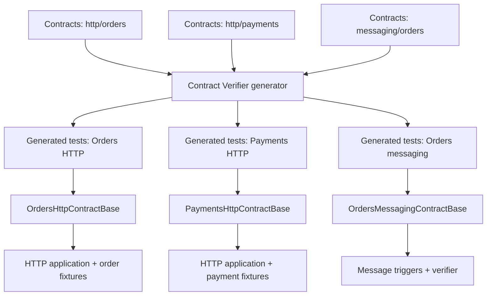
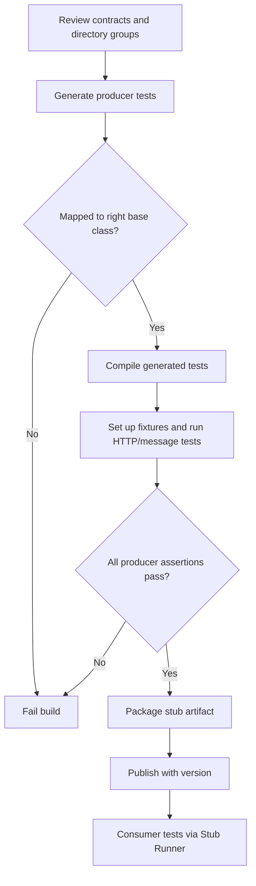

# Splitting Base Classes by Business Group or Communication Type

## 1. When one base test no longer fits all contracts

In the **SPRING_CLOUD_CONTRACT** module, Spring Cloud Contract helps producers and consumers agree on HTTP or messaging behavior using the **Groovy/YAML DSL**. From contracts, **Contract Verifier** generates producer-side tests; verified stubs can be packaged, published with versions, and consumed via **Stub Runner**. Combining producer tests and consumer tests in CI catches breaking API changes early.

Generated producer tests need a **base test class** to prepare the application, configure how requests are sent or messages triggered, set up fixtures, and provide helpers referenced by contracts. For a service with just a few HTTP endpoints, sharing one base class is usually sufficient. However, once a producer serves multiple business domains or handles both HTTP and messaging, a single base class holding every fixture and transport setup becomes hard to read, slow, and prone to state leaks across tests.

For example, consider an e-commerce service with three contract groups:

- **Orders HTTP**: `GET /api/orders/{id}`, `POST /api/orders`; needs order, inventory, and REST/MockMvc fixtures.
- **Payments HTTP**: `POST /api/payments`; needs payment fixtures, fake payment gateway config, and balance data.
- **Order messages**: emits `ORDER_CREATED` to `orders.events`; needs trigger methods and message observation mechanisms.

These three groups do not necessarily belong on the same base class. Spring Cloud Contract supports mapping contract groups to **different base classes**. The goal is not creating extra classes for its own sake, but placing the right test infrastructure at the right integration boundary.

After this article, you will be able to:

1. Decide when to split base classes by **business domain** versus **communication type**.
2. Organize contract directories and base classes so test groups do not interfere with one another.
3. Configure `baseClassMappings` or `packageWithBaseClasses` so Contract Verifier picks the right base class.
4. Distinguish the roles of `baseClassForTests`, base class mappings, generated test classes, and source contracts.
5. Read generated tests and CI logs to verify the intended base class was actually selected.
6. Avoid pitfalls such as overlapping mapping regexes, unsafe shared fixtures, and message tests running inside an HTTP environment by mistake.

## 2. What does a base test class do, and what does it not do?

When generating producer tests, Contract Verifier produces code verifying behavior described in the DSL. The producer-authored base class supplies the **execution context**:

| Base class responsibility | HTTP example | Messaging example |
| --- | --- | --- |
| Initialize environment | Spring context, MockMvc, test server port | Spring context, message binder/test transport |
| Prepare fixtures | Order `ord-1001`, customer, inventory | Input message/event, aggregate to emit events |
| Configure test tools | Rest Assured MockMvc or matching HTTP client | Message verifier, triggers, and output observation |
| Provide helpers | ID builders, test resource setup | `publishOrderCreated()` to trigger events |
| Isolate state | Clean up data before/after tests | Drain test message queues/channels appropriately |

**The base class does not define expectations in place of the contract.** HTTP status `201`, `Location` header, JSON body, destination `orders.events`, or message payloads must come from contracts agreed upon by producer and consumer. If expected behavior needs changing, update the DSL after reviewing API commitments rather than tweaking the base test to mask broken behavior.

The base class is also **not an HTTP stub**. Stub Runner serves consumer tests using generated mappings; the base class primarily enables **generated producer tests** to execute against the real producer. Consumers generally do not inherit from the producer's base class.

### 2.1. Relationship diagram



One contract may generate one test method inside a generated class containing multiple methods. How methods/classes are grouped depends on the generator version and configuration. **Base class mapping determines which class generated tests extend, not the exact number of generated classes.**

## 3. Choosing the split axis: business domain or communication type?

### 3.1. Splitting by business domain

Split by business domain when multiple contracts share **the same testing technology** yet require specialized fixtures or dependencies:

- `OrdersHttpContractBase` prepares product `SKU-001`, order `ord-1001`, and inventory.
- `PaymentsHttpContractBase` prepares invoices, transaction `pay-1001`, and a fake payment service.
- `CustomersHttpContractBase` prepares customer/account fixtures and required permissions.

Benefit: base classes stay small and clear; payment failures are less likely to break order tests. Each test prepares only the data needed for the behavior it verifies.

**Do not** create a base class per endpoint or per contract if they share the same fixtures and API invocation setup. Over-splitting makes `baseClassMappings` configuration more complex than it is worth.

### 3.2. Splitting by communication type

Split between **HTTP** and **messaging** when triggering and observation mechanisms differ:

| Perspective | HTTP base | Messaging base |
| --- | --- | --- |
| How does the test start? | Sends an HTTP request | Triggers the producer or feeds an input message |
| What setup is needed? | MockMvc, WebTestClient, or test server/REST client | Binder, message verifier, consumer/producer test channels |
| Primary assertions | HTTP status, headers, body | Destination, headers, and message payload |
| Core fixtures | Entities/controller/security data | Event sources, input and output messages |
| Typical setup failure | `404` due to missing record | No message emitted because trigger is undefined |

A messaging base class **does not automatically switch** an HTTP generator into message testing mode; it only provides configuration and helpers so generated message tests run properly. Conversely, a MockMvc base class cannot verify broker events without message observation infrastructure.

### 3.3. Combining both axes

In systems with multiple domains and multiple communication types, a combined layout is often easiest to manage:

| Contract group | Suggested base class | Why? |
| --- | --- | --- |
| `http/orders` | `OrdersHttpContractBase` | Order fixtures + MockMvc |
| `http/payments` | `PaymentsHttpContractBase` | Transaction fixtures + MockMvc |
| `messaging/orders` | `OrdersMessagingContractBase` | Trigger and observe order events |
| `messaging/payments` | `PaymentsMessagingContractBase` | Payment events and matching retry scenarios |

Only split when genuine setup/fixture differences exist. If several groups share the exact same HTTP client setup, put the **shared technical setup in a supporting superclass** and keep domain fixtures in dedicated subclasses.

## 4. Organizing contract directories and base classes

Suppose the producer uses Maven and Contract Verifier reads contracts from `src/test/resources/contracts`:

```text
orders-producer/
  src/
    test/
      resources/
        contracts/
          http/
            orders/
              get_order_success.groovy
              get_order_not_found.yml
            payments/
              create_payment_success.groovy
              create_payment_declined.groovy
          messaging/
            orders/
              order_created_event.groovy
      java/
        com/example/contract/
          HttpContractBase.java
          OrdersHttpContractBase.java
          PaymentsHttpContractBase.java
          OrdersMessagingContractBase.java
        com/example/contract/fixture/
          OrderFixtures.java
          PaymentFixtures.java
```

This is an **illustrative layout**, not mandatory directory names. In Gradle, the default contracts root may differ from Maven; source paths, packages, and generated test outputs also depend on plugin configuration. What must be verified after a build: **every contract was scanned and each group mapped to the intended base class**.

### 4.1. Naming along behavioral boundaries

| Name | What is it used for? |
| --- | --- |
| `http/orders/get_order_success.groovy` | File describing HTTP behavior |
| `name 'get_order_success'` | Identifies the contract scenario |
| `com.example.contract.OrdersHttpContractBase` | Java class providing setup for that contract group |
| `baseClassFQN` | Configuration selecting a base class by regex |
| `generated test method` | Method generated by Contract Verifier from a contract |

Do not assume the plugin automatically picks `OrdersHttpContractBase` from `name` or the endpoint URL. **Base class selection relies on configuration or directory conventions**, not inferring business domains from API names.

## 5. Structuring base classes with shared and specialized parts

### 5.1. Shared technical base class for HTTP contracts

Suppose the project uses **JUnit 5**, Spring Boot, and **MockMvc** HTTP mode. A shared base class can initialize HTTP request dispatching for generated tests:

```java
package com.example.contract;

import io.restassured.module.mockmvc.RestAssuredMockMvc;
import org.junit.jupiter.api.BeforeEach;
import org.springframework.beans.factory.annotation.Autowired;
import org.springframework.boot.test.autoconfigure.web.servlet.AutoConfigureMockMvc;
import org.springframework.boot.test.context.SpringBootTest;
import org.springframework.test.web.servlet.MockMvc;

@SpringBootTest
@AutoConfigureMockMvc
public abstract class HttpContractBase {

    @Autowired
    private MockMvc mockMvc;

    @BeforeEach
    protected void configureHttpClient() {
        RestAssuredMockMvc.mockMvc(mockMvc);
    }
}
```

This class handles **HTTP plumbing**, without preparing specific orders or payment transactions. It is hand-written in the producer's test sources.

To run this example, the project also needs compatible `RestAssuredMockMvc` dependencies, Spring Boot/MockMvc config, and matching plugin test framework settings. If the generator uses `EXPLICIT` HTTP test mode with a real server, or another test mode, use the matching base class instead of copying this MockMvc setup.

### 5.2. Orders domain base class

```java
package com.example.contract;

import com.example.contract.fixture.OrderFixtures;
import org.junit.jupiter.api.BeforeEach;
import org.springframework.beans.factory.annotation.Autowired;

public abstract class OrdersHttpContractBase extends HttpContractBase {

    @Autowired
    private OrderFixtures orderFixtures;

    @BeforeEach
    protected void prepareOrderData() {
        orderFixtures.reset();
        orderFixtures.existingOrder("ord-1001", "SKU-001", 2);
        orderFixtures.ensureMissing("ord-missing");
    }
}
```

`OrderFixtures` and methods `reset`, `existingOrder`, and `ensureMissing` are **illustrative helpers implemented by the project**, not built-in Spring Cloud Contract APIs. Helpers must create deterministic data independent of prior test runs; when using a real database, watch transactions, IDs, and cleanup.

Generated tests for contracts in `http/orders` will extend `OrdersHttpContractBase` once mappings are configured properly. Those tests can verify:

- `GET /api/orders/ord-1001 -> 200` with the committed body.
- `GET /api/orders/ord-missing -> 404` with error codes.
- `POST /api/orders` with matching inventory fixtures.

If `reset()` wipes shared tables carelessly while multiple tests run in parallel, the suite can flake randomly. Prefer per-test/per-transaction isolated data or concurrency-safe reset mechanisms matching your test environment design.

### 5.3. Payments domain base class

```java
package com.example.contract;

import com.example.contract.fixture.PaymentFixtures;
import org.junit.jupiter.api.BeforeEach;
import org.springframework.beans.factory.annotation.Autowired;

public abstract class PaymentsHttpContractBase extends HttpContractBase {

    @Autowired
    private PaymentFixtures paymentFixtures;

    @BeforeEach
    protected void preparePaymentData() {
        paymentFixtures.prepareAcceptedPayment("pay-1001");
        paymentFixtures.prepareDeclinedPayment("pay-declined");
    }
}
```

`PaymentFixtures` is a helper **belonging to the illustrative application**. Unlike orders, the payments group may need to replace an external payment gateway with a suitable test double to keep producer tests stable, while responses returned by the **producer's controller/service** must still be verified for real. Never mock the exact endpoint the contract protects and conclude the producer has been verified.

### 5.4. Inheritance guidelines

```text
HttpContractBase                      <- Shared MockMvc/client
    |-- OrdersHttpContractBase         <- OrderFixtures
    |-- PaymentsHttpContractBase       <- PaymentFixtures

OrdersMessagingContractBase           <- Message triggers/verifier
```

Keep inheritance hierarchies shallow and clear. When a base class accumulates too many unrelated `@BeforeEach` methods and helpers, consider switching to composition or fixture helpers rather than adding multi-level base hierarchies.

## 6. Maven configuration: explicit mapping with `baseClassMappings`

The Spring Cloud Contract Maven plugin lets you declare a list of `baseClassMapping` entries, each containing:

- `contractPackageRegex`: regex matching the **contract group's package/path** as interpreted by the plugin.
- `baseClassFQN`: **fully qualified class name** of the base class generated tests should extend.

Abbreviated `pom.xml` example:

```xml
<build>
  <plugins>
    <plugin>
      <groupId>org.springframework.cloud</groupId>
      <artifactId>spring-cloud-contract-maven-plugin</artifactId>
      <extensions>true</extensions>
      <configuration>
        <testFramework>JUNIT5</testFramework>
        <testMode>MOCKMVC</testMode>

        <baseClassForTests>
          com.example.contract.HttpContractBase
        </baseClassForTests>

        <baseClassMappings>
          <baseClassMapping>
            <contractPackageRegex>.*http.*orders.*</contractPackageRegex>
            <baseClassFQN>com.example.contract.OrdersHttpContractBase</baseClassFQN>
          </baseClassMapping>
          <baseClassMapping>
            <contractPackageRegex>.*http.*payments.*</contractPackageRegex>
            <baseClassFQN>com.example.contract.PaymentsHttpContractBase</baseClassFQN>
          </baseClassMapping>
          <baseClassMapping>
            <contractPackageRegex>.*messaging.*orders.*</contractPackageRegex>
            <baseClassFQN>com.example.contract.OrdersMessagingContractBase</baseClassFQN>
          </baseClassMapping>
        </baseClassMappings>
      </configuration>
    </plugin>
  </plugins>
</build>
```

**This is an illustrative snippet**, not a ready-to-run `pom.xml`. The plugin needs a compatible version, dependencies, contract root layout, and test setup matching your project. The regexes target **group names containing `http/orders` or `messaging/orders`**; actual regex matching operates on the **contract package**, not HTTP URLs. Always **inspect generated tests after building** to confirm each regex matched the intended group in your plugin version.

### 6.1. Expected mapping outcomes

| Contract group | Regex expected to match | Selected base class |
| --- | --- | --- |
| `http/orders/get_order_success.groovy` | `.*http.*orders.*` | `OrdersHttpContractBase` |
| `http/payments/create_payment_success.groovy` | `.*http.*payments.*` | `PaymentsHttpContractBase` |
| `messaging/orders/order_created_event.groovy` | `.*messaging.*orders.*` | `OrdersMessagingContractBase` |
| Group matching no mapping | None | `HttpContractBase` **fallback** in this example |

**Fallback warning:** `baseClassForTests` applies when no specific mapping matches. If a new message contract is placed in `messaging/payments` without a mapping, it may inherit the **HTTP base** via fallback, causing generated tests to lack message setup or fail to run properly. Once contract groups span multiple transports, review and verify mapping coverage for every group; **fallback does not replace mapping checks**.

### 6.2. Configuration precedence

Among the base class options supported by Spring Cloud Contract, the general precedence order is:

1. **`baseClassMappings`** — explicit regex mapping when a match is found.
2. **`packageWithBaseClasses`** — directory-convention inference when configured.
3. **`baseClassForTests`** — single shared base class used as fallback.

This rule describes selection behavior; **do not treat it as a guarantee that overlapping regexes will resolve in the exact order an author hoped**. Write clear, non-overlapping patterns and verify generated sources.

## 7. Convention-based configuration with `packageWithBaseClasses`

Beyond explicit mappings, Spring Cloud Contract supports inferring base class names from **contract directory conventions**.

For instance, if you set:

```xml
<configuration>
  <packageWithBaseClasses>com.example.contract</packageWithBaseClasses>
</configuration>
```

and a contract lives in a folder structure ending in `foo/bar/baz`, the framework can infer a base class such as `BarBazBase` in package `com.example.contract` according to the convention documented by Spring Cloud Contract.

Key detail: this convention uses the **trailing segments of the contract path/package** to derive the class name—it does not automatically pick `OrdersHttpContractBase` just because an endpoint path contains `orders`. When you want base class names driven purely by domain/transport semantics, `baseClassMappings` is usually clearer.

### 7.1. When should you use conventions?

Conventions work well when:

- Many groups follow a **consistent directory structure**.
- The team accepts base class names derived by the framework's algorithm.
- You want to minimize hand-written mappings.
- You have a check inspecting generated sources to catch missing base classes.

Explicit mappings fit better when:

- Business-meaningful base class names do not match the default naming algorithm.
- Some HTTP groups need specialized fixtures while messaging groups need different infrastructure.
- You want to preserve existing Java class names without reorganizing all contract folders.
- The project is migrating incrementally from a single shared base class to multiple base classes.

Avoid enabling multiple mechanisms simultaneously without understanding precedence. Even when a class name is derived by convention, **that class must still exist on the test classpath and match the test framework**.

## 8. Gradle configuration for base class groups

With the Spring Cloud Contract **Gradle plugin**, the mapping idea is the same: pick a shared `baseClassForTests`, then declare `baseClassMappings` for specific groups. Groovy DSL example for `build.gradle`:

```groovy
contracts {
    testFramework = 'JUNIT5'
    baseClassForTests = 'com.example.contract.HttpContractBase'

    baseClassMappings {
        baseClassMapping('.*http.*orders.*',
                         'com.example.contract.OrdersHttpContractBase')
        baseClassMapping('.*http.*payments.*',
                         'com.example.contract.PaymentsHttpContractBase')
        baseClassMapping('.*messaging.*orders.*',
                         'com.example.contract.OrdersMessagingContractBase')
    }
}
```

This is a **reference** configuration assuming the project already applies the matching Gradle plugin version and organizes contracts into those groups. The `contracts { ... }` block and `baseClassMapping(...)` entries apply to plugin versions supporting this feature; consult **your project version's** documentation and verify Gradle reads the configuration.

After configuring, typical commands are:

```bash
./gradlew generateContractTests
./gradlew contractTest
```

Task names and lifecycle wiring can differ by plugin/version. `generateContractTests` only proves code generation ran; `contractTest` must **execute** generated tests and be checked in test reports.

With Maven, the corresponding sequence in a configured project might be:

```bash
./mvnw -B spring-cloud-contract:generateTests
./mvnw -B clean verify
```

Do not run these commands without an appropriate build environment. The snippets are **practice instructions**, not proof that this article's snippets were built directly.

## 9. How does a messaging base class differ from HTTP?

A message contract can be expressed in Groovy DSL:

```groovy
import org.springframework.cloud.contract.spec.Contract

Contract.make {
    name 'order_created_event'
    label 'order_created'

    input {
        triggeredBy('publishOrderCreated()')
    }

    outputMessage {
        sentTo('orders.events')
        body([
            eventType: 'ORDER_CREATED',
            orderId  : 'ord-1001'
        ])
    }
}
```

In this example, `publishOrderCreated()` is **not** provided automatically by the framework. It is a helper the producer team implements so generated tests can trigger message emission.

### 9.1. Skeleton of a messaging base class

```java
package com.example.contract;

import org.springframework.beans.factory.annotation.Autowired;
import org.springframework.boot.test.context.SpringBootTest;

@SpringBootTest
public abstract class OrdersMessagingContractBase {

    @Autowired
    private OrderEventTestDriver orderEventTestDriver;

    public void publishOrderCreated() {
        orderEventTestDriver.publishOrderCreatedFor("ord-1001");
    }
}
```

`OrderEventTestDriver` and `publishOrderCreatedFor(...)` are **illustrative components implemented by the team**, not built into Spring Cloud Contract. In a real project, the driver triggers application behavior to emit the event, while the message verifier/binder or test transport lets generated tests observe **the actual emitted message**.

Things to safeguard:

- Triggers must use reproducible fixtures rather than uncontrolled random data.
- Output events must go to the contract-specified destination with the agreed headers/body.
- Do not accidentally verify a fake message sent straight from the test driver to the verifier while bypassing the producer logic under test.
- With multiple events in the same test suite, drain test queues/channels between cases to avoid reading leftover messages from earlier tests.

### 9.2. Base mappings do not change the global `testMode`

**Distinguish two configuration levels:**

| Setting | What it decides | What it does NOT do automatically |
| --- | --- | --- |
| `baseClassMappings` | Which base class a generated test extends | Does not switch tests to a different HTTP test mode |
| `baseClassForTests` | Fallback base class | Does not automatically supply every fixture |
| `testMode` | HTTP test approach used by the generator per plugin config | Does not convert HTTP into messaging or vice versa |
| Message test setup | Message triggering/observation mechanism | Does not automatically guarantee real-broker delivery, retries, or ordering |

If the same producer needs both MockMvc HTTP and real-server HTTP under **different** test modes, splitting base classes alone is insufficient. You may need generator configuration adjustments, separate build/source-set/module groups, or consistent test infrastructure. For messaging, you must also select a concrete binder/verifier; never assume message tests run merely because a class carries `@SpringBootTest`.

## 10. Fixtures and test independence

Splitting base classes helps most by reducing **hidden state risks**:

| Concern | With one overly broad base class | When split appropriately |
| --- | --- | --- |
| Fixture initialization | Every test may create orders, payments, and messages | Each group creates only needed data |
| Execution time | Higher setup and dependency overhead | Cuts unrelated setup |
| Failure diagnosis | Unclear which domain data caused failure | Quickly traced to the group's base class |
| Parallel tests | One group's test can delete another group's fixtures | Easier to establish separate isolation boundaries |
| Internal mocks and stubs | Changing one mock affects many branches | Mocks/fixtures tailored to the test objective |
| Maintenance | Class full of `if` conditions checking contract names | Small classes with clear responsibilities |

### 10.1. Avoiding unsafe global data mutation

For example, suppose `OrdersHttpContractBase` has a `@BeforeEach` that deletes the entire orders table, while `PaymentsHttpContractBase` references orders in that same database. Running both groups in parallel creates flaky failures.

Options to reduce risk:

1. Use dedicated databases/schemas or namespaces per suite if needed.
2. Generate test-specific fixture IDs and clean up within that data scope.
3. Use transactions/rollbacks when compatible with how tests invoke the app (do not assume rollback spans every boundary).
4. Minimize shared mutable state or static/global configuration.
5. Disable parallel execution for groups lacking isolation instead of tolerating intermittent failures.

The goal is not total independence from the framework, but ensuring every test has **clear, preparable, repeatable preconditions**.

### 10.2. Security testing by group

HTTP contracts for authenticated endpoints may need base classes that create matching sessions, mock principals, or test tokens. Do not run all HTTP tests automatically as an admin user; doing so can prevent `401`/`403` contracts from being properly verified.

You can split:

- `PublicOrdersHttpBase` for public APIs.
- `AuthenticatedOrdersHttpBase` for identity-protected APIs.
- `AdminOrdersHttpBase` for administrative APIs.

Only split further when those groups have **clear differences in security fixtures** and consumers rely on different branches. Never disable security filters just to make tests green.

## 11. Verifying that mappings actually worked

**Do not conclude success merely because `pom.xml`/`build.gradle` contains `baseClassMappings`.** Inspect generated sources:

1. Run the producer's test-generation step with the active plugin.
2. Locate the generated test corresponding to `http/orders/get_order_success.groovy`.
3. Check whether the generated class extends `OrdersHttpContractBase`.
4. Locate the test for `http/payments/create_payment_success.groovy` and confirm it extends `PaymentsHttpContractBase`.
5. Locate the test from `messaging/orders/order_created_event.groovy`; confirm it extends `OrdersMessagingContractBase` and invokes the right trigger.
6. Verify the count of scanned contracts and generated tests—ensure no contract was missed.
7. Run tests and inspect pass/fail/skip counts in the build report.

Illustrative generated source structure (for illustration only, **not verbatim generator output**):

```java
package com.example.generated.http.orders;

import org.junit.jupiter.api.Test;
import com.example.contract.OrdersHttpContractBase;

public class OrdersContractVerifierTest extends OrdersHttpContractBase {
    @Test
    void validate_get_order_success() {
        // Generated code: GET request and contract assertions.
    }
}
```

Exact package, class, and method names depend on the plugin and contract metadata. The key detail to verify is `extends OrdersHttpContractBase` and **assertions matching the contract**.

### 11.1. Verifying with a mapping table

| Contract | Expected base class | Base class seen in generated source | Result |
| --- | --- | --- | --- |
| `http/orders/get_order_success` | `OrdersHttpContractBase` | Filled in during inspection | PASS/FAIL |
| `http/payments/create_payment_success` | `PaymentsHttpContractBase` | Filled in during inspection | PASS/FAIL |
| `messaging/orders/order_created_event` | `OrdersMessagingContractBase` | Filled in during inspection | PASS/FAIL |

If you see `HttpContractBase` on the messaging row, inspect the package regex, file location, and mapping config. Never hand-edit generated tests: they will be overwritten on the next generation run.

## 12. Common pitfalls when splitting base classes

| Symptom | Possible cause | How to resolve |
| --- | --- | --- |
| Generated HTTP test extends messaging base | Mapping regex too broad or wrong directory | Scope patterns by transport and inspect output |
| A contract group still uses fallback | Regex did not match package as author expected | Check actual contract package and fix pattern |
| Compile error: base class not found | Wrong package in `baseClassFQN` or class missing from test classpath | Check FQCN, package declaration, test dependencies |
| Compile error: helper not found | Helper lives in another base or wrong visibility | Move helper to right class; use `protected`/`public` as needed |
| Order test fails `404` despite expecting `200` | Fixture `ord-1001` was not created | Inspect `OrdersHttpContractBase`/`OrderFixtures` |
| Messaging test fails due to missing trigger | `triggeredBy(...)` points to missing/inaccessible method | Implement trigger in messaging base |
| Messaging test passes while producer fails to emit real event | Test driver bypasses producer logic or verifier watches wrong channel | Check emission path and verifier setup |
| Tests flake under parallel execution | DB reset or message queue affects other groups | Use independent fixtures and proper test isolation |
| New contract generates no test | Wrong contracts directory/filter/plugin config | Verify contract scanning and generated test count |
| CI green despite 0 producer tests | Lifecycle/test runner never executed generated sources | Check test engine and build reports |
| HTTP test uses different mode than base class | `testMode` and client setup mismatch | Align plugin configuration and client initialization |

### 12.1. Distinguishing mapping errors from business errors

If the generated class cannot find `OrdersHttpContractBase`, it is a **compile/configuration** error. If the class is right yet `GET /api/orders/ord-1001` returns `404`, it may be a **fixture or producer behavior** bug. If producer tests pass while consumers still fail against new stubs, inspect **consumer tests and active contracts**, not just base classes.

Follow a step-by-step trace:

```text
Contracts scanned?
    -> Regex/group mapped to right base class?
       -> Generated class compiles and helpers accessible?
          -> Fixtures / test transport ready?
             -> Producer test assertions pass?
                -> Stubs created and consumer tests pass?
```

Each layer solves a distinct problem. Never alter a contract's HTTP status or body just to work around a package or fixture issue.

## 13. Integrating base class grouping into CI

A producer pipeline can follow this workflow:



Record in CI:

- Spring Cloud Contract plugin/test framework version.
- List of discovered contracts and matching mapping groups.
- Generated test class → actual selected base class.
- Counts of generated, executed, passed, failed, and skipped tests.
- Created/published stub artifact with exact coordinates and version.

When adding `messaging/payments` to the project, CI should clearly report that the new group **lacks a matching mapping** rather than silently letting it fall back to HTTP. This can be enforced by verifying generated test mappings in the build/review workflow or via team verification checks.

Splitting base classes **does not change the interface published to consumers**. It makes producer verification more stable; consumers must still test application logic against versioned stubs and contracts covering critical branches.

## 14. Practice exercise: organizing contracts for Orders, Payments, and Events

### 14.1. Context

A producer has five contracts:

| Contract | Key preconditions | Observable result |
| --- | --- | --- |
| `http/orders/get_order_success.groovy` | `ord-1001` exists | `200`, order JSON |
| `http/orders/get_order_not_found.yml` | `ord-missing` absent | `404 ORDER_NOT_FOUND` |
| `http/payments/create_payment_success.groovy` | Valid account and transaction | `201`, payment JSON |
| `http/payments/create_payment_declined.groovy` | Payment gateway declines per fixture | `409`, declined error code |
| `messaging/orders/order_created_event.groovy` | Order-creation trigger succeeds | `ORDER_CREATED` event |

### 14.2. Exercise tasks

1. Create three base classes: `OrdersHttpContractBase`, `PaymentsHttpContractBase`, and `OrdersMessagingContractBase`. Have the two HTTP bases extend `HttpContractBase`, while the messaging base holds the appropriate trigger and verifier.
2. Identify which helpers are team-implemented, such as `OrderFixtures` and `PaymentFixtures`, without confusing them with framework APIs.
3. Use `baseClassMappings` to map the three contract groups; include an intentional fallback.
4. Generate producer tests; record the generated class/method names and the base class actually selected.
5. Run producer verification with independent fixtures; describe how you prevent the payments group from wiping order group data.
6. Intentionally move `order_created_event.groovy` into `messaging/payments` without adding a mapping; observe the fallback base class and fix the mapping rule.
7. Run consumer tests with Stub Runner against the verified stub version, ensuring `200`, `404`, `201`, and `409` branches are handled properly.

### 14.3. Self-check questions

**Question 1.** Why not put all HTTP and messaging helpers into a single `BaseContractTest`?

**Answer:** It easily introduces redundant fixtures, unnecessary dependencies, state collisions, and harder debugging. When setup or transport differs, split along meaningful boundaries.

**Question 2.** Does `baseClassMappings` automatically change `testMode` from MockMvc to a real HTTP server for a group?

**Answer:** No. It selects the base class to extend. Test modes and client infrastructure must be configured properly in the plugin/build.

**Question 3.** What happens if a contract matches no regex?

**Answer:** When `baseClassForTests` is configured as a fallback, the generator can use that base class. That is not necessarily the right choice; verify mapping coverage.

**Question 4.** Does changing a contract's `name` from `get_order_success` to `get_order_valid` automatically switch its base class?

**Answer:** No, unless the mapping rule relies on file/package organization that was also changed. Mapping typically operates on contract package/group path, not the business `name`.

**Question 5.** Why must `publishOrderCreated()` appear in the messaging base class?

**Answer:** Generated message tests need a way to invoke producer behavior to emit the event, and the test framework does not synthesize this business method automatically.

### 14.4. References

- [Spring Cloud Contract — Maven Project: Using Different Base Classes for Contracts](https://docs.spring.io/spring-cloud-contract/reference/maven-project.html): `baseClassForTests`, `packageWithBaseClasses`, and `baseClassMappings`.
- [Spring Cloud Contract — Gradle Project: Different Base Classes for Contracts](https://docs.spring.io/spring-cloud-contract/reference/gradle-project.html): grouping and executing `contractTest`.
- [Spring Cloud Contract — Getting Started](https://docs.spring.io/spring-cloud-contract/reference/getting-started/first-application.html): role of the base test when running generated producer tests.

### Pre-finalization checklist for base test architecture

- [ ] Business domains and communication types needing distinct test infrastructure have been identified.
- [ ] Separate base classes are not created per contract when they share setup.
- [ ] Contract directories are clear and scanned properly by the plugin.
- [ ] `baseClassMappings` or `packageWithBaseClasses` is configured according to the chosen mechanism.
- [ ] Mapping regexes do not overlap unintentionally and cover all required groups.
- [ ] Base class FQCNs exist and reside on the test classpath.
- [ ] HTTP bases match `testMode`, and messaging bases provide appropriate triggers/verifiers.
- [ ] Fixtures are repeatable and isolated across tests.
- [ ] Generated sources were inspected to confirm `extends` points to the right base class.
- [ ] Producer tests **executed and passed**, not merely generated.
- [ ] Stub artifacts are clearly versioned; consumer tests run on Stub Runner.

**Takeaway:** splitting base tests by **business group** keeps fixtures lean and reduces coupling; splitting by **communication type** ensures HTTP and messaging use matching triggers and observation mechanisms. `baseClassMappings` routes groups to the right base classes, but must be verified through generated sources and producer test results. When structured well, contract suites become easier to maintain, easier to trace, and far more reliable in CI.
