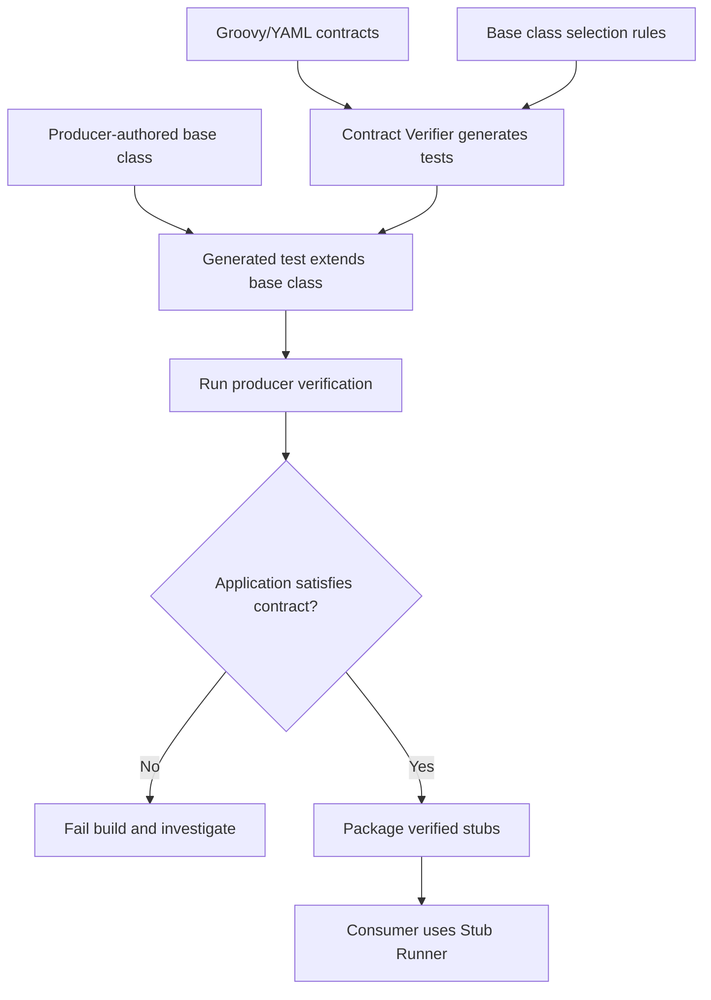
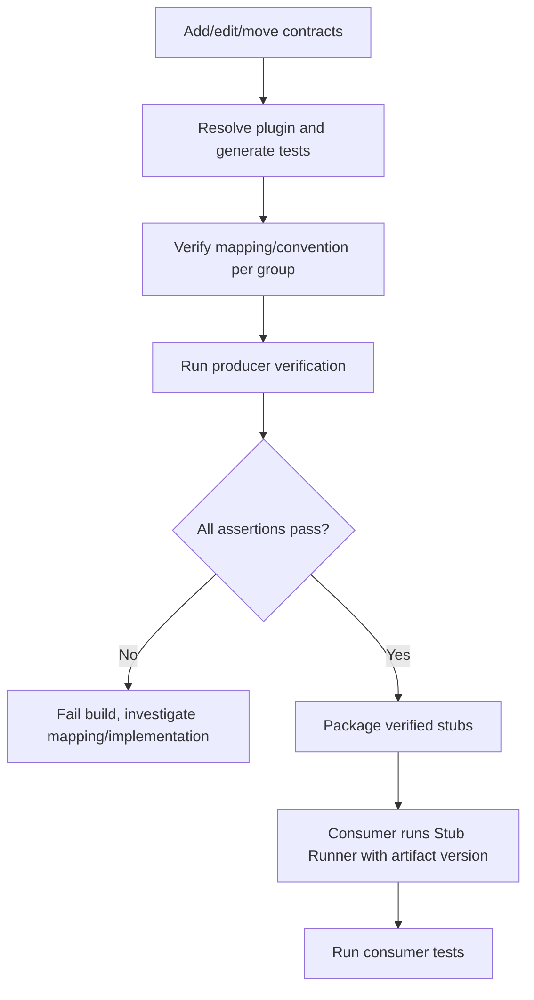

# Mapping by Package Name and Explicit Configuration

## 1. Context: one producer with multiple test initialization setups

**Spring Cloud Contract** lets teams define HTTP or messaging communication contracts using the Groovy/YAML DSL. From contracts, **Contract Verifier** generates **producer**-side tests; once the producer satisfies the contract, the build can package stubs for **consumers** to test via Stub Runner and integrate the whole workflow into CI.

A generated producer test cannot know on its own how to start the application, load data, or invoke your project's business logic. It typically needs a **base test class** written by the producer team. The base class prepares the test context, HTTP client, or message trigger, and generated tests inherit from it.

Suppose `Order Service` exposes:

- Public HTTP API `/api/orders/{id}`, using MockMvc and order fixtures.
- Internal HTTP API `/internal/orders/{id}`, requiring its own security context and fixtures.
- `OrderCreated` message, requiring a trigger method and message-observation configuration.

If all tests extend one default superclass, that class may end up holding unrelated configurations. Conversely, picking the wrong base class can keep generated tests from compiling, booting, or running in the right environment.

**The problem addressed here:** Spring Cloud Contract needs to know **which base class each contract group should extend**. Two key strategies are **package-name convention mapping** and **explicit configuration mapping**.

After this lesson, you will be able to:

1. Distinguish `baseClassForTests`, `packageWithBaseClasses`, and `baseClassMappings`.
2. Understand the roles of package names, contract paths, and fully qualified base class names.
3. Configure a Maven/Gradle project with multiple test groups.
4. Read generated tests to verify the right base class was chosen.
5. Avoid pitfalls like overlapping regexes, inconsistent packages, wrong test environments, and pipelines skipping contract tests.

## 2. Where does the base test class sit in test generation?

Consider a Groovy DSL contract for an HTTP request:

```groovy
import org.springframework.cloud.contract.spec.Contract

Contract.make {
    description 'Retrieve details for an order'
    request {
        method GET()
        url '/api/orders/42'
    }
    response {
        status OK()
        headers {
            contentType(applicationJson())
        }
        body(
            orderId: 42,
            status: 'CREATED'
        )
    }
}
```

In the producer environment, the plugin reads the contract and generates a matching test. Below is an **illustrative shape**, not verbatim Java generated by every plugin version:

```java
public class Validate_get_order extends PublicHttpContractBase {

    @Test
    public void validate_get_order() throws Exception {
        // Send GET /api/orders/42 to the application in the test context.
        // Verify status 200 and JSON body.
    }
}
```

`PublicHttpContractBase` provides the HTTP environment, while the generated test executes the steps derived from the contract.



**A base class is not a stub.** It is only used when running generated producer tests; consumers do not need to know which superclass the producer used to verify its contracts.

## 3. Distinguishing three easily confused names

Suppose a project has this layout:

```text
src/test/
  resources/
    contracts/
      public_http/
        get_order.groovy
      internal_http/
        get_internal_order.groovy
      messaging/
        order_created.groovy
  java/
    com/example/contracts/base/
      PublicHttpContractBase.java
      InternalHttpContractBase.java
      MessagingContractBase.java
```

There are at least three distinct pieces of information:

| Concept | Example | What is it used for? |
| --- | --- | --- |
| **Contract file location** | `contracts/public_http/get_order.groovy` | Groups interactions read by the generator |
| **Generated test package** | Package name derived/created per plugin config | Organizes auto-generated test classes |
| **Base class FQN** | `com.example.contracts.base.PublicHttpContractBase` | Superclass generated tests must extend |

**FQN (Fully Qualified Name)** includes both the package and class name. If a Java file declares:

```java
package com.example.contracts.base;

public abstract class PublicHttpContractBase {
}
```

then its FQN is `com.example.contracts.base.PublicHttpContractBase`, not the file path `src/test/java/com/example/contracts/base/PublicHttpContractBase.java`.

A **directory name** like `public_http` is also not automatically a valid Java package or base class name. How the plugin converts contract locations into generated test packages and applies conventions must be checked for your project's Spring Cloud Contract version.

## 4. Three ways to choose a base class

| Mechanism | Idea | Best fit | What to check |
| --- | --- | --- | --- |
| `baseClassForTests` | Specifies one shared superclass | All contracts share the same test context | Do generated tests actually extend the right class? |
| `packageWithBaseClasses` | Picks superclasses via **package/base-class naming conventions** | Multiple groups follow a uniform naming rule | What naming convention does the plugin apply to each contract package? |
| `baseClassMappings` | Declares **contract group regex → explicit FQN** | Arbitrarily named groups or non-conventional base classes | Does each regex match exactly one group? Does the FQN exist? |

No option is universally best. What matters is **matching how the project organizes contracts and test environments**, while keeping reviews straightforward as new groups are added.

### 4.1. Simple case: `baseClassForTests`

Maven example:

```xml
<configuration>
    <testFramework>JUNIT5</testFramework>
    <testMode>MOCKMVC</testMode>
    <baseClassForTests>com.example.contracts.base.HttpContractBase</baseClassForTests>
</configuration>
```

When every contract targets HTTP on the same Spring MVC application, this is easy to maintain. However, if a messaging group requires its own trigger methods, cramming everything into `HttpContractBase` introduces unnecessary coupling and invites broken setup.

## 5. Mapping by package name: `packageWithBaseClasses`

`packageWithBaseClasses` configures **the package holding convention-selected base classes**, instead of listing each contract or regex individually. The generator uses the contract's package structure and the base class naming convention supported by your plugin version to determine the superclass.

Partial Maven configuration example:

```xml
<configuration>
    <testFramework>JUNIT5</testFramework>
    <testMode>MOCKMVC</testMode>
    <packageWithBaseClasses>com.example.contracts.base</packageWithBaseClasses>
</configuration>
```

With Gradle Groovy DSL, the corresponding idea:

```groovy
contracts {
    packageWithBaseClasses = 'com.example.contracts.base'
}
```

**Important distinction:** `packageWithBaseClasses` **is not the FQN of a single base class**. It specifies the namespace containing the base classes the generator looks up by convention.

### 5.1. What are the benefits of naming conventions?

If a project enforces a consistent naming rule, you can add a new contract group without declaring another regex mapping. For instance, the project has contract groups `public_http`, `internal_http`, and `messaging`, and intentionally names base classes per **the convention recognized by the generator**.

Benefits:

- Less repetitive mapping configuration as the number of groups grows.
- Group names and base class names mirror the same structure.
- Easy to automate in projects with centrally governed conventions.

Trade-offs:

- Renaming a contract package/directory can silently alter which base class is chosen.
- Base class names must follow **the exact rule implemented by your plugin version**, not just "what looks reasonable."
- When groups break convention or need special overrides, explicit mappings are usually clearer.

### 5.2. Do not guess derived class names

Suppose a team wants to use:

```text
public_http   -> PublicHttpContractBase
internal_http -> InternalHttpContractBase
messaging     -> MessagingContractBase
```

That is **the project team's desired naming table**, not a guarantee that every Spring Cloud Contract version derives those exact names when `packageWithBaseClasses` is enabled. Exact transformations from contract package to class name (capitalization, joining package levels, suffixes) must be verified against release-specific documentation and generated source output.

If you cannot name base classes per the convention, **do not force group layouts into an assumption**; use `baseClassMappings` to declare FQNs directly.

## 6. Explicit mapping with `baseClassMappings`

With explicit mappings, each group has a rule consisting of:

- `contractPackageRegex`: regex identifying the contract group's package/location as used by the plugin.
- `baseClassFQN`: fully qualified superclass name matching `package` in Java/Kotlin sources.

Maven configuration example inside the Spring Cloud Contract plugin:

```xml
<plugin>
    <groupId>org.springframework.cloud</groupId>
    <artifactId>spring-cloud-contract-maven-plugin</artifactId>
    <version>${spring-cloud-contract.version}</version>
    <extensions>true</extensions>
    <configuration>
        <testFramework>JUNIT5</testFramework>
        <testMode>MOCKMVC</testMode>
        <baseClassMappings>
            <baseClassMapping>
                <contractPackageRegex>.*public_http.*</contractPackageRegex>
                <baseClassFQN>com.example.contracts.base.PublicHttpContractBase</baseClassFQN>
            </baseClassMapping>
            <baseClassMapping>
                <contractPackageRegex>.*internal_http.*</contractPackageRegex>
                <baseClassFQN>com.example.contracts.base.InternalHttpContractBase</baseClassFQN>
            </baseClassMapping>
            <baseClassMapping>
                <contractPackageRegex>.*messaging.*</contractPackageRegex>
                <baseClassFQN>com.example.contracts.base.MessagingContractBase</baseClassFQN>
            </baseClassMapping>
        </baseClassMappings>
    </configuration>
</plugin>
```

Here, `${spring-cloud-contract.version}` must be defined in the project/parent POM and aligned with **Spring Cloud Contract dependencies managed by the Spring Cloud BOM**. Importing a BOM manages dependencies, not Maven plugin versions automatically.

Gradle Groovy DSL configuration example:

```groovy
contracts {
    baseClassMappings {
        baseClassMapping(
            '.*public_http.*',
            'com.example.contracts.base.PublicHttpContractBase'
        )
        baseClassMapping(
            '.*internal_http.*',
            'com.example.contracts.base.InternalHttpContractBase'
        )
        baseClassMapping(
            '.*messaging.*',
            'com.example.contracts.base.MessagingContractBase'
        )
    }
}
```

The snippet above assumes the module applies a compatible Spring Cloud Contract Gradle plugin version. Gradle Kotlin DSL uses different syntax; check the corresponding extension API before converting.

### 6.1. Why are explicit FQNs easy to control?

Base class names do not need to match contract package names. For instance, the `internal_http` group can use a base class named `com.example.security.AdminContractVerificationBase`. Just swap the FQN in the rule:

```xml
<baseClassMapping>
    <contractPackageRegex>.*internal_http.*</contractPackageRegex>
    <baseClassFQN>com.example.security.AdminContractVerificationBase</baseClassFQN>
</baseClassMapping>
```

This works well when multiple groups share a base class, teams have legacy package structures, or class names cannot/should not be renamed to fit a convention.

**Drawback:** Whenever you add a group, rename a package, or move contracts, you must review the mappings. If forgotten, the generator may pick a fallback or fail to use the expected superclass.

## 7. Choosing a strategy based on project characteristics

Consider these scenarios:

| Project characteristic | Option to consider | Reason |
| --- | --- | --- |
| One module with a few HTTP contracts | `baseClassForTests` | Simple and readable |
| Many packages following a stable official convention | `packageWithBaseClasses` | Less manual configuration |
| Multiple groups with legacy/non-conventional superclasses | `baseClassMappings` | Explicit FQNs, fewer assumptions |
| Public and secured HTTP groups with distinct setups | `baseClassMappings` or verified convention | Ensures the right context is used |
| Message contracts needing custom triggers | Messaging base class, explicitly mapped | Tests must invoke message-publishing logic |
| Adding many groups per customer/tenant | Consider convention if naming is tightly governed | Reduces repetitive config, but requires checks for new groups |

Do not configure all three mechanisms at once "just in case." When multiple strategies are active simultaneously, **precedence/fallback rules can depend on the plugin version**; unless you know the exact behavior, choose one primary strategy, remove redundant config, and inspect generated tests.

### 7.1. Notes on ordering and overlapping regexes

Two rules:

```text
.*http.*
.*internal_http.*
```

can both match the `internal_http` group. If the superclass for public HTTP differs from internal HTTP, that is a hazard. It is better to structure groups and regexes so **one contract matches only one rule**.

Do not implicitly rely on the order of `baseClassMapping` entries without verifying precedence in your exact version's documentation. A plugin upgrade or rule reordering can silently switch generated tests to a different base class.

### 7.2. What does the regex match against?

The name `contractPackageRegex` refers to the contract's **package** during test generation; it does not necessarily match a raw file-explorer path containing `/` or `\`.

For example, `.*public_http.*` is fairly readable in examples, yet before adopting it in production you should:

1. Check the contract path and generated test package.
2. Verify what package/path string your plugin version passes to matching.
3. Generate tests for one representative contract.
4. Open the generated class and confirm `extends` points to the right FQN.
5. Add automated checks to detect mis-mappings when renaming groups.

If the plugin uses dot-separated package names, a regex relying on `/public_http/` will not match as expected.

## 8. Example base test classes for the groups

### 8.1. Public HTTP: initializing MockMvc

An HTTP base class can use Spring Boot Test and RestAssuredMockMvc:

```java
package com.example.contracts.base;

import io.restassured.module.mockmvc.RestAssuredMockMvc;
import org.junit.jupiter.api.BeforeEach;
import org.springframework.beans.factory.annotation.Autowired;
import org.springframework.boot.test.autoconfigure.web.servlet.AutoConfigureMockMvc;
import org.springframework.boot.test.context.SpringBootTest;
import org.springframework.test.web.servlet.MockMvc;

@SpringBootTest(webEnvironment = SpringBootTest.WebEnvironment.MOCK)
@AutoConfigureMockMvc
public abstract class PublicHttpContractBase {

    @Autowired
    protected MockMvc mockMvc;

    @BeforeEach
    protected void configureClient() {
        RestAssuredMockMvc.mockMvc(mockMvc);
    }
}
```

This template targets Spring MVC and a test mode supporting RestAssuredMockMvc. Align `testFramework`/`testMode`, plugin version, and test dependencies. Declaring the base class alone does not prepare `orderId=42` data or guarantee the controller returns the right response.

### 8.2. Internal HTTP: needing the right authentication context

```java
package com.example.contracts.base;

import org.springframework.test.context.ActiveProfiles;

@ActiveProfiles("contract-internal")
public abstract class InternalHttpContractBase
        extends PublicHttpContractBase {

    // Prepare fixtures and authentication mechanisms matching
    // the internal contracts the producer must actually satisfy.
}
```

This is just a skeleton. The `contract-internal` profile and principal/token setup are project responsibilities; this class **does not automatically grant admin privileges**. Disabling all security filters just to pass tests can prevent `401`/`403` contracts from being properly verified.

Having the internal base extend the public base to reuse MockMvc only makes sense if they genuinely share the same test context. Otherwise, extract shared helpers and keep the two base classes independent.

### 8.3. Messaging: providing triggers

Example message contract:

```groovy
import org.springframework.cloud.contract.spec.Contract

Contract.make {
    description 'Emit OrderCreated when creating an order'
    label 'order_created'
    input {
        triggeredBy('publishOrderCreated()')
    }
    outputMessage {
        sentTo('orders.created')
        body(
            eventType: 'OrderCreated',
            orderId: 42
        )
    }
}
```

Illustrative messaging base class:

```java
package com.example.contracts.base;

import org.springframework.beans.factory.annotation.Autowired;
import org.springframework.boot.test.context.SpringBootTest;
import org.springframework.cloud.contract.verifier.messaging.boot.AutoConfigureMessageVerifier;

@SpringBootTest
@AutoConfigureMessageVerifier
public abstract class MessagingContractBase {

    @Autowired
    protected OrderApplicationService orderApplicationService;

    public void publishOrderCreated() {
        orderApplicationService.publishOrderCreated(42L);
    }
}
```

`OrderApplicationService` and `publishOrderCreated` are **illustrative application APIs** you must implement. The test suite also needs matching message verifier/binder/transport configuration to observe events. `triggeredBy` does not generate message-publishing logic on its own.

The messaging group differs from public/internal HTTP in its **test environment**, not merely its directory name. That is why accurate base class mapping matters.

## 9. When does automatic package mapping become dangerous?

Suppose a team renames a directory:

```text
contracts/public_http/get_order.groovy
```

to:

```text
contracts/public_api/get_order.groovy
```

The HTTP contract content did not change. However:

- With `packageWithBaseClasses`, changing the package can make the generator look for a **different convention-derived base class**.
- With `baseClassMappings` using `.*public_http.*`, the renamed contract no longer matches the old rule.
- With `baseClassForTests` using one shared class, renaming packages rarely changes superclass selection, though it can still affect generated test packages and other settings.

Therefore, **moving a contract is a meaningful build/test change**, not just a file-location refactor. After moving contracts, regenerate tests and verify the selected superclass.

Similarly, when adding a `partner_http` group, do not just drop `.groovy` files and assume new tests get a valid environment. Decide whether the group uses the public base, internal base, or its own base class; then update conventions or mappings accordingly.

## 10. Inspecting generated tests after configuration

Syntax-valid `pom.xml` or `build.gradle` files do not prove mappings are right. **The primary evidence is the generated test source and test execution results.**

Reference commands **for a real, fully configured project**:

```bash
./mvnw clean verify
./mvnw help:effective-pom
```

```bash
./gradlew clean test
./gradlew tasks --all
```

These commands were not run while authoring this article. Their purposes:

- `help:effective-pom` shows the resolved Maven plugin configuration after merging parent/build settings.
- `tasks --all` reveals generator tasks exposed by your Gradle plugin version.
- `verify` or `test` executes generated producer tests when plugin and lifecycle/task wiring are configured properly.

### 10.1. Superclass verification matrix

| Contract | Expected base class | Generated `extends` | Conclusion |
| --- | --- | --- | --- |
| `public_http/get_order.groovy` | `PublicHttpContractBase` | `PublicHttpContractBase` | PASS mapping |
| `internal_http/get_internal_order.groovy` | `InternalHttpContractBase` | `InternalHttpContractBase` | PASS mapping |
| `messaging/order_created.groovy` | `MessagingContractBase` | `PublicHttpContractBase` | FAIL mapping |

This is **example data**. On the last row, the messaging test extends an HTTP base lacking `publishOrderCreated()`, leading to compilation failure or inability to observe messages.

If generated tests have unexpected package names or extend an unintended class:

1. Check which path the contract resides in.
2. Check active settings: `baseClassForTests`, `packageWithBaseClasses`, `baseClassMappings`.
3. Check for overlapping regexes and fallback classes.
4. Check the `package` declaration in the base class source and its FQN in the plugin.
5. Regenerate tests on a clean build, read the fresh source, and run the tests.

**Never edit generated test sources by hand.** They can be overwritten on the next generation run. Fix the configuration, contract location, or source base class instead.

## 11. Common errors and troubleshooting steps

| Symptom | Possible cause | Resolution |
| --- | --- | --- |
| `cannot find symbol: SomeBase` | Wrong FQN, missing class, or not on test classpath | Check package, source set, and module |
| Generated test extends wrong base | Convention/package or regex did not match as expected | Compare paths and generated sources |
| Test has right base class but does not run | Task skipped, no discoverable tests, or wrong test framework config | Check generated vs. executed test counts |
| `NullPointerException` in MockMvc setup | Wrong Spring context or injection | Check `@SpringBootTest`, `@AutoConfigureMockMvc`, `testMode` |
| Unexpected `401`/`403` in internal test | Missing user/token/permission or mismatched security setup | Check contract request, filters, and test principal |
| Messaging test misses emitted event | Trigger does not invoke business logic or wrong verifier/binder | Check method, destination, and test transport |
| Added new package but tests lack right base | Convention/mapping not updated | Update mapping rule and regenerate tests |
| Configuring multiple strategies gives confusing results | Precedence not verified for plugin version | Simplify config; check docs and generated output |

### 11.1. Base class missing from test classpath

Suppose the configuration declares:

```xml
<baseClassFQN>com.example.contracts.base.InternalHttpContractBase</baseClassFQN>
```

Yet the Java file declares:

```java
package com.example.testbase;
```

The actual FQN no longer matches configuration. Rename the package/class or update the mapping to match; **do not edit generated tests**.

### 11.2. Overly broad regex leading to "compiles, wrong context"

An `internal_http` test might compile and run against `PublicHttpContractBase` if both bases expose similar APIs. That is even more dangerous than a compile error because tests may skip internal security filters or fixtures. Beyond verifying that tests run, verify **which superclass was selected** and **which environment actually booted**.

## 12. Designing CI to avoid "false greens"

A sound producer pipeline can follow these steps:



Essential practices:

- **Pin versions** of Spring Boot, Spring Cloud BOM, Spring Cloud Contract dependencies, and the plugin consistently.
- **Inspect generated tests** per group whenever changing folders/packages or mapping configs.
- **Verify test counts**: neither generated nor executed test counts may silently drop to zero.
- **Keep fixtures stable**: public, internal, and messaging tests must not implicitly depend on execution order.
- **Never bypass security** just to make internal contracts pass.
- **Block stub publication when producer verification fails**; consumers must test against properly versioned stub artifacts.
- **Maintain integration/E2E tests** for environmental behavior outside the contract scope.

Base class mapping **does not replace contracts**: the right base merely runs tests in the right context; assertions on status, headers, bodies, and messages still come from producer/consumer-maintained contracts.

## 13. Hands-on exercise: convention or explicit mapping?

Suppose a producer has three groups:

```text
contracts/
  public_api/
    create_order.groovy
  backoffice/
    approve_order.groovy
  events/
    order_created.groovy
```

And these base classes already exist:

```text
com.example.testbase.PublicApiBase
com.example.security.BackOfficeVerificationBase
com.example.events.OrderMessageContractBase
```

**Tasks:**

1. Explain why a single `baseClassForTests` may not fit.
2. If adopting `packageWithBaseClasses`, what must be verified before relying on the existing class names?
3. Write explicit Maven `baseClassMappings` for the three groups.
4. If `backoffice` is renamed to `internal_admin`, which configuration needs review and why?
5. After running the generator, what should you inspect to prove mappings are right?

**Suggested solution for task 3:**

```xml
<baseClassMappings>
    <baseClassMapping>
        <contractPackageRegex>.*public_api.*</contractPackageRegex>
        <baseClassFQN>com.example.testbase.PublicApiBase</baseClassFQN>
    </baseClassMapping>
    <baseClassMapping>
        <contractPackageRegex>.*backoffice.*</contractPackageRegex>
        <baseClassFQN>com.example.security.BackOfficeVerificationBase</baseClassFQN>
    </baseClassMapping>
    <baseClassMapping>
        <contractPackageRegex>.*events.*</contractPackageRegex>
        <baseClassFQN>com.example.events.OrderMessageContractBase</baseClassFQN>
    </baseClassMapping>
</baseClassMappings>
```

Explanation hints: (1) public API, backoffice, and messaging require different setups; (2) verify whether **the plugin's exact convention** resolves those existing class names instead of guessing from folder names; (4) both convention and regex rules can break when packages are renamed; (5) inspect generated `extends`, package/FQN, and run real producer verification.

## 14. Pre-merge checklist

- Have you distinguished **contract path**, **generated test package**, and **base class FQN**?
- Does the project use one primary base class selection strategy, or multiple strategies with verified precedence/fallback?
- If using `packageWithBaseClasses`, has your plugin version's class-naming rule been verified?
- If using `baseClassMappings`, do regexes cleanly separate groups without overlap?
- Are base classes on the test classpath and providing the right Spring context, MockMvc, auth, or message triggers?
- Do generated tests in every group **extend the right class** and execute completely?
- Were folder/package refactors accompanied by mapping checks rather than only reviewing contract contents?
- Does CI publish stubs only after producer verification passes, and then run consumer tests via Stub Runner?

**Version-specific reference documentation:** [Spring Cloud Contract — Maven plugin](https://docs.spring.io/spring-cloud-contract/reference/maven-project.html), [Spring Cloud Contract — Gradle plugin](https://docs.spring.io/spring-cloud-contract/reference/gradle-project.html), [Contract Verifier](https://docs.spring.io/spring-cloud-contract/reference/project-features-contract.html). Specific details on **base class naming conventions, mapping precedence, and plugin syntax** must be cross-checked against your project's actual version.

**Takeaway:** `packageWithBaseClasses` selects base tests by **package-name convention**; `baseClassMappings` selects them by **contract group regex and explicit FQN**; `baseClassForTests` sets a single shared base class. To protect APIs with Spring Cloud Contract, don't stop at configuration—**read generated tests to confirm the superclass**, run real producer verification, and publish verified stubs for consumers.
