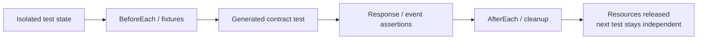
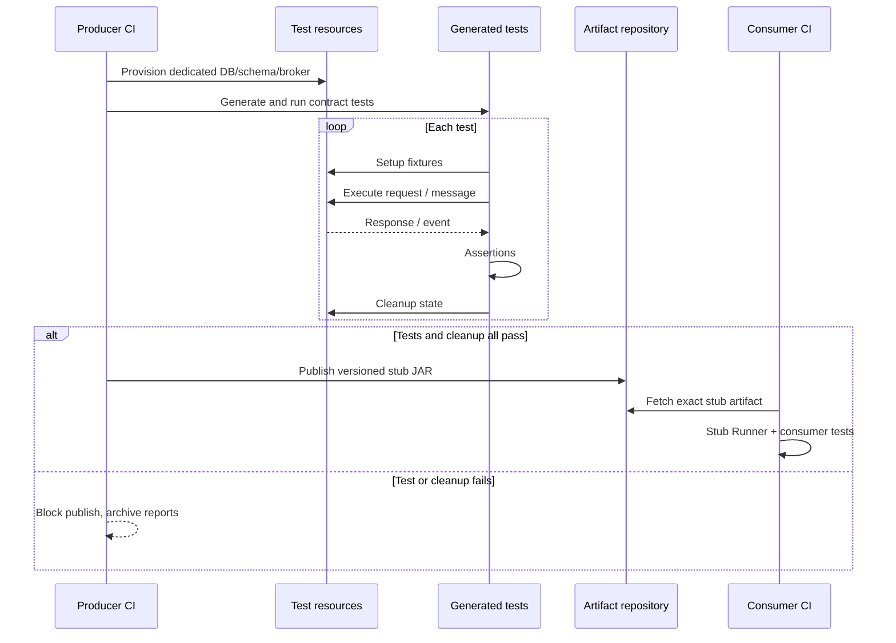

# Cleaning Up State After Tests and Avoiding Cross-Test Interference

## 1. Context: a valid contract can still produce flaky test results

In **Spring Cloud Contract**, the producer publishes HTTP or messaging behavior using **Groovy DSL** or **YAML DSL**. **Spring Cloud Contract Verifier** generates producer-side tests; the same contract source can generate stubs so **Stub Runner** serves consumer tests. In CI, both sides must be verified to catch breaking API changes.

Suppose the producer exposes an API:

```http
GET /api/orders/42
Accept: application/json
```

The contract requires the response:

```json
{
  "id": 42,
  "state": "PAID",
  "totalAmount": 120000
}
```

A generated producer test might pass when executed alone yet fail when run after another test. For instance, an earlier test transitioned order `42` to `REFUNDED`, left a stale entry in a cache, or left a mock configured to throw an error. Conversely, a contract test can dirty the database, session, or queue, causing tests running after it to fail.

**Cleaning up state after tests** (*teardown/cleanup*) returns test-used resources to a state that does not affect other tests. **Avoiding cross-test interference** (*test isolation*) means designing tests so one test's outcome never depends on earlier tests, execution order, or concurrent execution of other tests.

Desired outcome: **each contract runs independently, has clear preconditions, produces trustworthy evidence, and never alters the environment of the next contract**.

## 2. Distinguishing setup, teardown, and isolation

Three related concepts that do not replace one another:

| Concept | When? | Goal | Example |
|---|---|---|---|
| **Setup** | Before test | Create predictable preconditions | Order `42` exists, `state=PAID` |
| **Teardown** | After test | Clean up resources created or mutated by the test | Delete test records, close clients, stop stub servers |
| **Isolation** | Throughout lifecycle | Prevent tests from sharing state that can skew results | Dedicated DB/schema, dedicated namespace, non-overlapping data |

An ideal lifecycle:



**Good setup does not make teardown redundant.** A test may create additional payment attempts, temporary files, or messages while exercising an API. Conversely, **good teardown does not replace setup**: if a test starts from indeterminate data, results can still fail before cleanup ever runs.

Some global state **should never be shared in the first place** rather than trying to clean it up afterward: production databases, live queues, shared-environment caches, collision-prone fixed ports, user files, and process-wide environment variables.

## 3. Sources of cross-test state leakage

| Source | Leakage symptom | Appropriate countermeasure |
|---|---|---|
| **Database** | Later test reads rows created/modified by an earlier test | Proper rollback, seed + cleanup, dedicated DB/schema |
| **Mockito mock/spy** | Prior invocations or stubbings leak into new tests | Fresh stubs per test, reset via test framework |
| **Spring singleton bean** | Counters, mutable collections, or flags persist in cached context | Avoid mutable global state or reset in lifecycle |
| **HTTP test globals** | Rest Assured base URI, cookies/filters/request specs persist | Configure per test, reset globals if modified |
| **Cache** | Returns stale `PAID` entry even after DB changed | Isolated cache or clear exact keys before/after test |
| **Security context** | User/roles from earlier test remain active | Set and clear security context; use test security support |
| **Clock, locale, timezone** | Tests fail only at certain hours or in certain timezones | Inject fixed `Clock`; avoid changing global defaults |
| **Message broker** | Later test consumes events from an earlier test | Dedicated topic/queue/group, controlled ack/drain |
| **WireMock/stub server** | Request journal/mappings/scenarios retain state | Reset server, mappings, request journal, and scenarios as needed |
| **Temp files** | Existing file causes later test to skip creation step | Dedicated temp directory with automatic cleanup |
| **System properties** | JVM feature flags or config altered | Restore prior values; minimize global state mutation |

**There is no single cleanup command** that handles every kind of state. Identify shared resources before choosing cleanup techniques and isolation mechanisms.

## 4. How can a contract-generated test be affected?

Example Groovy contract for a paid order:

```groovy
import org.springframework.cloud.contract.spec.Contract

Contract.make {
    description 'Fetch PAID order to display at checkout'

    request {
        method GET()
        url '/api/orders/42'
        headers {
            header 'Accept', 'application/json'
        }
    }

    response {
        status OK()
        headers {
            contentType(applicationJson())
        }
        body(
            id: 42,
            state: 'PAID',
            totalAmount: 120000
        )
    }
}
```

YAML DSL expressing the same scenario:

```yaml
description: Fetch PAID order
request:
  method: GET
  url: /api/orders/42
  headers:
    Accept: application/json
response:
  status: 200
  headers:
    Content-Type: application/json
  body:
    id: 42
    state: PAID
    totalAmount: 120000
```

These two files are **two illustrative representations**; real projects usually pick **one** per scenario to avoid duplicate generated tests. The DSL describes requests and responses; **it does not create order 42 or clean up data**. When generated tests extend a base class, the base class must initialize producer state and control side effects after requests run.

Another test might call `POST /api/orders/42/pay` and insert a payment attempt. If order `42` gets mutated in the same database, the `GET` contract could return `PENDING`, `REFUNDED`, or the wrong total amount. That is why **the entire state lifecycle** must be managed, not just HTTP assertions.

## 5. JUnit 5: `@BeforeEach` and `@AfterEach` in the base test

Spring Cloud Contract Verifier can configure generated tests to inherit from a team-written **base class**. With JUnit Jupiter, lifecycle methods on the base class apply to inheriting tests under JUnit rules.

| Annotation/mechanism | Purpose | Caveats |
|---|---|---|
| `@BeforeEach` | Sets up state before each test method | Test must establish deterministic preconditions |
| `@AfterEach` | Cleans up resources after each test method | Must handle cases where test assertions fail |
| `@BeforeAll`/`@AfterAll` | Manages class-wide shared resources | Unsuitable for per-method independent state |
| `try/finally` | Releases resources immediately around an operation | Useful when resources are opened mid-test |
| `@Sql` | Sets up/cleans up DB data via scripts in Spring Test lifecycle | Requires understanding transactions and execution order |
| `@DirtiesContext` | Marks the Spring context non-reusable | Expensive; not a database-cleanup tool |

**Separation of responsibilities:** `@BeforeEach` builds a valid environment; `@AfterEach` cleans up things that do not vanish automatically, like static state or external resources. Avoid placing data-deletion calls inside individual contract DSLs—contracts describe behavior, while the base test manages test infrastructure.

### 5.1. Example base class for MockMvc

Suppose the application uses Spring MVC, JUnit 5, and Rest Assured MockMvc. A base class can configure the context and mocks before each generated test:

```java
package com.example.orders.contract;

import com.example.orders.api.OrderView;
import com.example.orders.service.OrderQueryService;
import io.restassured.module.mockmvc.RestAssuredMockMvc;
import org.junit.jupiter.api.AfterEach;
import org.junit.jupiter.api.BeforeEach;
import org.springframework.beans.factory.annotation.Autowired;
import org.springframework.boot.test.autoconfigure.web.servlet.AutoConfigureMockMvc;
import org.springframework.boot.test.context.SpringBootTest;
import org.springframework.test.context.bean.override.mockito.MockitoBean;
import org.springframework.web.context.WebApplicationContext;

import static org.mockito.Mockito.when;

@SpringBootTest(webEnvironment = SpringBootTest.WebEnvironment.MOCK)
@AutoConfigureMockMvc
public abstract class ContractVerifierBase {

    @Autowired
    private WebApplicationContext context;

    @MockitoBean
    private OrderQueryService orderQueryService;

    @BeforeEach
    protected void prepareContract() {
        RestAssuredMockMvc.webAppContextSetup(context);
        when(orderQueryService.findById(42L))
            .thenReturn(new OrderView(42L, "PAID", 120000L));
    }

    @AfterEach
    protected void cleanupContract() {
        // Only needed if tests used RestAssuredMockMvc static configuration.
        RestAssuredMockMvc.reset();
    }
}
```

**Important scope limits of this example:**

- `OrderQueryService` and `OrderView` are **illustrative application classes**, not built into Spring Cloud Contract.
- `@MockitoBean` exists in **Spring Framework 6.2+**; on older stacks, use the `@MockBean` mechanism matching your Spring Boot version.
- Spring Test's Mockito support normally resets mock beans after each test; `@AfterEach` here resets **Rest Assured MockMvc configuration**, not mock management. If mocks are created manually or kept outside the context, reset them explicitly.
- Annotations, `testMode`, dependencies, and verifier JUnit version must align. This example uses `MOCKMVC`; it does not apply as-is to WebFlux or real-port tests.
- Mocks only simulate dependencies at the HTTP boundary. They do not verify the producer's full repository/transaction behavior.

### 5.2. Resetting mocks differs from deleting data

Suppose a mock is stubbed to return `PAID`, while the next test expects an exception for `404`. Without resetting mocks, stale stubbings can break the next test. Avoid calling `Mockito.reset(...)` indiscriminately at the end of tests when the framework already manages resets; doing so can hide interactions another test intended to verify or complicate debugging.

**More importantly:** resetting Mockito does not clear caches, roll back databases, purge message brokers, or restore JVM environment variables.

### 5.3. What if setup or teardown throws an exception?

Normally JUnit still invokes `@AfterEach` when the test body fails, but avoid writing cleanup that assumes a variable assigned only at the very end of setup. Write cleanup to be **idempotent**: safe to call repeatedly and safe if resource creation failed midway.

Example:

```java
private AutoCloseable subscription;

@BeforeEach
void setup() {
    subscription = createSubscriptionForTest();
}

@AfterEach
void cleanup() throws Exception {
    if (subscription != null) {
        subscription.close();
        subscription = null;
    }
}
```

`createSubscriptionForTest()` here is an illustrative project-supplied function. For resources opened mid-test, `try/finally` or `try-with-resources` around the usage block usually ensures cleaner release.

## 6. Cleaning up the database with `@Sql`: before and after each test

If producer contract tests must traverse real repositories and a database, mocking the entire service can miss persistence bugs. Using a **test-dedicated database** with fixture scripts is a practical option.

### 6.1. Organizing scripts in the project

Example test layout:

```text
src/test/
├── java/com/example/orders/contract/
│   └── DbContractVerifierBase.java
└── resources/
    ├── contracts/orders/get-paid-order.groovy
    └── contract-fixtures/
        ├── seed-paid-order.sql
        └── cleanup-order.sql
```

The scripts in this diagram are examples you can create **in a real project**. This article does not create extra files outside the assigned Markdown.

File `seed-paid-order.sql`:

```sql
-- Run only on the test database.
DELETE FROM payment_attempts WHERE order_id = 42;
DELETE FROM orders WHERE id = 42;

INSERT INTO orders (id, state, total_amount)
VALUES (42, 'PAID', 120000);
```

File `cleanup-order.sql`:

```sql
-- Clean up dependent records first; follow foreign-key order.
DELETE FROM payment_attempts WHERE order_id = 42;
DELETE FROM orders WHERE id = 42;
```

This is an illustrative schema; table names, deletion order, and foreign keys must match your real database. **Never** run cleanup scripts on production databases or shared environments.

### 6.2. Base test using `@Sql`

```java
package com.example.orders.contract;

import io.restassured.module.mockmvc.RestAssuredMockMvc;
import org.junit.jupiter.api.BeforeEach;
import org.springframework.beans.factory.annotation.Autowired;
import org.springframework.boot.test.autoconfigure.web.servlet.AutoConfigureMockMvc;
import org.springframework.boot.test.context.SpringBootTest;
import org.springframework.test.context.jdbc.Sql;
import org.springframework.web.context.WebApplicationContext;

@SpringBootTest(webEnvironment = SpringBootTest.WebEnvironment.MOCK)
@AutoConfigureMockMvc
@Sql(
    scripts = "/contract-fixtures/seed-paid-order.sql",
    executionPhase = Sql.ExecutionPhase.BEFORE_TEST_METHOD
)
@Sql(
    scripts = "/contract-fixtures/cleanup-order.sql",
    executionPhase = Sql.ExecutionPhase.AFTER_TEST_METHOD
)
public abstract class DbContractVerifierBase {

    @Autowired
    private WebApplicationContext context;

    @BeforeEach
    protected void setupMockMvc() {
        RestAssuredMockMvc.webAppContextSetup(context);
    }
}
```

With Spring Test, `@Sql` runs scripts before and after each test method according to `executionPhase`. The contract verifier plugin must point to this exact base class.

**Design note:** the seed script deletes and recreates order ID `42` before the test; the cleanup script deletes the rows afterward. This gives **defense in depth**, because teardown is not guaranteed to run under every infrastructure crash. If a suite is killed abruptly, cleanup may not complete; the next run still needs a mechanism to guarantee clean initial state.

### 6.3. Delete by ID or wipe the whole table?

Deleting only the rows created by the test lowers risk when a test database holds multiple fixtures, though if tests generate new IDs you must track them or use a dedicated namespace. Unconditional `DELETE FROM orders` can break other tests or shared resources during parallel runs.

If you need parallel testing or multiple pipelines sharing a database server, a **dedicated schema/database per job** is usually far more reliable than cleaning shared tables. With ephemeral container databases, destroying the container after the suite provides an additional cleanup layer.

## 7. Transaction rollback: useful, but with limits

In Spring Test, a test annotated with `@Transactional` under a test-managed transaction normally **rolls back after the test finishes** per framework mechanics. That is a convenient way to isolate data for many scenarios.

However, **never treat rollback as complete cleanup**:

- With `@SpringBootTest(webEnvironment = RANDOM_PORT)` or `DEFINED_PORT`, HTTP requests run in a server context that may use a **separate thread/transaction**; the test method's transaction does not necessarily wrap writes made by the request.
- Interactions with message brokers, filesystems, caches, external services, or outbound emails are **not rolled back** by JDBC transactions.
- Code starting independent transactions like `REQUIRES_NEW` or async tasks can commit outside the test's transaction.
- `@Sql` scripts have their own transaction mode; verify which transaction they run in and when they commit.
- Depending on the database, DDL or sequence/identity increments may not roll back as you expect.

### 7.1. Strategy selection table

| Test type | Suitable strategy | Risks to watch |
|---|---|---|
| Repository test inside test transaction | Automatic rollback | Does not test side effects outside the transaction |
| MockMvc + shared-context service/repository | Rollback or setup/cleanup can work | Verify actual transaction boundaries in code |
| HTTP over a real port | Dedicated test DB + explicit cleanup/rollback | Server handles requests in separate transactions |
| Event/messaging | Dedicated destinations, message drain/ack | JDBC rollback does not retract emitted events |
| Integration test with external services | Stubs or isolated resource namespaces | External side effects do not roll back |

**Never guess from annotations alone.** When a test protects write behavior, inspect state after the request and after the test to prove cleanup actually works.

## 8. Cached Spring application contexts: benefits and risks

Spring Test can **cache the `ApplicationContext`** across test classes to cut startup overhead. That optimization is valuable, yet singleton beans in the context can retain mutable state if code is not careful.

For example, a bean holding a `List<String> events` field acts as an in-memory fake event store. Test A appends an event without clearing it; Test B sees that event even though the database rolled back. `@Transactional` does nothing for state stored in JVM memory.

### 8.1. When to use `@DirtiesContext`?

`@DirtiesContext` declares that the context was modified and should not be reused. It is useful when a test alters context beans/config in hard-to-restore ways, but it **incurs full Spring restart cost**. Avoid slapping `@DirtiesContext` onto every generated test just to mask a poorly designed cache or singleton.

Prefer:

1. Avoiding mutable global state in services.
2. Injecting clearly scoped dependencies (clock, cache, clients) and resetting those targets explicitly.
3. Using `@DirtiesContext` intentionally only when the context genuinely becomes dirty and cannot be reliably restored.

**Note:** `@DirtiesContext` also does not automatically clean up rows written to external databases, filesystems, or brokers.

## 9. Rest Assured, mock HTTP, security, and global configuration

Generated contract tests may use Rest Assured MockMvc, Rest Assured over real HTTP ports, or WebTestClient. Those libraries manage shared/configurable state differently.

- If a test modifies global **base URI, authentication, filters, cookies, or request specifications**, subsequent tests can inherit them. Restore or configure per test.
- With Rest Assured MockMvc, `RestAssuredMockMvc.reset()` clears static library configuration. **Resetting the HTTP client does not clear databases or caches.**
- If running a WireMock server in integration tests, reset modified **request journals, stub mappings, or scenario states**, or spin up dedicated instances.
- With Spring Security tests, set principals and security contexts per scenario and clear them via Spring Security test lifecycle support; never rely on a user left over from an earlier test.
- Never put real credentials into fixtures, logs, or test reports.

### 9.1. System properties and feature flags must be restored

If a test must call `System.setProperty(...)`, save and restore the prior value:

```java
private String oldValue;

@BeforeEach
void setFeatureFlag() {
    oldValue = System.getProperty("orders.feature.strict");
    System.setProperty("orders.feature.strict", "true");
}

@AfterEach
void restoreFeatureFlag() {
    if (oldValue == null) {
        System.clearProperty("orders.feature.strict");
    } else {
        System.setProperty("orders.feature.strict", oldValue);
    }
}
```

**Warning:** System properties are **JVM-wide state**. Even when restored in `@AfterEach`, another test running **concurrently** can observe the temporary value. Prefer context-scoped config/feature flag injection or isolated execution whenever global state must change. Similarly, avoid mutating process-wide default timezones or locales during parallel contract tests.

## 10. Messaging: cleanup is more than deleting messages

Spring Cloud Contract supports message testing via `input`, `outputMessage`, and triggers like `triggeredBy(...)`. In messaging tests, leaked state can hide in:

- Unconsumed events sitting in a topic/queue.
- Consumer group offsets, redeliveries, and retries.
- Active subscriptions/listeners left open.
- Dead-letter queues or outbox rows left from previous tests.
- Asynchronous tasks still running after assertions finish.

Conceptual contract example:

```groovy
import org.springframework.cloud.contract.spec.Contract

Contract.make {
    name 'shouldPublishOrderPaid'
    label 'order_paid'

    input {
        triggeredBy('publishOrderPaidForContract()')
    }

    outputMessage {
        sentTo('orders.paid')
        headers {
            header('eventType', 'OrderPaid')
        }
        body(
            orderId: 42,
            state: 'PAID'
        )
    }
}
```

`publishOrderPaidForContract()` is a project-implemented method invoked by generated tests, not a promise that the broker cleans itself up. The base test must configure matching binders/destinations/triggers. Use **dedicated destinations or consumer groups**, unique correlation IDs, and **bounded conditional waiting** to distinguish the current test's messages from stale ones.

### 10.1. Subtle bugs in async tests

If a test emits an event, asserts the event arrived, and exits immediately, a background handler may still be writing to the database or emitting follow-up messages. Cleanup running too early will collide with that background work, causing random failures in the next test.

Solution: wait with bounded conditions for completion, close subscriptions properly, use unique test namespaces, and clean up related outbox/message records. **`Thread.sleep(2000)` does not prove background side effects finished**; CI execution timing can differ from developer laptops.

## 11. Cleanup in consumer tests using Stub Runner

Stub Runner lets consumers test against producer-published stubs, typically backed by WireMock for HTTP. **Stub Runner neither creates nor cleans up data in the producer's database**: it simulates behavior at the communication boundary.

Still, consumer tests have their own state to manage:

- HTTP stub ports and server lifecycle, avoiding port collisions.
- Request journals used to assert call counts; reset or isolate per test when asserting request counts.
- Scenario state or mappings altered during a test.
- Consumer HTTP clients holding persistent base URLs, cookies, caches, or tokens.
- Consumer data in the consumer's own database if the consumer persists state after receiving stub responses.

For example, consumer test A calls `GET /api/orders/42` and verifies the request journal shows one call. If consumer test B shares that journal without resetting, the count becomes two even though client B behaved properly. When asserting invocation counts, reset the journal as supported by your Stub Runner/WireMock setup or use separate stub instances.

**Do not confuse resetting stubs with verifying the producer.** Generated producer tests must run against the real application with dedicated fixtures; consumer stub tests only verify that the consumer handles the contract as expected.

## 12. Parallel execution: cleanup cannot fix active contention

Suppose two contract tests both use order `42` in the same database:

```text
Test A: seed order 42 PAID ───────── read order 42 ─── cleanup
Test B:       seed order 42 PENDING ── read order 42 ── cleanup
```

Even when **both have `@AfterEach` or `@Sql` cleanup**, they can overwrite each other's rows **while executing**. That is a **race condition**, not a "forgot to clean up after test" bug.

Reliable countermeasures:

1. **Dedicated resources:** independent databases/schemas/containers, IDs, and namespaces per test or CI job.
2. **No mutable singletons:** inject stateful dependencies with appropriate scopes.
3. **Intentional synchronization:** under JUnit Jupiter, tests can use `@ResourceLock` for shared resources that all participating tests respect. This does not guard against external actors outside JUnit or other CI jobs.
4. **Limit parallelism:** disable parallel execution for contract test groups that cannot yet be isolated—a temporary safeguard, not a substitute for proper state design.
5. **Ephemeral services:** dedicated databases/test brokers/containers so pipelines never interfere with each other.

**For scenarios requiring fixed IDs from contracts**, you do not have to randomize IDs if generated tests/fixtures need determinism. Isolate the **entire database/schema** per job or assign distinct IDs per scenario group, ensuring requests and responses match the same ID.

## 13. Never let cleanup swallow assertion failures

An anti-pattern is catching and ignoring exceptions:

```java
@AfterEach
void cleanup() {
    try {
        deleteTemporaryData();
    } catch (Exception ignored) {
        // Wrong: may leave dirty state for subsequent tests.
    }
}
```

If cleanup fails, the test suite must **know**. Log with context, attach cleanup failures without hiding the original assertion failure, and use framework mechanisms to report multiple errors when appropriate. Never report a misleading "PASSED" when test data has leaked.

For critical external resources like databases or queues, cleanup must also cover abnormal runner termination: container teardown, TTL on test records, scheduled cleanup of test namespaces, or pipeline-level cleanup. This is a **second line of defense**; it does not replace per-test lifecycle hygiene.

### 13.1. Teardown should be idempotent and scoped

- Deleting a resource that no longer exists must succeed safely.
- Closing an already-closed subscription/client must not disrupt other tests' resources.
- Never run `DELETE FROM orders` on a shared database when you only need to remove test orders.
- Never flush an entire shared broker or production cache just to turn tests green.
- If cleanup needs elevated privileges, grant them strictly inside isolated test environments.

## 14. Diagnostic workflow for "passes alone, fails in the full suite"

| Symptom | Top hypothesis | How to verify |
|---|---|---|
| `200` becomes `404` | Order fixture deleted by another test | Check seed/cleanup and request ID |
| Expects `PAID` but gets `REFUNDED` | Leftover DB state or stale cache | Compare DB/cache right before request |
| Assertion expects 1 request but sees 2 | WireMock journal not reset | Inspect journal and stub lifecycle |
| Tests fail only when run in parallel | Contention on shared resource | Run sequentially to confirm, then isolate |
| Mock throws exception from prior test | Mock not reset or mis-stubbed | Check reset policy and `@BeforeEach` |
| Messaging test receives wrong event | Stale events left in queue/topic | Use correlation IDs, dedicated destinations, consumer groups |
| Passes locally, fails in CI | Different data, timing, timezone, or container | Capture fixture snapshots, logs, and test reports |
| Fails only after running after another class | Cached Spring context/singleton holds state | Inspect mutable beans, caches, or static fields |
| DB deleted yet test still reads old data | Persistence context/second-level cache | Check transactions, flush/clear, and cache invalidation |
| Cleanup fails yet suite stays green | Cleanup exception swallowed | Fail on error and log exact cause |

Investigation sequence:

1. Confirm generated tests **actually executed in the runner** rather than merely being generated.
2. Log **the request and pre-request state**: database, mocks, clock, security, caches.
3. Identify side effects of the failing test and of tests that may run before/after it.
4. Check teardown **after assertions and also when tests fail**.
5. Re-run in different orders or in parallel inside an **isolated test environment** to expose race conditions.
6. Fix the root cause in fixtures/lifecycle—never delete contract assertions or loosen matchers to hide failures.

## 15. CI workflow ensuring no cross-test interference



Technical CI checklist:

- **Provision:** create dedicated test resources and verify nothing points at production.
- **Run:** generate/compile/execute generated producer tests without skip flags, and reject `0 tests` when contract tests must exist.
- **Isolate:** seed deterministic fixtures; lock or serialize un-isolated groups.
- **Tear down:** release per-test resources and destroy ephemeral services at job end.
- **Inspect:** archive reports per generated test, including failures/errors/skipped and cleanup failures.
- **Publish:** publish stubs only after producer verification passes; run consumer tests against the exact stub version.
- **Protect compatibility:** when changing error statuses, bodies, messages, or schemas, run impacted consumer tests before accepting the API change.

Never equate **"stubs were generated"** with **"producer verification passed."** A stub can be packaged while producer tests were skipped, or producer tests ran without cleaning state, producing flaky results.

## 16. Practice lab: detecting and eliminating cross-test interference

**Context:** `checkout-service` uses `order-service` to read orders and initiate payments. One test creates a payment attempt for order `42`. Another contract checks that `GET /api/orders/42` returns `PAID`. Running each test individually passes, yet running them together intermittently sees `PENDING` or extra payment attempts.

**Requirement:** every test starts with order `42` in `PAID` and no leftover payment attempts; a contract `GET /api/orders/9999` must always return `404`. Stub Runner must still serve the consumer without relying on the real producer database.

Steps:

1. List shared resources: `orders` table, `payment_attempts` table, caches, mock services, broker, and HTTP client config.
2. Write a Groovy contract for `GET /api/orders/42` returning `200 + PAID` and a YAML contract for `GET /api/orders/9999` returning `404 + ORDER_NOT_FOUND`.
3. Create an appropriate base class: MockMvc + mocks or Spring Test + database fixtures. Prepare expected IDs/outcomes before every test.
4. Use `@AfterEach` or `@Sql(AFTER_TEST_METHOD)` to clean up test-created resources. Ensure teardown stays safe if a request fails midway.
5. Intentionally omit cleanup for payment attempts, run in order A→B and B→A, and observe the difference **inside the test environment** without editing contracts just to turn tests green.
6. Restore cleanup, then run repeatedly to catch un-reset state (caches, brokers, singletons).
7. If parallel runs still fail, isolate schemas/containers or lock shared resources; never just add `Thread.sleep(...)`.
8. Check reports: generated producer tests must execute and pass without skips; cleanup must report no errors.
9. Publish the versioned stub JAR after producer verification passes. Consumer tests with Stub Runner verify both `200` and `404` branches using the real application client.

### 16.1. Self-assessment

| Question | Conclusion |
|---|---|
| Does `@AfterEach` always run if the JVM is killed mid-test? | **No.** Resource isolation and job-level cleanup are needed where appropriate |
| Does `@Transactional` roll back every HTTP request and queue message? | **No.** Test transactions have limited boundaries |
| Does resetting Mockito clear the database? | **No.** Mock state and persistent state are separate |
| Is adding `@DirtiesContext` to every test optimal? | **No.** It is very expensive and does not clean external resources |
| If tests pass sequentially but fail in parallel, is teardown alone enough? | **No.** Tests can contend for resources **while running** |
| Do consumer tests via Stub Runner need producer DB seeding? | **No.** Stubs simulate responses; producer verification uses its own fixtures |
| If cleanup fails while assertions pass, should stubs be published? | **No.** Results do not guarantee a clean, trustworthy test environment |

## 17. Base test and cleanup review checklist

- [ ] Every generated contract test has independent fixtures and deterministic initial state.
- [ ] `@BeforeEach`, `@AfterEach`, or Spring Test lifecycle hooks match the test framework.
- [ ] Cleanup is idempotent, runs even when test bodies fail, and never deletes out-of-scope data.
- [ ] Databases are test-dedicated; `@Sql` scripts, transactions, and deletion order fit the schema.
- [ ] Rollback is never assumed to cover real-port HTTP requests, messages, or external services automatically.
- [ ] Mocks, caches, singletons, security contexts, clocks, and global HTTP client configs are reset/isolated as needed.
- [ ] Message brokers use isolated destinations/groups/correlation IDs and handle eventual completion.
- [ ] Stub Runner/WireMock journals or scenario state are reset if consumer tests share an instance.
- [ ] Parallel-running tests never overwrite shared resources; sharing is controlled rather than relying solely on teardown.
- [ ] Cleanup errors are reported instead of swallowing exceptions.
- [ ] Tests stay stable when run individually, as a full suite, reordered, or parallelized per project policy.
- [ ] CI runs real generated producer tests, archives reports, and publishes stubs only after verification passes.
- [ ] Consumer tests use the right stub version and verify client behavior, including key error branches.

**Conclusion:** Cleaning up state after tests is essential, yet **test isolation is the real goal**. When the base test establishes deterministic data, reverts scoped resources, and prevents parallel contention, Spring Cloud Contract can verify producers with stable results. Combining producer verification with Stub Runner and CI catches breaking API changes rather than random failures caused by cross-test interference.
