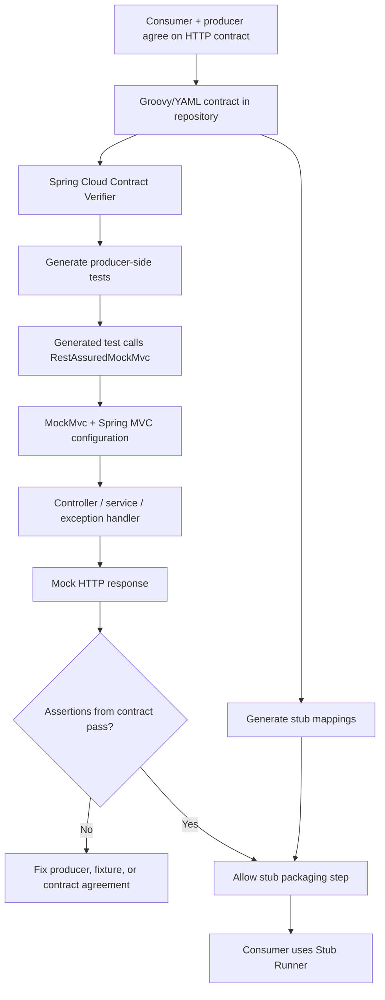

# Testing Controllers with MockMvc

When a consumer sends an HTTP request to a producer, what needs to be protected is not just that a Java method runs, but the **observable HTTP contract**: method, URL, headers, JSON request, status code, JSON response, and error cases. Spring Cloud Contract helps development teams define these commitments using a Groovy/YAML DSL and generate producer-side tests. For Spring MVC applications, **MockMvc** is one way to execute the generated tests without opening a real HTTP port.

This lesson belongs to the **HTTP Testing** chapter of the **Spring Cloud Contract** module. We will connect three often-confused components: the **contract** agreed upon by producer and consumer, **MockMvc** routing requests through the Spring MVC layer in the test process, and **Contract Verifier** generating assertions to check whether the producer satisfies the contract. Once the producer tests pass, the same set of contracts can be used to create stubs for the consumer via **Stub Runner** and serve as a gate in CI to detect incompatible API changes.

After this lesson, you will be able to:

- Explain which parts of the HTTP layer MockMvc tests and which parts it does not cover.
- Configure Spring Cloud Contract Verifier using `testMode = MOCKMVC` and JUnit 5.
- Write a Groovy/YAML contract for an endpoint, then organize a base class so generated tests run against the controller.
- Choose between **web application context** and **standalone controller setup** depending on the testing goal.
- Prepare fixtures, test doubles, and security setup so tests are both reproducible and meaningful.
- Verify `201`, `400`, `404`, and `409` branches, dynamic data matchers, and response headers.
- Diagnose test generation errors, compilation errors, test execution errors, wrong HTTP mappings, or false-green CI reports.

## 1. What is MockMvc in the Context of Contract Testing?

**Spring MockMvc** is a tool from Spring Test for sending simulated requests into the **Spring MVC** layer without starting a real network server. Requests still pass through the MVC components configured in the test, such as `DispatcherServlet`, handler mapping, argument resolution, validation, JSON converters, and exception handlers.

An illustrative request:

```http
POST /api/v1/reservations HTTP/1.1
Content-Type: application/json
Accept: application/json

{"sku":"SKU-001","quantity":2}
```

The producer might return:

```http
HTTP/1.1 201 Created
Content-Type: application/json
Location: /api/v1/reservations/RES-100

{"reservationId":"RES-100","status":"HELD"}
```

If `OrderService` depends on `201`, `reservationId`, and `status` to proceed with payment, the contract must protect those values. Contract Verifier generates the request and assertions; MockMvc executes the request within the producer's Spring MVC context.

### MockMvc Is Not a Real HTTP Server

| Layer to verify | MockMvc in Spring application context | What requires other tests |
| --- | --- | --- |
| `@RequestMapping`, `@PostMapping`, path variables | Can be tested | Deployment routing at ingress/gateway |
| JSON serialization/deserialization | Can be tested via configured message converters | Codec differences in another runtime, if any |
| `@Valid`, validation, `@ControllerAdvice` | Can be tested when configured | Error workflows across multiple services |
| HTTP status and headers from controller/filter | Can be tested | Reverse proxy, load balancer, and real HTTP server behavior |
| Spring Security filters | Can be tested when MockMvc is set up with the filter chain | TLS, browser cookies, cross-system authentication |
| Real service/repository | Depends on how the context is built and dependencies are mocked | Real database/transaction/concurrency in an integration environment |
| Network, sockets, TLS, out-of-process timeouts | No | Real HTTP tests with a server started on a port |
| Browser redirects and cookie storage | Not fully simulated automatically | Browser/end-to-end or HTTP client tests with a cookie jar |

**Key takeaway:** MockMvc can test controllers close to the Spring MVC runtime, but its depth **depends on how you construct the test**. If you only use the controller with a mock service, the contract may pass even if the real business service has bugs. If you use nearly the full Spring context and a test database, verification scope is broader, though the build is usually heavier.

## 2. How Do Contract Verifier and MockMvc Work Together?



This is a **logical flow**, not a claim that every build automatically publishes stubs after running tests. Packaging and publishing artifacts must be configured separately and depend on required verification gates.

### Component Roles

| Component | Responsibility |
| --- | --- |
| Groovy/YAML Contract | Defines the request and response the consumer is allowed to rely on |
| Spring Cloud Contract Verifier | Generates tests from contracts and data used to create stubs |
| Generated JUnit test | Sends requests and checks status, headers, and body against the contract |
| RestAssuredMockMvc | HTTP testing DSL bridge to Spring MockMvc |
| `MockMvc` | Dispatches requests through Spring MVC without sockets |
| Base class for generated tests | Sets up Spring context, MockMvc, and fixtures |
| CI | Runs tests and fails when the producer no longer meets the contract |

Having a contract generated into a Java test does not guarantee it has been executed. You must confirm the generator created the file, the build compiled it, and JUnit actually ran the generated test class.

## 3. A Complete HTTP Contract for a Reservation Endpoint

Suppose `InventoryService` is the producer and `OrderService` is the consumer. Assumed path:

```text
POST /api/v1/reservations
```

The consumer needs to reserve two units of `SKU-001`. On success, the producer returns `201`, status `HELD`, a new ID, and Location.

Example file:

```text
src/test/resources/contracts/reservations/create-reservation-success.groovy
```

Groovy DSL content:

```groovy
import org.springframework.cloud.contract.spec.Contract

Contract.make {
    name 'order_create_reservation_success'
    description '''
        OrderService requests InventoryService to reserve two SKU-001 items.
        Consumer needs reservationId and status HELD to proceed to payment.
    '''

    request {
        method 'POST'
        url '/api/v1/reservations'
        headers {
            contentType(applicationJson())
            header('Accept', 'application/json')
        }
        body([
            sku     : 'SKU-001',
            quantity: 2
        ])
    }

    response {
        status 201
        headers {
            contentType(applicationJson())
            header('Location', '/api/v1/reservations/RES-100')
        }
        body([
            reservationId: 'RES-100',
            status       : 'HELD'
        ])
    }
}
```

The values in this example are **assumed agreements**, not statuses/fields that Spring Cloud Contract requires every API to use. `RES-100` is fixed to illustrate a fixture; if the producer generates IDs dynamically, a matcher is needed as shown later.

### Reading a Contract in Three Layers

1. **Identity and semantics:** `name` and `description` explain which consumer needs the scenario and why.
2. **Request matching:** method, URL, headers, and body describe the call the producer must support.
3. **Response assertions:** status `201`, `Content-Type`, `Location`, and JSON body describe the committed result.

When running in MockMvc mode, the generated test does not call `http://localhost:8080`. It builds a MockMvc request for `POST /api/v1/reservations` against the Spring MVC test context set up by the base class.

## 4. Describing the Same Scenario in YAML DSL

Spring Cloud Contract also supports YAML DSL, for example:

```yaml
name: order_create_reservation_success
description: OrderService reserves inventory before payment step
request:
  method: POST
  url: /api/v1/reservations
  headers:
    Content-Type: application/json
    Accept: application/json
  body:
    sku: SKU-001
    quantity: 2
response:
  status: 201
  headers:
    Content-Type: application/json
    Location: /api/v1/reservations/RES-100
  body:
    reservationId: RES-100
    status: HELD
```

This is an **alternative representation**, not a second contract to place alongside a Groovy file with the same method, URL, and response. If both are read by the generator, the build can produce duplicate tests and stub mappings. Choose the format that matches project conventions.

For dynamic data, YAML has its own matcher mechanism. Do not paste Groovy expressions like `$(consumer(...), producer(...))` into YAML strings and assume they will be interpreted like Groovy DSL. Regardless of which format you write, verify the tests and stubs actually generated from the contract.

## 5. Maven Configuration to Generate MockMvc Tests

In a producer Maven build, the `spring-cloud-contract-maven-plugin` is responsible for generating tests from contract sources. The `spring-cloud-starter-contract-verifier` and `spring-boot-starter-test` dependencies provide the components for test execution, depending on the project's dependency management.

An illustrative configuration snippet for `pom.xml`:

```xml
<dependencies>
    <dependency>
        <groupId>org.springframework.boot</groupId>
        <artifactId>spring-boot-starter-test</artifactId>
        <scope>test</scope>
    </dependency>
    <dependency>
        <groupId>org.springframework.cloud</groupId>
        <artifactId>spring-cloud-starter-contract-verifier</artifactId>
        <scope>test</scope>
    </dependency>
</dependencies>

<build>
    <plugins>
        <plugin>
            <groupId>org.springframework.cloud</groupId>
            <artifactId>spring-cloud-contract-maven-plugin</artifactId>
            <version>VERSION_COMPATIBLE_WITH_YOUR_PROJECT</version>
            <extensions>true</extensions>
            <configuration>
                <testFramework>JUNIT5</testFramework>
                <testMode>MOCKMVC</testMode>
                <baseClassForTests>
                    com.example.inventory.ContractVerifierBase
                </baseClassForTests>
            </configuration>
        </plugin>
    </plugins>
</build>
```

This is **not a complete POM**. `VERSION_COMPATIBLE_WITH_YOUR_PROJECT` is a placeholder to be replaced with a valid version compatible with your existing Spring Boot/Spring Cloud, JDK, and dependency management. If the project configures contract sources, test source directories, or versions elsewhere, adjust accordingly.

| Property | Purpose |
| --- | --- |
| `testMode = MOCKMVC` | Generates tests using the MockMvc layer instead of making HTTP calls on a real port |
| `testFramework = JUNIT5` | Generates tests using JUnit 5 |
| `baseClassForTests` | Superclass that generated tests inherit from to set up context, MockMvc, and fixtures |
| `extensions = true` | Enables plugin integration appropriate for Maven |
| Directory `src/test/resources/contracts` | Common contract source location, configurable |

In a properly configured Maven project, `mvn clean verify` normally goes through generating test sources, compiling tests, and executing JUnit. **Never assume a green build means contract tests ran**: the plugin might not have read the sources, or the test runner might have skipped them.

### Location of Generated Code

A reference layout:

```text
inventory-service/
├── pom.xml
├── src/main/java/com/example/inventory/
│   └── ... controller, service, DTO ...
├── src/test/java/com/example/inventory/
│   └── ContractVerifierBase.java         # Hand-written, should be tracked in Git
├── src/test/resources/contracts/
│   └── reservations/
│       └── create-reservation-success.groovy  # Source contract
└── target/
    ├── generated-test-sources/contracts/ # Plugin-generated tests, path configurable
    └── surefire-reports/                 # JUnit/Surefire reports
```

Exact output names and locations may vary by version and configuration. Do not edit generated Java files in `target`: changes there will be overwritten on the next build. Fix the contract, base class, fixture, or producer code based on the root cause of the failure.

## 6. Base Class with Spring Context and MockMvc

Generated tests need to know **which MockMvc** will receive requests and **which Spring context** contains the controller. For Spring MVC applications where you want to verify configured converters, advice, and filters, the common approach is using `@SpringBootTest` with `@AutoConfigureMockMvc`.

Example class `src/test/java/com/example/inventory/ContractVerifierBase.java`:

```java
package com.example.inventory;

import io.restassured.module.mockmvc.RestAssuredMockMvc;
import org.junit.jupiter.api.BeforeEach;
import org.springframework.beans.factory.annotation.Autowired;
import org.springframework.boot.test.autoconfigure.web.servlet.AutoConfigureMockMvc;
import org.springframework.boot.test.context.SpringBootTest;
import org.springframework.test.context.ActiveProfiles;
import org.springframework.test.web.servlet.MockMvc;

@SpringBootTest
@AutoConfigureMockMvc
@ActiveProfiles("contract")
public abstract class ContractVerifierBase {

    @Autowired
    private MockMvc mockMvc;

    @BeforeEach
    void setUpMockMvc() {
        RestAssuredMockMvc.mockMvc(mockMvc);
    }
}
```

This example assumes the Spring Boot application already has component-scanned controllers, a test runtime compatible with RestAssured MockMvc, and uses JUnit 5. Depending on the version, RestAssuredMockMvc configuration may also be provided via `webAppContextSetup(...)` or `standaloneSetup(...)`; choose **one approach** consistent with your project's test mode and version.

**Why attach MockMvc in the base class?** Generated tests use RestAssuredMockMvc to execute requests. If the base class does not initialize it properly, tests may fail to find the MockMvc setup or fail to route through the expected controller.

### When to Use `webAppContextSetup(...)`?

A variant using `WebApplicationContext`:

```java
package com.example.inventory;

import io.restassured.module.mockmvc.RestAssuredMockMvc;
import org.junit.jupiter.api.BeforeEach;
import org.springframework.beans.factory.annotation.Autowired;
import org.springframework.boot.test.context.SpringBootTest;
import org.springframework.web.context.WebApplicationContext;

@SpringBootTest
public abstract class ContractVerifierBase {

    @Autowired
    private WebApplicationContext context;

    @BeforeEach
    void setUpMockMvc() {
        RestAssuredMockMvc.webAppContextSetup(context);
    }
}
```

This snippet is an **alternative option**, not a second class required simultaneously. It connects RestAssuredMockMvc to the Spring web context, though the level of filter integration (especially Spring Security) must be verified based on how MockMvc is actually built. When you need to preserve filters configured by `@AutoConfigureMockMvc`, injecting `MockMvc` and attaching it to RestAssuredMockMvc is usually clearer.

### Do Not Assume the Two Setups Are Equivalent for Security

MockMvc created via `@AutoConfigureMockMvc` can automatically include the application's servlet filters in the execution path. If you build MockMvc manually from the context using a builder or use standalone setup, verify whether filters and the Spring Security filter chain are actually applied. A contract running without security filters can pass even if the production endpoint requires a token.

## 7. Standalone Setup: Testing a Controller with a Narrower Scope

Another approach is `RestAssuredMockMvc.standaloneSetup(controller)`, often suitable when you need to verify **HTTP mapping and request/response conversion of a single controller** with controlled dependencies.

Structural example:

```java
package com.example.inventory;

import io.restassured.module.mockmvc.RestAssuredMockMvc;
import org.junit.jupiter.api.BeforeEach;
import org.springframework.beans.factory.annotation.Autowired;
import org.springframework.boot.test.context.SpringBootTest;

@SpringBootTest
public abstract class ContractVerifierBase {

    @Autowired
    private ReservationController reservationController;

    @BeforeEach
    void setUpMockMvc() {
        RestAssuredMockMvc.standaloneSetup(reservationController);
    }
}
```

Here `ReservationController` is an **assumed** class in the example application; it is not a built-in Spring Cloud Contract class. The test still starts a Spring context because the example uses `@SpringBootTest` to inject the controller, but MockMvc is built in **standalone mode for that controller**, so it does not necessarily use the full MVC configuration, filters, or advice like a web application context does.

| Setup approach | Advantages | What to watch out for |
| --- | --- | --- |
| `standaloneSetup(controller)` | Lighter at the MockMvc layer, focused on controller mapping logic | May miss global advice, security filters, or custom converters unless registered |
| `webAppContextSetup(context)` | Uses Spring MVC configuration from the context | Need to verify filter application and all required beans |
| `@AutoConfigureMockMvc` + inject `MockMvc` | Easy integration with Boot MVC setup and filter chain per test config | Starting the Spring context can be resource-intensive; isolate external dependencies |

**Selection rule:** if the contract covers security, validation, exception mapping, or Jackson configuration that the consumer truly depends on, a narrow setup must add them explicitly. If you only want to protect a controller's response format and have clearly checked what was replaced, standalone can be appropriate.

## 8. Preparing Fixtures: Tests Need Data for the Producer to Respond Correctly

MockMvc does not automatically create SKU `SKU-001` or a reservation in the database. If a reservation request returns `409 INSUFFICIENT_STOCK` because test data lacks inventory, the `201` generated test will fail even if the controller handles business logic correctly.

A fixture plan might include:

| Element to prepare | Success case | Error case |
| --- | --- | --- |
| SKU | `SKU-001` exists | `SKU-EMPTY` exists but is out of stock |
| Available quantity | At least 2 | Equal to 0 or below requested amount |
| Reservation state before test | No existing reservation for idempotency key | No new reservation created |
| Returned ID | Fixed ID via fixture or matcher for dynamic ID | Usually no successful `reservationId` |
| Clock | Can be fixed if contract involves expiration | Mock timestamp for expiration/boundary |

### Choosing Test Doubles Deliberately

There are two common strategies:

1. **Close to real producer:** start Spring context, test repository, and required internal beans; isolate only external systems like payment gateways or message brokers when they are outside the scope under test.
2. **Restricted to controller boundary:** replace the service with a deterministic test double, verifying URIs, JSON binding, validation, and exception handlers. This is faster but **does not** verify the real business service implementation.

If the service is mocked to always return `201` and sample JSON, generated tests may pass even when the producer's business code is broken. Therefore, explicitly document the **layer scope being tested** and supplement with integration tests using the real service for state-dependent commitments.

### Tests Must Run Independently and Reproducibly

- Test data must be reset before each scenario or after each test according to a clear policy.
- If requests generate IDs automatically, do not assert literal IDs unless fixtures make them deterministic.
- When expiration is involved, inject a controllable `Clock` instead of relying on CI machine time.
- Do not depend on the execution order of generated tests.
- Never put real customer data or real tokens into contracts.
- When running in parallel, each test needs sufficiently isolated data/namespaces.

"Works on my machine but fails on CI" issues are often related to fixtures, test ordering, timezones, or external dependencies, not just MockMvc itself.

## 9. What Does a Generated Test Check in the `201` Example?

Conceptually, a test generated from the success contract will:

1. Build the JSON request from the contract `body`.
2. Set method `POST`, URL `/api/v1/reservations`, and the described headers.
3. Call the endpoint via RestAssuredMockMvc and Spring MVC.
4. Assert status `201`, `Content-Type`, `Location`, and the JSON fields in the response.

To make the meaning of these assertions clear, here is an **illustrative hand-written MockMvc test**, not the exact code Verifier is required to generate:

```java
import static org.springframework.test.web.servlet.request.MockMvcRequestBuilders.post;
import static org.springframework.test.web.servlet.result.MockMvcResultMatchers.*;

mockMvc.perform(post("/api/v1/reservations")
        .contentType("application/json")
        .accept("application/json")
        .content("{\"sku\":\"SKU-001\",\"quantity\":2}"))
    .andExpect(status().isCreated())
    .andExpect(header().string(
        "Location", "/api/v1/reservations/RES-100"))
    .andExpect(jsonPath("$.reservationId").value("RES-100"))
    .andExpect(jsonPath("$.status").value("HELD"));
```

The code above is an **illustrative snippet placed inside a test method that already has `mockMvc`**, not a complete standalone compilable Java file. The actual plugin may generate code using RestAssuredMockMvc, different matchers, and different naming conventions. Do not treat syntax differences between generated tests and hand-written examples as criteria for judging the contract.

### What If Only the Response Status Changes?

Suppose the controller changes from `201` to `200` without updating the contract. The generated producer test must detect the mismatch if it reaches the right controller. Do not edit the `201` assertion in the generated Java file just to make the build green; determine whether the API change is approved by the consumer.

### What If the Controller Returns a JSON Number Instead of a String?

For example, the response changes from:

```json
{"reservationId":"RES-100","status":"HELD"}
```

to:

```json
{"reservationId":100,"status":"HELD"}
```

The consumer deserializer can break because the JSON type changed. Contracts need data types/matchers strict enough to detect this. An overly broad regex or a test checking only status will miss this change.

## 10. Dynamic Data: Do Not Force the Producer to Generate the Same ID Every Time

When the producer generates reservation codes, the response may be `RES-4817`, `RES-4818`, etc. In the **response** section of Groovy DSL, you can have the stub return a sample ID for the consumer while the producer test checks the format:

```groovy
response {
    status 201
    headers {
        contentType(applicationJson())
        header('Location',
               $(consumer('/api/v1/reservations/RES-100'),
                 producer(regex('/api/v1/reservations/RES-[0-9]+'))))
    }
    body([
        reservationId: $(consumer('RES-100'),
                         producer(regex('RES-[0-9]+'))),
        status       : 'HELD'
    ])
}
```

This is a **response DSL fragment**, meant to replace the `response` section in the full contract from section 3.

In the response:

| Value | Effect |
| --- | --- |
| `consumer('RES-100')` | Stub returns a stable sample value for consumer tests |
| `producer(regex('RES-[0-9]+'))` | Generated producer test accepts any ID matching the format |
| `status = HELD` | Must still match the committed business value |

Note: two independent regexes for `Location` and `reservationId` do not guarantee they **contain the same ID**. If the consumer relies on Location to look up the newly created resource, add an assertion linking the two values or an integration test that performs the subsequent GET step. Regex only checks **format**, not that the ID was persisted or is accessible.

## 11. Testing Error Branches with MockMvc

Contract testing does not only protect success responses. For a reservation API, consumers often need to distinguish:

| Case | Request | Example status | Example error body | Consumer decision |
| --- | --- | --- | --- | --- |
| Reservation created successfully | `SKU-001`, quantity 2 | `201` | `HELD`, reservation ID | Proceed to payment |
| Invalid quantity | `SKU-001`, quantity 0 | `400` | `INVALID_QUANTITY` | Display input validation error |
| SKU does not exist | `SKU-MISSING` | `404` | `SKU_NOT_FOUND` | Do not proceed |
| Insufficient stock | `SKU-EMPTY`, quantity 2 | `409` | `INSUFFICIENT_STOCK` | Stop / suggest changing quantity |

These are **sample API conventions**. `400`, `404`, `409`, and error code names must be agreed upon by producer and consumer rather than being defaults enforced by Contract Verifier.

### Contract for Invalid Quantity

```groovy
import org.springframework.cloud.contract.spec.Contract

Contract.make {
    name 'create_reservation_invalid_quantity'
    description 'OrderService receives a clear error when quantity is invalid'

    request {
        method 'POST'
        url '/api/v1/reservations'
        headers {
            contentType(applicationJson())
        }
        body([
            sku     : 'SKU-001',
            quantity: 0
        ])
    }

    response {
        status 400
        headers {
            contentType(applicationJson())
        }
        body([
            code: 'INVALID_QUANTITY'
        ])
    }
}
```

For this test to pass, the producer must implement validation and map errors into a response satisfying the contract. This can be via `@Valid`, constraint annotations, service validation, or `@ControllerAdvice` depending on the design.

### Contract for Insufficient Stock

```groovy
import org.springframework.cloud.contract.spec.Contract

Contract.make {
    name 'create_reservation_insufficient_stock'
    description 'OrderService must not proceed to payment when warehouse stock is insufficient'

    request {
        method 'POST'
        url '/api/v1/reservations'
        headers {
            contentType(applicationJson())
        }
        body([
            sku     : 'SKU-EMPTY',
            quantity: 2
        ])
    }

    response {
        status 409
        headers {
            contentType(applicationJson())
        }
        body([
            code: 'INSUFFICIENT_STOCK'
        ])
    }
}
```

In MockMvc tests, `@ControllerAdvice` or appropriate exception mapping must be enabled in the context or standalone setup if application error responses rely on them. Do not mock the exception handler itself and conclude that error mapping has been verified.

### Avoiding Overlapping Stub Mappings

If the success contract uses an overly broad request matcher, it may also match the `SKU-EMPTY` request. When stubs are published, two scenarios could match the same request yet return different `201` and `409` responses. Distinguish requests using meaningful fixture values/matchers for the consumer or explicit stub state modeling; **different filenames do not resolve matching conflicts**.

## 12. Headers, Query, Path Parameters, and Request Content

MockMvc contract tests can verify many HTTP details beyond the JSON body. Some examples:

| Scenario | Contract should describe | What to check in generated test |
| --- | --- | --- |
| Find reservation by ID | `GET /api/v1/reservations/{id}` as a sample literal or path matcher | Path sent by test has a valid fixture ID |
| Query options | `urlPath` and `queryParameters` | Query parameters attached to request in proper format |
| Required header | `X-Correlation-Id` or business header | Header appears accurately in MockMvc request |
| Authentication | `Authorization` or appropriate security context | Security filter actually runs and is not unintentionally disabled |
| JSON request | `Content-Type` and body fields | Converter/validation handles wire format properly |
| Cookie | `Cookie` on request or `Set-Cookie` on response | Test describes committed cookie name, value, and attributes |

Example of a URL query:

```groovy
request {
    method 'GET'
    urlPath('/api/v1/reservations/RES-100') {
        queryParameters {
            parameter 'includeHistory': 'true'
        }
    }
}
```

This is a **request DSL fragment**, not a complete contract. Separating query parameters from the path keeps contracts readable and avoids applying regex to the entire URL unnecessarily.

### Path Parameters in Spring MVC Do Not Automatically Appear in Contracts

In a controller, you might use `@GetMapping("/api/v1/reservations/{reservationId}")` and `@PathVariable`. In a contract, you must specify a **concrete request path or matcher**. Writing the literal string `"{reservationId}"` in a contract URL without a matcher will not automatically make the stub treat it as a dynamic variable like Spring MVC does.

## 13. Testing Spring Security with MockMvc: With and Without Filters

When the producer uses security, how MockMvc is created greatly affects test validity. If a controller is protected by a security filter chain, a generated contract test that sends no token may receive `401` or `403` instead of a `201` response.

There are three ways to handle this depending on your goal:

1. **Test the actual security contract:** send appropriate credentials/test tokens and keep the filter chain active; add `401/403` contracts if the consumer depends on those responses.
2. **Isolate security intentionally:** configure a test-only authentication principal to test the controller boundary, while clearly documenting that this contract test does not verify token parsing or real security policy.
3. **Separate test layers:** producer contract tests verify appropriate HTTP semantics, while security integration tests verify the filter chain and security branches.

Configurations like `@AutoConfigureMockMvc(addFilters = false)` **remove servlet filters** from the test path; use this only when you intentionally want to exclude filters, not as a shortcut to make tests green when authentication is missing. Likewise, standalone MockMvc does not automatically enforce a full `SecurityFilterChain`.

Notes on HTTP statuses:

- `401 Unauthorized` usually relates to missing or invalid credentials.
- `403 Forbidden` usually relates to an authenticated principal lacking permission, though exact behavior depends on application policy.
- `404 Not Found` is sometimes chosen to avoid leaking the existence of resources belonging to another tenant.

All choices must reflect the producer's **API agreement and security policy**, not assumptions inferred from the framework.

## 14. When Do You Need an HTTP Test Running on a Real Port?

MockMvc is effective for verifying most Spring MVC HTTP contracts, but certain layers of behavior lie outside its scope:

- TLS/HTTPS, certificates, reverse proxies, ingress, and URL rewrites.
- Socket/network timeouts and connection failures.
- HTTP server compression/chunking and specific connector configurations.
- Real browser behavior for redirects, `Secure` cookies, `SameSite`, and cross-site CORS.
- Connectivity to external dependencies, multi-system transactions, and messaging delivery.

If the producer uses pure **Spring WebFlux**, MockMvc is not the appropriate default tool for verifying WebFlux; choose the appropriate test mode and tool such as `WebTestClient` according to your Spring Cloud Contract version. For servlet-based Spring MVC, `MOCKMVC` is a common choice.

| Tool / Scope | When it is appropriate |
| --- | --- |
| MockMvc + Contract Verifier | Protecting HTTP contracts at the Spring MVC boundary, fast and without opening a port |
| Spring Boot test with random server port and HTTP client | Need to traverse a real network container or verify certain server configs |
| Browser / E2E | Cookies, redirects, CORS, and real user interactions |
| DB / messaging integration tests | Verifying data state, side effects, or cross-service workflows |
| Stub Runner on consumer | Verifying consumer code properly handles simulated responses |

There is no need to turn every contract into an E2E test: choose the **verification layer matched to the risk**, while understanding the limits of each layer.

## 15. Writing Contracts for One Interaction or an Entire Chain?

An HTTP contract can prove that `POST` returns `201` and a properly formatted `reservationId`. However, it **does not automatically prove**:

- Calling `GET /reservations/{id}` afterward returns the newly created reservation.
- Calling confirm twice does not deduct inventory twice.
- Concurrent contention does not cause overselling.
- A reservation automatically expires past `expiresAt`.
- A transaction rolls back when a partial save fails.

Example multi-step integration test:

```text
Given: SKU-001 is in stock; data store is in a clean state
When:
  1. POST /api/v1/reservations
  2. Extract actual reservationId from response
  3. GET /api/v1/reservations/{reservationId}
Then:
  - POST returns 201
  - GET returns 200
  - ID returned by GET equals ID returned by POST
  - Status and inventory count match business rules
```

You can implement multi-step tests with hand-written MockMvc, but **that is an additional integration test**, not Spring Cloud Contract automatically chaining independent contracts into a stateful sequence.

## 16. Diagnosing Failures in Generated MockMvc Tests

When a test fails, identify the failing layer before changing code:

| Symptom | Possible cause | How to check and fix |
| --- | --- | --- |
| No generated files | Plugin did not read contract sources or directory is wrong | Check `contracts` source, generator logs, and build config |
| Generated test fails to compile | Wrong JUnit version, missing dependency, base class not found | Check plugin, classpath, `baseClassForTests`, and package |
| `NullPointerException` or RestAssured MockMvc uninitialized | Base class did not attach MockMvc before test | Place setup in proper JUnit lifecycle hook and verify test mode |
| `404` response for an existing endpoint | Wrong mapping, missing controller bean, or wrong request path | Check `@RequestMapping`, context path, and MockMvc setup |
| Unexpected `401/403` | Security filter ran without authentication fixture | Send proper credentials/test principal; do not disable filters arbitrarily |
| `415 Unsupported Media Type` | Request `Content-Type` or converter mismatch | Check media types and Jackson/message converters |
| `406 Not Acceptable` | `Accept` header and produces/serializer mismatch | Check content negotiation and mappings |
| `400` due to validation | Invalid JSON/DTO or wrong fixture | Check request body, `@Valid`, and handlers |
| `500` from bean/external dependency | Spring context/service unprepared | Fix test doubles, datasource, and dependencies |
| `200` instead of `201` | Producer returns wrong status relative to contract | Fix controller or negotiate contract change |
| Body differs due to random ID | Contract uses overly strict literal | Use format matcher or deterministic fixture |
| Passes locally, fails in CI | Clock, timezone, shared DB, order-dependent tests | Make tests independent, reset data, fix clock |
| Green build with 0 contract tests | Test runner did not pick up generated class or build skipped tests | Check JUnit reports, surefire config, and test count |

### Short Debugging Workflow

1. Locate the source contract file and the failing assertion clause.
2. Confirm the plugin read the contract properly and the generated test compiled and ran.
3. Read the generated test to see the exact request constructed; **never edit the generated file directly**.
4. Inspect the actual MockMvc response (status, headers, body, exceptions).
5. Classify the root cause: fixture, MVC configuration, security, producer code, or outdated contract.
6. Fix at the corresponding source, regenerate tests, and run the full required contract suite.

## 17. Inspecting MockMvc Logs Without Relying on Test Generator Internals

In a hand-written MockMvc test, you can use `andDo(print())` to print the request and response. For generated tests, logging mechanisms depend on the tool and version; use debug mode, test reports, and RestAssuredMockMvc response outputs when needed.

Do not treat the generated Java class or method names as a stable API. They can change when you rename a contract `name`, adjust package configuration, or upgrade the plugin version. If CI only includes a narrow test name pattern, an upgrade can stop tests from running even though the generator still produces files.

**Rule for managing generated sources:** commit contracts, base classes, and test fixtures; treat generated code, compiled tests, and reports in `target`/`build` as build outputs. When investigating, read the generated code to understand assertions, but let the generator recreate it.

## 18. CI: Proving That Contracts Are Generated and Executed

In a properly configured Maven project, run:

```bash
mvn -B -ntp clean verify
```

A sample CI job with GitHub Actions:

```yaml
name: Verify HTTP contracts

on:
  pull_request:
  push:
    branches: [main]

jobs:
  contract-tests:
    runs-on: ubuntu-latest
    steps:
      - uses: actions/checkout@v4
      - uses: actions/setup-java@v4
        with:
          distribution: temurin
          java-version: '21'
          cache: maven

      - name: Run producer contract verification
        run: mvn -B -ntp clean verify
```

The workflow above assumes JDK 21 fits the project and that plugins/fixtures are already configured. It does not automatically configure stub publishing, count generated tests, or replace other integration tests.

### Signals to Check After the Build

| Signal | Why it matters |
| --- | --- |
| Source contracts exist in the module | Avoids building a module that is not the intended producer |
| Generated contract tests exist | Confirms the generator actually read the contracts |
| Generated tests compiled | Dependencies and base class are valid |
| JUnit/Surefire ran an expected test count | Prevents false greens caused by skips or filters |
| Tests pass against the right controller/fixture | Producer meets commitments within test scope |
| Stub artifact has the right version | Consumer reuses the exact verified interface |
| Consumer tests use Stub Runner | Consumer properly handles responses agreed by producer |

If you want to verify the generated sources directory in CI, base checks on the **actual output path of your plugin version**. A check like `find target/generated-test-sources/contracts -name '*.java'` may work in one project and fail in another with a custom directory. Checking file existence alone is also insufficient: read JUnit/Surefire reports to confirm tests **actually executed**.

### Do Not Publish Stubs Before the Producer Is Verified

A stub returns `201` per the contract even when the real producer currently returns `200`. If stubs are published while producer tests are skipped, consumer tests may pass while production integration fails. Therefore, ensure the stub release step only runs from commits/versions that passed producer verification gates and other required tests.

## 19. Using Gradle Instead of Maven

The principles remain unchanged: the plugin reads contracts, generates test sources, adds tests to the source set, compiles them, and runs them with the test runner.

A conceptual configuration example in Gradle Groovy DSL:

```groovy
plugins {
    id 'java'
    id 'org.springframework.cloud.contract' version 'VERSION_COMPATIBLE'
}

dependencies {
    testImplementation 'org.springframework.boot:spring-boot-starter-test'
    testImplementation 'org.springframework.cloud:spring-cloud-starter-contract-verifier'
}

contracts {
    baseClassForTests = 'com.example.inventory.ContractVerifierBase'
    testFramework = 'JUNIT5'
    testMode = 'MOCKMVC'
}
```

The snippet above is an **outline that must be customized** for your plugin/Gradle version, dependency management, and exact `contracts` DSL syntax. With Gradle, you can run the appropriate tasks and execute `./gradlew clean check` once contract generation and verification tasks are wired properly.

Do not maintain two build systems simultaneously for the same project without good reason; stick to the one the project already uses. On Windows, the corresponding Gradle wrapper is usually `gradlew.bat`.

## 20. Checklist for Testing Controllers with MockMvc

- [ ] Contracts exist describing requests and responses the consumer genuinely needs.
- [ ] Producer is a Spring MVC application suitable for `MOCKMVC` test mode.
- [ ] Spring Cloud Contract Verifier plugin is configured with compatible version and test framework.
- [ ] Generated tests extend the base class with the right package and name.
- [ ] Base class binds RestAssuredMockMvc with a configured MockMvc before tests run.
- [ ] MockMvc setup matches scope: standalone vs. web application context.
- [ ] Filters, advice, validation, and converters requiring protection actually participate in tests.
- [ ] Fixtures provide appropriate SKUs/reservations, reset cleanly, and do not depend on test order.
- [ ] Fixed IDs/timestamps are not used when the producer generates dynamic values unless the consumer requires fixed ones.
- [ ] Contracts cover both success and key error cases: `400`, `404`, `409`, or per API conventions.
- [ ] Contract request matchers do not cause the success stub to match error cases.
- [ ] Generated tests are generated, compiled, and executed in CI; no false greens with 0 tests.
- [ ] When generated tests fail, fix the contract, fixture, config, or producer code instead of editing generated files.
- [ ] Integration/security/E2E tests exist for commitments outside MockMvc's scope.
- [ ] Stub artifacts are published only from verified producer versions; consumers use the right version via Stub Runner.

### Practice Exercise

You are implementing `InventoryService` for `OrderService` with the API `POST /api/v1/reservations`. Example conditions:

- `sku = SKU-001`, `quantity = 2` → `201`, body `status = HELD` and `reservationId` matching `RES-[0-9]+`.
- `quantity = 0` → `400`, body `code = INVALID_QUANTITY`.
- `sku = SKU-MISSING` → `404`, body `code = SKU_NOT_FOUND`.
- `sku = SKU-EMPTY`, `quantity = 2` → `409`, body `code = INSUFFICIENT_STOCK`.

**Tasks:**

1. Write a Groovy contract for the success case; describe method, URL, Content-Type, status, Location, and body.
2. Replace the fixed response ID with a consumer sample and producer regex. Explain what the MockMvc test checks and what the stub returns.
3. Create three error contracts using distinct fixture data; define the `400/404/409` response branches.
4. Create `ContractVerifierBase` using `@SpringBootTest`, `@AutoConfigureMockMvc`, and RestAssuredMockMvc to route generated tests through Spring MVC.
5. Prepare fixtures for in-stock, out-of-stock, and missing SKU; demonstrate tests can be rerun without order dependence.
6. Intentionally change the controller from `201` to `200`; observe the generated test fail and explain why editing the generated file is wrong.
7. Enable validation and a `@ControllerAdvice` if the app uses them; verify the `400` contract actually passes through error mapping.
8. If the endpoint uses Spring Security, run one test with the filter chain active and one security test for missing authentication. Compare results with standalone setup.
9. Run `mvn -B -ntp clean verify` or the corresponding Gradle task in a configured project; check the number of generated and executed tests.
10. Publish stubs from a passing build and use Stub Runner on the consumer side to verify one success branch and one error branch; describe the limits of stubs regarding real inventory data.

**Completion criteria:** you can explain the path **contract → generated test → RestAssuredMockMvc → MockMvc → controller → assertion**, identify the right layer to fix when a test fails, and ensure the pipeline genuinely verifies the commitments the consumer depends on.

## References

- [Spring Cloud Contract Reference](https://docs.spring.io/spring-cloud-contract/reference/): producer verification concepts, test modes, build plugins, and stubs.
- [Spring Cloud Contract — HTTP Contracts](https://docs.spring.io/spring-cloud-contract/reference/project-features-contract/http.html): Groovy/YAML DSL syntax for HTTP requests and responses.
- [Spring Framework — MockMvc](https://docs.spring.io/spring-framework/reference/testing/mockmvc.html): configuration, request builders, result matchers, and MockMvc limitations.
- [Spring Boot — Testing Spring Boot Applications](https://docs.spring.io/spring-boot/reference/testing/spring-boot-applications.html): `@SpringBootTest`, `@AutoConfigureMockMvc`, and Spring MVC test configuration.
