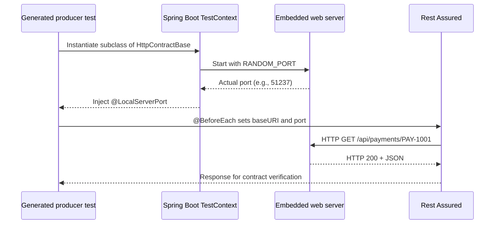
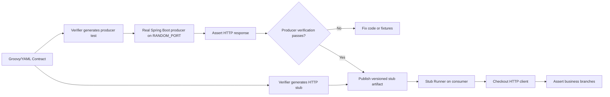
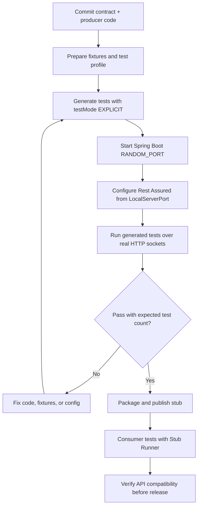

# Testing Over Real HTTP with an Application Running on a Random Port

## 1. When Do You Need to Send Real HTTP Requests in Producer Contract Tests?

Suppose `checkout-service` is the **consumer** and `payment-service` is the **producer** of an HTTP payment lookup API. Checkout sends:

```http
GET /api/payments/PAY-1001 HTTP/1.1
Accept: application/json
```

The producer commits to returning `200 OK` with JSON containing the payment ID, order ID, status `PAID`, and currency `VND`. With **Spring Cloud Contract**, the team describes this commitment using **Groovy DSL or YAML DSL**, generates tests to verify the producer, publishes stubs for the consumer to use via **Stub Runner**, and runs these steps in CI to catch incompatible API changes.

But **where does the producer test send its request?** There are two common ways to test HTTP:

- **Mocked HTTP layer:** for example, `MockMvc` invoking Spring MVC inside a test environment without opening a real TCP port.
- **Real HTTP (explicit mode):** the producer application starts with a web server listening on a port, and the test sends HTTP requests over a socket to `http://localhost:<running-port>`.

This lesson focuses on the second approach: **Spring Cloud Contract Verifier generates tests in `EXPLICIT` mode, the Spring Boot application runs with `RANDOM_PORT`, and the base class configures the HTTP client with the actual port**. This is producer verification; it does not mean deploying the application to a staging environment, nor is it configuring the consumer-side Stub Runner port.

### Learning Objectives

After this lesson, you will be able to explain the difference between `MOCKMVC` and `EXPLICIT`, write simple HTTP contracts, configure Maven/Gradle to generate tests over real sockets, build a `ContractBase` with `@SpringBootTest(webEnvironment = RANDOM_PORT)` and `@LocalServerPort`, isolate test data, verify requests/responses, troubleshoot common errors, and integrate the tests into CI.

## 2. Two Independent Choices: Test Framework and HTTP Test Mode

In Spring Cloud Contract, **test framework** and **test mode** are separate choices.

| Aspect | Example configuration | Effect |
| --- | --- | --- |
| Generated test framework | `testFramework = JUNIT5` or `SPOCK` | Determines JUnit Jupiter or Spock syntax and test engine. |
| HTTP dispatch mode | `testMode = MOCKMVC` | Uses the MockMvc HTTP test mechanism, requiring no TCP listener. |
| HTTP dispatch mode | `testMode = WEBTESTCLIENT` | Uses WebTestClient depending on plugin support, typically suited to WebFlux testing without real sockets. |
| HTTP dispatch mode | `testMode = EXPLICIT` | Sends real HTTP requests to the application running on a port. |
| Spring Boot test web server port | `webEnvironment = RANDOM_PORT` | Starts the web server and lets the OS pick an available port. |
| HTTP client address | `RestAssured.baseURI` and `RestAssured.port` | Tells generated tests which server to send requests to. |

You can choose **JUnit 5 + EXPLICIT**, **Spock + EXPLICIT**, or **JUnit 5 + MOCKMVC** if supported by the plugin and classpath. Choosing `JUNIT5` **does not automatically enable real HTTP**; choosing `RANDOM_PORT` **does not automatically change Spring Cloud Contract's test mode**.

### Comparing the Two Verification Styles

| Criterion | MockMvc | EXPLICIT over Real HTTP |
| --- | --- | --- |
| Real server socket | No | Yes |
| Typical speed | Faster because no real web server is needed | Extra startup and TCP communication overhead |
| Verifies routing/controller/JSON | Yes, depending on context setup | Yes, over HTTP requests |
| Verifies container/socket-dependent behavior | Limited by mock layer | Better suited for checking real web server behavior |
| Needs to know server port | No | Yes, via `@LocalServerPort` or equivalent |
| Best suited when | Only Spring MVC layer contract verification is needed | Real requests, context paths, filter/container behavior, or the HTTP stack need verification |

**Real HTTP does not mean full-system end-to-end.** The server may be real, while databases, banking gateways, message brokers, or external APIs can—and usually should—be replaced with fixtures/test doubles so tests remain repeatable. Conversely, if you want to verify a real database as well, provision a dedicated test database and treat that as a broader integration test scope.

## 3. What Does Random Port Mean?

In Spring Boot:

```java
@SpringBootTest(
    webEnvironment = SpringBootTest.WebEnvironment.RANDOM_PORT
)
```

Spring Boot starts the test web server on an **available port** assigned by the operating system. This is typically equivalent to configuring `server.port=0`.

Example runs:

```text
Run A: http://localhost:51237
Run B: http://localhost:54811
Run C: http://localhost:50726
```

These numbers are **illustrative only**, not fixed ports to use. The actual port is only known after the web server starts.

**Benefits:**

1. Reduces the risk of port `8080` conflicts when a developer machine already runs another producer.
2. Lets independent CI jobs start servers simultaneously in suitable environments.
3. Avoids editing contracts when changing ports or operating systems.
4. Encourages separating the **API path** from the **test environment host/port**.

**Limitations:** a random port does not automatically isolate databases, temp directories, management ports, queues, or shared data. Nor does it replace releasing resources after tests. The OS can reject binding if ports are exhausted or restricted, so always check startup logs when failures occur.

## 4. An HTTP Contract Without Hard-Coding Host and Port

Suppose Payment returns details of a sample transaction `PAY-1001`:

```json
{
  "paymentId": "PAY-1001",
  "orderId": "ORD-2001",
  "status": "PAID",
  "amount": 250000,
  "currency": "VND"
}
```

### 4.1. Groovy DSL

Example contract placed in the producer's contracts directory:

```groovy
import org.springframework.cloud.contract.spec.Contract

Contract.make {
    name 'get_paid_payment_over_http'
    description 'Look up a paid transaction over HTTP'

    request {
        method 'GET'
        urlPath '/api/payments/PAY-1001'
        headers {
            header 'Accept': 'application/json'
        }
    }

    response {
        status 200
        headers {
            contentType(applicationJson())
        }
        body([
            paymentId: 'PAY-1001',
            orderId: 'ORD-2001',
            status: 'PAID',
            amount: 250000,
            currency: 'VND'
        ])
    }
}
```

The contract contains only the **HTTP method, path, headers, status, and body**. There is no need to put `localhost:8080` or `localhost:51237` into the URL, because those are test environment details determined by the HTTP client.

Why use `urlPath`? Spring Cloud Contract allows `url(...)` with relative or absolute URLs; for host-independent contracts, `urlPath(...)` clarifies that the commitment focuses on the **path**. When query parameters are needed, declare them separately in the DSL. If the API has a context path, the path must reflect the exact HTTP path the client actually calls, as covered in section 10.

### 4.2. Equivalent YAML DSL

```yaml
description: Look up a paid transaction over HTTP
name: get_paid_payment_over_http
request:
  method: GET
  urlPath: /api/payments/PAY-1001
  headers:
    Accept: application/json
response:
  status: 200
  headers:
    Content-Type: application/json
  body:
    paymentId: PAY-1001
    orderId: ORD-2001
    status: PAID
    amount: 250000
    currency: VND
```

Groovy and YAML are **two representations of the same scenario**. Choose one primary definition in the project instead of storing both and generating duplicate tests. Choosing a DSL does not decide whether tests use real sockets; **`testMode = EXPLICIT`** is the relevant setting.

## 5. Maven: Generating Producer Verification Tests in EXPLICIT Mode

Suppose the producer is a Spring Boot application using Maven and JUnit Jupiter. Key elements include:

1. Appropriate test dependencies for Spring Boot, Spring Cloud Contract Verifier, and the HTTP client used by the generator.
2. Spring Cloud Contract plugin compatible with your Spring Boot and JDK versions.
3. `testMode` set to `EXPLICIT`.
4. `testFramework` set to `JUNIT5` if supported by that plugin version's generator.
5. `baseClassForTests` pointing to the base test class that prepares the web server and HTTP client.

Example **configuration snippets to merge into `pom.xml`**, not a complete POM:

```xml
<!-- Inside <dependencies> -->
<dependency>
    <groupId>org.springframework.boot</groupId>
    <artifactId>spring-boot-starter-test</artifactId>
    <scope>test</scope>
</dependency>
<dependency>
    <groupId>org.springframework.cloud</groupId>
    <artifactId>spring-cloud-starter-contract-verifier</artifactId>
    <scope>test</scope>
</dependency>

<!-- Inside <build><plugins> -->
<plugin>
    <groupId>org.springframework.cloud</groupId>
    <artifactId>spring-cloud-contract-maven-plugin</artifactId>
    <version>REPLACE_WITH_COMPATIBLE_SCC_VERSION</version>
    <extensions>true</extensions>
    <configuration>
        <testFramework>JUNIT5</testFramework>
        <testMode>EXPLICIT</testMode>
        <baseClassForTests>
            com.example.payment.contract.HttpContractBase
        </baseClassForTests>
    </configuration>
</plugin>
```

Replace the placeholder with a compatible version and manage dependency versions via your project's BOM/parent. Verify test engines and Maven Surefire/Failsafe according to your existing lifecycle. **Do not arbitrarily mix incompatible Spring Boot, Spring Cloud Contract, or JUnit lines.**

In a common Maven layout, contracts sit under `src/test/resources/contracts/`; the plugin generates test code under the generated sources directory in `target/`. Do not edit generated test files directly, as the generator overwrites them on the next build.

Verification command for a **fully configured project**:

```bash
./mvnw -B clean verify
```

This command must do more than generate files: confirm Maven **compiled and executed the generated producer tests**. A `BUILD SUCCESS` result when tests are skipped or 0 tests ran is not sufficient proof that the producer meets the contract.

## 6. Gradle: Configuring Real HTTP Instead of MockMvc

With Gradle Groovy DSL, the core configuration is:

```groovy
plugins {
    id 'java'
    id 'org.springframework.cloud.contract' version 'REPLACE_WITH_COMPATIBLE_SCC_VERSION'
}

dependencies {
    testImplementation 'org.springframework.boot:spring-boot-starter-test'
    testImplementation 'org.springframework.cloud:spring-cloud-starter-contract-verifier'
}

contracts {
    testFramework = 'JUNIT5'
    testMode = 'EXPLICIT'
    baseClassForTests = 'com.example.payment.contract.HttpContractBase'
}

tasks.withType(Test).configureEach {
    useJUnitPlatform()
}
```

This is a **configuration fragment**; a real project needs the Spring Boot plugin, dependency management/BOM, repositories, and compatible source sets. The `useJUnitPlatform()` line applies when using JUnit Jupiter or test engines running on the JUnit Platform.

Where the Gradle plugin looks for contracts depends on version and `contractsDslDir`; some layouts use `src/contractTest/resources/contracts`, differing from Maven. Do not assume pasting a Gradle snippet will automatically make the plugin read contracts from an arbitrary location.

Common command once the project is configured:

```bash
./gradlew clean check
```

To inspect test code generation separately, check the `generateContractTests` task depending on your Gradle plugin version. **Generating code does not mean tests ran.** Inspect test reports alongside build logs to ensure real HTTP tests used `EXPLICIT`.

## 7. Base Class: Connecting Rest Assured to the Real Web Server Port

This is the **decisive piece** that routes real HTTP requests to the application under test. With modern Spring Boot and JUnit 5:

```java
package com.example.payment.contract;

import io.restassured.RestAssured;
import org.junit.jupiter.api.BeforeEach;
import org.springframework.boot.test.context.SpringBootTest;
import org.springframework.boot.test.web.server.LocalServerPort;
import org.springframework.test.context.ActiveProfiles;
import com.example.payment.PaymentApplication;

@SpringBootTest(
    classes = PaymentApplication.class,
    webEnvironment = SpringBootTest.WebEnvironment.RANDOM_PORT
)
@ActiveProfiles("contract")
public abstract class HttpContractBase {

    @LocalServerPort
    protected int port;

    @BeforeEach
    void configureHttpClient() {
        RestAssured.baseURI = "http://localhost";
        RestAssured.port = port;
    }
}
```

**Requirements for this example to run:**

- `PaymentApplication` is the producer's real Spring Boot configuration class; adjust package and class name for your project.
- The project includes Spring Boot Test, JUnit Jupiter, and Rest Assured dependencies required by the test suite.
- The `contract` profile is configured by the application to avoid uncontrolled external databases or HTTP APIs.
- The Verifier plugin has `testMode = EXPLICIT` and `baseClassForTests` pointing to `com.example.payment.contract.HttpContractBase`.
- On older Spring Boot versions, the `@LocalServerPort` package may be `org.springframework.boot.web.server.LocalServerPort`. Do not mix imports across version lines.

### Explaining the Initialization Sequence



`@LocalServerPort` is only known once the test context and web server have started; therefore setting up the HTTP client in `@BeforeEach` is appropriate rather than setting a fixed port at field declaration. `RestAssured.baseURI` and `RestAssured.port` combine to form the target address, such as `http://localhost:51237/api/payments/PAY-1001`.

An equivalent approach is setting `RestAssured.baseURI = "http://localhost:" + port` in `@BeforeEach`. **Do not simultaneously append the port to `baseURI` while inadvertently keeping a global `RestAssured.port` set by another test**, as that easily targets the wrong endpoint. In this lesson's example, we consistently keep `baseURI` without a port and set `port` separately.

### Why Not Use RestAssuredMockMvc?

In MockMvc mode, the base class typically calls `RestAssuredMockMvc.standaloneSetup(...)` or `RestAssuredMockMvc.webAppContextSetup(...)`. However, this lesson chooses **EXPLICIT**: generated tests need to send real HTTP sockets and the base class must configure **`io.restassured.RestAssured`**, not merely set up MockMvc. Mixing these up can cause connection errors, fail to hit the real web server, or test a different layer than intended.

## 8. Fixtures and Configuration for a Real Web Server

Starting a real Spring Boot web server **does not mean calling a real database or payment gateway**. The example contract requires `PAY-1001` to return fixed information. The producer test must prepare state so the endpoint returns the expected JSON.

### Option A: Replace Repositories/Adapters with Mocks in the Test Profile

If `PaymentController` uses `PaymentQuery` to read transactions, you can replace the `PaymentQuery` bean with a mock in the test context and stub the response:

```java
// Outline using Spring Framework with @MockitoBean;
// PaymentQuery/PaymentView are assumed application types.
@MockitoBean
PaymentQuery paymentQuery;

@BeforeEach
void setupFixture() {
    Mockito.when(paymentQuery.findById("PAY-1001"))
        .thenReturn(new PaymentView(
            "PAY-1001", "ORD-2001", "PAID", 250000L, "VND"
        ));
}
```

The snippet above is an **illustrative code fragment placed inside a suitable test class**, not a standalone class. `@MockitoBean` belongs to newer Spring Test ecosystems; older Spring Boot applications may use `@MockBean`. Pick the annotation matching your project's managed version and configure how mocks reset across the test lifecycle.

The advantage of mocking at the **data-access boundary**: the controller, HTTP stack, JSON serializer, and exception mapping all run through the real server; no real database is needed. However, this **does not test SQL/JPA mappings**. Use separate integration tests if data query behavior is critical.

### Option B: Dedicated Test Database

When you want to verify JPA mappings, transactions, and real queries, provision a dedicated test database (such as Testcontainers), run migrations, and seed deterministic data:

```sql
INSERT INTO payments (
    payment_id, order_id, status, amount, currency
) VALUES (
    'PAY-1001', 'ORD-2001', 'PAID', 250000, 'VND'
);
```

Run such statements only against a **test database** and ensure rerunning tests does not fail on duplicate keys. With real HTTP over sockets, the request may be handled on a different thread/transaction than test setup; do not assume `@Transactional` + rollback on the test method will isolate or make data visible in every case.

### Isolating External Dependencies

If the controller calls a bank, tax service, config server, or message broker, replace them with fakes/mocks/stub test servers or configure the test profile to connect only to controlled endpoints. Letting real HTTP tests hit a production API produces non-reproducible results and risks side effects. **Real HTTP at the producer's inbound boundary does not require real HTTP to every outbound dependency.**

## 9. What Does the Generated Test Look Like?

In `EXPLICIT` mode, generated producer tests typically use the Rest Assured HTTP client to send requests to the base URL configured in the base class. Here is a **hand-written sketch illustrating the behavior**, not verbatim source code generated by every Verifier version:

```java
import static io.restassured.RestAssured.given;
import static org.hamcrest.Matchers.equalTo;

@Test
void shouldReturnPaidPayment() {
    given()
        .header("Accept", "application/json")
    .when()
        .get("/api/payments/PAY-1001")
    .then()
        .statusCode(200)
        .contentType("application/json")
        .body("paymentId", equalTo("PAY-1001"))
        .body("orderId", equalTo("ORD-2001"))
        .body("status", equalTo("PAID"))
        .body("currency", equalTo("VND"));
}
```

The example assumes the test extends `HttpContractBase` with Rest Assured configured and includes the appropriate JUnit/Hamcrest dependencies. Real producer tests must also assert `amount` if it is part of the commitment; generated code and assertion syntax may vary across Spring Cloud Contract versions.

**Important:** never edit generated tests directly to hard-code a running port. If the generator regenerates files after `clean`, manual edits will be lost. Configure `testMode` and `HttpContractBase`—that is where behavior should be maintained.

## 10. Context Paths, Reverse Proxies, and API Paths

Suppose the producer configures:

```properties
server.servlet.context-path=/billing
```

Then the actual endpoint may be:

```text
http://localhost:<random-port>/billing/api/payments/PAY-1001
```

The contract must describe the **actual request path** the client is expected to use. For example:

```groovy
request {
    method 'GET'
    urlPath '/billing/api/payments/PAY-1001'
}
```

Spring Cloud Contract documentation illustrates using `EXPLICIT` to send requests over real sockets when you need to test context paths. If the controller only maps `/api/payments/{id}`, that is the path **internal** to the application; the `/billing` context path is a prefix when HTTP clients call it. Do not silently drop the prefix in producer tests and accidentally publish stubs for a different path than consumers actually use.

**Practical note:** if an API gateway adds a prefix that the real producer lacks, clarify whether the contract owns the path **directly into the producer** or the **path through the gateway**. Do not blindly add `/billing` to every contract just because a gateway exposes a different path; verify the exact boundary of ownership. Direct HTTP tests against the producer do not automatically test external API gateway routing.

## 11. HTTP, HTTPS, Host, and Port Must Align

The base class example uses `http://localhost` assuming the test server runs HTTP without TLS. If the producer test runs HTTPS, configure the scheme and test certificates properly:

```java
@BeforeEach
void configureHttpsClient() {
    RestAssured.baseURI = "https://localhost";
    RestAssured.port = port;
    // Configure truststore/test certificates per project policy.
}
```

This snippet is **not sufficient to run HTTPS** if the server and truststore are not yet configured. Do not unconditionally disable TLS verification and treat that as production security testing. If using mTLS, HTTP tests need valid client certificates managed by the test environment.

Common sources of confusion:

- `server.port=0` / `RANDOM_PORT`: web application port.
- `management.server.port`: management/Actuator port **may differ**. API tests must target the application port, not the management port.
- `RestAssured.port`: the port the HTTP client targets; **does not start a server**.
- WireMock or Stub Runner port: the **stub server** port, not the producer verification port.
- `https://localhost:<port>`: valid only when the web server actually accepts TLS.

## 12. Avoiding Race Conditions and Parallel Test Conflicts with Rest Assured

`RestAssured.baseURI` and `RestAssured.port` are **static settings shared across the JVM**. If two generated test classes run in **parallel** inside the same process, each with a different `@SpringBootTest(RANDOM_PORT)`, they can overwrite each other:

```text
Test A: RestAssured.port = 51237
Test B: RestAssured.port = 54811
Test A: sends GET -> accidentally hits 54811
```

This is a classic example of a flaky test. To prevent it:

1. If the generator uses global Rest Assured configuration as shown, **do not run in parallel** tests that mutate `baseURI/port` within the same JVM, or isolate them in separate processes.
2. You can group generated tests to share a single Spring `TestContext`/server where appropriate, while still controlling fixtures and test state.
3. If true parallelism is required, configure per-test HTTP client/request specifications and ensure the plugin/generator supports using them; do not edit generated code directly only for the generator to overwrite it.
4. Do not fall back to a fixed port just to dodge static configuration issues—that reintroduces port collisions across CI jobs.

Similarly, databases, shared `@MockBean`/`@MockitoBean` instances, in-memory repositories, and temporary files must also be isolated under concurrent execution. **A random port only solves one kind of resource conflict.**

## 13. Distinguishing Real Producer HTTP from Consumer Stub Runner

Two types of servers can appear in the same workflow while serving two different goals:



**Producer:** when running `EXPLICIT`, Verifier sends HTTP requests to the **real running `payment-service`** on a random port in the test process/environment.

**Consumer:** Stub Runner starts a **stub server** from the published artifact. The Checkout HTTP client is configured to send requests to the stub address provided by Stub Runner, not to the producer test's `@LocalServerPort`.

Illustrative consumer configuration example:

```java
@SpringBootTest(properties = {
    "payment.base-url=http://localhost:6565"
})
@AutoConfigureStubRunner(
    ids = "com.example:payment-service:1.4.2:stubs:6565",
    stubsMode = StubRunnerProperties.StubsMode.LOCAL
)
class CheckoutClientContractTest {

    @Autowired
    CheckoutService checkoutService;

    @Test
    void confirmsAnOrderOnlyAfterPaymentIsPaid() {
        assertThat(checkoutService.canConfirm("ORD-2001"))
            .isTrue();
    }
}
```

This is an **abbreviated example**: it still needs imports, dependencies, fixtures, and a real `CheckoutService` class. Port `6565` here is a **fixed stub port chosen illustratively for the consumer test**, not the producer's random port; in parallel CI runs, prefer dynamic stub port discovery if the design allows to avoid port collisions. The consumer test is only valuable when `CheckoutService` actually calls the HTTP client pointed at the stub rather than mocking that client away.

## 14. Debugging Failures in Real HTTP Tests

| Symptom | Common cause | How to verify and fix |
| --- | --- | --- |
| `Connection refused` | Server did not start, wrong port, wrong scheme, or client config did not run. | Check server logs, `@LocalServerPort`, `@BeforeEach`, and `RestAssured.baseURI/port`. |
| Test still calls `localhost:8080` | Port hard-coded in test/contract or Rest Assured not configured. | Use `RANDOM_PORT` + `@LocalServerPort`, remove ports from contracts. |
| `@LocalServerPort` is 0 or not injected | Test context not running a real web environment, wrong version import, or setup ran too early. | Use `@SpringBootTest(RANDOM_PORT)`, fix imports, configure client in `@BeforeEach`. |
| Spring Boot starts but returns HTTP 404 | Wrong path, context path, version prefix, or controller not scanned. | Check actual HTTP request and Spring mappings; compare contract path with published API. |
| HTTP 401/403 instead of 200 | Real security filter active; missing token/test auth. | Supply matching token/test auth config; do not strip security if part of contract. |
| HTTP 500 while MockMvc test passed | Differences in exception handlers, filters, serializers, config, or dependencies on a real server. | Inspect server logs and verify production-like `TestContext`. |
| Passes locally, fails on CI port | Hard-coded port, parallel tests overwriting static Rest Assured config, or environment blocks bind. | Avoid hard-coding, isolate processes, clarify lifecycle/parallel test config. |
| Server on right port but SSL handshake fails | Client mismatched HTTP/HTTPS or invalid truststore. | Align scheme, certificates, and test TLS configuration. |
| Test receives HTML error page instead of JSON | Container/gateway/exception mapping returned a non-contract response. | Inspect actual status, headers, body, and responsible code layer. |
| Build green even though generator produced no tests | Contracts in wrong directory, wrong filter, tests skipped, or missing test engine. | Check generated test count and test reports; fail CI if expected tests did not run. |
| Server runs but lacks `PAY-1001` data | Fixture/database or mock not prepared under test profile. | Seed deterministic data or inject fake/mock adapter. |

### Step-by-Step Debugging Order

1. **Check the plugin** has `testMode=EXPLICIT`, not MockMvc mode.
2. **Check `TestContext`** uses `RANDOM_PORT` and the server bound successfully.
3. **Log the port carefully** in test logs (never log tokens/secrets); verify Rest Assured sends to the right host/scheme/port.
4. **Inspect method, path, headers, and body** of the real request; check context path and URL encoding closely.
5. **Check fixtures/test profile:** is data initialized and visible inside the HTTP request's transaction?
6. **Inspect the actual response:** do status, `Content-Type`, and JSON fields match the contract? If not, investigate controllers, serializers, security, or exception handling.
7. **Check test reports:** were generated tests executed? Were any classes marked skipped/`NO-SOURCE`?

Producer test failures caused by failing to connect to the server are usually **test setup / HTTP infrastructure issues**, not automatic proof that the production API violates the contract. Conversely, a `200` response with `status=FAILED` when the contract promises `PAID` is a genuine producer behavior bug or fixture error that must be investigated to distinguish.

## 15. Structuring CI for Reproducible Results

Recommended workflow:



Principles:

- **Never use a fixed port** for producer verification. Pass the actual port into the client via the test framework mechanism.
- **Never depend on staging/production databases**; use mocks/fakes or a dedicated test database with deterministic data and migrations.
- **Never call live third-party APIs** just to prove an inbound HTTP contract; isolate outbound dependencies.
- **Never run tests concurrently that contend over static Rest Assured configuration** in the same JVM.
- **Execute generated tests for real**, check passed/failed/skipped counts, and fail builds when no valid contracts exist.
- **Publish stubs only after producer verification passes** from the same commit/contract set, with explicit versioning.
- **Evaluate runtime cost:** `EXPLICIT` incurs server startup overhead, so use MockMvc where appropriate and real HTTP gates where needed, without claiming a subset protects the whole API if other contracts remain unrun.

In multi-module systems, consider giving each producer module its own `ContractBase` and profile. Avoid letting one module read another server's `@LocalServerPort` or accidentally pick up another module's generated tests.

## 16. Practice Exercise: Payment Lookup on a Random Port

You are developing `payment-service` with Spring Boot exposing the API:

```text
GET /api/payments/PAY-1001
GET /api/payments/PAY-9999
```

Agreed rules:

- `PAY-1001` exists, belongs to `ORD-2001`, has status `PAID`, amount `250000 VND`.
- `PAY-9999` does not exist, returning `404` with error JSON containing `code=PAYMENT_NOT_FOUND` if that is the API response agreed by both sides.
- The producer must be verified **using real HTTP over sockets** without calling a production database.

**Tasks:**

1. Write a Groovy contract `GET /api/payments/PAY-1001` returning HTTP 200, JSON header, and the business fields described.
2. Write the equivalent YAML DSL for the same contract, keeping **only one definition** as the source of truth in the repository.
3. Configure the Maven plugin with `testMode=EXPLICIT`, `testFramework=JUNIT5`, and `baseClassForTests`. Explain why `testFramework=JUNIT5` alone does not guarantee tests run over real HTTP.
4. Write `HttpContractBase` with `@SpringBootTest(webEnvironment=RANDOM_PORT)`, `@LocalServerPort`, and `@BeforeEach` pointing Rest Assured to the running server. Why shouldn't `8080` be hard-coded?
5. Use a mock/fake `PaymentQuery` or dedicated test database to create fixture `PAY-1001`. Explain the limitations of each approach.
6. Add contract `PAY-9999` returning `404 PAYMENT_NOT_FOUND`. Verify the actual HTTP status and body against the running server.
7. Try running two test classes with different random-port servers in parallel. Identify the risk when both write `RestAssured.port` and propose an isolation mechanism.
8. Set `server.servlet.context-path=/billing`. Update the contract path so requests reach the right HTTP endpoint; examine the difference between a direct producer path and a gateway-exposed path.
9. In CI, verify that generated tests exist, check the executed test count, confirm producer verification passes, and run consumer Stub Runner against the published artifact.

**Self-assessment:** your solution is sound when the test's HTTP request genuinely travels over a socket to the **producer application**, the port is captured after server startup, fixtures are deterministic, contracts remain host-independent, and producer ports are not confused with consumer stub ports.

## 17. Key Takeaways

- **Real HTTP in Spring Cloud Contract Verifier** uses `testMode=EXPLICIT`: generated tests send requests over sockets instead of MockMvc.
- **Random ports** come from `@SpringBootTest(webEnvironment=RANDOM_PORT)`; read the assigned port via `@LocalServerPort`.
- The base class configures `RestAssured.baseURI` and `RestAssured.port` **before tests send requests**; never hard-code ports in Groovy/YAML contracts.
- **testFramework** (JUnit/Spock), **testMode** (MOCKMVC/EXPLICIT/WEBTESTCLIENT), and **DSL** (Groovy/YAML) are independent decisions.
- Real HTTP verifies more web server behavior, yet does not prove the entire database, gateway, or external services; still manage fixtures and run separate integration tests.
- Rest Assured relies on static configuration: be careful when running multiple test classes in parallel with different ports.
- Generating tests is not executing tests. Publish stubs and have consumers run **Stub Runner** only after producer verification actually passed for the committed scope.

### References

- [Spring Cloud Contract — Project Features, Explicit Mode and Context Paths](https://docs.spring.io/spring-cloud-contract/docs/current/reference/html/project-features.html): `EXPLICIT` mode, base classes, Rest Assured, and context paths.
- [Spring Cloud Contract — Maven Project](https://docs.spring.io/spring-cloud-contract/reference/maven-project.html): `testMode`, `testFramework`, and plugin test generation for producer verification.
- [Spring Cloud Contract — Gradle Project](https://docs.spring.io/spring-cloud-contract/reference/gradle-project.html): Gradle configuration, test sources, and tasks.
- [Spring Boot — Testing Spring Boot Applications](https://docs.spring.io/spring-boot/reference/testing/spring-boot-applications.html): running a real server with `RANDOM_PORT` and reading the port with `@LocalServerPort`.
- [Spring Cloud Contract — Stub Runner](https://docs.spring.io/spring-cloud-contract/reference/project-features-stubrunner.html): consumers using stub artifacts from the producer.
