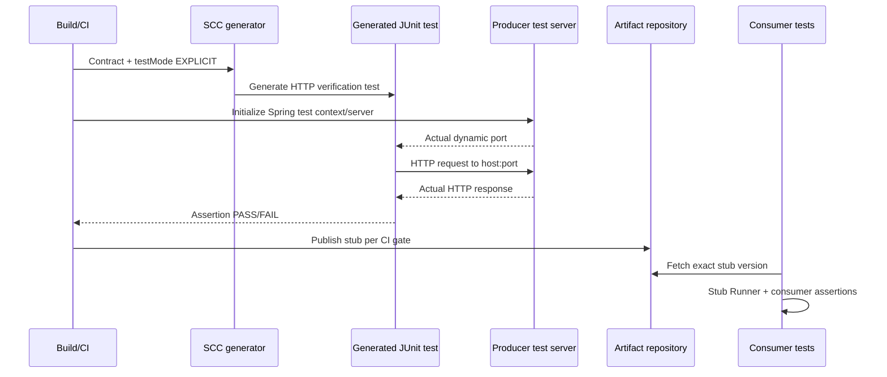

# Choosing Explicit Mode and Configuring the Producer Address

## 1. When Do You Need to Test Over Real HTTP?

In a multi-service architecture, the **producer** exposes an HTTP API or emits messages, while the **consumer** relies on that interface to operate. **Spring Cloud Contract (SCC)** helps teams define interactions using **Groovy/YAML DSL**, generate **producer verification tests**, package **stubs** for consumers to test via **Stub Runner**, and integrate these steps into **CI** to detect incompatible API changes.

When using HTTP contracts, generated tests need to send requests to the producer and match actual responses against declared expectations. The question is *how requests are sent*:

- With **`MOCKMVC`**, tests interact with Spring MVC through MockMvc, without needing a real HTTP server to open a network port.
- With **`WEBTESTCLIENT`**, tests use WebTestClient according to the mode supported by the generator, usually suited for reactive applications.
- With **`EXPLICIT`**, generated tests send **real HTTP requests over a socket** to the address configured by the test; the producer must be listening and ready to receive requests.

This lesson belongs to the **HTTP Testing** chapter of the **SPRING_CLOUD_CONTRACT** module and focuses on the decision to **choose `EXPLICIT`**, determine the **producer address**, connect generated tests to the test server, handle context paths, and diagnose connection failures.

**After this lesson, you will be able to:**

1. Distinguish test mode from contract storage location and application runtime environment.
2. Choose `EXPLICIT` when verifying real HTTP behavior or when the producer does not use Spring MVC.
3. Configure the SCC Maven/Gradle plugin to generate tests with the right mode and base class.
4. Use Spring Boot `RANDOM_PORT` + `@LocalServerPort` to supply the address to Rest Assured without hard-coding `8080`.
5. Combine `baseURI`, `port`, `basePath`, and contract paths without duplicating prefixes.
6. Distinguish connection errors, routing errors, fixture errors, and contract violations; inspect results in CI.

> **Principle:** `EXPLICIT` is not the name of a production environment. It is a **mode for generating producer tests that use real HTTP**. The standard safe practice is running the producer **in an isolated test environment** on a dynamic port, never sending side-effecting tests to a production service.

## 2. Comparing `MOCKMVC`, `WEBTESTCLIENT`, and `EXPLICIT`

| Criterion | `MOCKMVC` | `WEBTESTCLIENT` | `EXPLICIT` |
|---|---|---|---|
| Invocation mechanism | Tests via Spring MockMvc | Tests via configured WebTestClient | Real HTTP requests over a socket |
| Needs server bound to TCP port? | No | Depends on configured WebTestClient variant | **Yes** |
| Suitable producers | Spring MVC | Spring WebFlux/reactive | Spring MVC, WebFlux, other frameworks, or standalone servers |
| What base test must prepare | Web application context/MockMvc | WebTestClient + appropriate context/binding | **Running server + accurate host/port/protocol** |
| Real network path | No | Depends on configuration | Real HTTP connection to target address |
| Complexity | Usually lower | Depends on reactive stack | Usually higher due to server lifecycle, ports, and connections |
| Primary limitation | Does not verify all socket/HTTP container behaviors | Does not automatically ensure real socket traversal | Does not automatically verify production gateway/load balancer/TLS edge |

Choose the mode based on your goal:

- **Keep `MOCKMVC`** if the app uses Spring MVC, contracts mainly constrain controller/HTTP mappings, and tests do not need real sockets.
- **Consider `WEBTESTCLIENT`** for reactive apps when supported by your tool/version and backed by a proper test setup.
- **Choose `EXPLICIT`** when real HTTP requests are needed, the server does not rely on Spring MVC, or you must verify server/container-dependent behavior and context paths as described in the SCC documentation.

Do not choose `EXPLICIT` merely because it sounds "more like integration testing." Real HTTP tests carry **higher setup cost and greater flakiness risk**; use them only when they provide evidence that lighter modes cannot supply.

### 2.1. `EXPLICIT` Does Not Mean End-to-End

A test using `EXPLICIT` may run on `localhost` and use databases/mocks in a test profile. It checks the producer over real HTTP, yet **does not necessarily** pass through the API Gateway, service discovery, reverse proxy, network policy, edge TLS, or production infrastructure.

To thoroughly verify those components, you need appropriate integration, end-to-end, or deployment tests. Contract testing focuses on protecting the **agreed communication interface** for the declared scenarios.

## 3. Which Address Does the HTTP Request Send to the Producer?

When generated tests run via Rest Assured in `EXPLICIT` mode, you can picture the request target as:

```text
scheme + host + port + optional base path + contract path
```

Example:

```text
scheme       = http
host         = localhost
port         = 58321
basePath     = (empty)
contractPath = /api/orders/42

Target URL = http://localhost:58321/api/orders/42
```

Each component serves a distinct purpose:

| Component | Example | Where it is decided |
|---|---|---|
| **Protocol** | `http` / `https` | `RestAssured.baseURI` and server configuration |
| **Host** | `localhost`, `127.0.0.1`, test server DNS | `RestAssured.baseURI` |
| **Port** | Dynamically assigned `58321` | `@LocalServerPort` and `RestAssured.port` |
| **Base path** | `/order-api` if org configuration uses a separate prefix | `RestAssured.basePath`, if genuinely needed |
| **Contract URL/path** | `/api/orders/42` | `request.url` or `urlPath` in Groovy/YAML DSL |
| **Query** | `?include=items` | Contract URL/query parameters |

In a Spring Boot application using dynamic ports, **never hard-code `8080`**. Spring Boot can bind to an available random port, and the test reads the actual port via `@LocalServerPort`. If Rest Assured still sends requests to `8080`, generated tests may fail with `Connection refused` or accidentally hit another server running on the machine.

### 3.1. Producer Address vs. Stub Runner Address

The following two URLs typically belong to **two separate workflows**:

- **Producer test using `EXPLICIT`:** Rest Assured calls the **real producer** running on a test port.
- **Consumer test using Stub Runner:** the consumer's HTTP client calls a **simulated stub server**, which may use a different dynamic port.

Using the Stub Runner port as `RestAssured.port` in the producer test causes the "producer verification" test to actually call the mock. That is a severe bug: tests can pass because the stub matches its own contract, while the producer implementation is never tested at all.

## 4. Sample HTTP Contract for Verifying the Producer

Suppose producer `order-service` exposes an API to fetch order details. Illustrative file `order-found.yml`:

```yaml
name: order_found
description: "Consumer fetches details of a paid order"
request:
  method: GET
  url: /api/orders/42
  headers:
    Accept: application/json
response:
  status: 200
  headers:
    Content-Type: application/json
  body:
    id: 42
    state: PAID
    totalAmount: 125000
```

This contract **contains no producer hostname or port**. It describes the request and response at the interface level. Test mode and target address are configured in the **plugin + base test + test environment**, rather than mixing random CI addresses into the contract YAML.

This lets the same contract be used to:

1. Generate producer tests running with `EXPLICIT` against the build's server port.
2. Generate stub mappings for consumers to use via Stub Runner.
3. Keep `200`, `state: PAID`, and `totalAmount` expectations consistent across both sides.

**Data requirement:** the producer test needs fixtures ensuring order `42` exists with the matching state. `EXPLICIT` only changes how **requests are sent**, not automatically creating databases or business mocks.

## 5. Configuring the Maven Plugin with `testMode = EXPLICIT`

On a Maven-based producer, a core configuration can look like:

```xml
<build>
    <plugins>
        <plugin>
            <groupId>org.springframework.cloud</groupId>
            <artifactId>spring-cloud-contract-maven-plugin</artifactId>
            <version>REPLACE_WITH_COMPATIBLE_SCC_VERSION</version>
            <extensions>true</extensions>
            <configuration>
                <baseClassForTests>
                    com.example.orders.contract.RealHttpContractBase
                </baseClassForTests>
                <testFramework>JUNIT5</testFramework>
                <testMode>EXPLICIT</testMode>
            </configuration>
        </plugin>
    </plugins>
</build>
```

This is an **illustrative plugin snippet**, not a complete runnable POM. Meaning of each setting:

- `spring-cloud-contract-maven-plugin`: build tool that reads contracts and generates tests/stubs.
- `testMode=EXPLICIT`: generated tests use real HTTP instead of MockMvc.
- `testFramework=JUNIT5`: generates tests for JUnit 5; the test runner must actually execute JUnit 5.
- `baseClassForTests`: fully qualified class name of the class that **generated tests extend**.
- `REPLACE_WITH_COMPATIBLE_SCC_VERSION`: placeholder to replace with a Spring Cloud Contract version compatible with your project's Spring Boot/Spring Cloud.

Under `<dependencies>`, libraries supporting producer test execution should be in **test scope**:

```xml
<dependencies>
    <dependency>
        <groupId>org.springframework.boot</groupId>
        <artifactId>spring-boot-starter-web</artifactId>
    </dependency>
    <dependency>
        <groupId>org.springframework.boot</groupId>
        <artifactId>spring-boot-starter-test</artifactId>
        <scope>test</scope>
    </dependency>
    <dependency>
        <groupId>org.springframework.cloud</groupId>
        <artifactId>spring-cloud-starter-contract-verifier</artifactId>
        <scope>test</scope>
    </dependency>
</dependencies>
```

If Rest Assured core is not yet on the **test classpath** per your project's dependency tree, add `io.rest-assured:rest-assured` in `test` scope with a version compatible with your dependency management. Do not assume every project shares the exact same transitive dependency tree.

**Distinction:** Verifier and Rest Assured support **running tests**, while the Maven plugin is used for **generating tests**. Do not place the plugin into application dependencies and expect Maven to generate tests automatically.

### 5.1. Verifying the Mode Actually Generated

After building, inspect the generated Java test in Maven's configured generated test sources directory. With `EXPLICIT`, tests should use Rest Assured **HTTP requests**, not `RestAssuredMockMvc`. If generated code still calls `RestAssuredMockMvc`, possible causes include:

- The plugin has not applied the `EXPLICIT` configuration.
- The generate task has not re-run after changing the mode.
- Tests were generated by another plugin or module.
- Another profile or parent configuration overrode the setting.

The best verification is inspecting **generated source + test reports**, not just seeing `<testMode>EXPLICIT</testMode>` in the POM.

## 6. Equivalent Gradle Plugin Configuration

If the producer uses Gradle Groovy DSL:

```groovy
plugins {
    id 'java'
    id 'org.springframework.boot' version 'REPLACE_WITH_BOOT_VERSION'
    id 'org.springframework.cloud.contract' version 'REPLACE_WITH_SCC_VERSION'
}

repositories {
    mavenCentral()
}

dependencies {
    implementation 'org.springframework.boot:spring-boot-starter-web'
    testImplementation 'org.springframework.boot:spring-boot-starter-test'
    testImplementation 'org.springframework.cloud:spring-cloud-starter-contract-verifier'
}

contracts {
    testMode = 'EXPLICIT'
    testFramework = 'JUNIT5'
    baseClassForTests = 'com.example.orders.contract.RealHttpContractBase'
}
```

This is also a **core configuration snippet**, omitting version management, BOM, and project-specific tasks/source sets. With Gradle Kotlin DSL (`build.gradle.kts`), syntax must be adapted accordingly; do not paste Groovy DSL `build.gradle` verbatim into Kotlin DSL.

Depending on plugin/version, contract tests may live in a separate **`contractTest`** source set/task. When that happens:

- Generated tests must reside in the right source set.
- Test dependencies must be on the classpath of the task executing contract tests.
- `useJUnitPlatform()` must be configured for the required JUnit 5 task.
- CI must actually run the `contractTest` task or the lifecycle task bound by the plugin.

Do not conclude `./gradlew test` automatically runs all generated contract tests; inspect the task graph and test reports for your **exact plugin version**.

## 7. JUnit 5 Base Test for Spring Boot Running on a Dynamic Port

This is the common setup when the producer is a Spring Boot application:

1. Start a **real Spring Boot HTTP server** in the test context.
2. Tell Spring Boot to use **`RANDOM_PORT`**, avoiding collisions with other services.
3. Read the listening port via **`@LocalServerPort`**.
4. Configure Rest Assured to send generated requests to **`localhost:<port>`**.
5. Set up test data/fixtures before each request.

Suppose the application package is `com.example.orders`. Class `RealHttpContractBase` (adjust imports/package per Spring Boot version):

```java
package com.example.orders.contract;

import com.example.orders.OrderServiceApplication;
import io.restassured.RestAssured;
import org.junit.jupiter.api.AfterEach;
import org.junit.jupiter.api.BeforeEach;
import org.springframework.boot.test.context.SpringBootTest;
import org.springframework.boot.test.web.server.LocalServerPort;
import org.springframework.test.context.ActiveProfiles;

@SpringBootTest(
    classes = OrderServiceApplication.class,
    webEnvironment = SpringBootTest.WebEnvironment.RANDOM_PORT
)
@ActiveProfiles("contract")
public abstract class RealHttpContractBase {

    @LocalServerPort
    private int serverPort;

    @BeforeEach
    void setUpRealHttp() {
        RestAssured.baseURI = "http://localhost";
        RestAssured.port = serverPort;
        RestAssured.basePath = "";
    }

    @AfterEach
    void tearDownRestAssured() {
        RestAssured.reset();
    }
}
```

**Key points:**

- `@SpringBootTest(webEnvironment=RANDOM_PORT)` **starts a real HTTP server** inside the test JVM on an OS-assigned port.
- `@LocalServerPort` retrieves the **successfully bound port**, unlike guessing an available port ahead of time.
- `RestAssured.baseURI` and `RestAssured.port` point to the **producer address**, not Stub Runner.
- `RestAssured.basePath=""` in this example because `request.url` already contains the full expected path with no extra prefix needed.
- `@ActiveProfiles("contract")` is a profile name **configured by your project**, not a built-in Spring Cloud Contract profile.
- `@AfterEach` calls `RestAssured.reset()` to reduce configuration leakage during sequential runs. It **does not** provide thread safety if tests run in parallel.

**Code limitation:** `OrderServiceApplication` is your team's Spring Boot application class; it must exist in the project. The example omits data fixtures and application-specific database/security configs. Do not copy it blindly into another repository expecting it to compile without adjustments.

### 7.1. Why Does `@BeforeEach` Run Before Generated Tests?

Generated producer tests are configured to **extend** `RealHttpContractBase`. When the test runner properly uses JUnit 5, the `@BeforeEach` lifecycle method in the base class runs before each inherited test method. Thus, Rest Assured has the exact target URL before the test sends its request.

If the generated class **does not extend** this base class, the configuration in the base class will not run. Do not just check that the base class file exists; inspect the generated source and test reports.

### 7.2. Notes on Static State and Parallel Tests

`RestAssured.baseURI`, `RestAssured.port`, and `RestAssured.basePath` are **global static settings**. When generated tests run in parallel inside the same JVM with multiple servers/ports, test A can overwrite test B's target address.

You can handle this by:

- **Running tests that use global Rest Assured configuration sequentially.**
- Isolating them into separate test JVMs/forks.
- Using per-test request specifications if supported by the generated code and test mode.
- Ensuring all tests in the same JVM share a single server port and unified configuration without mutating globals during parallel execution.

Do not rely on `RestAssured.reset()` in `@AfterEach` to prevent race conditions while parallelism remains enabled.

## 8. Attaching Fixtures to the Base Class Without Breaking the Contract

The `order_found.yml` contract requires the producer to return paid order `42`. The base class must ensure that condition holds **before the request**. One way to extend it (snippet added to the class above):

```java
// Team-defined API, not part of SCC.
@Autowired
private OrderContractFixtures fixtures;

@BeforeEach
void prepareOrderAndHttp() {
    fixtures.resetContractOrders();
    fixtures.savePaidOrder(42L, 125000L);

    RestAssured.baseURI = "http://localhost";
    RestAssured.port = serverPort;
    RestAssured.basePath = "";
}
```

This is an **additional example**—do not paste it alongside `setUpRealHttp()` without deciding setup ordering; combine the logic into one `@BeforeEach` or clearly separate responsibilities if multiple lifecycle methods exist.

`OrderContractFixtures`, `resetContractOrders`, and `savePaidOrder` are **built by your team**. They must be registered in appropriate beans/test configuration and operate against a **test database/schema/container**, never deleting real data. If there is another `404` contract, fixtures must ensure that ID does not exist.

### 8.1. How Does Real HTTP Affect Transactions?

A real HTTP request is normally handled by the server on a **different thread and transaction** than the test method. Therefore, placing `@Transactional` on the test is not enough to roll back data written by the server alongside the test. When tests create or update data:

- Prepare seed data so it is visible from the server's transaction.
- Clean up test-scoped data afterward or use an isolated database/container.
- Avoid relying on execution order or leftover state.
- Make clocks, downstream mocks, authentication, and caches reproducible.

If the producer returns `404` because the fixture has not committed the record the server needs to see, that is a **setup/transaction visibility** error to distinguish from an API mapping bug.

## 9. Context Path, Base Path, and Contract Paths

This is one of the most common reasons `EXPLICIT` returns `404` even though the server is running.

Suppose the Spring Boot app configures:

```yaml
server:
  servlet:
    context-path: /order-api
```

The endpoint in the controller is `/api/orders/42`, so the path from the HTTP client's perspective may be:

```text
/order-api/api/orders/42
```

There are **two strategies**, and they must not be mixed:

### Strategy A — Contract Includes the Context Path

```yaml
request:
  method: GET
  url: /order-api/api/orders/42
response:
  status: 200
```

The base class keeps:

```java
RestAssured.baseURI = "http://localhost";
RestAssured.port = serverPort;
RestAssured.basePath = "";
```

Generated tests then call `/order-api/api/orders/42` directly. Stub mappings generated from the contract will also include that prefix. The Spring Cloud Contract documentation on **Working with Context Paths** presents this approach of including the context path in contracts with `EXPLICIT`.

### Strategy B — Contract Uses Logical Path, Base Test Adds Prefix

Contract:

```yaml
request:
  method: GET
  url: /api/orders/42
response:
  status: 200
```

Base class attempts configuration:

```java
RestAssured.baseURI = "http://localhost";
RestAssured.port = serverPort;
RestAssured.basePath = "/order-api";
```

This is a **conditional path organization option**; you must verify the actual generated request with your **Rest Assured/SCC version**. It also means **stubs generated from the contract may not automatically carry the `/order-api` prefix**. If real consumers call with the prefix, this risks divergence between producer tests and stubs, so review carefully with the consumer team.

**Never both put `/order-api` in `request.url` and set `RestAssured.basePath="/order-api"`**, because the request may become `/order-api/order-api/api/orders/42`.

### Final Path Verification Table

| Contract URL | Rest Assured basePath | Expected request path | Notes |
|---|---|---|---|
| `/api/orders/42` | `""` | `/api/orders/42` | No context path |
| `/order-api/api/orders/42` | `""` | `/order-api/api/orders/42` | Prefix resides in contract |
| `/api/orders/42` | `/order-api` | `/order-api/api/orders/42` | Must check stub divergence |
| `/order-api/api/orders/42` | `/order-api` | May duplicate prefix | **Do not use** |

Depending on servlet context path, WebFlux `spring.webflux.base-path`, reverse proxies, or gateways, the path seen by end callers may differ from internal server paths. Contracts must express the exact **interface consumers actually call**. Do not try to "fix" every `404` by blindly tweaking `basePath`.

## 10. Producers Running Outside a Spring Boot Test Context

`EXPLICIT` does not require the producer to be Spring MVC or even a Spring Boot application. Spring Cloud Contract documents non-Spring producers, such as a Javalin server started from the test base.

Mental steps:

1. Select or ask the OS for **an available test port**.
2. **Start the real server** on that port in `@BeforeEach` or the test suite lifecycle.
3. Proceed only after the server has bound and is ready to accept requests.
4. Pass the actual address (`scheme/host/port`) to Rest Assured.
5. Shut down the server and clean up state after the test.

Illustrative pseudocode, not a directly compilable Javalin/SCC class:

```java
@BeforeEach
void startProducer() {
    server = startTestServerOnAvailablePort();
    int actualPort = server.boundPort();

    RestAssured.baseURI = "http://localhost";
    RestAssured.port = actualPort;
}

@AfterEach
void stopProducer() {
    server.stop();
    RestAssured.reset();
}
```

**Do not** scan for a "free port" and wait before binding, because another process can claim the port in between (a race condition). If the framework supports binding port `0` and reading the assigned port, that is usually far more reliable. And never target an external production server for tests that create or delete data unless your organization has an approved isolated environment and appropriate safeguards.

## 11. WebFlux with `EXPLICIT`

Reactive applications can run a real HTTP server and be verified using `EXPLICIT`. Spring Cloud Contract documentation has a section on **WebFlux with Explicit Mode**, where the plugin uses `testMode=EXPLICIT` while the base test configures Rest Assured and the producer listens on a port.

Do not call `RestAssuredMockMvc.webAppContextSetup(...)` in a pure WebFlux project hoping it becomes real HTTP; that API is for MockMvc. If you choose `EXPLICIT`, generated tests must hit a **socket** and the producer address must be accurate.

Whether WebFlux or MVC, the checklist questions remain the same:

- Is the server ready before the request?
- Are host, protocol, port, and context/base path correct?
- Do request/response bodies use the right format and codecs?
- Are test fixtures independent?
- Do generated tests and CI actually run in the intended mode?

## 12. Real HTTP: Watch Out for TLS, Authentication, Gateways, and Proxies

### 12.1. HTTP vs. HTTPS

If the test server only enables HTTP, `RestAssured.baseURI` must use `http://`. Configuring `https://` against a non-TLS port causes handshake errors instead of contract results.

If you genuinely want to verify HTTPS/TLS, the test environment needs valid certificates and truststores configured. Never globally disable certificate verification or enable `relaxedHTTPSValidation()` for all tests; doing so can mask security misconfigurations. If using mTLS, HTTP tests need valid client certificates managed by the test environment.

### 12.2. Authentication and Authorization

Real requests can pass through security filter chains. If `GET /api/orders/42` returns `401` instead of `200`, check:

- Did the contract declare the `Authorization`/cookie/header required by the consumer?
- Does the test profile configure security as agreed?
- Does the generated test send credentials suited to the test environment?
- Are the fixture's permissions/roles accurate?

Do not turn off all security just to make tests green when authentication is part of the interface consumers depend on.

### 12.3. Gateways and Reverse Proxies

An `EXPLICIT` test against `localhost` normally calls the **producer directly**. It does not automatically pass through a gateway, service discovery, load balancer, or WAF. If the contract protects a public path rewritten by a gateway, choose the appropriate test architecture and maintain gateway-level integration tests.

Pointing `baseURI` to a staging gateway URL shifts the test target from a local producer to a shared environment. That introduces network, version, data, and even side-effect dependencies. It requires an explicit approved process, never as a default setup for producer contract tests.

## 13. Diagnosing Common `EXPLICIT` Failures

| Symptom | Likely cause | Verification steps |
|---|---|---|
| `Connection refused` | Server did not start, wrong port, or wrong host | Check `@SpringBootTest(RANDOM_PORT)`, `@LocalServerPort`, bind logs |
| `UnknownHostException` | Misconfigured host or unresolvable DNS | Check `baseURI` and network environment |
| `SSLHandshakeException` | `https` mismatch or invalid certificate/truststore | Verify protocol/TLS config; do not disable verification |
| Request hits a different service | Hard-coded port `8080` or Stub Runner port | Read actual bound port, log target URL |
| HTTP `404` while server is ready | Wrong context path, `basePath`, URL, or routing | Print final request path, verify no duplicate prefix |
| HTTP `401/403` | Missing authentication/role or different filter | Check headers and Spring Security setup |
| HTTP `500` | Fixture/DB/dependency error or real producer bug | Inspect stack trace, seed/reset, implementation |
| Passes alone, fails in suite | Shared `RestAssured` static state or shared fixtures | Check parallelism, forking, and cleanup |
| `0 tests` yet green build | Task or JUnit engine did not discover tests | Check generated sources and test reports |
| Generated code still calls MockMvc | `EXPLICIT` not actually applied | Check plugin config, regenerate, and recompile |
| Producer test green but new consumer fails | Wrong stub version or missing test cases | Run consumer tests against verified stub version |
| Timeout | Server not ready, slow routing/DB, or deadlock | Check startup logs, requests, dependencies, and actual timeouts |
| Differs between local and CI | Port, profile, clock, database, or network differences | Isolate environment and log key parameters |

### 13.1. Distinguishing Connection Errors from Contract Mismatches

- **Connection error:** no HTTP response exists yet to compare; fix server lifecycle, address, or TLS.
- **Unexpected `404` response:** an HTTP response arrived, but path or data/API state is wrong; investigate both routing and fixtures.
- **`200` response with wrong body:** the request reached the producer; check assertions, serialization, and implementation logic.
- **Consumer test passes with stub:** only verifies the client behaves correctly with the **stub**, not that the producer passed producer verification.

Never change `response.status` or delete assertions to "turn green" a test failing with `Connection refused`; the error lies outside contract semantics.

## 14. Running and Verifying in CI

A minimal pipeline for an HTTP producer:

1. **Check out contract and implementation** at the same reviewed commit/version.
2. **Stand up an isolated test environment:** `contract` profile, test database, downstream stubs, or required containers.
3. **Generate producer tests** with the SCC plugin using `testMode=EXPLICIT`.
4. **Start the real server** on `RANDOM_PORT` or an equivalent test-port mechanism.
5. **Run generated tests** passing the real host/port to Rest Assured from the base class.
6. **Fail CI on red tests**, including connection errors or status/header/body mismatches; never skip tests.
7. **Package and publish versioned stubs** per team policy once producer verification for that exact build passes.
8. **Run consumer tests via Stub Runner** with the matching artifact version and the assertions the consumer genuinely relies on.



### 14.1. Reference Maven/Gradle Commands

When a **complete project** already has the wrapper and matching plugins configured, you can run:

```bash
./mvnw clean verify
```

Or with Gradle:

```bash
./gradlew generateContractTests
./gradlew contractTest
```

Task names, lifecycle bindings, and test source sets must be verified on your exact build and plugin version. `generateContractTests` only generates tests; `contractTest` is typically the task running contract tests if the plugin creates a separate source set. If a task does not exist, never treat non-execution as PASS.

**This lesson does not require running a build**; commands are provided for learners to apply in a suitable environment. Content review and rigorous academic QA belong to the next stage.

### 14.2. Verifying Actual Outputs

- Do generated tests exist in the expected build directory?
- Does the generated test extend `RealHttpContractBase`?
- Does the generated test invoke Rest Assured HTTP instead of MockMvc?
- Is `@LocalServerPort` non-zero and did the server bind?
- Does the actual request path match the contract without duplicate prefixes?
- Are assertions present for status, headers, and body?
- Does the test report show actual executed tests rather than `0`?
- Does CI fail if the returned status is altered in the test environment?
- Is the stub artifact version linked to the verified producer build?

## 15. Exercise: Moving from `MOCKMVC` to `EXPLICIT` Under Control

**Context:** producer `billing-service` exposes the API:

```http
GET /api/invoices/501 HTTP/1.1
Accept: application/json
```

Contract-compliant response:

```http
HTTP/1.1 200 OK
Content-Type: application/json

{"invoiceId":501,"state":"ISSUED"}
```

Previously the app ran producer tests in `MOCKMVC`; now it needs real HTTP testing to verify routing and server configuration. Spring Boot can allocate a random port.

**Requirements:**

1. Write a YAML contract for `GET /api/invoices/501` with `200`, JSON `invoiceId`, and `state`.
2. Configure the Maven or Gradle plugin with `testMode=EXPLICIT`, `testFramework=JUNIT5`, and a base class FQN.
3. Write a `@SpringBootTest(webEnvironment=RANDOM_PORT)` base test configuring `RestAssured.baseURI` and `port` from `@LocalServerPort`.
4. Suppose the app adds `server.servlet.context-path=/billing`. State two ways to structure contract path/basePath and how to avoid a double prefix.
5. Propose fixtures ensuring invoice `501` exists before the test.
6. Explain why using the Stub Runner port for producer verification is wrong.
7. Describe one `Connection refused` failure and one `404` failure, and how to tell their root causes apart.
8. Propose a CI gate and verify generated tests/reports.

### Configuration Hints

```yaml
name: invoice_issued
request:
  method: GET
  url: /api/invoices/501
  headers:
    Accept: application/json
response:
  status: 200
  headers:
    Content-Type: application/json
  body:
    invoiceId: 501
    state: ISSUED
```

With the contract above and no context path, the base class can set:

```java
RestAssured.baseURI = "http://localhost";
RestAssured.port = serverPort;
RestAssured.basePath = "";
```

When the server has context path `/billing`, decide whether the **contract path already includes the prefix or not**, then verify the final request. Learners must also prove `EXPLICIT` calls the **running test producer server**, not a stub.

### Self-Check Rubric

| Question | Expected outcome |
|---|---|
| Which mode does the plugin use to generate tests? | `EXPLICIT` |
| Who starts and owns the server? | Base test/test context or configured test lifecycle |
| Where does the port come from? | `@LocalServerPort` or framework API returning the bound port |
| Who does Rest Assured call? | The real producer HTTP server |
| Is the address stable across CI machines? | Do not hard-code the port; read the actual port |
| Who provides invoice `501`? | Producer fixtures/test data |
| Who verifies the `200` response and JSON? | Generated producer verification test |
| Who uses stubs to test the client? | Consumer tests with Stub Runner |

## 16. Checklist Before Committing to `EXPLICIT`

- [ ] Chose `EXPLICIT` because real HTTP is needed or the producer framework does not fit MockMvc; lighter options were evaluated.
- [ ] Maven/Gradle SCC plugin genuinely generates tests with `testMode=EXPLICIT`.
- [ ] Test framework/runner aligns with JUnit 5 (or the active framework).
- [ ] Generated tests extend the right base class.
- [ ] Server starts on a test port and is ready before requests arrive.
- [ ] `baseURI` uses the right host/scheme; `port` comes from the bound server.
- [ ] `basePath` and `request.url` do not overlap context paths.
- [ ] Producer port is distinct from and never confused with Stub Runner's stub port.
- [ ] Test profile, fixtures, database, mocks, and security are isolated and reproducible.
- [ ] Accounted for `RestAssured` global static state during parallel execution.
- [ ] HTTP/TLS/authentication/gateway layers are tested at their proper boundaries rather than inferred from local `EXPLICIT`.
- [ ] Generated tests actually call the producer and assert status/headers/body.
- [ ] CI fails on mismatches or connection errors; no tests are skipped unintentionally.
- [ ] Stub artifacts are published with proper versions only after producer verification passes per process.
- [ ] Consumer tests via Stub Runner are not treated as a substitute for producer verification.

## 17. Takeaways and References

**`EXPLICIT` is the HTTP contract test generation mode that sends real requests to a producer running on a socket.** It does not automatically mean production or end-to-end. The most important configuration is the **producer address**: host, protocol, actual port, and path. With Spring Boot, `@SpringBootTest(webEnvironment=RANDOM_PORT)` combined with `@LocalServerPort` and Rest Assured is a practical pattern that avoids hard-coding ports and improves CI reproducibility.

Spring Cloud Contract preserves clear roles: **Groovy/YAML DSL** describes what the consumer needs; the **build plugin** generates tests/stubs; the **base class** sets up the test server/fixtures; **generated producer tests** verify real responses; and **Stub Runner** lets consumers verify against simulated stubs. Only when every stage runs on compatible versions behind a CI gate does the team gain reliable evidence to catch incompatible API changes.

Official documentation to cross-check against your project's SCC and Spring Boot versions:

- [Spring Cloud Contract — Working with Context Paths](https://docs.spring.io/spring-cloud-contract/reference/project-features-flows/context-paths.html).
- [Spring Cloud Contract — Provider Contract Testing with a Non-Spring Application](https://docs.spring.io/spring-cloud-contract/reference/using/provider-contract-testing-non-spring.html).
- [Spring Cloud Contract — WebFlux with Explicit Mode](https://docs.spring.io/spring-cloud-contract/reference/project-features-flows/feature-webflux-explicit.html).
- [Spring Cloud Contract — Maven Project: testMode and baseClassForTests](https://docs.spring.io/spring-cloud-contract/docs/current/reference/html/maven-project.html).
- [Spring Cloud Contract — Maven Plugin generateTests: configuration parameters](https://docs.spring.io/spring-cloud-contract/docs/current/spring-cloud-contract-maven-plugin/generateTests-mojo.html).
