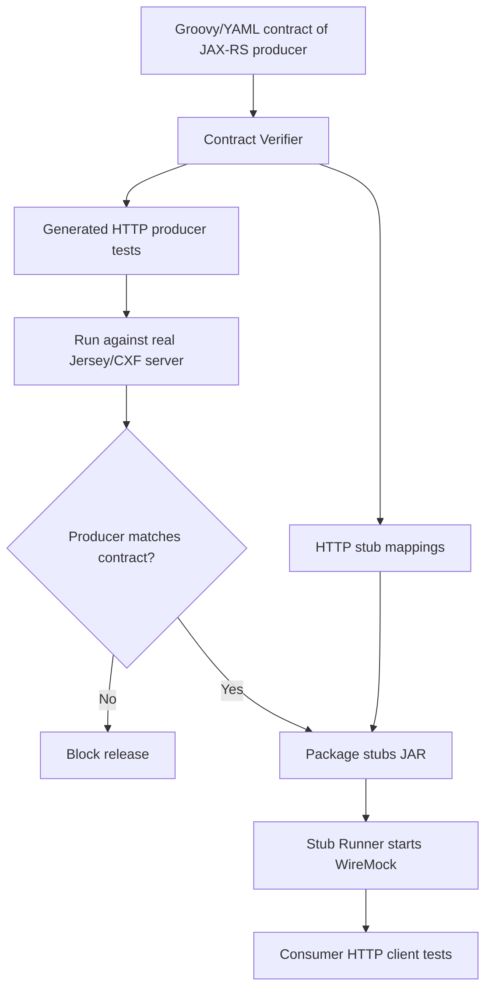
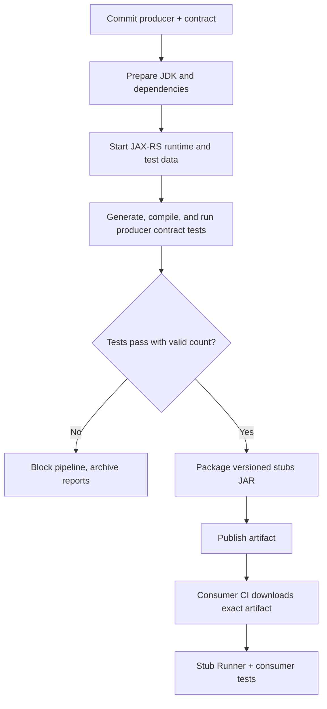

# JAX-RS Testing Conditions by Application Environment

## 1. How Is JAX-RS Different with Spring Cloud Contract?

**Spring Cloud Contract** helps producers and consumers agree on API behavior through contracts written in **Groovy/YAML DSL**. Contract Verifier generates producer-side tests, while stubs are generated and published for consumers to use via **Stub Runner**. With CI integration, changes to HTTP status, paths, headers, or JSON bodies can be detected before services are deployed independently.

For HTTP applications using **JAX-RS** (Jakarta RESTful Web Services, formerly Java API for RESTful Web Services), endpoints are typically declared using `@Path`, `@GET`, `@POST`, `@Produces`, `@Consumes`, and `Provider`s. This model differs from Spring MVC based on `@RestController` and `@GetMapping`. Consequently, **the default test generation mode meant for Spring MVC is not always suitable for JAX-RS**.

For example, a producer uses Jersey or Apache CXF to implement `GET /api/orders/42`. A generated test based on Spring MVC `MockMvc` may fail to find the Jersey route even though the live application returns HTTP `200`. The appropriate verification approach is typically to **start the JAX-RS runtime and send real HTTP requests** using a test client, unless your Spring Cloud Contract version and JAX-RS runtime provide a supported, properly configured in-process test mode.

**Lesson objectives:**

1. Separate HTTP contracts from the HTTP processing framework and pick an appropriate test mode.
2. Properly prepare the server, port, context path, JAX-RS application path, JSON provider, filters, and test data.
3. Run generated producer tests against the real JAX-RS API rather than an unrepresentative mock.
4. Use stubs JARs and Stub Runner to test the consumer independently, understanding test limitations.
5. Design CI gates to catch incompatible APIs and diagnose failures layer by layer.

## 2. HTTP Contracts Are Independent of Resource Implementation

Suppose a producer named `order-service` exposes an endpoint:

```http
GET /api/orders/42
Accept: application/json
```

And must return:

```http
HTTP/1.1 200 OK
Content-Type: application/json

{"orderId":42,"status":"CONFIRMED"}
```

The consumer does not need to know whether the endpoint is built with `@RestController` or `@Path`. They care about **the method, URL, headers, status, and body the client actually observes**. Thus, the same contract can serve Spring MVC or JAX-RS:

```groovy
import org.springframework.cloud.contract.spec.Contract

Contract.make {
    description 'Look up confirmed order'

    request {
        method GET()
        url '/api/orders/42'
        headers {
            accept(applicationJson())
        }
    }

    response {
        status OK()
        headers {
            contentType(applicationJson())
        }
        body([
            orderId: 42,
            status : 'CONFIRMED'
        ])
    }
}
```

The file is usually placed under the producer's contract sources, for example:

```text
src/test/resources/contracts/orders/get-confirmed-order.groovy
```

**Point to separate:** the Groovy DSL above describes the protocol, whereas **test mode and the base class** determine which environment generated tests execute requests against. If a test hits the wrong URL or fails to start the JAX-RS servlet, a `404` error does not prove the contract is wrong.

### Same Scenario in YAML DSL

```yaml
description: Look up confirmed order
request:
  method: GET
  url: /api/orders/42
  headers:
    Accept: application/json
response:
  status: 200
  headers:
    Content-Type: application/json
  body:
    orderId: 42
    status: "CONFIRMED"
```

Groovy and YAML are **two alternative representations** of this scenario. Do not keep both copies in the same contract directory scanned by the plugin after conversion, as that can produce duplicate tests and mappings. Note that `orderId: 42` is a JSON number, not the string `"42"`.

## 3. Matrix for Choosing the Test Environment

You cannot choose a test mode solely by whether code has `@Path` annotations: you must check **which framework runtime actually handles requests**.

| Producer / runtime | Appropriate verification approach | Key conditions |
| --- | --- | --- |
| Spring Boot + **Spring MVC** | `MockMvc` if supported by plugin and configured properly | Runs inside Spring MVC dispatcher; no real port needed |
| Spring Boot + **Jersey JAX-RS** | Real HTTP against embedded servlet/server is a safe, observable choice | Jersey servlet/container registered; port, path, and providers match |
| Spring Boot + **Apache CXF JAX-RS** | Real HTTP against started CXF runtime | CXF servlet/application path, providers, and security filters loaded |
| **Jakarta EE / JAX-RS** app on server/container | Real HTTP against test deployment | Container deployed, deterministic URL, data seeded |
| JAX-RS resource running in **specialized test container** | JAX-RS test framework if supported by Spring Cloud Contract/plugin | Check exact plugin version docs and runner integration |
| Spring WebFlux | `WebTestClient` if supported by plugin | This is reactive Spring, **not identical to JAX-RS** |

In the following examples, we choose **sending real HTTP requests to a running JAX-RS server**. In Spring Cloud Contract, the commonly used configuration name for real HTTP is **`EXPLICIT`** (generated tests via Rest Assured); some versions/ecosystems offer dedicated JAX-RS options. Always **check the test mode name and API of your exact plugin version** before configuring: never assume every version has the same enum or in-process JAX-RS support.

### Why Is MockMvc Often Insufficient for Jersey/CXF?

`MockMvc` simulates the Spring MVC pipeline. When real HTTP routes are registered in Jersey/CXF instead of Spring MVC's `DispatcherServlet`, a generated MockMvc test may not pass through JAX-RS `@Path` resources, `ContainerRequestFilter`s, `ExceptionMapper`s, or JSON providers as in real deployment. Specialized integrations may exist, but they must be verified via actual configuration and tests rather than assuming the two frameworks share a dispatcher.

**Selection rule:** if the goal is to verify the JAX-RS responses real consumers will receive, prefer requests crossing the **real JAX-RS runtime HTTP boundary** whenever no explicitly supported in-process mechanism is warranted.

## 4. Server, Port, and Path Conditions

A generated test request only succeeds when it reaches the deployed endpoint accurately.

### 4.1. The Final URL Is Assembled from Multiple Layers

For example, a server may have:

| Configuration layer | Illustrative value | Meaning |
| --- | --- | --- |
| Scheme and host | `http://localhost` | Where the producer test connects |
| Test port | `49152` | Dynamic port opened by the server |
| Context path | `/shop` | Web application prefix, if any |
| JAX-RS application path | `/api` | E.g., `@ApplicationPath("/api")` or equivalent servlet mapping |
| Resource path | `/orders` | E.g., `@Path("/orders")` |
| Method path | `/{id}` | E.g., `@Path("/{id}")` |

Combined, the URL may be:

```text
http://localhost:49152/shop/api/orders/42
```

However, `contract.request.url` should express **the path observed by the consumer per agreement**. If `/shop` is purely a prefix specific to the test deployment environment, the client's base path can be configured so requests are built accurately. If `/api` is a stable part of the public API, include it in the contract. **Do not duplicate prefixes** by putting `/api` in the contract while also making the client prepend `/api` again.

### 4.2. Easy-to-Confuse URL Mistakes

- Generated test calls `/api/orders/42`, while JAX-RS is deployed only at `/rest/orders/42`.
- Contract contains `/api`, and Rest Assured base path also contains `/api`, resulting in `/api/api/orders/42`.
- Test uses fixed port `8080` while the server runs on a random port.
- Test uses HTTP while the deployment only accepts HTTPS.
- JAX-RS runtime has not finished starting when generated tests begin.
- A reverse proxy in production adds prefixes/headers that tests targeting the servlet directly do not simulate.

When debugging, record the **actual called URL**, the port bound by the server, registered dispatchers/servlets, and producer-side request logs. A `404` may be a routing error rather than missing business data.

### 4.3. Readiness and Application Lifecycle

Testing against a real server must ensure:

1. The JAX-RS runtime is completely started before the first request.
2. Port, host, and base path are passed to generated tests.
3. Test data is in place before endpoints are called.
4. After the suite finishes, the server and test infrastructure shut down and clean up properly.

With embedded Spring Boot you can use `@SpringBootTest(webEnvironment = RANDOM_PORT)`. With an external Jakarta EE server running outside the JVM, you typically need a deploy/health-check step and separate HTTP base URI configuration; `@SpringBootTest` cannot start a non-Spring external server on its own.

## 5. Example JAX-RS Resource and Components That Must Be Loaded

In a Spring Boot application using Jersey, a resource can be declared using the Jakarta REST API as follows:

```java
import java.util.Map;
import jakarta.ws.rs.GET;
import jakarta.ws.rs.Path;
import jakarta.ws.rs.PathParam;
import jakarta.ws.rs.Produces;
import jakarta.ws.rs.core.MediaType;
import jakarta.ws.rs.core.Response;
import org.springframework.stereotype.Component;

@Component
@Path("/orders")
@Produces(MediaType.APPLICATION_JSON)
public class OrderResource {

    @GET
    @Path("/{id}")
    public Response getOrder(@PathParam("id") long id) {
        if (id == 42L) {
            return Response.ok(Map.of(
                "orderId", 42,
                "status", "CONFIRMED"
            )).build();
        }

        return Response.status(Response.Status.NOT_FOUND)
            .entity(Map.of("code", "ORDER_NOT_FOUND"))
            .build();
    }
}
```

If the runtime configures JAX-RS application path `/api`, then `@Path("/orders")` and `@Path("/{id}")` yield the desired serving path `/api/orders/42`. Note: **merely having the resource on the classpath is not enough for the route to work**. Jersey must be registered, and the runtime needs an appropriate JSON provider for the returned objects/maps.

Example of registering Jersey with Spring Boot:

```java
import org.glassfish.jersey.server.ResourceConfig;
import org.springframework.stereotype.Component;

@Component
public class JerseyConfig extends ResourceConfig {
    public JerseyConfig() {
        register(OrderResource.class);
        // Register ExceptionMapper, filters, or other JSON providers if needed.
    }
}
```

The application path can be configured specifically for Jersey via runtime configuration or the matching annotation—**do not declare overlapping conflicting prefixes**. For instance, with Spring Boot + Jersey versions supporting the corresponding property:

```properties
spring.jersey.application-path=/api
```

The Java snippet above is an **illustrative resource example**; a working project needs compatible Jersey/CXF dependencies, JSON providers, registrations, and Spring Boot/Jakarta versions. With Spring Boot 2.x and older JAX-RS libraries, the `javax.ws.rs.*` namespace may be needed instead of `jakarta.ws.rs.*`. **Do not mix `javax` and `jakarta`** arbitrarily in one application; stay consistent with the runtime and library set in use.

### JAX-RS Components Affecting Responses

| Component | Example | If missing or not invoked |
| --- | --- | --- |
| Resource registration | `OrderResource` managed by Jersey | Requests receive `404` because no route exists |
| Application path | `/api` | Generated tests call the wrong URL |
| JSON provider | Compatible Jackson/Jersey JSON integration | `406`/`500` or wrong body/media type |
| `@Consumes`, `@Produces` | `application/json` | `415` or `406` when content negotiation fails |
| `ExceptionMapper` | Converts exceptions into business error bodies | Actual `500`/HTML instead of committed `404` JSON |
| Request/response filters | Authentication, correlation ID | Tests skip authorization or miss headers |
| Data and service layer | Order 42 has status `CONFIRMED` | `404`/unexpected state despite valid route |

In particular, real JAX-RS layer tests must pass through the layers the consumer observes. If controllers/services are mocked to always return contract-matching responses, a test may pass without proving production converters, filters, or security chains work properly.

## 6. Configuring Contract Verifier to Send Real HTTP

Example relevant configuration in the producer's `pom.xml` already equipped with Spring Boot and appropriate JAX-RS dependencies:

```xml
<dependency>
    <groupId>org.springframework.cloud</groupId>
    <artifactId>spring-cloud-starter-contract-verifier</artifactId>
    <scope>test</scope>
</dependency>

<build>
    <plugins>
        <plugin>
            <groupId>org.springframework.cloud</groupId>
            <artifactId>spring-cloud-contract-maven-plugin</artifactId>
            <version>${spring-cloud-contract.version}</version>
            <extensions>true</extensions>
            <configuration>
                <testMode>EXPLICIT</testMode>
                <baseClassForTests>com.example.orders.ContractVerifierBase</baseClassForTests>
            </configuration>
        </plugin>
    </plugins>
</build>
```

This is a **configuration excerpt**, not a complete `pom.xml`. Property `spring-cloud-contract.version` must be defined to match your active Spring Boot/Spring Cloud versions; dependency management/BOM, JUnit, Rest Assured, and Jersey/CXF runtimes must also be complete. Setting `EXPLICIT` expresses the **intent to generate HTTP-level tests instead of MockMvc**. If a plugin version rejects this value or uses a different API, read the configuration error and use the value supported by that version.

### Base Class for Embedded Spring Boot

With Spring Boot versions supporting `@LocalServerPort` and JUnit 5, the base class can be structured as:

```java
package com.example.orders;

import io.restassured.RestAssured;
import org.junit.jupiter.api.BeforeEach;
import org.springframework.boot.test.context.SpringBootTest;
import org.springframework.boot.test.web.server.LocalServerPort;

@SpringBootTest(webEnvironment = SpringBootTest.WebEnvironment.RANDOM_PORT)
public abstract class ContractVerifierBase {

    @LocalServerPort
    int port;

    @BeforeEach
    void configureHttpClient() {
        RestAssured.baseURI = "http://localhost";
        RestAssured.port = port;
        RestAssured.basePath = "";
    }
}
```

Intent of the class above:

1. Start the **real Spring Boot application** with an embedded server on a random port.
2. Wait for the Spring test context and server to finish initializing.
3. Pass the opened port to Rest Assured before generated tests execute requests.
4. Allow tests to call relative URLs from contracts, such as `/api/orders/42`.

**Example limitation:** this skeleton applies when your plugin version's generated tests use HTTP via Rest Assured and extend a JUnit 5-style base class. If the plugin generates JUnit 4 tests, use matching lifecycle annotations; on older Spring Boot versions, the `@LocalServerPort` package may differ. Open generated tests to confirm the actual base class and request client rather than copying configuration and assuming it fits every version.

`RestAssured.baseURI`, `RestAssured.port`, and `RestAssured.basePath` are static settings that can affect multiple tests sharing a JVM. If contract tests run in **parallel** with other apps/tests using these static settings, isolate JVMs, disable parallelization, or configure isolated request specifications as supported by generated tests. Never use a dynamic port in one place while hard-coding `8080` elsewhere.

### Preparing Test Data

Contract `GET /api/orders/42` assumes order 42 exists in state `CONFIRMED`. When hitting a real test database, seed and clean up properly:

```text
Given: order 42 exists with status = CONFIRMED
When:  GET /api/orders/42, Accept: application/json
Then:  HTTP 200 and JSON { orderId: 42, status: "CONFIRMED" }
```

How you seed depends on architecture (test repository, migrations/SQL fixtures, test containers, or suitable service mocks). **Do not assume `@Transactional` on the test rolls back all writes** when requests traverse real HTTP on a separate thread/transaction. Design fixtures around actual transactions and lifecycles.

### When the JAX-RS Server Runs Outside Spring Boot

If the producer runs on a standalone Jakarta EE server/servlet container, do not use `@SpringBootTest` to "pretend" the server is already running. Instead, the base class should read `contract.base-url` or an equivalent environment variable from the pipeline:

```text
Deploy JAX-RS WAR/app to test container
  → wait for health/readiness
  → retrieve scheme, host, port, and context path
  → configure HTTP client for generated tests
  → run verification
  → collect reports, tear down container and test data
```

The property name passing the URL and how the request client is initialized are project/test-harness decisions; there is no single `@LocalServerPort` applicable to all Java EE apps. With Apache CXF or Jersey running embedded outside Spring Boot, the principle remains to **genuinely start the runtime serving the endpoints** and control its lifecycle.

## 7. Request Conditions: Accept, Content-Type, Query, and Auth

The JAX-RS runtime relies on content negotiation and providers to process data. These details matter especially when contract tests make real HTTP calls.

### GET and the `Accept` Header

In the lookup example, the contract sends:

```http
GET /api/orders/42 HTTP/1.1
Accept: application/json
```

If the resource has `@Produces(MediaType.APPLICATION_JSON)` yet lacks a JSON provider, the producer may fail to serialize the body properly. If the client sends `Accept: application/xml`, the runtime may return `406 Not Acceptable` depending on configuration. This is not a business status error; inspect request headers and provider registrations before changing the contract.

### POST with `@Consumes`

Example of an order creation API:

```http
POST /api/orders HTTP/1.1
Content-Type: application/json
Accept: application/json

{"customerId":"cust-123","quantity":2}
```

When a JAX-RS resource declares `@Consumes(MediaType.APPLICATION_JSON)`, requests missing a matching `Content-Type` may receive `415 Unsupported Media Type`. If a contract declares a body while omitting the header, tests may fail due to content negotiation rather than order creation logic. For JSON bodies, protect data types, required fields, and consumer-used matchers.

### Security Filters

If the API requires `Authorization` or cookies, decide whether contract tests aim to verify **authenticated** flows or `401`/`403` errors. With real HTTP, the filter chain typically runs; supply valid test tokens/identities or configure test authentication transparently.

If you turn off all security just so a `200` test passes, that result **does not protect the security interface**. Instead of silently disabling security, create dedicated scenarios for `401`/`403` if consumers depend on them and execute tests through the real handling layer.

## 8. Error Responses and JAX-RS ExceptionMapper

A producer may throw an exception when a resource does not exist. In JAX-RS, `ExceptionMapper` maps an exception type to a `Response` with the interface's expected HTTP status and body.

Example business exception:

```java
public class OrderNotFoundException extends RuntimeException {
    public OrderNotFoundException(long id) {
        super("Order not found: " + id);
    }
}
```

Illustrative mapper:

```java
import java.util.Map;
import jakarta.ws.rs.ext.ExceptionMapper;
import jakarta.ws.rs.ext.Provider;
import jakarta.ws.rs.core.MediaType;
import jakarta.ws.rs.core.Response;

@Provider
public class OrderNotFoundMapper
        implements ExceptionMapper<OrderNotFoundException> {

    @Override
    public Response toResponse(OrderNotFoundException error) {
        return Response.status(Response.Status.NOT_FOUND)
            .type(MediaType.APPLICATION_JSON)
            .entity(Map.of(
                "code", "ORDER_NOT_FOUND",
                "message", "Order not found"
            ))
            .build();
    }
}
```

With Jersey, ensure the mapper is discovered or registered by the runtime, such as via `ResourceConfig.register(OrderNotFoundMapper.class)`. With CXF or Jakarta EE servers, provider registration may differ. A mapper sitting on the classpath that is **not loaded by the runtime** results in error responses that do not match the contract.

Error contract:

```groovy
import org.springframework.cloud.contract.spec.Contract

Contract.make {
    description 'Order 999 not found'

    request {
        method GET()
        url '/api/orders/999'
        headers {
            accept(applicationJson())
        }
    }

    response {
        status NOT_FOUND()
        headers {
            contentType(applicationJson())
        }
        body([
            code: 'ORDER_NOT_FOUND',
            message: 'Order not found'
        ])
    }
}
```

This test verifies the **actual returned response** when data 999 does not exist, rather than testing `toResponse` in isolation. If the runtime returns an HTML error page or `500`, investigate providers, mapper registration, request routing, and root exceptions.

### Do Not Confuse HTTP 404 with a Missing Route

Two situations can both return HTTP `404` while having completely different meanings:

| Situation | Source | How to verify |
| --- | --- | --- |
| **Business 404** | JAX-RS endpoint received the request and determined order does not exist | JSON has committed `code = ORDER_NOT_FOUND` and `Content-Type` |
| **Routing 404** | No matching servlet/resource path found | Check URL, application path, resource registration, and dispatcher logs |

A generated test that only asserts `status = 404` can pass even if the endpoint was never registered. If consumers rely on error JSON, include `code` and content type in the contract.

### Watch Out for Filters and Exceptions Outside JAX-RS Resources

A `401` returned by a security filter or `502` produced by a reverse proxy may bypass `ExceptionMapper` altogether. If published contracts include such responses, pick a test environment that runs **the exact component producing the response**, or add corresponding integration tests. Testing a single resource does not guarantee final responses behind a gateway match production.

## 9. Execution Path of Generated Producer Tests for JAX-RS

After selecting an HTTP-level test mode and appropriate base class:

```bash
# Maven producer, with wrapper and plugin configured
./mvnw clean verify
```

Maven is only an example. With Gradle, configure the `org.springframework.cloud.contract` plugin and a test mode supporting real HTTP in your current version, then run the appropriate contract-test tasks. You can inspect:

```bash
./gradlew tasks --all
./gradlew clean check
```

**Do not assume** every plugin version automatically wires generated tests into `check` or `verify`; inspect code generation outputs, reports, and the number of tests actually executed.

A generated producer test for `GET /api/orders/42` conceptually looks like:

```java
// ILLUSTRATIVE CODE: not guaranteed to be verbatim plugin output.
given()
    .header("Accept", "application/json")
.when()
    .get("/api/orders/42")
.then()
    .statusCode(200)
    .body("orderId", equalTo(42))
    .body("status", equalTo("CONFIRMED"));
```

Things to check **in the actual generated code**:

1. The test uses the **right HTTP client**, not accidentally invoking Spring MVC `MockMvc` when the API is implemented with Jersey/CXF.
2. The base class is actually inherited and runs its setup before the test sends requests.
3. The actual test server port is passed to the request rather than falling back to a default port.
4. The contract URL has no extra or missing context path.
5. `Accept` and important auth headers are still sent.
6. Assertions verify status, headers, body, and required data types.

### Reading Errors by Layer

| Symptom | First layer to inspect |
| --- | --- |
| No generated tests | Source root, contract filters, plugin, and code generation task |
| Generated test fails to compile | Base test class, JUnit version, Rest Assured dependency, Java namespace |
| `Connection refused` | JAX-RS server not running or wrong host/port |
| `404` without business JSON | Context path, `@Path`/application path, route/resource registration |
| `405 Method Not Allowed` | HTTP method in contract does not match resource |
| `406 Not Acceptable` | `Accept` header and `@Produces`/provider |
| `415 Unsupported Media Type` | `Content-Type`, `@Consumes`, and request body |
| `401` or `403` | Auth filter/identity; do not change contract to expect an error response |
| `500` | Exceptions, JSON serialization, providers, DB, or mappers |
| `200` but body has wrong field name/type | DTO, JSON serializer, producer implementation, or committed contract |
| Passes locally, fails in CI | Port, startup timing, profile, data, JDK, namespace, or parallelism |

A notable case is `200` where the response contains `state` instead of `status`. The test must **detect the contract discrepancy**; changing the contract to `state` just to make tests pass can break consumers still expecting `status`. Before editing the contract, confirm the API change is agreed upon with affected consumers.

## 10. Testing Dynamic Responses and Two-Sided Matchers

When the producer generates IDs, timestamps, or trace IDs, do not lock responses to a single random value just because it appeared in sample data. With Spring Cloud Contract:

- **Request:** the `producer` side usually provides a concrete example for generated tests to send; the `consumer` side can contain matchers that stubs use to accept requests.
- **Response:** the `consumer` side provides a sample returned by stubs; the `producer` side can contain matchers so generated tests accept valid dynamic values.

Example response with a request ID:

```groovy
response {
    status OK()
    headers {
        contentType(applicationJson())
    }
    body([
        orderId: 42,
        status: 'CONFIRMED',
        requestId: $(consumer('req-demo-42'),
                     producer(regex('req-[A-Za-z0-9-]+')))
    ])
}
```

From that example:

- WireMock stubs can return `requestId = req-demo-42` for deterministic consumer tests.
- The real JAX-RS producer is allowed to return `req-a123` or `req-b456` as long as it matches the regex.
- A response with `status = FAILED` remains invalid for the confirmed scenario, because that field is checked by exact value.

If `requestId` is added by a `ContainerResponseFilter`, real HTTP tests will observe the header/body after the filter runs; a test calling the resource method directly might bypass the filter and give unrepresentative results. Ensure the producer test's request sample satisfies the corresponding consumer-side matcher so the two halves of the contract do not contradict each other.

## 11. Environment Types and Levels of Proof

| Environment | Fidelity | Risk of missing bugs | When appropriate |
| --- | --- | --- | --- |
| Direct unit test of resource method | Low at HTTP layer | Skips routing, JSON providers, filters, and status mapping | Fast, verifying simple logic |
| JAX-RS in-process test framework | Medium, depends on runtime and setup | May skip gateway, DB, or real servlet config | Testing resources/providers with that framework |
| Embedded HTTP server (Jersey/CXF) | High at producer HTTP interface | Lacks ingress/proxy; may use mocked DB | **Practical choice for generated contract tests** |
| Deployed server in test container | Closer to deployment | May still lack full production infrastructure | When JAX-RS uses an application server or complex servlet config |
| Staging/E2E through gateway | High across system flows | Slow, coupled to many services, hard to isolate | Verifying routing, auth, proxies, and distribution |

**"Real HTTP testing" does not mean all business logic is verified.** A producer contract test may run over real Jersey while still mocking repositories or payment gateways. To protect transactions, persistence, retries, or concurrency, use integration/E2E tests with the appropriate components.

### Which Environmental Conditions Should Mirror Production?

- **JAX-RS implementation/provider** matching real deployment.
- **Paths/servlets/filters/`ExceptionMapper`s** that real consumers traverse.
- **JSON serialization** sharing field naming, numbers, dates/times, and nullability rules.
- **Security** and test identities if contracts protect `401`/`403` branches or headers.
- **Encoding and locale** when they affect committed responses.
- **Reproducible data fixtures**, independent of any individual developer's DB.

Permitted differences (such as random ports or dedicated test databases) must be explicitly configured and **must not alter the HTTP semantics** checked by contracts.

## 12. Consumers Do Not Need to Run JAX-RS to Use HTTP Stubs

A major benefit of Spring Cloud Contract is that **consumers test independently of the producer's framework**. Once a JAX-RS producer verifies contracts and publishes a stubs JAR, consumers can be Spring MVC, Spring WebFlux, another Java app, or an app using an HTTP client with zero Jersey/CXF dependencies.

Overall flow:



Example Spring Boot consumer using Stub Runner:

```java
import org.springframework.cloud.contract.stubrunner.StubRunnerProperties;
import org.springframework.cloud.contract.stubrunner.spring.AutoConfigureStubRunner;

@AutoConfigureStubRunner(
    ids = "com.example:order-service:1.3.0:stubs:9090",
    stubsMode = StubRunnerProperties.StubsMode.LOCAL
)
class OrderClientContractTest {
    // Configure consumer's HTTP client to call http://localhost:9090.
    // Test GET /api/orders/42, assert orderId=42, status=CONFIRMED.
}
```

This is an illustrative configuration excerpt, not a complete test; projects need Stub Runner dependencies, a test framework, and client/assertion code. `LOCAL` requires the artifact to already exist in the local Maven repository. On isolated CI runners, a remote repository and matching download mode are usually needed. Dynamic ports can replace `9090` if tests run in parallel, provided the assigned port is passed to the consumer client.

**Do not confuse a JAX-RS server with WireMock:** Stub Runner serves responses from mappings without starting Jersey/CXF or running producer business logic. A passing consumer test against stubs only proves the client handles a simulated HTTP promise; generated producer tests prove the real JAX-RS implementation fulfills that promise.

### Scenarios Consumers Should Test

| Scenario | Stub response | Consumer should verify |
| --- | --- | --- |
| Order exists | `200`, `orderId/status` | Deserializing JSON and handling status |
| Order missing | `404`, `code = ORDER_NOT_FOUND` | Taking the proper error path rather than treating as success |
| Bad request | `400`, validation error JSON | Displaying field errors or appropriate messages |
| Unauthorized | `401`/`403` | Handling authentication/authorization per protocol |
| Temporary service error | `503`, possibly with `Retry-After` | Retry/backoff per policy, avoiding tight loops |

If multiple mappings share the same method/path without distinguishing conditions, design explicit request inputs and example data. HTTP stubs do not infer real DB state automatically; multi-step flows may require WireMock scenarios or fake services, which must be configured deliberately as separate test mechanisms.

## 13. Building a Reproducible CI Pipeline

A pipeline for a JAX-RS producer should include at least these stages:



**Gate 1 — Discovery and execution:** the plugin must discover the right contract files and generated tests must **actually run**. A green build with `0 contract tests` is not eligible to claim API compatibility.

**Gate 2 — Appropriate runtime:** tests must call the deployed Jersey/CXF/Jakarta EE server. If the mode mismatches, generated tests may falsely fail with `404` or falsely pass against the wrong mocked layer.

**Gate 3 — Artifacts:** the stubs JAR must be generated from the **same contract revision** verified by producer tests, tagged with explicit group/artifact/version/classifier. Never use hand-written stubs that drift out of sync with contracts.

**Gate 4 — Consumers:** consumer CI downloads the right stubs JAR version and calls the stub via its real HTTP client. If the consumer fails, distinguish stub download failures, unmatched requests, and client deserialization/handling bugs.

**Gate 5 — Requirements outside contracts:** if deployments rely on gateways, CORS, DB transactions, or brokers, create dedicated integration/E2E tests. Never claim a producer contract test verifies the entire system.

### Values to Record in CI Logs

- JDK, Spring Boot, Spring Cloud Contract, and JAX-RS runtime versions.
- Configured test mode, base class, and generated tests' HTTP client framework.
- Actual host/port/base path (never log secrets), application path, and context path.
- Count of contracts discovered, generated tests, executed tests, failed/skipped.
- Test reports showing expected/actual with credentials, tokens, and sensitive data masked.
- Produced stub artifact and the artifact version downloaded by consumers.

### Comparing When CI Differs from Local

| Passes locally, fails in CI because... | What to check |
| --- | --- |
| Different default port | Is `@LocalServerPort` or proper port config used? |
| Deployment not ready | Did the job wait for health/readiness before verification? |
| Different context path | Does CI add `/shop` or a different servlet mapping? |
| Different Java namespace | Are `javax.ws.rs` and `jakarta.ws.rs` consistent with runtime? |
| Different JSON serialization | Are Jackson provider and module versions identical? |
| Different test data | Is order 42 seeded and cleaned up on every run? |
| Different security profile | Are filters running and test tokens valid? |
| Parallel test execution | Are ports, Rest Assured static configs, or DB fixtures shared? |

## 14. Environment Selection Mistakes and How to Handle Them

### Mistake 1: Using MockMvc for Jersey Resources

**Symptom:** generated test receives `404`, even though starting the app and calling `curl` on the real port returns `200`.

**Investigation:** inspect which framework's request API the generated test imports/instantiates. If it runs through MockMvc while routes belong to Jersey, switch to a real-HTTP test mode supported by the plugin; start the embedded server properly and pass the port to Rest Assured. Do not alter contract URLs just to make MockMvc hit a different route.

### Mistake 2: Duplicating `/api`

**Symptom:** contract expects `/api/orders/42`, yet actual requests go to `/api/api/orders/42` and return `404`.

**Investigation:** check `spring.jersey.application-path`, `RestAssured.basePath`, context path, and `request.url`. Each prefix must be applied only at its owning layer; do not change all three places at once.

### Mistake 3: Server Not Ready or Wrong Port

**Symptom:** `Connection refused` or test hangs waiting.

**Investigation:** check server lifecycle, actual port value, host/container networking, and readiness. Do not alter matchers or response bodies to "fix" a network connection error.

### Mistake 4: JSON Exists, but Content-Type or Body Is Wrong

**Symptom:** producer returns HTML error, `406`, `415`, or renamed JSON fields.

**Investigation:** check `@Produces`, `@Consumes`, provider registration, `ExceptionMapper`, serializers, and request headers. Compare actual values against the contract. If a DTO renamed `status` to `state`, that may be a breaking change, not a port issue.

### Mistake 5: Green Tests That Bypass Security

**Symptom:** contract test `200` passes, yet integration through the gateway returns `401`.

**Investigation:** determine whether the security filter/gateway sits inside the producer contract test environment. If consumers rely on authorization branches, tests must traverse the right filters alongside matching `401`/`403` contracts.

### Mistake 6: Stub Runner Returns 404 Without Error JSON

**Symptom:** consumer test intends to test `ORDER_NOT_FOUND` yet receives a different `404`.

**Investigation:** verify artifact version, loaded mappings, method/path/headers sent by the consumer, and Stub Runner's port. A `404` from **no matching mapping** differs from a business `404` declared in a contract; assert both error code and `Content-Type` to avoid false passes.

## 15. Practice Lab: Same Contract, Two JAX-RS Environments

### Problem Statement

Your team builds `order-service` with JAX-RS/Jersey. There are two test environments:

- **Environment A:** Spring Boot embedded server on a random port; Jersey uses application path `/api`; resource has `@Path("/orders")`.
- **Environment B:** Jakarta EE server running outside the test process; app is deployed under context root `/shop` and JAX-RS application path `/api`.

Consumer `checkout-service` calls `GET /api/orders/42` to read `status = CONFIRMED`. If the order does not exist, the producer returns `404` with `code = ORDER_NOT_FOUND`.

**Execution tasks:**

1. Write a Groovy or YAML contract for `GET /api/orders/42` and a separate contract for `GET /api/orders/999`.
2. In Environment A, configure generated producer tests to use **real HTTP**, start the server via `RANDOM_PORT`, and retrieve the port in the base class.
3. In Environment B, determine the real deployment URL such as `http://host:port/shop/api/orders/42`, set up a deploy/readiness step, and configure request base URI/path so the agreed contract is still verified properly.
4. Confirm Jersey registers the resource, JSON provider, and `ExceptionMapper`, then test `200` and `404` through the HTTP client.
5. Intentionally drop `/api` or add `/api` twice, observe the error, and identify whether it is a test configuration bug or producer contract violation.
6. Change producer JSON from `status` to `state` without updating the contract; confirm the generated producer test catches it.
7. Generate the stubs JAR, run Stub Runner on the consumer with the verified version, and verify both success and not-found branches.
8. Record test reports, executed test counts, artifact versions, and test environments; propose two CI gates to prevent releases when tests did not execute.

### Expected Results Table

| Experiment | What you should see | Lesson learned |
| --- | --- | --- |
| A calls `/api/orders/42` on right port | `200`, `orderId=42`, `status=CONFIRMED` | Embedded Jersey HTTP works |
| B calls `/shop/api/orders/42` on deployment URL | `200` with same body | Context root only changes test/deployment access |
| Call `/api/orders/999` on A | `404`, `code=ORDER_NOT_FOUND` | Verifies business error, not routing 404 |
| Test calls wrong prefix | `404` or route mismatch | Fix base URI/path or deployment; do not arbitrarily edit contract |
| Producer renames `status` to `state` | Producer test **must fail** | Contract protects fields the consumer relies on |
| Consumer uses Stub Runner with right artifact | Client handles `200`/`404` properly | Stub protects consumer logic independently of JAX-RS |
| Producer tests did not run yet build is green | CI gate **must flag scope failure** | Build success alone does not prove compatibility |

### Self-Assessment Questions

**1. Must producer and consumer use the same HTTP framework?** No. Consumers use HTTP contracts and stubs as the interface; a JAX-RS producer can serve Spring apps or any other client.

**2. Why not use `MockMvc` for every JAX-RS resource?** Because MockMvc runs through the Spring MVC dispatcher, whereas Jersey/CXF has its own runtime and provider/filter pipeline. Without an explicitly supported test integration, real HTTP ensures requests traverse the deployed JAX-RS runtime.

**3. Does a passing real-HTTP producer test prove the DB and event broker work?** No. HTTP tests verify status/headers/body in the configured environment; persistence, transactions, access control, and message delivery may require dedicated integration/E2E tests.

**4. Why is a random port safer than a fixed port in CI?** It lowers the risk of port collisions across concurrent runs; however, generated clients must receive the actual port, and shared static settings like Rest Assured must be isolated during parallel runs.

## 16. Checklist Before Approving JAX-RS Contract Tests

- [ ] Identified the actual runtime: Jersey, CXF, or another JAX-RS application server.
- [ ] Selected a test mode supported by your Spring Cloud Contract version and suited to the runtime; did not default to MockMvc for JAX-RS.
- [ ] Generated tests genuinely send HTTP to the running producer or a supported in-process JAX-RS environment rather than mocking the wrong layer.
- [ ] Port, host, context root, application path, servlet mapping, and resource path assemble into the exact contract URL.
- [ ] Server starts and passes readiness checks before tests, and shuts down/cleans up resources afterward.
- [ ] Resources, JSON providers, `ExceptionMapper`s, and filters/security are loaded as covered by the contract scope.
- [ ] JDK, `javax`/`jakarta` namespace, Spring Boot, and plugin versions are consistent.
- [ ] Test data is deterministic; success and error contracts have clearly distinct request scenarios.
- [ ] Test base class/Rest Assured and JUnit versions match generated code; port configuration does not conflict under parallel runs.
- [ ] Generated tests are produced, compiled, executed for real, and assert HTTP status, headers, body, and matchers.
- [ ] Stubs JAR is published from verified contracts; consumers use Stub Runner with the exact version and port.
- [ ] CI checks executed test count and does not treat `BUILD SUCCESS` with 0 contract tests as passing.
- [ ] Requirements outside HTTP contracts—such as DB transactions, brokers, gateways, idempotency, and concurrency—have dedicated tests.

**Key takeaway:** With **Spring Cloud Contract on JAX-RS**, the HTTP contract still describes what the **consumer observes**, while **the execution environment for generated producer tests must traverse the exact runtime serving the API**. Choosing real HTTP and configuring ports, paths, providers, and test data accurately separates routing and environment errors from genuine API changes. Stub Runner and CI complete the verification loop between producer and consumer, without replacing system-level tests beyond the contract's scope.
