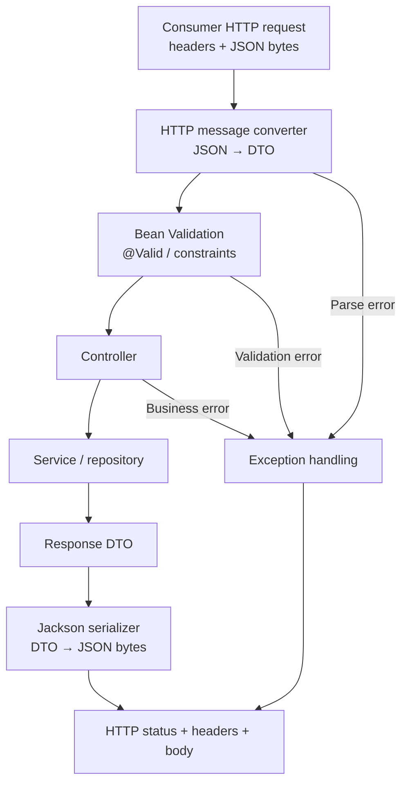
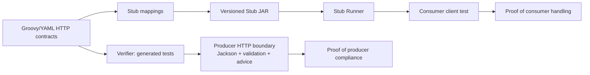
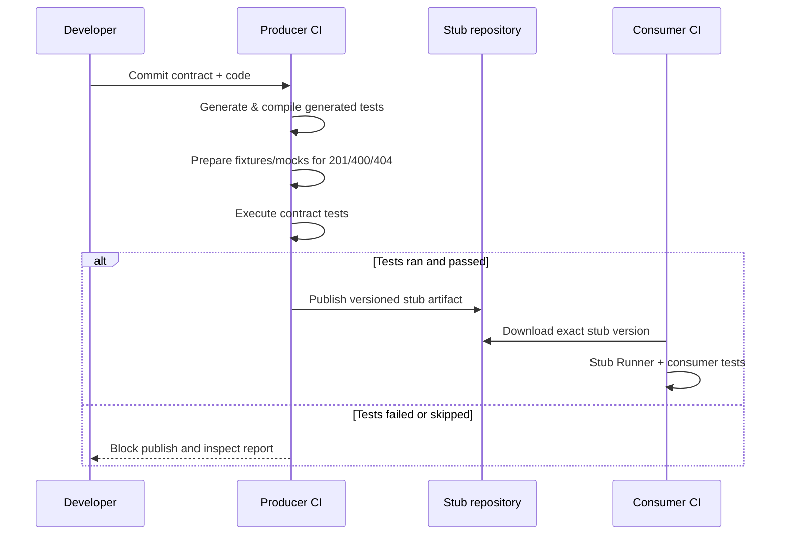

# Testing Serialization, Validation, and Exception Handlers

## 1. HTTP Contract Tests Must Traverse the Real HTTP Boundary

In **Spring Cloud Contract**, a producer publishes the behaviors consumers are allowed to rely on: HTTP method, URL, headers, request body, status, and response body. Contracts written in **Groovy DSL** or **YAML DSL** are used by **Spring Cloud Contract Verifier** to generate producer-side tests and produce stubs. Consumers can run those stubs via **Stub Runner** to test their own applications independently of the producer; CI combines both sides to catch incompatible API changes.

Three bug categories commonly missed by service-only unit tests are:

1. **Serialization/deserialization:** Are Java objects converted to JSON (and vice versa) with the exact field names, data types, formats, and structure?
2. **Validation:** Are HTTP requests missing fields, carrying invalid values, or formatted incorrectly rejected according to API rules?
3. **Exception handlers:** Are errors converted into **stable HTTP statuses and error bodies** that consumers can understand?

For example, a service might return a valid `OrderCreatedResponse`, yet Jackson serializes it as `{"order_id":42}` instead of `{"orderId":42}`, breaking consumer deserialization. Or a business exception slips through and becomes `500` instead of `404`. All of these occur at the **HTTP boundary**, where contract tests must observe the output.

Lesson goal: understand the processing flow, write contracts for both valid and invalid requests, set up a base test traversing Spring MVC, interpret generated test results accurately, and verify the corresponding responses in consumer tests.

## 2. The HTTP Flow: Which Layers Does Data Pass Through?

A typical Spring MVC request/response flow:



That is an overview diagram. Real applications also have security filters, interceptors, formatters, custom converters, controller advice, and additional error-handling logic. In particular, some authentication/authorization errors occur **before the controller**, not necessarily passing through `@RestControllerAdvice`.

| Layer | Example error | Observable HTTP symptom |
|---|---|---|
| **Deserialization** | Malformed JSON body, or `quantity` cannot be converted to expected Java type | Usually `400`; may be handled via `HttpMessageNotReadableException` |
| **Validation** | `quantity=0` with `@Min(1)` | `400` per application convention; `MethodArgumentNotValidException` for `@Valid @RequestBody` |
| **Controller/service** | Order ID does not exist | `404` if handler maps properly |
| **Business rule** | Paying an already-paid order again | `409` if API committed to it |
| **Serialization** | DTO `null` fields omitted from JSON, renamed fields | Status may still be `200/201` yet body violates contract |
| **Infrastructure** | Cannot connect to database | Usually a server error; should not blindly become `400` |

**Contract tests check observable behavior**, not just internal Java exception types. If the consumer relies on `code=ORDER_NOT_FOUND`, the test must protect that field rather than merely asserting the service threw `OrderNotFoundException`.

## 3. Running Example Contract: Creating and Finding an Order

Suppose `order-service` exposes two endpoints:

```http
POST /api/orders
Content-Type: application/json

{"customerId":"CUS-42","quantity":2}
```

On success:

```http
HTTP/1.1 201 Created
Content-Type: application/json
Location: /api/orders/42

{"id":42,"customerId":"CUS-42","quantity":2,"state":"CREATED"}
```

And:

```http
GET /api/orders/9999
Accept: application/json
```

When not found:

```http
HTTP/1.1 404 Not Found
Content-Type: application/json

{"code":"ORDER_NOT_FOUND","field":null,"message":"Order not found"}
```

**Business assumptions for the example:**

- `customerId` is a non-empty, non-whitespace-only string.
- `quantity` is a non-null integer and must be at least `1`.
- On creation success, response returns `201` and header `Location`.
- On validation failure, returns `400` with an error body containing `code`, `field`, and `message`.
- When an order does not exist, returns `404` with stable error code `ORDER_NOT_FOUND`.
- API uses **camelCase JSON**, not snake_case, unless explicitly specified.

These are conventions of the illustrative API, **not mandatory defaults** for every Spring Boot application. Spring Cloud Contract verifies whatever is written into the DSL; it does not decide the error schema itself.

## 4. Serialization: Protecting the JSON Consumers Actually Receive

### 4.1. Groovy DSL for Success Response

Example `create-order-success.groovy`:

```groovy
import org.springframework.cloud.contract.spec.Contract

Contract.make {
    description 'Creating an order returns JSON and Location per contract'

    request {
        method POST()
        url '/api/orders'
        headers {
            contentType(applicationJson())
        }
        body(
            customerId: 'CUS-42',
            quantity: 2
        )
    }

    response {
        status 201
        headers {
            contentType(applicationJson())
            header('Location', '/api/orders/42')
        }
        body(
            id: 42,
            customerId: 'CUS-42',
            quantity: 2,
            state: 'CREATED'
        )
    }
}
```

When the generated producer test runs across the HTTP boundary, it must observe `201`, the `Location` header, content type, and the described body structure. If the DTO changes `customerId` to `customer_id` while the contract still requires `customerId`, the test must report the mismatch.

### 4.2. Same Scenario in YAML DSL

```yaml
description: Creating an order returns JSON and Location per contract
request:
  method: POST
  url: /api/orders
  headers:
    Content-Type: application/json
  body:
    customerId: CUS-42
    quantity: 2
response:
  status: 201
  headers:
    Content-Type: application/json
    Location: /api/orders/42
  body:
    id: 42
    customerId: CUS-42
    quantity: 2
    state: CREATED
```

Choose only **one contract format per scenario** in the repository; the two snippets above demonstrate Groovy/YAML equivalence. Including both in the scanned contract directory can produce duplicate tests and stubs.

### 4.3. Field Names and JSON Types Are Part of the Public Contract

The following responses are not equivalent when the consumer expects `quantity` as a number:

```json
{"id":42,"quantity":2}
```

```json
{"id":"42","quantity":"2"}
```

If the producer changes `quantity` from a **JSON number** to a **JSON string**, the HTTP code and textual characters look similar, yet consumers in Java/Kotlin/TypeScript may fail deserialization or validation.

Jackson can change field names via `@JsonProperty` or naming strategies:

```java
public record OrderResponse(
        @com.fasterxml.jackson.annotation.JsonProperty("order_id")
        long orderId,
        String state) {
}
```

The record above serializes Java field `orderId` into JSON `order_id`. That is valid **if the API commits to `order_id`**; if consumers currently expect `orderId`, changing the naming strategy can be a breaking change. Contracts should protect external field names rather than accidentally coupling to internal method/getter names.

### 4.4. `null`, Missing Fields, Empty Arrays, and Default Values

Compare these bodies:

```json
{"discount":null,"items":[]}
```

```json
{"items":[]}
```

```json
{"discount":null,"items":null}
```

To a consumer, `discount` set to `null` differs from **no `discount` property present**; `items: []` differs from `items: null`. A Jackson setting such as `@JsonInclude(Include.NON_NULL)` or `NON_EMPTY` can strip fields from JSON even though the Java object has those properties.

If the API commits to returning an empty list when no items exist, include a contract with `body(items: [])` or `body([])` matching the exact structure. If a field **must be absent**, add explicit assertions or scenarios instead of assuming `byNull()` checks absence too.

### 4.5. Dates/Times, Unicode, Decimals, and Enums

| Data type | Serialization risk | Commitment to specify |
|---|---|---|
| `Instant`/`OffsetDateTime` | Timezone, offset, millisecond precision changes | ISO-8601 with offset vs. UTC, precision, and parsing rules |
| `BigDecimal` | JSON number vs. JSON string, differing trailing zeros | JSON type, currency unit, required precision |
| Unicode | Accented names, emoji, normalization | JSON encoding (usually UTF-8), post-parse values |
| Enum | Changing `PAID` to `COMPLETED` | Exact set of values consumers handle |
| Boolean | `true` vs. `"true"` | Proper JSON boolean |
| Collection | `[]` vs. `null` or `{}` | Root or property type and emptiness rules |

Never use `.*` matchers for enums or critical business statuses. For dynamically generated IDs/timestamps, regex/type/format matchers reduce brittleness while keeping exact fixed values consumers depend on.

## 5. Validation: Testing Both Valid and Rejected Requests

### 5.1. Bean Validation in the Controller

A Spring MVC model can use Jakarta Bean Validation:

```java
import jakarta.validation.Valid;
import jakarta.validation.constraints.Min;
import jakarta.validation.constraints.NotBlank;
import jakarta.validation.constraints.NotNull;

public record CreateOrderRequest(
        @NotBlank(message = "customerId is required")
        String customerId,

        @NotNull(message = "quantity is required")
        @Min(value = 1, message = "quantity must be at least 1")
        Integer quantity) {
}
```

The DTO snippet uses `@NotBlank`, `@NotNull`, and `@Min`. In Spring MVC, these constraints are typically enforced on request bodies when the controller declares `@Valid @RequestBody CreateOrderRequest` and the project includes a Bean Validation provider, such as `spring-boot-starter-validation`.

**If `@Valid` is forgotten** where request DTO validation should fire, the service may receive invalid inputs. A unit test calling the service directly will not catch that bug. Producer contract tests passing through the controller protect real HTTP behavior.

### 5.2. Groovy DSL for Invalid Quantity

The `quantity=0` scenario must return `400` with stable error fields:

```groovy
import org.springframework.cloud.contract.spec.Contract

Contract.make {
    description 'quantity of 0 is rejected'

    request {
        method POST()
        url '/api/orders'
        headers {
            contentType(applicationJson())
        }
        body(
            customerId: 'CUS-42',
            quantity: 0
        )
    }

    response {
        status BAD_REQUEST()
        headers {
            contentType(applicationJson())
        }
        body(
            code: 'VALIDATION_ERROR',
            field: 'quantity',
            message: 'quantity must be at least 1'
        )
    }
}
```

This contract verifies a request that **deserialized successfully** yet failed Bean Validation. To test *missing* `quantity`, use a separate contract:

```yaml
description: Missing quantity must return validation error
request:
  method: POST
  url: /api/orders
  headers:
    Content-Type: application/json
  body:
    customerId: CUS-42
response:
  status: 400
  headers:
    Content-Type: application/json
  body:
    code: VALIDATION_ERROR
    field: quantity
    message: quantity is required
```

With `Integer quantity` and `@NotNull`, omitting the field parses as `null` and triggers the constraint. If primitive `int` is used instead, a missing field may default to `0` in certain scenarios, changing the validation failure reason from what was expected. **Choose DTO field types matching the API's missing/null rules**, then write tests clearly distinguishing each case.

### 5.3. One Invalid Input Does Not Prove All Validations Work

| Request | Check condition | Illustrative API result |
|---|---|---|
| `{"customerId":"CUS-42","quantity":2}` | Valid | `201 CREATED` |
| `{"customerId":"","quantity":2}` | `@NotBlank` | `400`, error on `customerId` |
| `{"customerId":"  ","quantity":2}` | Not whitespace-only | `400` |
| `{"customerId":"CUS-42","quantity":0}` | `@Min(1)` | `400` |
| `{"customerId":"CUS-42"}` | Missing `quantity` | `400`, error on `quantity` |
| `{"customerId":"CUS-42","quantity":null}` | `@NotNull` | `400` |
| `{"customerId":"CUS-42","quantity":"abc"}` | Cannot convert to `Integer` | Usually `400` from **deserialization**, not `@Min` |
| Truncated JSON | Unparseable body | Usually `400` from **HttpMessageNotReadableException** |

**Do not collapse every error into one generic contract** if consumers distinguish `field` or `code`. Conversely, if consumers only rely on a single generic error schema, select the highest-value boundary scenarios as contracts and supplement with unit tests covering all validation constraints.

## 6. Exception Handlers: Turning Java Errors into Stable HTTP Contracts

### 6.1. Handling via `@RestControllerAdvice`

A controller may throw `OrderNotFoundException`. Without a proper handler, the application can return unexpected status codes and bodies, or even leak implementation details. A `@RestControllerAdvice` maps exceptions to public responses:

```java
import org.springframework.http.HttpStatus;
import org.springframework.http.ResponseEntity;
import org.springframework.http.converter.HttpMessageNotReadableException;
import org.springframework.validation.FieldError;
import org.springframework.web.bind.MethodArgumentNotValidException;
import org.springframework.web.bind.annotation.ExceptionHandler;
import org.springframework.web.bind.annotation.RestControllerAdvice;

record ApiError(String code, String field, String message) {}

@RestControllerAdvice
public class OrderExceptionHandler {

    @ExceptionHandler(MethodArgumentNotValidException.class)
    public ResponseEntity<ApiError> handleValidation(
            MethodArgumentNotValidException ex) {

        FieldError fieldError = ex.getBindingResult()
                .getFieldErrors()
                .stream()
                .findFirst()
                .orElseThrow();

        return ResponseEntity.badRequest().body(
                new ApiError("VALIDATION_ERROR",
                        fieldError.getField(),
                        fieldError.getDefaultMessage()));
    }

    @ExceptionHandler(HttpMessageNotReadableException.class)
    public ResponseEntity<ApiError> handleUnreadableJson(
            HttpMessageNotReadableException ex) {
        return ResponseEntity.badRequest().body(
                new ApiError("MALFORMED_JSON", null, "Invalid JSON request"));
    }

    @ExceptionHandler(OrderNotFoundException.class)
    public ResponseEntity<ApiError> handleNotFound(
            OrderNotFoundException ex) {
        return ResponseEntity.status(HttpStatus.NOT_FOUND).body(
                new ApiError("ORDER_NOT_FOUND", null, "Order not found"));
    }
}
```

**Important caveats:**

- `ApiError` and `OrderNotFoundException` are **project-defined types**, not built-in Spring Cloud Contract classes.
- The handler picks the **first field error** to illustrate a single-field error schema. When multiple fields fail simultaneously, **error order is not a guaranteed commitment**; design a deterministic error list or write contracts triggering one error at a time.
- A Spring Boot setup using `ProblemDetail` and RFC 9457 instead of a custom `ApiError` DTO is also valid. In that case, contracts must assert the exact `Content-Type`, status, and published `ProblemDetail` structure; never mix two error schemas in one API without a compatibility plan.
- Never put stack traces, SQL statements, tokens, or internal details into error bodies merely for debugging convenience. Internal logs and public responses serve different purposes.

### 6.2. Contract for the "Not Found" Exception

```groovy
import org.springframework.cloud.contract.spec.Contract

Contract.make {
    description 'Missing order returns a handleable error code'

    request {
        method GET()
        url '/api/orders/9999'
        headers {
            header 'Accept', 'application/json'
        }
    }

    response {
        status NOT_FOUND()
        headers {
            contentType(applicationJson())
        }
        body(
            code: 'ORDER_NOT_FOUND',
            field: null,
            message: 'Order not found'
        )
    }
}
```

In the generated producer test, the request must pass through the real controller/handler with order `9999` simulated as missing. If the handler returns `500` or omits `code`, the test must fail.

### 6.3. Distinguishing Four Commonly Conflated Error Types

| Error type | Cause | Common HTTP mapping |
|---|---|---|
| `VALIDATION_ERROR` | DTO parsed but violated constraints | `400 Bad Request` |
| `MALFORMED_JSON` | Broken JSON or unreadable body | `400 Bad Request` |
| `ORDER_NOT_FOUND` | Resource does not exist | `404 Not Found` |
| `ALREADY_PAID` | Conflicting business state | `409 Conflict` |

`401 Unauthorized` and `403 Forbidden` typically originate from the **Spring Security filter chain** before the controller. Do not assume an `@ExceptionHandler` inside controller advice formats all security errors; configure entry points and access-denied handlers if a unified error schema is required. Similarly, routing `404`s for nonexistent URL paths may not follow the same path as `OrderNotFoundException` from the service.

## 7. Example Controller and Service to Clarify Test Scope

The Java snippet below shows where Jackson, Bean Validation, and exception handlers participate. These are **illustrative snippets**; real projects organize them into proper files and classes.

```java
import jakarta.validation.Valid;
import java.net.URI;
import org.springframework.http.ResponseEntity;
import org.springframework.web.bind.annotation.*;

record OrderCreatedResponse(long id, String customerId,
                            int quantity, String state) {}

interface OrderService {
    OrderCreatedResponse create(CreateOrderRequest request);
    OrderCreatedResponse findById(long id);
}

@RestController
@RequestMapping("/api/orders")
public class OrderController {

    private final OrderService service;

    public OrderController(OrderService service) {
        this.service = service;
    }

    @PostMapping
    public ResponseEntity<OrderCreatedResponse> create(
            @Valid @RequestBody CreateOrderRequest request) {

        OrderCreatedResponse created = service.create(request);
        return ResponseEntity.created(
                URI.create("/api/orders/" + created.id()))
                .body(created);
    }

    @GetMapping("/{id}")
    public OrderCreatedResponse findOne(@PathVariable long id) {
        return service.findById(id);
    }
}
```

On a valid `POST`, the converter builds `CreateOrderRequest` from JSON, Bean Validation checks it, the controller invokes the service, and Jackson serializes `OrderCreatedResponse`. When `quantity=0`, `@Valid` triggers validation failure **before `service.create` is called** if configured properly. On a missing `GET`, the service throws an exception and `@RestControllerAdvice` produces `404`.

**If you only mock the controller** or call the service directly in tests, you bypass Jackson, validation, and advice, failing to protect the HTTP contract. For this contract scope, construct tests across the Spring MVC boundary—via MockMvc or a real server port.

## 8. Base Test So Generated Producer Tests Execute Properly

### 8.1. `MOCKMVC` Example with Real Context

Example using Spring MVC + JUnit Jupiter + Rest Assured MockMvc + Spring Framework 6.2+:

```java
package com.example.orders.contract;

import com.example.orders.api.CreateOrderRequest;
import com.example.orders.api.OrderCreatedResponse;
import com.example.orders.service.OrderNotFoundException;
import com.example.orders.service.OrderService;
import io.restassured.module.mockmvc.RestAssuredMockMvc;
import org.junit.jupiter.api.BeforeEach;
import org.springframework.beans.factory.annotation.Autowired;
import org.springframework.boot.test.autoconfigure.web.servlet.AutoConfigureMockMvc;
import org.springframework.boot.test.context.SpringBootTest;
import org.springframework.test.context.bean.override.mockito.MockitoBean;
import org.springframework.web.context.WebApplicationContext;

import static org.mockito.ArgumentMatchers.any;
import static org.mockito.Mockito.when;

@SpringBootTest(webEnvironment = SpringBootTest.WebEnvironment.MOCK)
@AutoConfigureMockMvc
public abstract class ContractVerifierBase {

    @Autowired
    private WebApplicationContext context;

    @MockitoBean
    private OrderService orderService;

    @BeforeEach
    protected void setup() {
        RestAssuredMockMvc.webAppContextSetup(context);

        when(orderService.create(any(CreateOrderRequest.class)))
            .thenReturn(new OrderCreatedResponse(
                42L, "CUS-42", 2, "CREATED"));

        when(orderService.findById(9999L))
            .thenThrow(new OrderNotFoundException(9999L));
    }
}
```

In this setup:

- The controller, HTTP converters, validation, and `@RestControllerAdvice` are **real Spring code** loaded in the test context.
- `OrderService` is mocked only at the business/dependency boundary so `201` and `404` scenarios have deterministic preconditions.
- For `quantity=0`, the test must observe `400` **from Bean Validation**; if the controller omits `@Valid`, the mocked `create` call may still return `201`, letting the generated test catch the discrepancy.
- `@MockitoBean` requires Spring Framework 6.2+. On older stacks, pick the mock annotation/config compatible with your Spring Boot version.
- `CreateOrderRequest` and `OrderCreatedResponse` are **illustrative project DTOs** to replace with actual classes; the plugin must configure this base class as the superclass of generated tests.

Reset/initialize mocks using framework-supported lifecycle hooks and isolate fixtures. In standard Spring Mockito configurations, mock beans reset between tests; if you create mocks manually, manage resetting explicitly. Never rely on a shared database or generated test execution order.

### 8.2. When Tests Must Verify a Real Database

When you also want to protect repositories/transactions, drop the service mock and use a test database via `@Sql`, Testcontainers, or fixture helpers. Ensure order `42` is seeded and ID `9999` is absent before each test; avoid depending on shared database state.

**Distinction:** mocking the service lets you test the HTTP/Jackson/validation/advice pipeline. It **does not prove** the real repository queries correctly. Pick test depth based on risk and supplement with persistence integration tests when needed.

## 9. Testing Malformed JSON and Type Mismatches

**Syntactically broken** JSON fails before Bean Validation:

```http
POST /api/orders
Content-Type: application/json

{"customerId":"CUS-42","quantity":
```

The request lacks a value and closing brace; the converter normally throws `HttpMessageNotReadableException`, and the handler from section 6 returns:

```json
{
  "code": "MALFORMED_JSON",
  "field": null,
  "message": "Invalid JSON request"
}
```

Because putting **raw malformed JSON bytes** inside a contract DSL body can depend on how the framework handles string literals and serializers, a clean option is adding a **supplementary HTTP integration test** with raw content:

```java
@Autowired
private MockMvc mvc;

@Test
void malformedJsonShouldHaveStableError() throws Exception {
    mvc.perform(post("/api/orders")
            .contentType(MediaType.APPLICATION_JSON)
            .content("{\"customerId\":\"CUS-42\",\"quantity\":"))
        .andExpect(status().isBadRequest())
        .andExpect(jsonPath("$.code").value("MALFORMED_JSON"))
        .andExpect(jsonPath("$.message").value("Invalid JSON request"));
}
```

The snippet above is an **illustrative test method body**; a real class needs imports for `MockMvc`, `@Test`, `MediaType`, and static imports for `post`, `status`, and `jsonPath`.

**Do not conflate type mismatch with validation:** some Jackson settings coerce `"2"` into number `2`, whereas `"abc"` fails conversion. If the API must **reject** numeric strings, configure the converter strictly and write tests verifying it rather than assuming the default parser enforces that rule.

## 10. Matchers: Fixed Values and Dynamic Fields

Success responses may contain runtime-generated `traceId` or `createdAt` fields. If the contract locks them to exact literals, producer tests will fail even when the API works properly. Combine stub samples with producer matchers:

```groovy
response {
    status 201
    headers {
        contentType(applicationJson())
    }
    body(
        id: 42,
        state: 'CREATED',
        traceId: $(
            consumer('7a48d8e3-2f69-44c4-a93b-6d40517e8e63'),
            producer(regex(uuid()))
        )
    )
}
```

**In `response`**, the `consumer` side is the sample returned by the stub; the `producer` side is the condition asserted by generated tests against the real producer. Keep `state` fixed at `'CREATED'`. Using a matcher for `traceId` when it only needs to be a UUID makes sense.

With JSONPath, you can use `bodyMatchers` per field:

```groovy
bodyMatchers {
    jsonPath('$.state', byEquality())
    jsonPath('$.traceId', byRegex(uuid()))
}
```

Do not overuse `byRegex('.*')` for error codes or messages; it can let consumer-breaking changes slip past. For validation errors, pick **API-stable fields** (like `code` and `field`); avoid strictly locking locale-translated messages unless consumers genuinely rely on them as a commitment.

## 11. One HTTP Error Code Can Have Multiple Causes

For instance, the producer returns `400` for three different inputs:

```text
1. quantity = 0                 -> Bean Validation
2. quantity = "abc"             -> JSON deserialization
3. Truncated JSON               -> JSON parsing
```

If the contract only asserts `status == 400`, tests cannot prove each case is classified properly or that the error schema is stable. Consumers may branch differently based on `code`.

| Field to check | Why it matters |
|---|---|
| **HTTP status** | Tells consumers the success/error class and retry policy |
| **Content-Type** | Determines how the response is decoded |
| **error code** | Usually the stable business key consumers switch on |
| **field or fieldErrors** | Helps UIs highlight the exact invalid input field |
| **message** | Helpful for display/logging, though may vary by locale unless fixed in contract |
| **correlation/trace ID** | Aids error troubleshooting; assert format rather than random value |

For `409` or `5xx` errors, contracts may also specify a `Retry-After` header or idempotency/retry rules. **Do not assume every error should be retried**: retrying a state-changing request without idempotency can cause unintended side effects.

## 12. Generated Producer Tests and Stub Runner Protect Two Different Things



**Producer side:** the generated test sends `POST /api/orders` with `quantity=0` and must observe `400 + VALIDATION_ERROR` from the real application. If a developer removes `@Valid`, alters Jackson config, or breaks the exception handler, the test can catch it.

**Consumer side:** Stub Runner receives the request from the consumer and returns the sample `VALIDATION_ERROR` body. The consumer test verifies the client displays an input error on `quantity` rather than treating it as an unknown system failure.

**Do not conflate the two test types:**

- A stub returning `400` does not prove the real producer still returns `400`; generated producer tests must run.
- A producer returning `400` does not prove the consumer handles the error response properly; consumer tests must run via Stub Runner.
- Stubs do not run the producer's Bean Validation or `@RestControllerAdvice`. They simply return the response described in the contract when requests match the stub mapping.
- Generated tests being **generated** does not mean the test runner **executed** them. CI must verify test reports, not just generated files and build success.

## 13. CI: Testing the Error Paths Most Likely to Cause Breaking Changes

A minimal workflow:



### 13.1. What Should Quality Gates Check?

1. **Right contract sources:** success, validation, and exception scenarios live in the directory scanned by the plugin.
2. **Tests executed:** generated test classes/methods appear in test reports, not merely on disk in generated sources.
3. **No false skips:** executed test count is greater than 0 and not accidentally disabled via `skipTests` or exclusions.
4. **Assertions pass:** status, headers, JSON fields/types, and error codes are checked against the contract.
5. **Reproducible fixtures:** success requests find the test order, not-found requests have no matching ID, and mocks/resets do not leak.
6. **Right stub version:** consumer tests do not accidentally run against stale mappings.
7. **Block breaking changes:** when changing JSON field names, types, statuses, or error codes, run affected consumer tests before accepting.

### 13.2. Try Mutation Checks to Prove Assertions Have Teeth

In an isolated test environment, temporarily alter code and rerun:

| Intentional mutation | Which scenario must catch it? |
|---|---|
| Remove `@Valid` from controller | `quantity=0` contract must fail if service still returns success |
| Rename `customerId` JSON to `customer_id` | Success contract must detect field change |
| Change `201` to `200` | Order creation contract must fail |
| Change `VALIDATION_ERROR` to `BAD_INPUT` | Validation contract must fail |
| Remove `OrderNotFoundException` handler | `404 + ORDER_NOT_FOUND` contract must fail if API returns something else |
| Change `items: []` to `items: null` | Empty-list contract must fail |

After testing, revert the code. **Do not edit contracts to match new bugs** without assessing consumer impact. Mutation checks verify assertion strength—they are not an excuse to introduce bugs into production code.

## 14. Diagnosing Failures When Running HTTP Contract Tests

| Symptom | Possible cause | How to resolve |
|---|---|---|
| `201` turns into `400` | Sample request fails deserialization or validation | Read actual error, fix fixture/request schema |
| `400` turns into `201` | Missing `@Valid` or inactive constraints | Check Bean Validation provider and controller annotations |
| `404` turns into `500` | Missing or misconfigured exception handler | Check `@RestControllerAdvice` and exception mappings |
| `quantity=0` yields `MALFORMED_JSON` | Error classified in converter rather than validation as expected | Inspect raw JSON request and parsing setup |
| Body switches from number to string | Jackson serializer/config or DTO field type changed | Inspect actual HTTP JSON response and contract types |
| Missing JSON field | `@JsonInclude`, naming strategy, or null omission | Check DTO/serializer and consumer expectations |
| Error message differs in CI | Locale or resource bundle changed | Commit to stable `code/field`; pin locale if message is contractual |
| `@Valid` test passes yet handler never ran | Mocked wrong layer or test bypassed controller | Use real HTTP boundary and check generated test mode |
| Generated tests compile yet never run | JUnit engine, include/exclude filters, skip config | Inspect test reports and generated class names |
| Stub returns right response yet producer differs | Consumer tested only against old stubs | Run producer verifier and consume newly published stubs |
| Response body matches yet status is wrong | Handler/controller returns wrong `ResponseEntity` status | Check status mapping and contract |
| Consumer fails deserialization when a field is added | Consumer uses strict parser/schema | Check actual consumer compatibility; do not assume adding fields is always safe |

## 15. Practice Lab: Protecting All Three Layers at the HTTP Boundary

**Context:** `checkout-service` calls `order-service`. A recent change altered error bodies and dropped validation. The goal is using Spring Cloud Contract to catch mismatches before release.

**Tasks and execution steps:**

1. Write contract `create-order-success.groovy` for `POST /api/orders` with `customerId=CUS-42`, `quantity=2`; expect `201`, `Location`, and JSON body containing `id`, `customerId`, `quantity`, `state`.
2. Write contract `create-order-invalid-quantity.groovy` for `quantity=0`; expect `400`, `code=VALIDATION_ERROR`, and `field=quantity`.
3. Write `get-order-not-found.yml` for `GET /api/orders/9999`; expect `404` and `code=ORDER_NOT_FOUND`.
4. Implement the controller using `@Valid @RequestBody`, DTO with `@NotBlank`/`@NotNull`/`@Min`, and `@RestControllerAdvice` handling exceptions per the public schema.
5. Prepare `ContractVerifierBase` using MockMvc with a service mock or test database; generated tests must genuinely pass through Jackson, validation, and handlers.
6. Run generated producer tests and read reports to confirm **every contract executed and passed**, not merely that source generation succeeded.
7. Temporarily remove `@Valid` in a test environment; verify the validation contract catches `201` instead of `400`. Restore `@Valid`.
8. Temporarily rename `customerId` in the response; verify the success contract catches the change.
9. Package versioned stubs **after producer verification passes**, then use Stub Runner to run consumer tests for success, validation error, and not-found cases.
10. Wire steps into CI, block publishing when generated tests fail or are skipped, and verify the stub version on the consumer side.

### 15.1. Self-Check Questions

- **Why isn't a unit test on `OrderService.create(...)` enough to protect serialization?** Because it does not necessarily pass through Jackson and the HTTP layer.
- **Does `quantity="abc"` always reach `@Min`?** No; if the converter cannot parse it into `Integer`, the error happens before validation.
- **Why doesn't `@RestControllerAdvice` handling `OrderNotFoundException` guarantee handling every `401`?** Because `401` can be produced by the security filter chain before reaching the controller.
- **If Stub Runner returns `400` properly, does that prove the real producer has `@Valid`?** Not yet; stubs only simulate sample responses.
- **If a generated test passes without asserting error codes, would changing `VALIDATION_ERROR` to `BAD_INPUT` be caught?** Not necessarily; an assertion on that field is required.
- **Should you lock down every error message verbatim?** Only when the message is genuinely a stable commitment; if localized, prioritize protecting error codes and structure first.

## 16. HTTP Contract Review Checklist

- [ ] Scenarios cover **success**, **validation failure**, **deserialization failure** when needed, and consumer-relevant **business exceptions**.
- [ ] JSON requests/responses specify accurate field names, data types, formats, and `null`/missing/empty rules.
- [ ] Validation is triggered at the HTTP boundary rather than tested only on service methods.
- [ ] Error handlers map exceptions to the right status/headers/body without leaking internal details.
- [ ] Security/routing errors are tested at their respective layers without assuming all errors pass through controller advice.
- [ ] Matchers are not so broad that they miss enum, error code, or JSON type changes.
- [ ] Base tests use the right test mode and traverse real serialization, validation, and advice.
- [ ] Fixtures and mocks have deterministic starting state and reset properly so tests stay independent.
- [ ] Generated tests are actually **generated, compiled, discovered, executed, and passing** all required assertions.
- [ ] Stub artifacts are versioned and consumer tests use Stub Runner with the application's real HTTP client.
- [ ] CI archives test reports, blocks publishing when tests are skipped or fail, and evaluates breaking changes before deployment.

**Conclusion:** An API can have flawless business logic yet still break contracts due to changes in JSON serialization, Bean Validation, or exception handlers. Good contracts do not stop at `status 200`: they specify **data crossing the HTTP boundary and how the producer returns errors**, then verify both via generated producer tests and Stub Runner consumer tests in CI.
