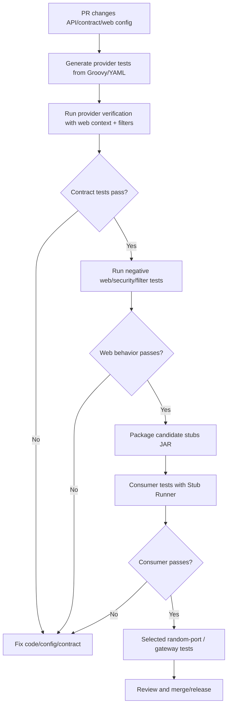

# Limitations When Bypassing Filters or Real Web Configuration in HTTP Testing

In **Spring Cloud Contract (SCC)**, an HTTP contract typically describes what the **consumer sends** (method, URL, headers, body) and what the **producer must return** (status, headers, body). From the Groovy/YAML DSL, Contract Verifier can generate producer-side tests and produce stubs for consumers to use via Stub Runner. However, provider test results depend significantly on **how the test delivers requests to the application**.

If you instantiate only an isolated controller, or intentionally disable servlet filters to make tests run faster, you can bypass mechanisms that determine real HTTP behavior: Spring Security, tenant filters, correlation IDs, CORS configuration, error handling, JSON converters, session setup, servlet context paths, or running behind a gateway. In that case, provider tests may **pass without genuinely verifying the HTTP boundary real consumers traverse**.

This lesson in the **HTTP Testing** chapter focuses on the **limitations of bypassing filters or real web configuration**, how to design reliable base tests, and how to combine contract tests with the necessary test layers. Examples use `order-producer` exposing an order API and `order-consumer` calling the API over HTTP.

## 1. Understanding the Two Paths of a Request

### 1.1. Request Path in Real Usage

An HTTP request can pass through many layers before reaching a controller:

```mermaid
flowchart LR
    A["Consumer HTTP client"] --> B["Gateway / reverse proxy"]
    B --> C["Web server and servlet container"]
    C --> D["Servlet Filter chain<br/>Security, tenant, tracing..."]
    D --> E["DispatcherServlet"]
    E --> F["Interceptors, binding, validation"]
    F --> G["Controller / service"]
    G --> H["JSON converter, exception handler"]
    H --> I["Response headers + status + body"]
```



Not every application has all of the layers above. For instance, an app without an API gateway has no gateway step. Yet whenever a layer determines the **response observed by the consumer**, it falls within the scope that must be tested appropriately.

### 1.2. Request Path in Provider Contract Tests

Depending on the HTTP test mode and base class, generated tests may:

- Invoke the controller via `MockMvcBuilders.standaloneSetup(...)`: minimal setup, usually **lacking the full filter chain and web configuration**.
- Invoke `MockMvc` configured from the Spring application context: can include MVC configuration and registered filters, **provided the test does not disable them**.
- Call an HTTP server running on a real port in the test environment: additionally exercises the corresponding networking/container layers.
- Send requests through a real gateway or reverse proxy in integration/end-to-end tests: exercises an even broader path.

**A contract cannot choose the realism of the test environment on its own.** The exact same Groovy file can pass or fail when you switch the base test setup, because the portion of the application under test has changed.

## 2. Why Does Disabling Filters Create a False Sense of Security?

Suppose API `GET /api/orders/1001` requires requests to carry header `X-Tenant-Id: shop-01`. An application filter checks the tenant; if missing or invalid, it returns HTTP `400` with error code `TENANT_REQUIRED` in our example.

In the real running system:

```http
GET /api/orders/1001 HTTP/1.1
Accept: application/json
X-Tenant-Id: shop-01
```

Response:

```http
HTTP/1.1 200 OK
Content-Type: application/json

{"id":1001,"status":"CREATED"}
```

Conversely, if the client omits the header:

```http
GET /api/orders/1001 HTTP/1.1
Accept: application/json
```

Expected response:

```http
HTTP/1.1 400 Bad Request
Content-Type: application/json

{"code":"TENANT_REQUIRED"}
```

If the provider test only invokes `OrderController` without running `TenantHeaderFilter`, the controller can return `200` for **both requests**. A contract covering only the valid case stays green; this does not prove the mandatory filter runs or that the API blocks tenantless requests.

Consequences can cut both ways:

| Scenario | Test with filters disabled | Real HTTP |
| --- | --- | --- |
| Request missing tenant | Returns `200` by going straight to controller | Returns `400` from filter |
| Request with valid header | Returns `200` | Returns `200` |
| Producer accidentally removes filter | Success-only test stays green | Tenant protection behavior may break |
| Contract expects `400` error | Provider test without filter may fail | Real HTTP properly returns `400` |

**A green test only means the components executed in the test environment satisfied the assertions.** It does not prove every component along the real HTTP path executed.

## 3. Example Application Filter to Understand Impact

The snippet below illustrates a servlet filter checking a tenant header, **not a production authentication/authorization mechanism**. It assumes Spring Boot 3+ with the Jakarta Servlet namespace:

```java
import java.io.IOException;
import jakarta.servlet.FilterChain;
import jakarta.servlet.ServletException;
import jakarta.servlet.http.HttpServletRequest;
import jakarta.servlet.http.HttpServletResponse;
import org.springframework.http.MediaType;
import org.springframework.stereotype.Component;
import org.springframework.web.filter.OncePerRequestFilter;

@Component
public class TenantHeaderFilter extends OncePerRequestFilter {

    @Override
    protected void doFilterInternal(
            HttpServletRequest request,
            HttpServletResponse response,
            FilterChain chain)
            throws ServletException, IOException {

        if (request.getRequestURI().startsWith("/api/orders/")
                && !"shop-01".equals(request.getHeader("X-Tenant-Id"))) {

            response.setStatus(HttpServletResponse.SC_BAD_REQUEST);
            response.setContentType(MediaType.APPLICATION_JSON_VALUE);
            response.getWriter().write("{\"code\":\"TENANT_REQUIRED\"}");
            return;
        }

        chain.doFilter(request, response);
    }
}
```

Here the filter returns `400` when the header is not `shop-01`, solely to demonstrate an observable condition. In practice, tenant registries, verifying user membership in a tenant, context paths, exception handling, and security policies must be designed far more rigorously. **Never treat a client-supplied header as proof of authorization.**

Illustrative controller:

```java
import java.util.Map;
import org.springframework.http.MediaType;
import org.springframework.http.ResponseEntity;
import org.springframework.web.bind.annotation.GetMapping;
import org.springframework.web.bind.annotation.PathVariable;
import org.springframework.web.bind.annotation.RequestMapping;
import org.springframework.web.bind.annotation.RestController;

@RestController
@RequestMapping("/api/orders")
public class OrderController {

    @GetMapping("/{id}")
    public ResponseEntity<Map<String, Object>> getOrder(
            @PathVariable long id) {

        return ResponseEntity.ok()
            .contentType(MediaType.APPLICATION_JSON)
            .body(Map.of("id", id, "status", "CREATED"));
    }
}
```

The controller does not read the tenant header itself. **When the filter is in the processing chain**, invalid-tenant requests are blocked before reaching the controller. **When the filter is bypassed**, invalid-tenant requests go straight to the controller and receive `200`. This is an easily reproducible example for evaluating the quality of a provider test setup.

### 3.1. Testing with a Filter Does Not Mean Real Authorization Is Tested

The example filter only checks a header string; it does not verify JWT signatures, sessions, roles, or per-order access rights. Do not conclude the system is secure merely because this test passes. With Spring Security, test the **`SecurityFilterChain`** and real authorization rules at the proper scope.

## 4. Writing HTTP Contracts for Valid Requests

Groovy DSL for when the consumer includes the tenant header:

```groovy
import org.springframework.cloud.contract.spec.Contract

Contract.make {
    description 'With valid tenant header, GET order returns JSON 200'

    request {
        method GET()
        url '/api/orders/1001'
        headers {
            header('Accept', 'application/json')
            header('X-Tenant-Id', 'shop-01')
        }
    }

    response {
        status OK()
        headers {
            contentType(applicationJson())
        }
        body(
            id: 1001,
            status: 'CREATED'
        )
    }
}
```

If the base test instantiates the controller in isolation, the generated provider test can pass because the controller still returns `200` even though the filter never ran. This contract verifies the **response for a request with a valid header**, yet **does not prove** the header is enforced or validated.

### 4.1. Adding a Contract for Invalid-Tenant Requests to Distinguish Behavior

To force the producer to protect the error behavior, create a second contract using the same URL with a **different header value**:

```groovy
import org.springframework.cloud.contract.spec.Contract

Contract.make {
    description 'Invalid tenant header, GET order returns error 400'

    request {
        method GET()
        url '/api/orders/1001'
        headers {
            header('X-Tenant-Id', 'other-tenant')
        }
    }

    response {
        status BAD_REQUEST()
        headers {
            contentType(applicationJson())
        }
        body(code: 'TENANT_REQUIRED')
    }
}
```

With the illustrative filter, an `other-tenant` request receives `400`. If the filter does not run in the provider verification test, the controller returns `200` and the error contract test **fails for the right reason**.

Because the two contracts are distinguished by `X-Tenant-Id`, stub mappings can select responses based on request headers without conflicting over the same condition. Still, **inspect the generated WireMock mappings** to confirm both are genuinely distinguished rather than shadowed by another overly broad mapping.

**Note:** a request **without the header** is a different case from an **invalid header value**. A contract omitting a header does not automatically mean it requires the header to be absent. To verify absence reliably, add a dedicated web/integration test sending a request without the header. Do not create a missing-header error contract assuming Stub Runner will always pick the right stub alongside a `200` contract sharing the URL.

### 4.2. YAML DSL for the Error Contract

```yaml
description: "Invalid tenant header, GET order returns error 400"
request:
  method: GET
  url: /api/orders/1001
  headers:
    X-Tenant-Id: other-tenant
response:
  status: 400
  headers:
    Content-Type: application/json
  body:
    code: TENANT_REQUIRED
```

This is the YAML equivalent of the Groovy error contract, **not an extra contract to keep alongside the same scenario**. Pick either Groovy or YAML as the active source to avoid duplicate tests and stubs.

## 5. Three Ways to Configure MockMvc: Same DSL, Different Coverage

### 5.1. Standalone Setup: Fast, but Only Includes Explicitly Registered Components

Example base test using standalone setup:

```java
import io.restassured.module.mockmvc.RestAssuredMockMvc;
import org.junit.jupiter.api.BeforeEach;
import org.springframework.test.web.servlet.setup.MockMvcBuilders;

public abstract class OrderContractStandaloneBase {

    @BeforeEach
    public void setup() {
        OrderController controller = new OrderController();

        RestAssuredMockMvc.mockMvc(
            MockMvcBuilders.standaloneSetup(controller).build()
        );
    }
}
```

This mode does not automatically load the full Spring application context or application-registered servlet filters. You can manually attach some components to `standaloneSetup`—such as `ControllerAdvice`, converters, validators, interceptors, or filters—yet that remains a **selective component setup**, not the full pipeline deployed by the application.

**Appropriate when:** testing a simple controller, needing fast feedback, having minimal web infrastructure dependencies, and explicitly accepting the environment limits.

**Not suitable as sole proof when:** the API relies on Spring Security, tenant filters, CORS, exception handlers, argument resolvers, or complex web configuration.

### 5.2. Spring Application Context with MockMvc, Filters Enabled

In a Spring Boot servlet application, a base class can use:

```java
import io.restassured.module.mockmvc.RestAssuredMockMvc;
import org.junit.jupiter.api.BeforeEach;
import org.springframework.beans.factory.annotation.Autowired;
import org.springframework.boot.test.autoconfigure.web.servlet.AutoConfigureMockMvc;
import org.springframework.boot.test.context.SpringBootTest;
import org.springframework.test.web.servlet.MockMvc;

@SpringBootTest
@AutoConfigureMockMvc(addFilters = true)
public abstract class OrderContractBase {

    @Autowired
    private MockMvc mockMvc;

    @BeforeEach
    public void setUp() {
        RestAssuredMockMvc.mockMvc(mockMvc);
    }
}
```

With proper configuration, `MockMvc` receives filters registered in the test application context and uses the context's MVC configuration. `addFilters = true` is commonly the default for `@AutoConfigureMockMvc`, yet writing it explicitly signals the intent not to disable filters.

**This verification level is closer to the real web application than standalone.** Even so, it **does not open a real network connection** to a servlet container like an out-of-process HTTP client; it does not automatically traverse deployment gateways, proxies, or ingress.

Some components that exist only under production profiles, environment configs, or conditional beans may be **absent** from the test context. Running `@SpringBootTest` does not mean test config is 100% identical to production.

### 5.3. Enabling Spring Context While Still Disabling Filters

A red flag to review in base tests:

```java
@SpringBootTest
@AutoConfigureMockMvc(addFilters = false)
public abstract class OrderContractBase {
    // ...
}
```

`addFilters = false` removes servlet filters from the auto-configured `MockMvc`. Tests still use the MVC context, yet **do not verify the filter chain path**. If all generated tests rely exclusively on this setup, they cannot verify `401`/`403`, tracing headers, or filter-enforced tenant gates.

Never toggle this flag simply to "fix" a `401` status into `200`. Clarify the test's purpose, document scope limits, and add tests exercising the real filter chain.

### 5.4. Manual `webAppContextSetup` Also Requires Attention to Filters

When building MockMvc manually from the context:

```java
MockMvc mvc = MockMvcBuilders
    .webAppContextSetup(webApplicationContext)
    .apply(springSecurity())
    .build();
```

The snippet above is an example **requiring matching Spring Security Test imports and dependencies**. `springSecurity()` configures Spring Security when building MockMvc manually; other application filters must also be registered compatibly rather than assuming the builder attaches every filter automatically.

Do not treat `webAppContextSetup(...).build()` missing filters as proof that requests traversed the real filter chain. In Spring Boot, `@AutoConfigureMockMvc` generally lowers the risk of forgetting basic wiring; still verify with negative tests.

## 6. Comparing HTTP Testing Levels

| Testing level | What usually executes? | What is usually bypassed? | Best fit |
| --- | --- | --- | --- |
| Standalone MockMvc | Controller and manually registered components | Full filter chain, web app context, many auto-configs | Fast checks of controller behavior |
| MockMvc + `@SpringBootTest` + filters | MVC context, registered servlet filters, and controller per test config | Sockets/network, proxies, TLS, ingress; profile differences | Provider verification close to real app |
| `@WebMvcTest` slice | Part of the web layer and matching auto-config | Full services/repositories, beans outside slice | Testing web layer with mocked dependencies; check filters/security loaded |
| Embedded HTTP server on random port | HTTP stack/servlet container in test app | Production gateway, service mesh, CDN, other infra | Verifying over real HTTP, cookies/compression/serialization |
| Testing through gateway/ingress | Network path and gateway config included | May still lack external services and production topology | Verifying rewrites, forwarded headers, gateway auth |
| Consumer test with Stub Runner | Consumer HTTP client + contract stubs | Producer implementation, producer filters, deployment | Verifying consumer uses committed interface |

No single level is "right for every project." The goal is **knowing clearly which boundary has been verified** and adding another test level whenever critical behavior lies outside that boundary.

### 6.1. WebMvcTest Is Not Automatically Equivalent to Production

`@WebMvcTest` is a **test slice**: it focuses on MVC components and typically mocks other dependencies. Whether filters, security configs, or custom argument resolvers are included depends on auto-configuration, bean selection, and imports.

Therefore, `@WebMvcTest` can be fast and appropriate, yet for APIs heavily reliant on filters or authorization, **check which components actually run**. In particular, a test using a mocked service does not verify real service-layer behavior.

### 6.2. MockMvc Does Not Mean the Network Was Tested

`MockMvc` simulates HTTP requests at the Spring MVC layer using test infrastructure without opening a network port. It can run filter chains and converters in the test context, yet does not verify every detail of:

- TLS/HTTPS, HTTP/2, and reverse proxy configuration.
- Headers added, stripped, or altered by gateways or load balancers.
- Socket timeouts, request forwarding, and large payload size limits.
- Servlet container/network-specific behavior or deployment-specific configuration.
- Compression and response streaming under all real conditions.

If consumers rely on any of these mechanisms, add integration tests over a **real HTTP server** and, when needed, through a real gateway or equivalent configuration.

## 7. Spring Security: 401, 403, and False Greens

An application with a `SecurityFilterChain` may return:

- `401 Unauthorized` when a request requires authentication without valid credentials.
- `403 Forbidden` when the principal is authenticated but lacks permission, or is blocked by another protection rule (such as CSRF depending on config).

Exact rules depend on Spring Security configuration. Do not assume every tokenless request returns the exact same JSON body or `WWW-Authenticate` header across all projects.

### 7.1. Tests Bypassing the Security Filter Chain Can Give Misleading Results

Suppose endpoint `GET /api/orders/1001` is protected by a bearer token. If the generated test sets up a standalone controller:

```text
Client sends no Authorization
  -> standalone MockMvc calls only OrderController
  -> controller returns 200
  -> success-only contract may pass
```

Yet the real deployment path is:

```text
Client sends no Authorization
  -> SecurityFilterChain
  -> returns 401
  -> controller is never called
```

**Contracts must express the commitments consumers rely on, and tests must execute the layer responsible for those commitments.**

### 7.2. Writing Negative Security Tests Outside Contracts When Needed

An HTTP contract for a `401` response can be written as:

```groovy
import org.springframework.cloud.contract.spec.Contract

Contract.make {
    description 'Without authentication info, order query is rejected'

    request {
        method GET()
        url '/api/orders/1001'
    }

    response {
        status UNAUTHORIZED()
    }
}
```

However, if a success contract also exists for the **same GET/URL** requiring `Authorization`, Stub Runner may generate an overly broad `401` mapping because **omitting a header does not necessarily require the header to be absent**. Therefore, to reliably test requests missing `Authorization`, it is often better to write a **direct MockMvc/integration test** asserting `401`; if you want a multi-scenario stub bundle, use distinct matching criteria and inspect the generated mappings.

A standard Spring Security test can send a tokenless request:

```java
import static org.springframework.test.web.servlet.request.MockMvcRequestBuilders.get;
import static org.springframework.test.web.servlet.result.MockMvcResultMatchers.status;

@Test
void rejectsRequestWithoutToken() throws Exception {
    mockMvc.perform(get("/api/orders/1001"))
           .andExpect(status().isUnauthorized());
}
```

This test is meaningful **only when** `mockMvc` actually includes the right `SecurityFilterChain` and the endpoint enforces authentication. With `addFilters=false`, the outcome may differ.

### 7.3. An `Authorization` Header in a Contract Does Not Prove Token Validation

A contract containing `header('Authorization', 'Bearer test-token')` only describes **the header string sent**. It does not automatically check JWT signatures, issuer, audience, expiration, roles, token revocation, or per-resource-ID authorization.

For producer verification, use **valid test-environment fixture credentials** or Spring Security Test tools matched to the scope under test. Never hard-code production bearer tokens in the repository. With Stub Runner, the stub can match the request header yet **never becomes a real authorization server**.

Valuable supplementary tests commonly include: missing token → 401, invalid token → 401, under-privileged user → 403, cross-tenant user trying to read another order → denied per policy, and valid user → 200.

## 8. ControllerAdvice and Exception Handling

Another omission occurs when testing a controller via standalone setup without **registering `@ControllerAdvice`** or exception resolvers used by the application. For example, a controller throws an exception:

```java
@GetMapping("/{id}")
public OrderDto getOrder(@PathVariable long id) {
    return service.findOrThrow(id); // May throw OrderNotFoundException
}
```

The application may define:

```java
@RestControllerAdvice
public class ApiErrorHandler {

    @ExceptionHandler(OrderNotFoundException.class)
    ResponseEntity<Map<String, String>> notFound(
            OrderNotFoundException exception) {

        return ResponseEntity.status(404)
            .contentType(MediaType.APPLICATION_JSON)
            .body(Map.of("code", "ORDER_NOT_FOUND"));
    }
}
```

If generated tests do not load the advice properly, failing requests may not become a `404` JSON response as in production. This directly impacts consumers parsing the error code.

With standalone MockMvc, testing advice requires registering it explicitly, for example:

```java
MockMvc mvc = MockMvcBuilders
    .standaloneSetup(new OrderController(/* test service */))
    .setControllerAdvice(new ApiErrorHandler())
    .build();
```

This is an **illustrative snippet**; supply matching controller dependencies in your project. It registers only the specified advice and does not recreate all MVC configuration. With a full Spring context, advice is normally loaded as a bean when components and scanning/config are set up properly.

### 8.1. Error Contracts Need Dedicated Verification

A `404` contract can protect the response:

```yaml
description: "Order does not exist, return 404 and agreed error code"
request:
  method: GET
  url: /api/orders/9999
  headers:
    X-Tenant-Id: shop-01
response:
  status: 404
  headers:
    Content-Type: application/json
  body:
    code: ORDER_NOT_FOUND
```

For this test to be trustworthy, **both** the tenant filter and the exception handler must be present in the test setup. Disabling filters to get the test running can let tenant-blocking regressions slip through. Omitting advice can produce error bodies differing from real requirements.

## 9. Serialization, Validation, and Content Negotiation

Not every discrepancy comes from servlet filters. **Spring MVC and Jackson configuration** also determines the response consumers see.

### 9.1. JSON Serialization

Suppose a DTO contains:

```java
record OrderDto(
    long id,
    java.time.Instant createdAt,
    java.math.BigDecimal amount
) {}
```

Under different Jackson configurations, values can serialize in different formats: timestamps as ISO strings vs. numbers, null fields included vs. omitted, differing decimal precision, or enums as names vs. custom formats.

Contract:

```yaml
response:
  status: 200
  headers:
    Content-Type: application/json
  body:
    id: 1001
    createdAt: "2026-11-24T03:15:30.123Z"
    amount: "12.30"
```

This only makes sense if the producer actually sends `amount` as a **string**. If Jackson serializes `BigDecimal` as a JSON number, code and contract disagree; decide which type the API defines rather than flipping string/number arbitrarily just to make tests pass.

A manually constructed `ObjectMapper` in a standalone test may not carry the same modules, naming strategies, custom serializers, or `spring.jackson.*` properties as the application context. That can make tests pass or fail differently from production.

### 9.2. Validation and Argument Resolution

Items easily omitted or configured differently in standalone/slice tests:

- Bean Validation and actual validation groups.
- `@ControllerAdvice` handling `MethodArgumentNotValidException`.
- `@DateTimeFormat`, custom converters, and argument resolvers.
- Locale for error messages and number/date parsing.
- Enum mapping and casing rules.
- Filters that read/cache request bodies or add correlation headers.

If a contract states `POST /api/orders` missing a field must return `400`, yet the test setup lacks the matching validator or argument resolver, the response may diverge from production.

### 9.3. Accept and Content-Type

Suppose the consumer sends:

```http
GET /api/orders/1001 HTTP/1.1
Accept: application/json
```

and expects:

```http
HTTP/1.1 200 OK
Content-Type: application/json
```

A standalone controller with minimal converters and a full web context can perform content negotiation differently. If the producer changes the response to `text/plain`, a consumer using a Jackson converter can fail even if the body looks like JSON.

Declare headers in the contract on **the right side (request vs. response)** and test with the actual converters and content negotiation in use, especially when the API supports multiple media types or returns `406`/`415`.

## 10. CORS, CSRF, Cookies, and Sessions

These mechanisms are especially prone to being skipped in standalone setups.

### 10.1. CORS

CORS governs how browsers allow JavaScript from one origin to access resources at another origin. Preflight `OPTIONS` requests can pass through CORS config/filters before the controller:

```http
OPTIONS /api/orders/1001 HTTP/1.1
Origin: https://client.example.org
Access-Control-Request-Method: GET
Access-Control-Request-Headers: authorization
```

The response may include `Access-Control-Allow-Origin`, `Access-Control-Allow-Methods`, or `Access-Control-Allow-Headers` depending on configuration.

A contract checking only `GET` does not protect preflight behavior. Testing via MockMvc with real CORS config/filters can verify preflight responses, yet **actual browser CORS policy enforcement** is not fully simulated by a JUnit header assertion. If browsers are primary consumers, browser/integration tests may be required.

### 10.2. CSRF

When an application uses cookie/session authentication, POST/PUT/DELETE may require a CSRF token per `SecurityFilterChain`. A standalone controller test omitting filters can return `201` without a CSRF token, while real requests receive `403`.

Do not disable all filters to make POST contracts pass. Configure valid tokens in producer tests or write dedicated negative tests for missing tokens aligned with the API's security policy.

### 10.3. Cookies, Sessions, and Redirects

Contract responses can check `Set-Cookie` or `Location`, yet attributes such as `Secure`, `HttpOnly`, `SameSite`, cookie domain/path, and proxy redirects also depend on configuration. Session persistence and cookies surviving across multiple requests are **stateful** behaviors that a single HTTP contract cannot prove on its own.

If consumers rely on maintaining login sessions, add session tests tracking cookies across multiple requests rather than checking a single isolated response.

## 11. Gateways, Reverse Proxies, Context Paths, and Forwarded Headers

Even `@SpringBootTest` with all filters enabled may not simulate the entire production path.

A gateway might:

- Rewrite prefixes from `/public/orders/1001` to `/api/orders/1001`.
- Add `X-Forwarded-Proto` or `Forwarded` so the app generates public URLs with the right scheme/host.
- Terminate TLS and forward internal HTTP.
- Validate tokens or enforce quotas before requests reach the producer.
- Rewrite or strip headers, limit body size, or configure caching/compression.
- Enforce CORS or rate limiting at the edge.

The producer's internal contract may test `GET /api/orders/1001`, while external consumers call `GET /public/orders/1001`. If gateway mapping is wrong, internal producer verification and consumer Stub Runner tests can both pass while end-to-end requests receive `404`.

### 11.1. Two Types of Contracts at Two Different Boundaries

| Boundary | What needs verification |
| --- | --- |
| Consumer → internal producer | API as actually exposed by producer on internal network |
| External consumer → gateway | Public path, auth, headers/host, TLS, and rewrites |
| Gateway → producer | URI, header forwarding, and identity context |
| Producer → internal dependency | Contracts between producer and downstream services, if any |

If a gateway owns the public contract, test the public boundary separately. Do not use an **internal-port provider HTTP contract** as proof that the entire public route works.

### 11.2. Differing Context Paths and Profiles

An application may run with `server.servlet.context-path=/order-service` in deployment yet without a context path in tests. Or a production feature flag may alter endpoints and filters. In such cases, configure the test context equivalently wherever public behavior depends on those properties.

You do not need to copy every infrastructure setting into provider tests; however, identify settings that determine **the interface consumers see** and verify them at the right layer.

## 12. Embedded HTTP Server: When Should You Test Over a Real Port?

To test the application's HTTP stack at a higher fidelity than MockMvc, start Spring Boot on a random port:

```java
import org.springframework.boot.test.context.SpringBootTest;

@SpringBootTest(
    webEnvironment = SpringBootTest.WebEnvironment.RANDOM_PORT
)
class OrderHttpIntegrationTest {
    // Use TestRestTemplate, WebTestClient, or an appropriate HTTP client
    // to call the server via localhost:randomPort.
}
```

When making HTTP calls over a real port, tests exercise more embedded web server/servlet container behavior than MockMvc. An example assertion with `TestRestTemplate`:

```java
import static org.junit.jupiter.api.Assertions.assertEquals;

import org.junit.jupiter.api.Test;
import org.springframework.beans.factory.annotation.Autowired;
import org.springframework.boot.test.context.SpringBootTest;
import org.springframework.boot.test.web.client.TestRestTemplate;

@SpringBootTest(
    webEnvironment = SpringBootTest.WebEnvironment.RANDOM_PORT
)
class OrderTenantHttpIT {

    @Autowired
    private TestRestTemplate rest;

    @Test
    void rejectsMissingTenantHeader() {
        var response = rest.getForEntity(
            "/api/orders/1001", String.class
        );

        assertEquals(400, response.getStatusCode().value());
    }
}
```

This example relies on `TenantHeaderFilter` and the illustrative controller above being loaded into the test application context. In newer Spring Boot versions, test client locations and support may vary; pick an HTTP client with compatible dependencies. Do not assume this test works verbatim if the app adds extra security, tokens, or feature flags.

**A random-port server still does not traverse the production gateway.** It tests the application in real HTTP mode inside the test environment. When external factors exist (proxies, certificates, DNS, service mesh), another test layer is required.

## 13. Stub Runner Tests the Consumer, Not Producer Filters

Spring Cloud Contract can generate a stubs JAR containing WireMock mappings from Groovy/YAML contracts. Consumer tests run Stub Runner:

```java
import org.springframework.boot.test.context.SpringBootTest;
import org.springframework.cloud.contract.stubrunner.spring.AutoConfigureStubRunner;
import org.springframework.cloud.contract.stubrunner.spring.StubRunnerProperties;

@SpringBootTest
@AutoConfigureStubRunner(
    ids = "com.example:order-producer:1.0.0:stubs:8085",
    stubsMode = StubRunnerProperties.StubsMode.LOCAL
)
class OrderConsumerContractTest {
    // Consumer HTTP client calls stub server on port 8085.
}
```

Stub Runner returns responses from generated mappings. It **does not start the producer's controller, `SecurityFilterChain`, `TenantHeaderFilter`, or gateway**. If contracts do not describe the tenant header or `400` error response, stubs have no awareness of real filter rules either.

Therefore:

| Scenario | Provider test with filters | Consumer test with stub |
| --- | --- | --- |
| Missing `X-Tenant-Id` | Can verify producer genuinely returns `400` | Verified only if mappings/tests describe matching conditions |
| Invalid token signature | Needs security filter/token verification in test | Stub does not validate JWT cryptography |
| Exception handler returns error JSON | Tests real controller advice/handler | Stub returns sample error JSON from contract |
| Broken gateway rewrite | Not tested if gateway is absent | Not tested unless gateway is simulated |
| Consumer mis-parses JSON | Provider test may still pass | Consumer test should catch when calling real client |

**Stubs do not automatically make provider tests more trustworthy.** To catch breaking changes, provider verification must run through the layer generating the committed behavior, and consumer tests must use the right candidate stub version.

## 14. How to Verify Filters Actually Participated in Provider Verification

Do not rely solely on seeing `@SpringBootTest`. Check for concrete proof.

### 14.1. Negative Tests for Filter-Owned Behavior

For a filter requiring a tenant header:

```java
import static org.springframework.test.web.servlet.request.MockMvcRequestBuilders.get;
import static org.springframework.test.web.servlet.result.MockMvcResultMatchers.jsonPath;
import static org.springframework.test.web.servlet.result.MockMvcResultMatchers.status;

@Test
void requestWithoutTenantIsRejected() throws Exception {
    mockMvc.perform(get("/api/orders/1001"))
        .andExpect(status().isBadRequest())
        .andExpect(jsonPath("$.code").value("TENANT_REQUIRED"));
}
```

If the filter did not run, the demo endpoint typically returns `200` and the negative test fails. This is concrete proof that web tests cover the gate rule. It can live alongside generated contract tests; there is no need to force every setup detail into a single contract file.

### 14.2. Positive Tests to Avoid Blocking Valid Requests by Mistake

```java
import static org.springframework.test.web.servlet.request.MockMvcRequestBuilders.get;
import static org.springframework.test.web.servlet.result.MockMvcResultMatchers.status;

@Test
void acceptsValidTenant() throws Exception {
    mockMvc.perform(get("/api/orders/1001")
            .header("X-Tenant-Id", "shop-01"))
        .andExpect(status().isOk());
}
```

Both positive and negative tests catch filters that are disabled, misconfigured, or overly restrictive. With Spring Security, build similar pairs for requests with/without credentials, valid/invalid roles, and tenant ownership.

### 14.3. Do Not Use Mocked Auth Mechanisms to Conclude Production JWTs Are Valid

For example, `@WithMockUser` is helpful for testing authorization in certain contexts, yet it does not exercise the real bearer token verification flow. If a public API relies on JWT signature/issuer/audience, test the token flow at an appropriate layer using valid test keys/issuers rather than relying solely on fake principals.

## 15. Minimum Coverage Matrix by Risk

Not every contract has to run all four test layers. Yet every critical requirement should have a layer **executing the exact responsible component**.

| Commitment / risk | Generated provider contract test | Web integration test | Network / gateway test | Consumer Stub Runner |
| --- | --- | --- | --- | --- |
| Controller status / JSON body | Yes | When real config needs confirmation | Not always needed | Yes, for consumer parsing |
| Tenant-requiring filter | Only when filter participates | Should have positive & negative tests | When gateway supplies identity | Stub does not enforce it |
| Authentication / authorization | If security chain runs | Very important | If gateway performs auth | Only simulates response |
| `@ControllerAdvice` + error format | When advice is loaded | Should cover error branches | When proxy has custom error responses | Consumer handles error body |
| Jackson / timezone / content negotiation | If real converters are used | Useful for complex formats | When proxy modifies headers | Consumer parsing |
| CORS / CSRF / sessions | Only when related config is loaded | Should have matching scenarios | Browser / edge when needed | Does not verify browser |
| Context path and URL rewrites | Usually does not cover gateway | Can verify context path | Needs gateway path tests | Stub depends on described path |
| Header forwarding / TLS | Insufficient | Partial | Needs real network boundary | Insufficient |

This table is a **selection guide**, not a rigid mandate. An internal project without a gateway does not need gateway tests. An API handling sensitive data should prioritize covering authentication, authorization, and tenant separation at the right layers.

## 16. CI: Preventing False Greens from Overly Minimal Test Setups

Example pipeline:



With Maven, if the Spring Cloud Contract plugin and test dependencies are configured properly:

```bash
mvn clean verify
```

This command does not automatically guarantee all test layers in the diagram execute. Inspect the actual pipeline and confirm generated tests, web integration tests, consumer tests, and selected edge tests are wired into the proper lifecycle phases.

**CI gates to check:**

- Generated contract tests are genuinely generated and executed; not merely `BUILD SUCCESS`.
- Base tests use the HTTP test mode matched to the behaviors needing proof.
- No `addFilters=false` or standalone setup silently drops critical filter/security behavior.
- Negative tests for missing/invalid headers, missing tokens, missing CSRF, or wrong roles exist at appropriate scopes.
- Jackson, validation, exception handlers, CORS, and content negotiation are loaded per API needs.
- Candidate stubs are published with the exact group/artifact/version/classifier, and consumer tests use the new artifact.
- Gateway, ingress, proxy, or context-path changes are tested at an appropriate deployment level.
- Test setups use deterministic fixtures, timezones, and locales without relying on external services causing flaky failures.

### 16.1. Intentional Breakage Checks

| Trial change | What should happen if coverage is sound |
| --- | --- |
| Disable `TenantHeaderFilter` | Tenantless negative test fails |
| Change filter condition to allow every tenant | Wrong-tenant test fails |
| Remove Spring Security filter chain | `401`/`403` tests fail |
| Remove `@ControllerAdvice` turning `404` into different JSON | Provider/web error test fails |
| Change response `Content-Type` from JSON to text | Contract or consumer decoder test fails |
| Break `/public/orders/*` rewrite in gateway | Gateway/public-path test fails |
| Delete `X-Tenant-Id` from success contract request | Review or matching negative test catches risk; do not assume success test fails on its own |
| Consumer uses stale stubs JAR | CI catches wrong candidate version or artifact mismatch |

If you intentionally remove a safeguard and every test stays green, that signals a **coverage gap to evaluate**, not proof that the safeguard is unimportant.

## 17. Common Misconceptions

**"MockMvc always skips filters."** False. MockMvc runs registered servlet filters when configured properly. What matters is the **setup mode and actual filter list**, not the tool name.

**"Using `@SpringBootTest` guarantees identical production behavior."** It loads an application context in a test environment; profiles, bean conditions, secret providers, server runtimes, gateways, and external configs can still differ.

**"Setting `addFilters=false` to fix a `401` and make contract tests pass is fine."** Only valid if the test is deliberately scoped to part of the web layer and other tests protect security. Never treat that test as proof that a public endpoint returns `200` without auth.

**"An `Authorization` header in a Groovy contract is enough to prove security."** No. It only describes a request header; authentication and authorization require the security chain and matching tests.

**"Stub Runner verifies controller filters."** No. Stub Runner executes mappings from contracts and never starts the producer's real filters.

**"Omitting a request header means the header must be absent."** In many stub mappings, omitting it merely means **no matching condition is placed** on that header. To test missing headers, use dedicated tests or explicit absence matchers and inspect the mapping.

**"`ControllerAdvice` is always included in `standaloneSetup`."** Not automatically. Web components must be registered explicitly or loaded from a context.

**"Full-context MockMvc also tests the gateway and TLS."** No. MockMvc does not traverse proxies or networks like a real client.

**"A green build means no breaking changes."** If the plugin generated no tests, the base class dropped filters, consumer tests used stale stubs, or error scenarios are missing, CI can still show a false green.

## 18. Practice Lab with Verification Criteria

Create a Spring Boot servlet producer with controller `GET /api/orders/{id}`, `TenantHeaderFilter`, and `@ControllerAdvice` handling not-found errors. Configure Spring Cloud Contract with Groovy or YAML DSL and set up a consumer test with Stub Runner.

1. **Success contract:** declare `GET` with `X-Tenant-Id: shop-01`, `200` response, and order JSON.
2. **Invalid-tenant contract:** declare `GET` with the same URL but `X-Tenant-Id: other-tenant`, `400` response with `code: TENANT_REQUIRED`. Verify both stub mappings distinguish cleanly.
3. **Standalone comparison:** run generated tests with a `standaloneSetup(controller)` base class that registers no filters. Record which case behaves unexpectedly and why.
4. **Full context:** switch the base class to `@SpringBootTest` + `@AutoConfigureMockMvc(addFilters=true)` and `RestAssuredMockMvc.mockMvc(mockMvc)`. Confirm `200`/`400` statuses match real behavior.
5. **Deliberately disable filters:** try `addFilters=false`. Observe signs that negative tests no longer protect tenant behavior.
6. **Missing-header request:** write a separate MockMvc test without `X-Tenant-Id` and assert `400`. Explain why a contract omitting a header field does not automatically enforce header absence in stubs.
7. **Security:** if the app uses `SecurityFilterChain`, add tests for missing token, invalid token, and sufficient/insufficient roles per real policy.
8. **Exception handler:** have the controller throw `OrderNotFoundException`; require `404` with error code JSON. Compare when advice is registered vs. omitted from standalone setup.
9. **Serialization:** add `createdAt` or `amount` fields and verify the Jackson serializer in context produces the contract's JSON types.
10. **Random port:** run an HTTP integration test with `@SpringBootTest(webEnvironment=RANDOM_PORT)` and a client calling over the test network. Compare scope with MockMvc.
11. **Optional gateway:** if the public API sits behind a gateway, test rewrites/forwarded headers and verify the URL consumers call matches the real contract path.
12. **CI:** package candidate stubs, run consumer tests with Stub Runner, and configure gates checking generated tests, web negative tests, and selected integration tests.

Self-assessment table:

| Competency | Evidence achieved |
| --- | --- |
| Distinguish test modes | Can explain standalone, MockMvc context, and random-port HTTP |
| Identify false greens | Disabling filters leaves one test green while real path changes behavior |
| Configure proper base tests | Generated tests extend base and run appropriate web context |
| Verify filters/security | Both valid and rejected requests are covered |
| Verify error handling | `ControllerAdvice`, content type, and error body are verified |
| Understand Stub Runner limits | Do not confuse fake mappings with real filters/implementation |
| Understand gateway boundary | Dedicated tests exist if public API traverses proxy/gateway |
| Evidence-backed CI | Intentionally breaking filters or HTTP config causes matching tests to fail |

**Key takeaway:** Spring Cloud Contract verifies **only the contract that your test setup actually executes**; it does not verify bypassed filters or omitted web configuration. `standaloneSetup` is handy for quick checks, yet insufficient as proof of Spring Security, tenant rules, CORS, or gateway behavior. Choose an appropriate base test, keep negative tests running against real filters and config, add random-port or gateway tests when warranted, and pair producer verification with Stub Runner in CI to catch incompatible API changes early.
