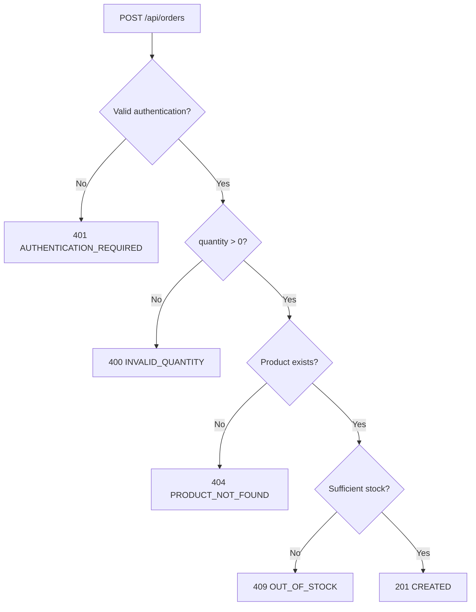
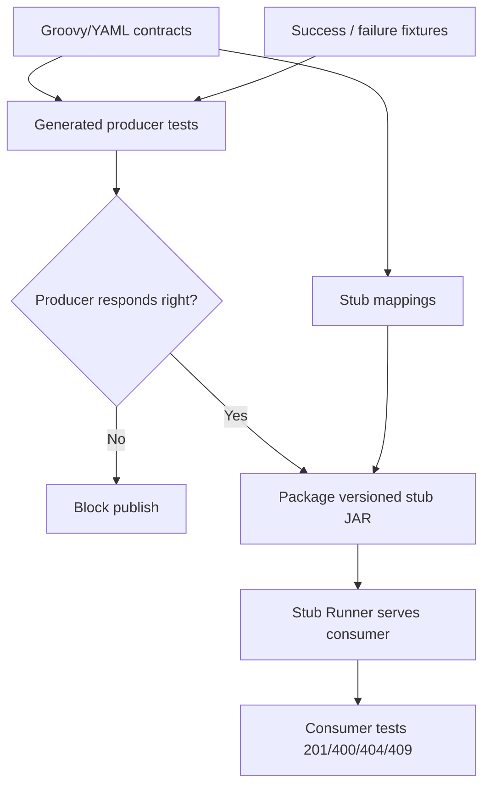

# Preparing Data for Success and Failure Branches

## 1. Test Data Is Part of Contract Verification

In **Spring Cloud Contract** (module `SPRING_CLOUD_CONTRACT`), producer and consumer agree on integration behavior via **Groovy DSL** or **YAML DSL**. For HTTP, contracts describe method, URL, headers, request body, and response including status, headers, and body. **Contract Verifier** uses those descriptions to generate producer-side tests; stubs are packaged and versioned for consumers to run via **Stub Runner**. When integrated into CI, both sides catch incompatible API changes early.

A generated producer test needs more than a **syntactically valid request**. It also needs the producer to be in the **right data state** so that the request leads to the expected outcome branch.

For example, the same `POST /api/orders` can lead to:

- `201 Created`: product exists, quantity is valid, inventory is sufficient.
- `400 Bad Request`: quantity is 0 or payload is invalid.
- `409 Conflict`: product exists, yet inventory is insufficient.
- `401 Unauthorized`: request requires login without valid authentication.

If the test for the `201` branch uses data from the out-of-stock branch, the producer may return `409` and the generated test fails even though business logic is right. Conversely, if the `409` branch is faked by returning hardcoded JSON from a mock right at the API boundary, the test may fail to verify the producer's actual committed logic.

**Lesson goal:** prepare accurate data for each branch, keep cases independent and reproducible, distinguish fixture errors from producer bugs, and use those results across producer verification, Stub Runner, and CI.

## 2. Start from a Behavior Matrix, Not Random Data

Suppose `orders-producer` provides two APIs:

1. `GET /api/orders/{id}` — read order details.
2. `POST /api/orders` — create an order from `productId` and `quantity`.

Throughout the examples, the API exposes the following behaviors. **Endpoints, error codes, product names, and data are illustrative assumptions**, not Spring Cloud Contract defaults.

| Contract scenario | Representative request | State to prepare | Agreed response |
| --- | --- | --- | --- |
| Read existing order | `GET /api/orders/ord-1001` | Order `ord-1001` exists with status `CREATED` | `200`, JSON with `id` and `status` |
| Read nonexistent order | `GET /api/orders/ord-missing` | No order exists with this ID | `404`, `ORDER_NOT_FOUND` |
| Create order successfully | `POST /api/orders` with `SKU-IN-STOCK`, `quantity = 2` | SKU exists, stock is sufficient, other constraints pass | `201`, body with order ID and `CREATED` |
| Invalid input data | `POST /api/orders` with `quantity = 0` | Payload violates validation rule; valid SKU can still be seeded | `400`, `INVALID_QUANTITY` |
| Out of stock | `POST /api/orders` with `SKU-OUT-OF-STOCK`, `quantity = 2` | SKU exists with stock = 0 | `409`, `OUT_OF_STOCK` |
| Missing authentication (if API requires it) | Request without credentials | Security filter/config enabled | `401` or published auth behavior |

The matrix clarifies three columns to check separately:

- **Contract input:** the request the generated producer test will send.
- **Precondition/fixture:** the state of data and application dependencies before the request arrives.
- **Expected outcome:** the status/headers/body the producer must return if compliant with the contract.

> A test can return the right HTTP status accidentally from a **different failure cause**. Therefore, if a contract branch requires `409 OUT_OF_STOCK`, do not assert only `409`; assert the business error code and prepare a product that *exists yet lacks sufficient stock*, avoiding confusion with `409` from duplicate request keys or another rule.

### 2.1. Decision Flow of the Illustrative API



The check order in the diagram is **an assumed design**. Real projects may authenticate before validation, return `422` instead of `400`, return `403` for missing permissions, or omit `404` on POST endpoints. Treat the **agreed behavior** as the source of truth, then choose data triggering each branch.

## 3. Selecting Fixtures Deliberately

A **fixture** is the data and environment state prepared so tests yield predictable outcomes. Good fixtures cover both **data that must be present** and **data that must be absent**.

| Fixture name | State | Used for |
| --- | --- | --- |
| `ord-1001` | Existing order, `status = CREATED` | Successful GET |
| `ord-missing` | Guaranteed **not to exist** | GET 404 |
| `SKU-IN-STOCK` | Active product, stock ≥ 2 | POST 201 |
| `SKU-OUT-OF-STOCK` | Active product, stock = 0 | POST 409 |
| `SKU-VALID` | Valid product | POST `quantity = 0`, ensuring failure comes from validation |
| `test-user-001` | Valid principal with needed permissions, if API uses auth | `200/201/400/409` branches requiring authentication |

A conceptual preparation sequence:

```text
Before each producer test:
  - Clean or isolate data from the previous test
  - Create order ord-1001 with status CREATED
  - Ensure order ord-missing does not exist
  - Create SKU-IN-STOCK with stock 10
  - Create SKU-OUT-OF-STOCK with stock 0
  - Create SKU-VALID with valid product details
  - Set up principal/test credentials if endpoints require them
  - Configure external dependencies in a deterministic state
```

If all tests run in one context, this setup can share a helper, while **isolating state across runs**. Order-creation tests modify stock; on a rerun, data will differ from the initial state unless an appropriately scoped reset or rollback mechanism runs.

### 3.1. A Fixture Should Not Depend on Real Wall-Clock Time

Avoid setting `expiresAt = now() + 1 second` and hoping the test runs before expiration. Instead use:

- A fixed `Clock` in the test context when time is part of the logic.
- Clear relative timestamps against the test `Clock`.
- One expired fixture and one valid fixture with a generous safety margin.

Likewise, auto-generated IDs and random tokens should be **constrained via fixtures** when exact matching is needed, or matched with tight dynamic response matchers. Never rely on leftover values in a database from a previous run.

### 3.2. Success and Failure Data Must Differ Only in the Target Condition

To verify `quantity = 0` returns `400 INVALID_QUANTITY`, keep everything else valid: `SKU-VALID` exists, request has the right `Content-Type`, and permissions match. Then, if the test fails, you have confidence the root cause involves the quantity rule.

To verify `409 OUT_OF_STOCK`, use `quantity = 2` (valid) and an **existing** SKU with stock = 0. Using a nonexistent SKU causes the producer to return `404`, and the test no longer represents the out-of-stock branch.

The principle is **varying as few preconditions as possible relative to the happy path**, pinpointing which exact condition creates the response difference.

## 4. Groovy Contracts for GET Success and Failure Branches

### 4.1. Existing Order: `200 OK`

File `get_order_success.groovy`:

```groovy
import org.springframework.cloud.contract.spec.Contract

Contract.make {
    name 'get_order_success'
    description 'Returns an order existing in test data'

    request {
        method GET()
        url '/api/orders/ord-1001'
    }

    response {
        status 200
        headers {
            contentType(applicationJson())
        }
        body([
            id    : 'ord-1001',
            status: 'CREATED'
        ])
    }
}
```

**Precondition:** before the generated test sends the request, the producer must have order `ord-1001`. If the real producer returns `404` because the fixture was not created, inspect test setup before concluding the endpoint is broken.

### 4.2. Nonexistent Order: `404 Not Found`

File `get_order_not_found.groovy`:

```groovy
import org.springframework.cloud.contract.spec.Contract

Contract.make {
    name 'get_order_not_found'
    description 'Requested order is not found'

    request {
        method GET()
        url '/api/orders/ord-missing'
    }

    response {
        status 404
        headers {
            contentType(applicationJson())
        }
        body([code: 'ORDER_NOT_FOUND'])
    }
}
```

**Precondition:** `ord-missing` must **not exist**. Assuming "this ID probably hasn't been created yet" is insufficient: the database may hold stale data or another test created that ID. Fixtures must explicitly delete the test record or use an isolated data store.

### 4.3. Why Not Collapse Both Branches into One Broad URL Matcher?

If a stub mapping for `GET 200` accepts any path matching `/api/orders/.*`, it can capture `/api/orders/ord-missing` too and return a success body instead of `404`. Stub Runner only **matches mapping conditions**; it does not check whether an order exists in a database.

For branches with different responses, use distinct fixed IDs or non-overlapping matchers. When supporting large ID sets, explicitly design stub matching logic/priorities instead of funneling everything through one success mapping.

## 5. Groovy Contracts for POST: `201`, `400`, and `409`

### 5.1. Success: `201 Created`

File `create_order_success.groovy`:

```groovy
import org.springframework.cloud.contract.spec.Contract

Contract.make {
    name 'create_order_success'

    request {
        method POST()
        url '/api/orders'
        headers {
            contentType(applicationJson())
        }
        body([
            productId: 'SKU-IN-STOCK',
            quantity : 2
        ])
    }

    response {
        status 201
        headers {
            contentType(applicationJson())
        }
        body([
            id    : $(consumer('ord-2001'),
                      producer(regex('ord-[0-9]+'))),
            status: 'CREATED'
        ])
    }
}
```

**Producer fixture:** product `SKU-IN-STOCK` is active with stock ≥ 2. Other business checks must allow placing the order, such as the customer being eligible to purchase the product.

The `id` field is an example of **two-sided values**:

- Stub response for consumers returns `ord-2001` so test data is predictable.
- Generated producer test accepts the real created order ID if it matches regex `ord-[0-9]+`.

The contract does not automatically prove the order was persisted or stock was decremented accurately. If that is required, add appropriate integration assertions. When you must verify that the `Location` header carries the exact same generated ID, use a relational check rather than just matching two independent regexes.

### 5.2. Invalid Input: `400 Bad Request`

File `create_order_invalid_quantity.groovy`:

```groovy
import org.springframework.cloud.contract.spec.Contract

Contract.make {
    name 'create_order_invalid_quantity'

    request {
        method POST()
        url '/api/orders'
        headers {
            contentType(applicationJson())
        }
        body([
            productId: 'SKU-VALID',
            quantity : 0
        ])
    }

    response {
        status 400
        headers {
            contentType(applicationJson())
        }
        body([
            code: 'INVALID_QUANTITY'
        ])
    }
}
```

**Producer fixture:** `SKU-VALID` must exist and be valid. The goal is isolating the failure cause to `quantity = 0`, preventing the test from getting `404 PRODUCT_NOT_FOUND` merely because the product does not exist.

For endpoints requiring authentication/CSRF, requests must supply security information per the **real contract**. If the test returns `401` or `403` before validation runs, that may be an authentication setup mistake rather than a broken `quantity` rule.

### 5.3. Inventory Conflict: `409 Conflict`

File `create_order_out_of_stock.groovy`:

```groovy
import org.springframework.cloud.contract.spec.Contract

Contract.make {
    name 'create_order_out_of_stock'

    request {
        method POST()
        url '/api/orders'
        headers {
            contentType(applicationJson())
        }
        body([
            productId: 'SKU-OUT-OF-STOCK',
            quantity : 2
        ])
    }

    response {
        status 409
        headers {
            contentType(applicationJson())
        }
        body([
            code: 'OUT_OF_STOCK'
        ])
    }
}
```

**Producer fixture:** product `SKU-OUT-OF-STOCK` must **exist** with stock = 0. If the producer implements reservation/hold logic, fixtures must also clear prior reservations.

**Why require an error code?** A request might return `409` due to duplicate idempotency keys, optimistic locking failures, or another conflict. `code = OUT_OF_STOCK` verifies the exact branch the consumer relies on to display an "Out of stock" message.

## 6. YAML DSL for an Equivalent Error Branch

Example `create_order_out_of_stock.yml`:

```yaml
name: create_order_out_of_stock
description: Cannot create order when product stock equals 0
request:
  method: POST
  url: /api/orders
  headers:
    Content-Type: application/json
  body:
    productId: SKU-OUT-OF-STOCK
    quantity: 2
response:
  status: 409
  headers:
    Content-Type: application/json
  body:
    code: OUT_OF_STOCK
```

This is an **alternative representation** of the Groovy DSL from the previous section. In a real project, pick **one** format—Groovy or YAML—for the same scenario. If the plugin scans both duplicate files, it can generate duplicate tests/mappings and complicate result tracing.

Choosing Groovy or YAML **does not change fixture preparation requirements**: the producer still needs `SKU-OUT-OF-STOCK` to exist with stock = 0 so the generated test receives `409` from the real app.

## 7. Preparing Fixtures in the Generated Producer Tests' Base Class

### 7.1. Role of the Base Test Class

Contract Verifier generates test methods from contracts. The producer-managed base class must create the execution environment. For a Spring MVC app using MockMvc, for example:

```java
package com.example.orders.contract;

import io.restassured.module.mockmvc.RestAssuredMockMvc;
import org.junit.jupiter.api.BeforeEach;
import org.springframework.beans.factory.annotation.Autowired;
import org.springframework.boot.test.autoconfigure.web.servlet.AutoConfigureMockMvc;
import org.springframework.boot.test.context.SpringBootTest;
import org.springframework.test.web.servlet.MockMvc;

@SpringBootTest
@AutoConfigureMockMvc
public abstract class OrdersContractBase {

    @Autowired
    private MockMvc mockMvc;

    @Autowired
    private OrdersContractFixtures fixtures;

    @BeforeEach
    protected void setUp() {
        fixtures.resetToBaseline();
        fixtures.existingOrder("ord-1001", "CREATED");
        fixtures.ensureOrderMissing("ord-missing");
        fixtures.inStockProduct("SKU-IN-STOCK", 10);
        fixtures.inStockProduct("SKU-VALID", 10);
        fixtures.outOfStockProduct("SKU-OUT-OF-STOCK");
        RestAssuredMockMvc.mockMvc(mockMvc);
    }
}
```

Here, `OrdersContractFixtures` and methods `resetToBaseline`, `existingOrder`, `ensureOrderMissing`, `inStockProduct`, and `outOfStockProduct` are **assumed project-implemented helpers**. They are **not built-in APIs** of Spring Cloud Contract.

To use this class, the producer needs to:

1. Configure the Spring Cloud Contract Maven/Gradle plugin so generated tests extend `com.example.orders.contract.OrdersContractBase`, such as via `baseClassForTests` or `baseClassMappings`.
2. Provide the `OrdersContractFixtures` bean in the Spring test context and implement safe data creation.
3. Include MockMvc and Rest Assured MockMvc dependencies matching the generator's test mode.
4. Ensure controllers, services, and required components are loaded so producer tests **traverse the real HTTP boundary**.
5. Ensure fixtures are prepared before each generated test and tests do not corrupt one another's state.

### 7.2. Fixture Helper Implementation Sketch

A helper can interact with repositories or data-seeding services. This is **Java pseudocode tailored to project APIs**, not a class to copy into every application:

```java
// Repositories, entities, and save/delete methods are assumed.
public void resetToBaseline() {
    // Only reset data belonging to the isolated test environment.
    // Never delete production data or another team's test data.
    testDataCleaner.clearOrdersAndProductsForThisTest();
}

public void existingOrder(String id, String status) {
    orderRepository.save(testOrderFactory.order(id, status));
}

public void ensureOrderMissing(String id) {
    orderRepository.deleteById(id); // Only in an isolated test DB.
}

public void inStockProduct(String sku, int stock) {
    productRepository.save(testProductFactory.activeProduct(sku, stock));
}

public void outOfStockProduct(String sku) {
    inStockProduct(sku, 0);
}
```

In a real project, account for foreign keys, unique constraints, sequence/ID generators, persistence context, transactions, and cleanup order. Whether `deleteById` is safe when a record does not exist depends on the repository and implementation; build **idempotent** helpers so they can run repeatedly without failing.

Never run a command wiping an entire shared database just to simplify setup. If CI runs jobs in parallel, test A's fixture can delete test B's data.

### 7.3. Prepare All Fixtures or Per Branch?

There are two strategies:

| Strategy | Advantages | Risks | When suitable |
| --- | --- | --- | --- |
| **Shared baseline** for all tests | Simple setup, one stable fixture set | Extra setup, longer runtime, risk of cross-branch interference | Few scenarios, small data |
| **Branch/group-specific fixtures** | Isolates preconditions, minimal extra data | Needs explicit mapping/setup | Multiple domains, complex data, parallel runs |

You do not need an all-or-nothing choice. You can build a **minimal shared baseline** (schema, static catalog data), then add per-group fixtures via matching base classes. With multiple HTTP and messaging groups, `baseClassMappings` picks the base class by contract directory.

## 8. Isolating Data Between Tests: Prerequisite for Reproducibility

A `POST /api/orders` scenario inserts records and may decrement stock. If the next test reuses the same SKU without resetting, its outcome depends on **execution order**.

### 8.1. Common Isolation Techniques

- **Dedicated test database per suite or test class:** appropriate when calling the real app over HTTP.
- **Transaction rollback:** helpful when operations share a single transaction boundary; never assume test rollback rolls back transactions committed by another server thread/process.
- **Cleanup/setup scoped by test ID:** deletes only the scenario's records without touching unrelated data.
- **Idempotent fixtures:** calling repeatedly always produces the same starting state.
- **Ephemeral containers or databases:** recreates schemas and dependencies in CI without touching shared environments.
- **Testable clock/ID generator:** pins timestamps or uses matchers for dynamic data.

### 8.2. Why `@Transactional` Is Not the Answer for Every HTTP Test

In tests calling a controller via MockMvc in the same context, some operations may participate in the test's transaction depending on configuration. Yet in tests calling a real server over HTTP, requests run on a different thread/process and open separate transactions. `@Transactional` on the test method **does not reliably roll back data committed by the server**.

Therefore, check the actual test mode (`MOCKMVC`, explicit HTTP server, or other), transaction boundaries, and how the app persists data before relying solely on rollback annotations.

### 8.3. Parallel Tests Need Dedicated IDs and Environments

If two generated tests both use `ord-1001` and both reset the orders table, they can collide when running concurrently. Options:

1. Disable parallel execution for groups lacking isolation.
2. Assign a dedicated namespace/tenant or database/schema per worker if architecture permits.
3. Use distinct fixture identifiers per test and keep contracts/samples aligned.
4. Clean up scoped test data instead of truncating whole tables globally.

The goal is: **the same source code, same contracts, and same defined environment must yield the same outcome**, regardless of test order.

## 9. Picking the Right Mock Boundary So Producer Tests Stay Meaningful

Producer verification must observe **real behavior at the contract boundary**. If a contract test for `POST /api/orders` mocks the controller directly or mocks the entire HTTP response to match the DSL, tests can stay green without catching broken producer logic.

| Component | Replaceable with test double? | Notes |
| --- | --- | --- |
| HTTP controller/route protected by contract | Normally **no** | Must execute real routing/validation/serialization at target test level |
| Producer business service | Depends on test goal; use caution | Full mocking can eliminate verification of business branches |
| Data store | Test DB / fake repository can be used | Must accurately model existence/out-of-stock conditions under test |
| Payment gateway, email system, external HTTP APIs | Usually replaceable with test doubles | Isolate dependencies outside this producer contract |
| External authentication provider | Fixture / test tokens can be used | Preserve security behavior consumers depend on |
| Clock / UUID generator | Controllable in tests | Avoid dependence on wall time and randomness |

For instance, on the out-of-stock branch, if a unit test only checks that **the controller translates a business error into HTTP 409**, a service mock throwing a specific domain exception works. Yet when the goal is verifying the **inventory-check rule**, run that real logic against a stock = 0 fixture. Clearly state which verification scope is protected.

### 9.1. Mocks Must Not Mask Contract Bugs

Suppose `OrderService` has a bug: every quantity is accepted. If tests mock `OrderService.create(...)` to always return "created," the `400 INVALID_QUANTITY` contract may no longer verify validation rules inside the service.

Choose one of two paths consciously:

- Verify validation at **Controller / Bean Validation** if that is where input rules are enforced.
- Or run the **real service** with a test database to verify business conditions too.

Never equate "tests compile and assertions pass" with "every business layer is verified."

## 10. Authentication Branches and Error Evaluation Order

For endpoints requiring login, a request with `quantity = 0` that lacks a cookie/token may receive **`401` before reaching validation**. Which failure branch triggers depends on the security and controller pipeline.

### 10.1. Preparing the `401` Branch

Illustrative contract:

```groovy
import org.springframework.cloud.contract.spec.Contract

Contract.make {
    name 'create_order_unauthenticated'

    request {
        method POST()
        url '/api/orders'
        headers {
            contentType(applicationJson())
        }
        body([
            productId: 'SKU-IN-STOCK',
            quantity : 2
        ])
    }

    response {
        status 401
        headers {
            contentType(applicationJson())
        }
        body([code: 'AUTHENTICATION_REQUIRED'])
    }
}
```

**Important limitation:** the contract above **does not automatically enforce the absence of all credentials**. Omitting `Authorization` from the request does not mean the mapping accepts only requests *lacking* that header; stubs may match broadly. When you need to verify header/cookie **absence** strictly, use supported negation matchers or dedicated producer tests, and inspect generated mappings.

Additionally, Spring Security apps may return `302` redirecting to a login page, or `403` from CSRF, instead of `401` with JSON. This example applies only if the API genuinely commits to `401 AUTHENTICATION_REQUIRED`; test fixtures must enable security filters and pick the matching entry point.

### 10.2. Preparing Other Branches When Security Is Active

| Contract | Security precondition |
| --- | --- |
| GET `200` | Principal has read permission if the endpoint requires it |
| GET `404` | Principal has read permission while ID is absent; avoid `401/403` masking `404` |
| POST `201` | Valid principal, plus CSRF/token if needed |
| POST `400` | Valid principal so validation is reached |
| POST `409` | Valid principal so inventory check is reached |
| POST `401` | No credentials, or expired credentials per contract |

Never disable all security just to make other branches pass: doing so skips real behavior consumers rely on. If separating business and security suites, know the exact scope of each suite.

## 11. Matchers, Sample Values, and Branch Precision

Spring Cloud Contract uses **two-sided values**:

- **In `request`:** `consumer(...)` describes what the stub matches; `producer(...)` is the sample sent by the generated producer test.
- **In `response`:** `consumer(...)` is the sample returned by the stub; `producer(...)` describes what the generated producer test accepts.

In section 5's `201` branch, `id` can be dynamically generated. However, if in **`request`** you write:

```groovy
body([
    productId: $(consumer(regex('SKU-.*')),
                 producer('SKU-IN-STOCK')),
    quantity: 2
])
```

the stub can match many different SKUs, including `SKU-OUT-OF-STOCK`—an SKU meant to return `409`. This creates **overlapping mappings** between success and failure scenarios.

**Never use a request matcher broader than a single business branch.** To test the success branch, keep `SKU-IN-STOCK` specific or restrict matchers to values guaranteed to share the same behavior. Stubs have no database to tell in-stock from out-of-stock unless you model distinct conditions explicitly.

### 11.1. Do Not Mistake "No Matching Stub" for a Business Error Contract

If `quantity = 0` is sent when only a success mapping exists, Stub Runner returns a no-match response. That is **not proof** the producer returns `400 INVALID_QUANTITY`.

The `400` branch needs its own contract as in section 5.2, verified by producer tests with valid fixtures and verified by consumer tests checking error-code handling. Similarly, a `404` from Stub Runner finding no mapping differs from a business `404 ORDER_NOT_FOUND` declared in a contract.

## 12. Producer Tests Pass—What Should Consumer Tests Verify?



When generated producer tests pass, you have evidence that the **real producer**, with prepared fixtures, returns the right responses for the contract scenarios. Consumer tests using stubs then verify that **real consumer code** handles those responses properly.

Examples:

| Stub response | Meaningful consumer assertion |
| --- | --- |
| `200` read order | Client decodes `id`, `status` accurately and returns data to caller |
| `201` create order | Client extracts new ID and transitions to completion state |
| `400 INVALID_QUANTITY` | Consumer shows input validation error, never reports transaction succeeded |
| `404 ORDER_NOT_FOUND` | Consumer shows not-found state without using stale data |
| `409 OUT_OF_STOCK` | Consumer prompts adjusting cart or quantity |
| `401 AUTHENTICATION_REQUIRED` | Consumer prompts login or refreshes session per design |

### 12.1. Stub Runner Does Not Create Producer Fixtures

HTTP stubs return sample responses from mappings without needing the producer's database. That is why consumer tests can run independently of the real producer. Yet this strength is also a boundary:

- A stub returning `201` does not prove real inventory is sufficient.
- A stub returning `409` does not prove the real service checked stock.
- Only **producer verification executed with accurate fixtures** binds the stub to producer behavior at that version.

After producer tests pass, the artifact with classifier `stubs` can be published at coordinates like `com.example:orders-producer:1.4.2:stubs`. Consumers should pin versions so CI remains reproducible.

## 13. Diagnosing Failures on the Wrong Branch

An effective diagnostic flow moves from **actual request** to **preconditions** before inspecting assertions:

1. **What request did the generated test send?** Check actual method, URL, headers, and body.
2. **Which handler processed the request?** Did a security filter, validation rule, or router intercept it before business logic?
3. **Were fixtures in the right state?** SKU, ID, stock, status, principal, time?
4. **Did state leak from another test?** Leftover rows, transactions, caches, messages, or mock invocations?
5. **What was the actual response?** Where do status, headers, or body differ from contract commitments?
6. **Does the contract reflect the agreed API?** Only change expected results when the API intentionally changes with consumer agreement.

| Symptom | Most likely cause | What to check |
| --- | --- | --- |
| GET success returns `404` | Missing `ord-1001` fixture | Order helper, test DB, transactions |
| GET not-found returns `200` | `ord-missing` already exists | Cleanup, parallel tests, stale data |
| POST success returns `409` | SKU has stock = 0 or existing reservation | Stock seeding, reset, test inventory |
| POST invalid quantity returns `401` | No valid credentials | Security fixture and auth filter |
| POST invalid quantity returns `404` | SKU missing; validation may run after lookup | Create valid SKU, check handler order |
| POST out-of-stock returns `400` | Payload invalid before reaching stock check | Check quantity, headers, validation |
| Passes locally, fails in CI | Database/clock or dependency mismatch | Testcontainers, timezone, migrations, seed data |
| Passes alone, fails in suite | Shared state mutated | Isolation, cleanup, parallel execution |
| Generated test reports body mismatch with right status | Error code/schema changed or mapper differs | Compare contract, actual response, and fixtures |
| Stub returns different branch in consumer test | Overlapping mappings or unmatched request | Inspect WireMock mappings, body and header matchers |

### 13.1. Logging Preconditions Explicitly

In test setup, log diagnostic preconditions safely:

```text
contractCase=create_order_out_of_stock
productId=SKU-OUT-OF-STOCK
quantity=2
fixture.productExists=true
fixture.availableStock=0
expected.httpStatus=409
expected.errorCode=OUT_OF_STOCK
```

This log format is an illustration, not default framework output. Never log passwords, live tokens, session IDs usable outside tests, or personal data. Recording **branch preconditions** helps separate fixture bugs from producer behavior regressions.

## 14. Standardizing Data in CI

A trustworthy producer pipeline not only generates tests, it runs them against reproducible data:

```text
Check out code + contracts
  -> Verify DSL and generated tests
  -> Initialize test database / dependencies
  -> Run versioned migrations / schema
  -> Seed per-branch fixtures
  -> Run producer tests for 200/201/400/404/409
  -> Confirm all tests were discovered and executed
  -> Package verified stub artifact
  -> Consumer tests run Stub Runner with pinned stub version
```

**What to record in CI:**

- Commit and versions of producer and Spring Cloud Contract plugin.
- List of scanned contracts; counts of generated and executed tests.
- Test database, schema migrations, and fixture seeding method.
- Success/failure branches run and passed/failed/skipped counts.
- Stub artifact published when producer verification passes.

If a pipeline turns green with 0 executed tests, never mark contracts as verified. If a branch fails only in CI, check fixtures/migrations, timezones, and dependency access before altering expected responses in the DSL.

### 14.1. Separating Branch Tests from Heavy Load Tests

Contract tests usually target **representative behavior**. They do not replace:

- Load/stress tests with high concurrent order volume.
- Race-condition tests when two requests deduct stock simultaneously.
- Security penetration tests.
- End-to-end tests with real payment providers, shipping providers, and brokers.
- Exhaustive testing of every input combination.

For `409 OUT_OF_STOCK`, a stock = 0 fixture checks the out-of-stock response, yet **does not prove** the producer handles two concurrent requests for the last unit properly. Write dedicated concurrency/transaction tests if the product requires that guarantee.

## 15. Practice Lab: Designing Data Yourself for a Reservation API

Suppose `booking-producer` exposes `POST /api/reservations` with body:

```json
{
  "roomId": "room-1001",
  "nights": 2
}
```

API agreement for this lab:

- `201` with `reservationId` when the room is available and nights are valid.
- `400 INVALID_NIGHTS` if `nights ≤ 0`.
- `404 ROOM_NOT_FOUND` if `roomId` does not exist and the request is valid.
- `409 ROOM_UNAVAILABLE` if the room exists yet is already booked for the test date range.

### 15.1. Matrix to Complete

| Branch | Room fixture | Request `nights` | Expected |
| --- | --- | --- | --- |
| Success | `room-1001` exists and is free | `2` | `201` + reservation ID |
| Invalid input | `room-1001` exists | `0` | `400 INVALID_NIGHTS` |
| Not found | `room-missing` guaranteed absent | `2` | `404 ROOM_NOT_FOUND` |
| Conflict | `room-booked` exists and is busy in test dates | `2` | `409 ROOM_UNAVAILABLE` |

### 15.2. Practice Tasks

1. Write **four Groovy or YAML contracts**, one for each branch above.
2. Build fixture helpers creating an available room, a booked room, and deleting/ensuring the missing room is absent.
3. If tests require booking dates, use a fixed `Clock` or deliberate timestamps; avoid depending on "today" if it makes scenarios drift over time.
4. Make generated producer tests extend `BookingContractBase` and verify the helper runs before every request.
5. For `201`, use an appropriate matcher if `reservationId` is dynamically generated.
6. Run the suite at least twice and shuffle test order to verify independence.
7. Simulate a fixture bug: create `room-missing` before running the `404` branch. Observe the failure and explain why you **must not** change the `404` contract to `201`.
8. Write consumer tests with Stub Runner for `400` and `409`, confirming the consumer renders input validation errors differently from room-unavailable errors.

### 15.3. Self-Check Questions

**Question 1.** Why should the `400 INVALID_NIGHTS` branch use an existing `roomId`?

**Answer:** To isolate the invalid condition to the number of nights, avoiding confusion with `404 ROOM_NOT_FOUND`.

**Question 2.** If a generated test expects `409` yet receives `401`, what should you inspect first?

**Answer:** Authentication fixtures/security setup; the request may be rejected before reaching the room-availability check.

**Question 3.** Does Stub Runner returning `409` prove the real booking system recorded the room as busy?

**Answer:** No. Stubs only respond from mappings. Producer verification must run against a booked-room fixture, with integration tests verifying booking persistence when needed.

**Question 4.** Does putting `@Transactional` on a test calling a real HTTP server guarantee rolling back bookings saved by the server?

**Answer:** Not reliably. The server's transaction may differ from the test's transaction; use explicit cleanup or an isolated test database.

**Question 5.** Why isn't status `409` alone sufficient to prove the right branch was tested?

**Answer:** Multiple causes can trigger conflicts. Assert error code `ROOM_UNAVAILABLE` and ensure fixtures genuinely represent an already-booked room.

### Checklist Before Concluding HTTP Contract Tests Are Reliable

- [ ] Every critical branch has a clear representative request and expected response.
- [ ] Fixtures define both data that **exists** and data that **must not exist**.
- [ ] Failure branches trigger for the exact intended reason without being masked by security or other validations.
- [ ] Generated producer tests run against the configured controller/service and test mode.
- [ ] Test data is repeatable and independent of test execution order.
- [ ] No production databases, live events, or production credentials are used in test fixtures.
- [ ] Request matchers are not so broad that they confuse success and failure branches.
- [ ] Response matchers are tight enough for dynamic values while preserving committed assertions.
- [ ] Producer tests actually ran with fixtures initialized, not merely generated.
- [ ] Consumer tests use Stub Runner to verify handling of status and error codes.
- [ ] CI records executed test counts, contract/stub versions, and blocks publishing if producer tests fail.

**Key takeaway:** HTTP contract testing is meaningful only when the **DSL request**, **producer data state**, and **expected response** all describe the same business branch. Preparing success, invalid-input, not-found, and conflict fixtures independently and reproducibly lets Contract Verifier catch real producer changes; stubs and consumer tests then protect integration across the entire CI chain.
