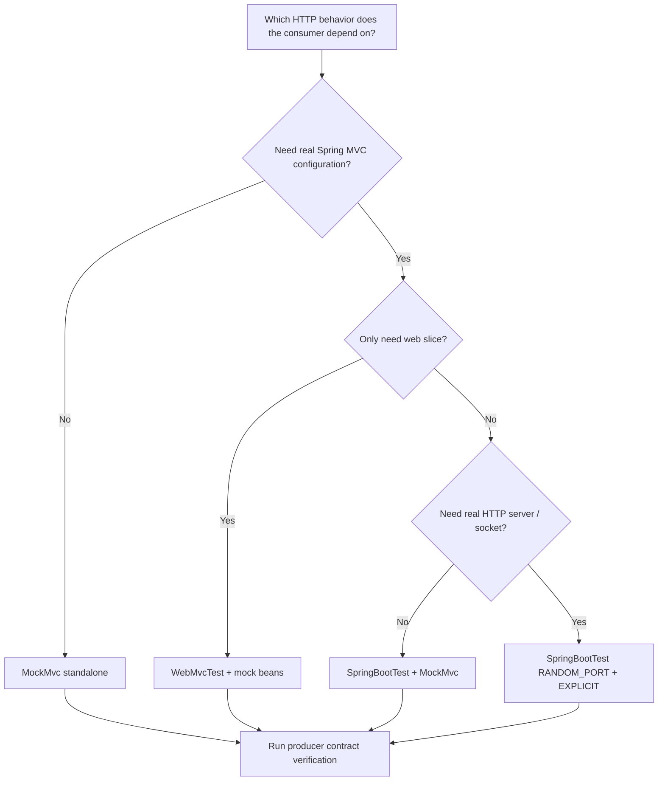
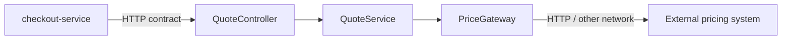
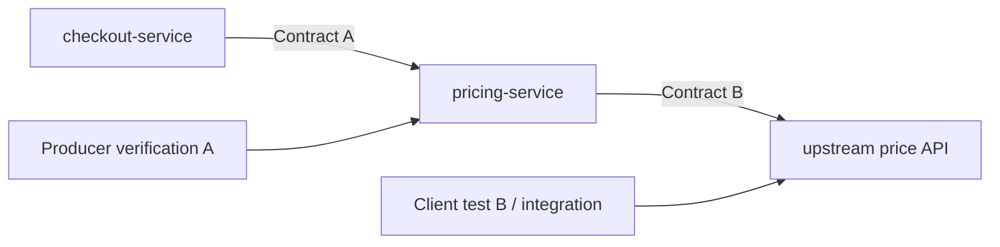
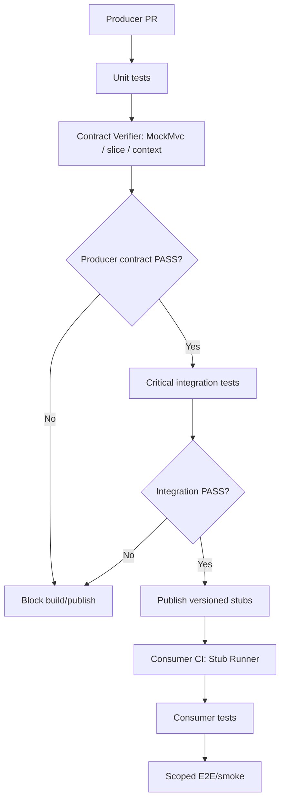

# Choosing the Right Integration Level for the HTTP Boundary

> **Chapter:** HTTP Testing  
> **Module:** `SPRING_CLOUD_CONTRACT` — learn contract testing between producer and consumer with Spring Cloud Contract, specifying behavior with Groovy/YAML DSL, generating producer tests, creating stubs, using Stub Runner, and integrating CI to catch incompatible API changes.

## Learning Objectives

After this lesson, you will be able to:

1. Explain why **producer contract tests do not necessarily need to run the entire application and every dependent system**, yet cannot simply verify a mock returning hardcoded responses.
2. Choose among integration levels: **MockMvc standalone**, **MVC slice**, **Spring context + MockMvc**, or a **real HTTP server in tests**, based on the HTTP behavior the consumer requires.
3. Build a base test for Spring Cloud Contract Verifier so generated tests invoke **real producer code within the scope requiring protection**.
4. Decide which dependencies to mock, which components must be wired in the Spring context, and when testing over an HTTP socket is mandatory.
5. Configure the corresponding `testMode` in the plugin, distinguish `MOCKMVC` from `EXPLICIT`, and understand their limitations.
6. Detect **false-green** situations caused by bypassing Spring Security, filters, serializers, exception advice, gateways, or production configurations.
7. Connect producer verification to stub artifacts, consumer Stub Runner, and CI to maintain API compatibility.

## 1. The Problem: What Does "Integrated Enough" Mean?

Suppose `checkout-service` (consumer) calls `pricing-service` (producer) to get a quote:

```http
POST /api/quotes HTTP/1.1
Content-Type: application/json
Accept: application/json

{
  "sku": "SKU-001",
  "units": 2
}
```

The producer commits to returning:

```http
HTTP/1.1 201 Created
Content-Type: application/json

{
  "sku": "SKU-001",
  "units": 2,
  "total": 240000,
  "currency": "VND"
}
```

`pricing-service` needs to fetch unit prices from an external pricing system. In contract tests, we want to guarantee:

- The producer actually receives `POST /api/quotes` and parses JSON using the committed data types.
- Producer logic uses the unit price and quantity to compute `total`.
- HTTP status is `201`, the response carries the right `Content-Type`, and the body includes all fields the consumer expects.
- If the API changes `total` to `"240000"` or `currency` to `USD`, verification must fail.

We do **not necessarily** want to depend on a staging pricing system, DNS, network tokens, or an external database just to test this HTTP contract.

However, if the contract includes security headers handled by Spring Security, custom JSON settings, filters, or server routing, a test constructing only a controller manually may **bypass those components**. Then the test passes even though the deployed application still returns `401`, `406`, or broken JSON.

Therefore, the right design question is not "*mock as much as possible?*" or "*always run E2E?*", but rather:

> **Which components actually determine the behavior the consumer depends on? Wire enough of those components in the test, and isolate unnecessary dependencies.**

## 2. Four Common HTTP Integration Levels

| Level | Common setup | Calls HTTP over socket? | What is tested | Trade-offs |
| --- | --- | --- | --- | --- |
| **1. MockMvc standalone** | `RestAssuredMockMvc.standaloneSetup(controller)` | No | Manually instantiated controller, Spring MVC mappings, and converters supplied by setup | Fast, yet does not automatically load full Spring configuration |
| **2. MVC slice** | `@WebMvcTest` + `@Import` / bean mocks | No | Web MVC portion chosen by Boot for the slice, matching controller/advice/converters/filters | Leaner than full context, yet may omit beans/config outside the slice |
| **3. Spring context + MockMvc** | `@SpringBootTest` + `@AutoConfigureMockMvc` | No | More real application beans and config; MockMvc invokes MVC in-process | Broader scope, slower startup, still does not test real server/network |
| **4. Embedded HTTP server** | `@SpringBootTest(webEnvironment = RANDOM_PORT)` + `EXPLICIT` | Yes, over loopback | Real HTTP stack in test, converters, filters, server, response over socket | More resource-heavy; still does not prove production/E2E infrastructure |

These levels are not a "*higher is always better*" scale. **Pick the lowest level that still includes every component capable of altering the contract under verification.** For very simple APIs, level 1 may suffice. For HTTP auth/filters, level 2 or 3 is usually better suited. For embedded server behavior, headers sent over the wire, or servlet container specifics, consider level 4.

A mature test suite typically combines levels: many fast producer contract tests at levels 1–3 alongside select higher-level integration/E2E tests for boundaries needing end-to-end confirmation.



Note: if you must verify **external gateways, proxies, real TLS, load balancers, service discovery, or cross-service networking**, even level 4 may not be enough. That is why separate integration/contract tests exist at other boundaries alongside smoke/E2E tests.

## 3. Identifying the HTTP Boundary Before Writing Tests

In this lesson, `checkout-service` relies only on HTTP communication with `pricing-service`. Inside the producer:



**What is verified on the producer** should include the controller and the response-building rules the consumer depends on. `PriceGateway` is an outbound integration port; Mockito can control pricing data in contract tests. Whether the gateway adapter properly connects to the real pricing system requires a **separate contract/integration test**.

### 3.1. Real or Mock?

| Component | In example contract test | Reason |
| --- | --- | --- |
| `QuoteController` | **Real** | Must verify mapping, status, HTTP request/response |
| `QuoteService` | **Real** | Must protect calculation `units × unitPrice` and currency |
| `PriceGateway` | **Mock** | Isolates external system, keeps fixtures deterministic |
| Default Spring JSON converter | **Real in MockMvc setup** | Must guarantee JSON response |
| Custom Jackson config or `@ControllerAdvice` | **Include when contract depends on it** | Standalone does not auto-load app config |
| Spring Security | **Include if auth is an API promise** | Omitting filters can produce false greens |
| Database / broker / external service | **Isolatable depending on goal** | Contract tests are not E2E by default |
| Stub Runner | **In consumer tests** | Does not replace producer-side verification |

**Never mock `QuoteController` itself to return a canned HTTP 201.** Doing so turns producer verification into comparing a fixture against itself.

**Do not mock `QuoteService` when trying to catch total-calculation bugs.** When testing only controller serialization, mocking the service can be a reasonable choice, yet scope has narrowed and must be stated explicitly.

## 4. Defining a Shared Contract

Place file `src/test/resources/contracts/quote_created.yml` in the **producer** project:

```yaml
name: quote_created
description: "Checkout creates a quote successfully"

request:
  method: POST
  url: /api/quotes
  headers:
    Content-Type: application/json
    Accept: application/json
  body:
    sku: SKU-001
    units: 2

response:
  status: 201
  headers:
    Content-Type: application/json
  body:
    sku: SKU-001
    units: 2
    total: 240000
    currency: VND
```

This uses fixed sample data, suitable for verifying **one concrete scenario**. If the producer also generates a dynamic `quoteId` or timestamp, add format-matched response matchers rather than locking a random ID to a sample literal.

The same interaction can be written in **Groovy DSL**:

```groovy
org.springframework.cloud.contract.spec.Contract.make {
    name 'quote_created'

    request {
        method 'POST'
        url '/api/quotes'
        headers {
            contentType(applicationJson())
            header 'Accept': 'application/json'
        }
        body(
            sku: 'SKU-001',
            units: 2
        )
    }

    response {
        status 201
        headers {
            contentType(applicationJson())
        }
        body(
            sku: 'SKU-001',
            units: 2,
            total: 240000,
            currency: 'VND'
        )
    }
}
```

**Place only one YAML or Groovy version per scenario in the contract directory scanned by the plugin.** Keeping both easily generates duplicate tests and stubs.

The contract above protects the producer's **observable behavior**. It does not itself say whether the producer uses MockMvc, a Spring context, or a real server; that choice belongs to the **base test and test mode**.

## 5. Minimal Producer Code for the Example

The example includes a controller, a service, and a port to the external pricing system. The files below use Spring MVC and Java records (JDK 17+).

### 5.1. Unit-Price Lookup Port

`PriceGateway.java`:

```java
package com.example.quotes;

public interface PriceGateway {
    long unitPrice(String sku);
}
```

A production adapter implementing this interface might call an external API. We do not need to build that adapter in this lesson because the contract verifies the **checkout → pricing** boundary, not the **pricing → external system** boundary.

### 5.2. Real Business Logic

`QuoteService.java`:

```java
package com.example.quotes;

import org.springframework.stereotype.Service;

@Service
public class QuoteService {

    private final PriceGateway priceGateway;

    public QuoteService(PriceGateway priceGateway) {
        this.priceGateway = priceGateway;
    }

    public QuoteResponse create(String sku, int units) {
        if (units <= 0) {
            throw new IllegalArgumentException("units must be positive");
        }

        long unitPrice = priceGateway.unitPrice(sku);
        long total = Math.multiplyExact(unitPrice, (long) units);

        return new QuoteResponse(sku, units, total, "VND");
    }

    public record QuoteResponse(
        String sku,
        int units,
        long total,
        String currency
    ) {}
}
```

`Math.multiplyExact` ensures overflow throws an exception rather than wrapping silently. When pricing returns `120000` for `SKU-001`, the service computes `total = 240000` for `units = 2`.

Negative branches (invalid units, gateway failure, missing SKU) do not yet have HTTP error mappings. If consumers depend on `400`/`404`/`503`, add an exception handler and **separate contracts**; never assume Spring turns every Java exception into the desired error code by default.

### 5.3. Real HTTP Controller

`QuoteController.java`:

```java
package com.example.quotes;

import org.springframework.http.HttpStatus;
import org.springframework.http.MediaType;
import org.springframework.web.bind.annotation.PostMapping;
import org.springframework.web.bind.annotation.RequestBody;
import org.springframework.web.bind.annotation.ResponseStatus;
import org.springframework.web.bind.annotation.RestController;

@RestController
public class QuoteController {

    private final QuoteService quoteService;

    public QuoteController(QuoteService quoteService) {
        this.quoteService = quoteService;
    }

    @PostMapping(
        path = "/api/quotes",
        consumes = MediaType.APPLICATION_JSON_VALUE,
        produces = MediaType.APPLICATION_JSON_VALUE
    )
    @ResponseStatus(HttpStatus.CREATED)
    public QuoteService.QuoteResponse create(
            @RequestBody QuoteRequest request) {
        return quoteService.create(request.sku(), request.units());
    }

    public record QuoteRequest(String sku, int units) {}
}
```

`consumes`, `produces`, `@RequestBody`, `@ResponseStatus`, and Jackson/message converters all participate in HTTP behavior. Depending on test level, parts of the framework configuration may be assembled manually or supplied by the Spring context.

## 6. Level 1 — MockMvc Standalone: Low-Cost Controller Verification

In a producer project using Spring Cloud Contract Verifier and JUnit 5, create the base class at `src/test/java/com/example/quotes/ContractTestBase.java`:

```java
package com.example.quotes;

import io.restassured.module.mockmvc.RestAssuredMockMvc;
import org.junit.jupiter.api.BeforeEach;

import static org.mockito.Mockito.mock;
import static org.mockito.Mockito.when;

public abstract class ContractTestBase {

    @BeforeEach
    public void setUp() {
        // Dependency outside the HTTP boundary under verification.
        PriceGateway gateway = mock(PriceGateway.class);
        when(gateway.unitPrice("SKU-001")).thenReturn(120_000L);

        // Producer's service and controller remain real objects.
        QuoteService service = new QuoteService(gateway);
        QuoteController controller = new QuoteController(service);

        RestAssuredMockMvc.standaloneSetup(controller);
    }
}
```

**Execution flow:**

1. The test generated by Contract Verifier extends `ContractTestBase`.
2. `@BeforeEach` creates the `PriceGateway` mock and stubs exact input data.
3. The test calls `POST /api/quotes` via RestAssuredMockMvc.
4. MockMvc dispatches the request to the real `QuoteController` and `QuoteService`.
5. The service computes the total from the mocked `120000`, and the controller returns `201`.
6. Generated assertions compare status/headers/JSON body against the contract.

### 6.1. What This Level Catches

- Wrong HTTP method or path in the controller.
- Wrong `consumes`/`produces` when matching converters are active in standalone setup.
- Missing or mis-bound request body fields under test.
- Wrong `@ResponseStatus` or JSON structure from the controller.
- Wrong `total` from service calculation bugs.
- Changing `currency` from `VND` to `USD` in the response.

### 6.2. What This Level May Miss

- Custom `ObjectMapper` and JSON formatting configured via production beans.
- `@ControllerAdvice` not registered in standalone setup.
- Unattached `SecurityFilterChain`, JWT validation, request tracing, or custom filters.
- Full-application Spring dependency injection/wiring.
- Servlet behaviors that only manifest in a running container.

**False-green example:** production has a filter requiring `X-Tenant-Id`, yet the standalone test never wires that filter. The contract sends a request **without that header** and still receives `201` in the test; production returns `401`/`403` or another error per policy. That is not a flaw in MockMvc: **the test setup selected a scope missing a behavior-determining component**.

If you only need to verify HTTP mappings and simple DTOs, level 1 can be a great choice. If filters or advice are part of the contract, add them to setup or raise the integration level.

### 6.3. Do Not Mock Too Broadly at Level 1

In fixtures, stub accurately:

```java
when(gateway.unitPrice("SKU-001")).thenReturn(120_000L);
```

Avoid overusing:

```java
when(gateway.unitPrice(anyString())).thenReturn(120_000L);
```

when tests need to catch the producer passing the wrong SKU. Returning a price for any SKU can mask parameter-passing bugs between controller and service.

Default Mockito mocks return `0` for primitives or `null` for objects when a call is not stubbed. A test failing due to missing fixtures **does not automatically** prove the API broke the contract; inspect the request sent by the generated test and the actual gateway invocation.

## 7. Level 2 — MVC Slice with `@WebMvcTest`

`@WebMvcTest` builds a **portion of the Spring context dedicated to the web layer**. It fits when you need MVC configuration, controller advice, JSON binding, or slice-loaded web components without starting the entire application.

An **alternative variant** for `ContractTestBase` from level 1:

```java
package com.example.quotes;

import io.restassured.module.mockmvc.RestAssuredMockMvc;
import org.junit.jupiter.api.BeforeEach;
import org.springframework.beans.factory.annotation.Autowired;
import org.springframework.boot.test.autoconfigure.web.servlet.WebMvcTest;
import org.springframework.context.annotation.Import;
import org.springframework.test.context.bean.override.mockito.MockitoBean;
import org.springframework.test.web.servlet.MockMvc;

import static org.mockito.Mockito.when;

@WebMvcTest(QuoteController.class)
@Import(QuoteService.class)
public abstract class ContractTestBase {

    @Autowired
    MockMvc mockMvc;

    @MockitoBean
    PriceGateway priceGateway;

    @BeforeEach
    public void setUp() {
        when(priceGateway.unitPrice("SKU-001")).thenReturn(120_000L);
        RestAssuredMockMvc.mockMvc(mockMvc);
    }
}
```

In this example:

- `@WebMvcTest(QuoteController.class)` creates the MVC slice for the controller.
- `@Import(QuoteService.class)` brings the **real service** into the slice (slices do not automatically scan `@Service` beans).
- `@MockitoBean` creates a mock bean for `PriceGateway` so the service can be injected.
- `MockMvc` is configured by the slice; RestAssuredMockMvc uses it so generated tests call the controller.

**Version note:** the `@WebMvcTest` import above fits the Spring Boot 3.x line. Spring Boot 4.x reorganized several test autoconfiguration packages (for MVC, e.g., into `org.springframework.boot.webmvc.test.autoconfigure`); use imports matching your project version. `@MockitoBean` requires Spring Framework 6.2+; older projects can use `@MockBean` per their Boot version, noting the older annotation is deprecated in newer lines.

Level 2 **is not automatically equivalent to production**:

- Slices load only selected beans/configuration; external services, transactions, and custom configurations may be absent.
- Security auto-configuration may join the test slice, yet **production auth policies** are not automatically identical in every slice.
- Use `@Import`, test configurations, or security test annotations as needed; verify generated requests genuinely pass through critical policies.

### 7.1. When Is an MVC Slice Worthwhile?

Example `@ControllerAdvice` standardizing business errors:

```java
@RestControllerAdvice
public class QuoteExceptionHandler {

    @ExceptionHandler(IllegalArgumentException.class)
    public ResponseEntity<ErrorResponse> badRequest(
            IllegalArgumentException ex) {
        return ResponseEntity.badRequest()
            .body(new ErrorResponse("INVALID_UNITS"));
    }

    public record ErrorResponse(String code) {}
}
```

If the contract states `units: -1` must return `400` and body `{"code":"INVALID_UNITS"}`, the test must include the real advice. An MVC slice loading that advice makes more sense than a standalone controller lacking advice configuration.

Do not assume the advice above loads automatically in every setup: check component scanning, imports, and generated test output. In other cases, full Spring context configuration may be necessary.

## 8. Level 3 — Spring Context + MockMvc

When contracts rely on many real application beans (custom JSON config, interceptors, controller advice, Spring Security, validation), use `@SpringBootTest` to start the application in-process, still **without opening an HTTP socket**.

An illustrative base class (replaces all earlier base classes):

```java
package com.example.quotes;

import io.restassured.module.mockmvc.RestAssuredMockMvc;
import org.junit.jupiter.api.BeforeEach;
import org.springframework.beans.factory.annotation.Autowired;
import org.springframework.boot.test.context.SpringBootTest;
import org.springframework.boot.test.autoconfigure.web.servlet.AutoConfigureMockMvc;
import org.springframework.test.context.bean.override.mockito.MockitoBean;
import org.springframework.test.web.servlet.MockMvc;

import static org.mockito.Mockito.when;

@SpringBootTest(
    webEnvironment = SpringBootTest.WebEnvironment.MOCK
)
@AutoConfigureMockMvc
public abstract class ContractTestBase {

    @Autowired
    MockMvc mockMvc;

    @MockitoBean
    PriceGateway priceGateway;

    @BeforeEach
    public void setUp() {
        when(priceGateway.unitPrice("SKU-001")).thenReturn(120_000L);
        RestAssuredMockMvc.mockMvc(mockMvc);
    }
}
```

Requirements to run:

- Project has a `@SpringBootApplication` class and compatible Spring MVC/test dependencies.
- Spring context starts with all required dependencies; adapters calling outside the boundary are mocked/configured appropriately.
- `@AutoConfigureMockMvc` configures MockMvc via Spring Boot; for filters/security, confirm those configurations actually participate in tests.
- `@MockitoBean` replaces the gateway bean so the external pricing system is never called.

Note that the `@AutoConfigureMockMvc` import shown matches Spring Boot 3.x. On Boot 4.x, check the new MVC test namespace; never mix imports across Boot lines. **In both levels 2 and 3**, generated tests use `MOCKMVC` test mode.

### 8.1. Benefits and Costs

Compared to standalone, full context can catch:

- Missing or conflicting bean wiring.
- Custom Jackson serializers altering field names or timestamp formats.
- Controller advice returning non-contract error bodies.
- Security filters requiring headers/tokens omitted by contracts.
- Servlet filters, interceptors, or locale handling affecting HTTP responses.

However, it carries costs:

- Increased application context startup time and memory usage.
- Tests may fail due to unrelated beans if not properly isolated.
- Context startup failures can obscure API compatibility bugs you are trying to find.
- With too many mocks, even a full context does not guarantee the real whole system.

**Practical advice:** move from level 1 to level 3 when there is an **observable requirement** missed by lower levels, not merely because "full context sounds safer."

## 9. Level 4 — Running a Real Embedded HTTP Server

When tests must traverse an HTTP socket, servlet container, and server stack, use Spring Cloud Contract's **`EXPLICIT` test mode** with the server running on a random port.

An illustrative base class example:

```java
package com.example.quotes;

import io.restassured.RestAssured;
import org.junit.jupiter.api.BeforeEach;
import org.springframework.beans.factory.annotation.Autowired;
import org.springframework.boot.test.context.SpringBootTest;
import org.springframework.boot.test.web.server.LocalServerPort;
import org.springframework.test.context.bean.override.mockito.MockitoBean;

import static org.mockito.Mockito.when;

@SpringBootTest(
    webEnvironment = SpringBootTest.WebEnvironment.RANDOM_PORT
)
public abstract class ContractTestBase {

    @LocalServerPort
    int port;

    @MockitoBean
    PriceGateway priceGateway;

    @BeforeEach
    public void setUp() {
        when(priceGateway.unitPrice("SKU-001")).thenReturn(120_000L);
        RestAssured.baseURI = "http://localhost";
        RestAssured.port = port;
    }
}
```

Key points:

- `RANDOM_PORT` avoids port contention on CI or developer machines.
- The producer runs an embedded server during tests.
- Generated tests send requests using **Rest Assured HTTP**, not RestAssuredMockMvc.
- `RestAssured.port` aims requests at the local port just allocated by Spring Boot.
- `PriceGateway` can still be a mock; using a real HTTP server **does not force starting every external system**.

When custom HTTPS, proxies, or other ingress paths are needed, this setup is still insufficient; testing a local server does not test TLS termination or production gateway routing.

**Note:** `RestAssured.baseURI` and `RestAssured.port` are static/global settings that can collide if multiple tests mutate them concurrently. For parallel test suites, use per-test request configuration or separate processes/configs. The `@LocalServerPort` package name can differ across Spring Boot lines; the snippet above illustrates Boot 3.x.

### 9.1. When Is Level 4 Necessary?

Step up to level 4 when what you must protect cannot be expressed accurately in MockMvc, such as:

- Headers or cookies handled by the embedded container carrying contract significance.
- Routing or filters behaving differently when requests travel over a socket.
- HTTP encoding, redirects, or response behavior depending on the server stack.
- Wanting component-level checks using a real HTTP client outside the MVC layer.

**However:** level 4 still does not verify real external APIs, production databases, brokers, or deployment proxies. Do not call it full-system E2E when only a single Spring Boot process is running.

## 10. Configuring the Plugin to Match the Integration Level

In a Maven producer project already configured with **compatible** Spring Boot + Spring Cloud, you need test dependencies and the Contract Verifier plugin.

An illustrative POM excerpt for MockMvc-based levels:

```xml
<!-- Inside <dependencies> -->
<dependency>
    <groupId>org.springframework.cloud</groupId>
    <artifactId>spring-cloud-starter-contract-verifier</artifactId>
    <scope>test</scope>
</dependency>

<!-- Inside <build><plugins> -->
<plugin>
    <groupId>org.springframework.cloud</groupId>
    <artifactId>spring-cloud-contract-maven-plugin</artifactId>
    <version>${spring-cloud-contract.version}</version>
    <extensions>true</extensions>
    <configuration>
        <testFramework>JUNIT5</testFramework>
        <testMode>MOCKMVC</testMode>
        <baseClassForTests>com.example.quotes.ContractTestBase</baseClassForTests>
    </configuration>
</plugin>
```

This is a **POM fragment**, omitting parent/BOM, MVC starter, `java.version`, and property `spring-cloud-contract.version`. Choose a Spring Cloud Contract Maven plugin version compatible with your project's Spring Boot/Cloud versions. Do not copy version values from another module without checking.

When switching to **level 4**, change only the test mode in the plugin:

```xml
<testMode>EXPLICIT</testMode>
```

and use a base class starting the server with Rest Assured HTTP as in section 9. **Never configure `EXPLICIT` while the base test calls only `RestAssuredMockMvc.standaloneSetup`**: generated tests will use a different invocation mechanism than the environment you prepared.

| Level | Test setup | Plugin `testMode` |
| --- | --- | --- |
| MockMvc standalone | `RestAssuredMockMvc.standaloneSetup` | `MOCKMVC` |
| `@WebMvcTest` | `RestAssuredMockMvc.mockMvc(mockMvc)` | `MOCKMVC` |
| `@SpringBootTest` + MockMvc | `RestAssuredMockMvc.mockMvc(mockMvc)` | `MOCKMVC` |
| `@SpringBootTest(RANDOM_PORT)` | `RestAssured.port = port` | `EXPLICIT` |

For **WebFlux/reactive** apps, Spring Cloud Contract offers an appropriate test mode and WebTestClient setup mechanism. Do not apply Servlet/MockMvc settings verbatim to a WebFlux project expecting identical behavior.

### 10.1. Relationship with Test Framework

`testFramework` chooses the test framework of the generated code (e.g., JUnit 5), whereas `testMode` chooses **how requests are sent to the producer**. The two concepts are distinct:

- `JUNIT5` is **not synonymous** with MockMvc.
- `MOCKMVC` does **not mean** tests cover only the controller; the base class can start a broader Spring context.
- `EXPLICIT` refers to requests sent to an HTTP server in tests; it does not automatically connect external services.
- `baseClassForTests` specifies the superclass generated tests extend to inherit the right setup.

## 11. Running Producer Verification and Confirming Tests Actually Work

In a producer with code, contracts, POM, and base class in place:

```bash
mvn clean verify
```

Expectations:

1. The plugin reads `quote_created.yml`.
2. Java tests are generated from the contract.
3. Tests compile and execute via JUnit/Surefire per configuration.
4. Requests are sent to the producer using the chosen test mode.
5. Assertions verify HTTP `201`, headers, and fields `sku`, `units`, `total`, `currency`.
6. If the implementation matches the contract, the build succeeds.

Never just look at `BUILD SUCCESS`: inspect **test reports** to be sure generated tests actually ran. If tests were never generated, were skipped, or were ignored by the test runner, builds can be green without protecting the HTTP boundary.

### 11.1. Deliberately Breaking the Contract

Temporarily edit `QuoteService`:

```java
long total = unitPrice; // Intentionally drop multiplying by units
```

With fixture `120000` and `units: 2`, the producer returns `total = 120000` instead of `240000`. The generated contract test must **FAIL** on the body. Restore `Math.multiplyExact(unitPrice, units)` and rerun.

Similarly, change `@ResponseStatus(CREATED)` to `OK`: the producer test must fail because the contract expects `201`.

If the test does not fail:

- Was `QuoteService` mocked to return a canned response?
- Did the generated test check only HTTP status without checking `total`?
- Did the plugin fail to read the contract, or were tests skipped?
- Did the build run with a different base class or test mode?
- Were test fixtures edited to match the buggy output, destroying independent verification?

This is how you evaluate **the quality of your test setup**, not just the correctness of production code.

## 12. Choosing the Integration Level When Auth and Error Responses Are Required

### 12.1. When APIs Require Tokens or Tenants

Suppose `pricing-service` uses Spring Security and enforces a valid bearer token or `X-Tenant-Id`. If consumers rely on `401` when unauthenticated and `403` when unauthorized, contracts must describe **both success cases and committed error branches**.

**Standalone** level may not load the Security filter chain. Then a passing test does not prove real requests traverse authentication/authorization.

Consider:

- `@WebMvcTest` when you can load the right security configuration/filters into the web slice.
- `@SpringBootTest` + `@AutoConfigureMockMvc` to test MVC alongside the Spring context, filters, and security.
- `RANDOM_PORT` when you must test real HTTP traversing the embedded server.

**Never put production tokens into contracts or CI logs.** Use test tokens/identities and appropriate test security mechanisms. If a test environment intentionally disables security, maintain a separate integration/security test suite protecting the committed behavior.

### 12.2. When Error Bodies Are Produced by `@ControllerAdvice`

Suppose `units <= 0` must return:

```http
HTTP/1.1 400 Bad Request
Content-Type: application/json

{"code":"INVALID_UNITS"}
```

If the error handler is a `@RestControllerAdvice` loaded from the context, a standalone controller without registered advice may behave differently. When you have a contract for this error response:

1. Define `@ControllerAdvice`/exception handlers in the real producer.
2. Use a test level that loads the handler, or deliberately register it on standalone setup.
3. Write a **dedicated contract** for `units: -1` returning `400`.
4. Verify generated assertions check status, content type, and error body.

Never change the contract to `500` simply because standalone setup omitted a handler when production promises `400`.

## 13. Runtime and Reliability: No Single Level Fits Every API

Summary of strengths and limitations:

| Question | Standalone | MVC slice | Full context + MockMvc | HTTP server |
| --- | --- | --- | --- | --- |
| Need basic controller and conversion? | Good | Good | Good | Good |
| Need custom Spring advice/converters? | Must attach manually | Can be in slice | Testable across context | Testable via server |
| Need Spring service wiring? | Wire manually | `@Import`/config | Yes | Yes |
| Need real Security/filters? | Must attach manually | Depends on slice/config | Depends on test config | Depends on test config |
| Need an HTTP socket? | No | No | No | Yes |
| Depends on app context startup? | No | Partially | Broadly | Yes, plus server |
| Relative speed | Usually fastest | Usually fast | Slower | Usually highest cost |

**"Integrated enough" does not mean "always use the lowest level."** If an endpoint depends on custom serialization, a standalone test with a default `ObjectMapper` can pass even if production renames a field. Conversely, running a real server for a simple in-memory controller increases CI cost without adding needed evidence.

### 13.1. Four Questions Before Picking a Base Test

1. **What does the consumer depend on?** Path, method, headers, JSON shape, auth, errors, or container-related behavior?
2. **Which components produce that behavior?** Controller, serializer, advice, filters, security, embedded server, or external gateway?
3. **Which test level starts those exact components?** Standalone, slice, context, or HTTP?
4. **Which dependencies can be isolated without invalidating the contract?** External services, DBs, or brokers; when isolated, cover those boundaries with their own tests.

Document the rationale in a README, test design doc, or brief comment on the base class in real projects so reviewers understand why a Spring context is needed or why standalone MockMvc suffices.

## 14. When Do You Need Tests at Another Boundary?

`pricing-service` in this example is the **producer** to `checkout-service`. Yet it is also a **consumer** of the external pricing system via `PriceGateway`.

Mocking `PriceGateway` keeps producer contract tests focused and deterministic; it **does not** prove the real adapter calls the pricing system's HTTP API properly.

To protect both directions:

- **Contract A:** `checkout-service → pricing-service`; `pricing-service` producer verification checks `POST /api/quotes`.
- **Contract B:** `pricing-service → upstream price API`; test `PriceGateway`'s HTTP client against appropriate stubs/contracts plus upstream producer verification.
- **Integration tests:** verify wiring, DB/brokers, authentication, and aspects not covered by contracts.
- **E2E smoke:** run select critical cross-service journeys in a production-like environment.



Do not pull every service into **Contract A** if doing so makes tests environment-dependent and non-reproducible. Verifying each boundary with its own tailored test suite makes root causes far easier to isolate.

## 15. Role of Stub Runner After Producer Verification

Once producer verification passes, Spring Cloud Contract can produce a stub JAR, for example:

```text
com.example:pricing-service:1.0.0:stubs
```

Consumer tests can use:

```java
@SpringBootTest(
    properties = "pricing.base-url=http://localhost:8090",
    webEnvironment = SpringBootTest.WebEnvironment.NONE
)
@AutoConfigureStubRunner(
    ids = "com.example:pricing-service:1.0.0:stubs:8090",
    stubsMode = StubRunnerProperties.StubsMode.LOCAL
)
class CheckoutPricingContractTest {

    @Autowired
    PricingClient pricingClient;

    @Test
    void docDuocBaoGiaTuStub() {
        Quote quote = pricingClient.create("SKU-001", 2);

        assertEquals(240000, quote.total());
        assertEquals("VND", quote.currency());
    }
}
```

This is an **illustrative test snippet**; running it requires `PricingClient`, `Quote`, imports/dependencies, and appropriate URL configuration. `LOCAL` requires the stub to be installed in the local Maven repository. `Stub Runner` serves **consumer-side tests only** and never runs the producer implementation itself.

Keep in mind:

- Producer-side verification at levels 1–4 tests the **real producer** within the test scope.
- Consumer-side Stub Runner tests the **real client** calling a **stub** generated from the contract.
- A consumer test passing against an **old** stub does not prove a **new** producer still honors the contract.
- Therefore, CI must block publishing stubs/artifacts when producer verification fails, and consumers must pin the right version.

## 16. Designing CI: Fast, Thorough Coverage with Proof

A pipeline can be organized into verification gates:



With Maven when the plugin is wired into the lifecycle properly:

```bash
mvn clean verify
```

After tests pass, stubs can be installed to Maven local or published to an artifact repository:

```bash
mvn install
```

In CI with separate runners, `mvn install` on the producer machine **does not automatically transfer stubs to the consumer machine**; pass artifacts explicitly or publish to a Maven repository so consumers download the right version.

**Critical blocking conditions:**

- Contracts must be discovered by the plugin.
- Generated tests must compile and **actually execute**, not merely produce Java files.
- Never use `-DskipTests` to publish unverified stubs.
- When HTTP test mode is enabled, ports must be configured accurately and the server must start.
- When using standalone/slice, never omit components that alter committed HTTP behavior.
- Test reports must reflect the expected count of contract tests; a build running **0 tests** must never be treated as passing.
- Publish stubs/versions only after critical producer gates pass.

### 16.1. Balancing Speed and Confidence in CI

A practical strategy:

1. Run many fast contract tests with MockMvc for simple APIs.
2. Run context-level contract tests for APIs relying on advice, custom JSON config, or security.
3. Reserve select server-level tests for HTTP behavior that genuinely needs a socket.
4. Run integration tests for adapters, databases, and brokers at their separate boundaries.
5. Keep a small, high-value set of E2E tests; do not replace the entire contract suite with E2E.

There is no universal second-count threshold for each level; measure your **actual suite** runtime and tune based on production risks observed.

## 17. Diagnosing Failures by Test Level

| Symptom | Likely cause | How to investigate |
| --- | --- | --- |
| Standalone test passes yet production returns `401` | Security filters not loaded | Use slice/context with real Security or security integration tests |
| Standalone JSON response differs from production | Custom `ObjectMapper` not used | Register matching serializer or use context |
| `@WebMvcTest` cannot find service | Slice does not auto-scan services | `@Import` the service under test or mock within scope |
| `@SpringBootTest` fails to build context | Beans outside boundary unmocked/unconfigured | Use `@MockitoBean` or matching test configuration |
| Generated test gets `404` | Wrong method/path, mismatched test mode/base test | Inspect generated request and mappings |
| Generated test gets `415`/`406` | `Content-Type`/`Accept` mismatch | Check `consumes/produces`, converters, and contract |
| `EXPLICIT` test hits connection refused | Embedded server not running or wrong port | Check `RANDOM_PORT`, `@LocalServerPort`, and RestAssured |
| HTTP-level tests collide on ports in parallel | Fixed port or shared RestAssured static state | Use random ports and per-test configuration |
| Build green despite wrong `total` | Overly broad service mock or skipped tests | Read generated tests/reports, try mutation |
| MockMvc test misses production proxy bug | Proxy/TLS/ingress sits out-of-process | Add smoke/integration tests through matching infrastructure |
| Consumer stub test gets `404` | Request did not match stub mapping | Compare method, URL, headers, and body in WireMock logs |
| Consumer test passes yet new producer breaks | Stale stub version or producer verifier skipped | Check producer verification and artifact version |

### 17.1. Checking Whether Your Test Level Protects Enough

Pick a known contract-breaking bug—for instance, changing `currency: VND` to `USD` in producer code. Leave the contract unchanged and rerun:

- If the generated test turns red: your test level protects this invariant.
- If it stays green: check whether code is mocked, contracts lack assertions, generated tests did not run, or the wrong instance is called.
- If the test fails only at level 3 while passing at level 1: identify which context component makes the difference (custom converter, filter, advice, or other config). Use that finding to pick the lowest sound level.

This gives a concrete way to evaluate **test evidence**, rather than choosing an integration level out of technical preference alone.

## 18. Practice Exercises

**Exercise 1 — Choose the integration level.** For these three endpoints, pick the lowest level that still protects the committed behavior and explain why: (a) a controller returning JSON from an in-memory service; (b) error responses formatted by a custom `@ControllerAdvice`; (c) an endpoint requiring a JWT verified by the Spring Security filter chain.

**Exercise 2 — Write a standalone base test.** Using `QuoteController`, `QuoteService`, and `PriceGateway`, create `ContractTestBase` with Mockito and `RestAssuredMockMvc.standaloneSetup`. Keep controller and service real; stub `unitPrice("SKU-001") = 120000`.

**Exercise 3 — Switch to an MVC slice.** Replace the base class with `@WebMvcTest(QuoteController.class)`, `@Import(QuoteService.class)`, `@MockitoBean PriceGateway`, and `@Autowired MockMvc`. Explain why the Spring service must be imported in this example.

**Exercise 4 — Switch to an HTTP server.** Use `@SpringBootTest(webEnvironment = RANDOM_PORT)`, `@LocalServerPort`, and `RestAssured.port`; set plugin `testMode = EXPLICIT`. Why is keeping `MOCKMVC` with this setup an inconsistent configuration?

**Exercise 5 — Test a breaking change.** Intentionally alter the `total` calculation or HTTP status in the producer. Run `mvn clean verify`. If the test does not fail, list at least four possible reasons and how to prove the real cause.

**Exercise 6 — Auth beyond standalone.** Design a contract for an endpoint returning `401` when no token is present. Analyze why a standalone test without Security filters can miss this behavior; propose a suitable base test.

**Exercise 7 — The second boundary.** `pricing-service` uses `PriceGateway` to call another pricing system. Design a contract/integration test suite for that adapter. Why doesn't Contract A between checkout and pricing automatically prove the adapter connects properly upstream?

**Exercise 8 — CI.** Design a pipeline with MockMvc contract tests, critical server-level integration tests, verified stub publishing, and consumer Stub Runner tests. Specify failure conditions if a build runs 0 generated tests or skips producer verification.

### Answer Hints

1. (a) standalone; (b) slice with advice or context; (c) context + matching security, and server-level when socket behavior matters.
2. Mock `PriceGateway`, instantiate real `QuoteService` and `QuoteController`, call `standaloneSetup`.
3. MVC slices focus on web components by default; import the service to keep real logic and mock the gateway dependency.
4. `EXPLICIT` generates tests using Rest Assured HTTP; `MOCKMVC` generates tests using MockMvc. Base setup must match the mechanism used by generated tests.
5. Possible causes: tests skipped, plugin did not read YAML, entire service mocked, missing assertions, wrong base/test mode, or test report excluded generated tests.
6. Must test real security filters, not just fake responses. Levels 2/3 with security config are common choices.
7. Test the real `PriceGateway` adapter calling a verified upstream stub, paired with upstream producer verification where applicable.
8. Never publish when producer verification fails or did not run; pick explicit stub versions and pass artifacts via a repository or between jobs.

## 19. Key Takeaways

**The right integration level for the HTTP boundary** is the lowest test level that still executes every component capable of affecting **behavior committed to the consumer**. Spring Cloud Contract Verifier can run producer tests via MockMvc standalone, MVC slices, Spring contexts, or real HTTP servers. `testMode` configuration must match the base test; MockMvc does not prove production sockets/networking, and an in-test HTTP server does not automatically prove every external dependency.

Keep **the controller and producer logic under protection** real; isolate gateways, databases, or brokers when they lie outside the contract test's goal. When contracts rely on Spring Security, custom serialization, or exception advice, raise the integration level or add matching tests. Always verify **generated producer tests actually ran**, publish stubs only after verification passes, and test consumer HTTP clients with Stub Runner. Select integration/E2E tests at other boundaries fill the gaps contract tests do not target.

## References

- [Spring Cloud Contract — Reference](https://docs.spring.io/spring-cloud-contract/reference/) — look up test modes and base tests for your exact version.
- [Spring Cloud Contract — Maven Project](https://docs.spring.io/spring-cloud-contract/reference/maven-project.html) — test generation, plugin configuration, and base classes.
- [Spring Cloud Contract — Getting Started](https://docs.spring.io/spring-cloud-contract/reference/getting-started/first-application.html) — producer verification and stubs workflow.
- [Spring Cloud Contract — Contract DSL](https://docs.spring.io/spring-cloud-contract/reference/project-features-contract.html) — describing HTTP/Groovy/YAML interactions.
- [Spring Cloud Contract — Stub Runner Core](https://docs.spring.io/spring-cloud-contract/reference/project-features-stubrunner/stub-runner-core.html) — consumer-side tests.
- [Spring Boot — Testing Spring Boot Applications](https://docs.spring.io/spring-boot/reference/testing/spring-boot-applications.html) — `@SpringBootTest`, test slices, and MockMvc.
- [Spring Framework — MockitoBean](https://docs.spring.io/spring-framework/reference/testing/annotations/integration-spring/annotation-mockitobean.html) — replacing external dependency beans in the test context.
