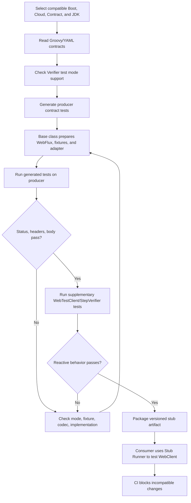

# Integrating WebTestClient According to Contract Verifier Capabilities

**Spring Cloud WebFlux** uses an asynchronous, non-blocking processing model with data types such as `Mono<T>` and `Flux<T>`. When a producer implements an API with WebFlux, the team still wants to protect the contract with consumers: requests must have the expected method, path, headers, and body; responses must have the committed status, headers, and JSON. The catch is that **the execution tool for generated tests must be compatible with the reactive platform**.

In the **SPRING_CLOUD_CONTRACT** learning path, Spring Cloud Contract Verifier reads **Groovy/YAML DSL** contracts, generates producer tests, and packages stubs for consumers to use with **Stub Runner**. **WebTestClient** is the HTTP test client in the Spring WebFlux ecosystem, supporting calling the application reactively. However, **you should not assume every Spring Cloud Contract version generates WebTestClient tests in the same way**. Support capabilities, test mode names, generated code, dependencies, and base class preparation must be checked against the **exact Contract Verifier version in use**.

This lesson belongs to the **Reactive Testing** chapter. Its goal is to understand how WebTestClient relates to generated producer tests, verify version-specific support, prepare a base test for WebFlux, design contracts for `Mono`/`Flux`, and distinguish HTTP contract testing from testing reactive properties such as streaming, timeouts, cancellation, or backpressure.

## 1. A Reactive Producer Must Still Conform to the HTTP Interface

Suppose the **Pricing Service** producer written in Spring WebFlux provides an API for the **Checkout** consumer:

```http
GET /api/prices/SKU-42
Accept: application/json

HTTP/1.1 200 OK
Content-Type: application/json

{
  "sku": "SKU-42",
  "currency": "VND",
  "amount": 125000
}
```

The controller can return `Mono<PriceResponse>` instead of a direct DTO:

```java
import org.springframework.http.HttpStatus;
import org.springframework.http.MediaType;
import org.springframework.web.bind.annotation.GetMapping;
import org.springframework.web.bind.annotation.PathVariable;
import org.springframework.web.bind.annotation.RestController;
import org.springframework.web.server.ResponseStatusException;
import reactor.core.publisher.Mono;

@RestController
class PricingController {

    private final PricingService pricingService;

    PricingController(PricingService pricingService) {
        this.pricingService = pricingService;
    }

    @GetMapping(
        value = "/api/prices/{sku}",
        produces = MediaType.APPLICATION_JSON_VALUE
    )
    Mono<PriceResponse> getPrice(@PathVariable String sku) {
        return pricingService.findBySku(sku)
            .switchIfEmpty(Mono.error(
                new ResponseStatusException(HttpStatus.NOT_FOUND)
            ));
    }
}
```

`PricingService`, `PriceResponse`, and test fixtures are **project-defined** components; the example shows the reactive structure, not a complete application.

For an HTTP consumer, whether the producer uses `Mono` or a direct DTO is usually **invisible on the wire**. The consumer observes status `200`, content type, JSON, and latency. Therefore, the same HTTP contract can protect both MVC and WebFlux implementations, provided producer verification runs in an appropriate way.

### 1.1. Distinguishing Three Verification Layers

| Layer | What to verify | Suitable tool |
|---|---|---|
| **HTTP contract** | `GET`, URL, headers, `200/404`, schema, and body matchers | Spring Cloud Contract DSL + generated producer tests |
| **WebFlux integration** | Routing, filters, codecs, exception handlers, implementation HTTP response | WebTestClient with application context or server |
| **Reactive behavior** | Stream completion, event count, publisher errors, cancellation, timeout, backpressure | Reactor Test/`StepVerifier` and appropriate integration tests |

Do not claim that WebTestClient alone verifies backpressure or non-blocking event-loop execution. WebTestClient verifies **HTTP behavior**; deeper reactive properties require additional techniques.

## 2. How Does WebTestClient Differ from MockMvc and RestAssured?

| Tool | Characteristics | When to use |
|---|---|---|
| **WebTestClient** | HTTP test client using reactive WebClient infrastructure; can bind to a controller/context or a live server | Testing Spring WebFlux and HTTP services |
| **MockMvc** | Test infrastructure for the Spring MVC servlet stack | MVC producers; not suitable by default for WebFlux-only applications |
| **RestAssured** | HTTP test client, typically calling a server over a real port | MVC/WebFlux producers when the test mode sends real HTTP |
| **RestAssuredMockMvc** | Adapter for Spring MVC MockMvc | Does not naturally replace WebTestClient when the producer uses only the reactive stack |
| **StepVerifier** | Verifies signals from a `Publisher`: `onNext`, `onComplete`, `onError`, virtual time | Unit/integration tests for `Mono`/`Flux` |

You must distinguish **WebTestClient used by a hand-written JUnit test** from **WebTestClient used by code generated by Spring Cloud Contract Verifier**. A hand-written test can work even if the Contract Verifier plugin version you use does not have a corresponding generation mode.

### 2.1. Ways WebTestClient Connects to an Application

WebTestClient can be created with different strategies:

1. **Bind to controller:** initializes only specific controllers, convenient for slice/unit tests, but may bypass some filters and application-wide configuration.
2. **Bind to application context:** uses the WebFlux handler infrastructure from the Spring context without opening a TCP port.
3. **Bind to live server:** calls a real HTTP server, such as a Spring Boot test running on a random port.

These approaches test different integration levels. When generating producer contract tests, pick the mode that **matches the behavior you need to protect** and the plugin's code-generation capabilities, not just the fastest option.

## 3. Checking Contract Verifier's WebTestClient Support by Version

The right question is not "Does Spring Cloud Contract support reactive?", but rather:

> **Does the Spring Cloud Contract Verifier version pinned in the producer support generating tests with WebTestClient for the contract types and test mode we use?**

Some release lines provide a **`WEBTESTCLIENT` test mode**. However, you should not copy a configuration from another version and assume every plugin accepts the same values or generates the same code.

Checklist to confirm:

1. **Spring Boot version** and reactive stack: is the application running Spring WebFlux or MVC? If both starters are present, inspect the actual web application type.
2. **Spring Cloud release train** compatible with Boot.
3. **Spring Cloud Contract Verifier/plugin version** and dependency management via BOM/plugin management.
4. **JDK and Maven/Gradle Wrapper** used for building; generated tests must compile with that toolchain.
5. **Test modes supported by that version's documentation:** whether `WEBTESTCLIENT` exists, how it is configured exactly, and what base class/fields the generated code requires.
6. **JUnit version and test dependencies:** `spring-boot-starter-test`, `spring-test`, `reactor-test`, or dependencies required by the plugin.
7. **Try a small contract:** generate tests, read the generated source, run tests on the WebFlux producer, and inspect stub mappings.

If no WebTestClient mode is found or the build reports an invalid test mode name, that is a **support/configuration issue**, not a reason to alter the HTTP contract away from business needs.

### 3.1. Decision Table

| Actual situation | Recommended action |
|---|---|
| Plugin/version **has** WebTestClient generation | Configure the supported test mode; align the base class with generated code |
| Plugin lacks WebTestClient mode but supports **real HTTP** | Run producer contract tests through an appropriate HTTP server test mode (often called `EXPLICIT` in supporting versions), and add separate WebTestClient integration tests |
| Only `MOCKMVC` setup exists while producer is WebFlux | Do not assume MockMvc will run on the reactive stack; switch to a supported mode |
| Hand-written WebTestClient tests pass while generated tests fail | Inspect plugin/test mode/base class; do not treat hand-written tests as proof that generated contract tests pass |
| Plugin lacks required capability | Consider upgrading according to the Boot–Cloud–Contract compatibility matrix or using another verified producer verification path |

The key point is **proving with actual generated tests**. A "BUILD SUCCESSFUL" message with zero generated tests has not verified the contract.

## 4. Groovy DSL Contract for a WebFlux API

Suppose Pricing Service has fixture `SKU-42` and returns a fixed price. An HTTP contract for Checkout:

```groovy
import org.springframework.cloud.contract.spec.Contract

Contract.make {
    name 'checkout_get_price_found_200'
    description 'Checkout fetches price of an existing SKU from Pricing Service'

    request {
        method GET()
        url '/api/prices/SKU-42'
        headers {
            header 'Accept', 'application/json'
        }
    }

    response {
        status OK()
        headers {
            contentType(applicationJson())
        }
        body(
            sku: 'SKU-42',
            currency: 'VND',
            amount: 125000
        )
    }
}
```

There is no `Mono` or `Flux` in the DSL because **this contract describes the observable HTTP request/response**, not the controller's Java signature. The plugin generates tests from the HTTP contract, and the test adapter sends requests to the implementation.

### 4.1. YAML DSL for Missing SKU Case

```yaml
name: checkout_get_price_missing_404
description: Pricing Service returns 404 when the SKU does not exist
request:
  method: GET
  url: /api/prices/SKU-MISSING
  headers:
    Accept: application/json
response:
  status: 404
  headers:
    Content-Type: application/json
  body:
    code: PRICE_NOT_FOUND
```

This example assumes the producer has an exception handler that produces a JSON body with `code=PRICE_NOT_FOUND`. If the controller throws `ResponseStatusException` but the application is not configured to return JSON like that, the generated test may fail; in that case check the **agreed contract** and actual response, rather than assuming the framework exception always returns the example body.

**The fixture must guarantee** `SKU-42` exists with `amount=125000` and `SKU-MISSING` does not exist. Do not rely on leftover data in a database from a previous run.

### 4.2. Can Both Groovy and YAML Coexist in the Same Directory?

Yes, when the plugin supports both formats. The two contracts above describe **two different scenarios** (`200` for an existing SKU and `404` for a missing SKU). Do not rewrite the exact same `200` scenario in both formats, as that can produce duplicate generated tests or stub mappings.

## 5. Hand-Written WebTestClient Test: A Reference Baseline for Checking the Producer

Before integrating generated tests, verify the WebFlux application with a standard **WebTestClient integration test**. This helps separate HTTP/repository-layer errors from errors caused by the Contract Verifier plugin.

Spring Boot WebFlux example using JUnit Jupiter:

```java
import org.junit.jupiter.api.Test;
import org.springframework.beans.factory.annotation.Autowired;
import org.springframework.boot.test.context.SpringBootTest;
import org.springframework.boot.test.autoconfigure.web.reactive.AutoConfigureWebTestClient;
import org.springframework.http.MediaType;
import org.springframework.test.web.reactive.server.WebTestClient;

@SpringBootTest(
    webEnvironment = SpringBootTest.WebEnvironment.RANDOM_PORT
)
@AutoConfigureWebTestClient
class PricingWebTestClientTest {

    @Autowired
    WebTestClient webTestClient;

    @Test
    void readsKnownPrice() {
        webTestClient.get()
            .uri("/api/prices/SKU-42")
            .accept(MediaType.APPLICATION_JSON)
            .exchange()
            .expectStatus().isOk()
            .expectHeader()
                .contentTypeCompatibleWith(MediaType.APPLICATION_JSON)
            .expectBody()
            .jsonPath("$.sku").isEqualTo("SKU-42")
            .jsonPath("$.currency").isEqualTo("VND")
            .jsonPath("$.amount").isEqualTo(125000);
    }
}
```

This example assumes:

- The application has `PricingController`, fixture `SKU-42`, Spring WebFlux, and Spring Boot Test.
- `@AutoConfigureWebTestClient` and package imports match your **Spring Boot version**; APIs/packages may change across major upgrades.
- The test context actually runs a reactive application on a **random port** or has matching WebTestClient configuration.
- `exchange()` sends the request; `expectStatus/expectHeader/expectBody` verify the HTTP response.
- This is a **hand-written test**, not yet a generated producer test.

### 5.1. Why Use a Random Port?

`RANDOM_PORT` avoids port conflicts when multiple CI jobs run concurrently on the same machine. When WebTestClient is configured by Spring Boot test infrastructure against the running server, you do not need to hard-code `localhost:8080`.

Do not hard-code a port in the base class while the plugin runs WebTestClient bound to context. The two modes initialize differently; check the generated code and corresponding documentation.

### 5.2. WebTestClient Can Verify `404`

```java
@Test
void returnsNotFoundForMissingSku() {
    webTestClient.get()
        .uri("/api/prices/SKU-MISSING")
        .accept(MediaType.APPLICATION_JSON)
        .exchange()
        .expectStatus().isNotFound()
        .expectBody()
        .jsonPath("$.code").isEqualTo("PRICE_NOT_FOUND");
}
```

This snippet lives inside a test class with an injected `WebTestClient` and only passes when the producer actually returns error JSON with the `code` field. It helps confirm `404` behavior before investigating issues arising from generated Contract Verifier tests.

## 6. Base Test Class for a WebFlux Producer

Spring Cloud Contract generated tests typically require a **base class** to hold test annotations, HTTP adapter configuration, fixtures, and shared hooks. For WebFlux, the base class should not mechanically copy Spring MVC's `RestAssuredMockMvc` setup.

Baseline template using WebTestClient in Spring Boot:

```java
import org.junit.jupiter.api.BeforeEach;
import org.springframework.beans.factory.annotation.Autowired;
import org.springframework.boot.test.context.SpringBootTest;
import org.springframework.boot.test.autoconfigure.web.reactive.AutoConfigureWebTestClient;
import org.springframework.test.web.reactive.server.WebTestClient;

@SpringBootTest(
    webEnvironment = SpringBootTest.WebEnvironment.RANDOM_PORT
)
@AutoConfigureWebTestClient
public abstract class ReactiveContractTestBase {

    @Autowired
    protected WebTestClient webTestClient;

    @Autowired
    private PriceContractFixtures fixtures;

    @BeforeEach
    protected void prepareContractState() {
        fixtures.resetPriceCatalog();
        fixtures.insertPrice("SKU-42", "VND", 125000);
        fixtures.ensureSkuAbsent("SKU-MISSING");
    }
}
```

**This is an architectural base-class pattern**, not a guarantee that every generated test in every version will use the exact field name `webTestClient` or the same initialization style. When your project's Contract Verifier version generates WebTestClient tests:

1. Check whether the generated test uses an **injected** `WebTestClient`, calls a base-class method, or creates its own client.
2. Confirm the field/method names and visibility expected by the generated test.
3. Adjust the base class **to match the contract of that version's generated code**, without manually editing generated code.
4. If the generated code requires bind-to-context instead of running a real server, choose a matching setup style.
5. If the plugin does not support generating WebTestClient tests, use another supported mode so producer verification still runs, while keeping separate WebTestClient integration tests.

`PriceContractFixtures` is a **project-implemented** helper. The base class does not automatically create data just because the DSL mentions `SKU-42`.

### 6.1. Binding to Application Context Instead of a Live Server

In some WebFlux test configurations, you can use:

```java
import org.springframework.context.ApplicationContext;
import org.springframework.test.web.reactive.server.WebTestClient;

WebTestClient client =
    WebTestClient.bindToApplicationContext(applicationContext)
        .configureClient()
        .build();
```

`applicationContext` is an `ApplicationContext` injected from the Spring test context. This form does not necessarily open an HTTP socket, yet still uses the WebFlux handler infrastructure in the context. If you need to test the HTTP server/network layer, use a live server test instead.

**Do not assume** generated tests automatically recognize this `client` variable. Integrate it into the base class only when your Contract Verifier version actually generates code calling that field/method or provides a documented hook.

### 6.2. Do Not Block the Event Loop in Fixtures

In reactive tests, preparing data via JDBC/JPA or synchronous helpers can be reasonable **on the test thread's lifecycle** if done in isolation. However, **do not call `block()` inside the reactive event loop** or inside controllers/services running on a non-blocking scheduler without deliberate design.

If the fixture uses R2DBC/reactive repositories, you may need to wait for seeding to **complete before generated requests run**. For example, a setup helper can coordinate publishers and wait on the **test setup thread**, with clear blocking boundaries. If setup finishes asynchronously without awaiting, generated tests might hit the API before records are created, causing intermittent `404` failures.

## 7. Configuring Contract Verifier: Only Enable WEBTESTCLIENT When Your Version Supports It

In Spring Cloud Contract versions that include the `WEBTESTCLIENT` test mode, the build plugin may let you select this mode to generate WebTestClient-based tests. **This is a version-dependent configuration**, not a directive applicable to every release.

### 7.1. Maven Plugin — Conditional Example

```xml
<!-- Illustrative snippet; verify against your Contract Verifier version. -->
<plugin>
    <groupId>org.springframework.cloud</groupId>
    <artifactId>spring-cloud-contract-maven-plugin</artifactId>
    <version>COMPATIBLE_VERSION</version>
    <extensions>true</extensions>
    <configuration>
        <testMode>WEBTESTCLIENT</testMode>
        <baseClassForTests>
            com.example.pricing.contract.ReactiveContractTestBase
        </baseClassForTests>
    </configuration>
</plugin>
```

Only use `<testMode>WEBTESTCLIENT</testMode>` if **that Maven plugin version actually accepts this value**. `COMPATIBLE_VERSION` is a placeholder; do not leave it as-is when running a build. Your project may manage versions via a Maven property or plugin management; check the effective POM to confirm.

Example commands on a configured project:

```bash
./mvnw -version
./mvnw clean test
```

On Windows PowerShell:

```powershell
.\mvnw.cmd -version
.\mvnw.cmd clean test
```

If the build reports an invalid test mode, do not manually patch generated code. Check the plugin/version, valid enum/configuration values in the documentation, and supported fallback modes.

### 7.2. Gradle Plugin — Conditional Example

Groovy DSL example in `build.gradle`:

```groovy
// Use only if supported by this Spring Cloud Contract Gradle plugin version.
contracts {
    testMode = 'WEBTESTCLIENT'
    baseClassForTests =
        'com.example.pricing.contract.ReactiveContractTestBase'
}
```

This is a **directional snippet**, not a complete `build.gradle` file. When using `build.gradle.kts`, Gradle Kotlin DSL syntax may differ. Without plugins/dependencies, source directories, or compatible versions, the snippet above is not runnable on its own.

```bash
./gradlew --version
./gradlew clean test
```

When the build plugin provides a `generateContractTests` task or equivalent, verify that the task runs and generated tests are actually wired into the test task.

### 7.3. How to Verify After Enabling the Mode

After running generation:

1. Locate the generated tests for `checkout_get_price_found_200` and `checkout_get_price_missing_404`.
2. Verify the test class extends `ReactiveContractTestBase` or uses the setup configured by the plugin.
3. Inspect the generated code to confirm it **actually uses WebTestClient** if the build selects that mode.
4. Check whether the client binds to the application context, a live server, or another mechanism.
5. Verify all method/status/header/body assertions and matchers were generated completely.
6. Run the generated tests and confirm fixtures are ready before HTTP requests are sent.
7. Check the report: test count matches expected contracts, with nothing skipped.
8. Inspect stub mappings after generation before publishing.

**Key criterion:** a test mode name in configuration does not replace evidence of **generated code and actual test execution**.

## 8. When Your Version Lacks WebTestClient Generation

A WebFlux project can still verify HTTP contracts through a **real server**, if Contract Verifier provides a compatible HTTP client test mode for that version. In versions supporting `EXPLICIT`, generated tests can call the application over real HTTP, for instance using RestAssured and a test server port.

This is a sound fallback path:

```text
Groovy/YAML contracts
       |
       v
Contract Verifier generates HTTP producer tests
       |
       v
Test mode calls real WebFlux server
       |
       v
Producer verification (status/header/JSON)
       |
       +--> Additional WebTestClient integration tests
       |
       v
Package verified stubs
```

What to avoid is **replacing producer verification with a few hand-written WebTestClient tests that do not correspond to the DSL and still claiming generated contract tests passed**.

### 8.1. Conditions for Choosing the HTTP Server Fallback

- The plugin/version has a suitable mode; check official documentation.
- Spring Boot WebFlux runs on a deterministic test port (`RANDOM_PORT` is preferred in parallel CI).
- The generated client knows the server's base URI and port, matching the actual generated code.
- Producer fixtures are seeded before requests run.
- Tests execute and the report records the contract scenarios.
- Consumers continue using the stub artifact generated from contracts as usual.

When a complex reactive feature cannot be expressed accurately in the DSL, keep the **existing HTTP contract** for committed interactions and add **WebTestClient/StepVerifier tests** for missing semantics; state the limits clearly instead of assuming Verifier covers everything.

## 9. Mono and Flux: What Does the Contract Protect?

### 9.1. `Mono<T>` — One Result or No Result

For an API returning `Mono<PriceResponse>`:

- If the SKU exists, the publisher emits one value and completes → HTTP usually returns `200` and JSON.
- If the SKU does not exist, the publisher may complete empty; the controller must map this case to the policy-defined HTTP response, e.g., `404`.
- If the publisher emits an error, the exception handler determines the HTTP status/body.

**`Mono.empty()` by itself does not equate to a specific HTTP status.** How the controller, framework, or exception handler processes it determines the observable response.

Contracts should focus on the **final status and payload**. Do not describe a `Mono` in the DSL thinking it automatically guarantees a `404` status.

### 9.2. `Flux<T>` — Multiple Elements

For an endpoint returning a price list as a JSON array:

```json
[
  {"sku":"SKU-42","amount":125000},
  {"sku":"SKU-43","amount":140000}
]
```

If the API commits to a **finite JSON array** response, the contract can describe the status, content type, key fields, and element matchers. With a producer returning `Flux<PriceResponse>`, Spring WebFlux can serialize items into a complete array depending on content negotiation and media type.

However, with **SSE** or **NDJSON streaming**, the response does not resemble a finite JSON array. A standard HTTP contract with a sample JSON body **does not fully verify** event stream ordering, emission timing, backpressure requests, or cancellation.

| Reactive API | Reasonable contract testing | Additional tests to include |
|---|---|---|
| `Mono<DTO>` returning JSON | Status, headers, body, JSON matchers | Reactive logic / error mapping |
| `Flux<DTO>` returning a finite JSON array | Status, array schema, count/order if committed | Sequence and completion when needed |
| `Flux<ServerSentEvent<?>>` | SSE media type, interactions expressible in DSL capabilities | WebTestClient streaming + StepVerifier |
| `Flux<DTO>` NDJSON | Content type and per-item schema if supported by tooling | Stream decoding, item count, framing, timeout |
| Never-completing publisher | Observable HTTP parts | Cancellation, lifetime, bounded receive, resource cleanup |

**Do not force generated contract tests to wait forever to match an entire streaming body.** For long-lived or unbounded streams, verify a **bounded number of events** and use appropriate timeouts/cancellation in specialized tests.

## 10. StepVerifier: Verifying Reactive Signals Not Covered by HTTP Contracts

`StepVerifier`, from `reactor-test`, is typically used to assert publisher signals rather than only comparing HTTP JSON responses.

Unit test example for a service emitting two events:

```java
import java.time.Duration;
import org.junit.jupiter.api.Test;
import reactor.core.publisher.Flux;
import reactor.test.StepVerifier;

import static org.junit.jupiter.api.Assertions.assertEquals;

class PricingEventServiceTest {

    @Test
    void emitsTwoPriceEventsAndCompletes() {
        Flux<PriceEvent> events = pricingEventService
            .watchTestPrices("SKU-42");

        StepVerifier.create(events.take(2))
            .assertNext(e -> assertEquals("SKU-42", e.sku()))
            .assertNext(e -> assertEquals("SKU-42", e.sku()))
            .verifyComplete();
    }
}
```

This is a **logical pattern**, not a standalone runnable class: `pricingEventService` and `PriceEvent` are project-defined components that must be initialized/injected; fixtures must emit at least two events. Add a timeout when the source may wait long for data, such as using StepVerifier's bounded verification overloads/mechanisms.

### 10.1. Virtual Time Does Not Automatically Apply to HTTP Networks

`StepVerifier.withVirtualTime(...)` is useful when the producer uses controllable schedulers and the publisher is **created after activating the virtual scheduler** according to Reactor Test rules. However, it does not automatically make real sockets, databases, HTTP clients, or brokers run on a virtual clock.

If you need to test delays/retries/backoff:

- Unit test reactive operators with virtual time where appropriate.
- Run HTTP integration tests with timeouts and controllable test data.
- Keep contract tests focused on the **HTTP outcomes consumers need**, without forcing the DSL to verify all scheduler internals.

## 11. WebTestClient and Streaming Endpoints

Suppose Pricing Service exposes a price stream:

```http
GET /api/prices/updates
Accept: text/event-stream
```

A WebTestClient test can request the media type and receive the response body as a publisher to verify the first events and then cancel the subscription. **Directional** example; adjust the decoder and event type to match the media type:

```java
var result = webTestClient.get()
    .uri("/api/prices/updates")
    .accept(MediaType.TEXT_EVENT_STREAM)
    .exchange()
    .expectStatus().isOk()
    .returnResult(String.class);

StepVerifier.create(result.getResponseBody().take(2))
    .expectNextCount(2)
    .verifyComplete();
```

This snippet assumes the client has a configured decoder converting the event stream into `String`, the server emits at least two items, and `reactor-test` is on the test classpath. For structured SSE, you can use `ServerSentEvent<T>` and an appropriate `ParameterizedTypeReference` to inspect `id`, `event`, and `data`.

**Timeouts and cleanup are required** to prevent hanging tests if the stream emits no events. `take(2)` cancels upstream after two items, but tests must have an execution time limit strategy. If the API guarantees no duplicates or ordering, add assertions on event/correlation keys, not just `expectNextCount`.

A generated contract test produced from a standard JSON body may **not perform** these signal/cancellation checks. Thus, testing reactive streaming usually requires a **supplementary test suite**, rather than cramming all requirements into a sample HTTP JSON stub.

## 12. Request and Response Matchers in Reactive Producers

Spring Cloud Contract DSL can verify:

- HTTP method/path/query/headers.
- Request JSON body and matchers.
- Response status and headers.
- JSON response body with fixed values, data types, regexes, or version-supported matchers.
- Certain messaging behaviors with triggers and payloads.

This remains valid in intent when the producer uses WebFlux. However, generated assertions must be inspected because different modes may use different tools or decoders.

### 12.1. Dynamic Data Needs Matchers and Fixtures

Suppose a response contains:

```json
{
  "sku": "SKU-42",
  "requestId": "req-9aa1",
  "generatedAt": "2026-01-15T09:30:00Z"
}
```

If `requestId` is freshly generated on each call, do not hard-code the full ID unless tests use a controllable ID generator. A contract can declare an appropriate matcher, while the base class injects `Clock.fixed(...)` to keep timestamps deterministic when needed.

Remember to distinguish **the stub value returned to consumers** from **the condition used to verify real responses from the producer**. An overly broad matcher can let producer tests stay green even when returning the wrong type or state, defeating detection of incompatible API changes.

### 12.2. Reactive Error Mapping

A `Mono.error(...)` flow can produce `404`, `400`, `409`, or `500` depending on the exception handler. The contract must describe the **status and error schema** the consumer actually relies on.

If the API is secured with Spring Security WebFlux, test `401` and `403` as well in scenarios consumers depend on. A simple WebTestClient bind-to-controller setup may **not load the full WebFilter security chain**; do not treat a green test as proof that real authentication/authorization was verified.

## 13. Base Tests and Async State: Avoiding Flaky Errors

Reactive code readily exposes asynchronous setup bugs:

| Symptom | Suspected cause | Fix |
|---|---|---|
| `200` occasionally becomes `404` | Reactive fixture `save(...)` did not finish before the request | Await seeding completion on the test setup thread |
| `404` intermittently passes and fails | Another test created the SKU expected to be absent | Isolate DB/namespace |
| Response timestamp differs | `Instant.now()` or timezone changed | Controlled `Clock` or suitable matcher |
| Stream test hangs | Publisher does not emit items or never completes | Bounded receive, timeout, cancellation |
| List order changes | Data source does not guarantee sorting | Define ordering if the consumer requires it |
| Tests only fail in parallel runs | Shared data/cache/port/broker | Isolate resources |
| Unexpected `401` | Expired test token or missing WebFilter config | Inspect test identity/security chain |
| Generated test does not compile | Wrong mode/plugin/API/base class | Read generated code and check version compatibility |
| Stub returns different result than WebFlux server | Wrong artifact/version or matcher | Compare generated mapping against real response |

### 13.1. Why Can `block()` Be Both Helpful and Dangerous?

In **tests** (on a JUnit-controlled thread), waiting for a `Mono<Void>` fixture seed to finish can make state deterministic. However, in **reactive request processing** (event loop), calling `block()` can cause errors, thread starvation, or negate non-blocking benefits.

Distinguish the boundary:

- **Test setup:** controlled waiting is acceptable if test infrastructure and schedulers permit it.
- **Reactive controller/service:** prefer composition with `flatMap`/`then`, avoiding unintended blocking.
- **Generated contract tests:** do not manually edit generated code to insert `block()` arbitrarily; adjust base fixtures or test mode if needed.

## 14. Stub Runner on the Consumer Side of a Reactive Application

The Checkout consumer may also be written in WebFlux using `WebClient`. Stub Runner serves an HTTP stub server from contract mappings so Checkout can call it over the network without starting the real producer.

Consumer test configuration example:

```java
import org.springframework.boot.test.context.SpringBootTest;
import org.springframework.cloud.contract.stubrunner.spring.AutoConfigureStubRunner;
import org.springframework.cloud.contract.stubrunner.spring.StubRunnerProperties;

@SpringBootTest
@AutoConfigureStubRunner(
    ids = "com.example:pricing-service:1.2.0:stubs:8085",
    stubsMode = StubRunnerProperties.StubsMode.LOCAL
)
class CheckoutPricingClientTest {
    // Configure Checkout's WebClient to point to Stub Runner.
    // Add @Test methods to call the real client and assert responses.
}
```

This is only a **configuration snippet**, assuming the stub artifact is available in the local Maven repository and port 8085 is free. The project needs the matching Stub Runner dependency, Spring test context, actual base URL configuration, and `@Test` methods.

A consumer test can use Reactor Test with the real WebClient-based client:

```java
Mono<PriceResponse> result = checkoutPricingClient.getPrice("SKU-42");

StepVerifier.create(result)
    .assertNext(price -> {
        assertEquals("SKU-42", price.sku());
        assertEquals(125000, price.amount());
    })
    .verifyComplete();
```

`checkoutPricingClient` must be injected/initialized and pointed at the stub server; `PriceResponse` and its getters/record accessors must match the project. Do not just use an arbitrary HTTP client calling the stub directly if the goal is to test the real **WebClient adapter** Checkout uses.

**Role distinction:** a green consumer test with Stub Runner proves the client handles the **simulation** from the contract; only **generated producer contract tests against the WebFlux implementation** prove the producer meets its commitment.

## 15. CI for WebFlux Producers and Consumers

A suitable pipeline:



Mandatory conditions to enforce:

1. **Right toolchain versions**: compatible Java, Spring Boot/Cloud/Contract, Gradle/Maven, and verifier plugin.
2. **Generated tests exist and execute**: not a green build simply because no DSL files were found.
3. **Verified test mode**: `WEBTESTCLIENT` if supported, or a compatible HTTP mode; logs/reports show the chosen mode.
4. **Correct base class adapter**: do not use MVC's MockMvc in a WebFlux-only producer.
5. **Fixtures finish before requests**: especially when seeding via reactive repositories.
6. **Bounded timeouts** for streaming/retry tests; never wait indefinitely.
7. **Security tested at the right layer**: WebFilter/security setup as required.
8. **Clearly versioned stub artifact**, published only after producer verification.
9. **Consumer uses its real client** against Stub Runner, not raw ad-hoc calls to the stub.
10. **Traceable reports**: contract name, generated test, status/body mismatch, dependencies, and artifact version.

When deploying the same module to another CI runner, if tests flake between green and red, check data races, schedulers/timeouts, ports, databases, brokers, timezones, and networking before concluding a contract is wrong.

## 16. Troubleshooting WebTestClient/Contract Verifier Issues

| Symptom | What to check |
|---|---|
| Plugin reports `WEBTESTCLIENT` is invalid | Does this plugin version support this test mode? |
| Generated tests still call RestAssured | Was the mode applied in the plugin's effective config? |
| `NoSuchBeanDefinitionException: WebTestClient` | Spring Boot test config/reactive web context and dependencies |
| Base class has the field but generated tests don't see it | FQN, visibility, and field/hook names used by this generator version |
| `404` even though fixture was seeded | Reactive seed incomplete, wrong SKU, or repository pointing to another DB |
| `200` with different JSON | Codec/serialization and DTOs, overly strict matcher, or API changed |
| Unexpected `401/403` | Security WebFilter, identity fixture, test request headers |
| SSE test hangs | Events not emitted, missing timeout, or publisher never completes |
| `Flux` order changes | Stream does not guarantee order, or `flatMap` concurrency |
| Passes individually, fails in suite | Shared resources/fixtures/caches/stub scenarios |
| Consumer gets `404` from Stub Runner | Request does not match any mapping; do not mistake for a business `404` |
| Consumer test green while producer test fails | Stub simulates independently; implementation does not yet satisfy contract |
| Green build with zero generated tests | Wrong source directory/plugin/task lifecycle or tests skipped |

### 16.1. Investigation Workflow

1. Record the exact plugin version and test mode.
2. Verify the plugin read the intended Groovy/YAML files.
3. Inspect generated source: what class does it extend, which client does it use, which URI does it call?
4. Check the test context: WebFlux or MVC, live port or bind-to-context?
5. Confirm fixtures completed before requests.
6. Run a hand-written WebTestClient test against the same endpoint to isolate runtime errors.
7. Compare responses and matchers; check exception handlers/codecs.
8. Re-run generated producer tests; inspect stub mappings before publishing.
9. Run consumer tests with Stub Runner using the exact artifact/version.

**Do not directly edit generated tests** just to work around version errors. They will be regenerated; fix the plugin config/base class or upgrade versions in a controlled way.

## 17. Lab: Pricing Service with WebFlux

This exercise includes a `pricing-service` producer written in Spring WebFlux, a `checkout-service` consumer using WebClient, and a Spring Cloud Contract version chosen by the project.

### Part A — Environment Preparation

1. Confirm JDK, Spring Boot, Spring Cloud release train, Spring Cloud Contract Verifier, and Maven/Gradle Wrapper.
2. Check the documentation for **your exact Verifier version** to see whether the `WEBTESTCLIENT` test mode exists.
3. Prepare fixture `SKU-42` with `currency=VND`, `amount=125000`; `SKU-MISSING` does not exist.
4. Start with a hand-written WebTestClient test; verify `200` and `404` against the agreed schema.

### Part B — Writing Contracts and Base Class

1. Write Groovy contract `checkout_get_price_found_200`.
2. Write YAML contract `checkout_get_price_missing_404`.
3. Create `ReactiveContractTestBase` with the Spring WebFlux context and fixture helper.
4. If Verifier supports WebTestClient generation, enable the right test mode and ensure the base class provides the client/setup expected by generated code.
5. If not supported, use a valid HTTP producer verification mode and keep supplementary WebTestClient tests.

### Part C — Producer Verification

1. Generate producer contract tests; **open the generated source** to inspect the HTTP adapter and base class.
2. Run each generated test individually, then the entire suite.
3. Try deleting fixture `SKU-42`: the `200` test must fail because the contract is no longer satisfied.
4. Try changing `amount` from an integer to a string: JSON verification must catch the type change if the contract protects it.
5. Check logs to confirm no tests were skipped.

### Part D — Supplementary Reactive Checks

1. If `Flux` is used, write a `StepVerifier` test for completion/error signals and committed data.
2. If SSE/NDJSON is used, use WebTestClient to consume a bounded number of items with a timeout configured.
3. Verify tests do not arbitrarily block the event loop.
4. If the API has security, verify WebFilters and authentication/authorization with the real configuration.

### Part E — Stubs and CI

1. Package stubs only after producer verification passes.
2. Configure Checkout to use Stub Runner with a pinned artifact/version.
3. Point Checkout's real WebClient to the stub URL.
4. Use `StepVerifier` or appropriate assertions to check data received by the client.
5. Put generated producer tests, supplementary WebTestClient/StepVerifier tests, stub packaging, and consumer tests into CI.

**Completion criteria:** the project has evidence that the plugin generated and ran producer tests on the WebFlux implementation using a genuinely supported test mode; required reactive behaviors are tested separately; Stub Runner serves the exact contract to the WebClient consumer; CI catches incompatible API changes.

## 18. Self-Check Questions

1. **Must a WebFlux producer put `Mono`/`Flux` in the contract DSL?** No. HTTP contracts generally describe observable requests/responses.
2. **Does having a hand-written WebTestClient test prove Verifier can generate WebTestClient tests?** Not yet. You must verify the test mode and generated source.
3. **When should `WEBTESTCLIENT` be used?** Only when the Spring Cloud Contract Verifier/plugin version in use supports it and it is configured properly.
4. **If Verifier does not generate WebTestClient tests, how can a WebFlux producer be verified?** Run producer verification via a plugin-supported HTTP server mode, complemented by WebTestClient integration tests.
5. **Does MockMvc automatically work for a WebFlux-only application?** Do not assume so; MockMvc is built for the MVC servlet stack.
6. **How do WebTestClient bind-to-context and live-server differ?** One uses handler infrastructure inside the context; the other sends HTTP over a real server/port.
7. **Why does `Mono.empty()` not automatically guarantee `404`?** HTTP status depends on the controller/exception handling, not merely an empty Publisher.
8. **Does a finite JSON array contract test backpressure on a `Flux`?** No. Reactive tests like StepVerifier are needed when that matters.
9. **Why might a generated test return `404` even when controller code is correct?** Fixtures may not be seeded or reactive setup may not have completed yet.
10. **Why not wait for an entire SSE stream to complete in a test?** Streams may never complete; use bounded receives, timeouts, and cancellation.
11. **Does a green Stub Runner test prove the producer implementation responds correctly?** No. You need generated producer contract tests against the real implementation.
12. **Can a base class assume a field named `webTestClient` across all versions?** No. Inspect the generated code and configuration for your specific version.
13. **When is StepVerifier needed?** When verifying publisher signals, completion/errors, streams, and reactive properties beyond the HTTP body contract.
14. **If the plugin generates tests without executing them, has CI verified the contract?** No. You must check test reports and build lifecycle execution.
15. **What is required before a published stub is considered verified?** Producer generated contract tests pass with proper fixtures, a valid test mode, and a traceable artifact.

## Conclusion

**WebTestClient is the right tool for verifying the HTTP behavior of Spring WebFlux applications**, but whether **Spring Cloud Contract Verifier can generate WebTestClient producer tests** must be verified against the **actual plugin version and test mode**, not guessed from the project being reactive. Keep Groovy/YAML contracts focused on **request–response commitments**, configure the base class and fixtures for the reactive stack, inspect generated tests, and supplement with **WebTestClient/StepVerifier** for streaming or signal behaviors not fully captured by the DSL. When producer verification genuinely runs and stubs are published with clear versions, consumers using **Stub Runner** can reliably detect incompatible API changes in CI.
