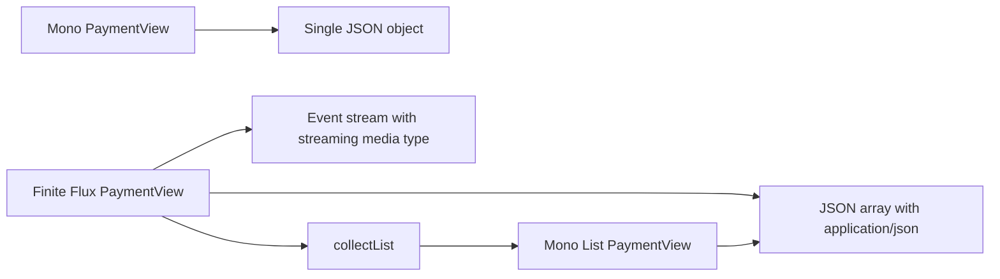
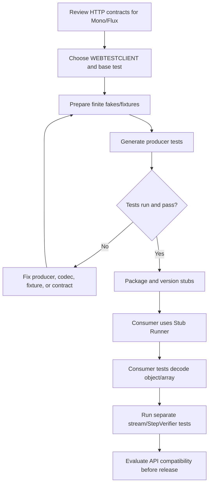

# Verifying Mono, Flux, and Aggregated Response Payloads

## 1. Why Do Reactive Responses Need a Distinct Testing Approach?

Suppose `checkout-service` (consumer) calls `payment-service` (producer) to look up a transaction and fetch the list of payments for an order. The producer is written with **Spring WebFlux**, so endpoints may return `Mono<PaymentView>` or `Flux<PaymentView>` instead of directly returning a Java object or a list.

**Spring Cloud Contract** lets you describe HTTP or messaging behavior using **Groovy/YAML DSL**, generate producer verification tests, publish stubs for consumers to use via **Stub Runner**, and run them in CI to detect incompatible API changes. In WebFlux, one challenge is identifying **what is actually committed**: the internal `Mono`/`Flux` types, or the HTTP status, headers, and **data the client actually observes**?

The answer is: **HTTP contracts verify observable behavior over the protocol**. A consumer in another language does not need to know whether the producer uses `Mono`, `Flux`, or a blocking implementation. The consumer needs to know whether the HTTP response is a JSON object, a JSON array, empty, or an SSE/NDJSON stream; it needs to know the status codes and payload rules.

Example of two endpoints:

```text
GET /api/payments/PAY-1001
    -> HTTP 200 + a single JSON object

GET /api/orders/ORD-2001/payments
    -> HTTP 200 + a JSON array of two payments
```

The first endpoint may return `Mono<PaymentView>`; the second may return `Flux<PaymentView>`. Yet if the HTTP response is `application/json` as an array, producer verification must verify the **complete JSON array**, rather than trying to force the client to receive each Reactor element as an independent object.

**Lesson objectives:** distinguish `Mono` from `Flux`, understand finite aggregated responses with JSON arrays/JSON envelopes, configure Spring Cloud Contract `WEBTESTCLIENT`, test with `WebTestClient` and `StepVerifier`, recognize limitations with infinite streams, and integrate producer tests and Stub Runner into CI.

## 2. Mono, Flux, and Reactive Signals

Project Reactor provides two common types:

| Type | Data signals | Business example |
| --- | --- | --- |
| `Mono<T>` | Emits **at most one** item, then completes or errors; may also complete without emitting any item. | Looking up a transaction, payment creation result, completion signal. |
| `Flux<T>` | Emits **0 to many** items, either finite or infinite, then completes or errors. | List of transactions, status changes over time, event feed. |
| `Mono<List<T>>` | Emits a single **List** already aggregated from multiple values. | JSON response containing a full list to compute `count`, `total`, or pagination. |
| `Mono<Void>` | Emits no data objects; completion usually represents finishing an operation. | Deleting/canceling a resource; HTTP status must be designed explicitly. |

`Mono.empty()` means a Publisher finishes **with no value**—it does not automatically mean returning HTTP `404` or JSON literal `null`. Similarly, `Flux.empty()` means zero elements; when encoding a JSON collection, the response may be `[]`. The final status and body still depend on the controller, codec, and chosen HTTP media type.

A simple mental model:



**Important:** `Flux<T>` does not always mean HTTP streaming. How WebFlux encodes it depends on **content negotiation** and `Content-Type`. Standard HTTP `application/json` is a single JSON document; `text/event-stream` and `application/x-ndjson` represent streams of items transmitted over time.

## 3. "Aggregated Response" Can Mean Three Different Things

The word *aggregation* is easy to confuse. In this lesson we distinguish:

1. **HTTP structural aggregation:** multiple `PaymentView` instances presented as **one complete JSON array**, e.g. `[{"paymentId":"PAY-1001"}, {"paymentId":"PAY-1002"}]`. This is what the HTTP contract observes.
2. **Reactor-layer aggregation:** the controller calls `flux.collectList()` to turn it into `Mono<List<PaymentView>>`, perhaps computing `count` or building a response envelope. This step holds all elements in memory, so it only suits finite, bounded sets.
3. **Test-client aggregation:** `WebTestClient.expectBodyList(PaymentView.class)` reads and decodes **the entire finite response** into a list for assertions. That is test behavior—it **does not prove** the controller called `collectList()`.

Therefore, never write: "every `Flux` is forced by WebFlux to `collectList()` into RAM before sending HTTP." Encoder versions can write values incrementally to the response while preserving the **shape of a complete JSON array**. What the contract must protect is **media type, payload data, ordering if committed, and completion conditions**, not internal buffering algorithms.

### Choosing the HTTP Shape by Business Need

| Application output | Media type | What the client sees | Primary verification approach |
| --- | --- | --- | --- |
| `Mono<PaymentView>` | `application/json` | One JSON object | Status, headers, JSON fields. |
| Finite `Flux<PaymentView>` | `application/json` | One JSON array | Status, element count, fields/dataset, order if API guarantees it. |
| `Mono<List<PaymentView>>` | `application/json` | One JSON array | Same as above; server layer aggregated the List. |
| `Mono<PaymentSummary>` | `application/json` | Object with `payments` and `count` | Object structure, consistency between `count` and the list. |
| `Flux<PaymentEvent>` | `text/event-stream` | Server-Sent Events over time | Receive events, cancel subscription, timeout; never wait for infinite body completion. |
| `Flux<PaymentEvent>` | `application/x-ndjson` | Newline-delimited JSON objects | Per-element inspection, framing, completion/cancellation rules. |

If a producer returns `Flux<String>`, do not assume it is encoded like `Flux<DTO>` as a JSON array; Spring WebFlux treats strings specially. When an API promises a JSON array of strings, check the exact codec or intentionally convert to `Mono<List<String>>` and write an HTTP test confirming the final response bytes.

## 4. Designing a Payment Example with WebFlux

We use two fixed synthetic records:

| paymentId | orderId | status | amount | currency |
| --- | --- | --- | ---: | --- |
| `PAY-1001` | `ORD-2001` | `PAID` | `250000` | `VND` |
| `PAY-1002` | `ORD-2001` | `PENDING` | `99000` | `VND` |

Both records belong to the same order with different statuses, letting the consumer verify that a `PENDING` transaction is not treated as `PAID`. Amounts in this example are integers per the API convention with a currency field; no real customer data is used.

### 4.1. DTOs and Reactive Query Port

Java sketch using records (requires a JDK supporting records):

```java
public record PaymentView(
    String paymentId,
    String orderId,
    String status,
    long amount,
    String currency
) {}

public interface PaymentQuery {
    Mono<PaymentView> findById(String paymentId);
    Flux<PaymentView> findByOrderId(String orderId);
}

public record PaymentSummary(
    String orderId,
    int count,
    List<PaymentView> payments
) {}
```

Real code needs imports for `reactor.core.publisher.Mono`, `Flux`, and `java.util.List`; each public type typically resides in its own Java file. `PaymentQuery` is a boundary that can be backed by R2DBC/reactive repositories in production and faked in tests.

### 4.2. Controller for Mono, Flux, and Summary

```java
@RestController
@RequestMapping("/api")
class PaymentController {
    private final PaymentQuery query;

    PaymentController(PaymentQuery query) {
        this.query = query;
    }

    @GetMapping(
        value = "/payments/{id}",
        produces = MediaType.APPLICATION_JSON_VALUE
    )
    Mono<PaymentView> getPayment(@PathVariable String id) {
        return query.findById(id)
            .switchIfEmpty(Mono.error(
                new ResponseStatusException(HttpStatus.NOT_FOUND)
            ));
    }

    @GetMapping(
        value = "/orders/{orderId}/payments",
        produces = MediaType.APPLICATION_JSON_VALUE
    )
    Flux<PaymentView> listPayments(@PathVariable String orderId) {
        return query.findByOrderId(orderId);
    }

    @GetMapping(
        value = "/orders/{orderId}/payment-summary",
        produces = MediaType.APPLICATION_JSON_VALUE
    )
    Mono<PaymentSummary> getPaymentSummary(
            @PathVariable String orderId) {
        return query.findByOrderId(orderId)
            .collectList()
            .map(items -> new PaymentSummary(
                orderId, items.size(), items
            ));
    }
}
```

This illustrative code requires imports for Spring WebFlux, Reactor, and the application types above; packages and visibility must be adjusted for a real project.

Key decisions:

- `getPayment` returns `Mono<PaymentView>`. If not found, `switchIfEmpty` **explicitly maps** the empty case to `404`; `Mono.empty()` itself does not do so automatically.
- `listPayments` returns a finite `Flux<PaymentView>`; with `application/json`, the consumer expects **a JSON array**.
- `getPaymentSummary` uses `collectList()` to build a list and compute `count`. This is genuine pipeline aggregation, unsuitable if the `Flux` is infinite or emits millions of records.
- A `ResponseStatusException` produces status `404`, but **does not guarantee an error JSON matching a specific business schema**. If `code=PAYMENT_NOT_FOUND` is required, design an appropriate exception handler/response and write a dedicated contract.

## 5. Contract for Mono Returning a Single JSON Object

Groovy DSL example:

```groovy
import org.springframework.cloud.contract.spec.Contract

Contract.make {
    name 'get_paid_payment_reactive'
    description 'Look up a payment by ID'

    request {
        method 'GET'
        urlPath '/api/payments/PAY-1001'
        headers {
            header 'Accept': 'application/json'
        }
    }

    response {
        status 200
        headers {
            contentType(applicationJson())
        }
        body([
            paymentId: 'PAY-1001',
            orderId: 'ORD-2001',
            status: 'PAID',
            amount: 250000,
            currency: 'VND'
        ])
    }
}
```

**This contract does not mention `Mono`.** It requires the producer to accept `GET` at the agreed path and return an HTTP response with the right status/headers/body. The same contract can be fulfilled by either a reactive or blocking producer without any consumer changes.

### Equivalent YAML DSL

```yaml
description: Look up a payment by ID
name: get_paid_payment_reactive
request:
  method: GET
  urlPath: /api/payments/PAY-1001
  headers:
    Accept: application/json
response:
  status: 200
  headers:
    Content-Type: application/json
  body:
    paymentId: PAY-1001
    orderId: ORD-2001
    status: PAID
    amount: 250000
    currency: VND
```

In a real repository, choose **one format—either Groovy or YAML—**as the contract source for a scenario to avoid generating duplicate tests.

## 6. Contract for a Finite Flux Returning a JSON Array

For endpoint `GET /api/orders/ORD-2001/payments`, the consumer needs a **complete list**, not a never-ending event stream.

Example response:

```http
HTTP/1.1 200 OK
Content-Type: application/json

[
  {
    "paymentId": "PAY-1001",
    "orderId": "ORD-2001",
    "status": "PAID",
    "amount": 250000,
    "currency": "VND"
  },
  {
    "paymentId": "PAY-1002",
    "orderId": "ORD-2001",
    "status": "PENDING",
    "amount": 99000,
    "currency": "VND"
  }
]
```

### 6.1. Groovy DSL

```groovy
import org.springframework.cloud.contract.spec.Contract

Contract.make {
    name 'list_payments_as_json_array'
    description 'List payments for order ORD-2001'

    request {
        method 'GET'
        urlPath '/api/orders/ORD-2001/payments'
        headers {
            header 'Accept': 'application/json'
        }
    }

    response {
        status 200
        headers {
            contentType(applicationJson())
        }
        body([
            [
                paymentId: 'PAY-1001',
                orderId: 'ORD-2001',
                status: 'PAID',
                amount: 250000,
                currency: 'VND'
            ],
            [
                paymentId: 'PAY-1002',
                orderId: 'ORD-2001',
                status: 'PENDING',
                amount: 99000,
                currency: 'VND'
            ]
        ])
    }
}
```

`body([...])` here is a **Groovy List containing two Maps**; the expected HTTP outcome is a JSON array, not two separate HTTP responses. The contract protects the status and amount belonging to each payment. If the client depends on ordering, explicitly state the API's sorting rule and configure fixtures to preserve that order. If the API does not guarantee order, avoid turning fixture ordering into an accidental API rule; use appropriate matchers or ID-based checks.

### 6.2. YAML DSL

```yaml
description: List payments for order ORD-2001
name: list_payments_as_json_array
request:
  method: GET
  urlPath: /api/orders/ORD-2001/payments
  headers:
    Accept: application/json
response:
  status: 200
  headers:
    Content-Type: application/json
  body:
    - paymentId: PAY-1001
      orderId: ORD-2001
      status: PAID
      amount: 250000
      currency: VND
    - paymentId: PAY-1002
      orderId: ORD-2001
      status: PENDING
      amount: 99000
      currency: VND
```

Again, YAML and Groovy here are simply **two alternative representations**; do not keep both for the same behavior.

### 6.3. Empty Flux and Empty Mono Are Not Equivalent

Suppose order `ORD-EMPTY` has no payments yet. For an endpoint declaring `application/json` and encoding a list, the contract can promise:

```groovy
Contract.make {
    name 'list_payments_empty'
    request {
        method 'GET'
        urlPath '/api/orders/ORD-EMPTY/payments'
    }
    response {
        status 200
        headers {
            contentType(applicationJson())
        }
        body([])
    }
}
```

Here `[]` is an **empty JSON array**, two characters long; it is not a zero-length body or JSON `null`. When the controller returns `Flux.empty()`, verify the real HTTP response under your project's codec and media-type configuration to confirm `[]` is produced as promised.

For `Mono.empty()`, the application must **decide explicitly**: return `404`, `204`, or `200` with an empty body according to business rules. Do not write contracts implicitly assuming `Mono.empty()` automatically turns into `404`.

## 7. Aggregating into Mono<List<T>> or Mono<Summary>

When both transaction count and list must be returned together, the controller can convert `Flux<PaymentView>` into `Mono<PaymentSummary>`:

```java
Mono<PaymentSummary> summary = query
    .findByOrderId("ORD-2001")
    .collectList()
    .map(items -> new PaymentSummary(
        "ORD-2001", items.size(), items
    ));
```

The JSON value seen by the consumer:

```json
{
  "orderId": "ORD-2001",
  "count": 2,
  "payments": [
    {"paymentId":"PAY-1001","status":"PAID","amount":250000,"currency":"VND"},
    {"paymentId":"PAY-1002","status":"PENDING","amount":99000,"currency":"VND"}
  ]
}
```

This is a **JSON object containing an array property**, different from the root-level JSON array in section 6. If the consumer relies on `count`, the contract should verify **its value and consistency**, not merely match `count` as any number.

Illustrative Groovy contract:

```groovy
import org.springframework.cloud.contract.spec.Contract

Contract.make {
    name 'get_payment_summary'

    request {
        method 'GET'
        urlPath '/api/orders/ORD-2001/payment-summary'
    }

    response {
        status 200
        headers {
            contentType(applicationJson())
        }
        body([
            orderId: 'ORD-2001',
            count: 2,
            payments: [
                [
                    paymentId: 'PAY-1001',
                    status: 'PAID',
                    amount: 250000,
                    currency: 'VND'
                ],
                [
                    paymentId: 'PAY-1002',
                    status: 'PENDING',
                    amount: 99000,
                    currency: 'VND'
                ]
            ]
        ])
    }
}
```

For producer tests to remain repeatable, fixtures must seed exactly two payments. Never rely on a shared staging database where data changes unexpectedly.

### Performance Limits of collectList()

`collectList()` must wait for the `Flux` to **complete** before emitting the `List`. If the `Flux` is infinite, it never finishes as expected; if data is huge, buffering everything can exhaust RAM. For APIs with many records, use pagination/item limits or an aggregation algorithm that avoids holding everything in memory. Never add `collectList()` solely to make an HTTP contract test pass if the API is genuinely designed for streaming.

## 8. Configuring Contract Verifier for WebFlux

Spring Cloud Contract documentation provides **`testMode = WEBTESTCLIENT`** to generate producer verification tests using WebTestClient/RestAssuredWebTestClient instead of MockMvc. This is usually the right option for WebFlux applications and **does not require starting a web server on a real TCP port**.

### Maven: Illustrative Plugin Snippet

```xml
<plugin>
    <groupId>org.springframework.cloud</groupId>
    <artifactId>spring-cloud-contract-maven-plugin</artifactId>
    <version>REPLACE_WITH_COMPATIBLE_SCC_VERSION</version>
    <extensions>true</extensions>
    <configuration>
        <testFramework>JUNIT5</testFramework>
        <testMode>WEBTESTCLIENT</testMode>
        <baseClassForTests>
            com.example.payment.contract.ReactiveContractBase
        </baseClassForTests>
    </configuration>
</plugin>
```

This is a **configuration fragment** to place in your project's POM, not a full POM. The project must also include Spring WebFlux dependencies, `spring-cloud-starter-contract-verifier` in test scope, `spring-boot-starter-test` or compatible test libraries, and the RestAssuredWebTestClient module used by that plugin version. Manage versions via a BOM/parent compatible with your Spring Boot/JDK versions.

### Gradle: Matching Configuration Snippet

```groovy
contracts {
    testFramework = 'JUNIT5'
    testMode = 'WEBTESTCLIENT'
    baseClassForTests =
        'com.example.payment.contract.ReactiveContractBase'
}

tasks.withType(Test).configureEach {
    useJUnitPlatform()
}
```

This is a configuration snippet for a project that already applies the `org.springframework.cloud.contract` plugin and declares suitable dependencies. Default contract file locations differ between Maven and Gradle; verify `contractsDslDir`, source sets, and the exact plugin version settings.

**Do not confuse:**

- `testFramework=JUNIT5` selects **JUnit Jupiter** for generated tests.
- `testMode=WEBTESTCLIENT` selects the **HTTP test mechanism**.
- Groovy/YAML only selects the **contract description language**, not JUnit vs. Spock.
- `EXPLICIT` is another option when you want to send HTTP over real sockets to a WebFlux app running on a port, such as `RANDOM_PORT`.

## 9. RestAssuredWebTestClient Base Class with Independent Fixtures

A simple way to test a WebFlux controller without a database or real TCP server is initializing the controller with a fake `PaymentQuery` per test:

```java
package com.example.payment.contract;

import io.restassured.module.webtestclient.RestAssuredWebTestClient;
import org.junit.jupiter.api.BeforeEach;
import reactor.core.publisher.Flux;
import reactor.core.publisher.Mono;

public abstract class ReactiveContractBase {

    @BeforeEach
    void setUp() {
        PaymentView paid = new PaymentView(
            "PAY-1001", "ORD-2001", "PAID", 250000L, "VND");
        PaymentView pending = new PaymentView(
            "PAY-1002", "ORD-2001", "PENDING", 99000L, "VND");

        PaymentQuery query = new PaymentQuery() {
            @Override
            public Mono<PaymentView> findById(String id) {
                return Flux.just(paid, pending)
                    .filter(p -> p.paymentId().equals(id))
                    .next();
            }

            @Override
            public Flux<PaymentView> findByOrderId(String orderId) {
                if ("ORD-2001".equals(orderId)) {
                    return Flux.just(paid, pending);
                }
                return Flux.empty();
            }
        };

        RestAssuredWebTestClient.standaloneSetup(
            new PaymentController(query)
        );
    }
}
```

This class assumes `PaymentView`, `PaymentQuery`, and `PaymentController` are defined as in section 4 with accessible packages/constructors; add appropriate imports or module structure in a real project. If sources are split across packages with a package-private controller, use appropriate visibility or move the base class into the matching package.

`RestAssuredWebTestClient.standaloneSetup(...)` builds WebTestClient infrastructure around the controller without starting a TCP listener. For generated tests in `WEBTESTCLIENT` mode, this supplies the endpoint so tests can send HTTP requests per the contract.

**Known boundaries:**

1. What is being verified is the controller and conversion of `Mono/Flux` into HTTP responses.
2. Fake queries do not test R2DBC, transactions, or real database behavior; separate integration tests are required.
3. Controller-only setup may **exclude real application Spring Security filters, exception handlers, and custom codecs**. If contracts depend on those components, use a full test `ApplicationContext` and bind WebTestClient to the context rather than standalone controller setup.
4. Static state in `RestAssuredWebTestClient` can interact if multiple test classes run in parallel; isolate contexts/clients or tune parallelism as needed.

## 10. Testing Real HTTP Bodies with WebTestClient

Beyond generated producer tests, write a few hand-crafted WebFlux tests to confirm data is aggregated and processed properly. `WebTestClient` can bind directly to a controller, application context, or a live server.

### 10.1. Mono Returning a Single Object

```java
WebTestClient client =
    WebTestClient.bindToController(new PaymentController(query))
        .build();

client.get()
    .uri("/api/payments/PAY-1001")
    .accept(MediaType.APPLICATION_JSON)
    .exchange()
    .expectStatus().isOk()
    .expectHeader()
        .contentTypeCompatibleWith(MediaType.APPLICATION_JSON)
    .expectBody()
        .jsonPath("$.paymentId").isEqualTo("PAY-1001")
        .jsonPath("$.orderId").isEqualTo("ORD-2001")
        .jsonPath("$.status").isEqualTo("PAID");
```

Assumes `query` is an appropriate fake and `MediaType`/`WebTestClient` are imported. The snippet demonstrates **HTTP output**, without calling `Mono.block()` directly inside the controller.

### 10.2. Flux Returning a JSON Array

```java
client.get()
    .uri("/api/orders/ORD-2001/payments")
    .accept(MediaType.APPLICATION_JSON)
    .exchange()
    .expectStatus().isOk()
    .expectHeader()
        .contentTypeCompatibleWith(MediaType.APPLICATION_JSON)
    .expectBody()
        .jsonPath("$").isArray()
        .jsonPath("$[0].paymentId").isEqualTo("PAY-1001")
        .jsonPath("$[1].paymentId").isEqualTo("PAY-1002")
        .jsonPath("$[1].status").isEqualTo("PENDING");
```

Or assert the result decoded into a `List`:

```java
client.get()
    .uri("/api/orders/ORD-2001/payments")
    .accept(MediaType.APPLICATION_JSON)
    .exchange()
    .expectStatus().isOk()
    .expectBodyList(PaymentView.class)
    .hasSize(2);
```

`expectBodyList(...)` works well for **finite responses**. If ordering is **not committed by the API**, avoid asserting `$[0]` must be `PAY-1001`; extract the list and compare by ID or set membership. If the API guarantees sorting, state the rule explicitly (for example ascending `createdAt`) and verify that exact order.

### 10.3. Verifying the Summary

```java
client.get()
    .uri("/api/orders/ORD-2001/payment-summary")
    .accept(MediaType.APPLICATION_JSON)
    .exchange()
    .expectStatus().isOk()
    .expectBody()
        .jsonPath("$.orderId").isEqualTo("ORD-2001")
        .jsonPath("$.count").isEqualTo(2)
        .jsonPath("$.payments.length()").isEqualTo(2);
```

Do not just check that `count` is an integer; if the producer accidentally returns `count=3` with only two payments, the consumer still receives inconsistent data. Verify structural invariants by decoding the body and checking element counts when JSONPath matchers are not expressive enough.

## 11. StepVerifier Is for Reactor Signals, Not Replacing HTTP Contracts

`StepVerifier`, from `reactor-test`, verifies **Publisher signal sequences** (`onNext`, `onComplete`, `onError`, `cancel`). It is especially useful for testing services and reactive pipelines.

### Verifying a Successful Mono

```java
StepVerifier.create(query.findById("PAY-1001"))
    .assertNext(payment -> {
        assertThat(payment.paymentId()).isEqualTo("PAY-1001");
        assertThat(payment.status()).isEqualTo("PAID");
    })
    .verifyComplete();
```

### Verifying a Finite Flux

```java
StepVerifier.create(query.findByOrderId("ORD-2001"))
    .expectNextMatches(p -> p.paymentId().equals("PAY-1001"))
    .expectNextMatches(p -> p.paymentId().equals("PAY-1002"))
    .verifyComplete();
```

### Verifying Empty and Error Mono/Flux

```java
StepVerifier.create(query.findById("PAY-9999"))
    .verifyComplete(); // Mono.empty(): no onNext.

StepVerifier.create(query.findByOrderId("ORD-EMPTY"))
    .verifyComplete(); // Flux.empty(): no onNext.

StepVerifier.create(Mono.<PaymentView>error(
        new IllegalStateException("query unavailable")))
    .expectError(IllegalStateException.class)
    .verify();
```

**Limits:** A StepVerifier test on `Mono.empty()` does not prove the API returns HTTP `404`; that is decided by controller/exception mapping. Service-level StepVerifier also does not verify `Content-Type` headers, JSON serialization, request paths, or security filters. Thus **StepVerifier complements Spring Cloud Contract** rather than replacing HTTP producer verification.

If a Publisher uses timers/delays, `StepVerifier.withVirtualTime(...)` can be used in suitable unit tests to avoid waiting in real time; this technique requires controlling the scheduler and when the Publisher is instantiated. Do not apply virtual time indiscriminately to full HTTP integration tests containing real components.

## 12. Streaming Flux: SSE and NDJSON Are Different Contracts

An endpoint may stream continuous status changes:

```java
@GetMapping(
    value = "/api/payments/events",
    produces = MediaType.TEXT_EVENT_STREAM_VALUE
)
Flux<PaymentEvent> events() {
    return paymentEventSource.events();
}
```

This is **SSE**. The body is not a single complete JSON array; the server emits events over time. With NDJSON, `Content-Type` may be `application/x-ndjson` with each JSON item separated by a newline. Never take a JSON array contract from section 6 and use it as proof that SSE/NDJSON works properly.

### WebTestClient + StepVerifier for Streams

```java
FluxExchangeResult<PaymentEvent> result = client.get()
    .uri("/api/payments/events")
    .accept(MediaType.TEXT_EVENT_STREAM)
    .exchange()
    .expectStatus().isOk()
    .expectHeader()
        .contentTypeCompatibleWith(MediaType.TEXT_EVENT_STREAM)
    .returnResult(PaymentEvent.class);

StepVerifier.create(result.getResponseBody())
    .assertNext(event -> {
        assertThat(event.eventType()).isEqualTo("PaymentCaptured");
    })
    .thenCancel()
    .verify(Duration.ofSeconds(3));
```

This example assumes `PaymentEvent` is a DTO/record with `eventType()`, the event source deterministically emits the first item, and `FluxExchangeResult`, `StepVerifier`, `Duration`, and matchers are imported. Use `thenCancel()` to **avoid waiting forever for an infinite stream to complete**. Test timeouts should fit the environment and avoid depending on wall-clock randomness where possible.

Properties usually tested separately for streams:

- Are the media type and event framing faithful to what the API advertises?
- Do event IDs, sequences, correlation IDs, and timestamps follow the right format and link to the right resources?
- Are retry/reconnect limits and duplicate-delivery rules defined and respected?
- Does cancelling a subscription release resources?
- If ordering is guaranteed, are events emitted in the promised order?

**Limits of static stubs:** an HTTP stub generally returns a fixed body; a consumer receiving a JSON array or sample SSE payload from a stub **does not prove** backpressure, event scheduling, reconnects, infinite lifetimes, or cancellation work in real runtime. Those requirements need dedicated reactive/integration tests.

## 13. Errors and Completion After the Response Has Started Sending

A Publisher may emit several items and then signal `onError`. For streams that have already begun sending data, HTTP headers/status may **already be committed**. At that point, the producer cannot always switch the response to `500` with a valid JSON error body.

Example:

```text
Flux emits PAY-1001 -> HTTP response begins writing
Flux emits PAY-1002 -> continues writing
Flux emits onError  -> connection breaks or incomplete JSON body
```

That is why you should not confuse:

- `Mono.error(...)` **before the HTTP response commits**: error handlers can still return an error status/body per API rules.
- `Flux` erroring **after the body is partially written**: the response may be truncated, leaving the client with invalid JSON; status can no longer be changed.
- `Flux.empty()`: a stream completing with zero items, representable as an empty collection when a JSON codec writes an array.

For bounded aggregation endpoints, `collectList()` before building the response defers sending until all data is collected, allowing errors to be handled **before commit**; the trade-off is memory and latency cost. Never apply this to infinite streams.

Contracts for stable HTTP responses should cover clearly observable errors (such as `404 PAYMENT_NOT_FOUND` or `503` committed by the producer). Fault injection for mid-stream errors, dropped connections, and timeouts belongs in another testing layer.

## 14. Test Data Must Be Finite and Reproducible

Producer verification from contracts requires fixtures that produce the agreed outcomes deterministically. With Reactive:

| Source of variation | Common failure | Fix |
| --- | --- | --- |
| Non-terminating `Flux` | Test waits for full body and times out. | Use finite Flux for JSON array APIs; test streams separately with cancel. |
| Randomly generated IDs | Contract expects exact `PAY-1001` but producer creates another ID. | Fixed fixtures or constrained format matchers. |
| Unordered list emission | `$[0]` assertions pass intermittently. | Assert order only if API promises it; if so, sort explicitly in producer. |
| Shared R2DBC/database | `PAY-1001` mutated by another test. | Mock/fake repository or isolated test DB with controlled seed/reset. |
| Dynamic event timing | Tests use fixed `sleep` and fail intermittently. | Virtual time in unit tests, controllable fixtures/schedulers, bounded timeouts. |
| Codec switches content type | Flux becomes NDJSON/SSE instead of JSON array. | Assert `Content-Type` and raw body/format. |
| StepVerifier-only tests | Pipeline emits right items while endpoint returns wrong status or JSON. | Add Spring Cloud Contract/WebTestClient HTTP assertions. |

A short dataset distinguishing `PAID`/`PENDING` states is far more valuable than a meaningless `Flux.range(1, 1000000)`. Contract testing verifies **communication commitments**, not stress-testing one million elements.

## 15. Producer Verification and Stub Runner in CI

Recommended flow:



### Consumer Test with Versioned Stubs

Example (abbreviated) of Checkout calling Payment through stubs:

```java
@SpringBootTest(properties = {
    "payment.base-url=http://localhost:6565"
})
@AutoConfigureStubRunner(
    ids = "com.example:payment-service:1.4.2:stubs:6565",
    stubsMode = StubRunnerProperties.StubsMode.LOCAL
)
class CheckoutPaymentClientTest {

    @Autowired
    PaymentClient paymentClient;

    @Test
    void getsPaymentsAsAnArray() {
        StepVerifier.create(
                paymentClient.listByOrder("ORD-2001").collectList())
            .assertNext(payments -> {
                assertThat(payments).hasSize(2);
                assertThat(payments)
                    .extracting(PaymentView::paymentId)
                    .contains("PAY-1001", "PAY-1002");
            })
            .verifyComplete();
    }
}
```

This snippet assumes `PaymentClient` is the **real HTTP WebClient adapter** configured to point to `payment.base-url`, `listByOrder` returns `Flux<PaymentView>`, and all test dependencies are present. Do not mock `PaymentClient` itself if the goal is proving the consumer works with the stub. `LOCAL` reads artifacts from the local Maven repository; in CI, use the configured remote repository mode. Pinning versions keeps results reproducible.

**Note:** Stub Runner mainly simulates declared HTTP requests/responses. If a producer uses `Flux` to return **a finite JSON array**, a JSON array stub body lets the consumer test list decoding and processing. However, stubs do not prove the producer uses the right Reactor schedulers, manages backpressure, or handles cancellation well; that belongs to StepVerifier and dedicated integration tests.

### What Must Be Verified in CI

1. Contract sources and generated producer tests exist; never accept a green build with **0 executed tests**.
2. Test mode is `WEBTESTCLIENT` when testing WebFlux without opening a TCP server; the base class configures `RestAssuredWebTestClient` properly.
3. `Mono` contracts return a valid single object; finite `Flux` contracts return a valid JSON array, including empty cases.
4. `Content-Type` header has not accidentally switched from `application/json` to `text/event-stream` or NDJSON.
5. Fixtures do not depend on shared external databases or services; tests are repeatable.
6. Stubs are generated and published **after producer verification passes**, tied to the exact contract version/commit.
7. Consumers fetch the right stub and test real client logic; long/infinite streams have **dedicated tests** with bounded timeouts and cancellation.

## 16. Practice Exercise: From Flux to Aggregated Response

An `inventory-service` using WebFlux exposes three APIs:

```text
GET /api/items/SKU-001
GET /api/warehouses/HN01/items
GET /api/warehouses/HN01/item-summary
```

Agreed rules:

- `GET /api/items/SKU-001` returns a JSON object from `Mono<ItemView>`, with `sku=SKU-001`, `available=true`, `quantity=12`.
- `GET /api/warehouses/HN01/items` returns a two-element JSON array from `Flux<ItemView>`, with `sku` values `SKU-001` and `SKU-002` in order **if** the API commits to this ordering.
- `GET /api/warehouses/HN01/item-summary` returns a summary object with `warehouse=HN01`, `count=2`, and `items` as a two-element array.
- When a warehouse has no stock, the list endpoint returns `200` with `[]`, not JSON `null`.

**Tasks:**

1. Write an `ItemQuery` interface returning `Mono<ItemView>` for single lookups and `Flux<ItemView>` for warehouse listings.
2. Implement the WebFlux controller for the first two endpoints, deciding how to return `404` when an SKU does not exist; explain why `Mono.empty()` does not automatically become `404`.
3. Write a Groovy or YAML contract for the `SKU-001` object and another contract for the two-element JSON array.
4. Implement the summary endpoint using `collectList()` and returning `Mono<ItemSummary>`. Explain memory limits when item counts grow large.
5. Configure `testMode=WEBTESTCLIENT`, `testFramework=JUNIT5`, and a base class using `RestAssuredWebTestClient.standaloneSetup(...)` with a fake query.
6. Create WebTestClient tests: correct single object, 2-element array, and summary where `count=2` matches array length.
7. Create a `StepVerifier` test for a finite `Flux` and one for `Flux.empty()`; distinguish what they verify vs. HTTP contracts.
8. Suppose a new API switches from `application/json` to `text/event-stream`. Why can't you simply keep the JSON array contract? Propose a `FluxExchangeResult`/`StepVerifier` test with `thenCancel()` for a long stream.
9. In CI, run producer verification, publish a versioned stub, and verify the consumer `WebClient` decodes the list from the stub.

**Self-assessment:** a strong solution verifies the **committed HTTP body shape**, keeps fixtures consistent, never assumes `Flux` always means SSE streaming, and avoids `collectList()` for infinite streams.

## 17. Key Takeaways

- `Mono<T>` emits at most one item; `Flux<T>` emits many items. **Contracts protect HTTP responses**, not the Reactor return type names on controllers.
- With `application/json` and a finite `Flux<DTO>`, consumers normally see **a JSON array**; `Mono<DTO>` usually corresponds to a JSON object.
- `collectList()` genuinely transforms `Flux<T>` into `Mono<List<T>>`, awaiting completion and incurring memory cost; this differs from a test client decoding a complete JSON array.
- Use `testMode=WEBTESTCLIENT` and `RestAssuredWebTestClient` for WebFlux producer verification without real sockets; `EXPLICIT` is an option for HTTP over a live server.
- `WebTestClient.expectBodyList(...)` fits finite responses; `StepVerifier` asserts reactive signals, especially valuable for streams and pipeline logic.
- `text/event-stream` or `application/x-ndjson` **differs** from JSON arrays; for long/infinite streams, use `returnResult(...)` and `thenCancel()` instead of waiting for the full body.
- A green test with Stub Runner proves the consumer handles the **declared stub**; producer verification and appropriate reactive/integration tests are still required to evaluate the system.

### References

- [Spring Cloud Contract — WebFlux with WebTestClient](https://docs.spring.io/spring-cloud-contract/reference/project-features-flows/feature-webflux.html): `WEBTESTCLIENT` configuration and RestAssuredWebTestClient base class.
- [Spring Cloud Contract — WebFlux with Explicit Mode](https://docs.spring.io/spring-cloud-contract/reference/project-features-flows/feature-webflux-explicit.html): live HTTP server option.
- [Spring Framework — WebTestClient](https://docs.spring.io/spring-framework/reference/testing/webtestclient.html): `expectBodyList`, JSONPath, `FluxExchangeResult`, and StepVerifier for streaming.
- [Spring WebFlux — Controller Return Values](https://docs.spring.io/spring-framework/reference/web/webflux/controller/ann-methods/return-types.html): reactive types, response writing, and consequences of mid-stream errors.
- [Spring Cloud Contract — HTTP Contracts](https://docs.spring.io/spring-cloud-contract/reference/project-features-contract/http.html): Groovy/YAML HTTP request/response definitions.
- [Reactor — Testing](https://projectreactor.io/docs/core/release/reference/testing.html): StepVerifier and virtual time.
